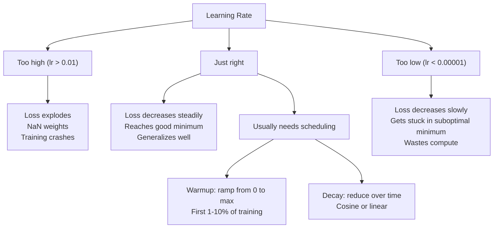
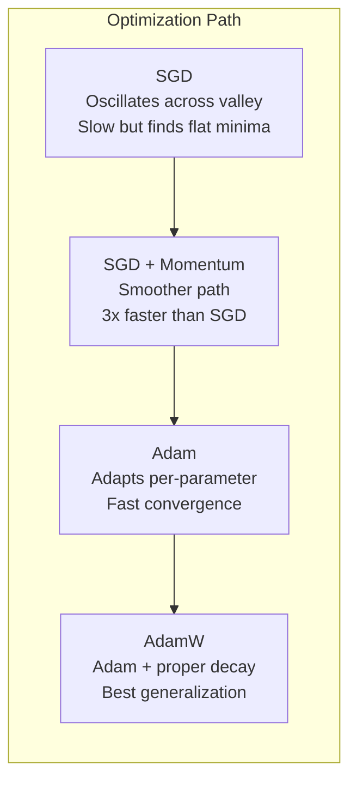
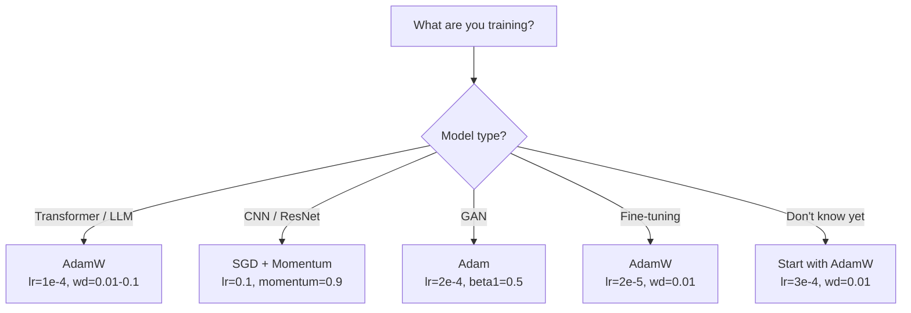

# Optimizers

> Hạ gradient cho bạn biết nên đi hướng nào. Nó không nói gì về đi bao xa hay nhanh đến mức nào. SGD là một la bàn. Adam là GPS có dữ liệu giao thông.

**Type:** Build
**Languages:** Python
**Prerequisites:** Lesson 03.05 (Loss Functions)
**Time:** ~75 minutes

## Learning Objectives

- Triển khai các bộ tối ưu hóa SGD, SGD với momentum, Adam và AdamW từ đầu bằng Python
- Giải thích cách hiệu chỉnh độ chệch của Adam bù cho các ước lượng moment được khởi tạo bằng không trong những bước huấn luyện đầu
- Chứng minh tại sao AdamW tạo ra khả năng khái quát hóa tốt hơn Adam với chính quy hóa L2 trên cùng tác vụ
- Chọn bộ tối ưu hóa phù hợp và các siêu tham số mặc định cho transformer, CNN, GAN và tinh chỉnh

## The Problem

Bạn đã tính các gradient. Bạn biết trọng số #4,721 nên giảm 0.003 để giảm mất mát. Nhưng 0.003 theo đơn vị nào? Được co giãn bởi gì? Và bạn có nên di chuyển cùng một lượng ở bước 1 như ở bước 1,000 không?

Hạ gradient nguyên bản áp dụng cùng tốc độ học cho mọi tham số ở mọi bước: $w = w - \text{lr} \cdot \text{gradient}$. Điều này tạo ra ba vấn đề khiến việc huấn luyện mạng nơ-ron khó nhọc trong thực tế.

Thứ nhất, dao động. Bề mặt mất mát hiếm khi có hình dạng như một cái bát trơn. Nó giống một thung lũng dài, hẹp hơn. Gradient chỉ ngang thung lũng (hướng dốc), không phải dọc theo nó (hướng thoải). Hạ gradient nảy qua lại theo chiều hẹp trong khi tiến rất ít theo chiều hữu ích. Bạn đã thấy điều này: mất mát giảm nhanh rồi chững lại, không phải vì mô hình hội tụ mà vì nó đang dao động.

Thứ hai, một tốc độ học cho tất cả các tham số là sai. Một số trọng số cần các cập nhật lớn (chúng ở giai đoạn đầu, khớp thiếu). Những trọng số khác cần các cập nhật rất nhỏ (chúng gần giá trị tối ưu). Một tốc độ học hoạt động cho nhóm trước phá hủy nhóm sau, và ngược lại.

Thứ ba, các điểm yên ngựa. Trong không gian nhiều chiều, bề mặt mất mát có các vùng phẳng rộng lớn nơi gradient gần bằng không. SGD nguyên bản bò qua chúng với tốc độ của gradient, về thực chất bằng không. Mô hình trông như bị kẹt. Nó không bị kẹt -- nó ở trong một vùng phẳng có hướng giảm hữu ích ở phía bên kia. Nhưng SGD không có cơ chế để đẩy xuyên qua.

Adam giải quyết cả ba. Nó duy trì hai trung bình tích lũy cho mỗi tham số -- gradient trung bình (momentum, xử lý dao động) và gradient bình phương trung bình (tốc độ thích nghi, xử lý các thang đo khác nhau). Kết hợp với hiệu chỉnh độ chệch cho vài bước đầu, nó cho bạn một bộ tối ưu hóa duy nhất hoạt động trên 80% bài toán với các siêu tham số mặc định. Bài học này xây dựng nó từ đầu để bạn hiểu chính xác khi nào và tại sao nó thất bại trên 20% còn lại.

## The Concept

### Stochastic Gradient Descent (SGD)

Bộ tối ưu hóa đơn giản nhất. Tính gradient trên một mini-batch và bước theo hướng ngược lại.

```math
w = w - \text{lr} \cdot \text{gradient}
```

"Ngẫu nhiên" nghĩa là bạn sử dụng một tập con ngẫu nhiên (mini-batch) của dữ liệu để ước lượng gradient, thay vì toàn bộ tập dữ liệu. Nhiễu này thực sự hữu ích -- nó giúp thoát các cực tiểu cục bộ sắc nhọn. Nhưng nhiễu cũng gây dao động.

Tốc độ học là núm điều chỉnh duy nhất. Quá cao: mất mát phân kỳ. Quá thấp: huấn luyện kéo dài mãi. Giá trị tối ưu phụ thuộc vào kiến trúc, dữ liệu, kích thước batch và giai đoạn huấn luyện hiện tại. Với SGD nguyên bản trên các mạng hiện đại, các giá trị điển hình nằm trong khoảng 0.01 đến 0.1. Nhưng ngay trong một lần huấn luyện, tốc độ học lý tưởng cũng thay đổi.

### Momentum

Phép ví von quả bóng lăn xuống dốc bị lạm dụng nhưng chính xác. Thay vì chỉ bước theo gradient, bạn duy trì một vận tốc tích lũy các gradient quá khứ.

```math
\begin{aligned}
m_t &= \beta \, m_{t-1} + \text{gradient} \\
w &= w - \text{lr} \cdot m_t
\end{aligned}
```

Beta (thường là 0.9) kiểm soát lượng lịch sử giữ lại. Với $\beta = 0.9$, momentum gần bằng trung bình của 10 gradient gần nhất ($1 / (1 - 0.9) = 10$).

Tại sao điều này khắc phục dao động: các gradient cùng hướng tích lũy. Các gradient đổi hướng triệt tiêu nhau. Trong thung lũng hẹp đó, thành phần "ngang" đổi dấu mỗi bước và bị giảm chấn. Thành phần "dọc" nhất quán và được khuếch đại. Kết quả là tăng tốc trơn tru theo hướng hữu ích.

Các con số thực tế: riêng SGD trên một bề mặt mất mát có điều kiện kém có thể cần 10,000 bước. SGD với momentum ($\beta = 0.9$) thường cần 3,000-5,000 bước trên cùng bài toán. Mức tăng tốc không hề nhỏ.

### RMSProp

Phương pháp tốc độ học thích nghi theo từng tham số đầu tiên thực sự hoạt động. Được Hinton đề xuất trong một bài giảng Coursera (chưa bao giờ được xuất bản chính thức).

```math
\begin{aligned}
s_t &= \beta \, s_{t-1} + (1 - \beta) \cdot \text{gradient}^2 \\
w &= w - \text{lr} \cdot \frac{\text{gradient}}{\sqrt{s_t} + \epsilon}
\end{aligned}
```

$s_t$ theo dõi trung bình tích lũy của các gradient bình phương. Các tham số có gradient lớn nhất quán được chia cho một số lớn (tốc độ học hiệu dụng nhỏ hơn). Các tham số có gradient nhỏ được chia cho một số nhỏ (tốc độ học hiệu dụng lớn hơn).

Điều này giải quyết vấn đề "một tốc độ học cho mọi tham số". Một trọng số đã nhận các cập nhật lớn có lẽ gần mục tiêu của nó -- làm nó chậm lại. Một trọng số đã nhận các cập nhật rất nhỏ có thể chưa được huấn luyện đủ -- tăng tốc nó.

Epsilon (thường là 1e-8) ngăn chia cho không khi một tham số chưa được cập nhật.

### Adam: Momentum + RMSProp

Adam kết hợp cả hai ý tưởng. Nó duy trì hai trung bình trượt hàm mũ cho mỗi tham số:

```math
\begin{aligned}
m_t &= \beta_1 m_{t-1} + (1 - \beta_1) \cdot \text{gradient} && \text{(first moment: mean)} \\
v_t &= \beta_2 v_{t-1} + (1 - \beta_2) \cdot \text{gradient}^2 && \text{(second moment: variance)}
\end{aligned}
```

**Hiệu chỉnh độ chệch** là chi tiết then chốt mà hầu hết lời giải thích bỏ qua. Ở bước 1, $m_1 = (1 - \beta_1) \cdot \text{gradient}$. Với $\beta_1 = 0.9$, đó là $0.1 \cdot \text{gradient}$ -- nhỏ hơn mười lần so với cần thiết. Trung bình trượt chưa khởi động xong. Hiệu chỉnh độ chệch bù lại:

```math
\begin{aligned}
\hat{m} &= \frac{m_t}{1 - \beta_1^t} \\
\hat{v} &= \frac{v_t}{1 - \beta_2^t}
\end{aligned}
```

Ở bước 1 với $\beta_1 = 0.9$: $\hat{m} = m_1 / (1 - 0.9) = m_1 / 0.1 =$ gradient thực tế. Ở bước 100: $(1 - 0.9^{100})$ xấp xỉ 1.0, nên hiệu chỉnh biến mất. Hiệu chỉnh độ chệch quan trọng trong ~10 bước đầu và không còn liên quan sau ~50.

Cập nhật:

```math
w = w - \text{lr} \cdot \frac{\hat{m}}{\sqrt{\hat{v}} + \epsilon}
```

Các mặc định Adam: $\text{lr} = 0.001$, $\beta_1 = 0.9$, $\beta_2 = 0.999$, $\epsilon = 10^{-8}$. Các mặc định này hoạt động cho 80% bài toán. Khi không hoạt động, thay đổi lr trước. Rồi $\beta_2$. Gần như không bao giờ thay đổi $\beta_1$ hoặc $\epsilon$.

### AdamW: Weight Decay Done Right

Chính quy hóa L2 thêm $\lambda w^2$ vào mất mát. Trong SGD nguyên bản, điều này tương đương weight decay (trừ $\lambda w$ khỏi trọng số ở mỗi bước). Trong Adam, sự tương đương này bị phá vỡ.

Nhận định của Loshchilov & Hutter: khi bạn thêm L2 vào mất mát rồi Adam xử lý gradient, tốc độ học thích nghi cũng co giãn số hạng chính quy hóa. Các tham số có phương sai gradient lớn nhận ít chính quy hóa hơn. Các tham số có phương sai nhỏ nhận nhiều hơn. Đây không phải điều bạn muốn -- bạn muốn chính quy hóa đồng đều bất kể thống kê gradient.

AdamW khắc phục điều này bằng cách áp dụng weight decay trực tiếp lên các trọng số, sau cập nhật Adam:

```math
w = w - \text{lr} \cdot \frac{\hat{m}}{\sqrt{\hat{v}} + \epsilon} - \text{lr} \cdot \lambda w
```

Số hạng weight decay ($\text{lr} \cdot \lambda w$) không được co giãn bởi hệ số thích nghi của Adam. Mỗi tham số nhận cùng mức co lại theo tỷ lệ.

Điều này có vẻ là một chi tiết nhỏ. Không phải vậy. AdamW hội tụ tới các nghiệm tốt hơn Adam + chính quy hóa L2 trên gần như mọi tác vụ. Nó là bộ tối ưu hóa mặc định trong PyTorch để huấn luyện transformer, mô hình khuếch tán và hầu hết các kiến trúc hiện đại. BERT, GPT, LLaMA, Stable Diffusion -- tất cả đều được huấn luyện với AdamW.

### Learning Rate: The Most Important Hyperparameter



Nếu bạn điều chỉnh một siêu tham số, hãy điều chỉnh tốc độ học. Một thay đổi gấp 10 lần tốc độ học quan trọng hơn bất kỳ quyết định kiến trúc nào bạn sẽ đưa ra. Các mặc định phổ biến:

- SGD: lr = 0.01 đến 0.1
- Adam/AdamW: lr = 1e-4 đến 3e-4
- Tinh chỉnh các mô hình được tiền huấn luyện: lr = 1e-5 đến 5e-5
- Warmup tốc độ học: tăng tuyến tính trong 1-10% số bước đầu

### Optimizer Comparison



### When Each Optimizer Wins



```figure
optimizer-trajectory
```

## Build It

### Step 1: Vanilla SGD

```python
class SGD:
    def __init__(self, lr=0.01):
        self.lr = lr

    def step(self, params, grads):
        for i in range(len(params)):
            params[i] -= self.lr * grads[i]
```

### Step 2: SGD with Momentum

```python
class SGDMomentum:
    def __init__(self, lr=0.01, beta=0.9):
        self.lr = lr
        self.beta = beta
        self.velocities = None

    def step(self, params, grads):
        if self.velocities is None:
            self.velocities = [0.0] * len(params)
        for i in range(len(params)):
            self.velocities[i] = self.beta * self.velocities[i] + grads[i]
            params[i] -= self.lr * self.velocities[i]
```

### Step 3: Adam

```python
import math

class Adam:
    def __init__(self, lr=0.001, beta1=0.9, beta2=0.999, epsilon=1e-8):
        self.lr = lr
        self.beta1 = beta1
        self.beta2 = beta2
        self.epsilon = epsilon
        self.m = None
        self.v = None
        self.t = 0

    def step(self, params, grads):
        if self.m is None:
            self.m = [0.0] * len(params)
            self.v = [0.0] * len(params)

        self.t += 1

        for i in range(len(params)):
            self.m[i] = self.beta1 * self.m[i] + (1 - self.beta1) * grads[i]
            self.v[i] = self.beta2 * self.v[i] + (1 - self.beta2) * grads[i] ** 2

            m_hat = self.m[i] / (1 - self.beta1 ** self.t)
            v_hat = self.v[i] / (1 - self.beta2 ** self.t)

            params[i] -= self.lr * m_hat / (math.sqrt(v_hat) + self.epsilon)
```

### Step 4: AdamW

```python
class AdamW:
    def __init__(self, lr=0.001, beta1=0.9, beta2=0.999, epsilon=1e-8, weight_decay=0.01):
        self.lr = lr
        self.beta1 = beta1
        self.beta2 = beta2
        self.epsilon = epsilon
        self.weight_decay = weight_decay
        self.m = None
        self.v = None
        self.t = 0

    def step(self, params, grads):
        if self.m is None:
            self.m = [0.0] * len(params)
            self.v = [0.0] * len(params)

        self.t += 1

        for i in range(len(params)):
            self.m[i] = self.beta1 * self.m[i] + (1 - self.beta1) * grads[i]
            self.v[i] = self.beta2 * self.v[i] + (1 - self.beta2) * grads[i] ** 2

            m_hat = self.m[i] / (1 - self.beta1 ** self.t)
            v_hat = self.v[i] / (1 - self.beta2 ** self.t)

            params[i] -= self.lr * m_hat / (math.sqrt(v_hat) + self.epsilon)
            params[i] -= self.lr * self.weight_decay * params[i]
```

### Step 5: Training Comparison

Huấn luyện cùng mạng hai lớp trên tập dữ liệu đường tròn từ bài 05 với cả bốn bộ tối ưu hóa. So sánh hội tụ.

```python
import random

def sigmoid(x):
    x = max(-500, min(500, x))
    return 1.0 / (1.0 + math.exp(-x))

def make_circle_data(n=200, seed=42):
    random.seed(seed)
    data = []
    for _ in range(n):
        x = random.uniform(-2, 2)
        y = random.uniform(-2, 2)
        label = 1.0 if x * x + y * y < 1.5 else 0.0
        data.append(([x, y], label))
    return data


class OptimizerTestNetwork:
    def __init__(self, optimizer, hidden_size=8):
        random.seed(0)
        self.hidden_size = hidden_size
        self.optimizer = optimizer

        self.w1 = [[random.gauss(0, 0.5) for _ in range(2)] for _ in range(hidden_size)]
        self.b1 = [0.0] * hidden_size
        self.w2 = [random.gauss(0, 0.5) for _ in range(hidden_size)]
        self.b2 = 0.0

    def get_params(self):
        params = []
        for row in self.w1:
            params.extend(row)
        params.extend(self.b1)
        params.extend(self.w2)
        params.append(self.b2)
        return params

    def set_params(self, params):
        idx = 0
        for i in range(self.hidden_size):
            for j in range(2):
                self.w1[i][j] = params[idx]
                idx += 1
        for i in range(self.hidden_size):
            self.b1[i] = params[idx]
            idx += 1
        for i in range(self.hidden_size):
            self.w2[i] = params[idx]
            idx += 1
        self.b2 = params[idx]

    def forward(self, x):
        self.x = x
        self.z1 = []
        self.h = []
        for i in range(self.hidden_size):
            z = self.w1[i][0] * x[0] + self.w1[i][1] * x[1] + self.b1[i]
            self.z1.append(z)
            self.h.append(max(0.0, z))

        self.z2 = sum(self.w2[i] * self.h[i] for i in range(self.hidden_size)) + self.b2
        self.out = sigmoid(self.z2)
        return self.out

    def compute_grads(self, target):
        eps = 1e-15
        p = max(eps, min(1 - eps, self.out))
        d_loss = -(target / p) + (1 - target) / (1 - p)
        d_sigmoid = self.out * (1 - self.out)
        d_out = d_loss * d_sigmoid

        grads = [0.0] * (self.hidden_size * 2 + self.hidden_size + self.hidden_size + 1)
        idx = 0
        for i in range(self.hidden_size):
            d_relu = 1.0 if self.z1[i] > 0 else 0.0
            d_h = d_out * self.w2[i] * d_relu
            grads[idx] = d_h * self.x[0]
            grads[idx + 1] = d_h * self.x[1]
            idx += 2

        for i in range(self.hidden_size):
            d_relu = 1.0 if self.z1[i] > 0 else 0.0
            grads[idx] = d_out * self.w2[i] * d_relu
            idx += 1

        for i in range(self.hidden_size):
            grads[idx] = d_out * self.h[i]
            idx += 1

        grads[idx] = d_out
        return grads

    def train(self, data, epochs=300):
        losses = []
        for epoch in range(epochs):
            total_loss = 0.0
            correct = 0
            for x, y in data:
                pred = self.forward(x)
                grads = self.compute_grads(y)
                params = self.get_params()
                self.optimizer.step(params, grads)
                self.set_params(params)

                eps = 1e-15
                p = max(eps, min(1 - eps, pred))
                total_loss += -(y * math.log(p) + (1 - y) * math.log(1 - p))
                if (pred >= 0.5) == (y >= 0.5):
                    correct += 1
            avg_loss = total_loss / len(data)
            accuracy = correct / len(data) * 100
            losses.append((avg_loss, accuracy))
            if epoch % 75 == 0 or epoch == epochs - 1:
                print(f"    Epoch {epoch:3d}: loss={avg_loss:.4f}, accuracy={accuracy:.1f}%")
        return losses
```

## Use It

Các bộ tối ưu hóa PyTorch xử lý các nhóm tham số, cắt gradient và lập lịch tốc độ học:

```python
import torch
import torch.optim as optim

model = torch.nn.Sequential(
    torch.nn.Linear(784, 256),
    torch.nn.ReLU(),
    torch.nn.Linear(256, 10),
)

optimizer = optim.AdamW(model.parameters(), lr=3e-4, weight_decay=0.01)

scheduler = optim.lr_scheduler.CosineAnnealingLR(optimizer, T_max=100)

for epoch in range(100):
    optimizer.zero_grad()
    output = model(torch.randn(32, 784))
    loss = torch.nn.functional.cross_entropy(output, torch.randint(0, 10, (32,)))
    loss.backward()
    torch.nn.utils.clip_grad_norm_(model.parameters(), max_norm=1.0)
    optimizer.step()
    scheduler.step()
```

Mẫu luôn là: zero_grad, forward, loss, backward, (clip), step, (schedule). Ghi nhớ thứ tự này. Làm sai (ví dụ: gọi scheduler.step() trước optimizer.step()) là nguồn lỗi tinh vi thường gặp.

Với CNN, nhiều người thực hành vẫn thích SGD + momentum (lr=0.1, momentum=0.9, weight_decay=1e-4) với lịch bậc thang hoặc cosine. SGD tìm các cực tiểu phẳng hơn, thường khái quát hóa tốt hơn. Với transformer và LLM, AdamW với warmup + suy giảm cosine là mặc định phổ quát. Đừng chống lại sự đồng thuận nếu không có lý do được đo lường.

## Ship It

Bài học này tạo ra:
- `outputs/prompt-optimizer-selector.md` -- một prompt quyết định để chọn bộ tối ưu hóa và tốc độ học phù hợp cho bất kỳ kiến trúc nào

## Exercises

1. Triển khai momentum Nesterov, trong đó bạn tính gradient tại vị trí "nhìn trước" ($w - \text{lr} \cdot \beta v$) thay vì vị trí hiện tại. So sánh hội tụ với momentum tiêu chuẩn trên tập dữ liệu đường tròn.

2. Triển khai một lịch warmup tốc độ học: tăng tuyến tính từ 0 tới max_lr trong 10% số bước huấn luyện đầu, rồi suy giảm cosine về 0. Huấn luyện với Adam + warmup so với Adam không có warmup. Đo số epoch cần để đạt accuracy 90% trên tập dữ liệu đường tròn.

3. Theo dõi tốc độ học hiệu dụng của mỗi tham số trong quá trình huấn luyện Adam. Tốc độ hiệu dụng là $\text{lr} \cdot \hat{m} / (\sqrt{\hat{v}} + \epsilon)$. Vẽ phân phối của các tốc độ hiệu dụng sau 10, 50 và 200 bước. Có phải mọi tham số đều được cập nhật với cùng tốc độ không?

4. Triển khai cắt gradient (cắt theo chuẩn toàn cục). Đặt chuẩn gradient tối đa là 1.0. Huấn luyện có và không cắt bằng một tốc độ học cao (lr=0.01 cho Adam). Đếm bao nhiêu lần chạy phân kỳ (mất mát thành NaN) khi có và không cắt trên 10 seed ngẫu nhiên.

5. So sánh Adam với AdamW trên một mạng có các trọng số lớn. Khởi tạo tất cả các trọng số thành các giá trị ngẫu nhiên trong [-5, 5] (lớn hơn bình thường nhiều). Huấn luyện trong 200 epoch với weight_decay=0.1. Vẽ chuẩn L2 của các trọng số trong quá trình huấn luyện cho cả hai bộ tối ưu hóa. AdamW nên cho thấy các trọng số co lại nhanh hơn.

## Key Terms

| Thuật ngữ | Cách mọi người nói | Ý nghĩa thực sự |
|------|----------------|----------------------|
| Learning rate (Tốc độ học) | "Kích thước bước" | Hệ số nhân vô hướng trên cập nhật gradient; siêu tham số có tác động lớn nhất trong huấn luyện |
| SGD | "Hạ gradient cơ bản" | Hạ gradient ngẫu nhiên: cập nhật trọng số bằng cách trừ $\text{lr} \cdot \text{gradient}$, được tính trên một mini-batch |
| Momentum | "Phép ví von quả bóng lăn" | Trung bình trượt hàm mũ của các gradient quá khứ; giảm chấn dao động và tăng tốc các hướng nhất quán |
| RMSProp | "Tốc độ học thích nghi" | Chia gradient của mỗi tham số cho RMS tích lũy của các gradient gần đây; cân bằng các tốc độ học |
| Adam | "Bộ tối ưu hóa mặc định" | Kết hợp momentum (moment bậc nhất) và RMSProp (moment bậc hai) với hiệu chỉnh độ chệch cho các bước đầu |
| AdamW | "Adam được làm đúng" | Adam với weight decay tách rời; áp dụng chính quy hóa trực tiếp lên các trọng số thay vì thông qua gradient |
| Bias correction (Hiệu chỉnh độ chệch) | "Warmup cho các trung bình tích lũy" | Chia cho $(1 - \beta^t)$ để bù cho việc khởi tạo bằng không các ước lượng moment của Adam |
| Weight decay | "Co các trọng số lại" | Trừ một phần giá trị trọng số ở mỗi bước; một cơ chế chính quy hóa phạt các trọng số lớn |
| Learning rate schedule (Lịch tốc độ học) | "Thay đổi lr theo thời gian" | Một hàm điều chỉnh tốc độ học trong quá trình huấn luyện; warmup + suy giảm cosine là mặc định hiện đại |
| Gradient clipping (Cắt gradient) | "Chặn chuẩn gradient" | Co nhỏ vector gradient khi chuẩn của nó vượt một ngưỡng; ngăn các cập nhật gradient bùng nổ |

## Further Reading

- Kingma & Ba, "Adam: A Method for Stochastic Optimization" (2014) -- bài báo Adam gốc với phân tích hội tụ và phép suy ra hiệu chỉnh độ chệch
- Loshchilov & Hutter, "Decoupled Weight Decay Regularization" (2017) -- chứng minh chính quy hóa L2 và weight decay không tương đương trong Adam, và đề xuất AdamW
- Smith, "Cyclical Learning Rates for Training Neural Networks" (2017) -- giới thiệu phép kiểm tra phạm vi LR và các lịch tuần hoàn loại bỏ nhu cầu điều chỉnh một tốc độ học cố định
- Ruder, "An Overview of Gradient Descent Optimization Algorithms" (2016) -- khảo sát đơn lẻ tốt nhất về tất cả các biến thể bộ tối ưu hóa, với các so sánh và trực giác rõ ràng
