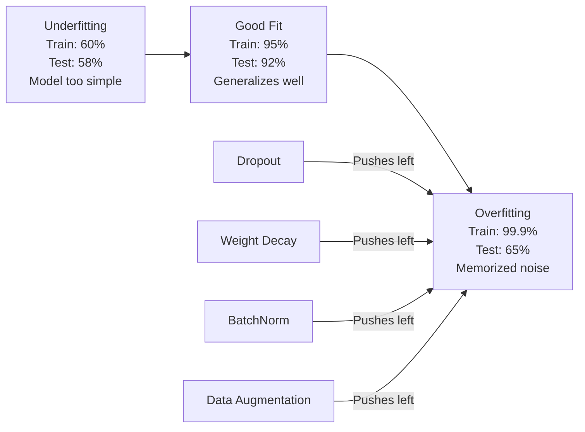
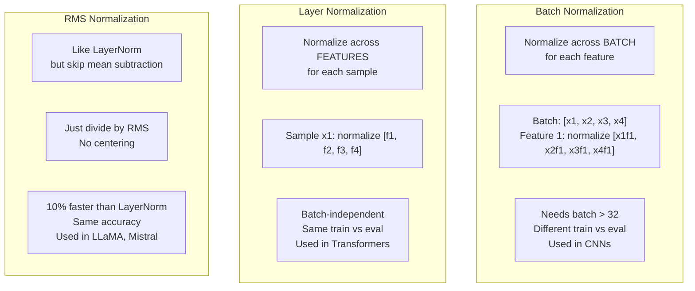
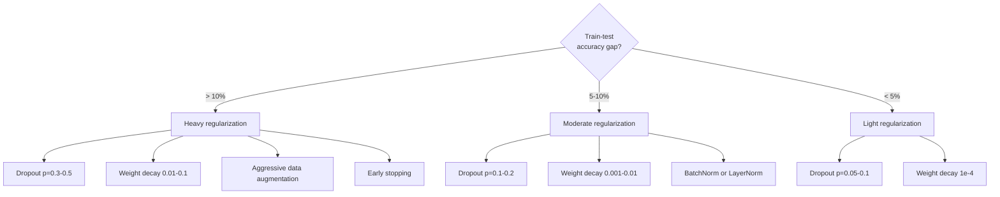

# Regularization

> Mô hình của bạn đạt 99% trên dữ liệu huấn luyện và 60% trên dữ liệu test. Nó ghi nhớ thay vì học. Chính quy hóa là khoản thuế bạn áp lên độ phức tạp để buộc khái quát hóa.

**Type:** Build
**Languages:** Python
**Prerequisites:** Lesson 03.06 (Optimizers)
**Time:** ~75 minutes

## Learning Objectives

- Triển khai dropout với co giãn đảo ngược, weight decay L2, batch normalization, layer normalization và RMSNorm từ đầu
- Đo khoảng cách accuracy giữa huấn luyện và test, và chẩn đoán quá khớp bằng các thí nghiệm chính quy hóa
- Giải thích tại sao transformer sử dụng LayerNorm thay vì BatchNorm và tại sao các LLM hiện đại thích RMSNorm
- Áp dụng tổ hợp kỹ thuật chính quy hóa đúng dựa trên mức độ nghiêm trọng của quá khớp

## The Problem

Một mạng nơ-ron có đủ tham số có thể ghi nhớ bất kỳ tập dữ liệu nào. Đây không phải giả thuyết -- Zhang và cộng sự (2017) đã chứng minh bằng cách huấn luyện các mạng tiêu chuẩn trên ImageNet với các nhãn ngẫu nhiên. Các mạng đạt mất mát huấn luyện gần bằng không trên các cách gán nhãn hoàn toàn ngẫu nhiên. Chúng ghi nhớ một triệu cặp đầu vào-đầu ra ngẫu nhiên mà không có mẫu nào để học. Mất mát huấn luyện hoàn hảo. Accuracy test bằng không.

Đây là vấn đề quá khớp, và nó tệ hơn khi các mô hình lớn hơn. GPT-3 có 175 tỷ tham số. Tập huấn luyện có khoảng 500 tỷ token. Với từng ấy tham số, mô hình có đủ năng lực để ghi nhớ nguyên văn các phần đáng kể của dữ liệu huấn luyện. Không có chính quy hóa, nó sẽ chỉ nhắc lại các ví dụ huấn luyện thay vì học các mẫu có thể khái quát hóa.

Khoảng cách giữa hiệu suất huấn luyện và hiệu suất test là khoảng cách quá khớp. Mỗi kỹ thuật trong bài học này tấn công khoảng cách đó từ một góc khác nhau. Dropout buộc mạng không dựa vào bất kỳ nơ-ron đơn lẻ nào. Weight decay ngăn bất kỳ trọng số đơn lẻ nào tăng quá lớn. Batch normalization làm trơn bề mặt mất mát để bộ tối ưu hóa tìm các cực tiểu phẳng hơn, có thể khái quát hóa hơn. Layer normalization làm cùng việc nhưng hoạt động ở nơi batch normalization thất bại (các batch nhỏ, các chuỗi độ dài thay đổi). RMSNorm làm nhanh hơn 10% bằng cách bỏ tính trung bình. Mỗi kỹ thuật đều đơn giản. Cùng nhau, chúng tạo ra khác biệt giữa một mô hình ghi nhớ và một mô hình khái quát hóa.

## The Concept

### The Overfitting Spectrum

Mỗi mô hình nằm ở đâu đó trên một phổ từ khớp thiếu (quá đơn giản để nắm bắt mẫu) tới quá khớp (phức tạp tới mức nắm bắt nhiễu). Điểm phù hợp nằm ở giữa, và chính quy hóa đẩy các mô hình về phía đó từ phía quá khớp.



### Dropout

Kỹ thuật chính quy hóa đơn giản nhất với cách diễn giải thanh nhã nhất. Trong huấn luyện, đặt ngẫu nhiên đầu ra mỗi nơ-ron bằng không với xác suất $p$.

```math
\text{output} = \text{activation}(z) \cdot \text{mask} \quad \text{where }\text{mask}[i] \sim \text{Bernoulli}(1 - p)
```

Với $p = 0.5$, một nửa số nơ-ron được đưa về không trong mỗi lượt truyền xuôi. Mạng phải học các biểu diễn dư thừa vì nó không thể dự đoán những nơ-ron nào sẽ sẵn có. Điều này ngăn đồng thích nghi -- các nơ-ron học cách dựa vào sự hiện diện của những nơ-ron cụ thể khác.

Cách diễn giải ensemble: một mạng có $N$ nơ-ron và dropout tạo ra $2^N$ mạng con có thể (mọi tổ hợp nơ-ron bật hay tắt). Huấn luyện với dropout xấp xỉ huấn luyện đồng thời tất cả $2^N$ mạng con, mỗi mạng trên các mini-batch khác nhau. Khi test, bạn sử dụng tất cả nơ-ron (không dropout) và co giãn các đầu ra theo $(1 - p)$ để khớp giá trị kỳ vọng trong huấn luyện. Điều này tương đương lấy trung bình các dự đoán của $2^N$ mạng con -- một ensemble khổng lồ từ một mô hình duy nhất.

Trong thực tế, phép co giãn được áp dụng khi huấn luyện thay vì test (dropout đảo ngược):

```math
\begin{aligned}
\text{During training:} \quad & \text{output} = \text{activation}(z) \cdot \text{mask} / (1 - p) \\
\text{During testing:} \quad & \text{output} = \text{activation}(z) \quad \text{(no change needed)}
\end{aligned}
```

Cách này gọn hơn vì mã test không cần biết gì về dropout.

Các tỷ lệ mặc định: p = 0.1 cho transformer, p = 0.5 cho MLP, p = 0.2-0.3 cho CNN. Dropout cao hơn = chính quy hóa mạnh hơn = nguy cơ khớp thiếu cao hơn.

### Weight Decay (L2 Regularization)

Thêm độ lớn bình phương của tất cả trọng số vào mất mát:

```math
\text{total\_loss} = \text{task\_loss} + \frac{\lambda}{2} \sum_i w_i^2
```

Gradient của số hạng chính quy hóa là $\lambda w$. Điều này nghĩa là ở mỗi bước, mỗi trọng số co về không một phần tỷ lệ với độ lớn của nó. Các trọng số lớn bị phạt nhiều hơn. Mô hình được đẩy về các nghiệm mà không trọng số đơn lẻ nào chi phối.

Tại sao điều này giúp khái quát hóa: các mô hình quá khớp có xu hướng có trọng số lớn khuếch đại nhiễu trong dữ liệu huấn luyện. Weight decay giữ các trọng số nhỏ, giới hạn năng lực hiệu dụng của mô hình và buộc nó dựa vào các đặc trưng vững, có thể khái quát hóa thay vì những đặc điểm riêng đã ghi nhớ.

Siêu tham số $\lambda$ kiểm soát độ mạnh. Các giá trị điển hình:

- 0.01 cho AdamW trên transformer
- 1e-4 cho SGD trên CNN
- 0.1 cho các mô hình quá khớp nặng

Như đã thảo luận trong bài 06: weight decay và chính quy hóa L2 tương đương trong SGD nhưng không trong Adam. Luôn sử dụng AdamW (weight decay tách rời) khi huấn luyện với Adam.

### Batch Normalization

Chuẩn hóa đầu ra mỗi lớp trên toàn mini-batch trước khi đưa nó tới lớp tiếp theo.

Với một mini-batch các kích hoạt tại một lớp nào đó:

```math
\begin{aligned}
\mu &= \frac{1}{B} \sum_i x_i && \text{(batch mean)} \\
\sigma^2 &= \frac{1}{B} \sum_i (x_i - \mu)^2 && \text{(batch variance)} \\
\hat{x} &= \frac{x_i - \mu}{\sqrt{\sigma^2 + \epsilon}} && \text{(normalize)} \\
y &= \gamma \hat{x} + \beta && \text{(scale and shift)}
\end{aligned}
```

Gamma và beta là các tham số có thể học cho phép mạng hoàn tác chuẩn hóa nếu điều đó tối ưu. Không có chúng, bạn sẽ buộc đầu ra mọi lớp có trung bình bằng không và phương sai đơn vị, điều có thể không phải là điều mạng muốn.

**Phân tách huấn luyện và suy luận:** Trong huấn luyện, $\mu$ và $\sigma$ đến từ mini-batch hiện tại. Trong suy luận, bạn sử dụng các trung bình tích lũy được thu thập trong huấn luyện (trung bình trượt hàm mũ với momentum = 0.1, nghĩa là 90% cũ + 10% mới).

Tại sao BatchNorm hoạt động vẫn còn được tranh luận. Bài báo gốc tuyên bố nó giảm "dịch chuyển đồng biến nội bộ" (phân phối các đầu vào lớp thay đổi khi các lớp trước cập nhật). Santurkar và cộng sự (2018) cho thấy lời giải thích này sai. Lý do thực sự: BatchNorm làm bề mặt mất mát trơn hơn. Các gradient có tính dự báo cao hơn, các hằng số Lipschitz nhỏ hơn, và bộ tối ưu hóa có thể bước lớn hơn một cách an toàn. Đây là lý do BatchNorm cho phép bạn sử dụng các tốc độ học cao hơn và hội tụ nhanh hơn.

BatchNorm có một giới hạn cơ bản: nó phụ thuộc vào thống kê batch. Với kích thước batch 1, trung bình và phương sai vô nghĩa. Với các batch nhỏ (< 32), các thống kê nhiễu và làm hại hiệu suất. Điều này quan trọng cho các tác vụ như phát hiện đối tượng (nơi bộ nhớ giới hạn kích thước batch) và mô hình hóa ngôn ngữ (nơi độ dài chuỗi thay đổi).

### Layer Normalization

Chuẩn hóa trên các đặc trưng thay vì trên batch. Với một mẫu đơn lẻ:

```math
\begin{aligned}
\mu &= \frac{1}{D} \sum_j x_j && \text{(feature mean)} \\
\sigma^2 &= \frac{1}{D} \sum_j (x_j - \mu)^2 && \text{(feature variance)} \\
\hat{x} &= \frac{x_j - \mu}{\sqrt{\sigma^2 + \epsilon}} \\
y &= \gamma \hat{x} + \beta
\end{aligned}
```

$D$ là số chiều đặc trưng. Mỗi mẫu được chuẩn hóa độc lập -- không phụ thuộc kích thước batch. Đây là lý do transformer sử dụng LayerNorm thay vì BatchNorm. Các chuỗi có độ dài thay đổi, kích thước batch thường nhỏ (hoặc 1 khi sinh), và tính toán giống hệt giữa huấn luyện và suy luận.

LayerNorm trong transformer được áp dụng sau mỗi khối self-attention và mỗi khối feed-forward (Post-LN), hoặc trước chúng (Pre-LN, ổn định hơn cho huấn luyện).

### RMSNorm

LayerNorm không có phép trừ trung bình. Được Zhang & Sennrich (2019) đề xuất.

```math
\begin{aligned}
\text{rms} &= \sqrt{\frac{1}{D} \sum_j x_j^2} \\
y &= \gamma \cdot \frac{x}{\text{rms}}
\end{aligned}
```

Chỉ vậy thôi. Không tính trung bình, không tham số beta. Quan sát: việc đặt lại tâm (trừ trung bình) trong LayerNorm đóng góp rất ít vào hiệu suất mô hình, nhưng tốn tính toán. Loại bỏ nó cho cùng accuracy với chi phí phụ ít hơn khoảng 10%.

LLaMA, LLaMA 2, LLaMA 3, Mistral và hầu hết các LLM hiện đại sử dụng RMSNorm thay vì LayerNorm. Ở quy mô hàng tỷ tham số và hàng nghìn tỷ token, mức tiết kiệm 10% đó là đáng kể.

### Normalization Comparison



### Data Augmentation as Regularization

Không phải sửa đổi mô hình mà là sửa đổi dữ liệu. Biến đổi các đầu vào huấn luyện trong khi giữ nguyên nhãn:

- Hình ảnh: cắt ngẫu nhiên, lật, xoay, làm nhiễu màu, cắt bỏ
- Văn bản: thay từ đồng nghĩa, dịch ngược, xóa ngẫu nhiên
- Âm thanh: kéo giãn thời gian, dịch cao độ, thêm nhiễu

Hiệu ứng giống hệt chính quy hóa: nó tăng kích thước hiệu dụng của tập huấn luyện, khiến mô hình khó ghi nhớ các ví dụ cụ thể hơn. Một mô hình chỉ thấy mỗi hình ảnh một lần ở dạng gốc có thể ghi nhớ nó. Một mô hình thấy 50 phiên bản tăng cường của mỗi hình ảnh bị buộc phải học cấu trúc bất biến.

### Early Stopping

Cơ chế chính quy hóa đơn giản nhất: dừng huấn luyện khi mất mát validation bắt đầu tăng. Mô hình chưa quá khớp tại thời điểm đó. Trong thực tế, bạn theo dõi mất mát validation mỗi epoch, lưu mô hình tốt nhất và tiếp tục huấn luyện trong một cửa sổ "kiên nhẫn" (thường 5-20 epoch). Nếu mất mát validation không cải thiện trong cửa sổ kiên nhẫn, bạn dừng và tải mô hình tốt nhất đã lưu.

### When to Apply What



```figure
l2-regularization
```

## Build It

### Step 1: Dropout (Train and Eval Mode)

```python
import random
import math


class Dropout:
    def __init__(self, p=0.5):
        self.p = p
        self.training = True
        self.mask = None

    def forward(self, x):
        if not self.training:
            return list(x)
        self.mask = []
        output = []
        for val in x:
            if random.random() < self.p:
                self.mask.append(0)
                output.append(0.0)
            else:
                self.mask.append(1)
                output.append(val / (1 - self.p))
        return output

    def backward(self, grad_output):
        grads = []
        for g, m in zip(grad_output, self.mask):
            if m == 0:
                grads.append(0.0)
            else:
                grads.append(g / (1 - self.p))
        return grads
```

### Step 2: L2 Weight Decay

```python
def l2_regularization(weights, lambda_reg):
    penalty = 0.0
    for w in weights:
        penalty += w * w
    return lambda_reg * 0.5 * penalty

def l2_gradient(weights, lambda_reg):
    return [lambda_reg * w for w in weights]
```

### Step 3: Batch Normalization

```python
class BatchNorm:
    def __init__(self, num_features, momentum=0.1, eps=1e-5):
        self.gamma = [1.0] * num_features
        self.beta = [0.0] * num_features
        self.eps = eps
        self.momentum = momentum
        self.running_mean = [0.0] * num_features
        self.running_var = [1.0] * num_features
        self.training = True
        self.num_features = num_features

    def forward(self, batch):
        batch_size = len(batch)
        if self.training:
            mean = [0.0] * self.num_features
            for sample in batch:
                for j in range(self.num_features):
                    mean[j] += sample[j]
            mean = [m / batch_size for m in mean]

            var = [0.0] * self.num_features
            for sample in batch:
                for j in range(self.num_features):
                    var[j] += (sample[j] - mean[j]) ** 2
            var = [v / batch_size for v in var]

            for j in range(self.num_features):
                self.running_mean[j] = (1 - self.momentum) * self.running_mean[j] + self.momentum * mean[j]
                self.running_var[j] = (1 - self.momentum) * self.running_var[j] + self.momentum * var[j]
        else:
            mean = list(self.running_mean)
            var = list(self.running_var)

        self.x_hat = []
        output = []
        for sample in batch:
            normalized = []
            out_sample = []
            for j in range(self.num_features):
                x_h = (sample[j] - mean[j]) / math.sqrt(var[j] + self.eps)
                normalized.append(x_h)
                out_sample.append(self.gamma[j] * x_h + self.beta[j])
            self.x_hat.append(normalized)
            output.append(out_sample)
        return output
```

### Step 4: Layer Normalization

```python
class LayerNorm:
    def __init__(self, num_features, eps=1e-5):
        self.gamma = [1.0] * num_features
        self.beta = [0.0] * num_features
        self.eps = eps
        self.num_features = num_features

    def forward(self, x):
        mean = sum(x) / len(x)
        var = sum((xi - mean) ** 2 for xi in x) / len(x)

        self.x_hat = []
        output = []
        for j in range(self.num_features):
            x_h = (x[j] - mean) / math.sqrt(var + self.eps)
            self.x_hat.append(x_h)
            output.append(self.gamma[j] * x_h + self.beta[j])
        return output
```

### Step 5: RMSNorm

```python
class RMSNorm:
    def __init__(self, num_features, eps=1e-6):
        self.gamma = [1.0] * num_features
        self.eps = eps
        self.num_features = num_features

    def forward(self, x):
        rms = math.sqrt(sum(xi * xi for xi in x) / len(x) + self.eps)
        output = []
        for j in range(self.num_features):
            output.append(self.gamma[j] * x[j] / rms)
        return output
```

### Step 6: Training With and Without Regularization

```python
def sigmoid(x):
    x = max(-500, min(500, x))
    return 1.0 / (1.0 + math.exp(-x))


def make_circle_data(n=200, seed=42):
    random.seed(seed)
    data = []
    for _ in range(n):
        x = random.uniform(-2, 2)
        y = random.uniform(-2, 2)
        label = 1.0 if x * x + y * y < 1.5 else 0.0
        data.append(([x, y], label))
    return data


class RegularizedNetwork:
    def __init__(self, hidden_size=16, lr=0.05, dropout_p=0.0, weight_decay=0.0):
        random.seed(0)
        self.hidden_size = hidden_size
        self.lr = lr
        self.dropout_p = dropout_p
        self.weight_decay = weight_decay
        self.dropout = Dropout(p=dropout_p) if dropout_p > 0 else None

        self.w1 = [[random.gauss(0, 0.5) for _ in range(2)] for _ in range(hidden_size)]
        self.b1 = [0.0] * hidden_size
        self.w2 = [random.gauss(0, 0.5) for _ in range(hidden_size)]
        self.b2 = 0.0

    def forward(self, x, training=True):
        self.x = x
        self.z1 = []
        self.h = []
        for i in range(self.hidden_size):
            z = self.w1[i][0] * x[0] + self.w1[i][1] * x[1] + self.b1[i]
            self.z1.append(z)
            self.h.append(max(0.0, z))

        if self.dropout and training:
            self.dropout.training = True
            self.h = self.dropout.forward(self.h)
        elif self.dropout:
            self.dropout.training = False
            self.h = self.dropout.forward(self.h)

        self.z2 = sum(self.w2[i] * self.h[i] for i in range(self.hidden_size)) + self.b2
        self.out = sigmoid(self.z2)
        return self.out

    def backward(self, target):
        eps = 1e-15
        p = max(eps, min(1 - eps, self.out))
        d_loss = -(target / p) + (1 - target) / (1 - p)
        d_sigmoid = self.out * (1 - self.out)
        d_out = d_loss * d_sigmoid

        for i in range(self.hidden_size):
            d_relu = 1.0 if self.z1[i] > 0 else 0.0
            d_h = d_out * self.w2[i] * d_relu
            self.w2[i] -= self.lr * (d_out * self.h[i] + self.weight_decay * self.w2[i])
            for j in range(2):
                self.w1[i][j] -= self.lr * (d_h * self.x[j] + self.weight_decay * self.w1[i][j])
            self.b1[i] -= self.lr * d_h
        self.b2 -= self.lr * d_out

    def evaluate(self, data):
        correct = 0
        total_loss = 0.0
        for x, y in data:
            pred = self.forward(x, training=False)
            eps = 1e-15
            p = max(eps, min(1 - eps, pred))
            total_loss += -(y * math.log(p) + (1 - y) * math.log(1 - p))
            if (pred >= 0.5) == (y >= 0.5):
                correct += 1
        return total_loss / len(data), correct / len(data) * 100

    def train_model(self, train_data, test_data, epochs=300):
        history = []
        for epoch in range(epochs):
            total_loss = 0.0
            correct = 0
            for x, y in train_data:
                pred = self.forward(x, training=True)
                self.backward(y)
                eps = 1e-15
                p = max(eps, min(1 - eps, pred))
                total_loss += -(y * math.log(p) + (1 - y) * math.log(1 - p))
                if (pred >= 0.5) == (y >= 0.5):
                    correct += 1
            train_loss = total_loss / len(train_data)
            train_acc = correct / len(train_data) * 100
            test_loss, test_acc = self.evaluate(test_data)
            history.append((train_loss, train_acc, test_loss, test_acc))
            if epoch % 75 == 0 or epoch == epochs - 1:
                gap = train_acc - test_acc
                print(f"    Epoch {epoch:3d}: train_acc={train_acc:.1f}%, test_acc={test_acc:.1f}%, gap={gap:.1f}%")
        return history
```

## Use It

PyTorch cung cấp tất cả các cơ chế chuẩn hóa và chính quy hóa dưới dạng module:

```python
import torch
import torch.nn as nn

model = nn.Sequential(
    nn.Linear(784, 256),
    nn.BatchNorm1d(256),
    nn.ReLU(),
    nn.Dropout(0.3),
    nn.Linear(256, 128),
    nn.BatchNorm1d(128),
    nn.ReLU(),
    nn.Dropout(0.3),
    nn.Linear(128, 10),
)

model.train()
out_train = model(torch.randn(32, 784))

model.eval()
out_test = model(torch.randn(1, 784))
```

Chuyển đổi `model.train()` / `model.eval()` rất quan trọng. Nó bật/tắt dropout và cho BatchNorm biết sử dụng thống kê batch hay thống kê tích lũy. Quên `model.eval()` trước suy luận là một trong các lỗi thường gặp nhất trong học sâu. Accuracy test của bạn sẽ dao động ngẫu nhiên vì dropout vẫn hoạt động và BatchNorm đang sử dụng thống kê mini-batch.

Với transformer, mẫu khác đi:

```python
class TransformerBlock(nn.Module):
    def __init__(self, d_model=512, nhead=8, dropout=0.1):
        super().__init__()
        self.attention = nn.MultiheadAttention(d_model, nhead, dropout=dropout)
        self.norm1 = nn.LayerNorm(d_model)
        self.ff = nn.Sequential(
            nn.Linear(d_model, d_model * 4),
            nn.GELU(),
            nn.Linear(d_model * 4, d_model),
            nn.Dropout(dropout),
        )
        self.norm2 = nn.LayerNorm(d_model)
        self.dropout = nn.Dropout(dropout)

    def forward(self, x):
        attended, _ = self.attention(x, x, x)
        x = self.norm1(x + self.dropout(attended))
        x = self.norm2(x + self.ff(x))
        return x
```

LayerNorm, không phải BatchNorm. Dropout p=0.1, không phải p=0.5. Đây là các mặc định transformer.

## Ship It

Bài học này tạo ra:
- `outputs/prompt-regularization-advisor.md` -- một prompt chẩn đoán quá khớp và khuyến nghị chiến lược chính quy hóa phù hợp

## Exercises

1. Triển khai dropout không gian cho dữ liệu 2D: thay vì bỏ các nơ-ron riêng lẻ, bỏ toàn bộ các kênh đặc trưng. Mô phỏng điều này bằng cách coi các nhóm đặc trưng liên tiếp là các kênh và bỏ nguyên nhóm. So sánh khoảng cách huấn luyện-test với dropout tiêu chuẩn trên tập dữ liệu đường tròn có hidden_size=32.

2. Triển khai làm trơn nhãn từ bài 05 kết hợp với dropout từ bài này. Huấn luyện với bốn cấu hình: không có cả hai, chỉ dropout, chỉ làm trơn nhãn, cả hai. Đo khoảng cách accuracy huấn luyện-test cuối cùng cho mỗi cấu hình. Tổ hợp nào cho khoảng cách nhỏ nhất?

3. Thêm một lớp BatchNorm giữa lớp ẩn và kích hoạt trong mạng tập dữ liệu đường tròn của bạn. Huấn luyện có và không có BatchNorm ở các tốc độ học 0.01, 0.05 và 0.1. BatchNorm nên cho phép huấn luyện ổn định ở các tốc độ học cao hơn mà mạng nguyên bản phân kỳ.

4. Triển khai dừng sớm: theo dõi mất mát test mỗi epoch, lưu các trọng số tốt nhất và dừng nếu mất mát test không cải thiện trong 20 epoch. Chạy mạng được chính quy hóa trong 1000 epoch. Báo cáo epoch nào có accuracy test tốt nhất và bạn tiết kiệm được bao nhiêu epoch tính toán.

5. So sánh LayerNorm với RMSNorm trên một mạng 4 lớp (không chỉ 2). Khởi tạo cả hai với cùng các trọng số. Huấn luyện trong 200 epoch và so sánh accuracy cuối cùng, tốc độ huấn luyện (thời gian mỗi epoch) và độ lớn gradient ở lớp đầu tiên. Xác minh RMSNorm nhanh hơn với cùng accuracy.

## Key Terms

| Thuật ngữ | Cách mọi người nói | Ý nghĩa thực sự |
|------|----------------|----------------------|
| Overfitting (Quá khớp) | "Mô hình ghi nhớ dữ liệu" | Khi hiệu suất huấn luyện của mô hình vượt đáng kể hiệu suất test, cho thấy nó học nhiễu thay vì tín hiệu |
| Regularization (Chính quy hóa) | "Ngăn quá khớp" | Bất kỳ kỹ thuật nào ràng buộc độ phức tạp mô hình để cải thiện khái quát hóa: dropout, weight decay, chuẩn hóa, tăng cường |
| Dropout | "Xóa nơ-ron ngẫu nhiên" | Đưa các nơ-ron ngẫu nhiên về không trong huấn luyện với xác suất $p$, buộc các biểu diễn dư thừa; tương đương huấn luyện một ensemble |
| Weight decay | "Hình phạt L2" | Co tất cả các trọng số về không bằng cách trừ $\lambda w$ ở mỗi bước; phạt độ phức tạp thông qua độ lớn trọng số |
| Batch normalization | "Chuẩn hóa theo batch" | Chuẩn hóa các đầu ra lớp trên chiều batch bằng thống kê batch trong huấn luyện và các trung bình tích lũy trong suy luận |
| Layer normalization | "Chuẩn hóa theo mẫu" | Chuẩn hóa trên các đặc trưng trong mỗi mẫu; độc lập với batch, được sử dụng trong transformer nơi kích thước batch thay đổi |
| RMSNorm | "LayerNorm không có trung bình" | Chuẩn hóa căn trung bình bình phương; bỏ phép trừ trung bình khỏi LayerNorm để tăng tốc 10% với accuracy tương đương |
| Early stopping (Dừng sớm) | "Dừng trước khi quá khớp" | Dừng huấn luyện khi mất mát validation ngừng cải thiện; cơ chế chính quy hóa đơn giản nhất, thường được dùng cùng các cơ chế khác |
| Data augmentation (Tăng cường dữ liệu) | "Nhiều dữ liệu hơn từ ít dữ liệu" | Biến đổi các đầu vào huấn luyện (lật, cắt, nhiễu) để tăng kích thước tập dữ liệu hiệu dụng và buộc học tính bất biến |
| Generalization gap (Khoảng cách khái quát hóa) | "Chia huấn luyện-test" | Khác biệt giữa hiệu suất huấn luyện và test; chính quy hóa nhắm tới tối thiểu hóa khoảng cách này |

## Further Reading

- Srivastava et al., "Dropout: A Simple Way to Prevent Neural Networks from Overfitting" (2014) -- bài báo dropout gốc với cách diễn giải ensemble và các thí nghiệm sâu rộng
- Ioffe & Szegedy, "Batch Normalization: Accelerating Deep Network Training by Reducing Internal Covariate Shift" (2015) -- giới thiệu BatchNorm và quy trình huấn luyện của nó, một trong các bài báo học sâu được trích dẫn nhiều nhất
- Zhang & Sennrich, "Root Mean Square Layer Normalization" (2019) -- cho thấy RMSNorm khớp accuracy của LayerNorm với tính toán giảm; được LLaMA và Mistral áp dụng
- Zhang et al., "Understanding Deep Learning Requires Rethinking Generalization" (2017) -- bài báo cột mốc cho thấy mạng nơ-ron có thể ghi nhớ các nhãn ngẫu nhiên, thách thức các quan điểm truyền thống về khái quát hóa
