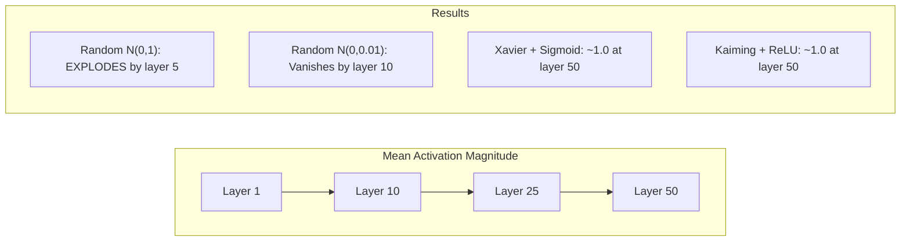
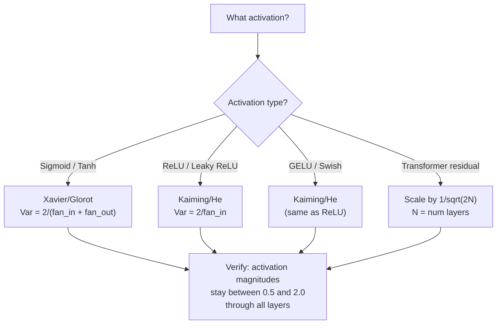

# Weight Initialization and Training Stability

> Khởi tạo sai và huấn luyện không bao giờ bắt đầu. Khởi tạo đúng và 50 lớp huấn luyện trơn tru như 3.

**Type:** Build
**Languages:** Python
**Prerequisites:** Lesson 03.04 (Activation Functions), Lesson 03.07 (Regularization)
**Time:** ~90 minutes

## Learning Objectives

- Triển khai các chiến lược khởi tạo bằng không, ngẫu nhiên, Xavier/Glorot và Kaiming/He, và đo tác động của chúng lên độ lớn kích hoạt qua 50 lớp
- Suy ra tại sao khởi tạo Xavier sử dụng Var(w) = 2/(fan_in + fan_out) và Kaiming sử dụng Var(w) = 2/fan_in
- Minh họa vấn đề đối xứng với khởi tạo bằng không và giải thích tại sao chỉ thang đo ngẫu nhiên là chưa đủ
- Ghép chiến lược khởi tạo đúng với hàm kích hoạt: Xavier cho sigmoid/tanh, Kaiming cho ReLU/GELU

## The Problem

Khởi tạo tất cả các trọng số bằng không. Không gì học được. Mỗi nơ-ron tính cùng một hàm, nhận cùng một gradient và cập nhật giống hệt nhau. Sau 10,000 epoch, lớp ẩn 512 nơ-ron của bạn vẫn là 512 bản sao của cùng một nơ-ron. Bạn trả tiền cho 512 tham số và nhận được 1.

Khởi tạo chúng quá lớn. Các kích hoạt bùng nổ qua mạng. Đến lớp 10, các giá trị đạt 1e15. Đến lớp 20, chúng tràn tới vô cực. Các gradient đi theo cùng quỹ đạo theo chiều ngược lại.

Khởi tạo chúng ngẫu nhiên từ một phân phối chuẩn tắc. Hoạt động cho 3 lớp. Ở 50 lớp, tín hiệu sụp về không hoặc nổ tới vô cực tùy thang đo ngẫu nhiên hơi quá nhỏ hay hơi quá lớn. Ranh giới giữa "hoạt động" và "hỏng" mỏng như lưỡi dao.

Khởi tạo trọng số là quyết định bị đánh giá thấp nhất trong học sâu. Kiến trúc có các bài báo. Bộ tối ưu hóa có các bài blog. Khởi tạo có một chú thích chân trang. Nhưng làm sai và không gì khác còn quan trọng -- mạng của bạn chết trước khi huấn luyện bắt đầu.

## The Concept

### The Symmetry Problem

Mỗi nơ-ron trong một lớp có cùng cấu trúc: nhân các đầu vào với trọng số, cộng bias, áp dụng kích hoạt. Nếu tất cả các trọng số bắt đầu ở cùng giá trị (không là trường hợp cực đoan), mỗi nơ-ron tính cùng đầu ra. Trong lan truyền ngược, mỗi nơ-ron nhận cùng gradient. Trong bước cập nhật, mỗi nơ-ron thay đổi cùng một lượng.

Bạn bị kẹt. Mạng có hàng trăm tham số, nhưng tất cả di chuyển đồng bộ. Điều này được gọi là đối xứng, và khởi tạo ngẫu nhiên là cách vét cạn để phá vỡ nó. Mỗi nơ-ron bắt đầu tại một điểm khác nhau trong không gian trọng số, nên mỗi nơ-ron học một đặc trưng khác nhau.

Nhưng "ngẫu nhiên" là chưa đủ. *Thang đo* của tính ngẫu nhiên quyết định mạng có huấn luyện được hay không.

### Variance Propagation Through Layers

Xét một lớp đơn lẻ có fan_in đầu vào:

```math
z = w_1 x_1 + w_2 x_2 + \cdots + w_n x_n
```

Nếu mỗi trọng số $w_i$ được lấy mẫu từ một phân phối có phương sai $\mathrm{Var}(w)$ và mỗi đầu vào $x_i$ có phương sai $\mathrm{Var}(x)$, phương sai đầu ra là:

```math
\mathrm{Var}(z) = \text{fan}_{\text{in}} \cdot \mathrm{Var}(w) \cdot \mathrm{Var}(x)
```

Nếu $\mathrm{Var}(w) = 1$ và $\text{fan}_{\text{in}} = 512$, phương sai đầu ra gấp 512 lần phương sai đầu vào. Sau 10 lớp: $512^{10} = 1.2 \times 10^{27}$. Tín hiệu của bạn đã bùng nổ.

Nếu $\mathrm{Var}(w) = 0.001$, phương sai đầu ra co lại theo hệ số $0.001 \cdot 512 = 0.512$ mỗi lớp. Sau 10 lớp: $0.512^{10} = 0.00013$. Tín hiệu của bạn đã tiêu biến.

Mục tiêu: chọn $\mathrm{Var}(w)$ sao cho $\mathrm{Var}(z) = \mathrm{Var}(x)$. Độ lớn tín hiệu giữ nguyên qua các lớp.

### Xavier/Glorot Initialization

Glorot và Bengio (2010) suy ra nghiệm cho các kích hoạt sigmoid và tanh. Để giữ phương sai không đổi trong cả lượt truyền xuôi và lượt truyền ngược:

```math
\mathrm{Var}(w) = \frac{2}{\text{fan}_{\text{in}} + \text{fan}_{\text{out}}}
```

Trong thực tế, các trọng số được lấy từ:

```math
w \sim \text{Uniform}(-\text{limit}, \text{limit}) \quad \text{where } \text{limit} = \sqrt{\frac{6}{\text{fan}_{\text{in}} + \text{fan}_{\text{out}}}}
```

hoặc:

```math
w \sim \text{Normal}\left(0, \sqrt{\frac{2}{\text{fan}_{\text{in}} + \text{fan}_{\text{out}}}}\right)
```

Điều này hoạt động vì sigmoid và tanh gần tuyến tính quanh không, nơi các kích hoạt được khởi tạo đúng nằm. Phương sai giữ ổn định qua hàng chục lớp.

### Kaiming/He Initialization

ReLU giết một nửa các đầu ra (mọi thứ âm trở thành không). fan_in hiệu dụng giảm một nửa vì trung bình một nửa đầu vào bị đưa về không. Khởi tạo Xavier không tính đến điều này -- nó đánh giá thấp phương sai cần thiết.

He và cộng sự (2015) điều chỉnh công thức:

```math
\mathrm{Var}(w) = \frac{2}{\text{fan}_{\text{in}}}
```

Các trọng số được lấy từ:

```math
w \sim \text{Normal}\left(0, \sqrt{\frac{2}{\text{fan}_{\text{in}}}}\right)
```

Hệ số 2 bù cho việc ReLU đưa một nửa các kích hoạt về không. Không có nó, tín hiệu co lại theo hệ số ~0.5 mỗi lớp. Với 50 lớp: $0.5^{50} = 8.8 \times 10^{-16}$. Khởi tạo Kaiming ngăn điều này.

### Transformer Initialization

GPT-2 giới thiệu một mẫu khác. Các kết nối phần dư cộng đầu ra mỗi lớp con vào đầu vào của nó:

```math
x = x + \text{sublayer}(x)
```

Mỗi phép cộng tăng phương sai. Với $N$ lớp phần dư, phương sai tăng tỷ lệ với $N$. GPT-2 co giãn các trọng số của các lớp phần dư theo $1/\sqrt{2N}$, trong đó $N$ là số lớp. Điều này giữ độ lớn tín hiệu tích lũy ổn định.

Llama 3 (405B tham số, 126 lớp) sử dụng một cơ chế tương tự. Không có phép co giãn này, luồng phần dư sẽ tăng không giới hạn qua 126 lớp khối attention và feedforward.

```mermaid
flowchart TD
    subgraph "Zero Init"
        Z1["Layer 1<br/>All weights = 0"] --> Z2["Layer 2<br/>All neurons identical"]
        Z2 --> Z3["Layer 3<br/>Still identical"]
        Z3 --> ZR["Result: 1 effective neuron<br/>regardless of width"]
    end

    subgraph "Xavier Init"
        X1["Layer 1<br/>Var = 2/(fan_in+fan_out)"] --> X2["Layer 2<br/>Signal stable"]
        X2 --> X3["Layer 50<br/>Signal stable"]
        X3 --> XR["Result: Trains with<br/>sigmoid/tanh"]
    end

    subgraph "Kaiming Init"
        K1["Layer 1<br/>Var = 2/fan_in"] --> K2["Layer 2<br/>Signal stable"]
        K2 --> K3["Layer 50<br/>Signal stable"]
        K3 --> KR["Result: Trains with<br/>ReLU/GELU"]
    end
```



### Activation Magnitude Through 50 Layers



### Choosing the Right Init



```figure
weight-init-variance
```

## Build It

### Step 1: Initialization Strategies

Bốn cách khởi tạo một ma trận trọng số. Mỗi cách trả về một danh sách các danh sách (một ma trận 2D) có fan_in cột và fan_out hàng.

```python
import math
import random


def zero_init(fan_in, fan_out):
    return [[0.0 for _ in range(fan_in)] for _ in range(fan_out)]


def random_init(fan_in, fan_out, scale=1.0):
    return [[random.gauss(0, scale) for _ in range(fan_in)] for _ in range(fan_out)]


def xavier_init(fan_in, fan_out):
    std = math.sqrt(2.0 / (fan_in + fan_out))
    return [[random.gauss(0, std) for _ in range(fan_in)] for _ in range(fan_out)]


def kaiming_init(fan_in, fan_out):
    std = math.sqrt(2.0 / fan_in)
    return [[random.gauss(0, std) for _ in range(fan_in)] for _ in range(fan_out)]
```

### Step 2: Activation Functions

Chúng ta cần sigmoid, tanh và ReLU để kiểm thử mỗi chiến lược khởi tạo với kích hoạt dự định của nó.

```python
def sigmoid(x):
    x = max(-500, min(500, x))
    return 1.0 / (1.0 + math.exp(-x))


def tanh_act(x):
    return math.tanh(x)


def relu(x):
    return max(0.0, x)
```

### Step 3: Forward Pass Through 50 Layers

Truyền dữ liệu ngẫu nhiên qua một mạng sâu và đo độ lớn kích hoạt trung bình tại mỗi lớp.

```python
def forward_deep(init_fn, activation_fn, n_layers=50, width=64, n_samples=100):
    random.seed(42)
    layer_magnitudes = []

    inputs = [[random.gauss(0, 1) for _ in range(width)] for _ in range(n_samples)]

    for layer_idx in range(n_layers):
        weights = init_fn(width, width)
        biases = [0.0] * width

        new_inputs = []
        for sample in inputs:
            output = []
            for neuron_idx in range(width):
                z = sum(weights[neuron_idx][j] * sample[j] for j in range(width)) + biases[neuron_idx]
                output.append(activation_fn(z))
            new_inputs.append(output)
        inputs = new_inputs

        magnitudes = []
        for sample in inputs:
            magnitudes.append(sum(abs(v) for v in sample) / width)
        mean_mag = sum(magnitudes) / len(magnitudes)
        layer_magnitudes.append(mean_mag)

    return layer_magnitudes
```

### Step 4: The Experiment

Chạy tất cả các tổ hợp: khởi tạo bằng không, ngẫu nhiên N(0,1), ngẫu nhiên N(0,0.01), Xavier với sigmoid, Xavier với tanh, Kaiming với ReLU. In độ lớn tại các lớp chính.

```python
def run_experiment():
    configs = [
        ("Zero init + Sigmoid", lambda fi, fo: zero_init(fi, fo), sigmoid),
        ("Random N(0,1) + ReLU", lambda fi, fo: random_init(fi, fo, 1.0), relu),
        ("Random N(0,0.01) + ReLU", lambda fi, fo: random_init(fi, fo, 0.01), relu),
        ("Xavier + Sigmoid", xavier_init, sigmoid),
        ("Xavier + Tanh", xavier_init, tanh_act),
        ("Kaiming + ReLU", kaiming_init, relu),
    ]

    print(f"{'Strategy':<30} {'L1':>10} {'L5':>10} {'L10':>10} {'L25':>10} {'L50':>10}")
    print("-" * 80)

    for name, init_fn, act_fn in configs:
        mags = forward_deep(init_fn, act_fn)
        row = f"{name:<30}"
        for idx in [0, 4, 9, 24, 49]:
            val = mags[idx]
            if val > 1e6:
                row += f" {'EXPLODED':>10}"
            elif val < 1e-6:
                row += f" {'VANISHED':>10}"
            else:
                row += f" {val:>10.4f}"
        print(row)
```

### Step 5: Symmetry Demonstration

Cho thấy khởi tạo bằng không tạo ra các nơ-ron giống hệt nhau.

```python
def symmetry_demo():
    random.seed(42)
    weights = zero_init(2, 4)
    biases = [0.0] * 4

    inputs = [0.5, -0.3]
    outputs = []
    for neuron_idx in range(4):
        z = sum(weights[neuron_idx][j] * inputs[j] for j in range(2)) + biases[neuron_idx]
        outputs.append(sigmoid(z))

    print("\nSymmetry Demo (4 neurons, zero init):")
    for i, out in enumerate(outputs):
        print(f"  Neuron {i}: output = {out:.6f}")
    all_same = all(abs(outputs[i] - outputs[0]) < 1e-10 for i in range(len(outputs)))
    print(f"  All identical: {all_same}")
    print(f"  Effective parameters: 1 (not {len(weights) * len(weights[0])})")
```

### Step 6: Layer-by-Layer Magnitude Report

In một biểu đồ thanh trực quan của các độ lớn kích hoạt qua 50 lớp.

```python
def magnitude_report(name, magnitudes):
    print(f"\n{name}:")
    for i, mag in enumerate(magnitudes):
        if i % 5 == 0 or i == len(magnitudes) - 1:
            if mag > 1e6:
                bar = "X" * 50 + " EXPLODED"
            elif mag < 1e-6:
                bar = "." + " VANISHED"
            else:
                bar_len = min(50, max(1, int(mag * 10)))
                bar = "#" * bar_len
            print(f"  Layer {i+1:3d}: {bar} ({mag:.6f})")
```

## Use It

PyTorch cung cấp những cách này dưới dạng các hàm tích hợp:

```python
import torch
import torch.nn as nn

layer = nn.Linear(512, 256)

nn.init.xavier_uniform_(layer.weight)
nn.init.xavier_normal_(layer.weight)

nn.init.kaiming_uniform_(layer.weight, nonlinearity='relu')
nn.init.kaiming_normal_(layer.weight, nonlinearity='relu')

nn.init.zeros_(layer.bias)
```

Khi bạn gọi `nn.Linear(512, 256)`, PyTorch mặc định khởi tạo đều Kaiming. Đó là lý do hầu hết các mạng đơn giản "cứ hoạt động" -- PyTorch đã đưa ra lựa chọn đúng. Nhưng khi bạn xây dựng các kiến trúc tùy chỉnh hoặc đi sâu hơn 20 lớp, bạn cần hiểu điều gì đang xảy ra và có thể ghi đè mặc định.

Với transformer, các mô hình HuggingFace thường xử lý khởi tạo trong phương thức `_init_weights` của chúng. Bản triển khai GPT-2 co giãn các phép chiếu phần dư theo $1/\sqrt{N}$. Nếu bạn xây dựng một transformer từ đầu, bạn cần tự thêm điều này.

## Ship It

Bài học này tạo ra:
- `outputs/prompt-init-strategy.md` -- một prompt chẩn đoán các vấn đề khởi tạo trọng số và khuyến nghị chiến lược phù hợp

## Exercises

1. Thêm khởi tạo LeCun ($\mathrm{Var} = 1/\text{fan}_{\text{in}}$, được thiết kế cho kích hoạt SELU). Chạy thí nghiệm 50 lớp với khởi tạo LeCun + tanh và so sánh với Xavier + tanh.

2. Triển khai co giãn phần dư GPT-2: nhân đầu ra mỗi lớp với $1/\sqrt{2N}$ trước khi cộng vào luồng phần dư. Chạy 50 lớp có và không co giãn, đo độ lớn phần dư tăng nhanh đến mức nào.

3. Tạo một hàm "kiểm tra sức khỏe khởi tạo" nhận các kích thước lớp và loại kích hoạt của một mạng, rồi khuyến nghị khởi tạo đúng và cảnh báo nếu khởi tạo hiện tại sẽ gây vấn đề.

4. Chạy thí nghiệm với $\text{fan} _{\text{in}} = 16$ so với $\text{fan} _{\text{in}} = 1024$. Xavier và Kaiming thích nghi với fan_in, nhưng khởi tạo ngẫu nhiên thì không. Cho thấy khoảng cách giữa "hoạt động" và "hỏng" rộng ra như thế nào với các lớp lớn hơn.

5. Triển khai khởi tạo trực giao (sinh một ma trận ngẫu nhiên, tính SVD của nó, sử dụng ma trận trực giao U). So sánh với Kaiming cho các mạng ReLU ở 50 lớp.

## Key Terms

| Thuật ngữ | Cách mọi người nói | Ý nghĩa thực sự |
|------|----------------|----------------------|
| Weight initialization (Khởi tạo trọng số) | "Đặt các trọng số ban đầu ngẫu nhiên" | Chiến lược chọn các giá trị trọng số ban đầu quyết định liệu một mạng có thể huấn luyện được chút nào hay không |
| Symmetry breaking (Phá vỡ đối xứng) | "Làm các nơ-ron khác nhau" | Sử dụng khởi tạo ngẫu nhiên để bảo đảm các nơ-ron học các đặc trưng riêng biệt thay vì tính các hàm giống hệt |
| Fan-in | "Số đầu vào của một nơ-ron" | Số kết nối đi vào, quyết định phương sai đầu vào tích lũy như thế nào trong tổng có trọng số |
| Fan-out | "Số đầu ra từ một nơ-ron" | Số kết nối đi ra, liên quan tới duy trì phương sai gradient trong lan truyền ngược |
| Xavier/Glorot init (Khởi tạo Xavier/Glorot) | "Khởi tạo sigmoid" | $\mathrm{Var}(w) = 2/(\text{fan} _{\text{in}} + \text{fan} _{\text{out}})$, được thiết kế để bảo toàn phương sai qua các kích hoạt sigmoid và tanh |
| Kaiming/He init (Khởi tạo Kaiming/He) | "Khởi tạo ReLU" | $\mathrm{Var}(w) = 2/\text{fan}_{\text{in}}$, tính đến việc ReLU đưa một nửa các kích hoạt về không |
| Variance propagation (Lan truyền phương sai) | "Các tín hiệu tăng hoặc co lại qua các lớp như thế nào" | Phân tích toán học về cách phương sai kích hoạt thay đổi từng lớp dựa trên thang đo trọng số |
| Residual scaling (Co giãn phần dư) | "Thủ thuật khởi tạo của GPT-2" | Co giãn các trọng số kết nối phần dư theo $1/\sqrt{2N}$ để ngăn phương sai tăng qua $N$ lớp transformer |
| Dead network (Mạng chết) | "Không gì huấn luyện được" | Một mạng mà khởi tạo kém khiến tất cả các gradient bằng không hoặc tất cả các kích hoạt bão hòa |
| Exploding activations (Kích hoạt bùng nổ) | "Các giá trị đi tới vô cực" | Khi phương sai trọng số quá cao, khiến các độ lớn kích hoạt tăng theo cấp số nhân qua các lớp |

## Further Reading

- Glorot & Bengio, "Understanding the difficulty of training deep feedforward neural networks" (2010) -- bài báo khởi tạo Xavier gốc với phân tích phương sai
- He et al., "Delving Deep into Rectifiers" (2015) -- giới thiệu khởi tạo Kaiming cho các mạng ReLU
- Radford et al., "Language Models are Unsupervised Multitask Learners" (2019) -- bài báo GPT-2 với khởi tạo co giãn phần dư
- Mishkin & Matas, "All You Need is a Good Init" (2016) -- khởi tạo phương sai đơn vị tuần tự theo lớp, một phương án thực nghiệm thay cho các công thức giải tích
