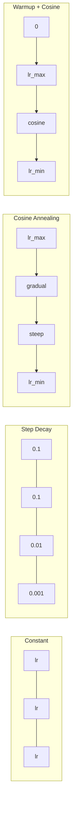
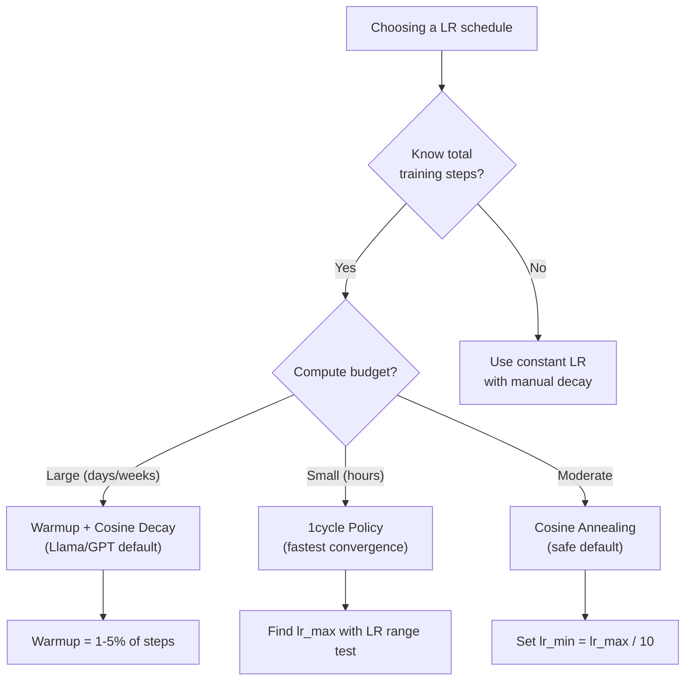
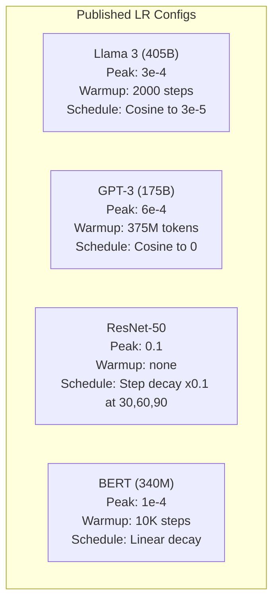

# Learning Rate Schedules and Warmup

> Tốc độ học là siêu tham số quan trọng nhất. Không phải kiến trúc. Không phải kích thước tập dữ liệu. Không phải hàm kích hoạt. Tốc độ học. Nếu bạn không điều chỉnh gì khác, hãy điều chỉnh nó.

**Type:** Build
**Languages:** Python
**Prerequisites:** Lesson 03.06 (Optimizers), Lesson 03.08 (Weight Initialization)
**Time:** ~90 minutes

## Learning Objectives

- Triển khai các lịch tốc độ học hằng, suy giảm bậc thang, ủ cosine, warmup + cosine và 1cycle từ đầu
- Minh họa ba kiểu thất bại của lựa chọn tốc độ học: phân kỳ (quá cao), đình trệ (quá thấp) và dao động (không suy giảm)
- Giải thích tại sao warmup cần thiết cho các bộ tối ưu hóa dựa trên Adam và cách nó ổn định huấn luyện ban đầu
- So sánh tốc độ hội tụ giữa cả năm lịch trên cùng tác vụ và chọn lịch phù hợp cho một ngân sách huấn luyện nhất định

## The Problem

Đặt tốc độ học thành 0.1. Huấn luyện phân kỳ -- mất mát nhảy tới vô cực trong 3 bước. Đặt thành 0.0001. Huấn luyện bò chậm -- sau 100 epoch, mô hình hầu như chưa dịch chuyển khỏi ngẫu nhiên. Đặt thành 0.01. Huấn luyện hoạt động trong 50 epoch, rồi mất mát dao động quanh một cực tiểu nó không bao giờ đạt tới vì các bước quá lớn.

Tốc độ học tối ưu không phải một hằng số. Nó thay đổi trong huấn luyện. Ban đầu, bạn muốn các bước lớn để nhanh chóng bao phủ không gian. Cuối huấn luyện, bạn muốn các bước rất nhỏ để ổn định vào một cực tiểu sắc nhọn. Khác biệt giữa một mô hình chính xác 90% và một mô hình chính xác 95% thường chỉ là lịch.

Mọi mô hình lớn được công bố trong ba năm qua đều sử dụng một lịch tốc độ học. Llama 3 sử dụng lr đỉnh=3e-4 với 2000 bước warmup và suy giảm cosine tới 3e-5. GPT-3 sử dụng lr=6e-4 với warmup trên 375 triệu token. Đây không phải các lựa chọn tùy ý. Chúng là kết quả của những đợt quét siêu tham số sâu rộng tốn hàng triệu đô la.

Bạn cần hiểu các lịch vì các mặc định sẽ không hoạt động cho bài toán của bạn. Khi bạn tinh chỉnh một mô hình được tiền huấn luyện, lịch đúng khác với huấn luyện từ đầu. Khi bạn tăng kích thước batch, giai đoạn warmup cần thay đổi. Khi huấn luyện hỏng ở bước 10,000, bạn cần biết đó là vấn đề lịch hay điều gì khác.

## The Concept

### Constant Learning Rate

Cách tiếp cận đơn giản nhất. Chọn một con số, sử dụng nó cho mọi bước.

```math
\text{lr}(t) = \text{lr}_0
```

Hiếm khi tối ưu. Nó hoặc quá cao cho cuối huấn luyện (dao động quanh cực tiểu) hoặc quá thấp cho ban đầu (lãng phí tính toán vào các bước rất nhỏ). Hoạt động ổn cho các mô hình nhỏ và gỡ lỗi. Một lựa chọn tệ cho bất cứ thứ gì huấn luyện hơn một giờ.

### Step Decay

Cách tiếp cận kiểu cũ từ thời ResNet. Giảm tốc độ học theo một hệ số (thường 10 lần) tại các epoch cố định.

```math
\text{lr}(t) = \text{lr}_0 \cdot \gamma^{\lfloor \text{epoch} / \text{step\_size} \rfloor}
```

Trong đó $\gamma = 0.1$ và step_size = 30 nghĩa là: lr giảm 10 lần mỗi 30 epoch. ResNet-50 sử dụng cách này -- lr=0.1, giảm 10 lần tại các epoch 30, 60 và 90.

Vấn đề: các điểm suy giảm tối ưu phụ thuộc tập dữ liệu và kiến trúc. Chuyển sang một bài toán khác và bạn cần điều chỉnh lại khi nào giảm. Các chuyển tiếp đột ngột -- mất mát có thể tăng vọt khi tốc độ đột ngột thay đổi.

### Cosine Annealing

Suy giảm trơn từ tốc độ học tối đa tới tối thiểu, theo một đường cong cosine:

```math
\text{lr}(t) = \text{lr}_{\min} + 0.5 \cdot (\text{lr}_{\max} - \text{lr}_{\min}) \cdot \left(1 + \cos\left(\frac{\pi t}{T}\right)\right)
```

Trong đó $t$ là bước hiện tại và $T$ là tổng số bước.

Tại $t=0$, số hạng cosine là 1, nên $\text{lr} = \text{lr} _{\max}$. Tại $t=T$, số hạng cosine là -1, nên $\text{lr} = \text{lr} _{\min}$. Suy giảm nhẹ lúc đầu, tăng tốc ở giữa và nhẹ trở lại gần cuối.

Đây là mặc định cho hầu hết các lần huấn luyện hiện đại. Không có siêu tham số cần điều chỉnh ngoài $\text{lr} _{\max}$ và $\text{lr} _{\min}$. Hình dạng cosine khớp quan sát thực nghiệm rằng hầu hết việc học xảy ra ở giữa huấn luyện -- bạn muốn kích thước bước hợp lý trong giai đoạn then chốt đó.

### Warmup: Why You Start Small

Adam và các bộ tối ưu hóa thích nghi khác duy trì các ước lượng tích lũy của trung bình và phương sai gradient. Ở bước 0, các ước lượng này được khởi tạo bằng không. Vài cập nhật gradient đầu tiên dựa trên các thống kê vô giá trị. Nếu tốc độ học của bạn lớn trong giai đoạn này, mô hình thực hiện các bước khổng lồ, định hướng kém.

Warmup khắc phục điều này. Bắt đầu với một tốc độ học rất nhỏ (thường là lr_max / warmup_steps hoặc thậm chí bằng không) và tăng tuyến tính đến $\text{lr}_{\max}$ trong $N$ bước đầu tiên. Khi bạn đạt tốc độ học đầy đủ, các thống kê của Adam đã ổn định.

```math
\text{lr}(t) = \text{lr}_{\max} \cdot \frac{t}{\text{warmup\_steps}} \quad \text{for } t < \text{warmup\_steps}
```

Warmup điển hình: 1-5% tổng số bước huấn luyện. Llama 3 huấn luyện trên ~1.8 nghìn tỷ token và warmup trong 2000 bước. GPT-3 warmup trên 375 triệu token.

### Linear Warmup + Cosine Decay

Mặc định hiện đại. Tăng tuyến tính, rồi suy giảm theo cosine:

```
if t < warmup_steps:
    lr(t) = lr_max * (t / warmup_steps)
else:
    progress = (t - warmup_steps) / (total_steps - warmup_steps)
    lr(t) = lr_min + 0.5 * (lr_max - lr_min) * (1 + cos(pi * progress))
```

Đây là điều Llama, GPT, PaLM và hầu hết các transformer hiện đại sử dụng. Warmup ngăn mất ổn định ban đầu. Suy giảm cosine đưa mô hình ổn định vào một cực tiểu tốt.

### 1cycle Policy

Khám phá của Leslie Smith (2018): tăng tốc độ học từ một giá trị thấp tới một giá trị cao trong nửa đầu huấn luyện, rồi giảm trở lại trong nửa sau. Trái trực giác -- tại sao bạn lại *tăng* tốc độ học giữa chừng?

Lý thuyết: một tốc độ học cao đóng vai trò chính quy hóa bằng cách thêm nhiễu vào quỹ đạo tối ưu hóa. Mô hình khám phá nhiều bề mặt mất mát hơn trong giai đoạn tăng, tìm các lòng chảo tốt hơn. Giai đoạn giảm sau đó tinh chỉnh trong lòng chảo tốt nhất đã tìm thấy.

```
Phase 1 (0 to T/2):    lr ramps from lr_max/25 to lr_max
Phase 2 (T/2 to T):    lr ramps from lr_max to lr_max/10000
```

1cycle thường huấn luyện nhanh hơn ủ cosine với một ngân sách tính toán cố định. Đánh đổi: bạn phải biết trước tổng số bước.

### Schedule Shapes



### Decision Flowchart



### Real Numbers from Published Models



```figure
lr-schedule
```

## Build It

### Step 1: Schedule Functions

Mỗi hàm nhận bước hiện tại và trả về tốc độ học tại bước đó.

```python
import math


def constant_schedule(step, lr=0.01, **kwargs):
    return lr


def step_decay_schedule(step, lr=0.1, step_size=100, gamma=0.1, **kwargs):
    return lr * (gamma ** (step // step_size))


def cosine_schedule(step, lr=0.01, total_steps=1000, lr_min=1e-5, **kwargs):
    if step >= total_steps:
        return lr_min
    return lr_min + 0.5 * (lr - lr_min) * (1 + math.cos(math.pi * step / total_steps))


def warmup_cosine_schedule(step, lr=0.01, total_steps=1000, warmup_steps=100, lr_min=1e-5, **kwargs):
    if total_steps <= warmup_steps:
        return lr * (step / max(warmup_steps, 1))
    if step < warmup_steps:
        return lr * step / warmup_steps
    progress = (step - warmup_steps) / (total_steps - warmup_steps)
    return lr_min + 0.5 * (lr - lr_min) * (1 + math.cos(math.pi * progress))


def one_cycle_schedule(step, lr=0.01, total_steps=1000, **kwargs):
    mid = max(total_steps // 2, 1)
    if step < mid:
        return (lr / 25) + (lr - lr / 25) * step / mid
    else:
        progress = (step - mid) / max(total_steps - mid, 1)
        return lr * (1 - progress) + (lr / 10000) * progress
```

### Step 2: Visualize All Schedules

In một đồ thị dựa trên văn bản thể hiện mỗi lịch tiến triển như thế nào trong huấn luyện.

```python
def visualize_schedule(name, schedule_fn, total_steps=500, **kwargs):
    steps = list(range(0, total_steps, total_steps // 20))
    if total_steps - 1 not in steps:
        steps.append(total_steps - 1)

    lrs = [schedule_fn(s, total_steps=total_steps, **kwargs) for s in steps]
    max_lr = max(lrs) if max(lrs) > 0 else 1.0

    print(f"\n{name}:")
    for s, lr_val in zip(steps, lrs):
        bar_len = int(lr_val / max_lr * 40)
        bar = "#" * bar_len
        print(f"  Step {s:4d}: lr={lr_val:.6f} {bar}")
```

### Step 3: Training Network

Một mạng hai lớp đơn giản trên tập dữ liệu đường tròn, giống các bài trước, nhưng giờ chúng ta thay đổi lịch.

```python
import random


def sigmoid(x):
    x = max(-500, min(500, x))
    return 1.0 / (1.0 + math.exp(-x))


def relu(x):
    return max(0.0, x)


def relu_deriv(x):
    return 1.0 if x > 0 else 0.0


def make_circle_data(n=200, seed=42):
    random.seed(seed)
    data = []
    for _ in range(n):
        x = random.uniform(-2, 2)
        y = random.uniform(-2, 2)
        label = 1.0 if x * x + y * y < 1.5 else 0.0
        data.append(([x, y], label))
    return data


def train_with_schedule(schedule_fn, schedule_name, data, epochs=300, base_lr=0.05, **kwargs):
    random.seed(0)
    hidden_size = 8
    total_steps = epochs * len(data)

    std = math.sqrt(2.0 / 2)
    w1 = [[random.gauss(0, std) for _ in range(2)] for _ in range(hidden_size)]
    b1 = [0.0] * hidden_size
    w2 = [random.gauss(0, std) for _ in range(hidden_size)]
    b2 = 0.0

    step = 0
    epoch_losses = []

    for epoch in range(epochs):
        total_loss = 0
        correct = 0

        for x, target in data:
            lr = schedule_fn(step, lr=base_lr, total_steps=total_steps, **kwargs)

            z1 = []
            h = []
            for i in range(hidden_size):
                z = w1[i][0] * x[0] + w1[i][1] * x[1] + b1[i]
                z1.append(z)
                h.append(relu(z))

            z2 = sum(w2[i] * h[i] for i in range(hidden_size)) + b2
            out = sigmoid(z2)

            error = out - target
            d_out = error * out * (1 - out)

            for i in range(hidden_size):
                d_h = d_out * w2[i] * relu_deriv(z1[i])
                w2[i] -= lr * d_out * h[i]
                for j in range(2):
                    w1[i][j] -= lr * d_h * x[j]
                b1[i] -= lr * d_h
            b2 -= lr * d_out

            total_loss += (out - target) ** 2
            if (out >= 0.5) == (target >= 0.5):
                correct += 1
            step += 1

        avg_loss = total_loss / len(data)
        accuracy = correct / len(data) * 100
        epoch_losses.append(avg_loss)

    return epoch_losses
```

### Step 4: Compare All Schedules

Huấn luyện cùng mạng với mỗi lịch và so sánh mất mát cuối cùng cùng hành vi hội tụ.

```python
def compare_schedules(data):
    configs = [
        ("Constant", constant_schedule, {}),
        ("Step Decay", step_decay_schedule, {"step_size": 15000, "gamma": 0.1}),
        ("Cosine", cosine_schedule, {"lr_min": 1e-5}),
        ("Warmup+Cosine", warmup_cosine_schedule, {"warmup_steps": 3000, "lr_min": 1e-5}),
        ("1cycle", one_cycle_schedule, {}),
    ]

    print(f"\n{'Schedule':<20} {'Start Loss':>12} {'Mid Loss':>12} {'End Loss':>12} {'Best Loss':>12}")
    print("-" * 70)

    for name, schedule_fn, extra_kwargs in configs:
        losses = train_with_schedule(schedule_fn, name, data, epochs=300, base_lr=0.05, **extra_kwargs)
        mid_idx = len(losses) // 2
        best = min(losses)
        print(f"{name:<20} {losses[0]:>12.6f} {losses[mid_idx]:>12.6f} {losses[-1]:>12.6f} {best:>12.6f}")
```

### Step 5: LR Too High vs Too Low

Minh họa ba kiểu thất bại: quá cao (phân kỳ), quá thấp (bò chậm) và vừa đúng.

```python
def lr_sensitivity(data):
    learning_rates = [1.0, 0.1, 0.01, 0.001, 0.0001]

    print("\nLR Sensitivity (constant schedule, 100 epochs):")
    print(f"  {'LR':>10} {'Start Loss':>12} {'End Loss':>12} {'Status':>15}")
    print("  " + "-" * 52)

    for lr in learning_rates:
        losses = train_with_schedule(constant_schedule, f"lr={lr}", data, epochs=100, base_lr=lr)
        start = losses[0]
        end = losses[-1]

        if end > start or math.isnan(end) or end > 1.0:
            status = "DIVERGED"
        elif end > start * 0.9:
            status = "BARELY MOVED"
        elif end < 0.15:
            status = "CONVERGED"
        else:
            status = "LEARNING"

        end_str = f"{end:.6f}" if not math.isnan(end) else "NaN"
        print(f"  {lr:>10.4f} {start:>12.6f} {end_str:>12} {status:>15}")
```

## Use It

PyTorch cung cấp các bộ lập lịch trong `torch.optim.lr_scheduler`:

```python
import torch
import torch.optim as optim
from torch.optim.lr_scheduler import CosineAnnealingLR, OneCycleLR, StepLR

model = nn.Sequential(nn.Linear(10, 64), nn.ReLU(), nn.Linear(64, 1))
optimizer = optim.Adam(model.parameters(), lr=3e-4)

scheduler = CosineAnnealingLR(optimizer, T_max=1000, eta_min=1e-5)

for step in range(1000):
    loss = train_step(model, optimizer)
    scheduler.step()
```

Với warmup + cosine, sử dụng một bộ lập lịch lambda hoặc `get_cosine_schedule_with_warmup` từ HuggingFace:

```python
from transformers import get_cosine_schedule_with_warmup

scheduler = get_cosine_schedule_with_warmup(
    optimizer,
    num_warmup_steps=2000,
    num_training_steps=100000,
)
```

Hàm HuggingFace là thứ hầu hết các script tinh chỉnh Llama và GPT sử dụng. Khi không chắc, sử dụng warmup + cosine với warmup = 3-5% tổng số bước. Nó hoạt động cho gần như mọi thứ.

## Ship It

Bài học này tạo ra:
- `outputs/prompt-lr-schedule-advisor.md` -- một prompt khuyến nghị lịch tốc độ học và các siêu tham số phù hợp cho thiết lập huấn luyện của bạn

## Exercises

1. Triển khai suy giảm hàm mũ: $\text{lr}(t) = \text{lr}_0 \cdot \gamma^t$ trong đó $\gamma = 0.999$. So sánh với ủ cosine trên tập dữ liệu đường tròn.

2. Triển khai phép kiểm tra phạm vi tốc độ học (Leslie Smith): huấn luyện vài trăm bước trong khi tăng LR theo hàm mũ từ 1e-7 tới 1. Vẽ mất mát theo LR. LR tối đa tối ưu nằm ngay trước khi mất mát bắt đầu tăng.

3. Huấn luyện với warmup + cosine nhưng thay đổi độ dài warmup: 0%, 1%, 5%, 10%, 20% tổng số bước. Tìm điểm phù hợp nơi huấn luyện ổn định nhất.

4. Triển khai ủ cosine với khởi động lại ấm (SGDR): đặt lại tốc độ học thành $\text{lr}_{\max}$ mỗi $T$ bước và suy giảm lại. So sánh với cosine tiêu chuẩn trên một lần huấn luyện dài hơn.

5. Xây dựng một "bác sĩ phẫu thuật lịch" giám sát mất mát huấn luyện và tự động chuyển từ warmup sang cosine khi mất mát ổn định, và giảm lr nếu mất mát chững lại quá lâu.

## Key Terms

| Thuật ngữ | Cách mọi người nói | Ý nghĩa thực sự |
|------|----------------|----------------------|
| Learning rate (Tốc độ học) | "Mô hình học nhanh đến mức nào" | Số vô hướng nhân với gradient để xác định kích thước cập nhật tham số |
| Schedule (Lịch) | "Thay đổi LR theo thời gian" | Một hàm ánh xạ bước huấn luyện thành tốc độ học, được thiết kế để tối ưu hóa hội tụ |
| Warmup | "Bắt đầu với LR nhỏ" | Tăng LR tuyến tính từ gần không tới giá trị mục tiêu trong $N$ bước đầu để ổn định các thống kê bộ tối ưu hóa |
| Cosine annealing (Ủ cosine) | "Suy giảm LR trơn" | Giảm LR theo một đường cong cosine từ $\text{lr} _{\max}$ tới $\text{lr} _{\min}$ trong huấn luyện |
| Step decay (Suy giảm bậc thang) | "Giảm LR tại các cột mốc" | Nhân LR với một hệ số (thường 0.1) tại các khoảng epoch cố định |
| 1cycle policy (Chính sách 1cycle) | "Lên rồi xuống" | Phương pháp của Leslie Smith tăng LR rồi giảm trong một chu kỳ duy nhất để hội tụ nhanh hơn |
| LR range test (Kiểm tra phạm vi LR) | "Tìm tốc độ học tốt nhất" | Huấn luyện ngắn trong khi tăng LR để tìm giá trị mà mất mát bắt đầu phân kỳ |
| Cosine with warm restarts (Cosine với khởi động lại ấm) | "Đặt lại và lặp lại" | Định kỳ đặt lại LR thành $\text{lr} _{\max}$ và suy giảm lại (SGDR) |
| Eta min | "Mức sàn của LR" | Tốc độ học tối thiểu mà lịch suy giảm tới |
| Peak learning rate (Tốc độ học đỉnh) | "LR tối đa" | LR cao nhất đạt được trong huấn luyện, thường sau warmup |

## Further Reading

- Loshchilov & Hutter, "SGDR: Stochastic Gradient Descent with Warm Restarts" (2017) -- giới thiệu ủ cosine và khởi động lại ấm
- Smith, "Super-Convergence: Very Fast Training of Neural Networks Using Large Learning Rates" (2018) -- bài báo chính sách 1cycle
- Touvron et al., "Llama 2: Open Foundation and Fine-Tuned Chat Models" (2023) -- ghi lại lịch warmup + cosine được sử dụng ở quy mô lớn
- Goyal et al., "Accurate, Large Minibatch SGD: Training ImageNet in 1 Hour" (2017) -- quy tắc co giãn tuyến tính và warmup cho huấn luyện batch lớn
