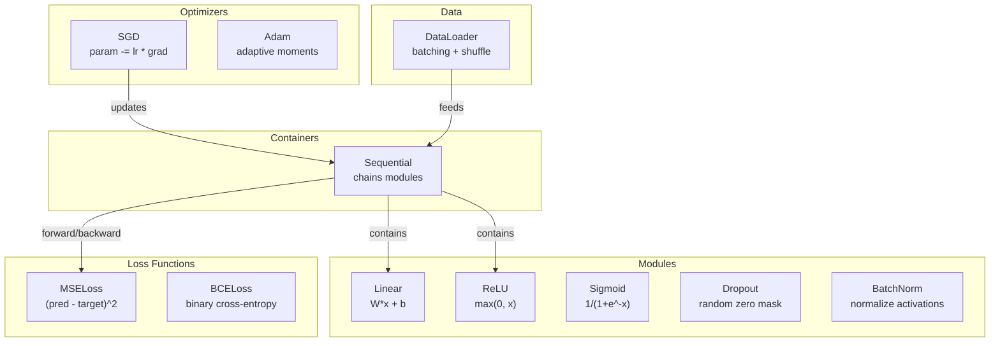
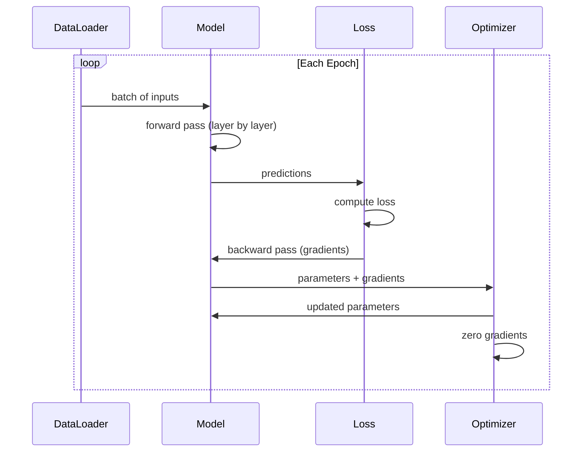
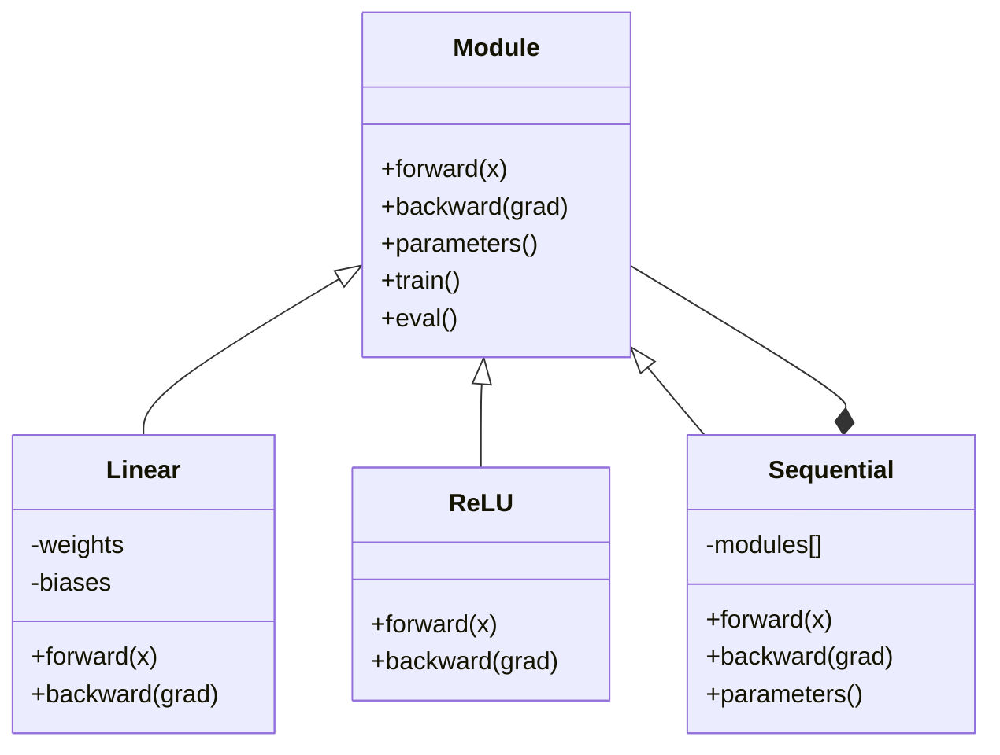

# Build Your Own Mini Framework

> Bạn đã xây dựng các nơ-ron, lớp, mạng, backprop, kích hoạt, hàm mất mát, bộ tối ưu hóa, chính quy hóa, khởi tạo và lịch LR. Tất cả dưới dạng các phần riêng biệt. Giờ nối chúng thành một framework. Không phải PyTorch. Không phải TensorFlow. Của bạn.

**Type:** Build
**Languages:** Python
**Prerequisites:** All of Phase 03 (Lessons 01-09)
**Time:** ~120 minutes

## Learning Objectives

- Xây dựng một framework học sâu hoàn chỉnh (~500 dòng) với Module, Linear, ReLU, Sigmoid, Dropout, BatchNorm, Sequential, các hàm mất mát, bộ tối ưu hóa và DataLoader
- Giải thích trừu tượng Module (forward, backward, parameters) và tại sao chuyển đổi chế độ train/eval là cần thiết
- Nối tất cả các thành phần thành một vòng lặp huấn luyện hoạt động để huấn luyện một mạng 4 lớp trên phân loại đường tròn
- Ánh xạ mỗi thành phần framework của bạn tới thành phần PyTorch tương đương (nn.Module, nn.Sequential, optim.Adam, DataLoader)

## The Problem

Bạn có các khối xây dựng từ mười bài học rải rác trong các file riêng biệt. Một lớp `Value` ở đây, một vòng lặp huấn luyện ở kia, khởi tạo trọng số trong một file khác, các lịch tốc độ học trong một file khác nữa. Để huấn luyện một mạng, bạn sao chép-dán từ năm bài học khác nhau và nối chúng thủ công.

Đó là điều framework giải quyết. PyTorch cho bạn `nn.Module`, `nn.Sequential`, `optim.Adam`, `DataLoader` và một mẫu vòng lặp huấn luyện gắn chúng với nhau. TensorFlow cho bạn `keras.Layer`, `keras.Sequential`, `keras.optimizers.Adam`. Đây không phải phép thuật. Chúng là các mẫu tổ chức cho phép định nghĩa, huấn luyện và đánh giá các mạng mà không phải làm lại hệ thống kết nối mỗi lần.

Bạn sẽ xây dựng cùng thứ đó trong ~500 dòng Python. Không numpy. Không phụ thuộc bên ngoài. Một framework có thể định nghĩa bất kỳ mạng feedforward nào, huấn luyện nó với SGD hoặc Adam, chia dữ liệu thành batch, áp dụng dropout và batch normalization, sử dụng bất kỳ kích hoạt nào và lập lịch tốc độ học.

Khi hoàn thành, bạn sẽ hiểu chính xác điều gì xảy ra khi viết `model = nn.Sequential(...)` trong PyTorch. Bạn sẽ hiểu tại sao `model.train()` và `model.eval()` tồn tại. Bạn sẽ hiểu tại sao `optimizer.zero_grad()` là một lời gọi riêng. Bạn sẽ hiểu tất cả, vì bạn đã xây dựng tất cả.

## The Concept

### The Module Abstraction

Mỗi lớp trong PyTorch kế thừa từ `nn.Module`. Một Module có ba trách nhiệm:

1. **forward()** -- tính đầu ra từ các đầu vào cho trước
2. **parameters()** -- trả về tất cả các trọng số có thể huấn luyện
3. **backward()** -- tính các gradient (được autograd xử lý trong PyTorch, tường minh trong framework của chúng ta)

Một lớp Linear là một Module. Một kích hoạt ReLU là một Module. Một lớp dropout là một Module. Một lớp batch normalization là một Module. Tất cả có cùng giao diện.

### Sequential Container

`nn.Sequential` nối các Module thành chuỗi. Lượt truyền xuôi: đưa dữ liệu qua Module 1, rồi Module 2, rồi Module 3. Lượt truyền ngược: đảo ngược chuỗi. Bản thân bộ chứa là một Module -- nó có forward(), parameters() và backward(). Đây là mẫu composite: một chuỗi các Module tự nó là một Module.

### Training vs Evaluation Mode

Dropout đưa ngẫu nhiên các nơ-ron về không trong huấn luyện nhưng truyền mọi thứ qua trong đánh giá. Batch normalization sử dụng thống kê batch trong huấn luyện nhưng các trung bình tích lũy trong đánh giá. Các phương thức `train()` và `eval()` chuyển đổi hành vi này. Mỗi Module có một cờ `training`.

### Optimizer

Bộ tối ưu hóa cập nhật các tham số bằng các gradient của chúng. SGD: `param -= lr * grad`. Adam: duy trì các ước lượng momentum và phương sai, rồi cập nhật. Bộ tối ưu hóa không biết về kiến trúc mạng -- nó chỉ thấy một danh sách phẳng các tham số và gradient của chúng.

### DataLoader

Chia batch quan trọng vì hai lý do. Thứ nhất, bạn không thể đưa toàn bộ tập dữ liệu vào bộ nhớ với các bài toán lớn. Thứ hai, hạ gradient mini-batch cung cấp nhiễu giúp thoát các cực tiểu cục bộ. DataLoader chia dữ liệu thành các batch và tùy chọn xáo trộn giữa các epoch.

### Framework Architecture



### Training Loop



### Module Hierarchy



```figure
gradient-clipping
```

## Build It

### Step 1: Module Base Class

Giao diện trừu tượng mà mọi lớp triển khai.

```python
class Module:
    def __init__(self):
        self.training = True

    def forward(self, x):
        raise NotImplementedError

    def backward(self, grad):
        raise NotImplementedError

    def parameters(self):
        return []

    def train(self):
        self.training = True

    def eval(self):
        self.training = False
```

### Step 2: Linear Layer

Khối xây dựng cơ bản. Lưu các trọng số và bias, tính Wx + b khi truyền xuôi, và các gradient trọng số/đầu vào khi truyền ngược.

```python
import math
import random


class Linear(Module):
    def __init__(self, fan_in, fan_out):
        super().__init__()
        std = math.sqrt(2.0 / fan_in)
        self.weights = [[random.gauss(0, std) for _ in range(fan_in)] for _ in range(fan_out)]
        self.biases = [0.0] * fan_out
        self.weight_grads = [[0.0] * fan_in for _ in range(fan_out)]
        self.bias_grads = [0.0] * fan_out
        self.fan_in = fan_in
        self.fan_out = fan_out
        self.input = None

    def forward(self, x):
        self.input = x
        output = []
        for i in range(self.fan_out):
            val = self.biases[i]
            for j in range(self.fan_in):
                val += self.weights[i][j] * x[j]
            output.append(val)
        return output

    def backward(self, grad):
        input_grad = [0.0] * self.fan_in
        for i in range(self.fan_out):
            self.bias_grads[i] += grad[i]
            for j in range(self.fan_in):
                self.weight_grads[i][j] += grad[i] * self.input[j]
                input_grad[j] += grad[i] * self.weights[i][j]
        return input_grad

    def parameters(self):
        params = []
        for i in range(self.fan_out):
            for j in range(self.fan_in):
                params.append((self.weights, i, j, self.weight_grads))
            params.append((self.biases, i, None, self.bias_grads))
        return params
```

### Step 3: Activation Modules

ReLU, Sigmoid và Tanh dưới dạng Module. Mỗi module lưu đệm những gì nó cần cho lượt truyền ngược.

```python
class ReLU(Module):
    def __init__(self):
        super().__init__()
        self.mask = None

    def forward(self, x):
        self.mask = [1.0 if v > 0 else 0.0 for v in x]
        return [max(0.0, v) for v in x]

    def backward(self, grad):
        return [g * m for g, m in zip(grad, self.mask)]


class Sigmoid(Module):
    def __init__(self):
        super().__init__()
        self.output = None

    def forward(self, x):
        self.output = []
        for v in x:
            v = max(-500, min(500, v))
            self.output.append(1.0 / (1.0 + math.exp(-v)))
        return self.output

    def backward(self, grad):
        return [g * o * (1 - o) for g, o in zip(grad, self.output)]


class Tanh(Module):
    def __init__(self):
        super().__init__()
        self.output = None

    def forward(self, x):
        self.output = [math.tanh(v) for v in x]
        return self.output

    def backward(self, grad):
        return [g * (1 - o * o) for g, o in zip(grad, self.output)]
```

### Step 4: Dropout Module

Đưa ngẫu nhiên các phần tử về không trong huấn luyện. Co giãn các phần tử còn lại theo 1/(1-p) để các giá trị kỳ vọng giữ nguyên. Không làm gì trong eval.

```python
class Dropout(Module):
    def __init__(self, p=0.5):
        super().__init__()
        self.p = p
        self.mask = None

    def forward(self, x):
        if not self.training:
            return x
        self.mask = [0.0 if random.random() < self.p else 1.0 / (1 - self.p) for _ in x]
        return [v * m for v, m in zip(x, self.mask)]

    def backward(self, grad):
        if self.mask is None:
            return grad
        return [g * m for g, m in zip(grad, self.mask)]
```

### Step 5: BatchNorm Module

Chuẩn hóa các kích hoạt về trung bình bằng không và phương sai đơn vị cho mỗi đặc trưng trên toàn batch. Duy trì các thống kê tích lũy cho chế độ eval.

```python
class BatchNorm(Module):
    def __init__(self, size, momentum=0.1, eps=1e-5):
        super().__init__()
        self.size = size
        self.gamma = [1.0] * size
        self.beta = [0.0] * size
        self.gamma_grads = [0.0] * size
        self.beta_grads = [0.0] * size
        self.running_mean = [0.0] * size
        self.running_var = [1.0] * size
        self.momentum = momentum
        self.eps = eps
        self.x_norm = None
        self.std_inv = None
        self.batch_input = None

    def forward_batch(self, batch):
        batch_size = len(batch)
        output_batch = []

        if self.training:
            mean = [0.0] * self.size
            for sample in batch:
                for j in range(self.size):
                    mean[j] += sample[j]
            mean = [m / batch_size for m in mean]

            var = [0.0] * self.size
            for sample in batch:
                for j in range(self.size):
                    var[j] += (sample[j] - mean[j]) ** 2
            var = [v / batch_size for v in var]

            self.std_inv = [1.0 / math.sqrt(v + self.eps) for v in var]

            self.x_norm = []
            self.batch_input = batch
            for sample in batch:
                normed = [(sample[j] - mean[j]) * self.std_inv[j] for j in range(self.size)]
                self.x_norm.append(normed)
                output = [self.gamma[j] * normed[j] + self.beta[j] for j in range(self.size)]
                output_batch.append(output)

            for j in range(self.size):
                self.running_mean[j] = (1 - self.momentum) * self.running_mean[j] + self.momentum * mean[j]
                self.running_var[j] = (1 - self.momentum) * self.running_var[j] + self.momentum * var[j]
        else:
            std_inv = [1.0 / math.sqrt(v + self.eps) for v in self.running_var]
            for sample in batch:
                normed = [(sample[j] - self.running_mean[j]) * std_inv[j] for j in range(self.size)]
                output = [self.gamma[j] * normed[j] + self.beta[j] for j in range(self.size)]
                output_batch.append(output)

        return output_batch

    def forward(self, x):
        result = self.forward_batch([x])
        return result[0]

    def backward(self, grad):
        if self.x_norm is None:
            return grad
        for j in range(self.size):
            self.gamma_grads[j] += self.x_norm[0][j] * grad[j]
            self.beta_grads[j] += grad[j]
        return [grad[j] * self.gamma[j] * self.std_inv[j] for j in range(self.size)]

    def parameters(self):
        params = []
        for j in range(self.size):
            params.append((self.gamma, j, None, self.gamma_grads))
            params.append((self.beta, j, None, self.beta_grads))
        return params
```

### Step 6: Sequential Container

Nối các module thành chuỗi. Xuôi đi từ trái sang phải, ngược đi từ phải sang trái.

```python
class Sequential(Module):
    def __init__(self, *modules):
        super().__init__()
        self.modules = list(modules)

    def forward(self, x):
        for module in self.modules:
            x = module.forward(x)
        return x

    def backward(self, grad):
        for module in reversed(self.modules):
            grad = module.backward(grad)
        return grad

    def parameters(self):
        params = []
        for module in self.modules:
            params.extend(module.parameters())
        return params

    def train(self):
        self.training = True
        for module in self.modules:
            module.train()

    def eval(self):
        self.training = False
        for module in self.modules:
            module.eval()
```

### Step 7: Loss Functions

MSE và Cross-Entropy Nhị phân. Mỗi hàm trả về giá trị mất mát và cung cấp một backward() trả về gradient.

```python
class MSELoss:
    def __call__(self, predicted, target):
        self.predicted = predicted
        self.target = target
        n = len(predicted)
        self.loss = sum((p - t) ** 2 for p, t in zip(predicted, target)) / n
        return self.loss

    def backward(self):
        n = len(self.predicted)
        return [2 * (p - t) / n for p, t in zip(self.predicted, self.target)]


class BCELoss:
    def __call__(self, predicted, target):
        self.predicted = predicted
        self.target = target
        eps = 1e-7
        n = len(predicted)
        self.loss = 0
        for p, t in zip(predicted, target):
            p = max(eps, min(1 - eps, p))
            self.loss += -(t * math.log(p) + (1 - t) * math.log(1 - p))
        self.loss /= n
        return self.loss

    def backward(self):
        eps = 1e-7
        n = len(self.predicted)
        grads = []
        for p, t in zip(self.predicted, self.target):
            p = max(eps, min(1 - eps, p))
            grads.append((-t / p + (1 - t) / (1 - p)) / n)
        return grads
```

### Step 8: SGD and Adam Optimizers

Cả hai nhận một danh sách tham số và cập nhật các trọng số bằng các gradient.

```python
class SGD:
    def __init__(self, parameters, lr=0.01):
        self.params = parameters
        self.lr = lr

    def step(self):
        for container, i, j, grad_container in self.params:
            if j is not None:
                container[i][j] -= self.lr * grad_container[i][j]
            else:
                container[i] -= self.lr * grad_container[i]

    def zero_grad(self):
        for container, i, j, grad_container in self.params:
            if j is not None:
                grad_container[i][j] = 0.0
            else:
                grad_container[i] = 0.0


class Adam:
    def __init__(self, parameters, lr=0.001, beta1=0.9, beta2=0.999, eps=1e-8):
        self.params = parameters
        self.lr = lr
        self.beta1 = beta1
        self.beta2 = beta2
        self.eps = eps
        self.t = 0
        self.m = [0.0] * len(parameters)
        self.v = [0.0] * len(parameters)

    def step(self):
        self.t += 1
        for idx, (container, i, j, grad_container) in enumerate(self.params):
            if j is not None:
                g = grad_container[i][j]
            else:
                g = grad_container[i]

            self.m[idx] = self.beta1 * self.m[idx] + (1 - self.beta1) * g
            self.v[idx] = self.beta2 * self.v[idx] + (1 - self.beta2) * g * g

            m_hat = self.m[idx] / (1 - self.beta1 ** self.t)
            v_hat = self.v[idx] / (1 - self.beta2 ** self.t)

            update = self.lr * m_hat / (math.sqrt(v_hat) + self.eps)

            if j is not None:
                container[i][j] -= update
            else:
                container[i] -= update

    def zero_grad(self):
        for container, i, j, grad_container in self.params:
            if j is not None:
                grad_container[i][j] = 0.0
            else:
                grad_container[i] = 0.0
```

### Step 9: DataLoader

Chia dữ liệu thành các batch, tùy chọn xáo trộn mỗi epoch.

```python
class DataLoader:
    def __init__(self, data, batch_size=32, shuffle=True):
        self.data = data
        self.batch_size = batch_size
        self.shuffle = shuffle

    def __iter__(self):
        indices = list(range(len(self.data)))
        if self.shuffle:
            random.shuffle(indices)
        for start in range(0, len(indices), self.batch_size):
            batch_indices = indices[start:start + self.batch_size]
            batch = [self.data[i] for i in batch_indices]
            inputs = [item[0] for item in batch]
            targets = [item[1] for item in batch]
            yield inputs, targets

    def __len__(self):
        return (len(self.data) + self.batch_size - 1) // self.batch_size
```

### Step 10: Train a 4-Layer Network on Circle Classification

Nối mọi thứ lại. Định nghĩa một mô hình, chọn một mất mát, chọn một bộ tối ưu hóa, chạy vòng lặp huấn luyện.

```python
def make_circle_data(n=500, seed=42):
    random.seed(seed)
    data = []
    for _ in range(n):
        x = random.uniform(-2, 2)
        y = random.uniform(-2, 2)
        label = 1.0 if x * x + y * y < 1.5 else 0.0
        data.append(([x, y], [label]))
    return data


def train():
    random.seed(42)

    model = Sequential(
        Linear(2, 16),
        ReLU(),
        Linear(16, 16),
        ReLU(),
        Linear(16, 8),
        ReLU(),
        Linear(8, 1),
        Sigmoid(),
    )

    criterion = BCELoss()
    optimizer = Adam(model.parameters(), lr=0.01)

    data = make_circle_data(500)
    split = int(len(data) * 0.8)
    train_data = data[:split]
    test_data = data[split:]

    loader = DataLoader(train_data, batch_size=16, shuffle=True)

    model.train()

    for epoch in range(100):
        total_loss = 0
        total_correct = 0
        total_samples = 0

        for batch_inputs, batch_targets in loader:
            batch_loss = 0
            for x, t in zip(batch_inputs, batch_targets):
                pred = model.forward(x)
                loss = criterion(pred, t)
                batch_loss += loss

                optimizer.zero_grad()
                grad = criterion.backward()
                model.backward(grad)
                optimizer.step()

                predicted_class = 1.0 if pred[0] >= 0.5 else 0.0
                if predicted_class == t[0]:
                    total_correct += 1
                total_samples += 1

            total_loss += batch_loss

        avg_loss = total_loss / total_samples
        accuracy = total_correct / total_samples * 100

        if epoch % 10 == 0 or epoch == 99:
            print(f"Epoch {epoch:3d} | Loss: {avg_loss:.6f} | Train Accuracy: {accuracy:.1f}%")

    model.eval()
    correct = 0
    for x, t in test_data:
        pred = model.forward(x)
        predicted_class = 1.0 if pred[0] >= 0.5 else 0.0
        if predicted_class == t[0]:
            correct += 1
    test_accuracy = correct / len(test_data) * 100
    print(f"\nTest Accuracy: {test_accuracy:.1f}% ({correct}/{len(test_data)})")

    return model, test_accuracy
```

## Use It

Đây là bản PyTorch tương đương với những gì bạn vừa xây dựng:

```python
import torch
import torch.nn as nn
from torch.utils.data import DataLoader, TensorDataset

model = nn.Sequential(
    nn.Linear(2, 16),
    nn.ReLU(),
    nn.Linear(16, 16),
    nn.ReLU(),
    nn.Linear(16, 8),
    nn.ReLU(),
    nn.Linear(8, 1),
    nn.Sigmoid(),
)

criterion = nn.BCELoss()
optimizer = torch.optim.Adam(model.parameters(), lr=0.01)

for epoch in range(100):
    model.train()
    for inputs, targets in dataloader:
        optimizer.zero_grad()
        predictions = model(inputs)
        loss = criterion(predictions, targets)
        loss.backward()
        optimizer.step()

    model.eval()
    with torch.no_grad():
        test_predictions = model(test_inputs)
```

Cấu trúc giống hệt. `Sequential`, `Linear`, `ReLU`, `Sigmoid`, `BCELoss`, `Adam`, `zero_grad`, `backward`, `step`, `train`, `eval`. Mỗi khái niệm ánh xạ một-một. Khác biệt là PyTorch xử lý autograd tự động (không cần triển khai backward() trong mỗi module), chạy trên GPU và đã được tối ưu hóa nhiều năm. Nhưng bộ khung giống nhau.

Giờ khi bạn thấy mã PyTorch, bạn biết chính xác điều gì đang xảy ra ở mỗi dòng. Sự hiểu biết đó là toàn bộ mục đích.

## Ship It

Bài học này tạo ra:
- `outputs/prompt-framework-architect.md` -- một prompt để thiết kế các kiến trúc mạng nơ-ron bằng các trừu tượng framework

## Exercises

1. Thêm một lớp `SoftmaxCrossEntropyLoss` cho phân loại đa lớp. Áp dụng softmax cho các dự đoán, tính mất mát cross-entropy và xử lý lượt truyền ngược kết hợp. Kiểm thử trên một tập dữ liệu xoắn ốc 3 lớp.

2. Triển khai lập lịch tốc độ học trong bộ tối ưu hóa: thêm một phương thức `set_lr()` và nối lịch cosine từ Bài 09 vào. Huấn luyện bộ phân loại đường tròn với warmup + cosine và so sánh với LR hằng.

3. Thêm một phương thức `save()` và `load()` vào Sequential để tuần tự hóa tất cả các trọng số vào một file JSON và tải chúng lại. Xác minh một mô hình được tải tạo ra cùng các dự đoán như bản gốc.

4. Triển khai weight decay (chính quy hóa L2) trong bộ tối ưu hóa Adam. Thêm một tham số `weight_decay` co các trọng số về không mỗi bước. So sánh huấn luyện với decay=0 và decay=0.01.

5. Thay vòng lặp huấn luyện theo từng mẫu bằng tích lũy gradient mini-batch đúng nghĩa: tích lũy các gradient trên tất cả các mẫu trong một batch, rồi chia cho kích thước batch và thực hiện một bước tối ưu hóa. Đo xem điều này có thay đổi tốc độ hội tụ không.

## Key Terms

| Thuật ngữ | Cách mọi người nói | Ý nghĩa thực sự |
|------|----------------|----------------------|
| Module | "Một lớp" | Trừu tượng cơ sở trong một framework -- bất cứ thứ gì có forward(), backward() và parameters() |
| Sequential | "Xếp chồng các lớp theo thứ tự" | Một bộ chứa nối các module, áp dụng chúng theo thứ tự khi truyền xuôi và ngược lại khi truyền ngược |
| Forward pass (Lượt truyền xuôi) | "Chạy mạng" | Tính đầu ra bằng cách truyền đầu vào qua từng module theo thứ tự |
| Backward pass (Lượt truyền ngược) | "Tính các gradient" | Lan truyền gradient mất mát qua từng module theo chiều ngược lại để tính các gradient tham số |
| Parameters (Các tham số) | "Các trọng số có thể huấn luyện" | Tất cả các giá trị trong mạng mà bộ tối ưu hóa có thể cập nhật -- các trọng số và bias |
| Optimizer (Bộ tối ưu hóa) | "Thứ cập nhật các trọng số" | Một thuật toán sử dụng các gradient để cập nhật tham số, triển khai SGD, Adam hoặc các quy tắc khác |
| DataLoader | "Thứ cung cấp dữ liệu" | Một iterator chia tập dữ liệu thành các batch, tùy chọn xáo trộn giữa các epoch |
| Training mode (Chế độ huấn luyện) | "model.train()" | Một cờ bật hành vi ngẫu nhiên như dropout và batch normalization với thống kê batch |
| Evaluation mode (Chế độ đánh giá) | "model.eval()" | Một cờ tắt dropout và sử dụng các thống kê tích lũy cho batch normalization |
| Zero grad (Đưa gradient về không) | "Xóa các gradient" | Đặt lại tất cả các gradient tham số về không trước khi tính các gradient của batch tiếp theo |

## Further Reading

- Paszke et al., "PyTorch: An Imperative Style, High-Performance Deep Learning Library" (2019) -- bài báo mô tả các quyết định thiết kế của PyTorch
- Chollet, "Deep Learning with Python, Second Edition" (2021) -- Chương 3 đề cập nội bộ Keras với cùng trừu tượng module/lớp
- Johnson, "Tiny-DNN" (https://github.com/tiny-dnn/tiny-dnn) -- một framework học sâu C++ chỉ gồm header để hiểu nội bộ framework
