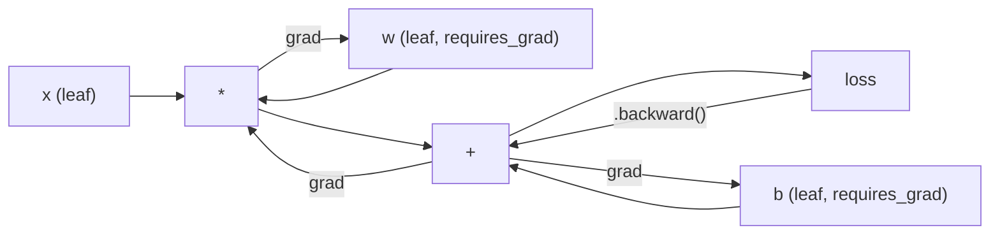
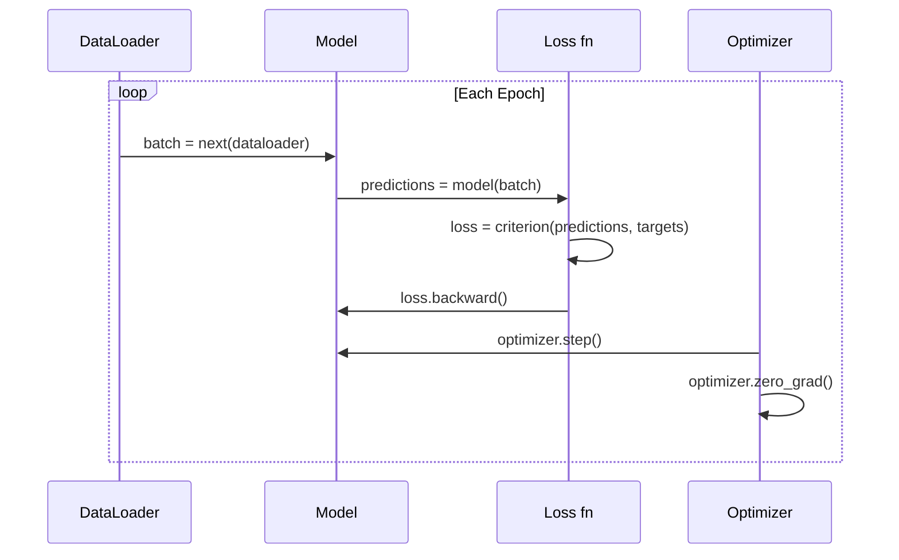

# Introduction to PyTorch

> Bạn đã xây động cơ từ piston và trục khuỷu. Giờ học loại mà mọi người thực sự lái.

**Type:** Build
**Languages:** Python
**Prerequisites:** Lesson 03.10 (Build Your Own Mini Framework)
**Time:** ~75 minutes

## Learning Objectives

- Xây dựng và huấn luyện các mạng nơ-ron bằng nn.Module, nn.Sequential và autograd của PyTorch
- Sử dụng các tensor PyTorch, tăng tốc GPU và vòng lặp huấn luyện tiêu chuẩn (zero_grad, forward, loss, backward, step)
- Chuyển các thành phần mini framework bạn xây dựng từ đầu sang các thành phần PyTorch tương đương
- Đo hiệu năng và so sánh tốc độ huấn luyện giữa framework Python thuần của bạn và PyTorch trên cùng tác vụ

## The Problem

Bạn có một mini framework hoạt động. Các lớp tuyến tính, ReLU, dropout, batch norm, Adam, một DataLoader, một vòng lặp huấn luyện. Nó huấn luyện một mạng 4 lớp trên một bài toán phân loại đường tròn bằng Python thuần.

Nó cũng chậm hơn PyTorch 500 lần trên cùng bài toán.

Mini framework của bạn xử lý từng mẫu một bằng các vòng lặp Python lồng nhau. PyTorch chuyển cùng các phép toán đó tới các kernel C++/CUDA được tối ưu hóa chạy trên GPU. Trên một NVIDIA A100, PyTorch huấn luyện một ResNet-50 (25.6M tham số) trên ImageNet (1.28M hình ảnh) trong khoảng 6 giờ. Framework của bạn sẽ cần khoảng 3,000 giờ trên cùng tác vụ -- nếu nó không hết bộ nhớ trước.

Tốc độ không phải khoảng cách duy nhất. Framework của bạn không hỗ trợ GPU. Không vi phân tự động -- bạn viết tay backward() cho mọi module. Không tuần tự hóa. Không huấn luyện phân tán. Không độ chính xác hỗn hợp. Không có cách gỡ lỗi luồng gradient mà không dùng các câu lệnh print.

PyTorch lấp đầy từng khoảng trống này. Và nó làm vậy trong khi giữ đúng cùng mô hình tư duy bạn đã xây dựng: Module, forward(), parameters(), backward(), optimizer.step(). Các khái niệm chuyển giao một-một. Cú pháp gần như giống hệt. Khác biệt là PyTorch bao bọc một thập kỷ kỹ thuật hệ thống đằng sau cùng giao diện bạn thiết kế từ đầu.

## The Concept

### Why PyTorch Won

Năm 2015, TensorFlow yêu cầu bạn định nghĩa một đồ thị tính toán tĩnh trước khi chạy bất cứ thứ gì. Bạn xây đồ thị, biên dịch nó, rồi đưa dữ liệu qua nó. Gỡ lỗi nghĩa là nhìn chằm chằm vào các hình trực quan đồ thị. Thay đổi kiến trúc nghĩa là xây lại đồ thị từ đầu.

PyTorch ra mắt năm 2017 với một triết lý khác: thực thi tức thời. Bạn viết Python. Nó chạy ngay. `y = model(x)` thực sự tính y ngay lúc này, không phải "thêm một nút vào một đồ thị sẽ tính y sau." Điều này nghĩa là các công cụ gỡ lỗi Python tiêu chuẩn hoạt động. print() hoạt động. pdb hoạt động. if/else trong lượt truyền xuôi của bạn hoạt động.

Đến năm 2020, thị trường đã lên tiếng. Thị phần của PyTorch trong các bài báo nghiên cứu ML đi từ 7% (2017) lên hơn 75% (2022). Meta, Google DeepMind, OpenAI, Anthropic và Hugging Face đều sử dụng PyTorch làm framework chính. TensorFlow 2.x áp dụng thực thi tức thời để đáp lại -- sự thừa nhận ngầm rằng thiết kế của PyTorch là đúng.

Bài học: trải nghiệm nhà phát triển tích lũy tác động. Một framework chậm hơn 10% nhưng gỡ lỗi nhanh hơn 50% thắng mọi lần.

### Tensors

Một tensor là một mảng nhiều chiều với ba thuộc tính then chốt: shape, dtype và device.

```python
import torch

x = torch.zeros(3, 4)           # shape: (3, 4), dtype: float32, device: cpu
x = torch.randn(2, 3, 224, 224) # batch of 2 RGB images, 224x224
x = torch.tensor([1, 2, 3])     # from a Python list
```

**Shape** là số chiều. Một số vô hướng có hình dạng (), một vector là (n,), một ma trận là (m, n), một batch hình ảnh là (batch, channels, height, width).

**Dtype** kiểm soát độ chính xác và bộ nhớ.

| dtype | Bit | Phạm vi | Trường hợp sử dụng |
|-------|------|-------|----------|
| float32 | 32 | ~7 chữ số thập phân | Huấn luyện mặc định |
| float16 | 16 | ~3.3 chữ số thập phân | Độ chính xác hỗn hợp |
| bfloat16 | 16 | Cùng phạm vi như float32, độ chính xác thấp hơn | Huấn luyện LLM |
| int8 | 8 | -128 đến 127 | Suy luận lượng tử hóa |

**Device** xác định nơi tính toán diễn ra.

```python
device = torch.device("cuda" if torch.cuda.is_available() else "cpu")
x = torch.randn(3, 4, device=device)
x = x.to("cuda")
x = x.cpu()
```

Mọi phép toán yêu cầu tất cả các tensor trên cùng thiết bị. Đây là lỗi PyTorch #1 mà người mới gặp: `RuntimeError: Expected all tensors to be on the same device`. Khắc phục bằng cách chuyển mọi thứ tới cùng thiết bị trước khi tính toán.

**Đổi hình dạng** có thời gian hằng -- nó thay đổi siêu dữ liệu, không phải dữ liệu.

```python
x = torch.randn(2, 3, 4)
x.view(2, 12)      # reshape to (2, 12) -- must be contiguous
x.reshape(6, 4)    # reshape to (6, 4) -- works always
x.permute(2, 0, 1) # reorder dimensions
x.unsqueeze(0)     # add dimension: (1, 2, 3, 4)
x.squeeze()        # remove size-1 dimensions
```

### Autograd

Mini framework của bạn yêu cầu bạn triển khai backward() cho mọi module. PyTorch thì không. Nó ghi lại mọi phép toán trên tensor vào một đồ thị có hướng không chu trình (đồ thị tính toán) rồi duyệt đồ thị đó theo chiều ngược lại để tự động tính các gradient.



Khác biệt chính so với framework của bạn: PyTorch sử dụng autodiff dựa trên băng ghi. Mỗi phép toán được nối thêm vào một "băng ghi" trong lượt truyền xuôi. Gọi `.backward()` phát lại băng ghi theo chiều ngược lại.

```python
x = torch.randn(3, requires_grad=True)
y = x ** 2 + 3 * x
z = y.sum()
z.backward()
print(x.grad)  # dz/dx = 2x + 3
```

Ba quy tắc của autograd:

1. Chỉ các tensor lá có `requires_grad=True` tích lũy gradient
2. Các gradient tích lũy theo mặc định -- gọi `optimizer.zero_grad()` trước mỗi lượt truyền ngược
3. `torch.no_grad()` tắt theo dõi gradient (sử dụng trong đánh giá)

### nn.Module

`nn.Module` là lớp cơ sở cho mọi thành phần mạng nơ-ron trong PyTorch. Bạn đã xây trừu tượng này trong Bài 10. Phiên bản PyTorch bổ sung đăng ký tham số tự động, khám phá module đệ quy, quản lý thiết bị và tuần tự hóa state dict.

```python
import torch.nn as nn

class MLP(nn.Module):
    def __init__(self, input_dim, hidden_dim, output_dim):
        super().__init__()
        self.layer1 = nn.Linear(input_dim, hidden_dim)
        self.relu = nn.ReLU()
        self.layer2 = nn.Linear(hidden_dim, output_dim)

    def forward(self, x):
        x = self.layer1(x)
        x = self.relu(x)
        x = self.layer2(x)
        return x
```

Khi bạn gán một `nn.Module` hoặc `nn.Parameter` làm thuộc tính trong `__init__`, PyTorch tự động đăng ký nó. `model.parameters()` thu thập đệ quy mọi tham số đã đăng ký. Đây là lý do bạn không bao giờ phải thu thập thủ công các trọng số như đã làm trong mini framework.

Các khối xây dựng chính:

| Module | Chức năng | Các tham số |
|--------|-------------|------------|
| nn.Linear(in, out) | $Wx + b$ | in*out + out |
| nn.Conv2d(in_ch, out_ch, k) | Tích chập 2D | in_ch*out_ch*k*k + out_ch |
| nn.BatchNorm1d(features) | Chuẩn hóa các kích hoạt | 2 * features |
| nn.Dropout(p) | Đưa về không ngẫu nhiên | 0 |
| nn.ReLU() | $\max(0, x)$ | 0 |
| nn.GELU() | Tuyến tính sai số Gaussian | 0 |
| nn.Embedding(vocab, dim) | Bảng tra cứu | vocab * dim |
| nn.LayerNorm(dim) | Chuẩn hóa theo từng mẫu | 2 * dim |

### Loss Functions and Optimizers

PyTorch cung cấp các phiên bản sẵn sàng cho production của mọi thứ bạn đã xây.

**Các hàm mất mát** (từ `torch.nn`):

| Mất mát | Tác vụ | Đầu vào |
|------|------|-------|
| nn.MSELoss() | Hồi quy | Bất kỳ hình dạng nào |
| nn.CrossEntropyLoss() | Phân loại đa lớp | Logit (không phải softmax) |
| nn.BCEWithLogitsLoss() | Phân loại nhị phân | Logit (không phải sigmoid) |
| nn.L1Loss() | Hồi quy (vững) | Bất kỳ hình dạng nào |
| nn.CTCLoss() | Căn chỉnh chuỗi | Xác suất log |

Lưu ý: `CrossEntropyLoss` kết hợp `LogSoftmax` + `NLLLoss` bên trong. Truyền các logit thô, không phải các đầu ra softmax. Đây là một lỗi thường gặp âm thầm tạo ra các gradient sai.

**Các bộ tối ưu hóa** (từ `torch.optim`):

| Bộ tối ưu hóa | Khi nào sử dụng | LR điển hình |
|-----------|-------------|-----------|
| SGD(params, lr, momentum) | CNN, các pipeline được điều chỉnh tốt | 0.01--0.1 |
| Adam(params, lr) | Điểm khởi đầu mặc định | 1e-3 |
| AdamW(params, lr, weight_decay) | Transformer, tinh chỉnh | 1e-4--1e-3 |
| LBFGS(params) | Quy mô nhỏ, bậc hai | 1.0 |

### The Training Loop

Mọi vòng lặp huấn luyện PyTorch đều theo cùng mẫu 5 bước. Bạn đã biết điều này từ Bài 10.



Mẫu chuẩn:

```python
for epoch in range(num_epochs):
    model.train()
    for inputs, targets in train_loader:
        inputs, targets = inputs.to(device), targets.to(device)
        optimizer.zero_grad()
        outputs = model(inputs)
        loss = criterion(outputs, targets)
        loss.backward()
        optimizer.step()
```

Năm dòng bên trong vòng lặp batch. Năm dòng đã huấn luyện GPT-4, Stable Diffusion và LLaMA. Kiến trúc thay đổi. Dữ liệu thay đổi. Năm dòng này không thay đổi.

### Dataset and DataLoader

`Dataset` của PyTorch là một lớp trừu tượng có hai phương thức: `__len__` và `__getitem__`. `DataLoader` bao bọc nó với chia batch, xáo trộn và tải dữ liệu đa tiến trình.

```python
from torch.utils.data import Dataset, DataLoader

class MNISTDataset(Dataset):
    def __init__(self, images, labels):
        self.images = images
        self.labels = labels

    def __len__(self):
        return len(self.labels)

    def __getitem__(self, idx):
        return self.images[idx], self.labels[idx]

loader = DataLoader(dataset, batch_size=64, shuffle=True, num_workers=4)
```

`num_workers=4` tạo 4 tiến trình để tải dữ liệu song song trong khi GPU huấn luyện trên batch hiện tại. Với các khối lượng công việc bị giới hạn bởi đĩa (hình ảnh lớn, âm thanh), riêng điều này có thể gấp đôi tốc độ huấn luyện.

### GPU Training

Chuyển một mô hình tới GPU:

```python
device = torch.device("cuda" if torch.cuda.is_available() else "cpu")
model = model.to(device)
```

Điều này chuyển đệ quy mọi tham số và bộ đệm tới GPU. Sau đó chuyển mỗi batch trong huấn luyện:

```python
inputs, targets = inputs.to(device), targets.to(device)
```

**Độ chính xác hỗn hợp** giảm một nửa mức sử dụng bộ nhớ và gấp đôi thông lượng trên các GPU hiện đại (A100, H100, RTX 4090) bằng cách chạy xuôi/ngược trong float16 trong khi giữ các trọng số chính trong float32:

```python
from torch.amp import autocast, GradScaler

scaler = GradScaler()
for inputs, targets in loader:
    with autocast(device_type="cuda"):
        outputs = model(inputs)
        loss = criterion(outputs, targets)
    scaler.scale(loss).backward()
    scaler.step(optimizer)
    scaler.update()
    optimizer.zero_grad()
```

### Comparison: Mini Framework vs PyTorch vs JAX

| Tính năng | Mini Framework (L10) | PyTorch | JAX |
|---------|---------------------|---------|-----|
| Autodiff | backward() thủ công | Autograd dựa trên băng ghi | Các phép biến đổi hàm |
| Thực thi | Tức thời (các vòng lặp Python) | Tức thời (các kernel C++) | Được truy vết + biên dịch JIT |
| Hỗ trợ GPU | Không | Có (CUDA, ROCm, MPS) | Có (CUDA, TPU) |
| Tốc độ (MNIST MLP) | ~300s/epoch | ~0.5s/epoch | ~0.3s/epoch |
| Hệ thống module | Lớp Module tùy chỉnh | nn.Module | Các hàm không trạng thái (Flax/Equinox) |
| Gỡ lỗi | print() | print(), pdb, breakpoint() | Khó hơn (truy vết JIT làm hỏng print) |
| Hệ sinh thái | Không có | Hugging Face, Lightning, timm | Flax, Optax, Orbax |
| Đường cong học tập | Bạn đã xây nó | Vừa phải | Dốc (mô hình lập trình hàm) |
| Sử dụng trong production | Các bài toán đồ chơi | Meta, OpenAI, Anthropic, HF | Google DeepMind, Midjourney |

```figure
dropout-mask
```

## Build It

Một MLP 3 lớp được huấn luyện trên MNIST chỉ bằng các thành phần nguyên thủy PyTorch. Không có các lớp bao bọc cấp cao. Không `torchvision.datasets`. Chúng ta tự tải và phân tích dữ liệu thô.

### Step 1: Load MNIST From Raw Files

MNIST được cung cấp dưới dạng 4 file gzip: hình ảnh huấn luyện (60,000 x 28 x 28), nhãn huấn luyện, hình ảnh test (10,000 x 28 x 28), nhãn test. Chúng ta tải chúng và phân tích định dạng nhị phân.

```python
import torch
import torch.nn as nn
import struct
import gzip
import urllib.request
import os

def download_mnist(path="./mnist_data"):
    base_url = "https://storage.googleapis.com/cvdf-datasets/mnist/"
    files = [
        "train-images-idx3-ubyte.gz",
        "train-labels-idx1-ubyte.gz",
        "t10k-images-idx3-ubyte.gz",
        "t10k-labels-idx1-ubyte.gz",
    ]
    os.makedirs(path, exist_ok=True)
    for f in files:
        filepath = os.path.join(path, f)
        if not os.path.exists(filepath):
            urllib.request.urlretrieve(base_url + f, filepath)

def load_images(filepath):
    with gzip.open(filepath, "rb") as f:
        magic, num, rows, cols = struct.unpack(">IIII", f.read(16))
        data = f.read()
        images = torch.frombuffer(bytearray(data), dtype=torch.uint8)
        images = images.reshape(num, rows * cols).float() / 255.0
    return images

def load_labels(filepath):
    with gzip.open(filepath, "rb") as f:
        magic, num = struct.unpack(">II", f.read(8))
        data = f.read()
        labels = torch.frombuffer(bytearray(data), dtype=torch.uint8).long()
    return labels
```

### Step 2: Define the Model

Một MLP 3 lớp: 784 -> 256 -> 128 -> 10. Các kích hoạt ReLU. Dropout để chính quy hóa. Không batch norm để giữ đơn giản.

```python
class MNISTModel(nn.Module):
    def __init__(self):
        super().__init__()
        self.net = nn.Sequential(
            nn.Linear(784, 256),
            nn.ReLU(),
            nn.Dropout(0.2),
            nn.Linear(256, 128),
            nn.ReLU(),
            nn.Dropout(0.2),
            nn.Linear(128, 10),
        )

    def forward(self, x):
        return self.net(x)
```

Lớp đầu ra tạo ra 10 logit thô (mỗi chữ số một logit). Không softmax -- `CrossEntropyLoss` xử lý điều đó bên trong.

Số tham số: $784 \cdot 256 + 256 + 256 \cdot 128 + 128 + 128 \cdot 10 + 10 = 235{,}146$. Rất nhỏ theo tiêu chuẩn hiện đại. GPT-2 nhỏ có 124M. Mô hình này huấn luyện trong vài giây.

### Step 3: Training Loop

Mẫu forward-loss-backward-step chuẩn.

```python
def train_one_epoch(model, loader, criterion, optimizer, device):
    model.train()
    total_loss = 0
    correct = 0
    total = 0
    for images, labels in loader:
        images, labels = images.to(device), labels.to(device)
        optimizer.zero_grad()
        outputs = model(images)
        loss = criterion(outputs, labels)
        loss.backward()
        optimizer.step()
        total_loss += loss.item() * images.size(0)
        _, predicted = outputs.max(1)
        correct += predicted.eq(labels).sum().item()
        total += labels.size(0)
    return total_loss / total, correct / total


def evaluate(model, loader, criterion, device):
    model.eval()
    total_loss = 0
    correct = 0
    total = 0
    with torch.no_grad():
        for images, labels in loader:
            images, labels = images.to(device), labels.to(device)
            outputs = model(images)
            loss = criterion(outputs, labels)
            total_loss += loss.item() * images.size(0)
            _, predicted = outputs.max(1)
            correct += predicted.eq(labels).sum().item()
            total += labels.size(0)
    return total_loss / total, correct / total
```

Lưu ý `torch.no_grad()` trong đánh giá. Điều này tắt autograd, giảm sử dụng bộ nhớ và tăng tốc suy luận. Không có nó, PyTorch xây dựng một đồ thị tính toán bạn không bao giờ sử dụng.

### Step 4: Wire Everything Together

```python
def main():
    device = torch.device("cuda" if torch.cuda.is_available() else "cpu")

    download_mnist()
    train_images = load_images("./mnist_data/train-images-idx3-ubyte.gz")
    train_labels = load_labels("./mnist_data/train-labels-idx1-ubyte.gz")
    test_images = load_images("./mnist_data/t10k-images-idx3-ubyte.gz")
    test_labels = load_labels("./mnist_data/t10k-labels-idx1-ubyte.gz")

    train_dataset = torch.utils.data.TensorDataset(train_images, train_labels)
    test_dataset = torch.utils.data.TensorDataset(test_images, test_labels)
    train_loader = torch.utils.data.DataLoader(
        train_dataset, batch_size=64, shuffle=True
    )
    test_loader = torch.utils.data.DataLoader(
        test_dataset, batch_size=256, shuffle=False
    )

    model = MNISTModel().to(device)
    criterion = nn.CrossEntropyLoss()
    optimizer = torch.optim.Adam(model.parameters(), lr=1e-3)

    num_params = sum(p.numel() for p in model.parameters())
    print(f"Device: {device}")
    print(f"Parameters: {num_params:,}")
    print(f"Train samples: {len(train_dataset):,}")
    print(f"Test samples: {len(test_dataset):,}")
    print()

    for epoch in range(10):
        train_loss, train_acc = train_one_epoch(
            model, train_loader, criterion, optimizer, device
        )
        test_loss, test_acc = evaluate(
            model, test_loader, criterion, device
        )
        print(
            f"Epoch {epoch+1:2d} | "
            f"Train Loss: {train_loss:.4f} | Train Acc: {train_acc:.4f} | "
            f"Test Loss: {test_loss:.4f} | Test Acc: {test_acc:.4f}"
        )

    torch.save(model.state_dict(), "mnist_mlp.pt")
    print(f"\nModel saved to mnist_mlp.pt")
    print(f"Final test accuracy: {test_acc:.4f}")
```

Đầu ra kỳ vọng sau 10 epoch: accuracy test ~97.8%. Thời gian huấn luyện trên CPU: ~30 giây. Trên GPU: ~5 giây. Trên mini framework của bạn với cùng kiến trúc: ~45 phút.

## Use It

### Quick Comparison: Mini Framework vs PyTorch

| Mini Framework (Bài 10) | PyTorch |
|---------------------------|---------|
| `model = Sequential(Linear(784, 256), ReLU(), ...)` | `model = nn.Sequential(nn.Linear(784, 256), nn.ReLU(), ...)` |
| `pred = model.forward(x)` | `pred = model(x)` |
| `optimizer.zero_grad()` | `optimizer.zero_grad()` |
| `grad = criterion.backward()` rồi `model.backward(grad)` | `loss.backward()` |
| `optimizer.step()` | `optimizer.step()` |
| Không GPU | `model.to("cuda")` |
| Truyền ngược thủ công cho mọi module | Autograd xử lý mọi thứ |

Giao diện gần như giống hệt. Khác biệt là mọi thứ bên dưới.

### Saving and Loading Models

```python
torch.save(model.state_dict(), "model.pt")

model = MNISTModel()
model.load_state_dict(torch.load("model.pt", weights_only=True))
model.eval()
```

Luôn lưu `state_dict()` (từ điển tham số), không phải đối tượng mô hình. Lưu đối tượng mô hình sử dụng pickle, sẽ hỏng khi bạn tái cấu trúc mã. State dict có tính di động.

### Learning Rate Scheduling

```python
scheduler = torch.optim.lr_scheduler.CosineAnnealingLR(
    optimizer, T_max=10
)
for epoch in range(10):
    train_one_epoch(model, train_loader, criterion, optimizer, device)
    scheduler.step()
```

PyTorch cung cấp 15+ bộ lập lịch: StepLR, ExponentialLR, CosineAnnealingLR, OneCycleLR, ReduceLROnPlateau. Tất cả đều cắm vào cùng giao diện bộ tối ưu hóa.

## Ship It

Bài học này tạo ra hai sản phẩm:

- `outputs/prompt-pytorch-debugger.md` -- một prompt chẩn đoán các thất bại huấn luyện PyTorch thường gặp
- `outputs/skill-pytorch-patterns.md` -- một tài liệu skill tham khảo cho các mẫu huấn luyện PyTorch

## Exercises

1. **Thêm batch normalization.** Chèn `nn.BatchNorm1d` sau mỗi lớp tuyến tính (trước kích hoạt). So sánh accuracy test và tốc độ huấn luyện với phiên bản chỉ có dropout. Batch norm nên đạt 98%+ trong ít epoch hơn.

2. **Triển khai một công cụ tìm tốc độ học.** Huấn luyện một epoch với tốc độ học tăng theo hàm mũ (từ 1e-7 tới 1.0). Vẽ mất mát theo LR. LR tối ưu nằm ngay trước khi mất mát bắt đầu leo lên. Sử dụng điều này để chọn một LR tốt hơn cho mô hình MNIST.

3. **Chuyển sang GPU với độ chính xác hỗn hợp.** Thêm `torch.amp.autocast` và `GradScaler` vào vòng lặp huấn luyện. Đo thông lượng (mẫu/giây) khi có và không có độ chính xác hỗn hợp trên GPU. Trên một A100, kỳ vọng tăng tốc ~2 lần.

4. **Xây dựng một Dataset tùy chỉnh.** Tải Fashion-MNIST (cùng định dạng như MNIST nhưng với các mặt hàng quần áo). Triển khai một lớp `FashionMNISTDataset(Dataset)` với `__getitem__` và `__len__`. Huấn luyện cùng MLP và so sánh accuracy. Fashion-MNIST khó hơn -- kỳ vọng ~88% so với ~98%.

5. **Thay Adam bằng SGD + momentum.** Huấn luyện với `SGD(params, lr=0.01, momentum=0.9)`. So sánh các đường cong hội tụ. Sau đó thêm một bộ lập lịch `CosineAnnealingLR` và xem SGD có bắt kịp Adam ở epoch 10 không.

## Key Terms

| Thuật ngữ | Cách mọi người nói | Ý nghĩa thực sự |
|------|----------------|----------------------|
| Tensor | "Một mảng nhiều chiều" | Một mảng có kiểu và nhận biết thiết bị với hỗ trợ vi phân tự động được tích hợp vào mọi phép toán |
| Autograd | "Backprop tự động" | Một hệ thống dựa trên băng ghi ghi lại các phép toán trong lượt truyền xuôi, rồi phát lại theo chiều ngược để tính các gradient chính xác |
| nn.Module | "Một lớp" | Lớp cơ sở cho bất kỳ khối tính toán khả vi nào -- đăng ký các tham số, hỗ trợ lồng nhau, xử lý các chế độ train/eval |
| state_dict | "Các trọng số mô hình" | Một OrderedDict ánh xạ tên tham số tới tensor -- biểu diễn có tính di động, có thể tuần tự hóa của một mô hình đã huấn luyện |
| .backward() | "Tính các gradient" | Duyệt đồ thị tính toán theo chiều ngược, tính và tích lũy các gradient cho mọi tensor lá có requires_grad=True |
| .to(device) | "Chuyển tới GPU" | Chuyển đệ quy tất cả các tham số và bộ đệm tới thiết bị được chỉ định (CPU, CUDA, MPS) |
| DataLoader | "Pipeline dữ liệu" | Một iterator chia batch, xáo trộn và tùy chọn song song hóa việc tải dữ liệu từ một Dataset |
| Mixed precision (Độ chính xác hỗn hợp) | "Sử dụng float16" | Huấn luyện với xuôi/ngược float16 để có tốc độ trong khi giữ các trọng số chính float32 để ổn định số |
| Eager execution (Thực thi tức thời) | "Chạy ngay" | Các phép toán thực thi ngay khi được gọi, không trì hoãn tới một bước biên dịch sau -- lựa chọn thiết kế cốt lõi phân biệt PyTorch với TF 1.x |
| zero_grad | "Đặt lại các gradient" | Đặt tất cả các gradient tham số về không trước lượt truyền ngược tiếp theo, vì PyTorch tích lũy các gradient theo mặc định |

## Further Reading

- Paszke et al., "PyTorch: An Imperative Style, High-Performance Deep Learning Library" (2019) -- bài báo gốc giải thích các đánh đổi thiết kế của PyTorch
- PyTorch Tutorials: "Learning PyTorch with Examples" (https://pytorch.org/tutorials/beginner/pytorch_with_examples.html) -- lộ trình chính thức từ tensor tới nn.Module
- PyTorch Performance Tuning Guide (https://pytorch.org/tutorials/recipes/recipes/tuning_guide.html) -- độ chính xác hỗn hợp, worker DataLoader, bộ nhớ được ghim và các tối ưu hóa production khác
- Horace He, "Making Deep Learning Go Brrrr" (https://horace.io/brrr_intro.html) -- tại sao huấn luyện GPU nhanh, với các chiến lược tối ưu hóa riêng cho PyTorch
