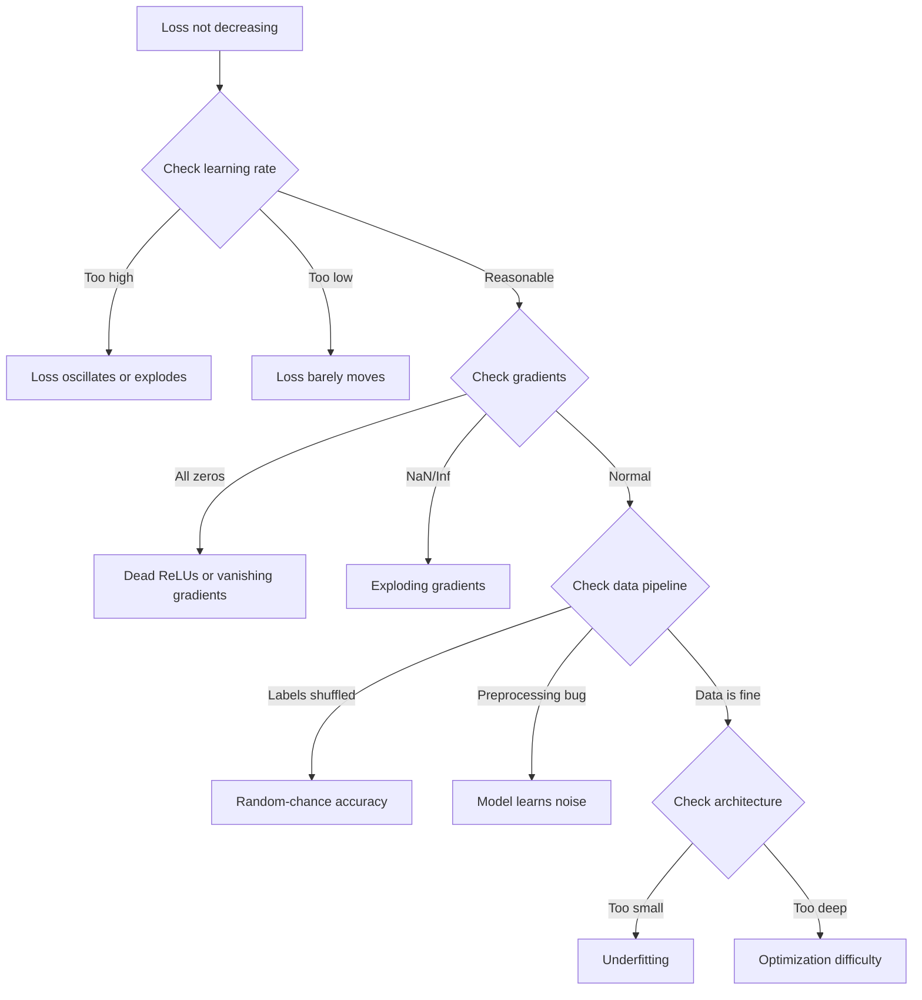
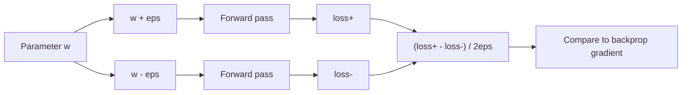
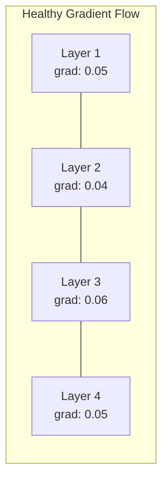
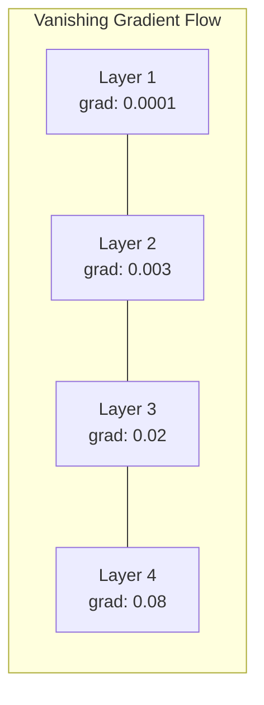
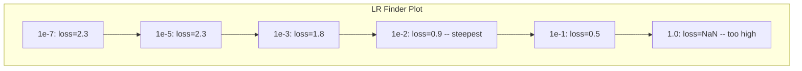

# Debugging Neural Networks

> Mạng của bạn đã biên dịch. Nó đã chạy. Nó tạo ra một con số. Con số sai và không có gì bị sập. Chào mừng đến với kiểu gỡ lỗi khó nhất -- kiểu không có thông báo lỗi.

**Type:** Build
**Languages:** Python, PyTorch
**Prerequisites:** Phase 03 Lessons 01-10 (especially backpropagation, loss functions, optimizers)
**Time:** ~90 minutes

## Learning Objectives

- Chẩn đoán các thất bại mạng nơ-ron thường gặp (mất mát NaN, đường cong mất mát phẳng, quá khớp, dao động) bằng các chiến lược gỡ lỗi có hệ thống
- Áp dụng kỹ thuật "quá khớp một batch" để xác minh kiến trúc mô hình và vòng lặp huấn luyện của bạn đúng
- Xem xét các độ lớn gradient, phân phối kích hoạt và chuẩn trọng số để xác định các vấn đề gradient tiêu biến/bùng nổ
- Xây dựng một danh sách kiểm tra gỡ lỗi bao quát các vấn đề pipeline dữ liệu, kiến trúc mô hình, hàm mất mát, bộ tối ưu hóa và tốc độ học

## The Problem

Phần mềm truyền thống sập khi nó hỏng. Một con trỏ null ném ra ngoại lệ. Một trường hợp không khớp kiểu thất bại lúc biên dịch. Một lỗi lệch một đơn vị tạo ra đầu ra rõ ràng sai.

Mạng nơ-ron không cho bạn sự xa xỉ đó.

Một mạng nơ-ron hỏng chạy đến hoàn tất, in một giá trị mất mát và xuất ra các dự đoán. Mất mát có thể giảm. Các dự đoán có thể trông hợp lý. Nhưng mô hình âm thầm sai -- học các lối tắt, ghi nhớ nhiễu hoặc hội tụ tới một cực tiểu cục bộ vô dụng. Các nhà nghiên cứu Google ước tính 60-70% thời gian gỡ lỗi ML dành cho các lỗi "âm thầm" không tạo ra lỗi nhưng làm giảm chất lượng mô hình.

Khác biệt giữa một mô hình hoạt động và một mô hình hỏng thường là một dòng đặt sai chỗ: thiếu `zero_grad()`, một chiều bị chuyển vị, một tốc độ học sai lệch 10 lần. tài liệu chuẩn "Recipe for Training Neural Networks" (2019) mở đầu bằng điều này: "Những sai lầm mạng nơ-ron thường gặp nhất là các lỗi không gây sập."

Bài học này dạy bạn tìm những lỗi đó.

## The Concept

### The Debugging Mindset

Quên cách gỡ lỗi in-ra-rồi-cầu-nguyện đi. Gỡ lỗi mạng nơ-ron cần một cách tiếp cận có hệ thống vì vòng phản hồi chậm (vài phút tới vài giờ mỗi lần huấn luyện) và các triệu chứng mơ hồ (mất mát tệ có thể có 20 ý nghĩa khác nhau).

Quy tắc vàng: **bắt đầu đơn giản, thêm độ phức tạp từng phần một và xác minh từng phần độc lập.**



### Symptom 1: Loss Not Decreasing

Đây là lời phàn nàn thường gặp nhất. Vòng lặp huấn luyện chạy, các epoch trôi qua và mất mát giữ phẳng hoặc dao động dữ dội.

**Tốc độ học sai.** Quá cao: mất mát dao động hoặc nhảy tới NaN. Quá thấp: mất mát giảm chậm tới mức trông phẳng. Với Adam, bắt đầu ở 1e-3. Với SGD, bắt đầu ở 1e-1 hoặc 1e-2. Luôn thử 3 tốc độ học cách nhau 10 lần (ví dụ: 1e-2, 1e-3, 1e-4) trước khi kết luận có điều gì khác sai.

**ReLU chết.** Nếu một nơ-ron ReLU nhận một đầu vào âm lớn, nó xuất ra 0 và gradient của nó là 0. Nó không bao giờ kích hoạt trở lại. Nếu đủ nơ-ron chết, mạng không thể học. Kiểm tra: in tỷ lệ các kích hoạt đúng bằng 0 sau mỗi lớp ReLU. Nếu >50% đã chết, chuyển sang LeakyReLU hoặc giảm tốc độ học.

**Gradient tiêu biến.** Trong các mạng sâu có kích hoạt sigmoid hoặc tanh, các gradient co lại theo cấp số nhân khi lan truyền ngược. Khi đến lớp đầu tiên, chúng là ~0. Các lớp đầu ngừng học. Khắc phục: sử dụng ReLU/GELU, thêm các kết nối phần dư hoặc sử dụng batch normalization.

**Gradient bùng nổ.** Vấn đề ngược lại -- các gradient tăng theo cấp số nhân. Thường gặp trong RNN và các mạng rất sâu. Mất mát nhảy tới NaN. Khắc phục: cắt gradient (`torch.nn.utils.clip_grad_norm_`), giảm tốc độ học hoặc thêm chuẩn hóa.

### Symptom 2: Loss Decreasing But Model is Bad

Mất mát đi xuống. Accuracy huấn luyện đạt 99%. Nhưng accuracy test là 55%. Hoặc mô hình tạo ra các đầu ra vô nghĩa trên dữ liệu thật.

**Quá khớp.** Mô hình ghi nhớ dữ liệu huấn luyện thay vì học các mẫu. Khoảng cách giữa mất mát huấn luyện và validation tăng theo thời gian. Khắc phục: thêm dữ liệu, dropout, weight decay, dừng sớm, tăng cường dữ liệu.

**Rò rỉ dữ liệu.** Dữ liệu test rò vào huấn luyện. Accuracy cao đáng ngờ. Các nguyên nhân thường gặp: xáo trộn trước khi chia, tiền xử lý với thống kê từ toàn bộ tập dữ liệu, các mẫu trùng lặp giữa các tập chia. Khắc phục: chia trước, tiền xử lý sau, kiểm tra trùng lặp.

**Lỗi nhãn.** 5-10% nhãn trong hầu hết các tập dữ liệu thật là sai (Northcutt et al., 2021 -- "Pervasive Label Errors in Test Sets"). Mô hình học nhiễu. Khắc phục: sử dụng confident learning để tìm và sửa các ví dụ gán nhãn sai, hoặc sử dụng cắt cụt mất mát để bỏ qua các mẫu có mất mát cao.

### Symptom 3: NaN or Inf in Loss

Giá trị mất mát trở thành `nan` hoặc `inf`. Huấn luyện đã chết.

**Tốc độ học quá cao.** Các cập nhật gradient vượt quá xa tới mức các trọng số bùng nổ. Khắc phục: giảm 10 lần.

**log(0) hoặc log(âm).** Mất mát cross-entropy tính `log(p)`. Nếu mô hình của bạn xuất ra đúng 0 hoặc một xác suất âm, log bùng nổ. Khắc phục: chặn các dự đoán về `[eps, 1-eps]` trong đó `eps=1e-7`.

**Chia cho không.** Batch normalization chia cho độ lệch chuẩn. Một batch có các giá trị hằng có std=0. Khắc phục: thêm epsilon vào mẫu số (PyTorch làm điều này theo mặc định, nhưng các bản triển khai tùy chỉnh có thể không).

**Tràn số.** Các kích hoạt lớn đưa vào `exp()` tạo ra Inf. Softmax đặc biệt dễ gặp. Khắc phục: trừ giá trị lớn nhất trước khi lấy hàm mũ (thủ thuật log-sum-exp).

### Technique 1: Gradient Checking

So sánh các gradient giải tích của bạn (từ backprop) với các gradient số (từ sai phân hữu hạn). Nếu chúng không khớp, lượt truyền ngược của bạn có lỗi.

Gradient số cho tham số `w`:

```
grad_numerical = (loss(w + eps) - loss(w - eps)) / (2 * eps)
```

Thước đo mức khớp (chênh lệch tương đối):

```
rel_diff = |grad_analytical - grad_numerical| / max(|grad_analytical|, |grad_numerical|, 1e-8)
```

Nếu `rel_diff < 1e-5`: đúng. Nếu `rel_diff > 1e-3`: gần như chắc chắn có lỗi.



### Technique 2: Activation Statistics

Giám sát trung bình và độ lệch chuẩn của các kích hoạt sau mỗi lớp trong huấn luyện. Các mạng khỏe mạnh duy trì các kích hoạt có trung bình gần 0 và độ lệch chuẩn gần 1 (sau chuẩn hóa) hoặc ít nhất bị chặn.

| Chỉ báo sức khỏe | Trung bình | Độ lệch chuẩn | Chẩn đoán |
|-----------------|------|-----|-----------|
| Khỏe mạnh | ~0 | ~1 | Mạng đang học bình thường |
| Bão hòa | >>0 hoặc <<0 | ~0 | Các kích hoạt mắc kẹt ở các giá trị cực đoan |
| Chết | 0 | 0 | Các nơ-ron đã chết (tất cả bằng không) |
| Bùng nổ | >>10 | >>10 | Các kích hoạt tăng không giới hạn |

### Technique 3: Gradient Flow Visualization

Vẽ độ lớn gradient trung bình cho mỗi lớp. Trong một mạng khỏe mạnh, các độ lớn gradient nên gần tương tự giữa các lớp. Nếu các lớp đầu có gradient nhỏ hơn các lớp sau 1000 lần, bạn có gradient tiêu biến.





### Technique 4: The Overfit-One-Batch Test

Kỹ thuật gỡ lỗi quan trọng nhất trong học sâu.

Lấy một batch nhỏ (8-32 mẫu). Huấn luyện trên nó trong 100+ lần lặp. Mất mát nên về gần không và accuracy huấn luyện nên đạt 100%. Nếu không, mô hình hoặc vòng lặp huấn luyện của bạn có một lỗi cơ bản -- đừng tiếp tục huấn luyện đầy đủ.

Phép kiểm tra này phát hiện:
- Các hàm mất mát hỏng
- Các lượt truyền ngược hỏng
- Kiến trúc quá nhỏ để biểu diễn dữ liệu
- Bộ tối ưu hóa không được kết nối với các tham số mô hình
- Dữ liệu và nhãn bị lệch nhau

Phép kiểm tra này mất 30 giây để chạy và tiết kiệm hàng giờ gỡ lỗi các lần huấn luyện đầy đủ.

### Technique 5: Learning Rate Finder

Leslie Smith (2017) đề xuất quét tốc độ học từ rất nhỏ (1e-7) tới rất lớn (10) trong một epoch trong khi ghi lại mất mát. Vẽ mất mát theo tốc độ học. Tốc độ học tối ưu nhỏ hơn khoảng 10 lần tốc độ mà mất mát bắt đầu giảm nhanh nhất.



LR tốt nhất trong ví dụ này: ~1e-3 (một bậc độ lớn trước điểm dốc nhất).

### Common PyTorch Bugs

Đây là những lỗi gây lãng phí tổng số giờ nhiều nhất trong cộng đồng PyTorch:

| Lỗi | Triệu chứng | Cách khắc phục |
|-----|---------|-----|
| Quên `optimizer.zero_grad()` | Các gradient tích lũy qua các batch, mất mát dao động | Thêm `optimizer.zero_grad()` trước `loss.backward()` |
| Quên `model.eval()` khi test | Dropout và batch norm hoạt động khác nhau, accuracy test thay đổi giữa các lần chạy | Thêm `model.eval()` và `torch.no_grad()` |
| Hình dạng tensor sai | Broadcasting âm thầm tạo ra các kết quả sai, không có lỗi | In các hình dạng sau mỗi phép toán khi gỡ lỗi |
| CPU/GPU không khớp | `RuntimeError: expected CUDA tensor` | Sử dụng `.to(device)` trên mô hình VÀ dữ liệu |
| Không tách các tensor | Đồ thị tính toán tăng mãi, OOM | Sử dụng `.detach()` hoặc `with torch.no_grad()` |
| Các phép toán tại chỗ làm hỏng autograd | `RuntimeError: modified by in-place operation` | Thay `x += 1` bằng `x = x + 1` |
| Dữ liệu không được chuẩn hóa | Mất mát mắc kẹt ở mức may rủi ngẫu nhiên | Chuẩn hóa các đầu vào về mean=0, std=1 |
| Nhãn sai dtype | Cross-entropy kỳ vọng `Long`, nhận `Float` | Ép kiểu nhãn: `labels.long()` |

### The Master Debugging Table

| Triệu chứng | Nguyên nhân có khả năng | Điều đầu tiên cần thử |
|---------|-------------|-------------------|
| Mất mát mắc kẹt ở -log(1/num_classes) | Mô hình dự đoán phân phối đều | Kiểm tra pipeline dữ liệu, xác minh nhãn khớp đầu vào |
| Mất mát NaN sau vài bước | Tốc độ học quá cao | Giảm LR 10 lần |
| Mất mát NaN ngay lập tức | log(0) hoặc chia cho không | Thêm epsilon vào các phép toán log/chia |
| Mất mát dao động dữ dội | LR quá cao hoặc kích thước batch quá nhỏ | Giảm LR, tăng kích thước batch |
| Mất mát giảm rồi chững lại | LR quá cao cho giai đoạn tinh chỉnh | Thêm lịch LR (cosine hoặc suy giảm bậc thang) |
| Accuracy huấn luyện cao, accuracy test thấp | Quá khớp | Thêm dropout, weight decay, thêm dữ liệu |
| Accuracy huấn luyện = accuracy test = may rủi | Mô hình không học được gì | Chạy phép kiểm tra quá khớp một batch |
| Accuracy huấn luyện = accuracy test nhưng cả hai thấp | Khớp thiếu | Mô hình lớn hơn, nhiều lớp hơn, nhiều đặc trưng hơn |
| Các gradient đều bằng không | ReLU chết hoặc đồ thị tính toán bị tách | Chuyển sang LeakyReLU, kiểm tra `.requires_grad` |
| Hết bộ nhớ trong huấn luyện | Batch quá lớn hoặc đồ thị chưa được giải phóng | Giảm kích thước batch, sử dụng `torch.no_grad()` cho eval |

```figure
learning-curves
```

## Build It

Một bộ công cụ chẩn đoán giám sát các kích hoạt, gradient và đường cong mất mát. Bạn sẽ cố ý làm hỏng một mạng và sử dụng bộ công cụ để chẩn đoán từng vấn đề.

### Step 1: The NetworkDebugger Class

Gắn hook vào một mô hình PyTorch để ghi lại các thống kê kích hoạt và gradient theo từng lớp.

```python
import torch
import torch.nn as nn
import math


class NetworkDebugger:
    def __init__(self, model):
        self.model = model
        self.activation_stats = {}
        self.gradient_stats = {}
        self.loss_history = []
        self.lr_losses = []
        self.hooks = []
        self._register_hooks()

    def _register_hooks(self):
        for name, module in self.model.named_modules():
            if isinstance(module, (nn.Linear, nn.Conv2d, nn.ReLU, nn.LeakyReLU)):
                hook = module.register_forward_hook(self._make_activation_hook(name))
                self.hooks.append(hook)
                hook = module.register_full_backward_hook(self._make_gradient_hook(name))
                self.hooks.append(hook)

    def _make_activation_hook(self, name):
        def hook(module, input, output):
            with torch.no_grad():
                out = output.detach().float()
                self.activation_stats[name] = {
                    "mean": out.mean().item(),
                    "std": out.std().item(),
                    "fraction_zero": (out == 0).float().mean().item(),
                    "min": out.min().item(),
                    "max": out.max().item(),
                }
        return hook

    def _make_gradient_hook(self, name):
        def hook(module, grad_input, grad_output):
            if grad_output[0] is not None:
                with torch.no_grad():
                    grad = grad_output[0].detach().float()
                    self.gradient_stats[name] = {
                        "mean": grad.mean().item(),
                        "std": grad.std().item(),
                        "abs_mean": grad.abs().mean().item(),
                        "max": grad.abs().max().item(),
                    }
        return hook

    def record_loss(self, loss_value):
        self.loss_history.append(loss_value)

    def check_loss_health(self):
        if len(self.loss_history) < 2:
            return "NOT_ENOUGH_DATA"
        recent = self.loss_history[-10:]
        if any(math.isnan(v) or math.isinf(v) for v in recent):
            return "NAN_OR_INF"
        if len(self.loss_history) >= 20:
            first_half = sum(self.loss_history[:10]) / 10
            second_half = sum(self.loss_history[-10:]) / 10
            if second_half >= first_half * 0.99:
                return "NOT_DECREASING"
        if len(recent) >= 5:
            diffs = [recent[i+1] - recent[i] for i in range(len(recent)-1)]
            if max(diffs) - min(diffs) > 2 * abs(sum(diffs) / len(diffs)):
                return "OSCILLATING"
        return "HEALTHY"

    def check_activations(self):
        issues = []
        for name, stats in self.activation_stats.items():
            if stats["fraction_zero"] > 0.5:
                issues.append(f"DEAD_NEURONS: {name} has {stats['fraction_zero']:.0%} zero activations")
            if abs(stats["mean"]) > 10:
                issues.append(f"EXPLODING_ACTIVATIONS: {name} mean={stats['mean']:.2f}")
            if stats["std"] < 1e-6:
                issues.append(f"COLLAPSED_ACTIVATIONS: {name} std={stats['std']:.2e}")
        return issues if issues else ["HEALTHY"]

    def check_gradients(self):
        issues = []
        grad_magnitudes = []
        for name, stats in self.gradient_stats.items():
            grad_magnitudes.append((name, stats["abs_mean"]))
            if stats["abs_mean"] < 1e-7:
                issues.append(f"VANISHING_GRADIENT: {name} abs_mean={stats['abs_mean']:.2e}")
            if stats["abs_mean"] > 100:
                issues.append(f"EXPLODING_GRADIENT: {name} abs_mean={stats['abs_mean']:.2e}")
        if len(grad_magnitudes) >= 2:
            first_mag = grad_magnitudes[0][1]
            last_mag = grad_magnitudes[-1][1]
            if last_mag > 0 and first_mag / last_mag > 100:
                issues.append(f"GRADIENT_RATIO: first/last = {first_mag/last_mag:.0f}x (vanishing)")
        return issues if issues else ["HEALTHY"]

    def print_report(self):
        print("\n=== NETWORK DEBUGGER REPORT ===")
        print(f"\nLoss health: {self.check_loss_health()}")
        if self.loss_history:
            print(f"  Last 5 losses: {[f'{v:.4f}' for v in self.loss_history[-5:]]}")
        print("\nActivation diagnostics:")
        for item in self.check_activations():
            print(f"  {item}")
        print("\nGradient diagnostics:")
        for item in self.check_gradients():
            print(f"  {item}")
        print("\nPer-layer activation stats:")
        for name, stats in self.activation_stats.items():
            print(f"  {name}: mean={stats['mean']:.4f} std={stats['std']:.4f} zero={stats['fraction_zero']:.1%}")
        print("\nPer-layer gradient stats:")
        for name, stats in self.gradient_stats.items():
            print(f"  {name}: abs_mean={stats['abs_mean']:.2e} max={stats['max']:.2e}")

    def remove_hooks(self):
        for hook in self.hooks:
            hook.remove()
        self.hooks.clear()
```

### Step 2: The Overfit-One-Batch Test

```python
def overfit_one_batch(model, x_batch, y_batch, criterion, lr=0.01, steps=200):
    optimizer = torch.optim.Adam(model.parameters(), lr=lr)
    model.train()
    print("\n=== OVERFIT ONE BATCH TEST ===")
    print(f"Batch size: {x_batch.shape[0]}, Steps: {steps}")

    for step in range(steps):
        optimizer.zero_grad()
        output = model(x_batch)
        loss = criterion(output, y_batch)
        loss.backward()
        optimizer.step()

        if step % 50 == 0 or step == steps - 1:
            with torch.no_grad():
                preds = (output > 0).float() if output.shape[-1] == 1 else output.argmax(dim=1)
                targets = y_batch if y_batch.dim() == 1 else y_batch.squeeze()
                acc = (preds.squeeze() == targets).float().mean().item()
            print(f"  Step {step:3d} | Loss: {loss.item():.6f} | Accuracy: {acc:.1%}")

    final_loss = loss.item()
    if final_loss > 0.1:
        print(f"\n  FAIL: Loss did not converge ({final_loss:.4f}). Model or training loop is broken.")
        return False
    print(f"\n  PASS: Loss converged to {final_loss:.6f}")
    return True
```

### Step 3: Learning Rate Finder

```python
def find_learning_rate(model, x_data, y_data, criterion, start_lr=1e-7, end_lr=10, steps=100):
    import copy
    original_state = copy.deepcopy(model.state_dict())
    optimizer = torch.optim.SGD(model.parameters(), lr=start_lr)
    lr_mult = (end_lr / start_lr) ** (1 / steps)

    model.train()
    results = []
    best_loss = float("inf")
    current_lr = start_lr

    print("\n=== LEARNING RATE FINDER ===")

    for step in range(steps):
        optimizer.zero_grad()
        output = model(x_data)
        loss = criterion(output, y_data)

        if math.isnan(loss.item()) or loss.item() > best_loss * 10:
            break

        best_loss = min(best_loss, loss.item())
        results.append((current_lr, loss.item()))

        loss.backward()
        optimizer.step()

        current_lr *= lr_mult
        for param_group in optimizer.param_groups:
            param_group["lr"] = current_lr

    model.load_state_dict(original_state)

    if len(results) < 10:
        print("  Could not complete LR sweep -- loss diverged too quickly")
        return results

    min_loss_idx = min(range(len(results)), key=lambda i: results[i][1])
    suggested_lr = results[max(0, min_loss_idx - 10)][0]

    print(f"  Swept {len(results)} steps from {start_lr:.0e} to {results[-1][0]:.0e}")
    print(f"  Minimum loss {results[min_loss_idx][1]:.4f} at lr={results[min_loss_idx][0]:.2e}")
    print(f"  Suggested learning rate: {suggested_lr:.2e}")

    return results
```

### Step 4: Gradient Checker

```python
def _flat_to_multi_index(flat_idx, shape):
    multi_idx = []
    remaining = flat_idx
    for dim in reversed(shape):
        multi_idx.insert(0, remaining % dim)
        remaining //= dim
    return tuple(multi_idx)


def gradient_check(model, x, y, criterion, eps=1e-4):
    model.train()
    x_double = x.double()
    y_double = y.double()
    model_double = model.double()

    print("\n=== GRADIENT CHECK ===")
    overall_max_diff = 0
    checked = 0

    for name, param in model_double.named_parameters():
        if not param.requires_grad:
            continue

        layer_max_diff = 0

        model_double.zero_grad()
        output = model_double(x_double)
        loss = criterion(output, y_double)
        loss.backward()
        analytical_grad = param.grad.clone()

        num_checks = min(5, param.numel())
        for i in range(num_checks):
            idx = _flat_to_multi_index(i, param.shape)
            original = param.data[idx].item()

            param.data[idx] = original + eps
            with torch.no_grad():
                loss_plus = criterion(model_double(x_double), y_double).item()

            param.data[idx] = original - eps
            with torch.no_grad():
                loss_minus = criterion(model_double(x_double), y_double).item()

            param.data[idx] = original

            numerical = (loss_plus - loss_minus) / (2 * eps)
            analytical = analytical_grad[idx].item()

            denom = max(abs(numerical), abs(analytical), 1e-8)
            rel_diff = abs(numerical - analytical) / denom

            layer_max_diff = max(layer_max_diff, rel_diff)
            checked += 1

        overall_max_diff = max(overall_max_diff, layer_max_diff)
        status = "OK" if layer_max_diff < 1e-5 else "MISMATCH"
        print(f"  {name}: max_rel_diff={layer_max_diff:.2e} [{status}]")

    model.float()

    print(f"\n  Checked {checked} parameters")
    if overall_max_diff < 1e-5:
        print("  PASS: Gradients match (rel_diff < 1e-5)")
    elif overall_max_diff < 1e-3:
        print("  WARN: Small differences (1e-5 < rel_diff < 1e-3)")
    else:
        print("  FAIL: Gradient mismatch detected (rel_diff > 1e-3)")
    return overall_max_diff
```

### Step 5: Deliberately Broken Networks

Giờ áp dụng bộ công cụ cho các mạng hỏng và chẩn đoán từng mạng.

```python
def demo_broken_networks():
    torch.manual_seed(42)
    x = torch.randn(64, 10)
    y = (x[:, 0] > 0).long()

    print("\n" + "=" * 60)
    print("BUG 1: Learning rate too high (lr=10)")
    print("=" * 60)
    model1 = nn.Sequential(nn.Linear(10, 32), nn.ReLU(), nn.Linear(32, 2))
    debugger1 = NetworkDebugger(model1)
    optimizer1 = torch.optim.SGD(model1.parameters(), lr=10.0)
    criterion = nn.CrossEntropyLoss()
    for step in range(20):
        optimizer1.zero_grad()
        out = model1(x)
        loss = criterion(out, y)
        debugger1.record_loss(loss.item())
        loss.backward()
        optimizer1.step()
    debugger1.print_report()
    debugger1.remove_hooks()

    print("\n" + "=" * 60)
    print("BUG 2: Dead ReLUs from bad initialization")
    print("=" * 60)
    model2 = nn.Sequential(nn.Linear(10, 32), nn.ReLU(), nn.Linear(32, 32), nn.ReLU(), nn.Linear(32, 2))
    with torch.no_grad():
        for m in model2.modules():
            if isinstance(m, nn.Linear):
                m.weight.fill_(-1.0)
                m.bias.fill_(-5.0)
    debugger2 = NetworkDebugger(model2)
    optimizer2 = torch.optim.Adam(model2.parameters(), lr=1e-3)
    for step in range(50):
        optimizer2.zero_grad()
        out = model2(x)
        loss = criterion(out, y)
        debugger2.record_loss(loss.item())
        loss.backward()
        optimizer2.step()
    debugger2.print_report()
    debugger2.remove_hooks()

    print("\n" + "=" * 60)
    print("BUG 3: Missing zero_grad (gradients accumulate)")
    print("=" * 60)
    model3 = nn.Sequential(nn.Linear(10, 32), nn.ReLU(), nn.Linear(32, 2))
    debugger3 = NetworkDebugger(model3)
    optimizer3 = torch.optim.SGD(model3.parameters(), lr=0.01)
    for step in range(50):
        out = model3(x)
        loss = criterion(out, y)
        debugger3.record_loss(loss.item())
        loss.backward()
        optimizer3.step()
    debugger3.print_report()
    debugger3.remove_hooks()

    print("\n" + "=" * 60)
    print("HEALTHY NETWORK: Correct setup for comparison")
    print("=" * 60)
    model_good = nn.Sequential(nn.Linear(10, 32), nn.ReLU(), nn.Linear(32, 2))
    debugger_good = NetworkDebugger(model_good)
    optimizer_good = torch.optim.Adam(model_good.parameters(), lr=1e-3)
    for step in range(50):
        optimizer_good.zero_grad()
        out = model_good(x)
        loss = criterion(out, y)
        debugger_good.record_loss(loss.item())
        loss.backward()
        optimizer_good.step()
    debugger_good.print_report()
    debugger_good.remove_hooks()

    print("\n" + "=" * 60)
    print("OVERFIT-ONE-BATCH TEST (healthy model)")
    print("=" * 60)
    model_test = nn.Sequential(nn.Linear(10, 32), nn.ReLU(), nn.Linear(32, 2))
    overfit_one_batch(model_test, x[:8], y[:8], criterion)

    print("\n" + "=" * 60)
    print("LEARNING RATE FINDER")
    print("=" * 60)
    model_lr = nn.Sequential(nn.Linear(10, 32), nn.ReLU(), nn.Linear(32, 2))
    find_learning_rate(model_lr, x, y, criterion)

    print("\n" + "=" * 60)
    print("GRADIENT CHECK")
    print("=" * 60)
    model_grad = nn.Sequential(nn.Linear(10, 8), nn.ReLU(), nn.Linear(8, 2))
    gradient_check(model_grad, x[:4], y[:4], criterion)
```

## Use It

### PyTorch Built-in Tools

```python
import torch
import torch.nn as nn

model = nn.Sequential(
    nn.Linear(768, 256),
    nn.ReLU(),
    nn.Linear(256, 10),
)

with torch.autograd.detect_anomaly():
    output = model(input_tensor)
    loss = criterion(output, target)
    loss.backward()

for name, param in model.named_parameters():
    if param.grad is not None:
        print(f"{name}: grad_mean={param.grad.abs().mean():.2e}")
```

### Weights & Biases Integration

```python
import wandb

wandb.init(project="debug-training")

for epoch in range(100):
    loss = train_one_epoch()
    wandb.log({
        "loss": loss,
        "lr": optimizer.param_groups[0]["lr"],
        "grad_norm": torch.nn.utils.clip_grad_norm_(model.parameters(), float("inf")),
    })

    for name, param in model.named_parameters():
        if param.grad is not None:
            wandb.log({f"grad/{name}": wandb.Histogram(param.grad.cpu().numpy())})
```

### TensorBoard

```python
from torch.utils.tensorboard import SummaryWriter

writer = SummaryWriter("runs/debug_experiment")

for epoch in range(100):
    loss = train_one_epoch()
    writer.add_scalar("Loss/train", loss, epoch)

    for name, param in model.named_parameters():
        writer.add_histogram(f"weights/{name}", param, epoch)
        if param.grad is not None:
            writer.add_histogram(f"gradients/{name}", param.grad, epoch)
```

### The Debug Checklist (Before Full Training)

1. Chạy phép kiểm tra quá khớp một batch. Nếu thất bại, dừng.
2. In tóm tắt mô hình -- xác minh số tham số hợp lý.
3. Chạy một lượt truyền xuôi với dữ liệu ngẫu nhiên -- kiểm tra hình dạng đầu ra.
4. Huấn luyện trong 5 epoch -- xác minh mất mát giảm.
5. Kiểm tra thống kê kích hoạt -- không lớp chết, không bùng nổ.
6. Kiểm tra luồng gradient -- không tiêu biến, không bùng nổ.
7. Xác minh pipeline dữ liệu -- in 5 mẫu ngẫu nhiên với nhãn.

## Ship It

Bài học này tạo ra:
- `outputs/prompt-nn-debugger.md` -- một prompt chẩn đoán các thất bại huấn luyện mạng nơ-ron
- `outputs/skill-debug-checklist.md` -- một danh sách kiểm tra dạng cây quyết định để gỡ lỗi các vấn đề huấn luyện

Các mẫu triển khai chính cho gỡ lỗi:
- Thêm các hook giám sát vào các script huấn luyện production
- Ghi các thống kê kích hoạt và gradient vào W&B hoặc TensorBoard mỗi N bước
- Triển khai các cảnh báo tự động cho mất mát NaN, nơ-ron chết (>80% bằng không) hoặc bùng nổ gradient
- Luôn chạy phép kiểm tra quá khớp một batch khi thay đổi kiến trúc hoặc pipeline dữ liệu

## Exercises

1. **Thêm một bộ phát hiện gradient bùng nổ.** Sửa `NetworkDebugger` để phát hiện khi các gradient vượt một ngưỡng và tự động đề xuất một giá trị cắt gradient. Kiểm thử trên một mạng 20 lớp không có chuẩn hóa.

2. **Xây dựng một công cụ hồi sinh nơ-ron chết.** Viết một hàm xác định các nơ-ron ReLU chết (luôn xuất ra 0) và khởi tạo lại các trọng số đi vào của chúng bằng khởi tạo Kaiming. Cho thấy điều này phục hồi một mạng mà >70% nơ-ron đã chết.

3. **Triển khai công cụ tìm tốc độ học với vẽ đồ thị.** Mở rộng `find_learning_rate` để lưu các kết quả thành CSV và viết một script riêng đọc CSV rồi hiển thị đường cong LR theo mất mát bằng matplotlib. Xác định LR tối ưu cho ResNet-18 trên CIFAR-10.

4. **Tạo một bộ xác thực pipeline dữ liệu.** Viết một hàm kiểm tra: các mẫu trùng lặp giữa các tập chia huấn luyện/test, mất cân bằng phân phối nhãn (tỷ lệ >10:1), chuẩn hóa đầu vào (trung bình gần 0, độ lệch chuẩn gần 1) và các giá trị NaN/Inf trong dữ liệu. Chạy trên một tập dữ liệu được cố ý làm hỏng.

5. **Gỡ lỗi một thất bại thực tế.** Lấy mini-framework từ Bài 10, đưa vào một lỗi tinh vi (ví dụ: chuyển vị ma trận trọng số trong backward) và sử dụng kiểm tra gradient để xác định chính xác tham số nào có gradient sai. Ghi lại quá trình gỡ lỗi.

## Key Terms

| Thuật ngữ | Cách mọi người nói | Ý nghĩa thực sự |
|------|----------------|----------------------|
| Silent bug (Lỗi âm thầm) | "Nó chạy nhưng cho kết quả tệ" | Một lỗi không tạo ra thông báo lỗi nhưng làm giảm chất lượng mô hình -- kiểu thất bại chủ đạo trong ML |
| Dead ReLU (ReLU chết) | "Các nơ-ron đã chết" | Một nơ-ron ReLU có đầu vào luôn âm, nên nó xuất ra 0 và nhận gradient 0 vĩnh viễn |
| Vanishing gradients (Gradient tiêu biến) | "Các lớp đầu ngừng học" | Các gradient co lại theo cấp số nhân qua các lớp, khiến các trọng số ở các lớp đầu về thực chất bị đóng băng |
| Exploding gradients (Gradient bùng nổ) | "Mất mát thành NaN" | Các gradient tăng theo cấp số nhân qua các lớp, gây ra các cập nhật trọng số lớn tới mức tràn số |
| Gradient checking (Kiểm tra gradient) | "Xác minh backprop đúng" | So sánh các gradient giải tích từ backprop với các gradient số từ sai phân hữu hạn |
| Overfit-one-batch (Quá khớp một batch) | "Phép kiểm tra gỡ lỗi quan trọng nhất" | Huấn luyện trên một batch nhỏ duy nhất để xác minh mô hình CÓ THỂ học -- nếu không, có điều gì đó hỏng về cơ bản |
| LR finder (Công cụ tìm LR) | "Quét để tìm tốc độ học đúng" | Tăng tốc độ học theo hàm mũ trong một epoch và chọn tốc độ ngay trước khi mất mát phân kỳ |
| Data leakage (Rò rỉ dữ liệu) | "Dữ liệu test rò vào huấn luyện" | Khi thông tin từ tập test làm nhiễm huấn luyện, tạo ra accuracy cao giả tạo |
| Activation statistics (Thống kê kích hoạt) | "Giám sát sức khỏe lớp" | Theo dõi trung bình, độ lệch chuẩn và tỷ lệ bằng không của đầu ra mỗi lớp để phát hiện các nơ-ron chết, bão hòa hoặc bùng nổ |
| Gradient clipping (Cắt gradient) | "Chặn độ lớn gradient" | Co nhỏ các gradient khi chuẩn của chúng vượt một ngưỡng, ngăn các cập nhật gradient bùng nổ |

## Further Reading

- Smith, "Cyclical Learning Rates for Training Neural Networks" (2017) -- bài báo giới thiệu phép kiểm tra phạm vi tốc độ học (công cụ tìm LR)
- Northcutt et al., "Pervasive Label Errors in Test Sets Destabilize Machine Learning Benchmarks" (2021) -- chứng minh 3-6% nhãn trong ImageNet, CIFAR-10 và các benchmark lớn khác là sai
- Zhang et al., "Understanding Deep Learning Requires Rethinking Generalization" (2017) -- bài báo cho thấy mạng nơ-ron có thể ghi nhớ các nhãn ngẫu nhiên, là lý do phép kiểm tra quá khớp một batch hoạt động
- Tài liệu PyTorch về `torch.autograd.detect_anomaly` và `torch.autograd.set_detect_anomaly` để phát hiện NaN/Inf tích hợp
