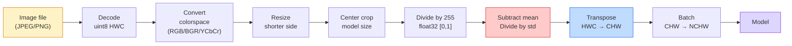
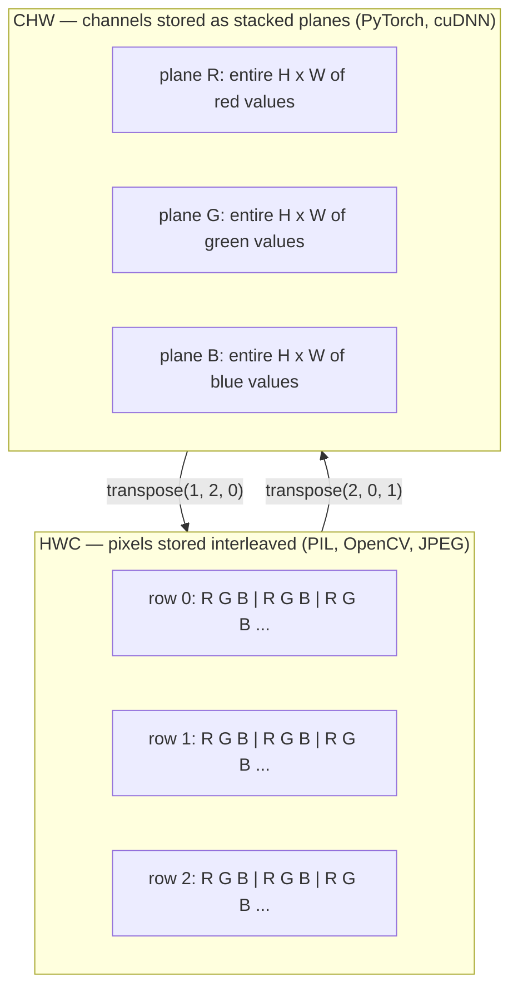

# Image Fundamentals — Pixels, Channels, Color Spaces

> Một hình ảnh là một tensor các mẫu ánh sáng. Mọi mô hình thị giác bạn sẽ sử dụng đều bắt đầu từ sự thật này.

**Type:** Build
**Languages:** Python
**Prerequisites:** Phase 1 Lesson 12 (Tensor Operations), Phase 3 Lesson 11 (Intro to PyTorch)
**Time:** ~45 minutes

## Learning Objectives

- Giải thích cách một cảnh liên tục được rời rạc hóa thành các pixel và tại sao các quyết định lấy mẫu/lượng tử hóa đặt ra giới hạn trên cho mọi mô hình phía sau
- Đọc, cắt lát và xem xét các hình ảnh dưới dạng mảng NumPy và chuyển đổi thành thạo giữa các bố cục HWC và CHW
- Chuyển đổi giữa RGB, thang xám, HSV và YCbCr và giải thích tại sao mỗi không gian màu tồn tại
- Áp dụng tiền xử lý cấp pixel (chuẩn hóa phạm vi, chuẩn hóa thống kê, đổi kích thước, kênh trước) đúng như các mô hình thị giác PyTorch được tiền huấn luyện kỳ vọng

## The Problem

Mọi bài báo bạn sẽ đọc, mọi trọng số được tiền huấn luyện bạn sẽ tải, mọi API thị giác bạn sẽ gọi đều giả định một cách mã hóa đầu vào cụ thể. Truyền một hình ảnh `uint8` vào nơi mô hình muốn `float32` và nó vẫn chạy — và âm thầm tạo ra rác. Đưa BGR vào một mạng được huấn luyện trên RGB và accuracy giảm mười điểm. Đưa cho một mô hình đầu vào kênh cuối khi nó kỳ vọng kênh trước và lớp tích chập đầu tiên coi chiều cao là một kênh đặc trưng. Không điều nào trong số này ném ra lỗi. Nó chỉ phá hỏng các thước đo và bạn dành một tuần săn tìm một lỗi nằm trong cách bạn tải file.

Một phép tích chập không phức tạp một khi bạn biết nó trượt trên cái gì. Phần khó là "một hình ảnh" có những ý nghĩa khác nhau đối với một máy ảnh, một bộ giải mã JPEG, PIL, OpenCV, torchvision và một kernel CUDA. Mỗi bộ công cụ có thứ tự trục, phạm vi byte và quy ước kênh riêng. Một kỹ sư thị giác không thể phân biệt rõ những điều này sẽ đưa ra các pipeline hỏng.

Bài học này sửa nền tảng để phần còn lại của giai đoạn có thể xây dựng trên đó. Khi kết thúc bạn sẽ biết pixel là gì, tại sao có ba số mỗi pixel thay vì một, "chuẩn hóa bằng thống kê ImageNet" thực sự làm gì và cách chuyển giữa hai hoặc ba bố cục mà mọi bài học khác trong giai đoạn này sẽ giả định.

## The Concept

### The full preprocessing pipeline at a glance

Mọi hệ thống thị giác production đều là cùng một chuỗi các phép biến đổi có thể đảo ngược. Làm sai một bước và mô hình thấy một đầu vào khác với đầu vào nó được huấn luyện.



Hai hộp đỏ và xanh dương là nơi 80% các thất bại âm thầm tồn tại: thiếu chuẩn hóa thống kê và sai bố cục.

### A pixel is a sample, not a square

Một cảm biến máy ảnh đếm các photon rơi lên một lưới các bộ dò nhỏ. Mỗi bộ dò tích phân ánh sáng trong một phần giây và phát ra một điện áp tỷ lệ với số photon chạm nó. Cảm biến sau đó rời rạc hóa điện áp đó thành một số nguyên. Một bộ dò trở thành một pixel.

```
Continuous scene                 Sensor grid                     Digital image
(infinite detail)                (H x W detectors)               (H x W integers)

    ~~~~~                        +--+--+--+--+--+                 210 198 180 155 120
   ~   ~   ~                     |  |  |  |  |  |                 205 195 178 152 118
  ~ light ~      ---->           +--+--+--+--+--+     ---->       200 190 175 150 115
   ~~~~~                         |  |  |  |  |  |                 195 185 170 148 112
                                 +--+--+--+--+--+                 188 180 165 145 108
```

Hai lựa chọn xảy ra ở bước này và chúng cố định giới hạn trên cho mọi thứ phía sau:

- **Lấy mẫu không gian** quyết định số bộ dò trên mỗi độ của cảnh. Quá ít, các cạnh trở nên răng cưa (aliasing). Quá nhiều, lưu trữ và tính toán bùng nổ.
- **Lượng tử hóa cường độ** quyết định điện áp được chia thành các mức mịn tới đâu. 8 bit cho 256 mức và là tiêu chuẩn hiển thị. 10, 12, 16 bit cho các chuyển sắc mượt hơn và quan trọng với hình ảnh y tế, HDR và các pipeline cảm biến thô.

Một pixel không phải một hình vuông có màu có diện tích. Nó là một phép đo đơn lẻ. Khi bạn đổi kích thước hoặc xoay, bạn đang lấy mẫu lại lưới đo đó.

### Why three channels

Một bộ dò đếm photon trên toàn bộ phổ nhìn thấy — đó là thang xám. Để có màu, cảm biến phủ lưới bằng một khảm các bộ lọc đỏ, xanh lá và xanh dương. Sau giải khảm, mọi vị trí không gian có ba số nguyên: phản hồi của bộ dò lọc đỏ, lọc xanh lá và lọc xanh dương ở gần đó. Ba số nguyên đó là bộ ba RGB của một pixel.

```
One pixel in memory:

    (R, G, B) = (210, 140, 30)   <- reddish-orange

An H x W RGB image:

    shape (H, W, 3)     stored as   H rows of W pixels of 3 values
                                    each in [0, 255] for uint8
```

Ba không phải phép thuật. Máy ảnh độ sâu thêm một kênh Z. Vệ tinh thêm các dải hồng ngoại và tử ngoại. Ảnh quét y tế thường có một kênh (X-quang, CT) hoặc nhiều kênh (siêu phổ). Số kênh là trục cuối; các lớp tích chập học cách trộn trên trục đó.

### Two layout conventions: HWC and CHW

Cùng tensor, hai cách sắp thứ tự. Mỗi thư viện chọn một.

```
HWC (height, width, channels)           CHW (channels, height, width)

   W ->                                    H ->
  +-----+-----+-----+                     +-----+-----+
H |R G B|R G B|R G B|                   C |R R R R R R|
| +-----+-----+-----+                   | +-----+-----+
v |R G B|R G B|R G B|                   v |G G G G G G|
  +-----+-----+-----+                     +-----+-----+
                                          |B B B B B B|
                                          +-----+-----+

   PIL, OpenCV, matplotlib,              PyTorch, most deep learning
   almost every image file on disk       frameworks, cuDNN kernels
```

CHW tồn tại vì các kernel tích chập trượt trên H và W. Giữ trục kênh đầu tiên nghĩa là mỗi kernel thấy một mặt phẳng 2D liền mạch mỗi kênh, dễ vector hóa. Các định dạng đĩa giữ HWC vì nó khớp cách các dòng quét đi ra từ cảm biến.

Phép chuyển đổi một dòng bạn sẽ gõ một nghìn lần:

```
img_chw = img_hwc.transpose(2, 0, 1)      # NumPy
img_chw = img_hwc.permute(2, 0, 1)        # PyTorch tensor
```

Bố trí bộ nhớ, được trực quan hóa:



### Byte ranges and dtype

Ba quy ước chiếm ưu thế:

| Quy ước | dtype | Phạm vi | Nơi bạn gặp |
|------------|-------|-------|------------------|
| Thô | `uint8` | [0, 255] | File trên đĩa, PIL, đầu ra OpenCV |
| Được chuẩn hóa phạm vi | `float32` | [0.0, 1.0] | Sau `img.astype('float32') / 255` |
| Được chuẩn hóa thống kê | `float32` | khoảng [-2, +2] | Sau khi trừ trung bình và chia độ lệch chuẩn |

Các mạng tích chập được huấn luyện trên các đầu vào đã chuẩn hóa thống kê. Thống kê ImageNet `mean=[0.485, 0.456, 0.406]`, `std=[0.229, 0.224, 0.225]` là trung bình cộng và độ lệch chuẩn của ba kênh trên toàn bộ tập huấn luyện ImageNet, được tính trên các pixel chuẩn hóa về [0, 1]. Đưa `uint8` thô vào một mô hình kỳ vọng float đã chuẩn hóa thống kê là thất bại âm thầm thường gặp nhất trong thị giác ứng dụng.

### Color spaces and why they exist

RGB là định dạng thu nhận nhưng không phải lúc nào cũng là biểu diễn hữu ích nhất cho một mô hình.

```
 RGB               HSV                       YCbCr / YUV

 R red             H hue (angle 0-360)       Y luminance (brightness)
 G green           S saturation (0-1)        Cb chroma blue-yellow
 B blue            V value/brightness (0-1)  Cr chroma red-green

 Linear to         Separates color from      Separates brightness from
 sensor output     brightness. Useful for    color. JPEG and most video
                   color thresholding, UI    codecs compress the chroma
                   sliders, simple filters   channels harder because the
                                             human eye is less sensitive
                                             to chroma detail than to Y.
```

Với hầu hết CNN hiện đại bạn đưa vào RGB. Bạn gặp các không gian khác khi:

- **HSV** — mã CV cổ điển, phân đoạn dựa trên màu, cân bằng trắng.
- **YCbCr** — đọc nội bộ JPEG, các pipeline video, các mô hình siêu phân giải chỉ hoạt động trên Y.
- **Thang xám** — OCR, các mô hình tài liệu, mọi trường hợp màu là biến gây nhiễu thay vì tín hiệu.

Thang xám từ RGB là một tổng có trọng số, không phải trung bình, vì mắt người nhạy với xanh lá hơn đỏ hoặc xanh dương:

```
Y = 0.299 R + 0.587 G + 0.114 B       (ITU-R BT.601, the classic weights)
```

### Aspect ratio, resizing, and interpolation

Mỗi mô hình có một kích thước đầu vào cố định (224x224 cho hầu hết bộ phân loại ImageNet, 384x384 hoặc 512x512 cho các bộ phát hiện hiện đại). Các hình ảnh của bạn hiếm khi khớp. Ba lựa chọn đổi kích thước quan trọng:

- **Đổi kích thước cạnh ngắn hơn, rồi cắt giữa** — công thức ImageNet tiêu chuẩn. Giữ tỷ lệ khung hình, bỏ một dải pixel ở cạnh.
- **Đổi kích thước và đệm** — giữ tỷ lệ khung hình và mọi pixel, thêm các dải đen. Tiêu chuẩn cho phát hiện và OCR.
- **Đổi kích thước trực tiếp tới mục tiêu** — kéo giãn hình ảnh. Rẻ, làm méo hình học, ổn cho nhiều tác vụ phân loại.

Phương pháp nội suy quyết định cách tính các pixel trung gian khi lưới mới không khớp lưới cũ:

```
Nearest neighbour     fastest, blocky, only choice for masks/labels
Bilinear              fast, smooth, default for most image resizing
Bicubic               slower, sharper on upscaling
Lanczos               slowest, best quality, used for final display
```

Quy tắc kinh nghiệm: song tuyến tính cho huấn luyện, song lập phương hoặc lanczos cho các tài sản bạn sẽ xem, láng giềng gần nhất cho bất cứ thứ gì chứa ID lớp nguyên.

```figure
conv-output-size
```

## Build It

### Step 1: Build an image tensor and inspect its shape

Bắt đầu với một hình ảnh tổng hợp tất định để bài thực hành đầu tiên chạy ngoại tuyến chỉ với NumPy. Giải mã file là một ranh giới riêng: một khi bộ giải mã JPEG hoặc PNG trả về các byte RGB, mọi phép toán tensor bên dưới đều giống nhau.

```python
import numpy as np

def synthetic_rgb(h=128, w=192, seed=0):
    rng = np.random.default_rng(seed)
    yy, xx = np.meshgrid(np.linspace(0, 1, h), np.linspace(0, 1, w), indexing="ij")
    r = (np.sin(xx * 6) * 0.5 + 0.5) * 255
    g = yy * 255
    b = (1 - yy) * xx * 255
    rgb = np.stack([r, g, b], axis=-1) + rng.normal(0, 6, (h, w, 3))
    return np.clip(rgb, 0, 255).astype(np.uint8)

arr = synthetic_rgb()

print(f"type:   {type(arr).__name__}")
print(f"dtype:  {arr.dtype}")
print(f"shape:  {arr.shape}     # (H, W, C)")
print(f"min:    {arr.min()}")
print(f"max:    {arr.max()}")
print(f"pixel at (0, 0): {arr[0, 0]}")
```

Đầu ra kỳ vọng: `shape: (H, W, 3)`, `dtype: uint8`, phạm vi `[0, 255]`. Đó là biểu diễn đã giải mã chuẩn bất kể các byte đến từ một máy ảnh, một bộ giải mã hình ảnh hay bộ sinh tổng hợp này.

### Step 2: Split channels and re-order layout

Tách riêng R, G, B, rồi chuyển từ HWC sang CHW cho PyTorch.

```python
R = arr[:, :, 0]
G = arr[:, :, 1]
B = arr[:, :, 2]
print(f"R shape: {R.shape}, mean: {R.mean():.1f}")
print(f"G shape: {G.shape}, mean: {G.mean():.1f}")
print(f"B shape: {B.shape}, mean: {B.mean():.1f}")

arr_chw = arr.transpose(2, 0, 1)
print(f"\nHWC shape: {arr.shape}")
print(f"CHW shape: {arr_chw.shape}")
```

Ba mặt phẳng thang xám, mỗi kênh một mặt phẳng. CHW chỉ đổi thứ tự các trục; không nhất thiết cần sao chép dữ liệu khi bố trí bộ nhớ cho phép.

### Step 3: Grayscale and HSV conversions

Thang xám tổng có trọng số, rồi chuyển RGB-sang-HSV thủ công.

```python
def rgb_to_grayscale(rgb):
    weights = np.array([0.299, 0.587, 0.114], dtype=np.float32)
    return (rgb.astype(np.float32) @ weights).astype(np.uint8)

def rgb_to_hsv(rgb):
    rgb_f = rgb.astype(np.float32) / 255.0
    r, g, b = rgb_f[..., 0], rgb_f[..., 1], rgb_f[..., 2]
    cmax = np.max(rgb_f, axis=-1)
    cmin = np.min(rgb_f, axis=-1)
    delta = cmax - cmin

    h = np.zeros_like(cmax)
    mask = delta > 0
    argmax = np.argmax(rgb_f, axis=-1)
    rmax = mask & (argmax == 0)
    gmax = mask & (argmax == 1)
    bmax = mask & (argmax == 2)
    h[rmax] = ((g[rmax] - b[rmax]) / delta[rmax]) % 6
    h[gmax] = ((b[gmax] - r[gmax]) / delta[gmax]) + 2
    h[bmax] = ((r[bmax] - g[bmax]) / delta[bmax]) + 4
    h = h * 60.0

    s = np.divide(delta, cmax, out=np.zeros_like(delta), where=cmax > 0)
    v = cmax
    return np.stack([h, s, v], axis=-1)

gray = rgb_to_grayscale(arr)
hsv = rgb_to_hsv(arr)
print(f"gray shape: {gray.shape}, range: [{gray.min()}, {gray.max()}]")
print(f"hsv   shape: {hsv.shape}")
print(f"hue range: [{hsv[..., 0].min():.1f}, {hsv[..., 0].max():.1f}] degrees")
print(f"sat range: [{hsv[..., 1].min():.2f}, {hsv[..., 1].max():.2f}]")
print(f"val range: [{hsv[..., 2].min():.2f}, {hsv[..., 2].max():.2f}]")
```

Sắc độ xuất ra theo độ, độ bão hòa và giá trị trong [0, 1]. Điều đó khớp quy ước `hsv_full` của OpenCV.

### Step 4: Normalize, standardize, and reverse it

Đi từ các byte thô tới đúng tensor mà một mô hình ImageNet được tiền huấn luyện kỳ vọng, rồi trở lại.

```python
mean = np.array([0.485, 0.456, 0.406], dtype=np.float32)
std = np.array([0.229, 0.224, 0.225], dtype=np.float32)

def preprocess_imagenet(rgb_uint8):
    x = rgb_uint8.astype(np.float32) / 255.0
    x = (x - mean) / std
    x = x.transpose(2, 0, 1)
    return x

def deprocess_imagenet(chw_float32):
    x = chw_float32.transpose(1, 2, 0)
    x = x * std + mean
    x = np.clip(x * 255.0, 0, 255).astype(np.uint8)
    return x

x = preprocess_imagenet(arr)
print(f"preprocessed shape: {x.shape}     # (C, H, W)")
print(f"preprocessed dtype: {x.dtype}")
print(f"preprocessed mean per channel:  {x.mean(axis=(1, 2)).round(3)}")
print(f"preprocessed std  per channel:  {x.std(axis=(1, 2)).round(3)}")

roundtrip = deprocess_imagenet(x)
max_diff = np.abs(roundtrip.astype(int) - arr.astype(int)).max()
print(f"roundtrip max pixel diff: {max_diff}    # should be 0 or 1")
```

Trung bình mỗi kênh nên gần không, độ lệch chuẩn gần một. Cặp tiền xử lý/hoàn tác tiền xử lý chính xác là điều mọi lời gọi `transforms.Normalize` của torchvision làm bên dưới.

### Step 5: Resize from scratch

Láng giềng gần nhất làm tròn mỗi tọa độ đầu ra tới một pixel nguồn. Nội suy song tuyến tính tìm bốn pixel xung quanh và trộn chúng theo khoảng cách. Cả hai bản triển khai bên dưới sử dụng tọa độ căn chỉnh điểm cuối để pixel nguồn đầu và cuối giữ cố định.

```python
def resize_coordinates(source_length, target_length):
    if target_length == 1:
        return np.zeros(1, dtype=np.float32)
    return np.linspace(0, source_length - 1, target_length, dtype=np.float32)

def nearest_resize(image, target_height, target_width):
    y = np.rint(resize_coordinates(image.shape[0], target_height)).astype(int)
    x = np.rint(resize_coordinates(image.shape[1], target_width)).astype(int)
    return image[y[:, None], x[None, :]]

def bilinear_resize(image, target_height, target_width):
    y = resize_coordinates(image.shape[0], target_height)
    x = resize_coordinates(image.shape[1], target_width)
    y0 = np.floor(y).astype(int)
    x0 = np.floor(x).astype(int)
    y1 = np.minimum(y0 + 1, image.shape[0] - 1)
    x1 = np.minimum(x0 + 1, image.shape[1] - 1)
    wy = (y - y0)[:, None, None]
    wx = (x - x0)[None, :, None]

    source = image.astype(np.float32)
    top = source[y0[:, None], x0[None, :]] * (1 - wx)
    top += source[y0[:, None], x1[None, :]] * wx
    bottom = source[y1[:, None], x0[None, :]] * (1 - wx)
    bottom += source[y1[:, None], x1[None, :]] * wx
    result = top * (1 - wy) + bottom * wy
    return np.clip(np.rint(result), 0, 255).astype(image.dtype)

target_height = arr.shape[0] * 3
target_width = arr.shape[1] * 3
nearest = nearest_resize(arr, target_height, target_width)
bilinear = bilinear_resize(arr, target_height, target_width)

def local_roughness(x):
    gy = np.diff(x.astype(float), axis=0)
    gx = np.diff(x.astype(float), axis=1)
    return float(np.abs(gy).mean() + np.abs(gx).mean())

for name, out in [("nearest", nearest), ("bilinear", bilinear)]:
    print(f"{name:>8}  shape={out.shape}  roughness={local_roughness(out):6.2f}")
```

Láng giềng gần nhất đạt điểm độ gồ ghề cao nhất vì nó giữ các cạnh cứng. Song tuyến tính mượt hơn vì mỗi pixel mới trộn hai vị trí trên mỗi trục. Phần đi kèm có thể chạy mở rộng cùng ý tưởng tách được sang bốn láng giềng mỗi trục với một kernel lập phương Catmull-Rom, rồi in cả ba kết quả mà không dùng thư viện hình ảnh.

## Use It

PyTorch thực hiện cùng các phép toán trên các tensor chia batch và nhận biết thiết bị. Mã bên dưới đổi kích thước cạnh ngắn hơn, cắt giữa, chuẩn hóa thống kê từng kênh và tạo tensor NCHW mà một mô hình được tiền huấn luyện kỳ vọng.

```python
import torch
import torch.nn.functional as F

image_hwc = torch.from_numpy(synthetic_rgb(256, 320))
batch = image_hwc.permute(2, 0, 1).unsqueeze(0).float() / 255.0

height, width = batch.shape[-2:]
scale = 256 / min(height, width)
resized_height = round(height * scale)
resized_width = round(width * scale)
batch = F.interpolate(
    batch,
    size=(resized_height, resized_width),
    mode="bilinear",
    align_corners=False,
    antialias=True,
)

top = (resized_height - 224) // 2
left = (resized_width - 224) // 2
batch = batch[:, :, top:top + 224, left:left + 224]

mean = torch.tensor([0.485, 0.456, 0.406]).view(1, 3, 1, 1)
std = torch.tensor([0.229, 0.224, 0.225]).view(1, 3, 1, 1)
batch = (batch - mean) / std

print(f"tensor dtype: {batch.dtype}")
print(f"batched shape: {tuple(batch.shape)}")
print(f"per-channel mean: {batch.mean(dim=(0, 2, 3)).tolist()}")
print(f"per-channel std:  {batch.std(dim=(0, 2, 3)).tolist()}")
```

Bốn bước, theo đúng thứ tự này: chuyển các byte thành float và đổi HWC sang NCHW, đổi kích thước cạnh ngắn hơn thành 256, cắt giữa 224x224, rồi trừ trung bình ImageNet và chia cho độ lệch chuẩn của nó. Đảo ngược thứ tự đó âm thầm thay đổi những gì tới mô hình.

## Ship It

Bài học này tạo ra:

- `outputs/prompt-vision-preprocessing-audit.md` — một prompt biến bất kỳ model card hoặc dataset card nào thành một danh sách kiểm tra các bất biến tiền xử lý chính xác mà một nhóm phải tuân thủ.
- `outputs/skill-image-tensor-inspector.md` — một skill, với bất kỳ tensor hoặc mảng có hình dạng ảnh nào, báo cáo dtype, bố cục, phạm vi và liệu nó trông thô, được chuẩn hóa phạm vi hay chuẩn hóa thống kê.

## Exercises

1. **(Dễ)** Tạo một mảng RGB `uint8` 2x2 với bốn màu khác nhau. Chuyển HWC sang CHW rồi trở lại, in cả hai hình dạng và chứng minh chuyển đổi đi-về giữ nguyên mọi giá trị.
2. **(Vừa)** Viết `standardize(img, mean, std)` và hàm nghịch đảo của nó để cùng nhau vượt qua phép kiểm tra `roundtrip_max_diff <= 1` trên bất kỳ hình ảnh uint8 nào. Các hàm của bạn phải hoạt động trên một hình ảnh đơn lẻ trong HWC và một batch trong NCHW bằng cùng lời gọi.
3. **(Khó)** Lấy một tensor 3 kênh đã chuẩn hóa thống kê theo ImageNet và chạy qua một tích chập 1x1 học một hỗn hợp có trọng số của RGB thành một kênh thang xám duy nhất. Khởi tạo các trọng số bằng `[0.299, 0.587, 0.114]`, đóng băng chúng và xác minh đầu ra khớp `rgb_to_grayscale` thủ công của bạn trong phạm vi sai số dấu phẩy động. Những phép biến đổi không gian màu cổ điển nào khác có thể được viết thành các tích chập 1x1?

## Key Terms

| Thuật ngữ | Cách mọi người nói | Ý nghĩa thực sự |
|------|----------------|----------------------|
| Pixel (Điểm ảnh) | "Một hình vuông có màu" | Một mẫu cường độ ánh sáng tại một vị trí lưới — ba số cho màu, một số cho thang xám |
| Channel (Kênh) | "Màu" | Một trong các lưới không gian song song xếp chồng thành một tensor hình ảnh; trục cuối trong HWC, đầu trong CHW |
| HWC / CHW | "Hình dạng" | Các thứ tự trục cho một tensor hình ảnh; đĩa và PIL sử dụng HWC, PyTorch và cuDNN sử dụng CHW |
| Normalize (Chuẩn hóa phạm vi) | "Co giãn hình ảnh" | Chia cho 255 để các pixel nằm trong [0, 1] — cần nhưng chưa đủ |
| Standardize (Chuẩn hóa thống kê) | "Đặt tâm tại không" | Trừ trung bình và chia độ lệch chuẩn theo từng kênh để phân phối đầu vào khớp những gì mô hình được huấn luyện |
| Grayscale conversion (Chuyển sang thang xám) | "Lấy trung bình các kênh" | Một tổng có trọng số với các hệ số 0.299/0.587/0.114 khớp cảm nhận độ chói của con người |
| Interpolation (Nội suy) | "Cách đổi kích thước chọn pixel" | Quy tắc quyết định các giá trị đầu ra khi lưới mới không khớp lưới cũ — gần nhất cho nhãn, song tuyến tính cho huấn luyện, song lập phương cho hiển thị |
| Aspect ratio (Tỷ lệ khung hình) | "Chiều rộng trên chiều cao" | Tỷ số phân biệt "đổi kích thước và đệm" với "đổi kích thước và kéo giãn" |

## Further Reading

- [Charles Poynton — A Guided Tour of Color Space](https://web.archive.org/web/20251220000525/https://poynton.ca/PDFs/Guided_tour.pdf) — phần trình bày kỹ thuật rõ ràng nhất về tại sao có nhiều không gian màu đến vậy và khi nào mỗi loại quan trọng
- [PyTorch Vision Transforms Docs](https://pytorch.org/vision/stable/transforms.html) — toàn bộ pipeline các phép biến đổi bạn sẽ thực sự kết hợp trong production
- [How JPEG Works (Colt McAnlis)](https://www.youtube.com/watch?v=F1kYBnY6mwg) — một chuyến tham quan trực quan sắc sảo về lấy mẫu con sắc độ, DCT và tại sao JPEG mã hóa YCbCr thay vì RGB
- [ImageNet Preprocessing Conventions (torchvision models)](https://pytorch.org/vision/stable/models.html) — nguồn chuẩn cho `mean=[0.485, 0.456, 0.406]` và tại sao mọi mô hình trong bộ sưu tập đều kỳ vọng nó
