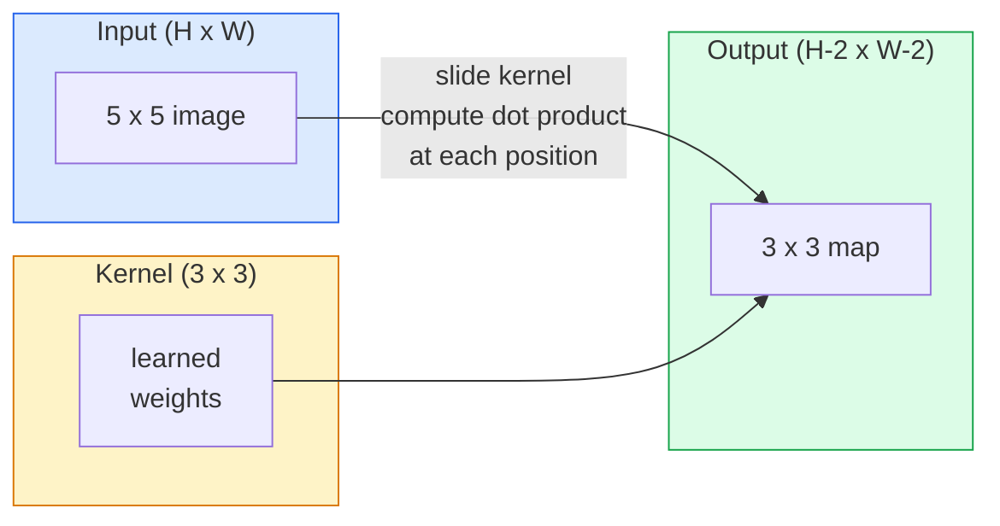
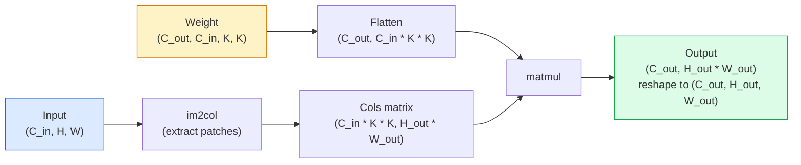

# Convolutions from Scratch

> Một phép tích chập là một lớp kết nối đầy đủ nhỏ mà bạn trượt trên hình ảnh, chia sẻ cùng các trọng số tại mọi vị trí.

**Type:** Build
**Languages:** Python
**Prerequisites:** Phase 3 (Deep Learning Core), Phase 4 Lesson 01 (Image Fundamentals)
**Time:** ~75 minutes

## Learning Objectives

- Triển khai tích chập 2D từ đầu chỉ bằng NumPy, bao gồm phiên bản vòng lặp lồng nhau và phiên bản `im2col` được vector hóa
- Tính kích thước không gian đầu ra cho bất kỳ tổ hợp kích thước đầu vào, kích thước kernel, padding và stride nào, và giải thích công thức `(H - K + 2P) / S + 1`
- Thiết kế thủ công các kernel (cạnh, làm mờ, làm sắc nét, Sobel) và giải thích tại sao mỗi kernel tạo ra mẫu kích hoạt của nó
- Xếp chồng các phép tích chập thành một bộ trích xuất đặc trưng và liên hệ độ sâu của chồng lớp với kích thước trường tiếp nhận

## The Problem

Một lớp kết nối đầy đủ trên một hình ảnh RGB 224x224 sẽ cần 224 * 224 * 3 = 150,528 trọng số đầu vào mỗi nơ-ron. Một lớp ẩn duy nhất có 1,000 đơn vị đã là 150 triệu tham số — trước khi bạn học được bất cứ điều gì hữu ích. Tệ hơn, lớp đó không có khái niệm rằng một con chó ở góc trên trái và một con chó ở góc dưới phải là cùng một mẫu. Nó coi mỗi vị trí pixel là độc lập, điều hoàn toàn sai với hình ảnh: tịnh tiến một con mèo ba pixel không nên buộc mạng học lại khái niệm đó.

Hai thuộc tính một mô hình hình ảnh cần là **đẳng biến tịnh tiến** (đầu ra dịch chuyển khi đầu vào dịch chuyển) và **chia sẻ tham số** (cùng bộ phát hiện đặc trưng chạy mọi nơi). Các lớp kết nối đầy đủ không cho bạn thuộc tính nào. Tích chập cho bạn cả hai miễn phí.

Tích chập không được phát minh cho học sâu. Nó là cùng phép toán vận hành nén JPEG, làm mờ Gaussian trong Photoshop, phát hiện cạnh trong thị giác công nghiệp và mọi bộ lọc âm thanh từng được phát hành. Lý do CNN thống trị ImageNet từ 2012 đến 2020 là tích chập là tiên nghiệm đúng cho dữ liệu mà các giá trị gần nhau có liên quan và cùng một mẫu có thể xuất hiện ở bất kỳ đâu.

## The Concept

### One kernel, sliding

Một tích chập 2D nhận một ma trận trọng số nhỏ gọi là kernel (hoặc bộ lọc), trượt nó trên đầu vào và tại mỗi vị trí tính tổng các tích theo từng phần tử. Tổng đó trở thành một pixel đầu ra.



Một ví dụ 3x3 cụ thể trên đầu vào 5x5 (không padding, stride 1):

```
Input X (5 x 5):                Kernel W (3 x 3):

  1  2  0  1  2                   1  0 -1
  0  1  3  1  0                   2  0 -2
  2  1  0  2  1                   1  0 -1
  1  0  2  1  3
  2  1  1  0  1

The kernel slides across every valid 3 x 3 window. Output Y is 3 x 3:

 Y[0,0] = sum( W * X[0:3, 0:3] )
 Y[0,1] = sum( W * X[0:3, 1:4] )
 Y[0,2] = sum( W * X[0:3, 2:5] )
 Y[1,0] = sum( W * X[1:4, 0:3] )
 ... and so on
```

Một công thức đó — **các trọng số dùng chung, tính cục bộ, cửa sổ trượt** — là toàn bộ ý tưởng. Mọi thứ khác là công việc ghi sổ.

### Output size formula

Cho kích thước không gian đầu vào `H`, kích thước kernel `K`, padding `P`, stride `S`:

```math
H_{\text{out}} = \left\lfloor \frac{H - K + 2P}{S} \right\rfloor + 1
```

Ghi nhớ điều này. Bạn sẽ tính nó hàng chục lần mỗi kiến trúc.

| Kịch bản | H | K | P | S | H_out |
|----------|---|---|---|---|-------|
| Tích chập valid, không padding | 32 | 3 | 0 | 1 | 30 |
| Tích chập same (giữ kích thước) | 32 | 3 | 1 | 1 | 32 |
| Giảm mẫu 2 lần | 32 | 3 | 1 | 2 | 16 |
| Pool 2x2 | 32 | 2 | 0 | 2 | 16 |
| Trường tiếp nhận lớn | 32 | 7 | 3 | 2 | 16 |

"Same padding" nghĩa là chọn $P$ sao cho $H_{\text{out}} = H$ khi $S = 1$. Với $K$ lẻ, đó là $P = (K - 1) / 2$. Đó là lý do các kernel 3x3 chiếm ưu thế — chúng là kernel lẻ nhỏ nhất vẫn có tâm.

### Padding

Không có padding, mỗi phép tích chập làm co bản đồ đặc trưng. Xếp chồng 20 phép và hình ảnh 224x224 của bạn trở thành 184x184, làm lãng phí tính toán trên biên và làm phức tạp các kết nối phần dư cần hình dạng khớp nhau.

```
Zero padding (P = 1) on a 5 x 5 input:

  0  0  0  0  0  0  0
  0  1  2  0  1  2  0
  0  0  1  3  1  0  0
  0  2  1  0  2  1  0       Now the kernel can centre on pixel
  0  1  0  2  1  3  0       (0, 0) and still have three rows and
  0  2  1  1  0  1  0       three columns of values to multiply.
  0  0  0  0  0  0  0
```

Các chế độ bạn gặp trong thực tế: `zero` (phổ biến nhất), `reflect` (phản chiếu cạnh, tránh các biên cứng trong mô hình tạo sinh), `replicate` (sao chép cạnh), `circular` (quấn vòng, dùng trong các bài toán hình xuyến).

### Stride

Stride là kích thước bước trượt. `stride=1` là mặc định. `stride=2` giảm một nửa các chiều không gian và là cách cổ điển để giảm mẫu trong một CNN mà không có lớp pooling riêng — mọi kiến trúc hiện đại (ResNet, ConvNeXt, MobileNet) đều sử dụng các tích chập có stride thay cho max-pool ở đâu đó.

```
Stride 1 on a 5 x 5 input, 3 x 3 kernel:

  starts: (0,0) (0,1) (0,2)        -> output row 0
          (1,0) (1,1) (1,2)        -> output row 1
          (2,0) (2,1) (2,2)        -> output row 2

  Output: 3 x 3

Stride 2 on the same input:

  starts: (0,0) (0,2)              -> output row 0
          (2,0) (2,2)              -> output row 1

  Output: 2 x 2
```

### Multiple input channels

Hình ảnh thật có ba kênh. Một tích chập 3x3 trên đầu vào RGB thực sự là một khối 3x3x3: một lát 3x3 mỗi kênh đầu vào. Tại mỗi vị trí không gian, bạn nhân và cộng trên cả ba lát rồi thêm một bias.

```
Input:   (C_in,  H,  W)        3 x 5 x 5
Kernel:  (C_in,  K,  K)        3 x 3 x 3 (one kernel)
Output:  (1,     H', W')       2D map

For a layer that produces C_out output channels, you stack C_out kernels:

Weight:  (C_out, C_in, K, K)   e.g. 64 x 3 x 3 x 3
Output:  (C_out, H', W')       64 x 3 x 3

Parameter count: C_out * C_in * K * K + C_out   (the + C_out is biases)
```

Dòng cuối đó là dòng bạn sẽ tính khi lên kế hoạch một mô hình. Một tích chập 3x3 có 64 kênh trên đầu vào 3 kênh có `64 * 3 * 3 * 3 + 64 = 1,792` tham số. Rẻ.

### The im2col trick

Các vòng lặp lồng nhau dễ đọc nhưng chậm. GPU muốn các phép nhân ma trận lớn. Thủ thuật: làm phẳng mỗi cửa sổ trường tiếp nhận của đầu vào thành một cột của một ma trận lớn, làm phẳng kernel thành một hàng và toàn bộ tích chập trở thành một phép nhân ma trận duy nhất.



Mọi bản triển khai tích chập production đều là một biến thể của điều này cộng các thủ thuật chia ô cache (tích chập trực tiếp, Winograd, tích chập FFT cho kernel lớn). Hiểu im2col và bạn hiểu cốt lõi.

### Receptive field

Một tích chập 3x3 đơn lẻ nhìn 9 pixel đầu vào. Xếp chồng hai tích chập 3x3 và một nơ-ron ở lớp thứ hai nhìn 5x5 pixel đầu vào. Ba tích chập 3x3 cho 7x7. Tổng quát:

```
RF after L stacked K x K convs (stride 1) = 1 + L * (K - 1)

With strides:   RF grows multiplicatively with stride along each layer.
```

Toàn bộ lý do "3x3 từ trên xuống dưới" hoạt động (VGG, ResNet, ConvNeXt) là hai tích chập 3x3 nhìn cùng diện tích đầu vào như một tích chập 5x5 nhưng với ít tham số hơn và thêm một tính phi tuyến ở giữa.

```figure
convolution-kernel
```

## Build It

### Step 1: Pad an array

Bắt đầu với thành phần nguyên thủy nhỏ nhất: một hàm đệm các số không quanh một mảng H x W.

```python
import numpy as np

def pad2d(x, p):
    if p == 0:
        return x
    h, w = x.shape[-2:]
    out = np.zeros(x.shape[:-2] + (h + 2 * p, w + 2 * p), dtype=x.dtype)
    out[..., p:p + h, p:p + w] = x
    return out

x = np.arange(9).reshape(3, 3)
print(x)
print()
print(pad2d(x, 1))
```

Thủ thuật các trục cuối `x.shape[:-2]` nghĩa là cùng hàm hoạt động trên `(H, W)`, `(C, H, W)` hoặc `(N, C, H, W)` mà không sửa đổi.

### Step 2: 2D convolution with nested loops

Bản triển khai tham chiếu — chậm, nhưng rõ ràng. Về nguyên tắc đây là điều `torch.nn.functional.conv2d` làm.

```python
def conv2d_naive(x, w, b=None, stride=1, padding=0):
    c_in, h, w_in = x.shape
    c_out, c_in_w, kh, kw = w.shape
    assert c_in == c_in_w

    x_pad = pad2d(x, padding)
    h_out = (h + 2 * padding - kh) // stride + 1
    w_out = (w_in + 2 * padding - kw) // stride + 1

    out = np.zeros((c_out, h_out, w_out), dtype=np.float32)
    for oc in range(c_out):
        for i in range(h_out):
            for j in range(w_out):
                hs = i * stride
                ws = j * stride
                patch = x_pad[:, hs:hs + kh, ws:ws + kw]
                out[oc, i, j] = np.sum(patch * w[oc])
        if b is not None:
            out[oc] += b[oc]
    return out
```

Bốn vòng lặp lồng nhau (kênh đầu ra, hàng, cột, cộng tổng ngầm trên C_in, kh, kw). Đây là chuẩn đúng bạn sẽ đối chiếu mọi bản triển khai nhanh hơn.

### Step 3: Verify with a hand-designed kernel

Xây một kernel Sobel dọc, áp dụng lên một hình ảnh bước tổng hợp và quan sát cạnh dọc sáng lên.

```python
def synthetic_step_image():
    img = np.zeros((1, 16, 16), dtype=np.float32)
    img[:, :, 8:] = 1.0
    return img

sobel_x = np.array([
    [[-1, 0, 1],
     [-2, 0, 2],
     [-1, 0, 1]]
], dtype=np.float32)[None]

x = synthetic_step_image()
y = conv2d_naive(x, sobel_x, padding=1)
print(y[0].round(1))
```

Kỳ vọng các giá trị dương lớn trên cột 7 (độ sáng tăng từ trái sang phải) và các số không ở mọi nơi khác. Một lần in đó là phép kiểm tra tính hợp lý rằng toán học đúng.

### Step 4: im2col

Chuyển mỗi cửa sổ kích thước kernel trong đầu vào thành một cột của một ma trận. Với `C_in=3, K=3`, mỗi cột là 27 số.

```python
def im2col(x, kh, kw, stride=1, padding=0):
    c_in, h, w = x.shape
    x_pad = pad2d(x, padding)
    h_out = (h + 2 * padding - kh) // stride + 1
    w_out = (w + 2 * padding - kw) // stride + 1

    cols = np.zeros((c_in * kh * kw, h_out * w_out), dtype=x.dtype)
    col = 0
    for i in range(h_out):
        for j in range(w_out):
            hs = i * stride
            ws = j * stride
            patch = x_pad[:, hs:hs + kh, ws:ws + kw]
            cols[:, col] = patch.reshape(-1)
            col += 1
    return cols, h_out, w_out
```

Nó vẫn là một vòng lặp Python, nhưng giờ phần nặng sẽ là một phép nhân ma trận được vector hóa duy nhất.

### Step 5: Fast conv via im2col + matmul

Thay vòng lặp bốn tầng bằng một phép nhân ma trận.

```python
def conv2d_im2col(x, w, b=None, stride=1, padding=0):
    c_out, c_in, kh, kw = w.shape
    cols, h_out, w_out = im2col(x, kh, kw, stride, padding)
    w_flat = w.reshape(c_out, -1)
    out = w_flat @ cols
    if b is not None:
        out += b[:, None]
    return out.reshape(c_out, h_out, w_out)
```

Kiểm tra tính đúng: chạy cả hai bản triển khai và so sánh.

```python
rng = np.random.default_rng(0)
x = rng.normal(0, 1, (3, 16, 16)).astype(np.float32)
w = rng.normal(0, 1, (8, 3, 3, 3)).astype(np.float32)
b = rng.normal(0, 1, (8,)).astype(np.float32)

y_naive = conv2d_naive(x, w, b, padding=1)
y_im2col = conv2d_im2col(x, w, b, padding=1)

print(f"max abs diff: {np.max(np.abs(y_naive - y_im2col)):.2e}")
```

`max abs diff` nên khoảng `1e-5` — khác biệt là thứ tự tích lũy dấu phẩy động, không phải lỗi.

### Step 6: A bank of hand-designed kernels

Năm bộ lọc cho thấy một lớp tích chập đơn lẻ có thể biểu diễn gì trước bất kỳ huấn luyện nào.

```python
KERNELS = {
    "identity": np.array([[0, 0, 0], [0, 1, 0], [0, 0, 0]], dtype=np.float32),
    "blur_3x3": np.ones((3, 3), dtype=np.float32) / 9.0,
    "sharpen": np.array([[0, -1, 0], [-1, 5, -1], [0, -1, 0]], dtype=np.float32),
    "sobel_x": np.array([[-1, 0, 1], [-2, 0, 2], [-1, 0, 1]], dtype=np.float32),
    "sobel_y": np.array([[-1, -2, -1], [0, 0, 0], [1, 2, 1]], dtype=np.float32),
}

def apply_kernel(img2d, kernel):
    x = img2d[None].astype(np.float32)
    w = kernel[None, None]
    return conv2d_im2col(x, w, padding=1)[0]
```

Áp dụng cho bất kỳ hình ảnh thang xám nào, làm mờ làm dịu, làm sắc nét làm các cạnh rõ hơn, Sobel-x làm các cạnh dọc sáng lên, Sobel-y làm các cạnh ngang sáng lên. Đây chính xác là các mẫu mà lớp tích chập được huấn luyện *đầu tiên* trong AlexNet và VGG rốt cuộc đã học — vì một mô hình hình ảnh tốt cần các bộ phát hiện cạnh và đốm bất kể tác vụ phía sau là gì.

## Use It

`nn.Conv2d` của PyTorch bao bọc cùng phép toán với autograd, các kernel CUDA và tối ưu hóa cuDNN. Ngữ nghĩa hình dạng giống hệt.

```python
import torch
import torch.nn as nn

conv = nn.Conv2d(in_channels=3, out_channels=64, kernel_size=3, stride=1, padding=1)
print(conv)
print(f"weight shape: {tuple(conv.weight.shape)}   # (C_out, C_in, K, K)")
print(f"bias shape:   {tuple(conv.bias.shape)}")
print(f"param count:  {sum(p.numel() for p in conv.parameters())}")

x = torch.randn(8, 3, 224, 224)
y = conv(x)
print(f"\ninput  shape: {tuple(x.shape)}")
print(f"output shape: {tuple(y.shape)}")
```

Đổi `padding=1` thành `padding=0` và đầu ra giảm xuống 222x222. Đổi `stride=1` thành `stride=2` và nó giảm xuống 112x112. Cùng công thức bạn đã ghi nhớ ở trên.

## Ship It

Bài học này tạo ra:

- `outputs/prompt-cnn-architect.md` — một prompt, với kích thước đầu vào, ngân sách tham số và trường tiếp nhận mục tiêu, thiết kế một chồng các lớp `Conv2d` với K/S/P đúng ở mỗi bước.
- `outputs/skill-conv-shape-calculator.md` — một skill đi qua đặc tả mạng từng lớp và trả về hình dạng đầu ra, trường tiếp nhận và số tham số cho mỗi khối.

## Exercises

1. **(Dễ)** Với đầu vào thang xám 128x128 và một chồng `[Conv3x3(s=1,p=1), Conv3x3(s=2,p=1), Conv3x3(s=1,p=1), Conv3x3(s=2,p=1)]`, tính thủ công kích thước không gian đầu ra và trường tiếp nhận tại mỗi lớp. Xác minh bằng một `nn.Sequential` PyTorch với các tích chập giả.
2. **(Vừa)** Mở rộng `conv2d_naive` và `conv2d_im2col` để nhận một đối số `groups`. Cho thấy `groups=C_in=C_out` tái tạo một tích chập depthwise và số tham số của nó là `C * K * K` thay vì `C * C * K * K`.
3. **(Khó)** Triển khai lượt truyền ngược của `conv2d_im2col` bằng tay: với gradient của đầu ra cho trước, tính gradient của `x` và `w`. Xác minh với `torch.autograd.grad` trên cùng các đầu vào và trọng số. Thủ thuật: gradient của im2col là `col2im`, và nó phải tích lũy các cửa sổ chồng lấn.

## Key Terms

| Thuật ngữ | Cách mọi người nói | Ý nghĩa thực sự |
|------|----------------|----------------------|
| Convolution (Tích chập) | "Trượt một bộ lọc" | Một tích vô hướng có thể học được áp dụng tại mọi vị trí không gian với các trọng số dùng chung; về toán học là tương quan chéo, nhưng mọi người gọi là tích chập |
| Kernel / filter | "Bộ phát hiện đặc trưng" | Một tensor trọng số nhỏ có hình dạng (C_in, K, K) mà tích vô hướng với một cửa sổ đầu vào tạo ra một pixel đầu ra |
| Stride | "Bạn nhảy bao xa" | Kích thước bước giữa các lần đặt kernel liên tiếp; stride 2 giảm một nửa mỗi chiều không gian |
| Padding | "Các số không trên các cạnh" | Các giá trị bổ sung quanh đầu vào để kernel có thể đặt tâm lên các pixel biên; padding `same` giữ kích thước đầu ra bằng kích thước đầu vào |
| Receptive field (Trường tiếp nhận) | "Nơ-ron nhìn được bao nhiêu" | Vùng đầu vào gốc mà một kích hoạt đầu ra nhất định phụ thuộc vào, tăng theo độ sâu và stride |
| im2col | "Thủ thuật GEMM" | Sắp xếp lại mỗi cửa sổ tiếp nhận thành các cột để tích chập trở thành một phép nhân ma trận lớn — cốt lõi của mọi kernel tích chập nhanh |
| Depthwise conv | "Một kernel mỗi kênh" | Một tích chập có `groups == C_in`, tính mỗi kênh đầu ra chỉ từ kênh đầu vào tương ứng; xương sống của MobileNet và ConvNeXt |
| Translation equivariance (Đẳng biến tịnh tiến) | "Dịch vào, dịch ra" | Thuộc tính mà dịch đầu vào k pixel làm đầu ra dịch k pixel; có sẵn miễn phí với các trọng số dùng chung |

## Further Reading

- [A guide to convolution arithmetic for deep learning (Dumoulin & Visin, 2016)](https://arxiv.org/abs/1603.07285) — các sơ đồ padding/stride/dilation có tính chuẩn mực mà mọi khóa học âm thầm sao chép
- [CS231n: Convolutional Neural Networks for Visual Recognition](https://cs231n.github.io/convolutional-networks/) — các ghi chú bài giảng chuẩn, bao gồm lời giải thích im2col gốc
- [The Annotated ConvNet (fast.ai)](https://nbviewer.org/github/fastai/fastbook/blob/master/13_convolutions.ipynb) — một notebook đi từ tích chập thủ công tới một bộ phân loại chữ số đã huấn luyện
- [Receptive Field Arithmetic for CNNs (Dang Ha The Hien)](https://distill.pub/2019/computing-receptive-fields/) — phần giải thích tương tác đạt chất lượng bài báo về tính trường tiếp nhận
