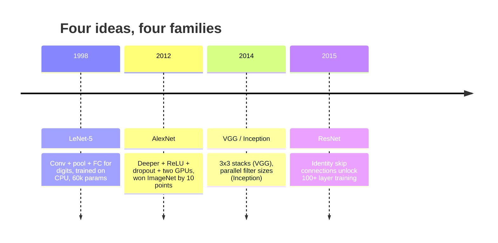
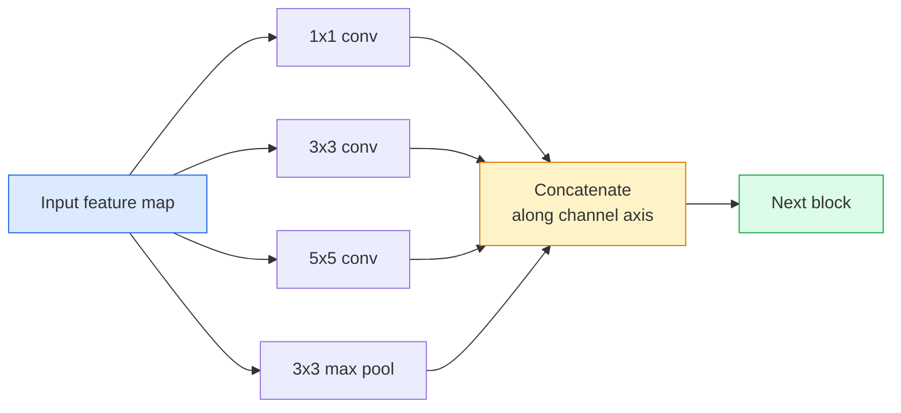
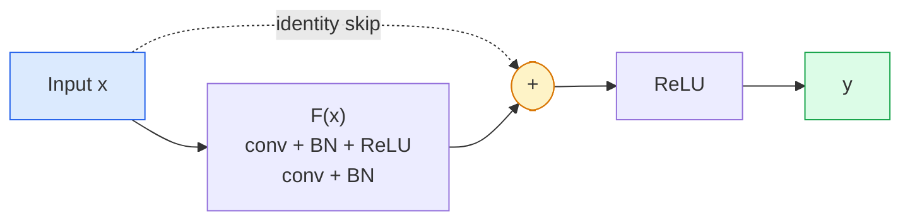

# CNNs — LeNet to ResNet

> Mọi CNN lớn trong ba mươi năm qua đều là cùng công thức tích chập–phi tuyến–giảm mẫu với một ý tưởng mới gắn thêm. Học các ý tưởng theo thứ tự.

**Type:** Learn + Build
**Languages:** Python
**Prerequisites:** Phase 3 Lesson 11 (PyTorch), Phase 4 Lesson 01 (Image Fundamentals), Phase 4 Lesson 02 (Convolutions from Scratch)
**Time:** ~75 minutes

## Learning Objectives

- Theo dõi dòng kiến trúc LeNet-5 -> AlexNet -> VGG -> Inception -> ResNet và nêu một ý tưởng mới mà mỗi họ đóng góp
- Triển khai LeNet-5, một khối kiểu VGG và một BasicBlock ResNet bằng PyTorch, mỗi thành phần dưới 40 dòng
- Giải thích tại sao các kết nối phần dư biến một mạng 1,000 lớp từ không thể huấn luyện thành tiên tiến nhất
- Đọc một backbone hiện đại (ResNet-18, ResNet-50) và dự đoán hình dạng đầu ra, trường tiếp nhận và số tham số trước khi xem mã nguồn

## The Problem

Năm 2011, bộ phân loại ImageNet tốt nhất đạt khoảng 74% accuracy top-5. Năm 2012 AlexNet đạt 85%. Năm 2015 ResNet đạt 96%. Không dữ liệu mới. Không thế hệ GPU mới. Những cải thiện đến từ các ý tưởng kiến trúc. Một kỹ sư thị giác đang làm việc phải biết ý tưởng nào đến từ bài báo nào vì mọi backbone production bạn phát hành trong năm 2026 đều là sự kết hợp lại của cùng những phần đó — và vì các ý tưởng tiếp tục chuyển giao: tích chập nhóm đi từ CNN sang transformer, kết nối phần dư đi từ ResNet tới mọi LLM đang tồn tại, batch normalization tồn tại trong các mô hình khuếch tán.

Nghiên cứu các mạng này theo thứ tự cũng giúp bạn miễn nhiễm với một sai lầm thường gặp: chọn mô hình lớn nhất sẵn có khi một mạng cỡ LeNet có thể giải bài toán. MNIST không cần một ResNet. Biết đường cong mở rộng của mỗi họ cho bạn biết nên chọn điểm nào trên đó.

## The Concept

### The four ideas that changed vision



Không gì khác trong thị giác cổ điển quan trọng bằng bốn bước nhảy này.

### LeNet-5 (1998)

Bộ nhận dạng chữ số của Yann LeCun. 60,000 tham số. Hai khối conv-pool, hai lớp kết nối đầy đủ, các kích hoạt tanh. Nó xác định khuôn mẫu mà mọi CNN kế thừa:

```
input (1, 32, 32)
  conv 5x5 -> (6, 28, 28)
  avg pool 2x2 -> (6, 14, 14)
  conv 5x5 -> (16, 10, 10)
  avg pool 2x2 -> (16, 5, 5)
  flatten -> 400
  dense -> 120
  dense -> 84
  dense -> 10
```

Mọi thứ mà thế giới hiện đại gọi là CNN — các phép tích chập và giảm mẫu xen kẽ đưa vào một đầu phân loại nhỏ — là LeNet với nhiều lớp hơn, số kênh lớn hơn và các kích hoạt tốt hơn.

### AlexNet (2012)

Ba thay đổi cùng nhau phá vỡ ImageNet:

1. **ReLU** thay vì tanh. Các gradient ngừng tiêu biến. Huấn luyện tăng tốc sáu lần.
2. **Dropout** trong đầu kết nối đầy đủ. Chính quy hóa trở thành một lớp, không phải một thủ thuật.
3. **Độ sâu và độ rộng**. Năm lớp tích chập, ba lớp kết nối đầy đủ, 60M tham số, được huấn luyện trên hai GPU với mô hình chia giữa chúng.

Figure 2 của bài báo vẫn cho thấy sự phân chia GPU dưới dạng hai luồng song song. Tính song song đó là một cách khắc phục phần cứng, không phải một nhận định kiến trúc — nhưng ba ý tưởng trên vẫn nằm trong mọi mô hình bạn sử dụng.

### VGG (2014)

VGG hỏi: điều gì xảy ra nếu bạn chỉ sử dụng các tích chập 3x3 và đi sâu?

```
stack:   conv 3x3 -> conv 3x3 -> pool 2x2
repeat:  16 or 19 conv layers
```

Hai tích chập 3x3 nhìn cùng diện tích đầu vào 5x5 như một tích chập 5x5 nhưng có ít tham số hơn ($2 \cdot 9 \cdot C^2 = 18C^2$ so với $25 \cdot C^2$) và thêm một ReLU ở giữa. VGG biến quan sát này thành cả một kiến trúc. Sự đơn giản — một loại khối, lặp lại — khiến nó là điểm tham chiếu cho mọi thứ sau đó.

Chi phí: 138M tham số, huấn luyện chậm, suy luận tốn kém.

### Inception (2014, same year)

Câu trả lời của Google cho "tôi nên sử dụng kích thước kernel nào?" là: tất cả, song song.



Mỗi nhánh chuyên biệt — 1x1 để trộn kênh, 3x3 cho kết cấu cục bộ, 5x5 cho các mẫu lớn hơn, pooling cho các đặc trưng bất biến dịch chuyển — và phép nối cho lớp tiếp theo chọn bất kỳ nhánh nào hữu ích. Inception v1 sử dụng các tích chập 1x1 trong mỗi nhánh làm nút thắt để giữ số tham số hợp lý.

### The degradation problem

Đến năm 2015, VGG-19 hoạt động và VGG-32 không hoạt động. Độ sâu được cho là giúp ích, nhưng vượt ~20 lớp cả mất mát huấn luyện và test đều tệ hơn. Đó không phải quá khớp. Đó là bộ tối ưu hóa không tìm được các trọng số hữu ích vì các gradient co lại theo phép nhân qua mọi lớp.

```
Plain deep network:
  y = f_L( f_{L-1}( ... f_1(x) ... ) )

Gradient wrt early layer:
  dL/dW_1 = dL/dy * df_L/df_{L-1} * ... * df_2/df_1 * df_1/dW_1

Each multiplicative term has magnitude roughly (weight magnitude) * (activation gain).
Stack 100 of them with gains < 1 and the gradient is effectively zero.
```

VGG hoạt động ở 19 lớp vì batch norm (được công bố đồng thời) giữ các kích hoạt có thang đo phù hợp. Nhưng ngay cả batch norm cũng không thể cứu độ sâu vượt khoảng 30 lớp.

### ResNet (2015)

He, Zhang, Ren, Sun đề xuất một thay đổi khắc phục mọi thứ:

```math
\begin{aligned}
\text{standard block:} \quad & y = F(x) \\
\text{residual block:} \quad & y = F(x) + x
\end{aligned}
```

`+ x` nghĩa là lớp luôn có thể chọn không làm gì bằng cách đưa `F(x)` về không. Một ResNet 1,000 lớp giờ nhiều nhất chỉ tệ bằng một mạng 1 lớp, vì mỗi khối bổ sung có một lối thoát đơn giản. Với bảo đảm đó, bộ tối ưu hóa sẵn sàng làm mỗi khối hữu ích *một chút* — và hữu ích một chút, xếp chồng 100 lần, là tiên tiến nhất.



Hai biến thể của khối xuất hiện ở mọi nơi:

- **BasicBlock** (ResNet-18, ResNet-34): hai tích chập 3x3, kết nối tắt vòng qua cả hai.
- **Bottleneck** (ResNet-50, -101, -152): 1x1 giảm, 3x3 giữa, 1x1 tăng, kết nối tắt vòng qua bộ ba. Rẻ hơn khi số kênh cao.

Khi kết nối tắt phải vượt qua một lần giảm mẫu (stride=2), đường đồng nhất được thay bằng một tích chập 1x1 stride=2 để khớp các hình dạng.

### Why residuals matter beyond vision

Ý tưởng thực ra không phải về phân loại hình ảnh. Nó là về biến các mạng sâu từ "bắt chéo ngón tay và hy vọng các gradient sống sót" thành một công cụ kỹ thuật đáng tin cậy, có thể mở rộng. Mọi transformer bạn sẽ đọc trong giai đoạn tiếp theo có cùng kết nối tắt trong mọi khối. Không có ResNet, không có GPT.

```figure
pooling
```

## Build It

### Step 1: LeNet-5

Một LeNet tối giản, trung thành. Các kích hoạt tanh, pooling trung bình. Nhượng bộ duy nhất với hiện đại là chúng ta sử dụng `nn.CrossEntropyLoss` phía sau thay vì các kết nối Gaussian gốc.

```python
import torch
import torch.nn as nn
import torch.nn.functional as F

class LeNet5(nn.Module):
    def __init__(self, num_classes=10):
        super().__init__()
        self.conv1 = nn.Conv2d(1, 6, kernel_size=5)
        self.conv2 = nn.Conv2d(6, 16, kernel_size=5)
        self.pool = nn.AvgPool2d(2)
        self.fc1 = nn.Linear(16 * 5 * 5, 120)
        self.fc2 = nn.Linear(120, 84)
        self.fc3 = nn.Linear(84, num_classes)

    def forward(self, x):
        x = self.pool(torch.tanh(self.conv1(x)))
        x = self.pool(torch.tanh(self.conv2(x)))
        x = torch.flatten(x, 1)
        x = torch.tanh(self.fc1(x))
        x = torch.tanh(self.fc2(x))
        return self.fc3(x)

net = LeNet5()
x = torch.randn(1, 1, 32, 32)
print(f"output: {net(x).shape}")
print(f"params: {sum(p.numel() for p in net.parameters()):,}")
```

Đầu ra kỳ vọng: `output: torch.Size([1, 10])`, `params: 61,706`. Đó là toàn bộ bộ phân loại chữ số đã khởi đầu thị giác hiện đại.

### Step 2: A VGG block

Một khối tái sử dụng: hai tích chập 3x3, ReLU, batch norm, max pool.

```python
class VGGBlock(nn.Module):
    def __init__(self, in_c, out_c):
        super().__init__()
        self.conv1 = nn.Conv2d(in_c, out_c, kernel_size=3, padding=1)
        self.bn1 = nn.BatchNorm2d(out_c)
        self.conv2 = nn.Conv2d(out_c, out_c, kernel_size=3, padding=1)
        self.bn2 = nn.BatchNorm2d(out_c)
        self.pool = nn.MaxPool2d(2)

    def forward(self, x):
        x = F.relu(self.bn1(self.conv1(x)))
        x = F.relu(self.bn2(self.conv2(x)))
        return self.pool(x)

class MiniVGG(nn.Module):
    def __init__(self, num_classes=10):
        super().__init__()
        self.stack = nn.Sequential(
            VGGBlock(3, 32),
            VGGBlock(32, 64),
            VGGBlock(64, 128),
        )
        self.head = nn.Sequential(
            nn.AdaptiveAvgPool2d(1),
            nn.Flatten(),
            nn.Linear(128, num_classes),
        )

    def forward(self, x):
        return self.head(self.stack(x))

net = MiniVGG()
x = torch.randn(1, 3, 32, 32)
print(f"output: {net(x).shape}")
print(f"params: {sum(p.numel() for p in net.parameters()):,}")
```

Ba khối VGG trên đầu vào cỡ CIFAR, một adaptive pool, một lớp tuyến tính. ~290k tham số. Dư sức cho CIFAR-10.

### Step 3: A ResNet BasicBlock

Khối xây dựng cốt lõi của ResNet-18 và ResNet-34.

```python
class BasicBlock(nn.Module):
    def __init__(self, in_c, out_c, stride=1):
        super().__init__()
        self.conv1 = nn.Conv2d(in_c, out_c, kernel_size=3, stride=stride, padding=1, bias=False)
        self.bn1 = nn.BatchNorm2d(out_c)
        self.conv2 = nn.Conv2d(out_c, out_c, kernel_size=3, stride=1, padding=1, bias=False)
        self.bn2 = nn.BatchNorm2d(out_c)
        if stride != 1 or in_c != out_c:
            self.shortcut = nn.Sequential(
                nn.Conv2d(in_c, out_c, kernel_size=1, stride=stride, bias=False),
                nn.BatchNorm2d(out_c),
            )
        else:
            self.shortcut = nn.Identity()

    def forward(self, x):
        out = F.relu(self.bn1(self.conv1(x)))
        out = self.bn2(self.conv2(out))
        out = out + self.shortcut(x)
        return F.relu(out)
```

`bias=False` trên các lớp tích chập là một quy ước batch norm — tham số beta của BN đã xử lý bias, nên mang thêm bias tích chập là lãng phí. `shortcut` chỉ cần một tích chập thật khi stride hoặc số kênh thay đổi; nếu không nó là ánh xạ đồng nhất không làm gì.

### Step 4: A tiny ResNet

Xếp chồng bốn nhóm BasicBlock để có một ResNet hoạt động cho các đầu vào cỡ CIFAR.

```python
class TinyResNet(nn.Module):
    def __init__(self, num_classes=10):
        super().__init__()
        self.stem = nn.Sequential(
            nn.Conv2d(3, 32, kernel_size=3, stride=1, padding=1, bias=False),
            nn.BatchNorm2d(32),
            nn.ReLU(inplace=True),
        )
        self.layer1 = self._make_group(32, 32, num_blocks=2, stride=1)
        self.layer2 = self._make_group(32, 64, num_blocks=2, stride=2)
        self.layer3 = self._make_group(64, 128, num_blocks=2, stride=2)
        self.layer4 = self._make_group(128, 256, num_blocks=2, stride=2)
        self.head = nn.Sequential(
            nn.AdaptiveAvgPool2d(1),
            nn.Flatten(),
            nn.Linear(256, num_classes),
        )

    def _make_group(self, in_c, out_c, num_blocks, stride):
        blocks = [BasicBlock(in_c, out_c, stride=stride)]
        for _ in range(num_blocks - 1):
            blocks.append(BasicBlock(out_c, out_c, stride=1))
        return nn.Sequential(*blocks)

    def forward(self, x):
        x = self.stem(x)
        x = self.layer1(x)
        x = self.layer2(x)
        x = self.layer3(x)
        x = self.layer4(x)
        return self.head(x)

net = TinyResNet()
x = torch.randn(1, 3, 32, 32)
print(f"output: {net(x).shape}")
print(f"params: {sum(p.numel() for p in net.parameters()):,}")
```

Bốn nhóm, mỗi nhóm hai khối. Stride 2 ở đầu các nhóm 2, 3, 4. Số kênh gấp đôi mỗi lần giảm mẫu. Khoảng 2.8M tham số. Đó là công thức tiêu chuẩn mở rộng gọn lên tới ResNet-152.

### Step 5: Compare parameter-to-feature efficiency

Chạy cùng đầu vào qua cả ba mạng và so sánh số tham số.

```python
def summary(name, net, x):
    y = net(x)
    params = sum(p.numel() for p in net.parameters())
    print(f"{name:12s}  input {tuple(x.shape)} -> output {tuple(y.shape)}  params {params:>10,}")

x = torch.randn(1, 3, 32, 32)
summary("LeNet5",     LeNet5(),       torch.randn(1, 1, 32, 32))
summary("MiniVGG",    MiniVGG(),      x)
summary("TinyResNet", TinyResNet(),   x)
```

Ba mô hình, ba thời đại, ba bậc độ lớn về số tham số. Với accuracy CIFAR-10, bạn cần khoảng: LeNet 60%, MiniVGG 89%, TinyResNet 93% sau vài epoch huấn luyện.

## Use It

`torchvision.models` cho bạn các phiên bản được tiền huấn luyện của tất cả những mô hình trên. Chữ ký lời gọi giống hệt giữa các họ, chính là mục đích của trừu tượng backbone.

```python
from torchvision.models import resnet18, ResNet18_Weights, vgg16, VGG16_Weights

r18 = resnet18(weights=ResNet18_Weights.IMAGENET1K_V1)
r18.eval()

print(f"ResNet-18 params: {sum(p.numel() for p in r18.parameters()):,}")
print(r18.layer1[0])
print()

v16 = vgg16(weights=VGG16_Weights.IMAGENET1K_V1)
v16.eval()
print(f"VGG-16   params: {sum(p.numel() for p in v16.parameters()):,}")
```

ResNet-18 có 11.7M tham số. VGG-16 có 138M. Accuracy top-1 ImageNet tương tự (69.8% so với 71.6%). Các kết nối phần dư mang lại lợi thế hiệu quả tham số 12 lần. Đó là lý do các biến thể ResNet thống trị từ 2016 cho tới khi ViT đến năm 2021 — và vẫn thống trị các triển khai thực tế nơi tính toán là ràng buộc.

Với học chuyển giao, công thức luôn giống nhau: tải mô hình được tiền huấn luyện, đóng băng backbone, thay đầu phân loại.

```python
for p in r18.parameters():
    p.requires_grad = False
r18.fc = nn.Linear(r18.fc.in_features, 10)
```

Ba dòng. Giờ bạn có một bộ phân loại CIFAR 10 lớp kế thừa các biểu diễn mà ImageNet đã trả giá để có.

## Ship It

Bài học này tạo ra:

- `outputs/prompt-backbone-selector.md` — một prompt chọn họ CNN phù hợp (LeNet/VGG/ResNet/MobileNet/ConvNeXt) với tác vụ, kích thước tập dữ liệu và ngân sách tính toán cho trước.
- `outputs/skill-residual-block-reviewer.md` — một skill đọc một module PyTorch và đánh dấu các lỗi kết nối tắt (thiếu shortcut khi đổi stride, thứ tự kích hoạt shortcut, vị trí BN so với phép cộng).

## Exercises

1. **(Dễ)** Đếm thủ công các tham số của `TinyResNet` từng lớp. So sánh với `sum(p.numel() for p in net.parameters())`. Phần lớn ngân sách tham số đi đâu — các tích chập, BN hay đầu phân loại?
2. **(Vừa)** Triển khai khối Bottleneck (1x1 -> 3x3 -> 1x1 với kết nối tắt) và sử dụng nó để xây một mạng kiểu ResNet-50 cho CIFAR. So sánh các tham số với `TinyResNet`.
3. **(Khó)** Loại bỏ kết nối tắt khỏi `BasicBlock`, huấn luyện một mạng "thuần" 34 khối và một ResNet 34 khối trên CIFAR-10, mỗi mạng 10 epoch. Vẽ mất mát huấn luyện theo epoch cho cả hai. Tái tạo kết quả Figure 1 của He và cộng sự, nơi mạng sâu thuần hội tụ tới mất mát cao hơn mạng song sinh nông hơn.

## Key Terms

| Thuật ngữ | Cách mọi người nói | Ý nghĩa thực sự |
|------|----------------|----------------------|
| Backbone | "Mô hình" | Chồng các khối tích chập tạo ra bản đồ đặc trưng đưa vào đầu tác vụ |
| Residual connection (Kết nối phần dư) | "Kết nối tắt" | `y = F(x) + x`; cho phép bộ tối ưu hóa học ánh xạ đồng nhất bằng cách đặt F bằng không, khiến độ sâu tùy ý có thể huấn luyện |
| BasicBlock | "Hai tích chập 3x3 có kết nối tắt" | Khối xây dựng ResNet-18/34: conv-BN-ReLU-conv-BN-add-ReLU |
| Bottleneck | "1x1 giảm, 3x3, 1x1 tăng" | Khối ResNet-50/101/152; rẻ ở số kênh cao vì 3x3 chạy trên độ rộng giảm |
| Degradation problem (Vấn đề suy giảm) | "Sâu hơn tệ hơn" | Vượt ~20 lớp tích chập thuần, cả sai số huấn luyện và test tăng; được giải bằng các kết nối phần dư, không phải thêm dữ liệu |
| Stem | "Lớp đầu tiên" | Tích chập ban đầu chuyển đầu vào 3 kênh thành độ rộng đặc trưng cơ sở; thường 7x7 stride 2 cho ImageNet, 3x3 stride 1 cho CIFAR |
| Head (Đầu) | "Bộ phân loại" | Các lớp sau khối backbone cuối: adaptive pool, flatten, một hoặc nhiều lớp tuyến tính |
| Transfer learning (Học chuyển giao) | "Các trọng số được tiền huấn luyện" | Tải một backbone được huấn luyện trên ImageNet và chỉ tinh chỉnh đầu trên tác vụ của bạn |

## Further Reading

- [Deep Residual Learning for Image Recognition (He et al., 2015)](https://arxiv.org/abs/1512.03385) — bài báo ResNet; mọi hình đều đáng nghiên cứu
- [Very Deep Convolutional Networks (Simonyan & Zisserman, 2014)](https://arxiv.org/abs/1409.1556) — bài báo VGG; vẫn là tài liệu tham khảo tốt nhất cho "tại sao 3x3"
- [ImageNet Classification with Deep CNNs (Krizhevsky et al., 2012)](https://papers.nips.cc/paper_files/paper/2012/hash/c399862d3b9d6b76c8436e924a68c45b-Abstract.html) — AlexNet; bài báo kết thúc thời đại đặc trưng thiết kế thủ công
- [Going Deeper with Convolutions (Szegedy et al., 2014)](https://arxiv.org/abs/1409.4842) — Inception v1; ý tưởng bộ lọc song song vẫn xuất hiện trong các vision transformer
