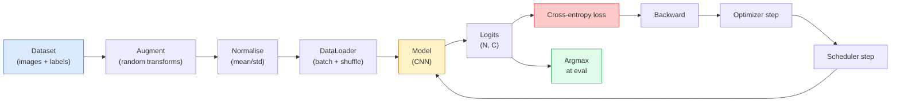

# Image Classification

> Một bộ phân loại là một hàm từ các pixel tới một phân phối xác suất trên các lớp. Mọi thứ khác là hệ thống kết nối.

**Type:** Build
**Languages:** Python
**Prerequisites:** Phase 2 Lesson 09 (Model Evaluation), Phase 3 Lesson 10 (Mini Framework), Phase 4 Lesson 03 (CNNs)
**Time:** ~75 minutes

## Learning Objectives

- Xây dựng một pipeline phân loại hình ảnh đầu-cuối trên CIFAR-10: tập dữ liệu, tăng cường, mô hình, vòng lặp huấn luyện, đánh giá
- Giải thích vai trò mỗi thành phần (dataloader, mất mát, bộ tối ưu hóa, bộ lập lịch, tăng cường) và dự đoán việc làm hỏng bất kỳ thành phần nào biểu hiện thế nào trên đường cong mất mát
- Triển khai mixup, cutout và làm trơn nhãn từ đầu và giải thích khi nào mỗi kỹ thuật đáng thêm vào
- Đọc một ma trận nhầm lẫn và bảng precision/recall từng lớp để chẩn đoán các thất bại tập dữ liệu và mô hình vượt ngoài accuracy tổng hợp

## The Problem

Mọi tác vụ thị giác được phát hành đều quy về phân loại hình ảnh ở mức nào đó. Phát hiện phân loại các vùng. Phân đoạn phân loại các pixel. Truy xuất xếp hạng theo độ tương đồng với các trọng tâm lớp. Làm đúng phân loại — vòng lặp tập dữ liệu, chính sách tăng cường, mất mát, đánh giá — là kỹ năng chuyển giao tới mọi tác vụ khác trong giai đoạn.

Hầu hết lỗi phân loại không nằm trong mô hình. Chúng nằm trong pipeline: chuẩn hóa hỏng, tập huấn luyện không được xáo trộn, tăng cường làm méo nhãn, tập validation bị dữ liệu huấn luyện làm nhiễm, tốc độ học âm thầm phân kỳ sau epoch 30. Một CNN có thể đạt 93% trên CIFAR-10 với thiết lập đúng thường chỉ đạt 70-75% với thiết lập hỏng, và đường cong mất mát trông hợp lý suốt thời gian đó.

Bài học này nối toàn bộ pipeline bằng tay để mỗi phần đều có thể xem xét. Bạn sẽ không sử dụng bất cứ thứ gì từ `torchvision.datasets` có thể che giấu một lỗi.

## The Concept

### The classification pipeline



Mỗi dòng trong vòng lặp này đều là nơi một lỗi có thể tồn tại. Cross-entropy nhận logit thô, không phải đầu ra softmax, nên bất kỳ `model(x).softmax()` nào trước mất mát đều âm thầm tính sai gradient. Các phép tăng cường chỉ áp dụng cho đầu vào, không phải nhãn — trừ mixup trộn cả hai. `optimizer.zero_grad()` phải xảy ra một lần mỗi bước; bỏ nó tích lũy gradient và trông như một tốc độ học rất không ổn định. Mỗi lỗi đó làm phẳng đường cong học mà không ném ra lỗi.

### Cross-entropy, logits, and softmax

Một bộ phân loại tạo ra `C` số mỗi hình ảnh gọi là logit. Áp dụng softmax chuyển chúng thành một phân phối xác suất:

```
softmax(z)_i = exp(z_i) / sum_j exp(z_j)
```

Cross-entropy đo log xác suất âm của lớp đúng:

```
CE(z, y) = -log( softmax(z)_y )
        = -z_y + log( sum_j exp(z_j) )
```

Dạng bên phải là dạng ổn định về số (log-sum-exp). `nn.CrossEntropyLoss` của PyTorch hợp nhất softmax + NLL trong một phép toán và nhận trực tiếp logit thô. Tự áp dụng softmax trước gần như luôn là lỗi — bạn tính log(softmax(softmax(z))), một đại lượng vô nghĩa.

### Why augmentation works

Một CNN có thiên kiến quy nạp cho tịnh tiến (từ chia sẻ trọng số) nhưng không có tính bất biến tích hợp với cắt, lật, làm nhiễu màu hoặc che khuất. Cách duy nhất dạy nó những tính bất biến đó là cho nó thấy các pixel thể hiện chúng. Mỗi phép biến đổi ngẫu nhiên trong huấn luyện là một cách nói: "hai hình ảnh này có cùng nhãn; học các đặc trưng bỏ qua khác biệt."

```
Original crop:  "dog facing left"
Flip:           "dog facing right"       <- same label, different pixels
Rotate(+15):    "dog, slight tilt"
Colour jitter:  "dog in warmer light"
RandomErasing:  "dog with patch missing"
```

Quy tắc: tăng cường phải giữ nguyên nhãn. Cutout và xoay trên một chữ số có thể biến "6" thành "9"; với tập dữ liệu đó bạn sử dụng phạm vi xoay nhỏ hơn và chọn các phép tăng cường tôn trọng các tính bất biến riêng của chữ số.

### Mixup and cutmix

Tăng cường thông thường biến đổi các pixel nhưng giữ nhãn one-hot. **Mixup** và **cutmix** phá vỡ điều đó bằng cách nội suy cả hai.

```
Mixup:
  lambda ~ Beta(a, a)
  x = lambda * x_i + (1 - lambda) * x_j
  y = lambda * y_i + (1 - lambda) * y_j

Cutmix:
  paste a random rectangle of x_j into x_i
  y = area-weighted mix of y_i and y_j
```

Tại sao giúp ích: mô hình ngừng ghi nhớ các mục tiêu one-hot nhọn và học cách nội suy giữa các lớp. Mất mát huấn luyện tăng, accuracy test tăng. Đây là nâng cấp độ vững rẻ nhất cho bất kỳ bộ phân loại nào.

### Label smoothing

Một họ hàng của mixup. Thay vì huấn luyện theo `[0, 0, 1, 0, 0]`, huấn luyện theo `[eps/C, eps/C, 1-eps, eps/C, eps/C]` với `eps` nhỏ như 0.1. Ngăn mô hình tạo ra các logit sắc tùy ý và cải thiện hiệu chỉnh với chi phí gần như không có. Được tích hợp trong `nn.CrossEntropyLoss(label_smoothing=0.1)` từ PyTorch 1.10.

### Evaluation beyond accuracy

Accuracy tổng hợp che giấu mất cân bằng. Một bộ phân loại nhị phân 90-10 luôn dự đoán lớp đa số đạt 90%. Các công cụ thực sự cho bạn biết điều gì đang xảy ra:

- **Accuracy từng lớp** — một con số mỗi lớp; lập tức làm lộ các loại hoạt động kém.
- **Ma trận nhầm lẫn** — lưới C x C với hàng i cột j = số lượng lớp thật i được dự đoán là lớp j; đường chéo đúng, các ô ngoài đường chéo là nơi mô hình của bạn tồn tại.
- **Top-1 / Top-5** — liệu lớp đúng có nằm trong 1 hoặc 5 dự đoán cao nhất không; Top-5 quan trọng với ImageNet vì các lớp như "Norwich terrier" so với "Norfolk terrier" thực sự mơ hồ.
- **Hiệu chỉnh (ECE)** — một dự đoán có độ tin cậy 0.8 có đúng 80% thời gian không? Các mạng hiện đại quá tự tin một cách có hệ thống; khắc phục bằng co giãn nhiệt độ hoặc làm trơn nhãn.

```figure
receptive-field
```

## Build It

### Step 1: A deterministic synthetic dataset

CIFAR-10 nằm trên đĩa. Để bài học này có thể tái lập và nhanh, chúng ta xây một tập dữ liệu tổng hợp trông như CIFAR — các hình ảnh RGB 32x32 với cấu trúc riêng theo lớp mà mô hình phải học. Cùng pipeline hoạt động không đổi trên CIFAR-10 thật.

```python
import numpy as np
import torch
from torch.utils.data import Dataset


def synthetic_cifar(num_per_class=1000, num_classes=10, seed=0):
    rng = np.random.default_rng(seed)
    X = []
    Y = []
    for c in range(num_classes):
        centre = rng.uniform(0, 1, (3,))
        freq = 2 + c
        for _ in range(num_per_class):
            yy, xx = np.meshgrid(np.linspace(0, 1, 32), np.linspace(0, 1, 32), indexing="ij")
            r = np.sin(xx * freq) * 0.5 + centre[0]
            g = np.cos(yy * freq) * 0.5 + centre[1]
            b = (xx + yy) * 0.5 * centre[2]
            img = np.stack([r, g, b], axis=-1)
            img += rng.normal(0, 0.08, img.shape)
            img = np.clip(img, 0, 1)
            X.append(img.astype(np.float32))
            Y.append(c)
    X = np.stack(X)
    Y = np.array(Y)
    idx = rng.permutation(len(X))
    return X[idx], Y[idx]


class ArrayDataset(Dataset):
    def __init__(self, X, Y, transform=None):
        self.X = X
        self.Y = Y
        self.transform = transform

    def __len__(self):
        return len(self.X)

    def __getitem__(self, i):
        img = self.X[i]
        if self.transform is not None:
            img = self.transform(img)
        img = torch.from_numpy(img).permute(2, 0, 1)
        return img, int(self.Y[i])
```

Mỗi lớp có bảng màu và mẫu tần số riêng, cộng nhiễu Gaussian để buộc mô hình học tín hiệu thay vì ghi nhớ pixel. Mười lớp, mỗi lớp một nghìn hình ảnh, được hoán vị.

### Step 2: Normalisation and augmentation

Hai phép biến đổi mà mọi pipeline thị giác đều có.

```python
def standardize(mean, std):
    mean = np.array(mean, dtype=np.float32)
    std = np.array(std, dtype=np.float32)
    def _fn(img):
        return (img - mean) / std
    return _fn


def random_hflip(p=0.5):
    def _fn(img):
        if np.random.random() < p:
            return img[:, ::-1, :].copy()
        return img
    return _fn


def random_crop(pad=4):
    def _fn(img):
        h, w = img.shape[:2]
        padded = np.pad(img, ((pad, pad), (pad, pad), (0, 0)), mode="reflect")
        y = np.random.randint(0, 2 * pad)
        x = np.random.randint(0, 2 * pad)
        return padded[y:y + h, x:x + w, :]
    return _fn


def compose(*fns):
    def _fn(img):
        for fn in fns:
            img = fn(img)
        return img
    return _fn
```

Đệm phản chiếu trước khi cắt, không đệm số không, vì các biên đen là một tín hiệu mà mô hình sẽ học cách bỏ qua theo cách không hữu ích.

### Step 3: Mixup

Trộn hai hình ảnh và hai nhãn trong bước huấn luyện. Được triển khai như một phép biến đổi batch để nằm cạnh lượt truyền xuôi thay vì trong tập dữ liệu.

```python
def mixup_batch(x, y, num_classes, alpha=0.2):
    if alpha <= 0:
        return x, torch.nn.functional.one_hot(y, num_classes).float()
    lam = float(np.random.beta(alpha, alpha))
    idx = torch.randperm(x.size(0), device=x.device)
    x_mixed = lam * x + (1 - lam) * x[idx]
    y_onehot = torch.nn.functional.one_hot(y, num_classes).float()
    y_mixed = lam * y_onehot + (1 - lam) * y_onehot[idx]
    return x_mixed, y_mixed


def soft_cross_entropy(logits, soft_targets):
    log_probs = torch.log_softmax(logits, dim=-1)
    return -(soft_targets * log_probs).sum(dim=-1).mean()
```

`soft_cross_entropy` là cross-entropy đối với một phân phối nhãn mềm. Nó rút về trường hợp one-hot thông thường khi mục tiêu đúng là one-hot.

### Step 4: The training loop

Công thức hoàn chỉnh: một lượt qua dữ liệu, gradient một lần mỗi batch, bộ lập lịch bước một lần mỗi epoch.

```python
import torch
import torch.nn as nn
from torch.utils.data import DataLoader
from torch.optim import SGD
from torch.optim.lr_scheduler import CosineAnnealingLR

def train_one_epoch(model, loader, optimizer, device, num_classes, use_mixup=True):
    model.train()
    total, correct, loss_sum = 0, 0, 0.0
    for x, y in loader:
        x, y = x.to(device), y.to(device)
        if use_mixup:
            x_m, y_soft = mixup_batch(x, y, num_classes)
            logits = model(x_m)
            loss = soft_cross_entropy(logits, y_soft)
        else:
            logits = model(x)
            loss = nn.functional.cross_entropy(logits, y, label_smoothing=0.1)
        optimizer.zero_grad()
        loss.backward()
        optimizer.step()
        loss_sum += loss.item() * x.size(0)
        total += x.size(0)
        # Training accuracy vs the un-mixed labels `y` is only an approximation
        # when mixup is on (the model saw soft targets, not y). Treat it as a
        # rough progress signal; rely on val accuracy for real performance.
        with torch.no_grad():
            pred = logits.argmax(dim=-1)
            correct += (pred == y).sum().item()
    return loss_sum / total, correct / total


@torch.no_grad()
def evaluate(model, loader, device, num_classes):
    model.eval()
    total, correct = 0, 0
    loss_sum = 0.0
    cm = torch.zeros(num_classes, num_classes, dtype=torch.long)
    for x, y in loader:
        x, y = x.to(device), y.to(device)
        logits = model(x)
        loss = nn.functional.cross_entropy(logits, y)
        pred = logits.argmax(dim=-1)
        for t, p in zip(y.cpu(), pred.cpu()):
            cm[t, p] += 1
        loss_sum += loss.item() * x.size(0)
        total += x.size(0)
        correct += (pred == y).sum().item()
    return loss_sum / total, correct / total, cm
```

Năm bất biến bạn kiểm tra mỗi lần viết vòng lặp huấn luyện:

1. `model.train()` trước huấn luyện, `model.eval()` trước đánh giá — chuyển hành vi dropout và batchnorm.
2. `.zero_grad()` trước `.backward()`.
3. `.item()` khi tích lũy các thước đo để không gì giữ đồ thị tính toán sống.
4. `@torch.no_grad()` trong đánh giá — tiết kiệm bộ nhớ và thời gian, ngăn các tai nạn tinh vi.
5. Argmax trên logit thô, không phải softmax — cùng kết quả, ít hơn một phép toán.

### Step 5: Put it together

Sử dụng `TinyResNet` từ bài trước, huấn luyện vài epoch, đánh giá.

```python
from main import synthetic_cifar, ArrayDataset
from main import standardize, random_hflip, random_crop, compose
from main import mixup_batch, soft_cross_entropy
from main import train_one_epoch, evaluate
# TinyResNet comes from the previous lesson (03-cnns-lenet-to-resnet).
# Adjust the import path to wherever you stored the previous lesson's code.
from cnns_lenet_to_resnet import TinyResNet  # example placeholder

X, Y = synthetic_cifar(num_per_class=500)
split = int(0.9 * len(X))
X_train, Y_train = X[:split], Y[:split]
X_val, Y_val = X[split:], Y[split:]

mean = [0.5, 0.5, 0.5]
std = [0.25, 0.25, 0.25]
train_tf = compose(random_hflip(), random_crop(pad=4), standardize(mean, std))
eval_tf = standardize(mean, std)

train_ds = ArrayDataset(X_train, Y_train, transform=train_tf)
val_ds = ArrayDataset(X_val, Y_val, transform=eval_tf)

train_loader = DataLoader(train_ds, batch_size=128, shuffle=True, num_workers=0)
val_loader = DataLoader(val_ds, batch_size=256, shuffle=False, num_workers=0)

device = "cuda" if torch.cuda.is_available() else "cpu"
model = TinyResNet(num_classes=10).to(device)
optimizer = SGD(model.parameters(), lr=0.1, momentum=0.9, weight_decay=5e-4, nesterov=True)
scheduler = CosineAnnealingLR(optimizer, T_max=10)

for epoch in range(10):
    tr_loss, tr_acc = train_one_epoch(model, train_loader, optimizer, device, 10, use_mixup=True)
    va_loss, va_acc, _ = evaluate(model, val_loader, device, 10)
    scheduler.step()
    print(f"epoch {epoch:2d}  lr {scheduler.get_last_lr()[0]:.4f}  "
          f"train {tr_loss:.3f}/{tr_acc:.3f}  val {va_loss:.3f}/{va_acc:.3f}")
```

Trên tập dữ liệu tổng hợp, cách này đạt accuracy validation gần hoàn hảo trong năm epoch, chính là mục đích: pipeline đúng, mô hình có thể học điều học được. Đổi tập dữ liệu thành CIFAR-10 thật và cùng vòng lặp huấn luyện tới ~90% mà không thay đổi.

### Step 6: Read the confusion matrix

Chỉ accuracy không bao giờ cho bạn biết mô hình thất bại ở đâu. Ma trận nhầm lẫn làm được.

```python
def print_confusion(cm, labels=None):
    c = cm.shape[0]
    labels = labels or [str(i) for i in range(c)]
    print(f"{'':>6}" + "".join(f"{l:>5}" for l in labels))
    for i in range(c):
        row = cm[i].tolist()
        print(f"{labels[i]:>6}" + "".join(f"{v:>5}" for v in row))
    print()
    tp = cm.diag().float()
    fp = cm.sum(dim=0).float() - tp
    fn = cm.sum(dim=1).float() - tp
    prec = tp / (tp + fp).clamp_min(1)
    rec = tp / (tp + fn).clamp_min(1)
    f1 = 2 * prec * rec / (prec + rec).clamp_min(1e-9)
    for i in range(c):
        print(f"{labels[i]:>6}  prec {prec[i]:.3f}  rec {rec[i]:.3f}  f1 {f1[i]:.3f}")

_, _, cm = evaluate(model, val_loader, device, 10)
print_confusion(cm)
```

Các hàng là lớp thật, các cột là dự đoán. Một cụm số đếm ngoài đường chéo giữa lớp 3 và 5 nghĩa là mô hình nhầm hai lớp đó và cho bạn điểm bắt đầu để thu thập dữ liệu có mục tiêu hoặc tăng cường riêng theo lớp.

## Use It

`torchvision` bao bọc mọi thứ trên thành các thành phần theo phong cách chuẩn. Với CIFAR-10 thật toàn bộ pipeline là bốn dòng cộng một vòng lặp huấn luyện.

```python
from torchvision.datasets import CIFAR10
from torchvision.transforms import Compose, RandomCrop, RandomHorizontalFlip, ToTensor, Normalize

mean = (0.4914, 0.4822, 0.4465)
std = (0.2470, 0.2435, 0.2616)
train_tf = Compose([
    RandomCrop(32, padding=4, padding_mode="reflect"),
    RandomHorizontalFlip(),
    ToTensor(),
    Normalize(mean, std),
])
eval_tf = Compose([ToTensor(), Normalize(mean, std)])

train_ds = CIFAR10(root="./data", train=True,  download=True, transform=train_tf)
val_ds   = CIFAR10(root="./data", train=False, download=True, transform=eval_tf)
```

Hai điều cần chú ý: trung bình/độ lệch chuẩn **riêng theo tập dữ liệu** — được tính trên tập huấn luyện CIFAR-10, không phải ImageNet — và đệm phản chiếu là chính sách cắt mặc định cộng đồng. Sao chép-dán thống kê ImageNet ở đây làm mất ~1% accuracy mà không ai phát hiện cho tới khi ai đó đo hiệu năng mô hình.

## Ship It

Bài học này tạo ra:

- `outputs/prompt-classifier-pipeline-auditor.md` — một prompt kiểm tra script huấn luyện theo năm bất biến trên và làm lộ vi phạm đầu tiên.
- `outputs/skill-classification-diagnostics.md` — một skill, với một ma trận nhầm lẫn và danh sách tên lớp, tóm tắt các thất bại từng lớp và đề xuất một cách khắc phục có tác động lớn nhất.

## Exercises

1. **(Dễ)** Huấn luyện cùng mô hình có và không mixup trong năm epoch trên tập dữ liệu tổng hợp. Vẽ mất mát huấn luyện và validation cho cả hai. Giải thích tại sao mất mát huấn luyện có mixup cao hơn nhưng accuracy validation tương tự hoặc tốt hơn.
2. **(Vừa)** Triển khai Cutout — đưa một hình vuông 8x8 ngẫu nhiên trong mỗi hình ảnh huấn luyện về không — và chạy thí nghiệm loại bỏ thành phần so với không tăng cường, hflip+crop, hflip+crop+cutout, hflip+crop+mixup. Báo cáo accuracy validation cho mỗi cách.
3. **(Khó)** Xây một pipeline CIFAR-100 (100 lớp, cùng kích thước đầu vào) và tái tạo một lần huấn luyện ResNet-34 trong phạm vi 1% accuracy đã công bố. Bổ sung: quét ba tốc độ học và hai weight decay, ghi nhật ký vào CSV cục bộ, tạo bảng các nhầm lẫn hàng đầu từ ma trận nhầm lẫn cuối cùng.

## Key Terms

| Thuật ngữ | Cách mọi người nói | Ý nghĩa thực sự |
|------|----------------|----------------------|
| Logits | "Các đầu ra thô" | Vector C số trước softmax mỗi hình ảnh; cross-entropy kỳ vọng chúng, không phải các giá trị đã qua softmax |
| Cross-entropy | "Mất mát" | Log xác suất âm của lớp đúng; kết hợp log-softmax và NLL trong một phép toán ổn định |
| DataLoader | "Bộ chia batch" | Bao bọc một tập dữ liệu với xáo trộn, chia batch và tải nhiều worker (tùy chọn); bị đổ lỗi cho một nửa lỗi huấn luyện |
| Augmentation (Tăng cường) | "Các phép biến đổi ngẫu nhiên" | Bất kỳ phép biến đổi cấp pixel nào lúc huấn luyện giữ nguyên nhãn; dạy các tính bất biến mà CNN không có sẵn |
| Mixup / Cutmix | "Trộn hai hình ảnh" | Trộn cả đầu vào và nhãn để bộ phân loại học các nội suy trơn thay vì các ranh giới cứng |
| Label smoothing (Làm trơn nhãn) | "Các mục tiêu mềm hơn" | Thay one-hot bằng (1-eps, eps/(C-1), ...); cải thiện hiệu chỉnh và tăng nhẹ accuracy |
| Top-k accuracy (Accuracy top-k) | "Top-5" | Lớp đúng nằm trong k dự đoán có xác suất cao nhất; được dùng trên các tập dữ liệu có các lớp thực sự mơ hồ |
| Confusion matrix (Ma trận nhầm lẫn) | "Nơi các lỗi tồn tại" | Bảng C x C trong đó ô (i, j) đếm các hình ảnh của lớp thật i được dự đoán là j; đường chéo đúng, ngoài đường chéo cho bạn biết cần sửa gì |

## Further Reading

- [CS231n: Training Neural Networks](https://cs231n.github.io/neural-networks-3/) — vẫn là chuyến tham quan rõ ràng nhất về pipeline huấn luyện trên một trang
- [Bag of Tricks for Image Classification (He et al., 2019)](https://arxiv.org/abs/1812.01187) — mọi thủ thuật nhỏ cùng nhau thêm 3-4% accuracy ResNet trên ImageNet
- [mixup: Beyond Empirical Risk Minimization (Zhang et al., 2017)](https://arxiv.org/abs/1710.09412) — bài báo mixup gốc; ba trang lý thuyết cộng các thí nghiệm thuyết phục
- [Why temperature scaling matters (Guo et al., 2017)](https://arxiv.org/abs/1706.04599) — bài báo chứng minh các mạng hiện đại bị hiệu chỉnh sai và khắc phục bằng một tham số vô hướng
