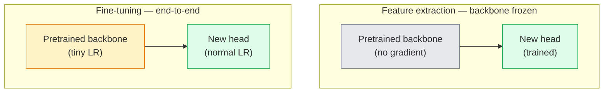

# Transfer Learning & Fine-Tuning

> Ai đó đã dành một triệu giờ GPU để dạy một mạng các cạnh, kết cấu và bộ phận đối tượng trông như thế nào. Bạn nên mượn các đặc trưng đó trước khi tự huấn luyện.

**Type:** Build
**Languages:** Python
**Prerequisites:** Phase 4 Lesson 03 (CNNs), Phase 4 Lesson 04 (Image Classification)
**Time:** ~75 minutes

## Learning Objectives

- Phân biệt trích xuất đặc trưng với tinh chỉnh và chọn cách phù hợp dựa trên kích thước tập dữ liệu, khoảng cách lĩnh vực và ngân sách tính toán
- Tải một backbone được tiền huấn luyện, thay đầu phân loại và chỉ huấn luyện đầu tới một đường cơ sở hoạt động trong dưới 20 dòng
- Mở băng dần các lớp với các tốc độ học phân biệt để các đặc trưng tổng quát ban đầu nhận cập nhật nhỏ hơn các đặc trưng riêng theo tác vụ phía sau
- Chẩn đoán ba thất bại thường gặp: trôi đặc trưng do LR quá cao trên các khối được mở băng, sụp đổ thống kê BN trên các tập dữ liệu rất nhỏ và quên thảm họa

## The Problem

Huấn luyện một ResNet-50 trên ImageNet tốn khoảng 2,000 giờ GPU. Rất ít nhóm có ngân sách đó cho mọi tác vụ họ phát hành. Thứ gần như mọi nhóm thực sự phát hành là một backbone được tiền huấn luyện với một đầu mới được huấn luyện trên vài trăm hoặc vài nghìn hình ảnh riêng theo tác vụ.

Đây không phải lối tắt. Khối tích chập đầu của bất kỳ CNN được huấn luyện ImageNet nào học các cạnh và các bộ lọc giống Gabor. Vài khối tiếp theo học các kết cấu và mô típ đơn giản. Các khối giữa học các bộ phận đối tượng. Các khối cuối học các tổ hợp bắt đầu giống 1,000 loại ImageNet. 90% đầu của hệ phân cấp đó chuyển giao gần như không đổi tới hình ảnh y tế, kiểm tra công nghiệp, dữ liệu vệ tinh và mọi tác vụ thị giác khác — vì tự nhiên có một vốn từ vựng cạnh và kết cấu hữu hạn. 10% cuối là những gì bạn thực sự huấn luyện.

Làm đúng chuyển giao có ba lỗi chờ bạn: phá hủy các đặc trưng được tiền huấn luyện bằng tốc độ học quá cao, làm mô hình thiếu thông tin bằng cách đóng băng quá nhiều và để các thống kê tích lũy của BatchNorm trôi về một tập dữ liệu rất nhỏ mà phần còn lại của mạng chưa bao giờ học từ đó. Bài học này cố ý đi qua từng lỗi.

## The Concept

### Feature extraction vs fine-tuning

Hai chế độ, được chọn theo mức tin tưởng các đặc trưng được tiền huấn luyện và lượng dữ liệu bạn có.



Các quy tắc kinh nghiệm:

| Kích thước tập dữ liệu | Khoảng cách lĩnh vực | Công thức |
|--------------|-----------------|--------|
| < 1k hình ảnh | gần ImageNet | Đóng băng backbone, chỉ huấn luyện đầu |
| 1k-10k | gần | Đóng băng 2-3 giai đoạn đầu, tinh chỉnh phần còn lại |
| 10k-100k | bất kỳ | Tinh chỉnh đầu-cuối với LR phân biệt |
| 100k+ | xa | Tinh chỉnh mọi thứ; cân nhắc huấn luyện từ đầu nếu lĩnh vực đủ xa |

"Gần ImageNet" đại khái nghĩa là các ảnh RGB tự nhiên có nội dung dạng đối tượng. Các ảnh quét CT y tế, ảnh vệ tinh từ trên cao và ảnh hiển vi là các lĩnh vực xa — các đặc trưng vẫn giúp ích, nhưng bạn sẽ cần để nhiều lớp thích nghi hơn.

### Why freezing works at all

Các đặc trưng ImageNet một CNN học không chuyên biệt cho 1,000 loại. Chúng chuyên biệt cho các thống kê hình ảnh tự nhiên: các cạnh ở những hướng cụ thể, kết cấu, mẫu tương phản, các thành phần hình dạng cơ bản. Các thống kê đó ổn định trên gần như mọi lĩnh vực thị giác con người có thể gọi tên. Đó là lý do một mô hình được huấn luyện trên ImageNet và đánh giá zero-shot trên CIFAR-10 chỉ với một đầu tuyến tính mới (không tinh chỉnh backbone) đạt accuracy 80%+. Đầu đang học nên gán trọng số cho những đặc trưng đã học nào cho tác vụ này.

### Discriminative learning rates

Khi bạn mở băng, các lớp đầu nên huấn luyện chậm hơn các lớp sau. Các lớp đầu mã hóa các đặc trưng tổng quát bạn muốn giữ; các lớp sau mã hóa cấu trúc riêng theo tác vụ bạn cần thay đổi nhiều.

```
Typical recipe:

  stage 0 (stem + first group): lr = base_lr / 100    (mostly fixed)
  stage 1:                       lr = base_lr / 10
  stage 2:                       lr = base_lr / 3
  stage 3 (last backbone group): lr = base_lr
  head:                          lr = base_lr  (or slightly higher)
```

Trong PyTorch đây chỉ là một danh sách nhóm tham số truyền cho bộ tối ưu hóa. Một mô hình, năm tốc độ học, không mã bổ sung.

### The BatchNorm problem

Các lớp BN chứa bộ đệm `running_mean` và `running_var` đã được tính trên ImageNet. Nếu tác vụ của bạn có phân phối pixel khác — ánh sáng khác, cảm biến khác, không gian màu khác — các bộ đệm đó sai. Ba lựa chọn theo thứ tự ưu tiên:

1. **Tinh chỉnh với BN ở chế độ train.** Để BN cập nhật các thống kê tích lũy cùng mọi thứ khác. Lựa chọn mặc định khi tập dữ liệu tác vụ cỡ vừa (>= 5k ví dụ).
2. **Đóng băng BN ở chế độ eval.** Giữ thống kê ImageNet và chỉ huấn luyện các trọng số. Đúng khi tập dữ liệu của bạn đủ nhỏ để trung bình trượt BN bị nhiễu.
3. **Thay BN bằng GroupNorm.** Loại bỏ hoàn toàn vấn đề trung bình trượt. Được sử dụng trong các backbone phát hiện và phân đoạn nơi kích thước batch mỗi GPU rất nhỏ.

Làm sai điều này âm thầm kéo accuracy xuống 5-15%.

### Head design

Đầu phân loại là 1-3 lớp tuyến tính cộng dropout tùy chọn. Mọi backbone torchvision đều cung cấp một đầu mặc định mà bạn thay thế:

```
backbone.fc = nn.Linear(backbone.fc.in_features, num_classes)          # ResNet
backbone.classifier[1] = nn.Linear(..., num_classes)                    # EfficientNet, MobileNet
backbone.heads.head = nn.Linear(..., num_classes)                       # torchvision ViT
```

Với các tập dữ liệu nhỏ, một lớp tuyến tính duy nhất thường đủ. Thêm một lớp ẩn (Linear -> ReLU -> Dropout -> Linear) giúp ích khi phân phối tác vụ xa hơn phân phối huấn luyện của backbone.

### Layer-wise LR decay

Một phiên bản mượt hơn của LR phân biệt được dùng trong tinh chỉnh hiện đại (BEiT, DINOv2, tinh chỉnh ViT-B). Thay vì nhóm các lớp thành giai đoạn, cho mỗi lớp một LR nhỏ hơn một chút so với lớp phía trên:

```
lr_layer_k = base_lr * decay^(L - k)
```

Với decay = 0.75 và L = 12 khối transformer, khối đầu huấn luyện ở `0.75^11 ≈ 0.04x` LR của đầu. Quan trọng với tinh chỉnh transformer hơn CNN, nơi các LR nhóm theo giai đoạn thường đủ.

### What to evaluate

Các lần học chuyển giao cần hai con số mà bạn sẽ không theo dõi khi huấn luyện từ đầu:

- **Accuracy chỉ với tiền huấn luyện** — accuracy của đầu khi backbone đóng băng. Đây là mức sàn của bạn.
- **Accuracy đã tinh chỉnh** — cùng mô hình sau huấn luyện đầu-cuối. Đây là mức trần của bạn.

Nếu kết quả tinh chỉnh thấp hơn chỉ tiền huấn luyện, bạn có lỗi tốc độ học hoặc BN. Luôn in cả hai.

```figure
transfer-learning
```

## Build It

### Step 1: Load a pretrained backbone and inspect it

```python
import torch
import torch.nn as nn
from torchvision.models import resnet18, ResNet18_Weights

backbone = resnet18(weights=ResNet18_Weights.IMAGENET1K_V1)
print(backbone)
print()
print("classifier head:", backbone.fc)
print("feature dim:", backbone.fc.in_features)
```

`ResNet18` có bốn giai đoạn (`layer1..layer4`) cộng một stem và một đầu `fc`. Mọi backbone phân loại torchvision có một cấu trúc tương tự.

### Step 2: Feature extraction — freeze everything, replace the head

```python
def make_feature_extractor(num_classes=10):
    model = resnet18(weights=ResNet18_Weights.IMAGENET1K_V1)
    for p in model.parameters():
        p.requires_grad = False
    model.fc = nn.Linear(model.fc.in_features, num_classes)
    return model

model = make_feature_extractor(num_classes=10)
trainable = sum(p.numel() for p in model.parameters() if p.requires_grad)
frozen = sum(p.numel() for p in model.parameters() if not p.requires_grad)
print(f"trainable: {trainable:>10,}")
print(f"frozen:    {frozen:>10,}")
```

Chỉ `model.fc` có thể huấn luyện. Backbone là một bộ trích xuất đặc trưng đóng băng.

### Step 3: Discriminative fine-tuning

Một tiện ích xây dựng các nhóm tham số với tốc độ học riêng theo giai đoạn.

```python
def discriminative_param_groups(model, base_lr=1e-3, decay=0.3):
    stages = [
        ["conv1", "bn1"],
        ["layer1"],
        ["layer2"],
        ["layer3"],
        ["layer4"],
        ["fc"],
    ]
    groups = []
    for i, names in enumerate(stages):
        lr = base_lr * (decay ** (len(stages) - 1 - i))
        params = [p for n, p in model.named_parameters()
                  if any(n.startswith(k) for k in names)]
        if params:
            groups.append({"params": params, "lr": lr, "name": "_".join(names)})
    return groups

model = resnet18(weights=ResNet18_Weights.IMAGENET1K_V1)
model.fc = nn.Linear(model.fc.in_features, 10)
for p in model.parameters():
    p.requires_grad = True

groups = discriminative_param_groups(model)
for g in groups:
    print(f"{g['name']:>10s}  lr={g['lr']:.2e}  params={sum(p.numel() for p in g['params']):>8,}")
```

`decay=0.3` nghĩa là mỗi giai đoạn huấn luyện ở 30% tốc độ của giai đoạn tiếp theo. `fc` nhận `base_lr`, `layer4` nhận `0.3 * base_lr`, `conv1` nhận `0.3^5 * base_lr ≈ 0.00243 * base_lr`. Nghe cực đoan; thực nghiệm cho thấy nó hoạt động.

### Step 4: BatchNorm handling

Hàm hỗ trợ đóng băng các thống kê tích lũy BN mà không đóng băng các trọng số.

```python
def freeze_bn_stats(model):
    for m in model.modules():
        if isinstance(m, (nn.BatchNorm1d, nn.BatchNorm2d, nn.BatchNorm3d)):
            m.eval()
            for p in m.parameters():
                p.requires_grad = False
    return model
```

Gọi nó sau khi bạn đặt `model.train()` ở đầu mỗi epoch. `model.train()` chuyển mọi thứ sang chế độ huấn luyện; điều này đảo lại chỉ với các lớp BN.

### Step 5: A minimal end-to-end fine-tuning loop

```python
from torch.optim import SGD
from torch.utils.data import DataLoader
from torch.optim.lr_scheduler import CosineAnnealingLR
import torch.nn.functional as F

def fine_tune(model, train_loader, val_loader, device, epochs=5, base_lr=1e-3, freeze_bn=False):
    model = model.to(device)
    groups = discriminative_param_groups(model, base_lr=base_lr)
    optimizer = SGD(groups, momentum=0.9, weight_decay=1e-4, nesterov=True)
    scheduler = CosineAnnealingLR(optimizer, T_max=epochs)

    for epoch in range(epochs):
        model.train()
        if freeze_bn:
            freeze_bn_stats(model)
        tr_loss, tr_correct, tr_total = 0.0, 0, 0
        for x, y in train_loader:
            x, y = x.to(device), y.to(device)
            logits = model(x)
            loss = F.cross_entropy(logits, y, label_smoothing=0.1)
            optimizer.zero_grad()
            loss.backward()
            optimizer.step()
            tr_loss += loss.item() * x.size(0)
            tr_total += x.size(0)
            tr_correct += (logits.argmax(-1) == y).sum().item()
        scheduler.step()

        model.eval()
        va_total, va_correct = 0, 0
        with torch.no_grad():
            for x, y in val_loader:
                x, y = x.to(device), y.to(device)
                pred = model(x).argmax(-1)
                va_total += x.size(0)
                va_correct += (pred == y).sum().item()
        print(f"epoch {epoch}  train {tr_loss/tr_total:.3f}/{tr_correct/tr_total:.3f}  "
              f"val {va_correct/va_total:.3f}")
    return model
```

Năm epoch với công thức trên trên CIFAR-10 đưa `ResNet18-IMAGENET1K_V1` từ accuracy linear-probe zero-shot ~70% tới accuracy tinh chỉnh ~93%. Chỉ riêng đầu sẽ chững lại quanh 86% mà không chạm backbone.

### Step 6: Progressive unfreezing

Một lịch mở băng một giai đoạn mỗi epoch từ cuối về đầu. Giảm trôi đặc trưng với chi phí thêm một số epoch.

```python
def progressive_unfreeze_schedule(model):
    stages = ["layer4", "layer3", "layer2", "layer1"]
    yielded = set()

    def start():
        for p in model.parameters():
            p.requires_grad = False
        for p in model.fc.parameters():
            p.requires_grad = True

    def unfreeze(epoch):
        if epoch < len(stages):
            name = stages[epoch]
            yielded.add(name)
            for n, p in model.named_parameters():
                if n.startswith(name):
                    p.requires_grad = True
            return name
        return None

    return start, unfreeze
```

Gọi `start()` một lần trước epoch đầu tiên. Gọi `unfreeze(epoch)` ở đầu mỗi epoch. Xây lại bộ tối ưu hóa bất cứ khi nào tập tham số có thể huấn luyện thay đổi, nếu không các tham số đóng băng vẫn giữ các moment lưu đệm gây nhầm lẫn cho nó.

## Use It

Với hầu hết tác vụ thực, `torchvision.models` + ba dòng là đủ. Bộ máy nặng hơn ở trên quan trọng khi bạn gặp các vấn đề mà mặc định thư viện không thể sửa.

```python
from torchvision.models import resnet50, ResNet50_Weights

model = resnet50(weights=ResNet50_Weights.IMAGENET1K_V2)
model.fc = nn.Linear(model.fc.in_features, num_classes)
optimizer = torch.optim.AdamW(model.parameters(), lr=1e-4, weight_decay=1e-4)
```

Hai mặc định khác đạt cấp production:

- `timm` cung cấp ~800 backbone thị giác được tiền huấn luyện với một API nhất quán (`timm.create_model("resnet50", pretrained=True, num_classes=10)`). Với bất kỳ tinh chỉnh nào ngoài bộ sưu tập torchvision, nó là tiêu chuẩn.
- Với transformer, `transformers.AutoModelForImageClassification.from_pretrained(name, num_labels=N)` cho bạn ViT / BEiT / DeiT với cùng ngữ nghĩa tải như các mô hình văn bản.

## Ship It

Bài học này tạo ra:

- `outputs/prompt-fine-tune-planner.md` — một prompt chọn trích xuất đặc trưng, tinh chỉnh dần hoặc đầu-cuối dựa trên kích thước tập dữ liệu, khoảng cách lĩnh vực và ngân sách tính toán.
- `outputs/skill-freeze-inspector.md` — một skill, với một mô hình PyTorch, báo cáo các tham số nào có thể huấn luyện, các lớp BatchNorm nào ở chế độ eval và liệu bộ tối ưu hóa có thực sự được cung cấp các tham số có thể huấn luyện không.

## Exercises

1. **(Dễ)** Huấn luyện một `ResNet18` như một linear probe (backbone đóng băng) và như một lần tinh chỉnh đầy đủ trên cùng tập dữ liệu CIFAR tổng hợp. Báo cáo hai accuracy cạnh nhau. Giải thích khoảng cách nào cho biết các đặc trưng chuyển giao tốt và khoảng cách nào cho biết chúng không chuyển giao tốt.
2. **(Vừa)** Cố ý đưa vào một lỗi: đặt `base_lr = 1e-1` trên giai đoạn backbone thay vì đầu. Cho thấy mất mát huấn luyện bùng nổ, rồi phục hồi bằng hàm hỗ trợ `discriminative_param_groups`. Ghi lại LR mà mỗi giai đoạn bắt đầu phân kỳ.
3. **(Khó)** Lấy một tập dữ liệu hình ảnh y tế (ví dụ CheXpert-small, PatchCamelyon hoặc HAM10000) và so sánh ba chế độ: (a) backbone đóng băng được tiền huấn luyện ImageNet + đầu tuyến tính; (b) tinh chỉnh đầu-cuối từ tiền huấn luyện ImageNet; (c) huấn luyện từ đầu. Báo cáo accuracy và chi phí tính toán cho mỗi cách. Ở kích thước tập dữ liệu nào huấn luyện từ đầu trở nên cạnh tranh?

## Key Terms

| Thuật ngữ | Cách mọi người nói | Ý nghĩa thực sự |
|------|----------------|----------------------|
| Feature extraction (Trích xuất đặc trưng) | "Đóng băng và huấn luyện đầu" | Các tham số backbone đóng băng, chỉ đầu phân loại mới nhận gradient |
| Fine-tuning (Tinh chỉnh) | "Huấn luyện lại đầu-cuối" | Tất cả tham số có thể huấn luyện, thường với LR nhỏ hơn nhiều so với huấn luyện từ đầu |
| Discriminative LR (LR phân biệt) | "LR nhỏ hơn cho các lớp đầu" | Các nhóm tham số bộ tối ưu hóa trong đó LR giai đoạn đầu là một phần LR giai đoạn sau |
| Layer-wise LR decay (Suy giảm LR theo lớp) | "Gradient LR mượt" | LR mỗi lớp nhân với decay^(L - k); phổ biến trong tinh chỉnh transformer |
| Catastrophic forgetting (Quên thảm họa) | "Mô hình mất ImageNet" | Một LR quá cao ghi đè các đặc trưng được tiền huấn luyện trước khi tín hiệu tác vụ mới được học |
| BN statistics drift (Trôi thống kê BN) | "Trung bình tích lũy sai" | running_mean/var BatchNorm được tính trên phân phối khác tác vụ hiện tại, âm thầm làm hại accuracy |
| Linear probe | "Backbone đóng băng + đầu tuyến tính" | Đánh giá các đặc trưng được tiền huấn luyện — accuracy của bộ phân loại tuyến tính tốt nhất trên biểu diễn đóng băng |
| Catastrophic collapse (Sụp đổ thảm họa) | "Mọi thứ dự đoán một lớp" | Xảy ra khi tinh chỉnh với LR đủ cao để phá hủy các đặc trưng trước khi các gradient từ đầu có thể ổn định |

## Further Reading

- [How transferable are features in deep neural networks? (Yosinski et al., 2014)](https://arxiv.org/abs/1411.1792) — bài báo định lượng khả năng chuyển giao đặc trưng giữa các lớp
- [Universal Language Model Fine-tuning (ULMFiT, Howard & Ruder, 2018)](https://arxiv.org/abs/1801.06146) — công thức LR phân biệt / mở băng dần gốc; các ý tưởng chuyển trực tiếp sang thị giác
- [timm documentation](https://huggingface.co/docs/timm) — tài liệu tham khảo cho các backbone thị giác hiện đại và các mặc định tinh chỉnh chính xác chúng được huấn luyện
- [A Simple Framework for Linear-Probe Evaluation (Kornblith et al., 2019)](https://arxiv.org/abs/1805.08974) — tại sao accuracy linear-probe quan trọng và cách báo cáo đúng
