# Object Detection — YOLO from Scratch

> Phát hiện là phân loại cộng hồi quy, chạy tại mọi vị trí trong một bản đồ đặc trưng, rồi được dọn sạch bằng triệt tiêu phi cực đại.

**Type:** Build
**Languages:** Python
**Prerequisites:** Phase 4 Lesson 03 (CNNs), Phase 4 Lesson 04 (Image Classification), Phase 4 Lesson 05 (Transfer Learning)
**Time:** ~75 minutes

## Learning Objectives

- Giải thích thiết kế lưới-và-anchor biến phát hiện thành bài toán dự đoán dày đặc và nêu ý nghĩa mọi số trong tensor đầu ra
- Tính Intersection-over-Union giữa các hộp và triển khai triệt tiêu phi cực đại từ đầu
- Xây một đầu kiểu YOLO tối giản trên một backbone được tiền huấn luyện, bao gồm các mất mát phân loại, objectness và hồi quy hộp
- Đọc một hàng thước đo phát hiện (precision@0.5, recall, mAP@0.5, mAP@0.5:0.95) và chọn núm điều chỉnh tiếp theo

## The Problem

Phân loại nói "hình ảnh này là một con chó." Phát hiện nói "có một con chó tại các pixel (112, 40, 280, 210), có một con mèo tại (400, 180, 560, 310) và không có gì khác trong khung hình." Một thay đổi cấu trúc đó — dự đoán số lượng hộp có nhãn thay đổi thay vì một nhãn mỗi hình ảnh — là điều mà mọi hệ thống tự hành, mọi sản phẩm giám sát, mọi bộ phân tích bố cục tài liệu và mọi dây chuyền thị giác nhà máy phụ thuộc.

Phát hiện cũng là nơi mọi đánh đổi kỹ thuật trong thị giác xuất hiện cùng lúc. Bạn muốn các hộp chính xác (đầu hồi quy), muốn lớp đúng cho mỗi hộp (đầu phân loại), muốn mô hình biết khi không có gì để phát hiện (điểm objectness) và muốn đúng một dự đoán mỗi đối tượng thật (triệt tiêu phi cực đại). Bỏ sót bất kỳ điều nào và pipeline hoặc bỏ sót đối tượng, báo cáo các hộp ảo giác hoặc dự đoán cùng đối tượng mười lăm lần ở các vị trí hơi khác nhau.

YOLO (You Only Look Once, Redmon et al. 2016) là thiết kế khiến tất cả điều này chạy thời gian thực bằng một lượt truyền xuôi duy nhất của một mạng tích chập, và cùng các quyết định cấu trúc vẫn là xương sống của các bộ phát hiện hiện đại (YOLOv8, YOLOv9, YOLO-NAS, RT-DETR). Học cốt lõi và mọi biến thể trở thành sự sắp xếp lại của cùng các phần.

## The Concept

### Detection as dense prediction

Một bộ phân loại xuất ra C số mỗi hình ảnh. Một bộ phát hiện kiểu YOLO xuất ra `(S x S x (5 + C))` số mỗi hình ảnh, trong đó S là kích thước lưới không gian.

```mermaid
flowchart LR
    IMG["Input 416x416 RGB"] --> BB["Backbone<br/>(ResNet, DarkNet, ...)"]
    BB --> FM["Feature map<br/>(C_feat, 13, 13)"]
    FM --> HEAD["Detection head<br/>(1x1 convs)"]
    HEAD --> OUT["Output tensor<br/>(13, 13, B * (5 + C))"]
    OUT --> DEC["Decode<br/>(grid + sigmoid + exp)"]
    DEC --> NMS["Non-max suppression"]
    NMS --> RESULT["Final boxes"]

    style IMG fill:#dbeafe,stroke:#2563eb
    style HEAD fill:#fef3c7,stroke:#d97706
    style NMS fill:#fecaca,stroke:#dc2626
    style RESULT fill:#dcfce7,stroke:#16a34a
```



Mỗi ô trong `S * S` ô lưới dự đoán `B` hộp. Với mỗi hộp:

- 4 số mô tả hình học: `tx, ty, tw, th`.
- 1 số là điểm objectness: "có đối tượng đặt tâm trong ô này không?"
- C số là các xác suất lớp.

Tổng mỗi ô: `B * (5 + C)`. Với VOC có `S=13, B=2, C=20`, đó là 50 số mỗi ô.

### Why grids and anchors

Hồi quy thông thường sẽ dự đoán `(x, y, w, h)` cho mỗi đối tượng như một tọa độ tuyệt đối. Điều đó khó với một mạng tích chập vì tịnh tiến hình ảnh không nên tịnh tiến mọi dự đoán cùng một lượng — mỗi đối tượng được neo trong không gian. Lưới trả lời bằng cách gán mỗi hộp sự thật nền cho ô lưới chứa tâm của nó; chỉ ô đó chịu trách nhiệm cho đối tượng đó.

Anchor giải quyết vấn đề thứ hai. Một tích chập 3x3 không dễ hồi quy một hộp rộng 500 pixel từ một ô đặc trưng có trường tiếp nhận 16 pixel. Thay vào đó, chúng ta định trước `B` hình dạng hộp tiên nghiệm (anchor) mỗi ô và dự đoán các độ lệch nhỏ từ mỗi anchor. Mô hình học chọn anchor đúng và dịch nó thay vì hồi quy từ không có gì.

```
Anchor box priors (example for 416x416 input):

  small:   (30,  60)
  medium:  (75,  170)
  large:   (200, 380)

At each grid cell, every anchor emits (tx, ty, tw, th, obj, c_1, ..., c_C).
```

Các bộ phát hiện hiện đại thường sử dụng FPN với các tập anchor khác nhau mỗi độ phân giải — anchor nhỏ trên bản đồ nông độ phân giải cao, anchor lớn trên bản đồ sâu độ phân giải thấp. Cùng ý tưởng, nhiều tỷ lệ hơn.

### Decoding predictions

Các `tx, ty, tw, th` thô không phải tọa độ hộp; chúng là các mục tiêu hồi quy cần được biến đổi trước khi vẽ:

```
centre x  = (sigmoid(tx) + cell_x) * stride
centre y  = (sigmoid(ty) + cell_y) * stride
width     = anchor_w * exp(tw)
height    = anchor_h * exp(th)
```

`sigmoid` giữ các độ lệch tâm trong ô. `exp` cho phép chiều rộng co giãn tự do từ anchor mà không đổi dấu. `stride` co giãn tọa độ lưới trở lại pixel. Bước giải mã này giống nhau trong mọi phiên bản YOLO từ v2.

### IoU

Thước đo tương đồng phổ quát của phát hiện giữa hai hộp:

```
IoU(A, B) = area(A intersect B) / area(A union B)
```

IoU = 1 nghĩa là giống hệt; IoU = 0 nghĩa là không chồng lấn. IoU giữa dự đoán và hộp sự thật nền quyết định liệu một dự đoán được tính là dương tính thật không (thường IoU >= 0.5). IoU giữa hai dự đoán là thứ NMS dùng để loại trùng.

### Non-maximum suppression

Một mạng tích chập được huấn luyện trên các anchor liền kề thường dự đoán các hộp chồng lấn cho cùng đối tượng. NMS giữ dự đoán có độ tin cậy cao nhất và xóa mọi dự đoán khác có IoU trên một ngưỡng.

```
NMS(boxes, scores, iou_threshold):
    sort boxes by score descending
    keep = []
    while boxes not empty:
        pick the top-scoring box, add to keep
        remove every box with IoU > iou_threshold to the picked box
    return keep
```

Ngưỡng điển hình: 0.45 cho phát hiện đối tượng. Các bộ phát hiện gần đây thay NMS tiêu chuẩn bằng `soft-NMS`, `DIoU-NMS` hoặc trực tiếp học triệt tiêu (RT-DETR) nhưng mục đích cấu trúc giống nhau.

### The loss

Mất mát YOLO là ba mất mát cộng với các trọng số:

```
L = lambda_coord * L_box(pred, target, where obj=1)
  + lambda_obj   * L_obj(pred, 1,     where obj=1)
  + lambda_noobj * L_obj(pred, 0,     where obj=0)
  + lambda_cls   * L_cls(pred, target, where obj=1)
```

Chỉ các ô chứa một đối tượng đóng góp vào các mất mát hồi quy hộp và phân loại. Các ô không có đối tượng chỉ đóng góp vào mất mát objectness (dạy mô hình im lặng). `lambda_noobj` thường nhỏ (~0.5) vì đại đa số ô trống và nếu không sẽ chi phối tổng mất mát.

Các biến thể hiện đại đổi mất mát hộp MSE thành CIoU / DIoU (tối ưu trực tiếp IoU), sử dụng focal loss cho mất cân bằng lớp và cân bằng objectness với quality focal loss. Cấu trúc ba thành phần không đổi.

### Detection metrics

Accuracy không chuyển sang phát hiện. Bốn con số làm được:

- **Precision@IoU=0.5** — trong các dự đoán được tính là dương tính, bao nhiêu thực sự đúng.
- **Recall@IoU=0.5** — trong các đối tượng thật, chúng ta tìm được bao nhiêu.
- **AP@0.5** — diện tích đường cong precision-recall tại ngưỡng IoU 0.5; một số mỗi lớp.
- **mAP@0.5:0.95** — trung bình AP trên các ngưỡng IoU 0.5, 0.55, ..., 0.95. Thước đo COCO; nghiêm ngặt nhất và nhiều thông tin nhất.

Báo cáo cả bốn. Một bộ phát hiện mạnh ở mAP@0.5 nhưng yếu ở mAP@0.5:0.95 đang định vị gần đúng nhưng chưa sát; khắc phục bằng mất mát hồi quy hộp tốt hơn. Một bộ phát hiện có precision cao và recall thấp quá thận trọng; hạ ngưỡng tin cậy hoặc tăng trọng số objectness.

```figure
object-detection-nms
```

## Build It

### Step 1: IoU

Thành phần chủ lực của toàn bài học. Hoạt động trên hai mảng hộp ở định dạng `(x1, y1, x2, y2)`.

```python
import numpy as np

def box_iou(boxes_a, boxes_b):
    ax1, ay1, ax2, ay2 = boxes_a[:, 0], boxes_a[:, 1], boxes_a[:, 2], boxes_a[:, 3]
    bx1, by1, bx2, by2 = boxes_b[:, 0], boxes_b[:, 1], boxes_b[:, 2], boxes_b[:, 3]

    inter_x1 = np.maximum(ax1[:, None], bx1[None, :])
    inter_y1 = np.maximum(ay1[:, None], by1[None, :])
    inter_x2 = np.minimum(ax2[:, None], bx2[None, :])
    inter_y2 = np.minimum(ay2[:, None], by2[None, :])

    inter_w = np.clip(inter_x2 - inter_x1, 0, None)
    inter_h = np.clip(inter_y2 - inter_y1, 0, None)
    inter = inter_w * inter_h

    area_a = (ax2 - ax1) * (ay2 - ay1)
    area_b = (bx2 - bx1) * (by2 - by1)
    union = area_a[:, None] + area_b[None, :] - inter
    return inter / np.clip(union, 1e-8, None)
```

Trả về một ma trận `(N_a, N_b)` các IoU từng cặp. Sử dụng với một hộp sự thật nền duy nhất bằng cách cho một mảng hình dạng `(1, 4)`.

### Step 2: Non-max suppression

```python
def nms(boxes, scores, iou_threshold=0.45):
    order = np.argsort(-scores)
    keep = []
    while len(order) > 0:
        i = order[0]
        keep.append(i)
        if len(order) == 1:
            break
        rest = order[1:]
        ious = box_iou(boxes[[i]], boxes[rest])[0]
        order = rest[ious <= iou_threshold]
    return np.array(keep, dtype=np.int64)
```

Tất định, `O(N log N)` từ sắp xếp, và khớp hành vi `torchvision.ops.nms` trên các đầu vào giống hệt.

### Step 3: Box encoding and decoding

Chuyển giữa tọa độ pixel và các mục tiêu `(tx, ty, tw, th)` mà mạng thực sự hồi quy.

```python
def encode(box_xyxy, cell_x, cell_y, stride, anchor_wh):
    x1, y1, x2, y2 = box_xyxy
    cx = 0.5 * (x1 + x2)
    cy = 0.5 * (y1 + y2)
    w = x2 - x1
    h = y2 - y1
    tx = cx / stride - cell_x
    ty = cy / stride - cell_y
    tw = np.log(w / anchor_wh[0] + 1e-8)
    th = np.log(h / anchor_wh[1] + 1e-8)
    return np.array([tx, ty, tw, th])


def decode(tx_ty_tw_th, cell_x, cell_y, stride, anchor_wh):
    tx, ty, tw, th = tx_ty_tw_th
    cx = (sigmoid(tx) + cell_x) * stride
    cy = (sigmoid(ty) + cell_y) * stride
    w = anchor_wh[0] * np.exp(tw)
    h = anchor_wh[1] * np.exp(th)
    return np.array([cx - w / 2, cy - h / 2, cx + w / 2, cy + h / 2])


def sigmoid(x):
    return 1.0 / (1.0 + np.exp(-x))
```

Kiểm tra: mã hóa một hộp rồi giải mã — bạn nên nhận lại thứ rất gần bản gốc (ngoại trừ nghịch đảo sigmoid không hoàn toàn khả nghịch khi `tx` không nằm trong phạm vi sau sigmoid).

### Step 4: A minimal YOLO head

Một tích chập 1x1 trên một bản đồ đặc trưng, đổi hình dạng thành `(B, S, S, num_anchors, 5 + C)`.

```python
import torch
import torch.nn as nn

class YOLOHead(nn.Module):
    def __init__(self, in_c, num_anchors, num_classes):
        super().__init__()
        self.num_anchors = num_anchors
        self.num_classes = num_classes
        self.conv = nn.Conv2d(in_c, num_anchors * (5 + num_classes), kernel_size=1)

    def forward(self, x):
        n, _, h, w = x.shape
        y = self.conv(x)
        y = y.view(n, self.num_anchors, 5 + self.num_classes, h, w)
        y = y.permute(0, 3, 4, 1, 2).contiguous()
        return y
```

Hình dạng đầu ra: `(N, H, W, num_anchors, 5 + C)`. Chiều cuối chứa `[tx, ty, tw, th, obj, cls_0, ..., cls_{C-1}]`.

### Step 5: Ground-truth assignment

Với mọi hộp sự thật nền, quyết định `(cell, anchor)` nào chịu trách nhiệm.

```python
def assign_targets(boxes_xyxy, classes, anchors, stride, grid_size, num_classes):
    num_anchors = len(anchors)
    target = np.zeros((grid_size, grid_size, num_anchors, 5 + num_classes), dtype=np.float32)
    has_obj = np.zeros((grid_size, grid_size, num_anchors), dtype=bool)

    for box, cls in zip(boxes_xyxy, classes):
        x1, y1, x2, y2 = box
        cx, cy = 0.5 * (x1 + x2), 0.5 * (y1 + y2)
        gx, gy = int(cx / stride), int(cy / stride)
        bw, bh = x2 - x1, y2 - y1

        ious = np.array([
            (min(bw, aw) * min(bh, ah)) / (bw * bh + aw * ah - min(bw, aw) * min(bh, ah))
            for aw, ah in anchors
        ])
        best = int(np.argmax(ious))
        aw, ah = anchors[best]

        target[gy, gx, best, 0] = cx / stride - gx
        target[gy, gx, best, 1] = cy / stride - gy
        target[gy, gx, best, 2] = np.log(bw / aw + 1e-8)
        target[gy, gx, best, 3] = np.log(bh / ah + 1e-8)
        target[gy, gx, best, 4] = 1.0
        target[gy, gx, best, 5 + cls] = 1.0
        has_obj[gy, gx, best] = True
    return target, has_obj
```

Lựa chọn anchor là "IoU hình dạng tốt nhất với sự thật nền" — một đại diện rẻ khớp phép gán YOLOv2/v3. v5 trở lên dùng các chiến lược tinh vi hơn (ghép căn chỉnh tác vụ, k động) tinh chỉnh cùng ý tưởng.

### Step 6: The three losses

```python
def yolo_loss(pred, target, has_obj, lambda_coord=5.0, lambda_obj=1.0, lambda_noobj=0.5, lambda_cls=1.0):
    has_obj_t = torch.from_numpy(has_obj).bool()
    target_t = torch.from_numpy(target).float()

    # box-regression loss: only on cells with objects
    box_pred = pred[..., :4][has_obj_t]
    box_true = target_t[..., :4][has_obj_t]
    loss_box = torch.nn.functional.mse_loss(box_pred, box_true, reduction="sum")

    # objectness loss
    obj_pred = pred[..., 4]
    obj_true = target_t[..., 4]
    loss_obj_pos = torch.nn.functional.binary_cross_entropy_with_logits(
        obj_pred[has_obj_t], obj_true[has_obj_t], reduction="sum")
    loss_obj_neg = torch.nn.functional.binary_cross_entropy_with_logits(
        obj_pred[~has_obj_t], obj_true[~has_obj_t], reduction="sum")

    # classification loss on cells with objects
    cls_pred = pred[..., 5:][has_obj_t]
    cls_true = target_t[..., 5:][has_obj_t]
    loss_cls = torch.nn.functional.binary_cross_entropy_with_logits(
        cls_pred, cls_true, reduction="sum")

    total = (lambda_coord * loss_box
             + lambda_obj * loss_obj_pos
             + lambda_noobj * loss_obj_neg
             + lambda_cls * loss_cls)
    return total, {"box": loss_box.item(), "obj_pos": loss_obj_pos.item(),
                   "obj_neg": loss_obj_neg.item(), "cls": loss_cls.item()}
```

Năm siêu tham số mà mọi hướng dẫn YOLO hoặc mã hóa cứng hoặc quét. Các tỷ lệ quan trọng: `lambda_coord=5, lambda_noobj=0.5` phản ánh bài báo YOLOv1 gốc và vẫn hoạt động như một mặc định hợp lý.

### Step 7: Inference pipeline

Giải mã đầu ra đầu thô, áp dụng sigmoid/exp, đặt ngưỡng trên objectness và NMS.

```python
def postprocess(pred_tensor, anchors, stride, img_size, conf_threshold=0.25, iou_threshold=0.45):
    pred = pred_tensor.detach().cpu().numpy()
    grid_h, grid_w = pred.shape[1], pred.shape[2]
    num_anchors = len(anchors)

    boxes, scores, classes = [], [], []
    for gy in range(grid_h):
        for gx in range(grid_w):
            for a in range(num_anchors):
                tx, ty, tw, th, obj, *cls = pred[0, gy, gx, a]
                score = sigmoid(obj) * sigmoid(np.array(cls)).max()
                if score < conf_threshold:
                    continue
                cls_idx = int(np.argmax(cls))
                cx = (sigmoid(tx) + gx) * stride
                cy = (sigmoid(ty) + gy) * stride
                w = anchors[a][0] * np.exp(tw)
                h = anchors[a][1] * np.exp(th)
                boxes.append([cx - w / 2, cy - h / 2, cx + w / 2, cy + h / 2])
                scores.append(float(score))
                classes.append(cls_idx)

    if not boxes:
        return np.zeros((0, 4)), np.zeros((0,)), np.zeros((0,), dtype=int)
    boxes = np.array(boxes)
    scores = np.array(scores)
    classes = np.array(classes)
    keep = nms(boxes, scores, iou_threshold)
    return boxes[keep], scores[keep], classes[keep]
```

Đó là toàn bộ đường eval: đầu -> giải mã -> ngưỡng -> NMS.

## Use It

`torchvision.models.detection` cung cấp các bộ phát hiện production với cùng cấu trúc khái niệm. Tải một mô hình được tiền huấn luyện cần ba dòng.

```python
import torch
from torchvision.models.detection import fasterrcnn_resnet50_fpn_v2

model = fasterrcnn_resnet50_fpn_v2(weights="DEFAULT")
model.eval()
with torch.no_grad():
    predictions = model([torch.randn(3, 400, 600)])
print(predictions[0].keys())
print(f"boxes:  {predictions[0]['boxes'].shape}")
print(f"scores: {predictions[0]['scores'].shape}")
print(f"labels: {predictions[0]['labels'].shape}")
```

Với các pipeline suy luận thời gian thực, `ultralytics` (YOLOv8/v9) là tiêu chuẩn: `from ultralytics import YOLO; model = YOLO('yolov8n.pt'); model(img)`. Mô hình xử lý giải mã và NMS bên trong rồi trả về cùng bộ ba `boxes / scores / labels` bạn đã xây ở trên.

## Ship It

Bài học này tạo ra:

- `outputs/prompt-detection-metric-reader.md` — một prompt biến một hàng `precision, recall, AP, mAP@0.5:0.95` thành một chẩn đoán một dòng và một thí nghiệm tiếp theo hữu ích nhất.
- `outputs/skill-anchor-designer.md` — một skill, với một tập dữ liệu hộp sự thật nền, chạy k-means trên `(w, h)` và trả về các tập anchor mỗi mức FPN cộng thống kê bao phủ bạn cần để chọn số anchor đúng.

## Exercises

1. **(Dễ)** Triển khai `box_iou` và chạy đối chiếu với `torchvision.ops.box_iou` trên 1,000 cặp hộp ngẫu nhiên. Xác minh chênh lệch tuyệt đối tối đa dưới `1e-6`.
2. **(Vừa)** Chuyển `yolo_loss` sang một phiên bản sử dụng mất mát hộp `CIoU` thay MSE. Cho thấy trên một tập dữ liệu tổng hợp 100 hình ảnh rằng CIoU hội tụ tới mAP@0.5:0.95 cuối tốt hơn MSE trong cùng số epoch.
3. **(Khó)** Triển khai suy luận đa tỷ lệ: đưa cùng hình ảnh ở ba độ phân giải qua mô hình, hợp các dự đoán hộp và chạy một NMS duy nhất ở cuối. Đo mức tăng mAP so với suy luận một tỷ lệ trên một tập được giữ lại.

## Key Terms

| Thuật ngữ | Cách mọi người nói | Ý nghĩa thực sự |
|------|----------------|----------------------|
| Anchor | "Tiên nghiệm hộp" | Một hình dạng hộp định trước tại mỗi ô lưới mà từ đó mạng dự đoán các độ lệch thay vì tọa độ tuyệt đối |
| IoU | "Chồng lấn" | Giao trên hợp của hai hộp; thước đo tương đồng phổ quát trong phát hiện |
| NMS | "Loại trùng" | Thuật toán tham lam giữ các dự đoán điểm cao nhất và loại bỏ các dự đoán chồng lấn trên một ngưỡng |
| Objectness | "Có thứ gì ở đây không" | Số vô hướng mỗi anchor, mỗi ô dự đoán liệu một đối tượng có tâm trong ô đó không |
| Grid stride (Stride lưới) | "Hệ số giảm mẫu" | Số pixel mỗi ô lưới; một đầu vào 416-px với đầu lưới 13 có stride 32 |
| mAP | "Trung bình average precision" | Trung bình diện tích dưới đường cong precision-recall, lấy trung bình trên các lớp và (với COCO) các ngưỡng IoU |
| AP@0.5 | "PASCAL VOC AP" | Average precision với ngưỡng IoU 0.5; phiên bản dễ dãi của thước đo |
| mAP@0.5:0.95 | "COCO AP" | Trung bình trên các ngưỡng IoU 0.5..0.95 bước 0.05; phiên bản nghiêm ngặt và tiêu chuẩn cộng đồng hiện tại |

## Further Reading

- [YOLOv1: You Only Look Once (Redmon et al., 2016)](https://arxiv.org/abs/1506.02640) — bài báo nền tảng; mọi YOLO sau đó là sự tinh chỉnh cấu trúc này
- [YOLOv3 (Redmon & Farhadi, 2018)](https://arxiv.org/abs/1804.02767) — bài báo giới thiệu các đầu đa tỷ lệ kiểu FPN; vẫn là sơ đồ rõ ràng nhất
- [Ultralytics YOLOv8 docs](https://docs.ultralytics.com) — tài liệu tham khảo production hiện tại; bao quát các định dạng tập dữ liệu, tăng cường, công thức huấn luyện
- [The Illustrated Guide to Object Detection (Jonathan Hui)](https://jonathan-hui.medium.com/object-detection-series-24d03a12f904) — chuyến tham quan bằng tiếng Anh đơn giản tốt nhất về toàn bộ bộ sưu tập bộ phát hiện; vô giá để hiểu DETR, RetinaNet, FCOS và YOLO liên hệ thế nào
