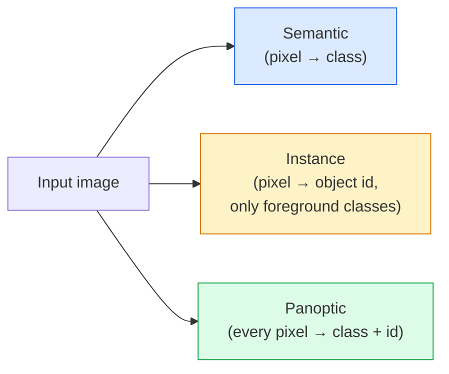
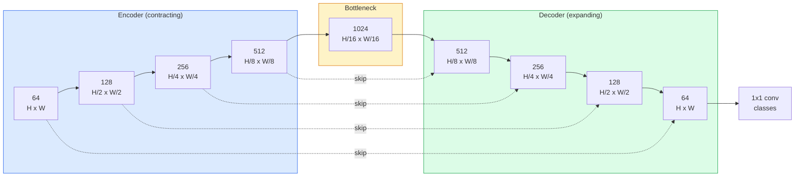

# Semantic Segmentation — U-Net

> Phân đoạn là phân loại tại mọi pixel. U-Net khiến nó hoạt động bằng cách ghép một encoder giảm mẫu với một decoder tăng mẫu và nối các kết nối tắt giữa chúng.

**Type:** Build
**Languages:** Python
**Prerequisites:** Phase 4 Lesson 03 (CNNs), Phase 4 Lesson 04 (Image Classification)
**Time:** ~75 minutes

## Learning Objectives

- Phân biệt phân đoạn ngữ nghĩa, thực thể và toàn cảnh và chọn tác vụ phù hợp cho một bài toán nhất định
- Xây một U-Net từ đầu bằng PyTorch với các khối encoder, một bottleneck, một decoder có tích chập chuyển vị và các kết nối tắt
- Triển khai cross-entropy từng pixel, mất mát Dice và mất mát kết hợp hiện là mặc định cho phân đoạn y tế và công nghiệp
- Đọc các thước đo IoU và Dice từng lớp và chẩn đoán điểm kém đến từ recall đối tượng nhỏ, độ chính xác biên hay mất cân bằng lớp

## The Problem

Phân loại xuất ra một nhãn mỗi hình ảnh. Phát hiện xuất ra một số hộp mỗi hình ảnh. Phân đoạn xuất ra một nhãn mỗi pixel. Với một đầu vào kích thước `H x W`, đầu ra là một tensor hình dạng `H x W` (ngữ nghĩa) hoặc `H x W x N_instances` (thực thể). Đó là hàng triệu dự đoán mỗi hình ảnh, không phải một.

Cấu trúc phân đoạn là lý do nó vận hành gần như mọi sản phẩm thị giác dự đoán dày đặc: hình ảnh y tế (mặt nạ khối u), lái xe tự hành (đường, làn, chướng ngại), vệ tinh (dấu chân tòa nhà, ranh giới cây trồng), phân tích tài liệu (vùng bố cục), robot (vùng có thể nắm). Không tác vụ nào trong số đó có thể được giải bằng cách đặt một hộp quanh đối tượng; chúng cần đường viền chính xác.

Bài toán kiến trúc dễ phát biểu nhưng không dễ giải: bạn cần mạng thấy ngữ cảnh toàn cục của hình ảnh (đây là loại cảnh nào) và chi tiết pixel cục bộ (chính xác pixel nào là đường hay vỉa hè) đồng thời. Một CNN tiêu chuẩn nén theo không gian để có ngữ cảnh, làm mất chi tiết. U-Net là thiết kế có được cả hai.

## The Concept

### Semantic vs instance vs panoptic



- **Ngữ nghĩa** nói "pixel này là đường, pixel kia là xe." Hai xe cạnh nhau gộp thành một đốm.
- **Thực thể** nói "pixel này là xe #3, pixel kia là xe #5." Bỏ qua các vùng nền ("stuff" = trời, đường, cỏ).
- **Toàn cảnh** thống nhất cả hai: mọi pixel có nhãn lớp, mọi thực thể có một id duy nhất, cả vùng nền và đối tượng đều được phân đoạn.

Bài này đề cập ngữ nghĩa. Bài tiếp theo (Mask R-CNN) đề cập thực thể.

### The U-Net shape



Encoder giảm một nửa độ phân giải không gian bốn lần và gấp đôi số kênh. Decoder đảo lại: gấp đôi độ phân giải không gian bốn lần và giảm một nửa số kênh. Các kết nối tắt nối các đặc trưng encoder tương ứng với đặc trưng decoder ở mỗi độ phân giải. Tích chập 1x1 cuối ánh xạ `64 -> num_classes` ở độ phân giải đầy đủ.

Tại sao các kết nối tắt cần thiết: decoder chỉ thấy các bản đồ đặc trưng nhỏ khi nó cố xuất các dự đoán cấp pixel. Không có kết nối tắt nó không thể định vị các cạnh chính xác vì thông tin đó đã bị nén mất trong encoder. Các kết nối tắt đưa cho nó các bản đồ đặc trưng độ phân giải cao mà encoder đã tính trên đường đi xuống.

### Transposed vs bilinear upsample

Decoder phải mở rộng các chiều không gian. Hai lựa chọn:

- **Tích chập chuyển vị** (`nn.ConvTranspose2d`) — tăng mẫu có thể học. Mặc định U-Net trong lịch sử. Có thể tạo các giả ảnh bàn cờ nếu stride và kích thước kernel không chia hết đều.
- **Tăng mẫu song tuyến tính + tích chập 3x3** — tăng mẫu mượt theo sau bởi một tích chập. Ít giả ảnh hơn, ít tham số hơn, giờ là mặc định hiện đại.

Cả hai xuất hiện trong thực tế. Với U-Net đầu tiên, song tuyến tính an toàn hơn.

### Cross-entropy on a pixel grid

Với phân đoạn ngữ nghĩa có $C$ lớp, đầu ra mô hình là `(N, C, H, W)`. Mục tiêu là `(N, H, W)` với các ID lớp nguyên. Cross-entropy giống hệt trường hợp phân loại, chỉ áp dụng tại mọi vị trí không gian:

```math
\text{Loss} = \mathop{\mathrm{mean}}\limits_{(n, h, w)} \left[ -\log\left( \mathop{\mathrm{softmax}}(\text{logits}[n, :, h, w])[\text{target}[n, h, w]] \right) \right]
```

`F.cross_entropy` trong PyTorch xử lý hình dạng này trực tiếp. Không cần đổi hình dạng.

### Dice loss and why you need it

Cross-entropy coi mọi pixel như nhau. Điều đó sai khi một lớp chi phối khung hình (hình ảnh y tế: 99% nền, 1% khối u). Mạng có thể đạt accuracy 99% bằng cách dự đoán nền ở mọi nơi và vẫn vô dụng.

Mất mát Dice giải quyết bằng cách trực tiếp tối ưu độ chồng lấn giữa mặt nạ dự đoán và thật:

```math
\begin{aligned}
\mathop{\mathrm{Dice}}(p, y) &= \frac{2 \sum (p \cdot y)}{\sum p + \sum y + \epsilon} \\
\text{Dice}_{\text{loss}} &= 1 - \text{Dice}
\end{aligned}
```

trong đó `p` là bản đồ xác suất sigmoid/softmax cho một lớp và `y` là mặt nạ sự thật nền nhị phân. Mất mát chỉ bằng không khi chồng lấn hoàn hảo. Vì dựa trên tỷ số, mất cân bằng lớp không liên quan.

Trong thực tế, sử dụng **mất mát kết hợp**:

```math
L = L_{\text{cross\_entropy}} + \lambda \cdot L_{\text{dice}} \qquad (\lambda \approx 1)
```

Cross-entropy cho các gradient ổn định ở đầu huấn luyện; Dice tập trung phần cuối huấn luyện vào việc thực sự khớp hình dạng mặt nạ. Tổ hợp này là mặc định hình ảnh y tế và khó đánh bại trên bất kỳ tập dữ liệu mất cân bằng lớp nào.

### Evaluation metrics

- **Accuracy pixel** — phần trăm pixel được dự đoán đúng. Rẻ. Không hoạt động trên dữ liệu mất cân bằng vì cùng lý do như accuracy trong phân loại.
- **IoU từng lớp** — giao trên hợp cho mặt nạ mỗi lớp; trung bình trên các lớp = mIoU.
- **Dice (F1 trên pixel)** — tương tự IoU; $\text{Dice} = 2 \cdot \text{IoU} / (1 + \text{IoU})$. Hình ảnh y tế thích Dice, cộng đồng lái xe thích IoU; chúng có quan hệ đơn điệu.
- **F1 biên** — đo các biên dự đoán gần các biên sự thật nền đến mức nào, phạt ngay cả các dịch chuyển nhỏ. Quan trọng với tác vụ độ chính xác cao như kiểm tra bán dẫn.

Báo cáo IoU từng lớp, không chỉ mIoU. IoU trung bình che giấu một lớp ở 15% khi chín lớp khác ở 85%.

### Input resolution trade-off

Encoder của U-Net giảm một nửa độ phân giải bốn lần, vì vậy các kết nối bỏ qua chỉ khớp chính xác khi đầu vào chia hết cho 16. Các kích thước khác cần padding hoặc thay đổi kích thước trong khối up (Bước 2). Hình ảnh y khoa thường là 512x512 hoặc 1024x1024. Các ảnh cắt lái xe tự chủ là 2048x1024. Chi phí bộ nhớ của U-Net tăng theo `H * W * C_max`, và ở 1024x1024 với 1024 kênh bottleneck, lượt truyền xuôi đã sử dụng nhiều gigabyte VRAM.

Hai cách khắc phục tiêu chuẩn:
1. Chia ô đầu vào — xử lý các ô 256x256 có chồng lấn rồi ghép.
2. Thay bottleneck bằng các tích chập giãn giữ độ phân giải không gian cao hơn nhưng mở rộng trường tiếp nhận (họ DeepLab).

Với mô hình đầu tiên, đầu vào 256x256 với U-Net cơ sở 64 kênh huấn luyện thoải mái trên 8 GB VRAM.

```figure
segmentation-flood
```

## Build It

### Step 1: Encoder block

Hai tích chập 3x3 với batch norm và ReLU. Tích chập đầu thay đổi số kênh; tích chập thứ hai giữ nguyên.

```python
import torch
import torch.nn as nn
import torch.nn.functional as F

class DoubleConv(nn.Module):
    def __init__(self, in_c, out_c):
        super().__init__()
        self.net = nn.Sequential(
            nn.Conv2d(in_c, out_c, kernel_size=3, padding=1, bias=False),
            nn.BatchNorm2d(out_c),
            nn.ReLU(inplace=True),
            nn.Conv2d(out_c, out_c, kernel_size=3, padding=1, bias=False),
            nn.BatchNorm2d(out_c),
            nn.ReLU(inplace=True),
        )

    def forward(self, x):
        return self.net(x)
```

Khối này được tái sử dụng xuyên suốt. `bias=False` vì beta BN xử lý bias.

### Step 2: Down and up blocks

```python
class Down(nn.Module):
    def __init__(self, in_c, out_c):
        super().__init__()
        self.net = nn.Sequential(
            nn.MaxPool2d(2),
            DoubleConv(in_c, out_c),
        )

    def forward(self, x):
        return self.net(x)


class Up(nn.Module):
    def __init__(self, in_c, out_c):
        super().__init__()
        self.up = nn.Upsample(scale_factor=2, mode="bilinear", align_corners=False)
        self.conv = DoubleConv(in_c, out_c)

    def forward(self, x, skip):
        x = self.up(x)
        if x.shape[-2:] != skip.shape[-2:]:
            x = F.interpolate(x, size=skip.shape[-2:], mode="bilinear", align_corners=False)
        x = torch.cat([skip, x], dim=1)
        return self.conv(x)
```

Kiểm tra hình dạng chỉ không gian (`shape[-2:]`) xử lý các đầu vào có kích thước không chia hết cho 16; một `F.interpolate` an toàn căn chỉnh tensor trước phép nối. So sánh toàn bộ hình dạng cũng sẽ kích hoạt trên các khác biệt số kênh, điều nên là một lỗi rõ ràng, không phải nội suy âm thầm.

### Step 3: The U-Net

```python
class UNet(nn.Module):
    def __init__(self, in_channels=3, num_classes=2, base=64):
        super().__init__()
        self.inc = DoubleConv(in_channels, base)
        self.d1 = Down(base, base * 2)
        self.d2 = Down(base * 2, base * 4)
        self.d3 = Down(base * 4, base * 8)
        self.d4 = Down(base * 8, base * 16)
        self.u1 = Up(base * 16 + base * 8, base * 8)
        self.u2 = Up(base * 8 + base * 4, base * 4)
        self.u3 = Up(base * 4 + base * 2, base * 2)
        self.u4 = Up(base * 2 + base, base)
        self.outc = nn.Conv2d(base, num_classes, kernel_size=1)

    def forward(self, x):
        x1 = self.inc(x)
        x2 = self.d1(x1)
        x3 = self.d2(x2)
        x4 = self.d3(x3)
        x5 = self.d4(x4)
        x = self.u1(x5, x4)
        x = self.u2(x, x3)
        x = self.u3(x, x2)
        x = self.u4(x, x1)
        return self.outc(x)

net = UNet(in_channels=3, num_classes=2, base=32)
x = torch.randn(1, 3, 256, 256)
print(f"output: {net(x).shape}")
print(f"params: {sum(p.numel() for p in net.parameters()):,}")
```

Hình dạng đầu ra `(1, 2, 256, 256)` — cùng kích thước không gian như đầu vào, `num_classes` kênh. Khoảng 7.7M tham số ở `base=32`.

### Step 4: Losses

```python
def dice_loss(logits, targets, num_classes, eps=1e-6):
    probs = F.softmax(logits, dim=1)
    targets_one_hot = F.one_hot(targets, num_classes).permute(0, 3, 1, 2).float()
    dims = (0, 2, 3)
    intersection = (probs * targets_one_hot).sum(dim=dims)
    denom = probs.sum(dim=dims) + targets_one_hot.sum(dim=dims)
    dice = (2 * intersection + eps) / (denom + eps)
    return 1 - dice.mean()


def combined_loss(logits, targets, num_classes, lam=1.0):
    ce = F.cross_entropy(logits, targets)
    dc = dice_loss(logits, targets, num_classes)
    return ce + lam * dc, {"ce": ce.item(), "dice": dc.item()}
```

Dice được tính từng lớp rồi lấy trung bình (Dice macro). `eps` ngăn chia cho không trên các lớp vắng mặt trong batch.

### Step 5: IoU metric

```python
@torch.no_grad()
def iou_per_class(logits, targets, num_classes):
    preds = logits.argmax(dim=1)
    ious = torch.zeros(num_classes)
    for c in range(num_classes):
        pred_c = (preds == c)
        true_c = (targets == c)
        inter = (pred_c & true_c).sum().float()
        union = (pred_c | true_c).sum().float()
        ious[c] = (inter / union) if union > 0 else torch.tensor(float("nan"))
    return ious
```

Trả về một vector độ dài C. `nan` đánh dấu các lớp vắng mặt trong batch — không lấy trung bình trên chúng khi tính mIoU.

### Step 6: Synthetic dataset for end-to-end verification

Sinh các hình dạng trên nền có màu để mạng phải học hình dạng, không phải màu pixel.

```python
import numpy as np
from torch.utils.data import Dataset, DataLoader

def synthetic_segmentation(num_samples=200, size=64, seed=0):
    rng = np.random.default_rng(seed)
    images = np.zeros((num_samples, size, size, 3), dtype=np.float32)
    masks = np.zeros((num_samples, size, size), dtype=np.int64)
    for i in range(num_samples):
        bg = rng.uniform(0, 1, (3,))
        images[i] = bg
        masks[i] = 0
        num_shapes = rng.integers(1, 4)
        for _ in range(num_shapes):
            cls = int(rng.integers(1, 3))
            color = rng.uniform(0, 1, (3,))
            cx, cy = rng.integers(10, size - 10, size=2)
            r = int(rng.integers(4, 12))
            yy, xx = np.meshgrid(np.arange(size), np.arange(size), indexing="ij")
            if cls == 1:
                mask = (xx - cx) ** 2 + (yy - cy) ** 2 < r ** 2
            else:
                mask = (np.abs(xx - cx) < r) & (np.abs(yy - cy) < r)
            images[i][mask] = color
            masks[i][mask] = cls
        images[i] += rng.normal(0, 0.02, images[i].shape)
        images[i] = np.clip(images[i], 0, 1)
    return images, masks


class SegDataset(Dataset):
    def __init__(self, images, masks):
        self.images = images
        self.masks = masks

    def __len__(self):
        return len(self.images)

    def __getitem__(self, i):
        img = torch.from_numpy(self.images[i]).permute(2, 0, 1).float()
        mask = torch.from_numpy(self.masks[i]).long()
        return img, mask
```

Ba lớp: nền (0), hình tròn (1), hình vuông (2). Mạng phải học phân biệt hình dạng.

### Step 7: Training loop

```python
def train_one_epoch(model, loader, optimizer, device, num_classes):
    model.train()
    loss_sum, total = 0.0, 0
    iou_sum = torch.zeros(num_classes)
    for x, y in loader:
        x, y = x.to(device), y.to(device)
        logits = model(x)
        loss, _ = combined_loss(logits, y, num_classes)
        optimizer.zero_grad()
        loss.backward()
        optimizer.step()
        loss_sum += loss.item() * x.size(0)
        total += x.size(0)
        iou_sum += iou_per_class(logits, y, num_classes).nan_to_num(0)
    return loss_sum / total, iou_sum / len(loader)
```

Chạy trong 10-30 epoch trên tập dữ liệu tổng hợp và quan sát mIoU vượt 0.9 cho các lớp hình dạng. Lưu ý `nan_to_num(0)` coi các lớp vắng mặt trong một batch là không; để có IoU từng lớp chính xác, đặt mặt nạ theo sự hiện diện và sử dụng `torch.nanmean` giữa các batch khi đánh giá thay vì lấy trung bình ở đây.

## Use It

Cho production, `segmentation_models_pytorch` ("smp") bao bọc mọi kiến trúc phân đoạn tiêu chuẩn với bất kỳ backbone torchvision hoặc timm nào. Ba dòng:

```python
import segmentation_models_pytorch as smp

model = smp.Unet(
    encoder_name="resnet34",
    encoder_weights="imagenet",
    in_channels=3,
    classes=3,
)
```

Cũng đáng biết cho công việc thực tế:
- **DeepLabV3+** thay giảm mẫu dựa trên max-pool bằng các tích chập giãn để bottleneck giữ độ phân giải; biên nhanh hơn trên dữ liệu vệ tinh và lái xe.
- **SegFormer** đổi encoder tích chập thành transformer phân cấp; SOTA hiện tại trên nhiều benchmark.
- **Mask2Former** / **OneFormer** thống nhất phân đoạn ngữ nghĩa, thực thể và toàn cảnh trong một kiến trúc duy nhất.

Cả ba là các thay thế trực tiếp trong `smp` hoặc `transformers` với cùng bộ tải dữ liệu.

## Ship It

Bài học này tạo ra:

- `outputs/prompt-segmentation-task-picker.md` — một prompt chọn giữa phân đoạn ngữ nghĩa, thực thể và toàn cảnh và nêu tên kiến trúc cho một tác vụ nhất định.
- `outputs/skill-segmentation-mask-inspector.md` — một skill báo cáo phân phối lớp, thống kê mặt nạ dự đoán và các lớp bị dự đoán thiếu hoặc mờ biên.

## Exercises

1. **(Dễ)** Triển khai `bce_dice_loss` cho một tác vụ phân đoạn nhị phân (tiền cảnh so với nền). Xác minh trên một tập dữ liệu tổng hợp hai lớp rằng mất mát kết hợp hội tụ nhanh hơn chỉ BCE khi tiền cảnh là 5% pixel.
2. **(Vừa)** Thay khối tăng `nn.Upsample + conv` bằng một khối tăng `nn.ConvTranspose2d`. Huấn luyện cả hai trên tập dữ liệu tổng hợp và so sánh mIoU. Quan sát nơi các giả ảnh bàn cờ xuất hiện trong phiên bản tích chập chuyển vị.
3. **(Khó)** Lấy một tập dữ liệu phân đoạn thật (Oxford-IIIT Pets, tập chia nhỏ Cityscapes hoặc một tập con y tế) và huấn luyện U-Net trong phạm vi 2 điểm IoU của bản tham chiếu `smp.Unet`. Báo cáo IoU từng lớp và xác định lớp nào hưởng lợi nhiều nhất từ việc thêm Dice vào mất mát.

## Key Terms

| Thuật ngữ | Cách mọi người nói | Ý nghĩa thực sự |
|------|----------------|----------------------|
| Semantic segmentation (Phân đoạn ngữ nghĩa) | "Gán nhãn mọi pixel" | Phân loại từng pixel thành C lớp; các thực thể cùng lớp gộp lại |
| Instance segmentation (Phân đoạn thực thể) | "Gán nhãn mọi đối tượng" | Tách các thực thể riêng biệt cùng lớp; chỉ tiền cảnh |
| Panoptic segmentation (Phân đoạn toàn cảnh) | "Ngữ nghĩa + thực thể" | Mọi pixel có một lớp; mọi thực thể đối tượng cũng có một id duy nhất |
| Skip connection (Kết nối tắt) | "Cầu U-Net" | Nối các đặc trưng encoder vào các đặc trưng decoder khớp độ phân giải; giữ chi tiết tần số cao |
| Transposed conv (Tích chập chuyển vị) | "Giải tích chập" | Tăng mẫu có thể học; có thể tạo giả ảnh bàn cờ |
| Dice loss (Mất mát Dice) | "Mất mát chồng lấn" | 1 - 2|A ∩ B| / (|A| + |B|); tối ưu chồng lấn mặt nạ trực tiếp và vững trước mất cân bằng lớp |
| mIoU | "Trung bình giao trên hợp" | IoU trung bình trên các lớp; thước đo tiêu chuẩn cộng đồng cho phân đoạn |
| Boundary F1 (F1 biên) | "Độ chính xác biên" | Điểm F1 chỉ tính trên các pixel biên; quan trọng với các tác vụ đòi hỏi độ chính xác |

## Further Reading

- [U-Net: Convolutional Networks for Biomedical Image Segmentation (Ronneberger et al., 2015)](https://arxiv.org/abs/1505.04597) — bài báo gốc; hình mọi người sao chép nằm ở trang 2
- [Fully Convolutional Networks (Long et al., 2015)](https://arxiv.org/abs/1411.4038) — bài báo đầu tiên biến phân đoạn thành một bài toán tích chập đầu-cuối
- [segmentation_models_pytorch](https://github.com/qubvel/segmentation_models.pytorch) — tài liệu tham khảo cho phân đoạn production; mọi kiến trúc tiêu chuẩn cộng mọi mất mát tiêu chuẩn
- [iafoss, Unet34 submission with TTA (Kaggle notebook)](https://www.kaggle.com/code/iafoss/unet34-submission-tta-0-699-new-public-lb) — tăng cường lúc test cho một U-Net trong một cuộc thi phân đoạn thực tế
