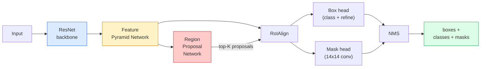

# Instance Segmentation — Mask R-CNN

> Thêm một nhánh mặt nạ nhỏ vào một bộ phát hiện Faster R-CNN và bạn có phân đoạn thực thể. Phần khó là RoIAlign, và nó khó hơn vẻ ngoài.

**Type:** Build + Learn
**Languages:** Python
**Prerequisites:** Phase 4 Lesson 06 (YOLO), Phase 4 Lesson 07 (U-Net)
**Time:** ~75 minutes

## Learning Objectives

- Theo dõi kiến trúc Mask R-CNN đầu-cuối: backbone, FPN, RPN, RoIAlign, đầu hộp, đầu mặt nạ
- Triển khai RoIAlign từ đầu và giải thích tại sao RoIPool không còn được sử dụng
- Sử dụng mô hình được tiền huấn luyện `maskrcnn_resnet50_fpn_v2` của torchvision để có các mặt nạ thực thể chất lượng production và đọc đúng định dạng đầu ra
- Tinh chỉnh Mask R-CNN trên một tập dữ liệu tùy chỉnh nhỏ bằng cách thay các đầu hộp và mặt nạ, và giữ backbone đóng băng

## The Problem

Phân đoạn ngữ nghĩa cho bạn một mặt nạ mỗi lớp. Phân đoạn thực thể cho bạn một mặt nạ mỗi đối tượng, ngay cả khi hai đối tượng cùng lớp. Đếm các cá thể, theo dõi qua các khung hình và đo các vật (hộp bao của mỗi viên gạch trong tường, mỗi tế bào trong ảnh hiển vi) đều cần phân đoạn thực thể.

Mask R-CNN (He et al., 2017) giải quyết bằng cách đặt lại phân đoạn thực thể thành phát hiện-cộng-một-mặt-nạ. Thiết kế gọn tới mức trong năm năm tiếp theo gần như mọi bài báo phân đoạn thực thể đều là một biến thể Mask R-CNN, và bản triển khai torchvision vẫn là mặc định production cho các tập dữ liệu nhỏ tới vừa.

Vấn đề kỹ thuật khó là lấy mẫu: làm thế nào cắt một vùng đặc trưng kích thước cố định từ một hộp đề xuất có các góc không căn chỉnh biên pixel? Làm sai mất vài phần mười điểm mAP ở mọi nơi. RoIAlign là câu trả lời.

## The Concept

### The architecture



Năm phần cần hiểu:

1. **Backbone** — ResNet-50 hoặc ResNet-101 được huấn luyện trên ImageNet. Tạo ra một hệ phân cấp bản đồ đặc trưng ở các stride 4, 8, 16, 32.
2. **FPN (Feature Pyramid Network)** — các kết nối từ trên xuống + bên cho mỗi mức C kênh đặc trưng giàu ngữ nghĩa. Phát hiện truy vấn mức FPN khớp kích thước đối tượng.
3. **RPN (Region Proposal Network)** — một đầu tích chập nhỏ tại mỗi vị trí anchor dự đoán "có đối tượng ở đây không?" và "tôi tinh chỉnh hộp thế nào?". Tạo ~1000 đề xuất mỗi hình ảnh.
4. **RoIAlign** — lấy mẫu một vùng đặc trưng kích thước cố định (ví dụ 7x7) từ bất kỳ hộp nào trên bất kỳ mức FPN nào. Lấy mẫu song tuyến tính, không lượng tử hóa.
5. **Các đầu** — đầu hộp hai lớp tinh chỉnh hộp và chọn một lớp, cộng một đầu tích chập nhỏ xuất một mặt nạ nhị phân `28x28` cho mỗi đề xuất.

### Why RoIAlign, not RoIPool

Fast R-CNN gốc sử dụng RoIPool, chia một hộp đề xuất thành lưới, lấy đặc trưng lớn nhất trong mỗi ô và làm tròn mọi tọa độ thành số nguyên. Việc làm tròn đó làm lệch bản đồ đặc trưng khỏi tọa độ pixel đầu vào tới cả một pixel bản đồ đặc trưng — nhỏ trên ảnh 224x224, thảm họa khi bản đồ đặc trưng có stride 32.

```
RoIPool:
  box (34.7, 51.3, 98.2, 142.9)
  round -> (34, 51, 98, 142)
  split grid -> round each cell boundary
  misalignment accumulates at every step

RoIAlign:
  box (34.7, 51.3, 98.2, 142.9)
  sample at exact float coordinates using bilinear interpolation
  no rounding anywhere
```

RoIAlign nâng AP mặt nạ 3-4 điểm trên COCO miễn phí. Mọi bộ phát hiện quan tâm định vị giờ đều sử dụng nó — YOLOv7 seg, RT-DETR, Mask2Former đều vậy.

### The RPN in one paragraph

Tại mọi vị trí của bản đồ đặc trưng, đặt K hộp anchor có kích thước và hình dạng khác nhau. Dự đoán một điểm objectness cho mỗi anchor và một độ lệch hồi quy để biến anchor thành hộp khớp hơn. Giữ ~1,000 hộp có điểm cao nhất, áp dụng NMS tại IoU 0.7 rồi đưa các hộp còn lại tới các đầu. RPN được huấn luyện với mất mát nhỏ riêng — cùng cấu trúc như mất mát YOLO từ Bài 6, chỉ có hai lớp (đối tượng / không đối tượng).

### The mask head

Với mỗi đề xuất (sau RoIAlign), đầu mặt nạ là một FCN nhỏ: bốn tích chập 3x3, một giải tích chập tăng 2 lần, một tích chập 1x1 cuối tạo `num_classes` kênh đầu ra ở độ phân giải `28x28`. Chỉ kênh tương ứng lớp dự đoán được giữ; các kênh khác bị bỏ qua. Điều này tách rời dự đoán mặt nạ khỏi phân loại.

Tăng mẫu mặt nạ 28x28 tới kích thước pixel gốc của đề xuất để tạo mặt nạ nhị phân cuối.

### Losses

Mask R-CNN có bốn mất mát cộng lại:

```
L = L_rpn_cls + L_rpn_box + L_box_cls + L_box_reg + L_mask
```

- `L_rpn_cls`, `L_rpn_box` — objectness + hồi quy hộp cho các đề xuất RPN.
- `L_box_cls` — cross-entropy trên (C+1) lớp (bao gồm nền) ở bộ phân loại của đầu.
- `L_box_reg` — L1 trơn trên tinh chỉnh hộp của đầu.
- `L_mask` — cross-entropy nhị phân từng pixel trên đầu ra mặt nạ 28x28.

Mỗi mất mát có trọng số mặc định riêng; bản triển khai torchvision công khai chúng dưới dạng đối số hàm khởi tạo.

### Output format

`torchvision.models.detection.maskrcnn_resnet50_fpn_v2` trả về một danh sách dict, mỗi hình ảnh một dict:

```
{
    "boxes":  (N, 4) in (x1, y1, x2, y2) pixel coordinates,
    "labels": (N,) class IDs, 0 = background so indices are 1-based,
    "scores": (N,) confidence scores,
    "masks":  (N, 1, H, W) float masks in [0, 1] — threshold at 0.5 for binary,
}
```

Mặt nạ đã có độ phân giải toàn ảnh. Đầu ra đầu 28x28 đã được tăng mẫu bên trong.

```figure
cv3-roialign-sampling
```

## Build It

### Step 1: RoIAlign from scratch

Đây là thành phần duy nhất của Mask R-CNN dễ hiểu dưới dạng mã hơn văn xuôi.

```python
import torch
import torch.nn.functional as F

def roi_align_single(feature, box, output_size=7, spatial_scale=1 / 16.0):
    """
    feature: (C, H, W) single-image feature map
    box: (x1, y1, x2, y2) in original image pixel coordinates
    output_size: side of the output grid (7 for box head, 14 for mask head)
    spatial_scale: reciprocal of the feature map stride
    """
    C, H, W = feature.shape
    x1, y1, x2, y2 = [c * spatial_scale - 0.5 for c in box]
    bin_w = (x2 - x1) / output_size
    bin_h = (y2 - y1) / output_size

    grid_y = torch.linspace(y1 + bin_h / 2, y2 - bin_h / 2, output_size)
    grid_x = torch.linspace(x1 + bin_w / 2, x2 - bin_w / 2, output_size)
    yy, xx = torch.meshgrid(grid_y, grid_x, indexing="ij")

    gx = 2 * (xx + 0.5) / W - 1
    gy = 2 * (yy + 0.5) / H - 1
    grid = torch.stack([gx, gy], dim=-1).unsqueeze(0)
    sampled = F.grid_sample(feature.unsqueeze(0), grid, mode="bilinear",
                            align_corners=False)
    return sampled.squeeze(0)
```

Mọi số nằm ở một vị trí lấy mẫu song tuyến tính. Không làm tròn, không lượng tử hóa, không bỏ gradient.

### Step 2: Compare to torchvision's RoIAlign

```python
from torchvision.ops import roi_align

feature = torch.randn(1, 16, 50, 50)
boxes = torch.tensor([[0, 10, 20, 100, 90]], dtype=torch.float32)  # (batch_idx, x1, y1, x2, y2)

ours = roi_align_single(feature[0], boxes[0, 1:].tolist(), output_size=7, spatial_scale=1/4)
theirs = roi_align(feature, boxes, output_size=(7, 7), spatial_scale=1/4, sampling_ratio=1, aligned=True)[0]

print(f"shape ours:   {tuple(ours.shape)}")
print(f"shape theirs: {tuple(theirs.shape)}")
print(f"max|diff|:    {(ours - theirs).abs().max().item():.3e}")
```

Với `sampling_ratio=1` và `aligned=True`, hai bản khớp trong phạm vi `1e-5`.

### Step 3: Load a pretrained Mask R-CNN

```python
import torch
from torchvision.models.detection import maskrcnn_resnet50_fpn_v2, MaskRCNN_ResNet50_FPN_V2_Weights

model = maskrcnn_resnet50_fpn_v2(weights=MaskRCNN_ResNet50_FPN_V2_Weights.DEFAULT)
model.eval()
print(f"params: {sum(p.numel() for p in model.parameters()):,}")
print(f"classes (including background): {len(model.roi_heads.box_predictor.cls_score.out_features * [0])}")
```

46M tham số, 91 lớp (COCO). Lớp đầu (id 0) là nền; mọi thứ mô hình thực sự phát hiện bắt đầu ở id 1.

### Step 4: Run inference

```python
with torch.no_grad():
    x = torch.randn(3, 400, 600)
    predictions = model([x])
p = predictions[0]
print(f"boxes:  {tuple(p['boxes'].shape)}")
print(f"labels: {tuple(p['labels'].shape)}")
print(f"scores: {tuple(p['scores'].shape)}")
print(f"masks:  {tuple(p['masks'].shape)}")
```

Tensor mặt nạ có hình dạng `(N, 1, H, W)`. Đặt ngưỡng tại 0.5 để có mặt nạ nhị phân mỗi đối tượng:

```python
binary_masks = (p['masks'] > 0.5).squeeze(1)  # (N, H, W) boolean
```

### Step 5: Swap the heads for a custom class count

Công thức tinh chỉnh phổ biến: tái sử dụng backbone, FPN và RPN; thay hai đầu phân loại.

```python
from torchvision.models.detection.faster_rcnn import FastRCNNPredictor
from torchvision.models.detection.mask_rcnn import MaskRCNNPredictor

def build_custom_maskrcnn(num_classes):
    model = maskrcnn_resnet50_fpn_v2(weights=MaskRCNN_ResNet50_FPN_V2_Weights.DEFAULT)
    in_features = model.roi_heads.box_predictor.cls_score.in_features
    model.roi_heads.box_predictor = FastRCNNPredictor(in_features, num_classes)
    in_features_mask = model.roi_heads.mask_predictor.conv5_mask.in_channels
    hidden_layer = 256
    model.roi_heads.mask_predictor = MaskRCNNPredictor(in_features_mask, hidden_layer, num_classes)
    return model

custom = build_custom_maskrcnn(num_classes=5)
print(f"custom cls_score.out_features: {custom.roi_heads.box_predictor.cls_score.out_features}")
```

`num_classes` phải bao gồm lớp nền, nên tập dữ liệu có 4 lớp đối tượng sử dụng `num_classes=5`.

### Step 6: Freeze what does not need training

Trên các tập dữ liệu nhỏ, đóng băng backbone và FPN. Chỉ objectness + hồi quy RPN và hai đầu học.

```python
def freeze_backbone_and_fpn(model):
    # torchvision Mask R-CNN packs the FPN inside `model.backbone` (as
    # `model.backbone.fpn`), so iterating `model.backbone.parameters()` covers
    # both the ResNet feature layers and the FPN lateral/output convs.
    for p in model.backbone.parameters():
        p.requires_grad = False
    return model

custom = freeze_backbone_and_fpn(custom)
trainable = sum(p.numel() for p in custom.parameters() if p.requires_grad)
print(f"trainable after freeze: {trainable:,}")
```

Trên các tập dữ liệu 500 hình ảnh đây là khác biệt giữa hội tụ và quá khớp.

## Use It

Toàn bộ vòng lặp huấn luyện Mask R-CNN trong torchvision là 40 dòng và không thay đổi đáng kể giữa các tác vụ — đổi tập dữ liệu rồi chạy.

```python
def train_step(model, images, targets, optimizer):
    model.train()
    loss_dict = model(images, targets)
    losses = sum(loss for loss in loss_dict.values())
    optimizer.zero_grad()
    losses.backward()
    optimizer.step()
    return {k: v.item() for k, v in loss_dict.items()}
```

Danh sách `targets` phải có các dict từng hình ảnh với `boxes`, `labels` và `masks` (dưới dạng các tensor nhị phân `(num_instances, H, W)`). Mô hình trả về một dict bốn mất mát trong huấn luyện và một danh sách dự đoán trong eval, dựa trên `model.training`.

Bộ đánh giá `pycocotools` tạo mAP@IoU=0.5:0.95 cho cả hộp và mặt nạ; bạn cần cả hai con số để biết đầu hộp hay đầu mặt nạ là nút thắt.

## Ship It

Bài học này tạo ra:

- `outputs/prompt-instance-vs-semantic-router.md` — một prompt hỏi ba câu và chọn thực thể, ngữ nghĩa hay toàn cảnh cùng mô hình chính xác để bắt đầu.
- `outputs/skill-mask-rcnn-head-swapper.md` — một skill sinh 10 dòng mã để đổi đầu trên bất kỳ mô hình phát hiện torchvision nào, với `num_classes` mới cho trước.

## Exercises

1. **(Dễ)** Xác minh RoIAlign của bạn với `torchvision.ops.roi_align` trên 100 hộp ngẫu nhiên. Báo cáo chênh lệch tuyệt đối tối đa. Cũng chạy RoIPool (hành vi trước 2017) và cho thấy nó lệch ~1-2 pixel bản đồ đặc trưng trên các hộp gần biên.
2. **(Vừa)** Tinh chỉnh `maskrcnn_resnet50_fpn_v2` trên một tập dữ liệu tùy chỉnh 50 hình ảnh (bất kỳ hai lớp: bóng bay, cá, ổ gà, logo). Đóng băng backbone, huấn luyện 20 epoch, báo cáo AP@0.5 mặt nạ.
3. **(Khó)** Thay đầu mặt nạ của Mask R-CNN bằng một đầu dự đoán ở 56x56 thay vì 28x28. Đo mAP@IoU=0.75 trước và sau. Giải thích tại sao mức tăng (hoặc không tăng) khớp đánh đổi độ chính xác biên / bộ nhớ kỳ vọng.

## Key Terms

| Thuật ngữ | Cách mọi người nói | Ý nghĩa thực sự |
|------|----------------|----------------------|
| Mask R-CNN | "Phát hiện cộng mặt nạ" | Faster R-CNN + một đầu FCN nhỏ dự đoán một mặt nạ 28x28 mỗi đề xuất mỗi lớp |
| FPN | "Tháp đặc trưng" | Các kết nối từ trên xuống + bên cho mỗi mức stride C kênh đặc trưng giàu ngữ nghĩa |
| RPN | "Bộ đề xuất vùng" | Một đầu tích chập nhỏ tạo ~1000 đề xuất đối tượng/không đối tượng mỗi hình ảnh |
| RoIAlign | "Cắt không làm tròn" | Lấy mẫu song tuyến tính một lưới đặc trưng kích thước cố định từ bất kỳ hộp tọa độ float nào |
| RoIPool | "Cắt trước 2017" | Cùng mục đích như RoIAlign nhưng làm tròn tọa độ hộp; lỗi thời |
| Mask AP (AP mặt nạ) | "mAP thực thể" | Average precision tính với IoU mặt nạ thay IoU hộp; thước đo phân đoạn thực thể COCO |
| Binary mask head (Đầu mặt nạ nhị phân) | "Mặt nạ từng lớp" | Dự đoán một mặt nạ nhị phân mỗi lớp cho mỗi đề xuất; chỉ kênh của lớp dự đoán được giữ |
| Background class (Lớp nền) | "Lớp 0" | Lớp "không đối tượng" bao quát; chỉ số các lớp thật bắt đầu ở 1 |

## Further Reading

- [Mask R-CNN (He et al., 2017)](https://arxiv.org/abs/1703.06870) — bài báo; phần 3 về RoIAlign là phần đọc then chốt
- [FPN: Feature Pyramid Networks (Lin et al., 2017)](https://arxiv.org/abs/1612.03144) — bài báo FPN; mọi bộ phát hiện hiện đại sử dụng nó
- [torchvision Mask R-CNN tutorial](https://pytorch.org/tutorials/intermediate/torchvision_tutorial.html) — tài liệu tham khảo cho vòng lặp tinh chỉnh
- [Detectron2 model zoo](https://github.com/facebookresearch/detectron2/blob/main/MODEL_ZOO.md) — các bản triển khai production với trọng số đã huấn luyện cho gần như mọi biến thể phát hiện và phân đoạn
