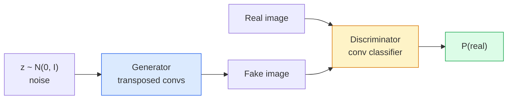
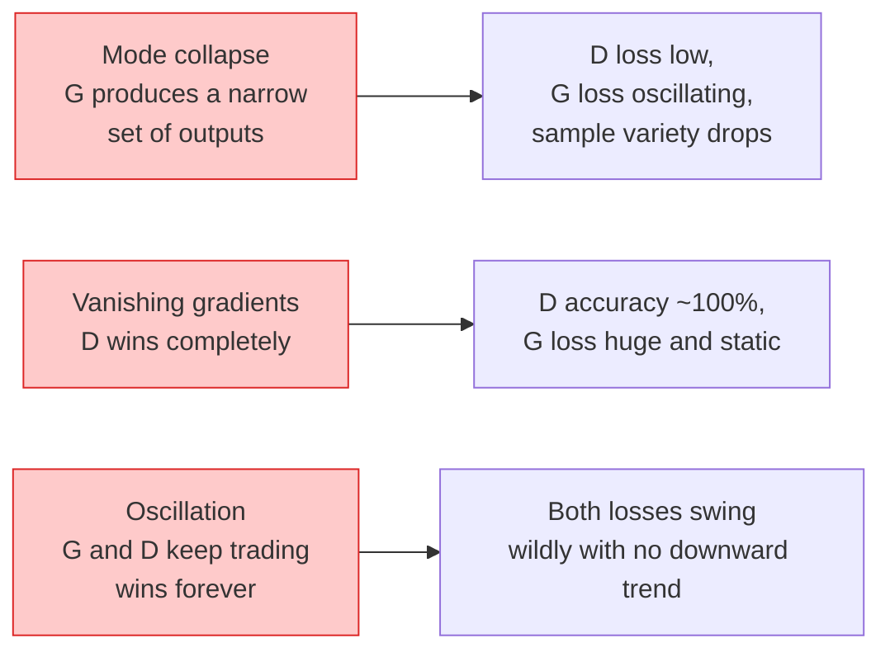

# Image Generation — GANs

> Một GAN là hai mạng nơ-ron trong một trò chơi cố định. Một mạng vẽ, một mạng phê bình. Chúng cùng tốt lên cho tới khi các bức vẽ đánh lừa người phê bình.

**Type:** Build
**Languages:** Python
**Prerequisites:** Phase 4 Lesson 03 (CNNs), Phase 3 Lesson 06 (Optimizers), Phase 3 Lesson 07 (Regularization)
**Time:** ~75 minutes

## Learning Objectives

- Giải thích trò chơi minimax giữa bộ sinh và bộ phân biệt và tại sao cân bằng tương ứng với p_model = p_data
- Triển khai một DCGAN bằng PyTorch và khiến nó sinh các hình ảnh tổng hợp 32x32 nhất quán trong dưới 60 dòng
- Ổn định huấn luyện GAN bằng ba thủ thuật tiêu chuẩn: mất mát không bão hòa, spectral norm, TTUR (quy tắc cập nhật hai thang thời gian)
- Đọc các đường cong huấn luyện phân biệt hội tụ khỏe mạnh với sụp đổ mode, dao động và bộ phân biệt thắng hoàn toàn

## The Problem

Phân loại dạy một mạng ánh xạ hình ảnh thành nhãn. Sinh đảo ngược bài toán: lấy mẫu các hình ảnh mới trông như đến từ cùng phân phối. Không có đầu ra "đúng" để bạn đối chiếu; chỉ có một phân phối bạn muốn bắt chước.

Các hàm mất mát tiêu chuẩn (MSE, cross-entropy) không thể đo "mẫu này có đến từ phân phối thật không." Tối thiểu hóa sai số từng pixel tạo ra các trung bình mờ, không phải các mẫu chân thực. Đột phá là học mất mát: huấn luyện một mạng thứ hai có nhiệm vụ phân biệt thật giả và sử dụng phán đoán của nó để thúc đẩy bộ sinh.

GAN (Goodfellow et al., 2014) định nghĩa framework đó. Đến năm 2018 StyleGAN tạo các khuôn mặt 1024x1024 không thể phân biệt với ảnh chụp. Các mô hình khuếch tán sau đó giành ngôi về chất lượng và khả năng điều khiển, nhưng mọi thủ thuật khiến khuếch tán thực tiễn — lựa chọn chuẩn hóa, không gian tiềm ẩn, mất mát đặc trưng — đều được hiểu đầu tiên trên GAN.

## The Concept

### The two networks



**Bộ sinh** G nhận một vector nhiễu `z` và xuất ra một hình ảnh. **Bộ phân biệt** D nhận một hình ảnh và xuất một số vô hướng duy nhất: xác suất hình ảnh là thật.

### The game

G muốn D sai. D muốn đúng. Về hình thức:

```
min_G max_D  E_x[log D(x)] + E_z[log(1 - D(G(z)))]
```

Đọc từ phải sang trái: D tối đa hóa accuracy trên các hình ảnh thật (`log D(real)`) và giả (`log (1 - D(fake))`). G tối thiểu hóa accuracy của D trên các ảnh giả — nó muốn `D(G(z))` cao.

Goodfellow chứng minh minimax này có một cân bằng toàn cục nơi `p_G = p_data`, D xuất ra 0.5 ở mọi nơi và phân kỳ Jensen-Shannon giữa phân phối sinh và thật bằng không. Phần khó là tới đó.

### Non-saturating loss

Dạng trên không ổn định về số. Đầu huấn luyện, `D(G(z))` gần không với mọi ảnh giả, nên `log(1 - D(G(z)))` có các gradient tiêu biến theo G. Khắc phục: đảo mất mát của G.

```
L_D = -E_x[log D(x)] - E_z[log(1 - D(G(z)))]
L_G = -E_z[log D(G(z))]                          # non-saturating
```

Giờ khi `D(G(z))` gần không, mất mát G lớn và gradient của nó có thông tin. Mọi GAN hiện đại đều huấn luyện với biến thể này.

### DCGAN architecture rules

Radford, Metz, Chintala (2015) chắt lọc nhiều năm thí nghiệm thất bại thành năm quy tắc khiến huấn luyện GAN ổn định:

1. Thay pooling bằng các tích chập có stride (cả hai mạng).
2. Sử dụng batch norm trong cả bộ sinh và bộ phân biệt, trừ đầu ra G và đầu vào D.
3. Loại bỏ các lớp kết nối đầy đủ trên các kiến trúc sâu hơn.
4. G sử dụng ReLU trên mọi lớp trừ đầu ra (tanh cho đầu ra trong [-1, 1]).
5. D sử dụng LeakyReLU (negative_slope=0.2) trên mọi lớp.

Mọi GAN dựa trên tích chập hiện đại (StyleGAN, BigGAN, GigaGAN) vẫn bắt đầu từ các quy tắc này và thay từng phần một.

### Failure modes and their signatures



- **Sụp đổ mode**: G tìm một hình ảnh đánh lừa D và chỉ tạo ảnh đó. Khắc phục: thêm phân biệt minibatch, spectral norm hoặc điều kiện hóa nhãn.
- **Bộ phân biệt thắng**: D trở nên quá mạnh quá nhanh, các gradient G tiêu biến. Khắc phục: D nhỏ hơn, tốc độ học D thấp hơn hoặc áp dụng làm trơn nhãn trên các nhãn thật.
- **Dao động**: hai mạng thay nhau thắng mà không bao giờ tiến tới cân bằng. Khắc phục: TTUR (D học nhanh hơn G 2-4 lần) hoặc chuyển sang mất mát Wasserstein.

### Evaluation

GAN không có sự thật nền, vậy làm sao bạn biết chúng đang hoạt động?

- **Xem xét mẫu** — chỉ cần xem 64 mẫu ở cuối mỗi epoch. Không thể thương lượng.
- **FID (Fréchet Inception Distance)** — khoảng cách giữa các phân phối đặc trưng Inception-v3 của tập thật và tập sinh. Thấp hơn tốt hơn. Tiêu chuẩn cộng đồng.
- **Inception Score** — cũ hơn, mong manh hơn; ưu tiên FID.
- **Precision/Recall cho mô hình tạo sinh** — đo riêng chất lượng (precision) và độ bao phủ (recall). Nhiều thông tin hơn chỉ FID.

Với một lần chạy dữ liệu tổng hợp nhỏ, xem xét mẫu là đủ.

```figure
cv-gan-image
```

## Build It

### Step 1: Generator

Một bộ sinh DCGAN nhỏ nhận nhiễu 64 chiều và tạo một hình ảnh 32x32.

```python
import torch
import torch.nn as nn

class Generator(nn.Module):
    def __init__(self, z_dim=64, img_channels=3, feat=64):
        super().__init__()
        self.net = nn.Sequential(
            nn.ConvTranspose2d(z_dim, feat * 4, kernel_size=4, stride=1, padding=0, bias=False),
            nn.BatchNorm2d(feat * 4),
            nn.ReLU(inplace=True),
            nn.ConvTranspose2d(feat * 4, feat * 2, kernel_size=4, stride=2, padding=1, bias=False),
            nn.BatchNorm2d(feat * 2),
            nn.ReLU(inplace=True),
            nn.ConvTranspose2d(feat * 2, feat, kernel_size=4, stride=2, padding=1, bias=False),
            nn.BatchNorm2d(feat),
            nn.ReLU(inplace=True),
            nn.ConvTranspose2d(feat, img_channels, kernel_size=4, stride=2, padding=1, bias=False),
            nn.Tanh(),
        )

    def forward(self, z):
        return self.net(z.view(z.size(0), -1, 1, 1))
```

Bốn tích chập chuyển vị, mỗi phép có `kernel_size=4, stride=2, padding=1` để gấp đôi kích thước không gian gọn gàng. Các kích hoạt đầu ra trong [-1, 1] qua tanh.

### Step 2: Discriminator

Ảnh gương của bộ sinh. LeakyReLU, các tích chập có stride, kết thúc với một logit vô hướng.

```python
class Discriminator(nn.Module):
    def __init__(self, img_channels=3, feat=64):
        super().__init__()
        self.net = nn.Sequential(
            nn.Conv2d(img_channels, feat, kernel_size=4, stride=2, padding=1),
            nn.LeakyReLU(0.2, inplace=True),
            nn.Conv2d(feat, feat * 2, kernel_size=4, stride=2, padding=1, bias=False),
            nn.BatchNorm2d(feat * 2),
            nn.LeakyReLU(0.2, inplace=True),
            nn.Conv2d(feat * 2, feat * 4, kernel_size=4, stride=2, padding=1, bias=False),
            nn.BatchNorm2d(feat * 4),
            nn.LeakyReLU(0.2, inplace=True),
            nn.Conv2d(feat * 4, 1, kernel_size=4, stride=1, padding=0),
        )

    def forward(self, x):
        return self.net(x).view(-1)
```

Tích chập cuối giảm bản đồ đặc trưng `4x4` thành `1x1`. Đầu ra là một số vô hướng mỗi hình ảnh; chỉ áp dụng sigmoid khi tính mất mát.

### Step 3: Training step

Luân phiên: cập nhật D một lần, rồi G một lần, mỗi batch.

```python
import torch.nn.functional as F

def train_step(G, D, real, z, opt_g, opt_d, device):
    real = real.to(device)
    bs = real.size(0)

    # D step
    opt_d.zero_grad()
    d_real = D(real)
    d_fake = D(G(z).detach())
    loss_d = (F.binary_cross_entropy_with_logits(d_real, torch.ones_like(d_real))
              + F.binary_cross_entropy_with_logits(d_fake, torch.zeros_like(d_fake)))
    loss_d.backward()
    opt_d.step()

    # G step
    opt_g.zero_grad()
    d_fake = D(G(z))
    loss_g = F.binary_cross_entropy_with_logits(d_fake, torch.ones_like(d_fake))
    loss_g.backward()
    opt_g.step()

    return loss_d.item(), loss_g.item()
```

`G(z).detach()` trong bước D rất quan trọng: chúng ta không muốn các gradient chảy vào G trong cập nhật của nó. Quên điều đó là lỗi người mới kinh điển.

### Step 4: Full training loop on synthetic shapes

```python
from torch.utils.data import DataLoader, TensorDataset
import numpy as np

def synthetic_images(num=2000, size=32, seed=0):
    rng = np.random.default_rng(seed)
    imgs = np.zeros((num, 3, size, size), dtype=np.float32) - 1.0
    for i in range(num):
        r = rng.uniform(6, 12)
        cx, cy = rng.uniform(r, size - r, size=2)
        yy, xx = np.meshgrid(np.arange(size), np.arange(size), indexing="ij")
        mask = (xx - cx) ** 2 + (yy - cy) ** 2 < r ** 2
        color = rng.uniform(-0.5, 1.0, size=3)
        for c in range(3):
            imgs[i, c][mask] = color[c]
    return torch.from_numpy(imgs)

device = "cuda" if torch.cuda.is_available() else "cpu"
data = synthetic_images()
loader = DataLoader(TensorDataset(data), batch_size=64, shuffle=True)

G = Generator(z_dim=64, img_channels=3, feat=32).to(device)
D = Discriminator(img_channels=3, feat=32).to(device)
opt_g = torch.optim.Adam(G.parameters(), lr=2e-4, betas=(0.5, 0.999))
opt_d = torch.optim.Adam(D.parameters(), lr=2e-4, betas=(0.5, 0.999))

for epoch in range(10):
    for (batch,) in loader:
        z = torch.randn(batch.size(0), 64, device=device)
        ld, lg = train_step(G, D, batch, z, opt_g, opt_d, device)
    print(f"epoch {epoch}  D {ld:.3f}  G {lg:.3f}")
```

`Adam(lr=2e-4, betas=(0.5, 0.999))` là mặc định DCGAN — beta1 thấp giữ số hạng momentum không ổn định hóa trò chơi đối kháng quá nhiều.

### Step 5: Sampling

```python
@torch.no_grad()
def sample(G, n=16, z_dim=64, device="cpu"):
    G.eval()
    z = torch.randn(n, z_dim, device=device)
    imgs = G(z)
    imgs = (imgs + 1) / 2
    return imgs.clamp(0, 1)
```

Luôn chuyển sang chế độ eval trước khi lấy mẫu. Với DCGAN điều này quan trọng vì các thống kê tích lũy batch norm được dùng thay thống kê của batch.

### Step 6: Spectral normalisation

Một thay thế trực tiếp cho BN trong bộ phân biệt bảo đảm mạng là 1-Lipschitz. Khắc phục hầu hết thất bại "D thắng quá mạnh".

```python
from torch.nn.utils import spectral_norm

def build_sn_discriminator(img_channels=3, feat=64):
    return nn.Sequential(
        spectral_norm(nn.Conv2d(img_channels, feat, 4, 2, 1)),
        nn.LeakyReLU(0.2, inplace=True),
        spectral_norm(nn.Conv2d(feat, feat * 2, 4, 2, 1)),
        nn.LeakyReLU(0.2, inplace=True),
        spectral_norm(nn.Conv2d(feat * 2, feat * 4, 4, 2, 1)),
        nn.LeakyReLU(0.2, inplace=True),
        spectral_norm(nn.Conv2d(feat * 4, 1, 4, 1, 0)),
    )
```

Đổi `Discriminator` thành `build_sn_discriminator()` và bạn thường không cần thủ thuật TTUR. Spectral norm là nâng cấp độ vững đơn lẻ dễ nhất bạn có thể áp dụng.

## Use It

Với sinh ảnh nghiêm túc, sử dụng các trọng số được tiền huấn luyện hoặc chuyển sang khuếch tán. Hai thư viện tiêu chuẩn:

- `torch_fidelity` tính FID / IS trên bộ sinh của bạn mà không viết mã eval tùy chỉnh.
- `pytorch-gan-zoo` (cũ) và `StudioGAN` cung cấp các bản triển khai đã kiểm thử của DCGAN, WGAN-GP, SN-GAN, StyleGAN và BigGAN.

Năm 2026, GAN vẫn là lựa chọn tốt nhất cho: sinh hình ảnh thời gian thực (độ trễ <10 ms), chuyển phong cách, chuyển đổi ảnh-sang-ảnh với kiểm soát chính xác (Pix2Pix, CycleGAN). Khuếch tán thắng về tính chân thực như ảnh chụp và điều kiện hóa văn bản.

## Ship It

Bài học này tạo ra:

- `outputs/prompt-gan-training-triage.md` — một prompt đọc mô tả đường cong huấn luyện và chọn kiểu thất bại (sụp đổ mode, D thắng, dao động) cộng một cách khắc phục được khuyến nghị.
- `outputs/skill-dcgan-scaffold.md` — một skill viết bộ khung DCGAN từ `z_dim`, `image_size` đích và `num_channels`, gồm vòng lặp huấn luyện và bộ lưu mẫu.

## Exercises

1. **(Dễ)** Huấn luyện DCGAN trên trên tập dữ liệu hình tròn tổng hợp và lưu một lưới 16 mẫu ở cuối mỗi epoch. Đến epoch nào các hình tròn được sinh trở nên rõ ràng tròn?
2. **(Vừa)** Thay batch norm bộ phân biệt bằng spectral norm. Huấn luyện hai phiên bản cạnh nhau. Phiên bản nào hội tụ nhanh hơn? Phiên bản nào có phương sai thấp hơn qua ba seed?
3. **(Khó)** Triển khai một DCGAN có điều kiện: đưa nhãn lớp vào cả G và D (nối one-hot vào nhiễu trong G, nối một kênh embedding lớp trong D). Huấn luyện trên tập dữ liệu tổng hợp "hình tròn so với hình vuông" từ bài 7 và cho thấy điều kiện hóa lớp hoạt động bằng cách lấy mẫu với các nhãn cụ thể.

## Key Terms

| Thuật ngữ | Cách mọi người nói | Ý nghĩa thực sự |
|------|----------------|----------------------|
| Generator (G) (Bộ sinh) | "Mạng vẽ các thứ" | Ánh xạ nhiễu thành hình ảnh; được huấn luyện để đánh lừa bộ phân biệt |
| Discriminator (D) (Bộ phân biệt) | "Người phê bình" | Bộ phân loại nhị phân; được huấn luyện để phân biệt hình ảnh thật với hình ảnh sinh |
| Minimax | "Trò chơi" | min trên G, max trên D của một mất mát đối kháng; cân bằng là p_G = p_data |
| Non-saturating loss (Mất mát không bão hòa) | "Phiên bản hợp lý về số" | Mất mát G là -log(D(G(z))) thay vì log(1 - D(G(z))) để tránh gradient tiêu biến đầu huấn luyện |
| Mode collapse (Sụp đổ mode) | "Bộ sinh tạo một thứ" | G chỉ tạo một tập con nhỏ của phân phối dữ liệu; khắc phục bằng SN, phân biệt minibatch hoặc batch lớn hơn |
| TTUR | "Hai tốc độ học" | D học nhanh hơn G, thường 2-4 lần; ổn định huấn luyện |
| Spectral norm | "Lớp 1-Lipschitz" | Một phép chuẩn hóa trọng số chặn hằng số Lipschitz mỗi lớp; ngăn D trở nên dốc tùy ý |
| FID | "Fréchet Inception Distance" | Khoảng cách giữa các phân phối đặc trưng Inception-v3 của tập thật và tập sinh; thước đo đánh giá tiêu chuẩn |

## Further Reading

- [Generative Adversarial Networks (Goodfellow et al., 2014)](https://arxiv.org/abs/1406.2661) — bài báo khởi đầu tất cả
- [DCGAN (Radford, Metz, Chintala, 2015)](https://arxiv.org/abs/1511.06434) — các quy tắc kiến trúc khiến GAN có thể huấn luyện
- [Spectral Normalization for GANs (Miyato et al., 2018)](https://arxiv.org/abs/1802.05957) — thủ thuật ổn định hóa hữu ích nhất
- [StyleGAN3 (Karras et al., 2021)](https://arxiv.org/abs/2106.12423) — GAN SOTA; đọc như một album tuyển tập các thủ thuật hay nhất từ thập kỷ qua
