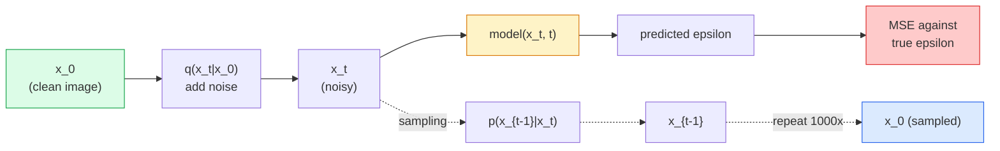

# Image Generation — Diffusion Models

> Một mô hình khuếch tán học khử nhiễu. Huấn luyện nó loại bỏ một chút nhiễu khỏi một hình ảnh nhiễu, lặp lại theo chiều ngược một nghìn lần và bạn có một bộ sinh hình ảnh.

**Type:** Build
**Languages:** Python
**Prerequisites:** Phase 4 Lesson 07 (U-Net), Phase 1 Lesson 06 (Probability), Phase 3 Lesson 06 (Optimizers)
**Time:** ~75 minutes

## Learning Objectives

- Suy ra quá trình thêm nhiễu xuôi `x_0 -> x_1 -> ... -> x_T` và giải thích tại sao dạng đóng `q(x_t | x_0)` đúng với mọi t
- Triển khai một mục tiêu huấn luyện kiểu DDPM hồi quy nhiễu được thêm ở mỗi bước và một bộ lấy mẫu đi ngược từ nhiễu thuần tới hình ảnh
- Xây một U-Net có điều kiện thời gian (đủ nhỏ để huấn luyện trên CPU) dự đoán nhiễu cho mọi bước thời gian
- Giải thích khác biệt giữa lấy mẫu DDPM và DDIM và khi nào mỗi cách phù hợp (Bài 23 đề cập sâu flow matching và rectified flow)

## The Problem

GAN sinh một lần: nhiễu vào, hình ảnh ra, một lượt truyền xuôi. Chúng nhanh và khó huấn luyện. Mô hình khuếch tán sinh lặp: bắt đầu từ nhiễu thuần, khử nhiễu theo các bước nhỏ, hình ảnh xuất hiện. Chúng chậm và dễ huấn luyện. Trong năm năm qua thuộc tính sau chiếm ưu thế: bất kỳ nhóm nhỏ nào cũng có thể huấn luyện một mô hình khuếch tán và có các mẫu hợp lý; huấn luyện GAN là một nghề bạn học qua nhiều năm chạy thất bại.

Ngoài ổn định huấn luyện, cấu trúc lặp của khuếch tán là điều mở khóa mọi thứ sinh hình ảnh hiện đại làm: điều kiện hóa văn bản, điền ảnh, chỉnh sửa hình ảnh, siêu phân giải, phong cách có thể điều khiển. Mỗi bước vòng lặp lấy mẫu là nơi đưa vào một ràng buộc mới. Điểm móc đó là lý do Stable Diffusion, Imagen, DALL-E 3, Midjourney và mọi mô hình hình ảnh có thể điều khiển bạn sẽ sử dụng đều dựa trên khuếch tán.

Bài này xây DDPM tối giản: thêm nhiễu xuôi, khử nhiễu ngược, vòng lặp huấn luyện. Bài tiếp theo (Stable Diffusion) nối nó thành một hệ thống production với một VAE, một encoder văn bản và classifier-free guidance.

## The Concept

### The forward process

Lấy một hình ảnh `x_0`. Thêm một lượng nhiễu Gaussian rất nhỏ để có `x_1`. Thêm một chút nữa để có `x_2`. Tiếp tục T bước tới khi `x_T` gần như không thể phân biệt với nhiễu Gaussian thuần.

```
q(x_t | x_{t-1}) = N(x_t; sqrt(1 - beta_t) * x_{t-1},  beta_t * I)
```

`beta_t` là một lịch phương sai nhỏ, thường tuyến tính từ 0.0001 tới 0.02 qua T=1000 bước. Mỗi bước làm tín hiệu co nhẹ và đưa vào nhiễu mới.

### The closed-form jump

Thêm nhiễu từng bước là một chuỗi Markov, nhưng toán học gộp lại được: bạn có thể lấy mẫu `x_t` trực tiếp từ `x_0` trong một bước.

```
Define alpha_t = 1 - beta_t
Define alpha_bar_t = prod_{s=1..t} alpha_s

Then:
  q(x_t | x_0) = N(x_t; sqrt(alpha_bar_t) * x_0,  (1 - alpha_bar_t) * I)

Equivalently:
  x_t = sqrt(alpha_bar_t) * x_0 + sqrt(1 - alpha_bar_t) * epsilon
  where epsilon ~ N(0, I)
```

Một phương trình này là toàn bộ lý do khuếch tán thực tiễn. Trong huấn luyện bạn chọn một `t` ngẫu nhiên, lấy mẫu `x_t` trực tiếp từ `x_0` và huấn luyện trong một bước — không cần mô phỏng toàn bộ chuỗi Markov.

### The reverse process

Quá trình xuôi cố định. Quá trình ngược `p(x_{t-1} | x_t)` là thứ mạng nơ-ron học. Các mô hình khuếch tán không dự đoán `x_{t-1}` trực tiếp; chúng dự đoán nhiễu `epsilon` được thêm ở bước t, và toán học suy ra `x_{t-1}` từ đó.



### The training loss

Với mỗi bước huấn luyện:

1. Lấy mẫu một hình ảnh thật `x_0`.
2. Lấy mẫu một bước thời gian `t` đồng đều từ [1, T].
3. Lấy mẫu nhiễu `epsilon ~ N(0, I)`.
4. Tính `x_t = sqrt(alpha_bar_t) * x_0 + sqrt(1 - alpha_bar_t) * epsilon`.
5. Dự đoán `epsilon_theta(x_t, t)` bằng mạng.
6. Tối thiểu hóa `|| epsilon - epsilon_theta(x_t, t) ||^2`.

Chỉ vậy thôi. Mạng nơ-ron học dự đoán nhiễu tại mọi bước thời gian. Mất mát là MSE. Không trò chơi đối kháng, không sụp đổ, không dao động.

### The sampler (DDPM)

Để sinh: bắt đầu từ `x_T ~ N(0, I)` và đi ngược từng bước một.

```
for t = T, T-1, ..., 1:
    eps = model(x_t, t)
    x_{t-1} = (1 / sqrt(alpha_t)) * (x_t - (beta_t / sqrt(1 - alpha_bar_t)) * eps) + sqrt(beta_t) * z
    where z ~ N(0, I) if t > 1, else 0
return x_0
```

Điểm then chốt là dù phân phối có điều kiện ngược nói chung không được biết ở dạng đóng, với quá trình xuôi Gaussian cụ thể này thì có. Các hệ số trông xấu là những gì quy tắc Bayes cho bạn.

### Why 1000 steps

Lịch nhiễu xuôi được chọn để mỗi bước thêm vừa đủ nhiễu khiến bước ngược gần Gaussian. Quá ít bước và bước ngược xa Gaussian, mạng không thể mô hình hóa tốt. Quá nhiều bước và lấy mẫu trở nên tốn kém với lợi ích giảm dần. T=1000 với lịch tuyến tính là mặc định DDPM.

### DDIM: 20x faster sampling

Huấn luyện giống nhau. Lấy mẫu thay đổi. DDIM (Song et al., 2020) định nghĩa một quá trình ngược tất định bỏ qua các bước thời gian mà không huấn luyện lại. Lấy mẫu 50 bước với DDIM cho chất lượng gần DDPM 1000 bước. Mọi hệ thống production sử dụng DDIM hoặc một biến thể còn nhanh hơn (DPM-Solver, Euler ancestral).

### Time conditioning

Mạng `epsilon_theta(x_t, t)` cần biết nó đang khử nhiễu bước thời gian nào. Các mô hình khuếch tán hiện đại đưa `t` vào qua các embedding thời gian hình sin (cùng ý tưởng như mã hóa vị trí trong transformer) được cộng vào các bản đồ đặc trưng ở mọi mức U-Net.

```
t_embedding = sinusoidal(t)
feature_map += MLP(t_embedding)
```

Không điều kiện hóa thời gian, mạng phải đoán mức nhiễu từ chính hình ảnh, cách này hoạt động nhưng kém hiệu quả mẫu hơn nhiều.

```figure
cv-diffusion-image
```

## Build It

### Step 1: Noise schedule

```python
import torch

def linear_beta_schedule(T=1000, beta_start=1e-4, beta_end=2e-2):
    return torch.linspace(beta_start, beta_end, T)


def precompute_schedule(betas):
    alphas = 1.0 - betas
    alphas_cumprod = torch.cumprod(alphas, dim=0)
    return {
        "betas": betas,
        "alphas": alphas,
        "alphas_cumprod": alphas_cumprod,
        "sqrt_alphas_cumprod": torch.sqrt(alphas_cumprod),
        "sqrt_one_minus_alphas_cumprod": torch.sqrt(1.0 - alphas_cumprod),
        "sqrt_recip_alphas": torch.sqrt(1.0 / alphas),
    }

schedule = precompute_schedule(linear_beta_schedule(T=1000))
```

Tính trước một lần, lấy theo chỉ số trong huấn luyện và lấy mẫu.

### Step 2: Forward diffusion (q_sample)

```python
def q_sample(x0, t, noise, schedule):
    sqrt_a = schedule["sqrt_alphas_cumprod"][t].view(-1, 1, 1, 1)
    sqrt_one_minus_a = schedule["sqrt_one_minus_alphas_cumprod"][t].view(-1, 1, 1, 1)
    return sqrt_a * x0 + sqrt_one_minus_a * noise
```

Dạng đóng một dòng. `t` là một batch các bước thời gian, mỗi hình ảnh trong batch một bước.

### Step 3: A tiny time-conditioned U-Net

```python
import torch.nn as nn
import torch.nn.functional as F
import math

def timestep_embedding(t, dim=64):
    half = dim // 2
    freqs = torch.exp(-math.log(10000) * torch.arange(half, device=t.device) / half)
    args = t[:, None].float() * freqs[None]
    emb = torch.cat([args.sin(), args.cos()], dim=-1)
    return emb


class TinyUNet(nn.Module):
    def __init__(self, img_channels=3, base=32, t_dim=64):
        super().__init__()
        self.t_mlp = nn.Sequential(
            nn.Linear(t_dim, base * 4),
            nn.SiLU(),
            nn.Linear(base * 4, base * 4),
        )
        self.t_dim = t_dim
        self.enc1 = nn.Conv2d(img_channels, base, 3, padding=1)
        self.enc2 = nn.Conv2d(base, base * 2, 4, stride=2, padding=1)
        self.mid = nn.Conv2d(base * 2, base * 2, 3, padding=1)
        self.dec1 = nn.ConvTranspose2d(base * 2, base, 4, stride=2, padding=1)
        self.dec2 = nn.Conv2d(base * 2, img_channels, 3, padding=1)
        self.time_proj = nn.Linear(base * 4, base * 2)

    def forward(self, x, t):
        t_emb = timestep_embedding(t, self.t_dim)
        t_emb = self.t_mlp(t_emb)
        t_proj = self.time_proj(t_emb)[:, :, None, None]

        h1 = F.silu(self.enc1(x))
        h2 = F.silu(self.enc2(h1)) + t_proj
        h3 = F.silu(self.mid(h2))
        d1 = F.silu(self.dec1(h3))
        d2 = torch.cat([d1, h1], dim=1)
        return self.dec2(d2)
```

U-Net hai mức với điều kiện hóa thời gian đưa vào tại bottleneck. Tăng độ sâu và độ rộng cho hình ảnh thật.

### Step 4: Training loop

```python
def train_step(model, x0, schedule, optimizer, device, T=1000):
    model.train()
    x0 = x0.to(device)
    bs = x0.size(0)
    t = torch.randint(0, T, (bs,), device=device)
    noise = torch.randn_like(x0)
    x_t = q_sample(x0, t, noise, schedule)
    pred = model(x_t, t)
    loss = F.mse_loss(pred, noise)
    optimizer.zero_grad()
    loss.backward()
    optimizer.step()
    return loss.item()
```

Đó là toàn bộ vòng lặp huấn luyện. Không trò chơi GAN, không mất mát chuyên biệt, một lời gọi MSE.

### Step 5: Sampler (DDPM)

```python
@torch.no_grad()
def sample(model, schedule, shape, T=1000, device="cpu"):
    model.eval()
    x = torch.randn(shape, device=device)
    betas = schedule["betas"].to(device)
    sqrt_one_minus_a = schedule["sqrt_one_minus_alphas_cumprod"].to(device)
    sqrt_recip_alphas = schedule["sqrt_recip_alphas"].to(device)

    for t in reversed(range(T)):
        t_batch = torch.full((shape[0],), t, dtype=torch.long, device=device)
        eps = model(x, t_batch)
        coef = betas[t] / sqrt_one_minus_a[t]
        mean = sqrt_recip_alphas[t] * (x - coef * eps)
        if t > 0:
            x = mean + torch.sqrt(betas[t]) * torch.randn_like(x)
        else:
            x = mean
    return x
```

1000 lượt truyền xuôi để tạo một batch mẫu. Trong mã thực tế bạn sẽ đổi nó thành bộ lấy mẫu DDIM 50 bước.

### Step 6: DDIM sampler (deterministic, ~20x faster)

```python
@torch.no_grad()
def sample_ddim(model, schedule, shape, steps=50, T=1000, device="cpu", eta=0.0):
    model.eval()
    x = torch.randn(shape, device=device)
    alphas_cumprod = schedule["alphas_cumprod"].to(device)

    ts = torch.linspace(T - 1, 0, steps + 1).long()
    for i in range(steps):
        t = ts[i]
        t_prev = ts[i + 1]
        t_batch = torch.full((shape[0],), t, dtype=torch.long, device=device)
        eps = model(x, t_batch)
        a_t = alphas_cumprod[t]
        a_prev = alphas_cumprod[t_prev] if t_prev >= 0 else torch.tensor(1.0, device=device)
        x0_pred = (x - torch.sqrt(1 - a_t) * eps) / torch.sqrt(a_t)
        sigma = eta * torch.sqrt((1 - a_prev) / (1 - a_t) * (1 - a_t / a_prev))
        dir_xt = torch.sqrt(1 - a_prev - sigma ** 2) * eps
        noise = sigma * torch.randn_like(x) if eta > 0 else 0
        x = torch.sqrt(a_prev) * x0_pred + dir_xt + noise
    return x
```

`eta=0` hoàn toàn tất định (cùng đầu vào nhiễu luôn tạo cùng đầu ra). `eta=1` khôi phục DDPM.

## Use It

Cho công việc production, sử dụng `diffusers`:

```python
from diffusers import DDPMScheduler, UNet2DModel

unet = UNet2DModel(sample_size=32, in_channels=3, out_channels=3, layers_per_block=2)
scheduler = DDPMScheduler(num_train_timesteps=1000)
```

Thư viện cung cấp các bộ lập lịch có sẵn (DDPM, DDIM, DPM-Solver, Euler, Heun), U-Net có thể cấu hình, các pipeline văn bản-sang-ảnh và ảnh-sang-ảnh, cùng các hàm hỗ trợ tinh chỉnh LoRA.

Cho nghiên cứu, `k-diffusion` (Katherine Crowson) có các bản triển khai tham chiếu trung thành nhất và các biến thể lấy mẫu tốt nhất.

## Ship It

Bài học này tạo ra:

- `outputs/prompt-diffusion-sampler-picker.md` — một prompt chọn DDPM / DDIM / DPM-Solver / Euler dựa trên mục tiêu chất lượng, ngân sách độ trễ và loại điều kiện hóa.
- `outputs/skill-noise-schedule-designer.md` — một skill tạo một lịch beta tuyến tính, cosine hoặc sigmoid với T và mức làm hỏng đích cho trước, cộng các đồ thị chẩn đoán tỷ số tín hiệu trên nhiễu theo thời gian.

## Exercises

1. **(Dễ)** Trực quan hóa quá trình xuôi: lấy một hình ảnh và vẽ `x_t` tại `t in [0, 100, 250, 500, 750, 1000]`. Xác minh `x_1000` trông như nhiễu Gaussian thuần.
2. **(Vừa)** Huấn luyện TinyUNet trên tập dữ liệu hình tròn tổng hợp trong 20 epoch và lấy mẫu 16 hình tròn. So sánh lấy mẫu DDPM (1000 bước) và DDIM (50 bước) — chúng có tạo các hình ảnh tương tự từ cùng seed nhiễu không?
3. **(Khó)** Triển khai một lịch nhiễu cosine (Nichol & Dhariwal, 2021): `alpha_bar_t = cos^2((t/T + s) / (1 + s) * pi / 2)`. Huấn luyện cùng mô hình với lịch tuyến tính và cosine, và cho thấy cosine cho các mẫu tốt hơn ở số bước thấp.

## Key Terms

| Thuật ngữ | Cách mọi người nói | Ý nghĩa thực sự |
|------|----------------|----------------------|
| Forward process (Quá trình xuôi) | "Thêm nhiễu theo thời gian" | Chuỗi Markov cố định làm hỏng một hình ảnh thành nhiễu Gaussian qua T bước |
| Reverse process (Quá trình ngược) | "Khử nhiễu từng bước" | Phân phối được học đi ngược từ nhiễu tới hình ảnh |
| Epsilon prediction (Dự đoán epsilon) | "Dự đoán nhiễu" | Mục tiêu huấn luyện: `epsilon_theta(x_t, t)` dự đoán nhiễu thêm ở bước t |
| Beta schedule (Lịch beta) | "Các lượng nhiễu" | Chuỗi T phương sai nhỏ xác định lượng nhiễu đi vào mỗi bước |
| alpha_bar_t | "Hệ số giữ tích lũy" | Tích của (1 - beta_s) tới thời điểm t; t lớn hơn nghĩa là còn ít tín hiệu hơn |
| DDPM sampler (Bộ lấy mẫu DDPM) | "Ancestral, ngẫu nhiên" | Lấy mẫu mỗi x_{t-1} từ Gaussian có điều kiện của nó; 1000 bước |
| DDIM sampler (Bộ lấy mẫu DDIM) | "Tất định, nhanh" | Viết lại lấy mẫu thành một ODE tất định; 20-100 bước với chất lượng tương tự |
| Time conditioning (Điều kiện hóa thời gian) | "Cho mô hình biết t nào" | Embedding hình sin của t được đưa vào U-Net để nó biết mức nhiễu |

## Further Reading

- [Denoising Diffusion Probabilistic Models (Ho et al., 2020)](https://arxiv.org/abs/2006.11239) — bài báo khiến khuếch tán thực tiễn và đánh bại GAN về FID
- [Improved DDPM (Nichol & Dhariwal, 2021)](https://arxiv.org/abs/2102.09672) — lịch cosine và tham số hóa v
- [DDIM (Song, Meng, Ermon, 2020)](https://arxiv.org/abs/2010.02502) — bộ lấy mẫu tất định khiến suy luận thời gian thực khả thi
- [Elucidating the Design Space of Diffusion (Karras et al., 2022)](https://arxiv.org/abs/2206.00364) — một cái nhìn thống nhất về mọi lựa chọn thiết kế khuếch tán; tài liệu tham khảo tốt nhất hiện tại
