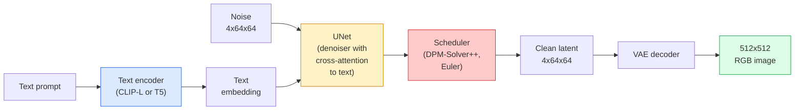

# Stable Diffusion — Architecture & Fine-Tuning

> Stable Diffusion là một DDPM chạy trong không gian tiềm ẩn của một VAE được tiền huấn luyện, được điều kiện hóa bằng văn bản qua cross-attention, lấy mẫu bằng một bộ giải ODE tất định nhanh và được điều hướng bằng classifier-free guidance.

**Type:** Learn + Use
**Languages:** Python
**Prerequisites:** Phase 4 Lesson 10 (Diffusion), Phase 7 Lesson 02 (Self-Attention)
**Time:** ~75 minutes

## Learning Objectives

- Theo dõi năm phần của một pipeline Stable Diffusion: VAE, encoder văn bản, U-Net, bộ lập lịch, bộ kiểm tra an toàn — và mỗi phần thực sự làm gì
- Giải thích khuếch tán tiềm ẩn và tại sao huấn luyện trong không gian tiềm ẩn 4x64x64 (thay vì hình ảnh 3x512x512) giảm tính toán 48 lần mà không mất chất lượng
- Sử dụng `diffusers` để sinh hình ảnh, chạy ảnh-sang-ảnh, điền ảnh và sinh được ControlNet hướng dẫn
- Tinh chỉnh Stable Diffusion bằng LoRA trên một tập dữ liệu tùy chỉnh nhỏ và tải adapter LoRA lúc suy luận

## The Problem

Huấn luyện một DDPM trực tiếp trên hình ảnh RGB 512x512 tốn kém. Mỗi bước huấn luyện lan truyền ngược qua một U-Net thấy 3x512x512 = 786,432 giá trị đầu vào, và lấy mẫu cần 50+ lượt truyền xuôi qua cùng U-Net. Ở mức chất lượng của Stable Diffusion 1.5 (phát hành 2022), khuếch tán không gian pixel sẽ cần khoảng 256 GPU-tháng huấn luyện và 10-30 giây mỗi hình ảnh trên một GPU tiêu dùng.

Thủ thuật khiến văn bản-sang-ảnh trọng số mở thực tiễn là **khuếch tán tiềm ẩn** (Rombach et al., CVPR 2022). Huấn luyện một VAE ánh xạ hình ảnh 3x512x512 thành tensor tiềm ẩn 4x64x64 rồi ngược lại, sau đó thực hiện khuếch tán trong không gian tiềm ẩn đó. Tính toán giảm theo `(3*512*512)/(4*64*64) = 48x`. Lấy mẫu giảm từ hàng chục giây xuống dưới hai giây trên cùng GPU.

Gần như mọi mô hình sinh hình ảnh hiện đại — SDXL, SD3, FLUX, HunyuanDiT, Wan-Video — đều là một mô hình khuếch tán tiềm ẩn với các biến thể autoencoder, bộ khử nhiễu (U-Net hoặc DiT) và điều kiện hóa văn bản. Học Stable Diffusion và bạn đã học khuôn mẫu.

## The Concept

### The pipeline



- **VAE** — autoencoder đóng băng. Encoder biến hình ảnh thành các biểu diễn tiềm ẩn (dùng cho img2img và huấn luyện). Decoder biến các biểu diễn tiềm ẩn trở lại thành hình ảnh.
- **Encoder văn bản** — encoder văn bản CLIP (SD 1.x/2.x), CLIP-L + CLIP-G (SDXL) hoặc T5-XXL (SD3/FLUX). Tạo một chuỗi embedding token.
- **U-Net** — bộ khử nhiễu. Có các lớp cross-attention chú ý từ các biểu diễn tiềm ẩn tới embedding văn bản ở mọi mức độ phân giải.
- **Bộ lập lịch** — thuật toán lấy mẫu (DDIM, Euler, DPM-Solver++). Chọn các sigma, trộn nhiễu dự đoán trở lại biểu diễn tiềm ẩn.
- **Bộ kiểm tra an toàn** — bộ lọc NSFW / nội dung bất hợp pháp tùy chọn trên hình ảnh đầu ra.

### Classifier-free guidance (CFG)

Điều kiện hóa văn bản thông thường học `epsilon_theta(x_t, t, c)` cho mọi prompt `c`. CFG huấn luyện cùng mạng với `c` bị bỏ 10% thời gian (thay bằng embedding rỗng), tạo một mô hình duy nhất dự đoán cả nhiễu có điều kiện và không điều kiện. Khi suy luận:

```
eps = eps_uncond + w * (eps_cond - eps_uncond)
```

`w` là thang hướng dẫn. `w=0` là không điều kiện, `w=1` là có điều kiện thông thường, `w>1` đẩy đầu ra về phía "được điều kiện hóa theo prompt nhiều hơn" với chi phí đa dạng. Mặc định SD là `w=7.5`.

CFG là lý do văn bản-sang-ảnh hoạt động ở chất lượng production. Không có nó, các prompt thiên lệch đầu ra yếu; có nó, các prompt chi phối.

### Latent space geometry

Biểu diễn tiềm ẩn 4 kênh của VAE không chỉ là hình ảnh nén. Nó là một đa tạp nơi số học gần tương ứng với các chỉnh sửa ngữ nghĩa (kỹ thuật prompt + nội suy đều nằm ở đây), và nơi U-Net khuếch tán được huấn luyện để dành toàn bộ ngân sách mô hình hóa. Giải mã một biểu diễn tiềm ẩn 4x64x64 ngẫu nhiên không tạo hình ảnh trông ngẫu nhiên — nó tạo rác, vì chỉ một đa tạp con cụ thể của các biểu diễn tiềm ẩn giải mã thành các hình ảnh hợp lệ.

Hai hệ quả:

1. **Img2img** = mã hóa hình ảnh thành biểu diễn tiềm ẩn, thêm một phần nhiễu, chạy bộ khử nhiễu, giải mã. Cấu trúc hình ảnh sống sót vì mã hóa gần khả nghịch; nội dung thay đổi dựa trên prompt.
2. **Inpainting** = giống img2img nhưng bộ khử nhiễu chỉ cập nhật các vùng có mặt nạ; các vùng không có mặt nạ được giữ ở biểu diễn tiềm ẩn đã mã hóa.

### The U-Net architecture

U-Net SD là một phiên bản lớn của TinyUNet từ Bài 10 với ba bổ sung:

- **Các khối transformer** ở mọi độ phân giải không gian, chứa self-attention + cross-attention tới embedding văn bản.
- **Embedding thời gian** qua MLP trên mã hóa hình sin.
- **Các kết nối tắt** giữa encoder và decoder tại các độ phân giải khớp nhau.

Tổng tham số trong SD 1.5: ~860M. SDXL: ~2.6B. FLUX: ~12B. Bước nhảy tham số phần lớn nằm trong các lớp attention.

### LoRA fine-tuning

Tinh chỉnh đầy đủ Stable Diffusion cần 20+ GB VRAM và cập nhật 860M tham số. LoRA (Low-Rank Adaptation) giữ mô hình cơ sở đóng băng và đưa các ma trận phân rã hạng nhỏ vào các lớp attention. Một adapter LoRA cho SD thường 10-50 MB, huấn luyện trong 10-60 phút trên một GPU tiêu dùng duy nhất và tải lúc suy luận như một sửa đổi cắm vào trực tiếp.

```
Original: W_q : (d_in, d_out)   frozen
LoRA:     W_q + alpha * (A @ B)   where A : (d_in, r), B : (r, d_out)

r is typically 4-32.
```

LoRA là cách gần như mọi bản tinh chỉnh cộng đồng được phân phối. CivitAI và Hugging Face lưu trữ hàng triệu bản.

### Schedulers you will see

- **DDIM** — tất định, ~50 bước, đơn giản.
- **Euler ancestral** — ngẫu nhiên, 30-50 bước, các mẫu sáng tạo hơn một chút.
- **DPM-Solver++ 2M Karras** — tất định, 20-30 bước, mặc định production.
- **LCM / TCD / Turbo** — các mô hình nhất quán và các biến thể chưng cất; 1-4 bước với chi phí một phần chất lượng.

Đổi các bộ lập lịch là thay đổi một dòng trong `diffusers` và đôi khi sửa các vấn đề mẫu mà không huấn luyện lại.

```figure
cv3-latent-compression
```

## Build It

Bài này sử dụng `diffusers` đầu-cuối thay vì xây lại Stable Diffusion từ đầu. Các phần bạn cần xây lại (VAE, encoder văn bản, U-Net, bộ lập lịch) là chủ đề của các bài riêng; ở đây mục tiêu là thành thạo API production.

### Step 1: Text-to-image

```python
import torch
from diffusers import StableDiffusionPipeline

pipe = StableDiffusionPipeline.from_pretrained(
    "runwayml/stable-diffusion-v1-5",
    torch_dtype=torch.float16,
).to("cuda")

image = pipe(
    prompt="a dog riding a skateboard in tokyo, studio ghibli style",
    guidance_scale=7.5,
    num_inference_steps=25,
    generator=torch.Generator("cuda").manual_seed(42),
).images[0]
image.save("dog.png")
```

`float16` giảm một nửa VRAM mà không mất chất lượng thấy được. `num_inference_steps=25` với DPM-Solver++ mặc định khớp `num_inference_steps=50` với DDIM.

### Step 2: Swap the scheduler

```python
from diffusers import DPMSolverMultistepScheduler, EulerAncestralDiscreteScheduler

pipe.scheduler = DPMSolverMultistepScheduler.from_config(pipe.scheduler.config)
pipe.scheduler = EulerAncestralDiscreteScheduler.from_config(pipe.scheduler.config)
```

Trạng thái bộ lập lịch tách rời khỏi các trọng số U-Net. Bạn có thể huấn luyện trên DDPM và lấy mẫu với bất kỳ bộ lập lịch nào.

### Step 3: Image-to-image

```python
from diffusers import StableDiffusionImg2ImgPipeline
from PIL import Image

img2img = StableDiffusionImg2ImgPipeline.from_pretrained(
    "runwayml/stable-diffusion-v1-5",
    torch_dtype=torch.float16,
).to("cuda")

init_image = Image.open("dog.png").convert("RGB").resize((512, 512))
out = img2img(
    prompt="a dog riding a skateboard, oil painting",
    image=init_image,
    strength=0.6,
    guidance_scale=7.5,
).images[0]
```

`strength` là lượng nhiễu thêm trước khử nhiễu (0.0 = không đổi, 1.0 = tái sinh hoàn toàn). 0.5-0.7 là phạm vi tiêu chuẩn cho chuyển phong cách.

### Step 4: Inpainting

```python
from diffusers import StableDiffusionInpaintPipeline

inpaint = StableDiffusionInpaintPipeline.from_pretrained(
    "runwayml/stable-diffusion-inpainting",
    torch_dtype=torch.float16,
).to("cuda")

image = Image.open("dog.png").convert("RGB").resize((512, 512))
mask = Image.open("dog_mask.png").convert("L").resize((512, 512))

out = inpaint(
    prompt="a cat",
    image=image,
    mask_image=mask,
    guidance_scale=7.5,
).images[0]
```

Các pixel trắng trong mặt nạ là vùng tái sinh. Các pixel đen được giữ nguyên.

### Step 5: LoRA loading

```python
pipe.load_lora_weights(
    "artificialguybr/studioghibli-redmond-1-5v-studio-ghibli-lora-for-liberteredmond-sd-1-5",
    weight_name="StudioGhibliRedmond-15V-LiberteRedmond-StdGBRedmAF-StudioGhibli.safetensors",
)
pipe.fuse_lora(lora_scale=0.8)

image = pipe(prompt="a village square, StdGBRedmAF, Studio Ghibli").images[0]
```

Cụm từ kích hoạt từ model card (`StdGBRedmAF, Studio Ghibli`) bật phong cách. `lora_scale` kiểm soát độ mạnh; 0.0 = không hiệu ứng, 1.0 = hiệu ứng đầy đủ. `fuse_lora` gộp adapter vào trọng số tại chỗ để tăng tốc nhưng ngăn hoán đổi. Gọi `pipe.unfuse_lora()` trước khi tải một adapter khác.

### Step 6: LoRA training (sketch)

Huấn luyện LoRA thật nằm trong `peft` hoặc `diffusers.training`. Phác thảo:

```python
# Pseudocode
for step, batch in enumerate(dataloader):
    images, prompts = batch
    latents = vae.encode(images).latent_dist.sample() * 0.18215

    t = torch.randint(0, num_train_timesteps, (batch_size,))
    noise = torch.randn_like(latents)
    noisy_latents = scheduler.add_noise(latents, noise, t)

    text_emb = text_encoder(tokenizer(prompts))

    pred_noise = unet(noisy_latents, t, text_emb)  # LoRA weights injected here

    loss = F.mse_loss(pred_noise, noise)
    loss.backward()
    optimizer.step()
```

Chỉ các ma trận LoRA nhận gradient; U-Net cơ sở, VAE và encoder văn bản đóng băng. Với kích thước batch 1 và gradient checkpointing, cấu hình này vừa 8 GB VRAM.

## Use It

Trong production, các quyết định bạn thực sự đưa ra:

- **Họ mô hình**: SD 1.5 cho các bản tinh chỉnh cộng đồng nguồn mở, SDXL cho độ trung thực cao hơn, SD3 / FLUX cho mức tiên tiến nhất và các yêu cầu giấy phép nghiêm ngặt.
- **Bộ lập lịch**: DPM-Solver++ 2M Karras cho 20-30 bước, LCM-LoRA khi độ trễ dưới 1s.
- **Độ chính xác**: `float16` trên 4080/4090, `bfloat16` trên A100 trở lên, `int8` (qua `bitsandbytes` hoặc `compel`) khi VRAM eo hẹp.
- **Điều kiện hóa**: văn bản thuần hoạt động; để kiểm soát mạnh hơn, thêm ControlNet (canny, độ sâu, tư thế) trên pipeline cơ sở.

Cho sinh theo batch, `AUTO1111` / `ComfyUI` là các công cụ cộng đồng; cho API production, `diffusers` + `accelerate` hoặc `optimum-nvidia` với biên dịch TensorRT.

## Ship It

Bài học này tạo ra:

- `outputs/prompt-sd-pipeline-planner.md` — một prompt chọn SD 1.5 / SDXL / SD3 / FLUX cộng bộ lập lịch và độ chính xác với ngân sách độ trễ, mục tiêu độ trung thực và ràng buộc giấy phép cho trước.
- `outputs/skill-lora-training-setup.md` — một skill viết cấu hình huấn luyện LoRA đầy đủ cho tập dữ liệu tùy chỉnh gồm chú thích, hạng, kích thước batch và tốc độ học.

## Exercises

1. **(Dễ)** Sinh cùng prompt với `guidance_scale` trong `[1, 3, 5, 7.5, 10, 15]`. Mô tả hình ảnh thay đổi thế nào. Ở giá trị hướng dẫn nào các giả ảnh xuất hiện?
2. **(Vừa)** Lấy bất kỳ ảnh chụp thật nào, chạy qua `StableDiffusionImg2ImgPipeline` ở `strength` trong `[0.2, 0.4, 0.6, 0.8, 1.0]`. Độ mạnh nào giữ bố cục trong khi đổi phong cách? Tại sao 1.0 bỏ qua đầu vào hoàn toàn?
3. **(Khó)** Huấn luyện một LoRA trên 10-20 hình ảnh của một chủ thể duy nhất (thú cưng, logo, nhân vật) và sinh các cảnh mới có chủ thể đó. Báo cáo hạng LoRA và số bước huấn luyện cho khả năng giữ danh tính tốt nhất mà không quá khớp các hình ảnh đầu vào.

## Key Terms

| Thuật ngữ | Cách mọi người nói | Ý nghĩa thực sự |
|------|----------------|----------------------|
| Latent diffusion (Khuếch tán tiềm ẩn) | "Khuếch tán trong các biểu diễn tiềm ẩn" | Chạy toàn bộ DDPM trong không gian tiềm ẩn VAE (4x64x64) thay không gian pixel (3x512x512); tiết kiệm tính toán 48 lần |
| VAE scale factor (Hệ số co giãn VAE) | "0.18215" | Hằng số co giãn lại biểu diễn tiềm ẩn thô VAE về phương sai gần đơn vị; được mã hóa cứng trong mọi pipeline SD |
| Classifier-free guidance | "CFG" | Trộn các dự đoán nhiễu có điều kiện và không điều kiện; núm suy luận có tác động lớn nhất |
| Scheduler (Bộ lập lịch) | "Sampler" | Thuật toán biến nhiễu + các dự đoán mô hình thành một quỹ đạo tiềm ẩn đã khử nhiễu |
| LoRA | "Adapter hạng thấp" | Các ma trận phân rã hạng nhỏ tinh chỉnh các lớp attention mà không chạm các trọng số cơ sở |
| Cross-attention | "Attention văn bản-hình ảnh" | Attention từ token tiềm ẩn tới token văn bản; đưa thông tin prompt vào mọi mức U-Net |
| ControlNet | "Điều kiện hóa cấu trúc" | Một adapter được huấn luyện riêng điều hướng SD bằng một đầu vào bổ sung (canny, độ sâu, tư thế, phân đoạn) |
| DPM-Solver++ | "Bộ lập lịch mặc định" | Bộ giải ODE tất định bậc hai; chất lượng tốt nhất ở số bước thấp (20-30) năm 2026 |

## Further Reading

- [High-Resolution Image Synthesis with Latent Diffusion (Rombach et al., 2022)](https://arxiv.org/abs/2112.10752) — bài báo Stable Diffusion; bao gồm mọi thí nghiệm loại bỏ thành phần lý giải thiết kế
- [Classifier-Free Diffusion Guidance (Ho & Salimans, 2022)](https://arxiv.org/abs/2207.12598) — bài báo CFG
- [LoRA: Low-Rank Adaptation of Large Language Models (Hu et al., 2021)](https://arxiv.org/abs/2106.09685) — LoRA ban đầu cho NLP; nó chuyển sang SD gần như không thay đổi
- [diffusers documentation](https://huggingface.co/docs/diffusers) — tài liệu tham khảo cho mọi pipeline SD / SDXL / SD3 / FLUX
