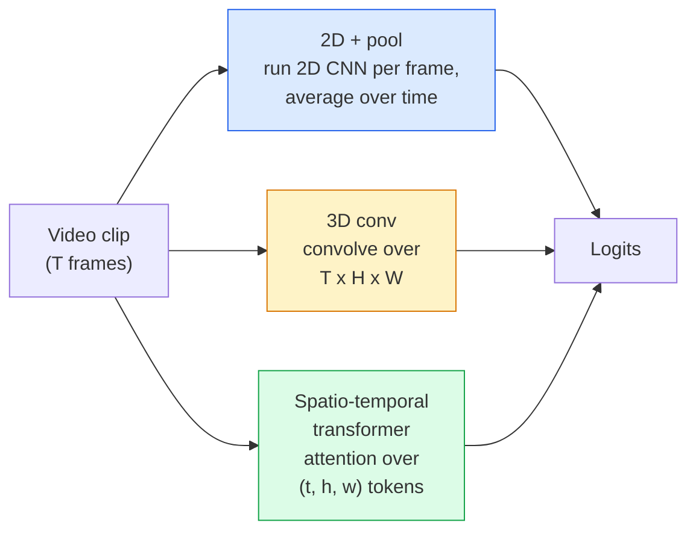

# Video Understanding — Temporal Modeling

> Một video là một chuỗi hình ảnh cộng vật lý kết nối chúng. Mọi mô hình video hoặc coi thời gian là trục bổ sung (tích chập 3D), một chuỗi để attention trên đó (transformer), hoặc một đặc trưng để trích xuất một lần rồi pooling (2D+pool).

**Type:** Learn + Build
**Languages:** Python
**Prerequisites:** Phase 4 Lesson 03 (CNNs), Phase 4 Lesson 04 (Image Classification)
**Time:** ~45 minutes

## Learning Objectives

- Phân biệt ba cách tiếp cận mô hình hóa video chính (2D+pool, tích chập 3D, transformer không-thời gian) và dự đoán các đánh đổi chi phí và accuracy
- Triển khai lấy mẫu khung hình, pooling thời gian và một bộ phân loại cơ sở 2D+pool bằng PyTorch
- Giải thích tại sao các kernel 3D "thổi phồng" của I3D chuyển giao tốt từ các trọng số ImageNet và tích chập (2+1)D được phân tách làm gì khác
- Đọc các tập dữ liệu và thước đo nhận dạng hành động tiêu chuẩn: Kinetics-400/600, UCF101, Something-Something V2; accuracy top-1 ở cấp clip và video

## The Problem

Một video 30 giây ở 30 fps là 900 hình ảnh. Theo cách đơn giản, phân loại video là phân loại hình ảnh chạy 900 lần rồi một kiểu tổng hợp nào đó. Cách này hoạt động khi hành động nhìn thấy trong gần như mọi khung hình (thể thao, nấu ăn, video tập luyện) và thất bại nặng khi hành động được xác định bởi chính chuyển động: "đẩy thứ gì đó từ trái sang phải" trông như hai đối tượng tĩnh trong từng khung hình.

Câu hỏi cốt lõi cho mọi kiến trúc video là: cấu trúc thời gian được mô hình hóa khi nào và thế nào? Câu trả lời chi phối mọi thứ khác — chi phí tính toán, chiến lược tiền huấn luyện, liệu bạn có thể tái sử dụng trọng số ImageNet, mô hình huấn luyện trên những tập dữ liệu nào.

Bài này cố ý ngắn hơn các bài hình ảnh tĩnh. Bộ máy hình ảnh cốt lõi đã có, và hiểu video phần lớn là câu chuyện thời gian: lấy mẫu, mô hình hóa và tổng hợp.

## The Concept

### The three architectural families



### 2D + pool

Lấy một CNN 2D (ResNet, EfficientNet, ViT). Chạy độc lập trên mỗi khung hình được lấy mẫu. Lấy trung bình (hoặc max-pool, hoặc attention-pool) các embedding từng khung hình. Đưa vector đã pooling tới một bộ phân loại.

Ưu điểm:
- Tiền huấn luyện ImageNet chuyển giao trực tiếp.
- Dễ triển khai nhất.
- Rẻ: T khung hình * chi phí suy luận một hình ảnh.

Nhược điểm:
- Không thể mô hình hóa chuyển động. Hành động = tổng hợp các diện mạo.
- Pooling thời gian bất biến thứ tự; "mở cửa" và "đóng cửa" trông giống nhau.

Khi sử dụng: tác vụ nặng về diện mạo, học chuyển giao trên các tập dữ liệu video nhỏ, các đường cơ sở ban đầu.

### 3D convolutions

Thay các kernel 2D (H, W) bằng kernel 3D (T, H, W). Mạng tích chập trên cả không gian và thời gian. Họ đầu tiên: C3D, I3D, SlowFast.

Thủ thuật I3D: lấy một mô hình ImageNet 2D được tiền huấn luyện, "thổi phồng" mỗi kernel 2D bằng cách sao chép dọc một trục thời gian mới. Một tích chập 2D 3x3 trở thành tích chập 3D 3x3x3. Điều này cho mô hình 3D các trọng số tiền huấn luyện mạnh thay vì huấn luyện từ đầu.

Ưu điểm:
- Trực tiếp mô hình hóa chuyển động.
- Thổi phồng I3D cho học chuyển giao miễn phí.

Nhược điểm:
- Nhiều FLOP hơn đối ứng 2D T/8 lần (với kernel thời gian 3 xếp chồng 3 lần).
- Các kernel thời gian nhỏ; chuyển động xa cần cách tiếp cận tháp hoặc hai luồng.

Khi sử dụng: nhận dạng hành động nơi chuyển động là tín hiệu (Something-Something V2, Kinetics có các lớp nặng chuyển động).

### Spatio-temporal transformers

Token hóa video thành một lưới các vùng không-thời gian và attention trên tất cả. TimeSformer, ViViT, Video Swin, VideoMAE.

Các mẫu attention quan trọng:
- **Chung** — một attention lớn trên (t, h, w). Bậc hai theo `T*H*W`; tốn kém.
- **Chia tách** — hai attention mỗi khối: một trên thời gian, một trên không gian. Mở rộng gần tuyến tính.
- **Phân tách** — attention thời gian xen kẽ attention không gian giữa các khối.

Ưu điểm:
- Accuracy SOTA trên mọi benchmark lớn.
- Chuyển giao từ transformer hình ảnh (ViT) qua thổi phồng patch.
- Hỗ trợ video ngữ cảnh dài qua attention thưa.

Nhược điểm:
- Ngốn tính toán.
- Cần chọn mẫu attention cẩn thận nếu không thời gian chạy phình to.

Khi sử dụng: các tập dữ liệu lớn, hiểu video độ trung thực cao, các tác vụ video+văn bản đa phương thức.

### Frame sampling

Một clip 10 giây ở 30 fps là 300 khung hình; đưa cả 300 vào bất kỳ mô hình nào là lãng phí. Các chiến lược tiêu chuẩn:

- **Lấy mẫu đều** — chọn T khung hình đều trên clip. Mặc định cho 2D+pool.
- **Lấy mẫu dày** — cửa sổ T khung hình liên tiếp ngẫu nhiên. Phổ biến cho tích chập 3D vì chuyển động cần các khung hình lân cận.
- **Nhiều clip** — lấy mẫu nhiều cửa sổ T khung hình từ cùng video, phân loại từng cửa sổ, lấy trung bình dự đoán lúc test.

T thường là 8, 16, 32 hoặc 64. T cao hơn = nhiều tín hiệu thời gian hơn với nhiều tính toán hơn.

### Evaluation

Hai cấp:
- **Accuracy cấp clip** — mô hình thấy một clip T khung hình, báo cáo top-k.
- **Accuracy cấp video** — lấy trung bình các dự đoán cấp clip trên nhiều clip mỗi video; cao hơn và ổn định hơn.

Luôn báo cáo cả hai. Một mô hình đạt 78% clip / 82% video đang dựa nhiều vào lấy trung bình lúc test; mô hình đạt 80% / 81% vững hơn theo từng clip.

### Datasets you will meet

- **Kinetics-400 / 600 / 700** — tập dữ liệu hành động đa dụng. 400k clip; URL YouTube (nhiều URL giờ đã chết).
- **Something-Something V2** — các hành động xác định bởi chuyển động ("di chuyển X từ trái sang phải"). Không thể giải bằng 2D+pool.
- **UCF-101**, **HMDB-51** — cũ hơn, nhỏ hơn, vẫn được báo cáo.
- **AVA** — *định vị* hành động trong không gian và thời gian; khó hơn phân loại.

```figure
v4-video-temporal
```

## Build It

### Step 1: Frame sampler

Các bộ lấy mẫu đều và dày hoạt động trên một danh sách khung hình (hoặc tensor video).

```python
import numpy as np

def sample_uniform(num_frames_total, T):
    if num_frames_total <= T:
        return list(range(num_frames_total)) + [num_frames_total - 1] * (T - num_frames_total)
    step = num_frames_total / T
    return [int(i * step) for i in range(T)]


def sample_dense(num_frames_total, T, rng=None):
    rng = rng or np.random.default_rng()
    if num_frames_total <= T:
        return list(range(num_frames_total)) + [num_frames_total - 1] * (T - num_frames_total)
    start = int(rng.integers(0, num_frames_total - T + 1))
    return list(range(start, start + T))
```

Cả hai trả về `T` chỉ số bạn dùng để cắt lát tensor video.

### Step 2: A 2D+pool baseline

Chạy một ResNet-18 2D trên mọi khung hình, pooling trung bình các đặc trưng, phân loại.

```python
import torch
import torch.nn as nn
from torchvision.models import resnet18, ResNet18_Weights

class FramePool(nn.Module):
    def __init__(self, num_classes=400, pretrained=True):
        super().__init__()
        weights = ResNet18_Weights.IMAGENET1K_V1 if pretrained else None
        backbone = resnet18(weights=weights)
        self.features = nn.Sequential(*(list(backbone.children())[:-1]))  # global avg pool kept
        self.head = nn.Linear(512, num_classes)

    def forward(self, x):
        # x: (N, T, 3, H, W)
        N, T = x.shape[:2]
        x = x.view(N * T, *x.shape[2:])
        feats = self.features(x).view(N, T, -1)
        pooled = feats.mean(dim=1)
        return self.head(pooled)

model = FramePool(num_classes=10)
x = torch.randn(2, 8, 3, 224, 224)
print(f"output: {model(x).shape}")
print(f"params: {sum(p.numel() for p in model.parameters()):,}")
```

Mười một triệu tham số, tiền huấn luyện ImageNet, chạy từng khung hình, lấy trung bình, phân loại. Đường cơ sở này thường trong phạm vi 5-10 điểm của các mô hình 3D đúng nghĩa trên các tác vụ nặng diện mạo — đôi khi tốt hơn, vì nó tái sử dụng một backbone ImageNet mạnh hơn.

### Step 3: An I3D-style inflated 3D conv

Biến một tích chập 2D thành tích chập 3D bằng cách lặp các trọng số dọc một trục thời gian mới.

```python
def inflate_2d_to_3d(conv2d, time_kernel=3):
    out_c, in_c, kh, kw = conv2d.weight.shape
    weight_3d = conv2d.weight.data.unsqueeze(2)  # (out, in, 1, kh, kw)
    weight_3d = weight_3d.repeat(1, 1, time_kernel, 1, 1) / time_kernel
    conv3d = nn.Conv3d(in_c, out_c, kernel_size=(time_kernel, kh, kw),
                        padding=(time_kernel // 2, conv2d.padding[0], conv2d.padding[1]),
                        stride=(1, conv2d.stride[0], conv2d.stride[1]),
                        bias=False)
    conv3d.weight.data = weight_3d
    return conv3d

conv2d = nn.Conv2d(3, 64, kernel_size=3, padding=1, bias=False)
conv3d = inflate_2d_to_3d(conv2d, time_kernel=3)
print(f"2D weight shape:  {tuple(conv2d.weight.shape)}")
print(f"3D weight shape:  {tuple(conv3d.weight.shape)}")
x = torch.randn(1, 3, 8, 56, 56)
print(f"3D output shape:  {tuple(conv3d(x).shape)}")
```

Chia cho `time_kernel` giữ các độ lớn kích hoạt gần không đổi — quan trọng để không phá thống kê batch norm ở lượt đầu.

### Step 4: Factorised (2+1)D conv

Tách một tích chập 3D thành tích chập 2D (không gian) và 1D (thời gian). Cùng trường tiếp nhận, ít tham số hơn, accuracy tốt hơn trên một số benchmark.

```python
class Conv2Plus1D(nn.Module):
    def __init__(self, in_c, out_c, kernel_size=3):
        super().__init__()
        mid_c = (in_c * out_c * kernel_size * kernel_size * kernel_size) \
                // (in_c * kernel_size * kernel_size + out_c * kernel_size)
        self.spatial = nn.Conv3d(in_c, mid_c, kernel_size=(1, kernel_size, kernel_size),
                                 padding=(0, kernel_size // 2, kernel_size // 2), bias=False)
        self.bn = nn.BatchNorm3d(mid_c)
        self.act = nn.ReLU(inplace=True)
        self.temporal = nn.Conv3d(mid_c, out_c, kernel_size=(kernel_size, 1, 1),
                                  padding=(kernel_size // 2, 0, 0), bias=False)

    def forward(self, x):
        return self.temporal(self.act(self.bn(self.spatial(x))))

c = Conv2Plus1D(3, 64)
x = torch.randn(1, 3, 8, 56, 56)
print(f"(2+1)D output: {tuple(c(x).shape)}")
```

Một mạng R(2+1)D đầy đủ giống một ResNet-18 với mọi tích chập 3x3 được thay bằng `Conv2Plus1D`.

## Use It

Hai thư viện bao quát công việc video production:

- `torchvision.models.video` — R(2+1)D, MViT, Swin3D với các trọng số Kinetics được tiền huấn luyện. Cùng API như các mô hình hình ảnh.
- `pytorchvideo` (Meta) — bộ sưu tập mô hình, các bộ tải dữ liệu Kinetics / SSv2 / AVA, các phép biến đổi tiêu chuẩn.

Với các mô hình video Thị giác-Ngôn ngữ (chú thích video, hỏi đáp video), sử dụng `transformers` (`VideoMAE`, `VideoLLaMA`, `InternVideo`).

## Ship It

Bài học này tạo ra:

- `outputs/prompt-video-architecture-picker.md` — một prompt chọn 2D+pool / I3D / (2+1)D / transformer dựa trên diện mạo-so-với-chuyển động, kích thước tập dữ liệu và ngân sách tính toán.
- `outputs/skill-frame-sampler-auditor.md` — một skill xem xét bộ lấy mẫu pipeline video và đánh dấu các lỗi thường gặp: chỉ số lệch một, lấy mẫu không đều khi `num_frames < T`, thiếu cắt giữ tỷ lệ khung hình, v.v.

## Exercises

1. **(Dễ)** Tính FLOP (xấp xỉ) cho FramePool với T=8 so với một ResNet 3D kiểu I3D với T=8. Giải thích tại sao 2D+pool rẻ hơn 3-5 lần.
2. **(Vừa)** Sinh một tập dữ liệu video tổng hợp: các quả bóng ngẫu nhiên chuyển động theo các hướng ngẫu nhiên, được gán nhãn theo hướng chuyển động ("trái-sang-phải", "phải-sang-trái", "chéo-lên"). Huấn luyện FramePool trên đó. Cho thấy nó đạt accuracy gần may rủi, chứng minh chỉ diện mạo không đủ cho các tác vụ chuyển động.
3. **(Khó)** Xây một R(2+1)D-18 bằng cách thay mọi Conv2d trong ResNet-18 bằng `Conv2Plus1D`. Thổi phồng trọng số tích chập đầu từ một ResNet-18 được tiền huấn luyện ImageNet. Huấn luyện trên tập dữ liệu chuyển động từ bài tập 2 và đánh bại FramePool.

## Key Terms

| Thuật ngữ | Cách mọi người nói | Ý nghĩa thực sự |
|------|----------------|----------------------|
| 2D + pool | "Bộ phân loại từng khung hình" | Chạy một CNN 2D trên mọi khung hình lấy mẫu, pooling trung bình các đặc trưng theo thời gian, phân loại |
| 3D convolution (Tích chập 3D) | "Kernel không-thời gian" | Kernel tích chập trên (T, H, W); có thể mô hình hóa chuyển động trực tiếp |
| Inflation (Thổi phồng) | "Nâng trọng số 2D lên 3D" | Khởi tạo trọng số tích chập 3D bằng cách lặp trọng số tích chập 2D dọc trục thời gian mới, rồi chia kernel_T để giữ thang kích hoạt |
| (2+1)D | "Tích chập phân tách" | Tách 3D thành 2D không gian + 1D thời gian; ít tham số hơn, thêm phi tuyến ở giữa |
| Divided attention (Attention chia tách) | "Thời gian rồi không gian" | Khối transformer có hai attention mỗi lớp: một trên các token cùng khung hình, một trên các token cùng vị trí |
| Clip (Đoạn video) | "Cửa sổ T khung hình" | Một chuỗi con T khung hình được lấy mẫu; đơn vị một mô hình video tiêu thụ |
| Clip vs video accuracy (Accuracy clip so với video) | "Hai thiết lập eval" | Clip = một mẫu mỗi video, video = trung bình trên nhiều clip lấy mẫu |
| Kinetics | "ImageNet của video" | 400-700 lớp hành động, 300k+ clip YouTube, ngữ liệu tiền huấn luyện video tiêu chuẩn |

## Further Reading

- [I3D: Quo Vadis, Action Recognition (Carreira & Zisserman, 2017)](https://arxiv.org/abs/1705.07750) — giới thiệu thổi phồng và tập dữ liệu Kinetics
- [R(2+1)D: A Closer Look at Spatiotemporal Convolutions (Tran et al., 2018)](https://arxiv.org/abs/1711.11248) — tích chập phân tách, vẫn là một đường cơ sở mạnh
- [TimeSformer: Is Space-Time Attention All You Need? (Bertasius et al., 2021)](https://arxiv.org/abs/2102.05095) — transformer video mạnh đầu tiên
- [VideoMAE (Tong et al., 2022)](https://arxiv.org/abs/2203.12602) — tiền huấn luyện autoencoder có mặt nạ cho video; công thức tiền huấn luyện chiếm ưu thế hiện tại
