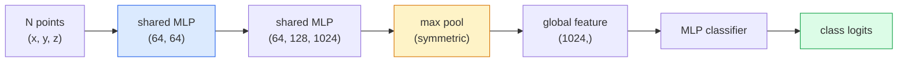

# 3D Vision — Point Clouds & NeRFs

> Thị giác 3D có hai dạng. Đám mây điểm là đầu ra thô của cảm biến. NeRF là trường thể tích được học. Cả hai trả lời "cái gì ở đâu trong không gian."

**Type:** Learn + Build
**Languages:** Python
**Prerequisites:** Phase 4 Lesson 03 (CNNs), Phase 1 Lesson 12 (Tensor Operations)
**Time:** ~45 minutes

## Learning Objectives

- Phân biệt các biểu diễn 3D tường minh (đám mây điểm, lưới, voxel) và ngầm định (trường khoảng cách có dấu, NeRF) và khi nào mỗi loại được dùng
- Hiểu thủ thuật hàm đối xứng của PointNet khiến mạng nơ-ron bất biến hoán vị trên một tập điểm không có thứ tự
- Theo dõi một lượt truyền xuôi NeRF: phát tia, kết xuất thể tích, mã hóa vị trí, đầu mật độ+màu MLP
- Sử dụng `nerfstudio` hoặc `instant-ngp` để tái tạo 3D được tiền huấn luyện từ một tập nhỏ hình ảnh có tư thế

## The Problem

Một máy ảnh tạo một hình ảnh 2D. Một LIDAR tạo một tập điểm 3D không có thứ tự. Một pipeline cấu trúc-từ-chuyển-động tạo một đám mây thưa các điểm đặc trưng 3D. Một NeRF tái tạo toàn bộ một cảnh 3D từ một số ít hình ảnh có tư thế. Tất cả đều là "thị giác" nhưng không thứ nào giống tensor dày đặc mà một CNN muốn.

Thị giác 3D quan trọng vì gần như mọi tác vụ robot giá trị cao chạy trong 3D: nắm bắt, tránh chướng ngại, điều hướng, che khuất AR, thu nhận nội dung 3D. Một kỹ sư thị giác chỉ hiểu hình ảnh 2D bị đứng ngoài phần tăng trưởng nhanh nhất của lĩnh vực (nội dung AR/VR, robot, các bộ công cụ lái xe tự hành, tái tạo 3D dựa trên NeRF cho bất động sản hoặc xây dựng).

Hai biểu diễn chiếm ưu thế vì các lý do khác nhau. Đám mây điểm là thứ cảm biến cho bạn miễn phí. NeRF và các kế nhiệm (3D Gaussian splatting, SDF nơ-ron) là thứ bạn có khi yêu cầu một mạng nơ-ron học một cảnh.

## The Concept

### Point clouds

Một đám mây điểm là một tập không thứ tự gồm $N$ điểm trong $\mathbb{R}^3$, tùy chọn mỗi điểm có các đặc trưng (màu, cường độ, pháp tuyến).

```
cloud = [
  (x1, y1, z1, r1, g1, b1),
  (x2, y2, z2, r2, g2, b2),
  ...
  (xN, yN, zN, rN, gN, bN),
]
```

Không lưới, không kết nối. Hai thuộc tính khiến điều này khó cho mạng nơ-ron:

- **Bất biến hoán vị** — đầu ra không được phụ thuộc thứ tự điểm.
- **N thay đổi** — một mô hình duy nhất phải xử lý các đám mây kích thước khác nhau.

PointNet (Qi et al., 2017) giải cả hai bằng một ý tưởng: áp dụng một MLP dùng chung cho mọi điểm, rồi tổng hợp bằng một hàm đối xứng (max pool). Kết quả là một vector kích thước cố định không phụ thuộc thứ tự.

```math
f(P) = \max_{p \in P} \mathop{\mathrm{MLP}}(p)
```

Đây là toàn bộ cốt lõi PointNet. Các biến thể sâu hơn (PointNet++, Point Transformer) thêm lấy mẫu phân cấp và tổng hợp cục bộ nhưng thủ thuật hàm đối xứng không đổi.

### The PointNet architecture



"MLP dùng chung" nghĩa là cùng MLP chạy độc lập trên mọi điểm. Được triển khai như tích chập 1x1 trên chiều điểm để hiệu quả.

### Neural Radiance Fields (NeRFs)

NeRF (Mildenhall et al., 2020) lấy câu hỏi "chúng ta có thể tái tạo một cảnh 3D từ N ảnh không?" và trả lời bằng một mạng nơ-ron chính là cảnh. Mạng ánh xạ `(x, y, z, viewing_direction)` tới `(density, colour)`. Kết xuất góc nhìn mới là một vòng lặp phát tia trên mạng này.

```
NeRF MLP:  (x, y, z, theta, phi) -> (sigma, r, g, b)

To render a pixel (u, v) of a new view:
  1. Cast a ray from the camera through pixel (u, v)
  2. Sample points along the ray at distances t_1, t_2, ..., t_N
  3. Query the MLP at each point
  4. Composite the colours weighted by (1 - exp(-sigma * dt))
  5. The sum is the rendered pixel colour
```

Một mất mát so sánh pixel được kết xuất với pixel sự thật nền trong các ảnh huấn luyện. Lan truyền ngược qua bước kết xuất cập nhật MLP. Không sự thật nền 3D, không hình học tường minh — cảnh được lưu trong các trọng số MLP.

### Positional encoding in NeRF

Một MLP nguyên bản trên `(x, y, z)` không thể biểu diễn các chi tiết tần số cao vì MLP có thiên kiến phổ về các tần số thấp. NeRF khắc phục bằng cách mã hóa mỗi tọa độ thành một vector đặc trưng Fourier trước MLP:

```math
\gamma(p) = \left(\sin(2^0 \pi p), \cos(2^0 \pi p), \sin(2^1 \pi p), \cos(2^1 \pi p), \ldots\right)
```

Tới $L=10$ mức tần số. Đây là cùng thủ thuật transformer sử dụng cho vị trí, và nó lại xuất hiện trong điều kiện hóa thời gian khuếch tán (Bài 10). Không có nó, NeRF trông mờ.

### Volumetric rendering

```math
\begin{aligned}
C(r) &= \sum_i T_i \left(1 - \exp(-\sigma_i \delta_i)\right) c_i \\[4pt]
T_i &= \exp\left(-\sum_{j<i} \sigma_j \delta_j\right) \\
\delta_i &= t_{i+1} - t_i
\end{aligned}
```

`T_i` là độ truyền qua — lượng ánh sáng sống sót tới điểm $i$. `(1 - exp(-sigma_i * delta_i))` là độ đục tại điểm $i$. `c_i` là màu. Pixel cuối là một tổng có trọng số dọc tia.

### What replaced NeRFs

NeRF thuần huấn luyện chậm (hàng giờ) và kết xuất chậm (vài giây mỗi hình ảnh). Dòng phát triển sau đó:

- **Instant-NGP** (2022) — mã hóa hash-grid thay đầu vào vị trí của MLP; huấn luyện trong vài giây.
- **Mip-NeRF 360** — xử lý các cảnh không bị chặn và khử răng cưa.
- **3D Gaussian Splatting** (2023) — thay trường thể tích bằng hàng triệu Gaussian 3D; huấn luyện trong vài phút, kết xuất thời gian thực. Mặc định production hiện tại.

Gần như mọi sản phẩm NeRF thực tế năm 2026 thực ra là 3D Gaussian splatting. Mô hình tư duy vẫn là NeRF.

### Datasets and benchmarks

- **ShapeNet** — phân loại và phân đoạn các mô hình CAD 3D dưới dạng đám mây điểm.
- **ScanNet** — các bản quét trong nhà thật để phân đoạn.
- **KITTI** — các đám mây điểm LIDAR ngoài trời cho lái xe tự hành.
- **NeRF Synthetic** / **Blended MVS** — các tập dữ liệu hình ảnh có tư thế cho tổng hợp góc nhìn.
- Tập dữ liệu **Mip-NeRF 360** — các cảnh thật không bị chặn.

```figure
nerf-rays
```

## Build It

### Step 1: PointNet classifier

```python
import torch
import torch.nn as nn

class PointNet(nn.Module):
    def __init__(self, num_classes=10):
        super().__init__()
        self.mlp1 = nn.Sequential(
            nn.Conv1d(3, 64, 1),    nn.BatchNorm1d(64),   nn.ReLU(inplace=True),
            nn.Conv1d(64, 64, 1),   nn.BatchNorm1d(64),   nn.ReLU(inplace=True),
        )
        self.mlp2 = nn.Sequential(
            nn.Conv1d(64, 128, 1),  nn.BatchNorm1d(128),  nn.ReLU(inplace=True),
            nn.Conv1d(128, 1024, 1), nn.BatchNorm1d(1024), nn.ReLU(inplace=True),
        )
        self.head = nn.Sequential(
            nn.Linear(1024, 512),   nn.BatchNorm1d(512),  nn.ReLU(inplace=True),
            nn.Dropout(0.3),
            nn.Linear(512, 256),    nn.BatchNorm1d(256),  nn.ReLU(inplace=True),
            nn.Dropout(0.3),
            nn.Linear(256, num_classes),
        )

    def forward(self, x):
        # x: (N, 3, num_points) — transposed for Conv1d
        x = self.mlp1(x)
        x = self.mlp2(x)
        x = torch.max(x, dim=-1)[0]       # (N, 1024)
        return self.head(x)

pts = torch.randn(4, 3, 1024)
net = PointNet(num_classes=10)
print(f"output: {net(pts).shape}")
print(f"params: {sum(p.numel() for p in net.parameters()):,}")
```

Khoảng 1.6M tham số. Chạy trên 1,024 điểm mỗi đám mây.

### Step 2: Positional encoding

```python
def positional_encoding(x, L=10):
    """
    x: (..., D) -> (..., D * 2 * L)
    """
    freqs = 2.0 ** torch.arange(L, dtype=x.dtype, device=x.device)
    args = x.unsqueeze(-1) * freqs * 3.141592653589793
    sinc = torch.cat([args.sin(), args.cos()], dim=-1)
    return sinc.reshape(*x.shape[:-1], -1)

x = torch.randn(5, 3)
y = positional_encoding(x, L=10)
print(f"input:  {x.shape}")
print(f"encoded: {y.shape}     # (5, 60)")
```

Nhân với `2^l * pi` cho các tần số cao dần.

### Step 3: Tiny NeRF MLP

```python
class TinyNeRF(nn.Module):
    def __init__(self, L_pos=10, L_dir=4, hidden=128):
        super().__init__()
        self.L_pos = L_pos
        self.L_dir = L_dir
        pos_dim = 3 * 2 * L_pos
        dir_dim = 3 * 2 * L_dir
        self.trunk = nn.Sequential(
            nn.Linear(pos_dim, hidden), nn.ReLU(inplace=True),
            nn.Linear(hidden, hidden),  nn.ReLU(inplace=True),
            nn.Linear(hidden, hidden),  nn.ReLU(inplace=True),
            nn.Linear(hidden, hidden),  nn.ReLU(inplace=True),
        )
        self.sigma = nn.Linear(hidden, 1)
        self.color = nn.Sequential(
            nn.Linear(hidden + dir_dim, hidden // 2), nn.ReLU(inplace=True),
            nn.Linear(hidden // 2, 3), nn.Sigmoid(),
        )

    def forward(self, x, d):
        x_enc = positional_encoding(x, self.L_pos)
        d_enc = positional_encoding(d, self.L_dir)
        h = self.trunk(x_enc)
        sigma = torch.relu(self.sigma(h)).squeeze(-1)
        rgb = self.color(torch.cat([h, d_enc], dim=-1))
        return sigma, rgb

nerf = TinyNeRF()
x = torch.randn(128, 3)
d = torch.randn(128, 3)
s, c = nerf(x, d)
print(f"sigma: {s.shape}   rgb: {c.shape}")
```

Rất nhỏ so với NeRF gốc (có 2 thân MLP độ sâu 8). Đủ minh họa kiến trúc.

### Step 4: Volumetric rendering along a ray

```python
def volumetric_render(sigma, rgb, t_vals):
    """
    sigma: (..., N_samples)
    rgb:   (..., N_samples, 3)
    t_vals: (N_samples,) distances along the ray
    """
    delta = torch.cat([t_vals[1:] - t_vals[:-1], torch.full_like(t_vals[:1], 1e10)])
    alpha = 1.0 - torch.exp(-sigma * delta)
    trans = torch.cumprod(torch.cat([torch.ones_like(alpha[..., :1]), 1.0 - alpha + 1e-10], dim=-1), dim=-1)[..., :-1]
    weights = alpha * trans
    rendered = (weights.unsqueeze(-1) * rgb).sum(dim=-2)
    depth = (weights * t_vals).sum(dim=-1)
    return rendered, depth, weights


N = 64
t_vals = torch.linspace(2.0, 6.0, N)
sigma = torch.rand(N) * 0.5
rgb = torch.rand(N, 3)
rendered, depth, weights = volumetric_render(sigma, rgb, t_vals)
print(f"rendered colour: {rendered.tolist()}")
print(f"depth:           {depth.item():.2f}")
```

Một tia, 64 mẫu, tổng hợp thành một pixel RGB duy nhất và một độ sâu.

## Use It

Cho công việc thực tế:

- `nerfstudio` (Tancik et al.) — thư viện tham chiếu hiện tại cho NeRF / Instant-NGP / Gaussian Splatting. Dòng lệnh cộng trình xem web.
- `pytorch3d` (Meta) — kết xuất khả vi, các tiện ích đám mây điểm, các phép toán lưới.
- `open3d` — xử lý đám mây điểm, đăng ký, trực quan hóa.

Cho triển khai, 3D Gaussian splatting phần lớn thay NeRF thuần vì kết xuất nhanh hơn 100 lần. Chất lượng tái tạo tương đương.

## Ship It

Bài học này tạo ra:

- `outputs/prompt-3d-task-router.md` — một prompt định tuyến tới biểu diễn 3D phù hợp (đám mây điểm, lưới, voxel, NeRF, Gaussian splat) dựa trên tác vụ và dữ liệu đầu vào.
- `outputs/skill-point-cloud-loader.md` — một skill viết `Dataset` PyTorch cho các file .ply / .pcd / .xyz với chuẩn hóa, đặt tâm và lấy mẫu điểm đúng.

## Exercises

1. **(Dễ)** Cho thấy PointNet bất biến hoán vị: chạy cùng đám mây qua hai lần, một lần các điểm được xáo trộn. Xác minh đầu ra giống hệt trong phạm vi nhiễu dấu phẩy động.
2. **(Vừa)** Triển khai một hàm sinh tia tối giản, với nội tại và tư thế máy ảnh cho trước, tạo các gốc và hướng tia cho mọi pixel của hình ảnh H x W.
3. **(Khó)** Huấn luyện TinyNeRF trên một tập dữ liệu tổng hợp các góc nhìn kết xuất của một khối lập phương có màu (sinh qua kết xuất khả vi hoặc bộ truy tia đơn giản). Báo cáo mất mát kết xuất tại epoch 1, 10 và 100. Ở epoch nào mô hình tạo các góc nhìn có thể nhận ra?

## Key Terms

| Thuật ngữ | Cách mọi người nói | Ý nghĩa thực sự |
|------|----------------|----------------------|
| Point cloud (Đám mây điểm) | "Các điểm 3D từ LIDAR" | Tập không thứ tự (x, y, z) + các đặc trưng tùy chọn mỗi điểm |
| PointNet | "Mạng nơ-ron đầu tiên trên đám mây điểm" | MLP dùng chung mỗi điểm + pool đối xứng (max); bất biến hoán vị theo cấu trúc |
| NeRF | "MLP chính là cảnh" | Mạng ánh xạ (x, y, z, dir) tới (mật độ, màu); được kết xuất bằng phát tia |
| Positional encoding (Mã hóa vị trí) | "Các đặc trưng Fourier" | Mã hóa mỗi tọa độ thành sin/cos ở nhiều tần số để vượt thiên kiến tần số thấp của MLP |
| Volumetric rendering (Kết xuất thể tích) | "Tích phân tia" | Tổng hợp các mẫu dọc tia thành một pixel bằng độ truyền qua và alpha |
| Instant-NGP | "NeRF hash-grid" | Thay MLP tọa độ NeRF bằng một lưới băm đa độ phân giải; nhanh hơn 100-1000 lần |
| 3D Gaussian splatting | "Hàng triệu Gaussian" | Cảnh = tập hợp các Gaussian 3D; kết xuất thời gian thực, huấn luyện trong vài phút |
| SDF | "Trường khoảng cách có dấu" | Hàm trả về khoảng cách có dấu tới bề mặt gần nhất; một biểu diễn ngầm định khác |

## Further Reading

- [PointNet (Qi et al., 2017)](https://arxiv.org/abs/1612.00593) — bộ phân loại bất biến hoán vị
- [NeRF (Mildenhall et al., 2020)](https://arxiv.org/abs/2003.08934) — bài báo biến tái tạo 3D từ ảnh thành bài toán mạng nơ-ron
- [Instant-NGP (Müller et al., 2022)](https://arxiv.org/abs/2201.05989) — các lưới băm, tăng tốc 1000 lần
- [3D Gaussian Splatting (Kerbl et al., 2023)](https://arxiv.org/abs/2308.04079) — kiến trúc thay NeRF trong production
