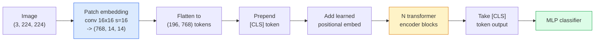

# Vision Transformers (ViT)

> Cắt hình ảnh thành các patch, coi mỗi patch là một từ, chạy một transformer tiêu chuẩn. Đừng nhìn lại.

**Type:** Build
**Languages:** Python
**Prerequisites:** Phase 7 Lesson 02 (Self-Attention), Phase 4 Lesson 04 (Image Classification)
**Time:** ~45 minutes

## Learning Objectives

- Triển khai patch embedding, embedding vị trí được học, token lớp và các khối encoder transformer từ đầu để xây một ViT tối giản
- Giải thích tại sao ViT được cho là cần dữ liệu tiền huấn luyện khổng lồ cho tới khi DeiT và MAE chứng minh ngược lại
- So sánh ViT, Swin và ConvNeXt về các tiên nghiệm kiến trúc (không có, attention cửa sổ cục bộ, backbone tích chập)
- Tinh chỉnh một ViT được tiền huấn luyện trên tập dữ liệu nhỏ bằng `timm` và công thức linear-probe / tinh chỉnh tiêu chuẩn

## The Problem

Trong một thập kỷ, tích chập đồng nghĩa với thị giác máy tính. CNN có các thiên kiến quy nạp mạnh — tính cục bộ, đẳng biến tịnh tiến — mà không ai nghĩ có thể thay thế. Rồi Dosovitskiy và cộng sự (2020) cho thấy một transformer thông thường áp dụng lên các patch hình ảnh làm phẳng, hoàn toàn không có bộ máy tích chập, có thể ngang hoặc vượt các CNN tốt nhất ở quy mô lớn.

Điểm vướng là "ở quy mô lớn." ViT trên ImageNet-1k thua ResNet. ViT được tiền huấn luyện trên ImageNet-21k hoặc JFT-300M rồi tinh chỉnh trên ImageNet-1k thắng nó. Kết luận là transformer thiếu các tiên nghiệm hữu ích nhưng có thể học từ đủ dữ liệu. Các công trình sau (DeiT, MAE, DINO) cho thấy với công thức huấn luyện đúng — tăng cường mạnh, tiền huấn luyện tự giám sát, chưng cất — ViT cũng huấn luyện ổn trên dữ liệu nhỏ.

Đến năm 2026, CNN thuần vẫn cạnh tranh trên các thiết bị biên (ConvNeXt mạnh nhất), nhưng transformer thống trị mọi thứ khác: phân đoạn (Mask2Former, SegFormer), phát hiện (DETR, RT-DETR), đa phương thức (CLIP, SigLIP), video (VideoMAE, VJEPA). Cấu trúc khối ViT là điều cần biết.

## The Concept

### The pipeline



Bảy bước. Patch -> token -> attention -> bộ phân loại. Mọi biến thể (DeiT, Swin, ConvNeXt, tiền huấn luyện MAE) thay đổi một hoặc hai trong bảy bước và giữ phần còn lại.

### Patch embedding

Tích chập đầu là bí mật. Kích thước kernel 16, stride 16, nên hình ảnh 224x224 trở thành lưới 14x14 các patch 16x16, mỗi patch được chiếu tới embedding 768 chiều. Một tích chập đó vừa chia patch vừa chiếu tuyến tính.

```
Input:  (3, 224, 224)
Conv (3 -> 768, k=16, s=16, no padding):
Output: (768, 14, 14)
Flatten spatial: (196, 768)
```

196 patch = 196 token. Chiều đặc trưng mỗi token là 768 (ViT-B), 1024 (ViT-L) hoặc 1280 (ViT-H).

### Class token

Một vector được học duy nhất thêm vào đầu chuỗi:

```
tokens = [CLS; patch_1; patch_2; ...; patch_196]   shape (197, 768)
```

Sau N khối transformer, đầu ra `[CLS]` là biểu diễn hình ảnh toàn cục. Đầu phân loại chỉ đọc vector này.

### Positional embedding

Transformer không có khái niệm vị trí không gian tích hợp. Thêm một vector được học vào mọi token:

```
tokens = tokens + learned_pos_embedding   (also shape (197, 768))
```

Embedding là một tham số mô hình; huấn luyện dựa trên gradient điều chỉnh nó theo cấu trúc hình ảnh 2D. Các lựa chọn hình sin 2D tồn tại nhưng hiếm khi được dùng trong thực tế.

### Transformer encoder block

Tiêu chuẩn. Self-attention nhiều đầu, MLP, các kết nối phần dư, pre-LayerNorm.

```
x = x + MSA(LN(x))
x = x + MLP(LN(x))

MLP is two-layer with GELU: Linear(d -> 4d) -> GELU -> Linear(4d -> d)
```

ViT-B/16 xếp chồng 12 khối này, mỗi khối có 12 đầu attention, tổng 86M tham số.

### Why pre-LN

Các transformer đầu dùng post-LN (`x = LN(x + sublayer(x))`) và khó huấn luyện vượt 6-8 lớp mà không warmup. Pre-LN (`x = x + sublayer(LN(x))`) huấn luyện các mạng sâu hơn ổn định mà không warmup. Mọi ViT và mọi LLM hiện đại sử dụng pre-LN.

### Patch size trade-off

- Patch 16x16 -> 196 token, tiêu chuẩn.
- Patch 32x32 -> 49 token, nhanh hơn nhưng độ phân giải thấp hơn.
- Patch 8x8 -> 784 token, mịn hơn nhưng chi phí attention $O(n^2)$ mở rộng kém.

Patch lớn hơn = ít token hơn = nhanh hơn nhưng ít chi tiết không gian hơn. SwinV2 sử dụng patch 4x4 trong các cửa sổ phân cấp.

### DeiT's recipe for training ViT on ImageNet-1k

ViT gốc cần JFT-300M để vượt CNN. DeiT (Touvron et al., 2020) huấn luyện ViT-B tới 81.8% top-1 chỉ trên ImageNet-1k với bốn thay đổi:

1. Tăng cường mạnh: RandAugment, Mixup, CutMix, Random Erasing.
2. Độ sâu ngẫu nhiên (bỏ ngẫu nhiên toàn bộ các khối trong huấn luyện).
3. Tăng cường lặp (cùng hình ảnh được lấy mẫu 3 lần mỗi batch).
4. Chưng cất từ một CNN giáo viên (tùy chọn, nâng accuracy thêm).

Mọi công thức huấn luyện ViT hiện đại đều bắt nguồn từ DeiT.

### Swin vs ConvNeXt

- **Swin** (Liu et al., 2021) — attention dựa trên cửa sổ. Mỗi khối attention trong một cửa sổ cục bộ; các khối xen kẽ dịch cửa sổ để trộn thông tin giữa cửa sổ. Đưa lại tiên nghiệm cục bộ kiểu CNN trong khi giữ toán tử attention.
- **ConvNeXt** (Liu et al., 2022) — CNN thiết kế lại khớp các lựa chọn kiến trúc Swin (tích chập depthwise, LayerNorm, GELU, bottleneck đảo ngược). Cho thấy khoảng cách không phải "attention so với tích chập" mà là "công thức huấn luyện hiện đại + kiến trúc."

Năm 2026, ConvNeXt-V2 và Swin-V2 đều đạt cấp production; lựa chọn đúng phụ thuộc bộ công cụ suy luận của bạn (ConvNeXt biên dịch tốt hơn cho biên) và ngữ liệu tiền huấn luyện.

### MAE pretraining

Masked Autoencoder (He et al., 2022): che ngẫu nhiên 75% patch, huấn luyện encoder chỉ xử lý 25% nhìn thấy, huấn luyện một decoder nhỏ tái tạo các patch che từ đầu ra encoder. Sau tiền huấn luyện, bỏ decoder và tinh chỉnh encoder.

MAE khiến ViT huấn luyện được chỉ trên ImageNet-1k, đạt SOTA và là công thức tự giám sát mặc định hiện tại.

```figure
batchnorm-inference
```

## Build It

### Step 1: Patch embedding

```python
import torch
import torch.nn as nn

class PatchEmbedding(nn.Module):
    def __init__(self, in_channels=3, patch_size=16, dim=192, image_size=64):
        super().__init__()
        assert image_size % patch_size == 0
        self.proj = nn.Conv2d(in_channels, dim, kernel_size=patch_size, stride=patch_size)
        num_patches = (image_size // patch_size) ** 2
        self.num_patches = num_patches

    def forward(self, x):
        x = self.proj(x)
        return x.flatten(2).transpose(1, 2)
```

Một tích chập, một phép làm phẳng, một chuyển vị. Đó là toàn bộ bước hình ảnh-sang-token.

### Step 2: Transformer block

Pre-LN, self-attention nhiều đầu, MLP với GELU, các kết nối phần dư.

```python
class Block(nn.Module):
    def __init__(self, dim, num_heads, mlp_ratio=4, dropout=0.0):
        super().__init__()
        self.ln1 = nn.LayerNorm(dim)
        self.attn = nn.MultiheadAttention(dim, num_heads, dropout=dropout, batch_first=True)
        self.ln2 = nn.LayerNorm(dim)
        self.mlp = nn.Sequential(
            nn.Linear(dim, dim * mlp_ratio),
            nn.GELU(),
            nn.Dropout(dropout),
            nn.Linear(dim * mlp_ratio, dim),
            nn.Dropout(dropout),
        )

    def forward(self, x):
        a, _ = self.attn(self.ln1(x), self.ln1(x), self.ln1(x), need_weights=False)
        x = x + a
        x = x + self.mlp(self.ln2(x))
        return x
```

`nn.MultiheadAttention` xử lý tách thành các đầu, tích vô hướng được co giãn và phép chiếu đầu ra. `batch_first=True` để các hình dạng là `(N, seq, dim)`.

### Step 3: The ViT

```python
class ViT(nn.Module):
    def __init__(self, image_size=64, patch_size=16, in_channels=3,
                 num_classes=10, dim=192, depth=6, num_heads=3, mlp_ratio=4):
        super().__init__()
        self.patch = PatchEmbedding(in_channels, patch_size, dim, image_size)
        num_patches = self.patch.num_patches
        self.cls_token = nn.Parameter(torch.zeros(1, 1, dim))
        self.pos_embed = nn.Parameter(torch.zeros(1, num_patches + 1, dim))
        self.blocks = nn.ModuleList([
            Block(dim, num_heads, mlp_ratio) for _ in range(depth)
        ])
        self.ln = nn.LayerNorm(dim)
        self.head = nn.Linear(dim, num_classes)
        nn.init.trunc_normal_(self.pos_embed, std=0.02)
        nn.init.trunc_normal_(self.cls_token, std=0.02)

    def forward(self, x):
        x = self.patch(x)
        cls = self.cls_token.expand(x.size(0), -1, -1)
        x = torch.cat([cls, x], dim=1)
        x = x + self.pos_embed
        for blk in self.blocks:
            x = blk(x)
        x = self.ln(x[:, 0])
        return self.head(x)

vit = ViT(image_size=64, patch_size=16, num_classes=10, dim=192, depth=6, num_heads=3)
x = torch.randn(2, 3, 64, 64)
print(f"output: {vit(x).shape}")
print(f"params: {sum(p.numel() for p in vit.parameters()):,}")
```

Khoảng 2.8M tham số — một ViT rất nhỏ xử lý được trên CPU. ViT-B thật là 86M; cùng định nghĩa lớp với `dim=768, depth=12, num_heads=12`.

### Step 4: Sanity check — single image inference

```python
logits = vit(torch.randn(1, 3, 64, 64))
print(f"logits: {logits}")
print(f"probs:  {logits.softmax(-1)}")
```

Nên chạy không lỗi. Các xác suất cộng thành 1.

## Use It

`timm` cung cấp mọi biến thể ViT với trọng số được tiền huấn luyện ImageNet. Một dòng:

```python
import timm

model = timm.create_model("vit_base_patch16_224", pretrained=True, num_classes=10)
```

`timm` là mặc định production cho vision transformer năm 2026. Hỗ trợ ViT, DeiT, Swin, Swin-V2, ConvNeXt, ConvNeXt-V2, MaxViT, MViT, EfficientFormer và hàng chục loại khác dưới cùng API.

Cho công việc đa phương thức (hình ảnh + văn bản), `transformers` cung cấp CLIP, SigLIP, BLIP-2, LLaVA. Encoder hình ảnh trong tất cả chúng là một biến thể ViT.

## Ship It

Bài học này tạo ra:

- `outputs/prompt-vit-vs-cnn-picker.md` — một prompt chọn giữa ViT, ConvNeXt hoặc Swin dựa trên kích thước tập dữ liệu, tính toán và bộ công cụ suy luận.
- `outputs/skill-vit-patch-and-pos-embed-inspector.md` — một skill xác minh hình dạng patch embedding và embedding vị trí của ViT khớp độ dài chuỗi mô hình kỳ vọng, phát hiện các lỗi chuyển đổi thường gặp nhất.

## Exercises

1. **(Dễ)** In hình dạng mọi tensor trung gian cho một lượt truyền xuôi qua ViT nhỏ trên. Xác nhận: đầu vào `(N, 3, 64, 64)` -> patch `(N, 16, 192)` -> với CLS `(N, 17, 192)` -> đầu vào bộ phân loại `(N, 192)` -> đầu ra `(N, num_classes)`.
2. **(Vừa)** Tinh chỉnh một ViT-S/16 `timm` được tiền huấn luyện trên tập dữ liệu CIFAR tổng hợp từ Bài 4. So sánh với tinh chỉnh ResNet-18 trên cùng dữ liệu. Báo cáo thời gian huấn luyện và accuracy cuối.
3. **(Khó)** Triển khai tiền huấn luyện MAE cho ViT nhỏ: che 75% patch, huấn luyện encoder + một decoder nhỏ để tái tạo các patch che. Đánh giá accuracy linear-probe trên dữ liệu tổng hợp trước và sau tiền huấn luyện.

## Key Terms

| Thuật ngữ | Cách mọi người nói | Ý nghĩa thực sự |
|------|----------------|----------------------|
| Patch embedding | "Tích chập đầu" | Một tích chập có kích thước kernel = stride = kích thước patch; biến hình ảnh thành lưới embedding token |
| Class token (Token lớp) | "[CLS]" | Một vector được học thêm vào đầu chuỗi token; đầu ra cuối của nó là biểu diễn hình ảnh toàn cục |
| Positional embedding (Embedding vị trí) | "Vị trí được học" | Một vector được học cộng vào mọi token để transformer biết mỗi patch đến từ đâu |
| Pre-LN | "LayerNorm trước lớp con" | Biến thể transformer ổn định: `x + sublayer(LN(x))` thay vì `LN(x + sublayer(x))` |
| Multi-head attention (Attention nhiều đầu) | "Attention song song" | Attention transformer tiêu chuẩn chia thành num_heads không gian con độc lập, sau đó nối lại |
| ViT-B/16 | "Base, patch 16" | Kích thước chuẩn: dim=768, depth=12, heads=12, patch_size=16, image=224; ~86M tham số |
| DeiT | "ViT hiệu quả dữ liệu" | ViT huấn luyện chỉ trên ImageNet-1k với tăng cường mạnh; chứng minh các tập dữ liệu tiền huấn luyện lớn không bắt buộc tuyệt đối |
| MAE | "Autoencoder có mặt nạ" | Tiền huấn luyện tự giám sát: che 75% patch, tái tạo; công thức tiền huấn luyện ViT chiếm ưu thế |

## Further Reading

- [An Image is Worth 16x16 Words (Dosovitskiy et al., 2020)](https://arxiv.org/abs/2010.11929) — bài báo ViT
- [DeiT: Data-efficient Image Transformers (Touvron et al., 2020)](https://arxiv.org/abs/2012.12877) — cách huấn luyện ViT chỉ trên ImageNet-1k
- [Masked Autoencoders are Scalable Vision Learners (He et al., 2022)](https://arxiv.org/abs/2111.06377) — tiền huấn luyện MAE
- [timm documentation](https://huggingface.co/docs/timm) — tài liệu tham khảo cho mọi vision transformer bạn sẽ sử dụng trong production
