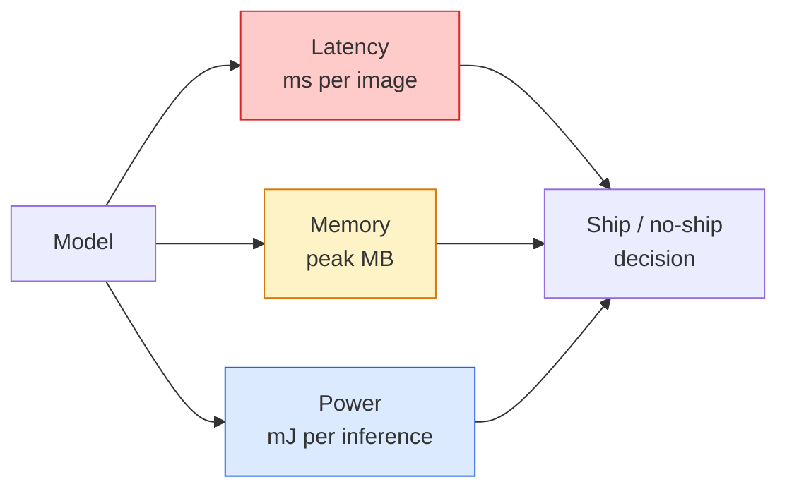

# Real-Time Vision — Edge Deployment

> Suy luận biên là kỷ luật đưa một mô hình accuracy 90 chạy ở 30 fps trên thiết bị có 2 GB RAM. Mỗi điểm phần trăm accuracy được đánh đổi với mili giây độ trễ.

**Type:** Learn + Build
**Languages:** Python
**Prerequisites:** Phase 4 Lesson 04 (Image Classification), Phase 10 Lesson 11 (Quantization)
**Time:** ~75 minutes

## Learning Objectives

- Đo độ trễ suy luận, bộ nhớ đỉnh và thông lượng cho bất kỳ mô hình PyTorch nào, và đọc đánh đổi FLOP / tham số / độ trễ
- Lượng tử hóa một mô hình thị giác thành INT8 bằng lượng tử hóa sau huấn luyện PyTorch và xác minh mất accuracy < 1%
- Xuất sang ONNX và biên dịch với ONNX Runtime hoặc TensorRT; nêu ba thất bại xuất thường gặp nhất và cách khắc phục
- Giải thích khi nào chọn MobileNetV3, EfficientNet-Lite, ConvNeXt-Tiny hoặc MobileViT cho một ràng buộc biên

## The Problem

Một mô hình thị giác lúc huấn luyện là một quái vật dấu phẩy động. 100M tham số, 10 GFLOP mỗi lượt truyền xuôi, 2 GB VRAM. Không thứ nào vừa trên điện thoại, bộ thông tin giải trí ô tô, máy ảnh công nghiệp hoặc drone. Phát hành một hệ thống thị giác nghĩa là đưa cùng các dự đoán vào một ngân sách nhỏ hơn 100 lần.

Ba núm làm hầu hết công việc: lựa chọn mô hình (kiến trúc nhỏ hơn với cùng công thức), lượng tử hóa (INT8 thay FP32) và runtime suy luận (ONNX Runtime, TensorRT, Core ML, TFLite). Làm đúng là khác biệt giữa một bản minh họa chạy trên máy trạm và một sản phẩm phát hành trên module máy ảnh $30.

Bài này thiết lập kỷ luật đo lường trước (bạn không thể tối ưu thứ không thể đo), rồi đi qua ba núm. Mục tiêu không phải học mọi runtime biên mà biết những đòn bẩy nào tồn tại và cách xác minh mỗi đòn bẩy làm điều bạn nghĩ.

## The Concept

### The three budgets



- **Độ trễ**: p50, p95, p99. Chỉ lấy trung bình p50 che giấu hành vi đuôi quan trọng với các hệ thống thời gian thực.
- **Bộ nhớ đỉnh**: mức tối đa thiết bị từng thấy, không phải trung bình trạng thái ổn định. Quan trọng vì OOM gây chết trên các đích nhúng.
- **Công suất / năng lượng**: mili joule mỗi suy luận trên thiết bị chạy pin. Thường được đại diện bằng mức sử dụng CPU/GPU * thời gian.

Một bảng (mô hình, độ trễ, bộ nhớ, accuracy) là cơ sở đưa ra quyết định biên. Mọi ô được đo trên thiết bị đích, không phải máy trạm.

### Measurement discipline

Ba quy tắc mọi phép đo hiệu năng biên nên theo:

1. **Khởi động** mô hình với 5-10 lượt truyền xuôi giả trước khi đo. Cache lạnh và biên dịch JIT tạo các số đầu không đại diện.
2. **Đồng bộ** các khối lượng công việc GPU bằng `torch.cuda.synchronize()` trước và sau khối đo thời gian. Không có điều này bạn đo điều phối kernel, không phải thực thi kernel.
3. **Cố định kích thước đầu vào** theo độ phân giải production. Độ trễ trên 224x224 không phải độ trễ trên 512x512.

### FLOPs as a proxy

FLOP (các phép toán dấu phẩy động mỗi suy luận) là một đại diện rẻ, độc lập thiết bị cho độ trễ. Hữu ích để so sánh kiến trúc, gây hiểu lầm như thời gian thực tuyệt đối. Một mô hình nhiều FLOP hơn 10% có thể nhanh hơn 2 lần trong thực tế vì sử dụng các phép toán thân thiện phần cứng (tích chập depthwise biên dịch tốt, tích chập 7x7 lớn thì không).

Quy tắc: dùng FLOP để tìm kiếm kiến trúc, dùng độ trễ trên thiết bị cho quyết định triển khai.

### Quantisation in one paragraph

Thay trọng số và kích hoạt FP32 bằng INT8. Kích thước mô hình giảm 4 lần, băng thông bộ nhớ giảm 4 lần, tính toán giảm 2-4 lần trên phần cứng có kernel INT8 (mọi SoC di động hiện đại, mọi GPU NVIDIA có Tensor Core). Mất accuracy trên các tác vụ thị giác thường 0.1-1 điểm phần trăm với lượng tử hóa tĩnh sau huấn luyện.

Các loại:

- **Động** — lượng tử hóa trọng số thành INT8, các kích hoạt tính trong FP. Dễ, tăng tốc nhỏ.
- **Tĩnh (sau huấn luyện)** — lượng tử hóa trọng số + hiệu chuẩn các phạm vi kích hoạt trên một tập hiệu chuẩn nhỏ. Nhanh hơn động nhiều.
- **Huấn luyện nhận biết lượng tử hóa (QAT)** — mô phỏng lượng tử hóa trong huấn luyện để mô hình học thích nghi. Accuracy tốt nhất, cần dữ liệu gán nhãn.

Với thị giác, lượng tử hóa tĩnh sau huấn luyện cho 95% lợi ích với 5% công sức. Chỉ dùng QAT khi mất accuracy từ PTQ không chấp nhận được.

### Pruning and distillation

- **Cắt tỉa** — loại bỏ các trọng số không quan trọng (dựa trên độ lớn) hoặc các kênh (có cấu trúc). Hoạt động tốt trên các mô hình dư tham số; ít hữu ích trên các kiến trúc đã nhỏ gọn.
- **Chưng cất** — huấn luyện một học sinh nhỏ bắt chước logit của một giáo viên lớn. Thường khôi phục phần lớn accuracy mất do thu nhỏ mô hình. Tiêu chuẩn cho mô hình biên production.

### The inference runtimes

- **PyTorch eager** — chậm, không cho triển khai. Chỉ dùng để phát triển.
- **TorchScript** — cũ. Được thay bởi `torch.compile` và xuất ONNX.
- **ONNX Runtime** — runtime trung lập. CPU, CUDA, CoreML, TensorRT, OpenVINO đều có provider ONNX. Bắt đầu ở đây.
- **TensorRT** — trình biên dịch NVIDIA. Độ trễ tốt nhất trên GPU NVIDIA (máy trạm và Jetson). Tích hợp với ONNX Runtime hoặc độc lập.
- **Core ML** — runtime Apple cho iOS/macOS. Cần `.mlmodel` hoặc `.mlpackage`.
- **TFLite** — runtime Google cho Android/ARM. Cần `.tflite`.
- **OpenVINO** — runtime Intel cho CPU/VPU. Cần `.xml` + `.bin`.

Trong thực tế: xuất PyTorch -> ONNX -> chọn runtime cho đích. ONNX là ngôn ngữ chung.

### Edge architecture picker

| Ngân sách | Mô hình | Tại sao |
|--------|-------|-----|
| < 3M tham số | MobileNetV3-Small | Biên dịch mọi nơi, đường cơ sở tốt |
| 3-10M | EfficientNet-Lite-B0 | Accuracy mỗi tham số tốt nhất trên TFLite |
| 10-20M | ConvNeXt-Tiny | Accuracy mỗi tham số tốt nhất, thân thiện CPU |
| 20-30M | MobileViT-S hoặc EfficientViT | Transformer có accuracy ImageNet |
| 30-80M | Swin-V2-Tiny | Nếu bộ công cụ hỗ trợ attention cửa sổ |

Lượng tử hóa tất cả thành INT8 trừ khi bạn có lý do cụ thể không làm.

```figure
cnn-param-count
```

## Build It

### Step 1: Measure latency correctly

```python
import time
import torch

def measure_latency(model, input_shape, device="cpu", warmup=10, iters=50):
    model = model.to(device).eval()
    x = torch.randn(input_shape, device=device)
    with torch.no_grad():
        for _ in range(warmup):
            model(x)
        if device == "cuda":
            torch.cuda.synchronize()
        times = []
        for _ in range(iters):
            if device == "cuda":
                torch.cuda.synchronize()
            t0 = time.perf_counter()
            model(x)
            if device == "cuda":
                torch.cuda.synchronize()
            times.append((time.perf_counter() - t0) * 1000)
    times.sort()
    return {
        "p50_ms": times[len(times) // 2],
        "p95_ms": times[int(len(times) * 0.95)],
        "p99_ms": times[int(len(times) * 0.99)],
        "mean_ms": sum(times) / len(times),
    }
```

Khởi động, đồng bộ, sử dụng `time.perf_counter()`. Báo cáo các phân vị, không chỉ trung bình.

### Step 2: Parameter and FLOP counts

```python
def parameter_count(model):
    return sum(p.numel() for p in model.parameters())

def flops_estimate(model, input_shape):
    """
    Rough FLOP count for a conv/linear-only model. For production use `fvcore` or `ptflops`.
    """
    total = 0
    def conv_hook(m, inp, out):
        nonlocal total
        c_out, c_in, kh, kw = m.weight.shape
        h, w = out.shape[-2:]
        total += 2 * c_in * c_out * kh * kw * h * w
    def linear_hook(m, inp, out):
        nonlocal total
        total += 2 * m.in_features * m.out_features
    hooks = []
    for m in model.modules():
        if isinstance(m, torch.nn.Conv2d):
            hooks.append(m.register_forward_hook(conv_hook))
        elif isinstance(m, torch.nn.Linear):
            hooks.append(m.register_forward_hook(linear_hook))
    model.eval()
    with torch.no_grad():
        model(torch.randn(input_shape))
    for h in hooks:
        h.remove()
    return total
```

Cho dự án thực tế dùng `fvcore.nn.FlopCountAnalysis` hoặc `ptflops`; chúng xử lý đúng mọi loại module.

### Step 3: Post-training static quantisation

```python
def quantise_ptq(model, calibration_loader, backend="x86"):
    import torch.ao.quantization as tq
    model = model.eval().cpu()
    model.qconfig = tq.get_default_qconfig(backend)
    tq.prepare(model, inplace=True)
    with torch.no_grad():
        for x, _ in calibration_loader:
            model(x)
    tq.convert(model, inplace=True)
    return model
```

Ba bước: cấu hình, chuẩn bị (chèn các bộ quan sát), hiệu chuẩn bằng dữ liệu thật, chuyển đổi (hợp nhất + lượng tử hóa). Yêu cầu mô hình được hợp nhất (`Conv -> BN -> ReLU` -> `ConvBnReLU`), điều `torch.ao.quantization.fuse_modules` xử lý.

### Step 4: Export to ONNX

```python
def export_onnx(model, sample_input, path="model.onnx"):
    model = model.eval()
    torch.onnx.export(
        model,
        sample_input,
        path,
        input_names=["input"],
        output_names=["output"],
        dynamic_axes={"input": {0: "batch"}, "output": {0: "batch"}},
        opset_version=17,
    )
    return path
```

`opset_version=17` là mặc định an toàn năm 2026. `dynamic_axes` cho phép chạy mô hình ONNX với kích thước batch tùy ý.

### Step 5: Benchmark and compare regimes

```python
import torch.nn as nn
from torchvision.models import mobilenet_v3_small

def compare_regimes():
    model = mobilenet_v3_small(weights=None, num_classes=10)
    params = parameter_count(model)
    flops = flops_estimate(model, (1, 3, 224, 224))
    lat_fp32 = measure_latency(model, (1, 3, 224, 224), device="cpu")
    print(f"FP32 MobileNetV3-Small: {params:,} params  {flops/1e9:.2f} GFLOPs  "
          f"p50={lat_fp32['p50_ms']:.2f}ms  p95={lat_fp32['p95_ms']:.2f}ms")
```

Chạy cùng hàm cho `resnet50`, `efficientnet_v2_s` và `convnext_tiny` và bạn có bảng so sánh cần cho quyết định triển khai.

## Use It

Các bộ công cụ production hội tụ về một trong ba đường:

- **Web / serverless**: PyTorch -> ONNX -> ONNX Runtime (provider CPU hoặc CUDA). Dễ nhất, đủ tốt cho hầu hết.
- **Biên NVIDIA (Jetson, máy chủ GPU)**: PyTorch -> ONNX -> TensorRT. Độ trễ tốt nhất, công sức kỹ thuật lớn nhất.
- **Di động**: PyTorch -> ONNX -> Core ML (iOS) hoặc TFLite (Android). Lượng tử hóa trước xuất.

Cho đo lường, `torch-tb-profiler`, `nvprof` / `nsys` và Instruments trên macOS cho phân tích từng lớp. `benchmark_app` (OpenVINO) và `trtexec` (TensorRT) cho các số CLI độc lập.

## Ship It

Bài học này tạo ra:

- `outputs/prompt-edge-deployment-planner.md` — một prompt chọn backbone, chiến lược lượng tử hóa và runtime với thiết bị đích và SLA độ trễ cho trước.
- `outputs/skill-latency-profiler.md` — một skill viết script đo hiệu năng độ trễ hoàn chỉnh với khởi động, đồng bộ, các phân vị và theo dõi bộ nhớ.

## Exercises

1. **(Dễ)** Đo độ trễ p50 cho `resnet18`, `mobilenet_v3_small`, `efficientnet_v2_s` và `convnext_tiny` ở 224x224 trên CPU. Báo cáo bảng và xác định kiến trúc có accuracy mỗi ms tốt nhất.
2. **(Vừa)** Áp dụng lượng tử hóa tĩnh sau huấn luyện cho `mobilenet_v3_small`. Báo cáo độ trễ FP32 so với INT8 và mất accuracy trên một tập con được giữ lại của CIFAR-10 hoặc tương tự.
3. **(Khó)** Xuất `convnext_tiny` sang ONNX, chạy qua `onnxruntime` với `CPUExecutionProvider` và so sánh độ trễ với đường cơ sở PyTorch eager. Xác định lớp đầu nơi ONNX Runtime nhanh hơn và giải thích tại sao.

## Key Terms

| Thuật ngữ | Cách mọi người nói | Ý nghĩa thực sự |
|------|----------------|----------------------|
| Latency (Độ trễ) | "Nhanh đến mức nào" | Thời gian từ đầu vào tới đầu ra; các phân vị p50/p95/p99, không phải trung bình |
| FLOPs | "Kích thước mô hình" | Các phép toán dấu phẩy động mỗi lượt truyền xuôi; đại diện gần đúng cho chi phí tính toán |
| INT8 quantisation (Lượng tử hóa INT8) | "8-bit" | Thay trọng số/kích hoạt FP32 bằng số nguyên 8 bit; nhỏ hơn ~4 lần, nhanh hơn 2-4 lần |
| PTQ | "Lượng tử hóa sau huấn luyện" | Lượng tử hóa mô hình đã huấn luyện mà không huấn luyện lại; dễ, thường đủ |
| QAT | "Huấn luyện nhận biết lượng tử hóa" | Mô phỏng lượng tử hóa trong huấn luyện; accuracy tốt nhất, cần dữ liệu gán nhãn |
| ONNX | "Định dạng trung lập" | Định dạng trao đổi mô hình được mọi runtime suy luận phổ biến hỗ trợ |
| TensorRT | "Trình biên dịch NVIDIA" | Biên dịch ONNX thành một bộ máy tối ưu cho GPU NVIDIA |
| Distillation (Chưng cất) | "Giáo viên -> học sinh" | Huấn luyện mô hình nhỏ bắt chước logit của mô hình lớn; khôi phục phần lớn accuracy mất |

## Further Reading

- [EfficientNet (Tan & Le, 2019)](https://arxiv.org/abs/1905.11946) — co giãn kết hợp cho các kiến trúc hiệu quả
- [MobileNetV3 (Howard et al., 2019)](https://arxiv.org/abs/1905.02244) — kiến trúc ưu tiên di động với h-swish và squeeze-excite
- [Accelerating Inference Up to 6x Faster in PyTorch with Torch-TensorRT (NVIDIA)](https://developer.nvidia.com/blog/accelerating-inference-up-to-6x-faster-in-pytorch-with-torch-tensorrt/) — cách thực sự có các số thông lượng trong bài báo
- [ONNX Runtime docs](https://onnxruntime.ai/docs/) — lượng tử hóa, tối ưu đồ thị, lựa chọn provider
