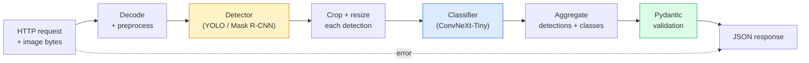

# Build a Complete Vision Pipeline — Capstone

> Một hệ thống thị giác production là một chuỗi mô hình và quy tắc được nối bằng các hợp đồng dữ liệu. Các phần đã có trong giai đoạn này; bài capstone nối chúng đầu-cuối.

**Type:** Build
**Languages:** Python
**Prerequisites:** Phase 4 Lessons 01-15
**Time:** ~120 minutes

## Learning Objectives

- Thiết kế một pipeline thị giác production phát hiện đối tượng, phân loại chúng và xuất JSON có cấu trúc — với mọi đường thất bại được xử lý
- Cắm một bộ phát hiện (Mask R-CNN hoặc YOLO), một bộ phân loại (ConvNeXt-Tiny) và một hợp đồng dữ liệu (Pydantic) vào một dịch vụ
- Đo hiệu năng pipeline đầu-cuối và xác định nút thắt đầu tiên (thường là tiền xử lý, rồi bộ phát hiện)
- Phát hành một dịch vụ FastAPI tối giản nhận tải lên hình ảnh, chạy pipeline và trả về các phát hiện kèm phân loại

## The Problem

Các mô hình thị giác riêng lẻ hữu ích; các sản phẩm thị giác là chuỗi của chúng. Kiểm tra kệ bán lẻ là một bộ phát hiện cộng bộ phân loại sản phẩm cộng pipeline OCR giá. Lái xe tự hành là một bộ phát hiện 2D cộng bộ phát hiện 3D cộng bộ phân đoạn cộng bộ theo dõi cộng bộ lập kế hoạch. Sàng lọc y tế là một bộ phân đoạn cộng bộ phân loại vùng cộng giao diện bác sĩ.

Nối các chuỗi đó là phần phân biệt một mẫu thử ML với sản phẩm. Mọi giao diện giữa mô hình là một nơi mới cho lỗi. Mọi phép biến đổi tọa độ, mọi chuẩn hóa, mọi đổi kích thước mặt nạ là một ứng viên thất bại âm thầm. Một pipeline mạnh bằng giao diện yếu nhất của nó.

Dự án tổng kết này thiết lập pipeline khả dụng tối thiểu: phát hiện + phân loại + đầu ra có cấu trúc + một lớp phục vụ. Mọi thứ khác trong Giai đoạn 4 đều lắp vào bộ khung này: thay Mask R-CNN bằng YOLOv8, thêm một head OCR, thêm một nhánh phân đoạn, thêm một bộ theo dõi. Kiến trúc ổn định; các thành phần có thể được cắm vào.

## The Concept

### The pipeline



Bảy giai đoạn. Hai giai đoạn mô hình tốn kém; năm giai đoạn khác là nơi lỗi tồn tại.

### Data contracts with Pydantic

Mọi ranh giới mô hình trở thành một đối tượng có kiểu. Điều này biến thất bại âm thầm thành thất bại rõ ràng.

```
Detection(
    box: tuple[float, float, float, float],   # (x1, y1, x2, y2), absolute pixels
    score: float,                              # [0, 1]
    class_id: int,                             # from detector's label map
    mask_rle: Optional[str],                   # RLE string if present
)

PipelineResult(
    image_id: str,
    detections: list[Detection],
    classifications: list[Classification],
    inference_ms: float,
)
```

Khi một bộ phát hiện trả về các hộp theo `(cx, cy, w, h)` thay vì `(x1, y1, x2, y2)`, kiểm tra Pydantic thất bại tại ranh giới và bạn biết ngay thay vì gỡ lỗi một phép cắt phía sau âm thầm trả về vùng rỗng.

### Where latency goes

Ba sự thật đúng trong gần như mọi pipeline thị giác:

1. **Tiền xử lý thường là khối đơn lớn nhất.** Giải mã JPEG, chuyển không gian màu, đổi kích thước — chúng bị giới hạn CPU và dễ quên.
2. **Bộ phát hiện chi phối thời gian GPU.** 70-90% thời gian GPU nằm trong lượt truyền xuôi phát hiện.
3. **Hậu xử lý (NMS, mã hóa/giải mã RLE) rẻ trên GPU, đắt trên CPU.** Luôn đo hiệu năng với đích thực tế.

Biết phân phối là điều biến tối ưu hóa thành một danh sách có ưu tiên.

### Failure modes

- **Các phát hiện rỗng** — trả danh sách rỗng, không sập. Ghi nhật ký.
- **Các hộp ngoài biên** — chặn theo kích thước hình ảnh trước khi cắt.
- **Các vùng cắt rất nhỏ** — bỏ phân loại cho các hộp nhỏ hơn đầu vào tối thiểu của bộ phân loại.
- **Tải lên hỏng** — phản hồi 400 với mã lỗi cụ thể, không phải 500.
- **Tải mô hình thất bại** — thất bại khi khởi động dịch vụ, không phải ở yêu cầu đầu tiên.

Một pipeline production xử lý từng trường hợp mà không viết `try/except` chung chung che giấu thất bại. Mọi thất bại có mã được đặt tên và phản hồi.

### Batching

Một dịch vụ production phục vụ nhiều máy khách. Chia batch các phát hiện và phân loại giữa các yêu cầu nhân thông lượng. Đánh đổi: thêm độ trễ từ chờ batch đầy. Thiết lập điển hình: gom yêu cầu tối đa 20ms, chia batch cùng nhau, xử lý, phân phối phản hồi. `torchserve` và `triton` làm trực tiếp; các dịch vụ nhỏ với tải dự đoán được tự xây micro-batcher.

```figure
v4-vision-pipeline
```

## Build It

### Step 1: Data contracts

```python
from pydantic import BaseModel, Field
from typing import List, Optional, Tuple

class Detection(BaseModel):
    box: Tuple[float, float, float, float]
    score: float = Field(ge=0, le=1)
    class_id: int = Field(ge=0)
    mask_rle: Optional[str] = None


class Classification(BaseModel):
    detection_index: int
    class_id: int
    class_name: str
    score: float = Field(ge=0, le=1)


class PipelineResult(BaseModel):
    image_id: str
    detections: List[Detection]
    classifications: List[Classification]
    inference_ms: float
```

Năm giây viết mã tiết kiệm một giờ gỡ lỗi trên bất kỳ pipeline nghiêm túc nào.

### Step 2: A minimal Pipeline class

```python
import time
import numpy as np
import torch
from PIL import Image

class VisionPipeline:
    def __init__(self, detector, classifier, class_names,
                 device="cpu", min_crop=32):
        self.detector = detector.to(device).eval()
        self.classifier = classifier.to(device).eval()
        self.class_names = class_names
        self.device = device
        self.min_crop = min_crop

    def preprocess(self, image):
        """
        image: PIL.Image or np.ndarray (H, W, 3) uint8
        returns: CHW float tensor on device
        """
        if isinstance(image, Image.Image):
            image = np.asarray(image.convert("RGB"))
        tensor = torch.from_numpy(image).permute(2, 0, 1).float() / 255.0
        return tensor.to(self.device)

    @torch.no_grad()
    def detect(self, image_tensor):
        return self.detector([image_tensor])[0]

    @torch.no_grad()
    def classify(self, crops):
        if len(crops) == 0:
            return []
        batch = torch.stack(crops).to(self.device)
        logits = self.classifier(batch)
        probs = logits.softmax(-1)
        scores, cls = probs.max(-1)
        return list(zip(cls.tolist(), scores.tolist()))

    def run(self, image, image_id="anonymous"):
        t0 = time.perf_counter()
        tensor = self.preprocess(image)
        det = self.detect(tensor)

        crops = []
        detections = []
        valid_indices = []
        for i, (box, score, cls) in enumerate(zip(det["boxes"], det["scores"], det["labels"])):
            x1, y1, x2, y2 = [max(0, int(b)) for b in box.tolist()]
            x2 = min(x2, tensor.shape[-1])
            y2 = min(y2, tensor.shape[-2])
            detections.append(Detection(
                box=(x1, y1, x2, y2),
                score=float(score),
                class_id=int(cls),
            ))
            if (x2 - x1) < self.min_crop or (y2 - y1) < self.min_crop:
                continue
            crop = tensor[:, y1:y2, x1:x2]
            crop = torch.nn.functional.interpolate(
                crop.unsqueeze(0),
                size=(224, 224),
                mode="bilinear",
                align_corners=False,
            )[0]
            crops.append(crop)
            valid_indices.append(i)

        class_preds = self.classify(crops)

        classifications = []
        for valid_idx, (cls_id, cls_score) in zip(valid_indices, class_preds):
            classifications.append(Classification(
                detection_index=valid_idx,
                class_id=int(cls_id),
                class_name=self.class_names[cls_id],
                score=float(cls_score),
            ))

        return PipelineResult(
            image_id=image_id,
            detections=detections,
            classifications=classifications,
            inference_ms=(time.perf_counter() - t0) * 1000,
        )
```

Mọi giao diện có kiểu. Mọi đường thất bại có quyết định xử lý cụ thể.

### Step 3: Wire a detector and a classifier

```python
from torchvision.models.detection import maskrcnn_resnet50_fpn_v2
from torchvision.models import convnext_tiny

# Use ImageNet-pretrained weights for a realistic pipeline without training
detector = maskrcnn_resnet50_fpn_v2(weights="DEFAULT")
classifier = convnext_tiny(weights="DEFAULT")
class_names = [f"imagenet_class_{i}" for i in range(1000)]

pipe = VisionPipeline(detector, classifier, class_names)

# Smoke test with a synthetic image
test_image = (np.random.rand(400, 600, 3) * 255).astype(np.uint8)
result = pipe.run(test_image, image_id="demo")
print(result.model_dump_json(indent=2)[:500])
```

### Step 4: FastAPI service

```python
from fastapi import FastAPI, UploadFile, HTTPException
from io import BytesIO

app = FastAPI()
pipe = None  # initialised on startup

@app.on_event("startup")
def load():
    global pipe
    detector = maskrcnn_resnet50_fpn_v2(weights="DEFAULT").eval()
    classifier = convnext_tiny(weights="DEFAULT").eval()
    pipe = VisionPipeline(detector, classifier, class_names=[f"c{i}" for i in range(1000)])

@app.post("/detect")
async def detect_endpoint(file: UploadFile):
    if file.content_type not in {"image/jpeg", "image/png", "image/webp"}:
        raise HTTPException(status_code=400, detail="unsupported image type")
    data = await file.read()
    try:
        img = Image.open(BytesIO(data)).convert("RGB")
    except Exception:
        raise HTTPException(status_code=400, detail="cannot decode image")
    result = pipe.run(img, image_id=file.filename or "upload")
    return result.model_dump()
```

Chạy bằng `uvicorn main:app --host 0.0.0.0 --port 8000`. Kiểm tra bằng `curl -F 'file=@dog.jpg' http://localhost:8000/detect`.

### Step 5: Benchmark the pipeline

```python
import time

def benchmark(pipe, num_runs=20, image_size=(400, 600)):
    img = (np.random.rand(*image_size, 3) * 255).astype(np.uint8)
    pipe.run(img)  # warm up

    stages = {"preprocess": [], "detect": [], "classify": [], "total": []}
    for _ in range(num_runs):
        t0 = time.perf_counter()
        tensor = pipe.preprocess(img)
        t1 = time.perf_counter()
        det = pipe.detect(tensor)
        t2 = time.perf_counter()
        crops = []
        for box in det["boxes"]:
            x1, y1, x2, y2 = [max(0, int(b)) for b in box.tolist()]
            x2 = min(x2, tensor.shape[-1])
            y2 = min(y2, tensor.shape[-2])
            if (x2 - x1) >= pipe.min_crop and (y2 - y1) >= pipe.min_crop:
                crop = tensor[:, y1:y2, x1:x2]
                crop = torch.nn.functional.interpolate(
                    crop.unsqueeze(0), size=(224, 224), mode="bilinear", align_corners=False
                )[0]
                crops.append(crop)
        pipe.classify(crops)
        t3 = time.perf_counter()
        stages["preprocess"].append((t1 - t0) * 1000)
        stages["detect"].append((t2 - t1) * 1000)
        stages["classify"].append((t3 - t2) * 1000)
        stages["total"].append((t3 - t0) * 1000)

    for stage, times in stages.items():
        times.sort()
        print(f"{stage:12s}  p50={times[len(times)//2]:7.1f} ms  p95={times[int(len(times)*0.95)]:7.1f} ms")
```

Đầu ra điển hình trên CPU: tiền xử lý ~3 ms, phát hiện 300-500 ms, phân loại 20-40 ms, tổng 350-550 ms. Trên GPU, phát hiện là 20-40 ms và tiền xử lý + phân loại bắt đầu quan trọng hơn theo tỷ lệ tương đối.

## Use It

Các khuôn production hội tụ về cùng cấu trúc, cộng:

- **Quản lý phiên bản mô hình** — luôn ghi tên mô hình và mã băm trọng số trong phản hồi.
- **ID truy vết từng yêu cầu** — ghi thời gian mọi giai đoạn cho mọi yêu cầu để liên hệ phản hồi chậm với các giai đoạn.
- **Đường dự phòng** — nếu bộ phân loại hết thời gian, trả các phát hiện không kèm phân loại thay vì làm thất bại toàn bộ yêu cầu.
- **Các bộ lọc an toàn** — các bộ lọc NSFW / PII chạy sau phân loại, trước khi phản hồi rời dịch vụ.
- **Endpoint batch** — một `/detect_batch` nhận danh sách URL hình ảnh để xử lý hàng loạt.

Cho phục vụ production, `torchserve`, `Triton Inference Server` và `BentoML` xử lý chia batch, quản lý phiên bản, thước đo và kiểm tra sức khỏe sẵn có. Chạy trực tiếp `FastAPI` ổn cho mẫu thử và sản phẩm quy mô nhỏ.

## Ship It

Bài học này tạo ra:

- `outputs/prompt-vision-service-shape-reviewer.md` — một prompt đánh giá mã dịch vụ thị giác tìm vi phạm hình dạng hợp đồng/phản hồi và nêu lỗi gây hỏng đầu tiên.
- `outputs/skill-pipeline-budget-planner.md` — một skill, với độ trễ và thông lượng đích, gán ngân sách thời gian cho mọi giai đoạn pipeline và đánh dấu giai đoạn sẽ không đạt ngân sách đầu tiên.

## Exercises

1. **(Dễ)** Chạy pipeline trên 10 hình ảnh từ bất kỳ tập dữ liệu mở nào. Báo cáo thời gian trung bình mỗi giai đoạn và phân phối số phát hiện mỗi hình ảnh.
2. **(Vừa)** Thêm một trường đầu ra mặt nạ vào `Detection` và mã hóa thành RLE. Xác minh JSON giữ dưới 1MB ngay cả cho hình ảnh 10 đối tượng.
3. **(Khó)** Thêm một micro-batcher trước bộ phân loại: gom các vùng cắt tối đa 10 ms, phân loại tất cả trong một lời gọi GPU, trả kết quả từng yêu cầu. Đo mức tăng thông lượng ở 5 yêu cầu đồng thời mỗi giây và độ trễ thêm.

## Key Terms

| Thuật ngữ | Cách mọi người nói | Ý nghĩa thực sự |
|------|----------------|----------------------|
| Pipeline | "Hệ thống" | Một chuỗi có thứ tự các bước tiền xử lý, suy luận và hậu xử lý với giao diện có kiểu giữa mỗi cặp |
| Data contract (Hợp đồng dữ liệu) | "Schema" | Các định nghĩa Pydantic / dataclass mà đầu vào và đầu ra mọi giai đoạn tuân theo; phát hiện lỗi tích hợp tại ranh giới |
| Preprocessing (Tiền xử lý) | "Trước mô hình" | Giải mã, chuyển màu, đổi kích thước, chuẩn hóa; thường là phần tốn thời gian CPU lớn nhất |
| Postprocessing (Hậu xử lý) | "Sau mô hình" | NMS, đổi kích thước mặt nạ, ngưỡng, mã hóa RLE; rẻ trên GPU, đắt trên CPU |
| Microbatcher | "Gom rồi truyền xuôi" | Bộ tổng hợp chờ một cửa sổ cố định cho nhiều yêu cầu, chạy một lượt truyền xuôi theo batch duy nhất |
| Trace ID (ID truy vết) | "Id yêu cầu" | Định danh từng yêu cầu ghi ở mọi giai đoạn để các yêu cầu chậm có thể truy vết đầu-cuối |
| Failure code (Mã thất bại) | "Lỗi có tên" | Mã lỗi cụ thể mỗi loại thất bại thay vì 500 chung chung; cho phép logic thử lại máy khách |
| Health check (Kiểm tra sức khỏe) | "Phép thăm dò sẵn sàng" | Endpoint rẻ báo liệu dịch vụ có thể trả lời; các bộ cân bằng tải dựa vào nó |

## Further Reading

- [Full Stack Deep Learning — Deploying Models](https://fullstackdeeplearning.com/course/2022/lecture-5-deployment/) — tổng quan chuẩn về triển khai ML production
- [BentoML docs](https://docs.bentoml.com) — framework phục vụ với chia batch, quản lý phiên bản và thước đo
- [torchserve docs](https://pytorch.org/serve/) — thư viện phục vụ chính thức của PyTorch
- [NVIDIA Triton Inference Server](https://developer.nvidia.com/triton-inference-server) — phục vụ thông lượng cao với hỗ trợ chia batch và nhiều mô hình
