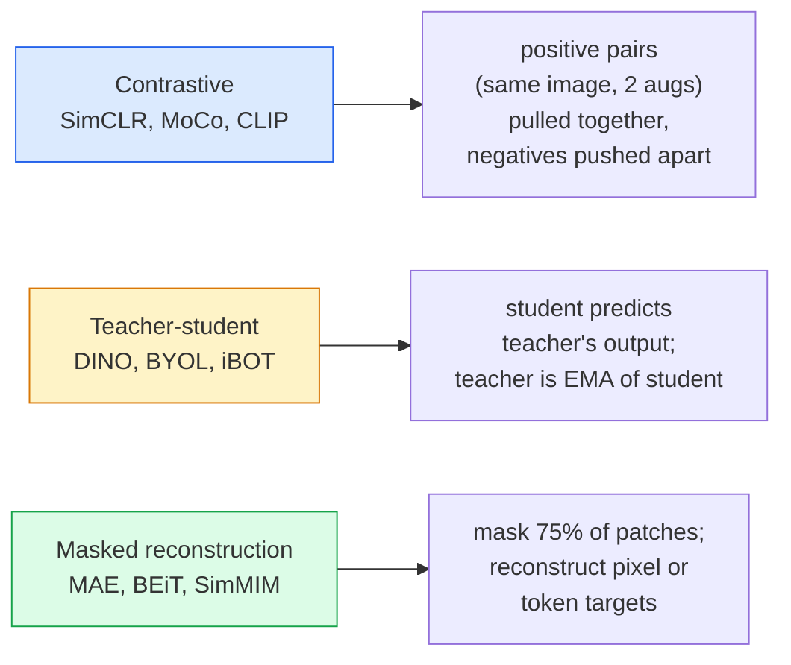

# Self-Supervised Vision — SimCLR, DINO, MAE

> Nhãn là nút thắt của thị giác có giám sát. Tiền huấn luyện tự giám sát loại bỏ chúng: học các đặc trưng thị giác từ 100M hình ảnh không nhãn, tinh chỉnh trên 10k hình ảnh có nhãn.

**Type:** Learn + Build
**Languages:** Python
**Prerequisites:** Phase 4 Lesson 04 (Image Classification), Phase 4 Lesson 14 (ViT)
**Time:** ~75 minutes

## Learning Objectives

- Theo dõi ba họ tự giám sát lớn — tương phản (SimCLR), giáo viên-học sinh (DINO), tái tạo có mặt nạ (MAE) — và nêu mỗi họ tối ưu gì
- Triển khai mất mát InfoNCE từ đầu và giải thích tại sao batch 512 hoạt động nhưng batch 32 thất bại
- Giải thích tại sao tỷ lệ che 75% của MAE không tùy ý và khác 15% của BERT cho văn bản thế nào
- Sử dụng các checkpoint ImageNet DINOv2 hoặc MAE cho linear probing và truy xuất zero-shot

## The Problem

ImageNet có giám sát có 1.3M hình ảnh gán nhãn, tốn ước tính $10M để chú thích. Các tập dữ liệu y tế và công nghiệp nhỏ hơn và còn tốn kém hơn để gán nhãn. Mọi nhóm thị giác hỏi: chúng ta có thể tiền huấn luyện trên dữ liệu không nhãn rẻ — các khung hình YouTube, thu thập web, cảnh webcam, các lượt quét vệ tinh — rồi tinh chỉnh trên một tập gán nhãn nhỏ không?

Học tự giám sát là câu trả lời. Một ViT tự giám sát hiện đại huấn luyện trên LAION hoặc JFT đạt hoặc vượt accuracy ImageNet có giám sát khi tinh chỉnh. Nó cũng chuyển giao tốt hơn tới các tác vụ phía sau (phát hiện, phân đoạn, độ sâu) so với tiền huấn luyện có giám sát. DINOv2 (Meta, 2023) và MAE (Meta, 2022) là các mặc định production hiện tại cho các đặc trưng thị giác có thể chuyển giao.

Thay đổi khái niệm là tác vụ tiền đề — thứ mô hình được huấn luyện để làm — không cần là tác vụ phía sau. Điều quan trọng là nó buộc mô hình học các đặc trưng hữu ích. Dự đoán màu hình ảnh thang xám, xoay hình ảnh và yêu cầu mô hình phân loại góc xoay, che patch và tái tạo — tất cả đã hoạt động. Ba cách tiếp cận mở rộng được là học tương phản, chưng cất giáo viên-học sinh và tái tạo có mặt nạ.

## The Concept

### Three families



### Contrastive learning (SimCLR)

Lấy một hình ảnh, áp dụng hai tăng cường ngẫu nhiên, có hai góc nhìn. Đưa cả hai qua cùng encoder cộng một đầu chiếu. Tối thiểu hóa mất mát nói "hai embedding này nên gần" và "embedding này nên xa các embedding của mọi hình ảnh khác trong batch."

```
Loss for positive pair (z_i, z_j) among 2N views per batch:

   L_ij = -log( exp(sim(z_i, z_j) / tau) / sum_k in batch \ {i} exp(sim(z_i, z_k) / tau) )

sim = cosine similarity
tau = temperature (0.1 standard)
```

Đây là mất mát InfoNCE. Nó cần nhiều mẫu âm mỗi mẫu dương, nên kích thước batch quan trọng — SimCLR cần 512-8192. MoCo giới thiệu hàng đợi momentum của các batch quá khứ để tách số mẫu âm khỏi kích thước batch.

### Teacher-student (DINO)

Hai mạng cùng kiến trúc: học sinh và giáo viên. Giáo viên là trung bình trượt hàm mũ (EMA) của các trọng số học sinh. Cả hai thấy các góc nhìn tăng cường của hình ảnh. Đầu ra học sinh được huấn luyện để khớp giáo viên — không mẫu âm tường minh.

```
loss = CE( student_output(view_1),  teacher_output(view_2) )
     + CE( student_output(view_2),  teacher_output(view_1) )

teacher_weights = m * teacher_weights + (1 - m) * student_weights   (m ≈ 0.996)
```

Tại sao nó không sụp về "dự đoán một hằng số": đầu ra giáo viên được đặt tâm (trừ trung bình từng chiều) và làm sắc (chia nhiệt độ nhỏ). Đặt tâm ngăn một chiều chi phối; làm sắc ngăn đầu ra sụp thành phân phối đều.

DINO là thứ DINOv2 mở rộng, trên 142M hình ảnh được tuyển chọn. Các đặc trưng kết quả là SOTA hiện tại cho truy xuất thị giác zero-shot và dự đoán dày đặc.

### Masked reconstruction (MAE)

Che 75% patch của một đầu vào ViT. Chỉ truyền 25% nhìn thấy qua encoder. Một decoder nhỏ nhận đầu ra encoder cộng các token mặt nạ tại các vị trí che và được huấn luyện tái tạo các pixel của các patch che.

```
Encoder:  visible 25% of patches -> features
Decoder:  features + mask tokens at masked positions -> reconstructed pixels
Loss:     MSE between reconstructed and original pixels on masked patches only
```

Các lựa chọn thiết kế chính khiến MAE hoạt động:

- **Tỷ lệ che 75%** — cao. Buộc encoder học các đặc trưng ngữ nghĩa; tái tạo 25% sẽ gần như tầm thường (các pixel lân cận tương quan tới mức một CNN có thể làm rất tốt).
- **Encoder/decoder bất đối xứng** — encoder ViT lớn chỉ thấy các patch nhìn thấy; decoder nhỏ (8 lớp, 512 chiều) xử lý tái tạo. Tiền huấn luyện nhanh hơn BEiT đơn giản 3 lần.
- **Mục tiêu tái tạo không gian pixel** — đơn giản hơn mục tiêu token hóa của BEiT và hoạt động tốt hơn trên ViT.

Sau tiền huấn luyện, bỏ decoder. Encoder là bộ trích xuất đặc trưng.

### Why 75% and not 15%

BERT che 15% token. MAE che 75%. Khác biệt là mật độ thông tin.

- Ngôn ngữ tự nhiên có entropy cao mỗi token. Dự đoán 15% token vẫn khó vì mỗi vị trí che có nhiều phần điền hợp lý.
- Các patch hình ảnh có entropy thấp — một vùng lân cận không che thường xác định các pixel patch che gần như chính xác. Để dự đoán đòi hỏi hiểu ngữ nghĩa, bạn phải che mạnh.

75% đủ cao để ngoại suy không gian đơn giản không thể giải tác vụ; encoder phải biểu diễn nội dung hình ảnh.

### Linear-probe evaluation

Sau tiền huấn luyện tự giám sát, đánh giá tiêu chuẩn là một **linear probe**: đóng băng encoder, huấn luyện một bộ phân loại tuyến tính duy nhất trên đó với nhãn ImageNet. Báo cáo accuracy top-1.

- SimCLR ResNet-50: ~71% (2020)
- DINO ViT-S/16: ~77% (2021)
- MAE ViT-L/16: ~76% (2022)
- DINOv2 ViT-g/14: ~86% (2023)

Linear probe là thước đo thuần chất lượng đặc trưng; tinh chỉnh thường thêm 2-5 điểm nhưng cũng trộn tác động của huấn luyện lại đầu.

```figure
data-augmentation
```

## Build It

### Step 1: Two-view augmentation pipeline

```python
import torch
import torchvision.transforms as T

two_view_train = lambda: T.Compose([
    T.RandomResizedCrop(96, scale=(0.2, 1.0)),
    T.RandomHorizontalFlip(),
    T.ColorJitter(0.4, 0.4, 0.4, 0.1),
    T.RandomGrayscale(p=0.2),
    T.ToTensor(),
])


class TwoViewDataset(torch.utils.data.Dataset):
    def __init__(self, base):
        self.base = base
        self.aug = two_view_train()

    def __len__(self):
        return len(self.base)

    def __getitem__(self, i):
        img, _ = self.base[i]
        v1 = self.aug(img)
        v2 = self.aug(img)
        return v1, v2
```

Mỗi __getitem__ trả về hai góc nhìn tăng cường của cùng hình ảnh; không cần nhãn.

### Step 2: InfoNCE loss

```python
import torch.nn.functional as F

def info_nce(z1, z2, tau=0.1):
    """
    z1, z2: (N, D) L2-normalised embeddings of paired views
    """
    N, D = z1.shape
    z = torch.cat([z1, z2], dim=0)  # (2N, D)
    sim = z @ z.T / tau              # (2N, 2N)

    mask = torch.eye(2 * N, dtype=torch.bool, device=z.device)
    sim = sim.masked_fill(mask, float("-inf"))

    targets = torch.cat([torch.arange(N, 2 * N), torch.arange(0, N)]).to(z.device)
    return F.cross_entropy(sim, targets)
```

Chuẩn hóa L2 các embedding trước khi gọi. `tau=0.1` là mặc định SimCLR; thấp hơn làm mất mát sắc hơn và cần nhiều mẫu âm hơn.

### Step 3: Sanity check InfoNCE

```python
z1 = F.normalize(torch.randn(16, 32), dim=-1)
z2 = z1.clone()
loss_same = info_nce(z1, z2, tau=0.1).item()
z2_random = F.normalize(torch.randn(16, 32), dim=-1)
loss_random = info_nce(z1, z2_random, tau=0.1).item()
print(f"InfoNCE with identical pairs:  {loss_same:.3f}")
print(f"InfoNCE with random pairs:     {loss_random:.3f}")
```

Các cặp giống hệt nên cho mất mát thấp (gần 0 với batch lớn và nhiệt độ lạnh). Các cặp ngẫu nhiên nên cho $\log(2N-1) \approx \log(31) \approx 3.4$ với batch 16 cặp.

### Step 4: MAE-style masking

```python
def random_mask_indices(num_patches, mask_ratio=0.75, seed=0):
    g = torch.Generator().manual_seed(seed)
    n_keep = int(num_patches * (1 - mask_ratio))
    perm = torch.randperm(num_patches, generator=g)
    visible = perm[:n_keep]
    masked = perm[n_keep:]
    return visible.sort().values, masked.sort().values


num_patches = 196
visible, masked = random_mask_indices(num_patches, mask_ratio=0.75)
print(f"visible: {len(visible)} / {num_patches}")
print(f"masked:  {len(masked)} / {num_patches}")
```

Đơn giản, nhanh và tất định với seed cho trước. Các bản triển khai MAE thật chia batch và giữ các mặt nạ theo mẫu.

## Use It

DINOv2 là tiêu chuẩn production năm 2026:

```python
import torch
from transformers import AutoImageProcessor, AutoModel

processor = AutoImageProcessor.from_pretrained("facebook/dinov2-base")
model = AutoModel.from_pretrained("facebook/dinov2-base")
model.eval()

# Per-image embeddings for zero-shot retrieval
with torch.no_grad():
    inputs = processor(images=[pil_image], return_tensors="pt")
    outputs = model(**inputs)
    embedding = outputs.last_hidden_state[:, 0]  # CLS token
```

Embedding 768 chiều kết quả là xương sống của các pipeline truy xuất hình ảnh, tương ứng dày đặc và chuyển giao zero-shot hiện đại. Tinh chỉnh trên tác vụ phía sau hiếm khi cần hơn một đầu tuyến tính.

Với embedding hình ảnh-văn bản, SigLIP hoặc OpenCLIP là tương đương; cho tinh chỉnh kiểu MAE, kho `timm` cung cấp mọi checkpoint MAE.

## Ship It

Bài học này tạo ra:

- `outputs/prompt-ssl-pretraining-picker.md` — một prompt chọn SimCLR / MAE / DINOv2 với kích thước tập dữ liệu, tính toán và tác vụ phía sau cho trước.
- `outputs/skill-linear-probe-runner.md` — một skill viết đánh giá linear-probe cho bất kỳ encoder đóng băng + tập dữ liệu gán nhãn nào.

## Exercises

1. **(Dễ)** Xác minh mất mát InfoNCE giảm khi bạn giảm nhiệt độ cho các embedding căn chỉnh tốt và tăng khi giảm nhiệt độ cho các embedding ngẫu nhiên. Tạo đồ thị `tau in [0.05, 0.1, 0.2, 0.5]` theo mất mát.
2. **(Vừa)** Triển khai một bộ đệm tâm kiểu DINO. Cho thấy không đặt tâm, học sinh sụp về vector hằng trong vài epoch.
3. **(Khó)** Huấn luyện MAE trên CIFAR-100 bằng TinyUNet từ Bài 10 làm backbone. Báo cáo accuracy linear-probe ở 10, 50 và 200 epoch. Cho thấy linear probe được tiền huấn luyện MAE vượt linear probe có giám sát từ đầu trên cùng tập con 1,000 hình ảnh.

## Key Terms

| Thuật ngữ | Cách mọi người nói | Ý nghĩa thực sự |
|------|----------------|----------------------|
| Self-supervised (Tự giám sát) | "Không nhãn" | Một tác vụ tiền đề tạo ra các biểu diễn hữu ích từ dữ liệu không nhãn |
| Pretext task (Tác vụ tiền đề) | "Tác vụ giả" | Mục tiêu dùng trong SSL (tái tạo patch, khớp góc nhìn); bỏ sau tiền huấn luyện |
| Linear probe | "Encoder đóng băng + đầu tuyến tính" | Đánh giá SSL tiêu chuẩn: chỉ huấn luyện một bộ phân loại tuyến tính trên các đặc trưng đóng băng |
| InfoNCE | "Mất mát tương phản" | softmax trên các độ tương đồng cosine; cặp dương là lớp mục tiêu, mọi cặp khác là âm |
| EMA teacher (Giáo viên EMA) | "Giáo viên trung bình trượt" | Giáo viên có các trọng số là trung bình trượt hàm mũ của học sinh; được dùng bởi BYOL, MoCo, DINO |
| Mask ratio (Tỷ lệ che) | "% patch bị ẩn" | Tỷ lệ patch bị che trong MAE; 75% cho thị giác, 15% cho văn bản |
| Representation collapse (Sụp đổ biểu diễn) | "Đầu ra hằng" | Thất bại SSL nơi encoder xuất một vector hằng cho mọi đầu vào; được ngăn bằng đặt tâm, làm sắc hoặc mẫu âm |
| DINOv2 | "Backbone SSL production" | ViT tự giám sát năm 2023 của Meta; các đặc trưng hình ảnh đa dụng mạnh nhất năm 2026 |

## Further Reading

- [SimCLR (Chen et al., 2020)](https://arxiv.org/abs/2002.05709) — tài liệu tham khảo học tương phản
- [DINO (Caron et al., 2021)](https://arxiv.org/abs/2104.14294) — giáo viên-học sinh với momentum, đặt tâm, làm sắc
- [MAE (He et al., 2022)](https://arxiv.org/abs/2111.06377) — tiền huấn luyện autoencoder có mặt nạ cho ViT
- [DINOv2 (Oquab et al., 2023)](https://arxiv.org/abs/2304.07193) — mở rộng ViT tự giám sát tới các đặc trưng production
