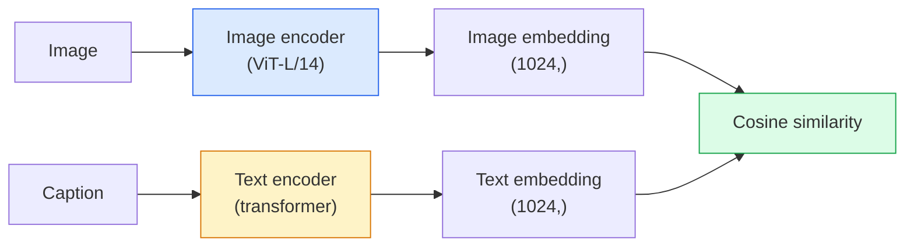

# Open-Vocabulary Vision — CLIP

> Huấn luyện một encoder hình ảnh và một encoder văn bản cùng nhau để các cặp (hình ảnh, chú thích) khớp nhau tới cùng điểm trong một không gian chung. Đó là toàn bộ thủ thuật.

**Type:** Build + Use
**Languages:** Python
**Prerequisites:** Phase 4 Lesson 14 (ViT), Phase 4 Lesson 17 (Self-Supervised)
**Time:** ~45 minutes

## Learning Objectives

- Giải thích kiến trúc hai tháp và mục tiêu huấn luyện tương phản của CLIP
- Sử dụng một CLIP (hoặc SigLIP) được tiền huấn luyện để phân loại zero-shot mà không huấn luyện riêng theo tác vụ
- Triển khai phân loại zero-shot từ đầu: mã hóa các prompt lớp, tính độ tương đồng cosine, lấy argmax
- Phân biệt CLIP, SigLIP, OpenCLIP và các mô hình LLaVA/LLaMA-vision — mỗi loại dùng cho gì năm 2026

## The Problem

Các bộ phân loại truyền thống có từ vựng đóng: một mô hình ImageNet 1000 lớp chỉ có thể dự đoán 1000 nhãn. Mọi loại mới cần dữ liệu gán nhãn và đầu được huấn luyện lại.

CLIP (Radford et al., OpenAI 2021) cho thấy huấn luyện trên 400M cặp (hình ảnh, chú thích) thu thập từ web tạo ra một mô hình có thể phân loại vào bất kỳ tập loại nào khi suy luận, được mô tả hoàn toàn bằng ngôn ngữ tự nhiên. Bạn cho nó một lớp mới bằng cách viết một câu.

Khả năng đó — chuyển giao zero-shot — là lý do mọi hệ thống thị giác hiện đại bắt đầu với checkpoint họ CLIP. Phát hiện (Grounding DINO, OWL-ViT), phân đoạn (CLIPSeg, SAM), truy xuất, kiểm duyệt nội dung, VLM và sinh văn bản-sang-ảnh đều xây trên các embedding chung kiểu CLIP.

## The Concept

### Two towers



Cả hai encoder kết thúc bằng một phép chiếu tuyến tính tới cùng số chiều embedding (512 cho CLIP-B/32, 1024 cho CLIP-L/14). Chuẩn hóa L2 và tính độ tương đồng cosine.

### The objective

Với một batch N cặp (hình ảnh, chú thích), xây một ma trận tương đồng NxN. Huấn luyện cả hai encoder để đường chéo (các cặp khớp) có tương đồng cao và ngoài đường chéo (không khớp) có tương đồng thấp.

```
sim_matrix = image_embeddings @ text_embeddings.T / tau

loss_i2t = cross_entropy(sim_matrix,       targets=arange(N))
loss_t2i = cross_entropy(sim_matrix.T,     targets=arange(N))
loss = (loss_i2t + loss_t2i) / 2
```

Đối xứng vì cả truy xuất hình ảnh-sang-văn bản và văn bản-sang-hình ảnh đều nên hoạt động. `tau` (nhiệt độ) thường được học như một tham số vô hướng, khởi tạo 0.07.

### SigLIP: a better loss

SigLIP (Zhai et al., 2023) thay softmax bằng sigmoid từng cặp:

```
loss = mean over pairs of log(1 + exp(-y_ij * sim_ij))
y_ij = +1 if matching, -1 otherwise
```

Mất mát từng cặp loại bỏ chuẩn hóa cấp batch mà CLIP cần. SigLIP huấn luyện tốt hơn ở kích thước batch nhỏ và ngang hoặc vượt CLIP với cùng dữ liệu.

### Zero-shot classification

Với một CLIP đã huấn luyện:

1. Với mỗi lớp, soạn một prompt: "một bức ảnh của một {class}".
2. Mã hóa mọi prompt lớp bằng encoder văn bản -> `T` hình dạng (C, d).
3. Mã hóa hình ảnh test -> `I` hình dạng (1, d).
4. Độ tương đồng = `I @ T.T` hình dạng (1, C).
5. Argmax -> lớp dự đoán.

Kỹ thuật prompt quan trọng. OpenAI công bố 80 khuôn prompt cho ImageNet ("một bức ảnh của một {}", "một bức ảnh mờ của một {}", "một bản phác họa của một {}", ...). Lấy trung bình embedding của mọi khuôn mỗi lớp để thêm 1-3% accuracy top-1.

### Where CLIP-style models are used in 2026

- **Phân loại zero-shot** — sử dụng trực tiếp.
- **Truy xuất hình ảnh** — mã hóa mọi hình ảnh một lần, embedding truy vấn khi suy luận.
- **Phát hiện có điều kiện văn bản** — Grounding DINO, OWL-ViT bao bọc một tháp văn bản CLIP quanh bộ phát hiện.
- **Phân đoạn có điều kiện văn bản** — CLIPSeg; SAM sử dụng đầu vào prompt văn bản qua CLIP.
- **VLM** — LLaVA, Qwen-VL, InternVL nối một encoder thị giác họ CLIP vào một LLM.
- **Sinh văn bản-sang-ảnh** — Stable Diffusion, DALL-E 3 điều kiện hóa trên các embedding văn bản CLIP.

Một khi có không gian embedding chung, mọi tác vụ thị giác+ngôn ngữ trở thành phép tính khoảng cách.

```figure
clip-contrastive
```

## Build It

### Step 1: A tiny two-tower model

CLIP thật là ViT + transformer. Trong bài này các tháp là MLP nhỏ trên các đặc trưng được trích xuất trước để tín hiệu huấn luyện nhìn thấy trên CPU.

```python
import torch
import torch.nn as nn
import torch.nn.functional as F


class TwoTower(nn.Module):
    def __init__(self, img_in=128, txt_in=64, emb=64):
        super().__init__()
        self.image_proj = nn.Sequential(nn.Linear(img_in, 128), nn.ReLU(), nn.Linear(128, emb))
        self.text_proj = nn.Sequential(nn.Linear(txt_in, 128), nn.ReLU(), nn.Linear(128, emb))
        self.logit_scale = nn.Parameter(torch.ones([]) * 2.6592)  # ln(1/0.07)

    def forward(self, img_feats, txt_feats):
        i = F.normalize(self.image_proj(img_feats), dim=-1)
        t = F.normalize(self.text_proj(txt_feats), dim=-1)
        return i, t, self.logit_scale.exp()
```

Hai phép chiếu, đầu ra cùng số chiều, nhiệt độ được học. Cùng hình dạng như API CLIP thật.

### Step 2: Contrastive loss

```python
def clip_loss(image_emb, text_emb, logit_scale):
    N = image_emb.size(0)
    sim = logit_scale * image_emb @ text_emb.T
    targets = torch.arange(N, device=sim.device)
    l_i = F.cross_entropy(sim, targets)
    l_t = F.cross_entropy(sim.T, targets)
    return (l_i + l_t) / 2
```

Đối xứng. logit_scale cao hơn = softmax sắc hơn = tự tin hơn nhưng nguy cơ mất ổn định.

### Step 3: Zero-shot classifier

```python
@torch.no_grad()
def zero_shot_classify(model, image_feats, class_text_feats, class_names):
    """
    image_feats:      (N, img_in)
    class_text_feats: (C, txt_in)   one averaged embedding per class
    """
    i = F.normalize(model.image_proj(image_feats), dim=-1)
    t = F.normalize(model.text_proj(class_text_feats), dim=-1)
    sim = i @ t.T
    pred = sim.argmax(dim=-1)
    return [class_names[p] for p in pred.tolist()]
```

Một dòng mỗi bước. Đây là đúng quy trình zero-shot được dùng với checkpoint CLIP production.

### Step 4: Sanity check

```python
torch.manual_seed(0)
model = TwoTower()

img = torch.randn(8, 128)
txt = torch.randn(8, 64)
i, t, scale = model(img, txt)
loss = clip_loss(i, t, scale)
print(f"batch size: {i.size(0)}   loss: {loss.item():.3f}")
```

Mất mát nên gần `log(N) = log(8) = 2.08` cho một mô hình khởi tạo ngẫu nhiên — mục tiêu cross-entropy đối xứng khi chưa học cấu trúc.

## Use It

OpenCLIP là mặc định cộng đồng năm 2026:

```python
import open_clip
import torch
from PIL import Image

model, _, preprocess = open_clip.create_model_and_transforms("ViT-B-32", pretrained="laion2b_s34b_b79k")
tokenizer = open_clip.get_tokenizer("ViT-B-32")

image = preprocess(Image.open("dog.jpg")).unsqueeze(0)
text = tokenizer(["a photo of a dog", "a photo of a cat", "a photo of a car"])

with torch.no_grad():
    image_features = model.encode_image(image)
    text_features = model.encode_text(text)
    image_features = image_features / image_features.norm(dim=-1, keepdim=True)
    text_features = text_features / text_features.norm(dim=-1, keepdim=True)
    probs = (100.0 * image_features @ text_features.T).softmax(dim=-1)

print(probs)
```

SigLIP mới hơn, huấn luyện tốt hơn ở quy mô nhỏ và được ưu tiên cho công việc mới: `google/siglip-base-patch16-224`. Hugging Face cung cấp cả hai.

## Ship It

Bài học này tạo ra:

- `outputs/prompt-zero-shot-class-picker.md` — một prompt thiết kế các khuôn lớp cho CLIP zero-shot với danh sách lớp và lĩnh vực cho trước.
- `outputs/skill-image-text-retriever.md` — một skill xây chỉ mục embedding hình ảnh với bất kỳ checkpoint CLIP nào, hỗ trợ truy vấn bằng văn bản và bằng hình ảnh.

## Exercises

1. **(Dễ)** Sử dụng OpenCLIP ViT-B/32 được tiền huấn luyện và phân loại zero-shot trên CIFAR-10 với bộ prompt 80 khuôn. Báo cáo accuracy top-1; nên khoảng 85-90%.
2. **(Vừa)** So sánh một khuôn ("một bức ảnh của một {}") với embedding trung bình 80 khuôn trên cùng tác vụ CIFAR-10. Định lượng khoảng cách và giải thích tại sao các khuôn giúp ích.
3. **(Khó)** Xây một chỉ mục truy xuất hình ảnh zero-shot: embedding 1,000 hình ảnh bằng CLIP, xây chỉ mục FAISS, truy vấn bằng mô tả ngôn ngữ tự nhiên. Báo cáo recall@5 truy xuất cho 20 truy vấn được giữ lại bạn tự viết.

## Key Terms

| Thuật ngữ | Cách mọi người nói | Ý nghĩa thực sự |
|------|----------------|----------------------|
| Two-tower (Hai tháp) | "Encoder kép" | Các encoder hình ảnh và văn bản riêng kết thúc bằng một đầu chiếu cùng số chiều |
| Zero-shot | "Không huấn luyện riêng tác vụ" | Phân loại vào các lớp chỉ được mô tả bằng văn bản khi suy luận; không chạm nhãn |
| Temperature / logit_scale (Nhiệt độ / logit_scale) | "tau" | Số vô hướng được học co giãn ma trận tương đồng trước softmax |
| Prompt template (Khuôn prompt) | "Một bức ảnh của một {}" | Phần bọc ngôn ngữ tự nhiên quanh tên lớp; lấy trung bình nhiều khuôn tăng accuracy zero-shot |
| CLIP | "Mô hình hình ảnh+văn bản" | Mô hình OpenAI năm 2021; vốn từ vựng của lĩnh vực năm 2026 |
| SigLIP | "CLIP sigmoid" | Đổi softmax thành sigmoid từng cặp; huấn luyện tốt hơn ở batch nhỏ |
| OpenCLIP | "Tái tạo mở" | Các biến thể CLIP cộng đồng huấn luyện trên LAION; mặc định production cho các pipeline nguồn mở |
| VLM | "Mô hình thị giác-ngôn ngữ" | Một encoder họ CLIP cộng LLM, được huấn luyện trả lời câu hỏi về hình ảnh |

## Further Reading

- [CLIP: Learning Transferable Visual Models from Natural Language Supervision (Radford et al., 2021)](https://arxiv.org/abs/2103.00020)
- [SigLIP: Sigmoid Loss for Language-Image Pre-Training (Zhai et al., 2023)](https://arxiv.org/abs/2303.15343)
- [OpenCLIP](https://github.com/mlfoundations/open_clip) — cơ sở mã cộng đồng
- [Oquab et al. (2023). DINOv2: Learning Robust Visual Features without Supervision](https://arxiv.org/abs/2304.07193) — bài báo, với benchmark đặc trưng so với các mô hình kiểu CLIP và MAE
