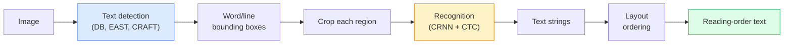

# OCR & Document Understanding

> OCR là một pipeline ba giai đoạn — phát hiện hộp văn bản, nhận dạng ký tự, rồi sắp bố cục chúng. Mọi hệ thống OCR hiện đại đổi thứ tự các giai đoạn này hoặc gộp chúng.

**Type:** Learn + Use
**Languages:** Python
**Prerequisites:** Phase 4 Lesson 06 (Detection), Phase 7 Lesson 02 (Self-Attention)
**Time:** ~45 minutes

## Learning Objectives

- Theo dõi pipeline OCR cổ điển (phát hiện -> nhận dạng -> bố cục) và các lựa chọn đầu-cuối hiện đại (Donut, Qwen-VL-OCR)
- Triển khai mất mát CTC (Connectionist Temporal Classification) để huấn luyện OCR chuỗi-sang-chuỗi
- Sử dụng PaddleOCR hoặc EasyOCR để phân tích tài liệu production mà không huấn luyện
- Phân biệt OCR, phân tích bố cục và hiểu tài liệu — và chọn công cụ đúng mỗi tác vụ

## The Problem

Các hình ảnh đầy văn bản ở khắp nơi: biên lai, hóa đơn, giấy tờ tùy thân, sách quét, biểu mẫu, bảng trắng, biển hiệu, ảnh chụp màn hình. Trích xuất dữ liệu có cấu trúc từ chúng — không chỉ các ký tự, mà "đây là tổng số tiền" — là một trong những bài toán thị giác ứng dụng có giá trị cao nhất.

Lĩnh vực chia thành ba lớp kỹ năng:

1. **OCR đúng nghĩa**: biến pixel thành văn bản.
2. **Phân tích bố cục**: nhóm đầu ra OCR thành các vùng (tiêu đề, thân bài, bảng, đầu trang).
3. **Hiểu tài liệu**: trích xuất các trường có cấu trúc ("invoice_total = $42.50") từ bố cục.

Mỗi lớp có các cách tiếp cận cổ điển và hiện đại, và khoảng cách giữa "tôi muốn văn bản từ hình ảnh" và "tôi cần tổng số tiền từ biên lai này" lớn hơn hầu hết các nhóm nhận ra.

## The Concept

### The classical pipeline



- **Phát hiện văn bản** tạo các tứ giác từng dòng hoặc từng từ.
- **Nhận dạng** cắt mỗi vùng về chiều cao cố định, chạy CNN + BiLSTM + CTC để tạo một chuỗi ký tự.
- **Bố cục** xây lại thứ tự đọc (trên-xuống-dưới, trái-sang-phải cho chữ Latin; khác với chữ Ả Rập, Nhật).

### CTC in one paragraph

Nhận dạng OCR tạo một chuỗi độ dài thay đổi từ một bản đồ đặc trưng độ dài cố định. CTC (Graves et al., 2006) cho phép huấn luyện mà không căn chỉnh cấp ký tự. Mô hình xuất một phân phối trên (vốn từ + blank) ở mỗi bước thời gian; mất mát CTC lấy tổng biên trên mọi cách căn chỉnh rút về văn bản mục tiêu sau khi gộp các lần lặp và bỏ blank.

```
raw output: "h h h _ _ e e l l _ l l o _ _"
after merge repeats and remove blanks: "hello"
```

CTC là lý do CRNN hoạt động năm 2015 và vẫn huấn luyện hầu hết mô hình OCR production năm 2026.

### Modern end-to-end models

- **Donut** (Kim et al., 2022) — một encoder ViT + decoder văn bản; đọc hình ảnh và xuất JSON trực tiếp. Không bộ phát hiện văn bản, không module bố cục.
- **TrOCR** — ViT + decoder transformer cho OCR cấp dòng.
- **Qwen-VL-OCR / InternVL** — các mô hình thị giác-ngôn ngữ đầy đủ được tinh chỉnh cho tác vụ OCR; accuracy tốt nhất năm 2026 trên tài liệu phức tạp.
- **PaddleOCR** — pipeline DB + CRNN cổ điển trong một gói production trưởng thành; vẫn là thành phần chủ lực nguồn mở.

Các mô hình đầu-cuối cần thêm dữ liệu và tính toán nhưng bỏ qua tích lũy sai số của các pipeline nhiều giai đoạn.

### Layout parsing

Với tài liệu có cấu trúc, chạy một bộ phát hiện bố cục (LayoutLMv3, DocLayNet) gán nhãn mỗi vùng: Tiêu đề, Đoạn văn, Hình, Bảng, Chú thích chân trang. Thứ tự đọc sau đó trở thành "lặp qua các vùng theo thứ tự bố cục, nối lại."

Với biểu mẫu, sử dụng các mô hình **trích xuất Khóa-Giá trị** (Donut cho tài liệu giàu trực quan, LayoutLMv3 cho bản quét đơn giản). Chúng nhận hình ảnh + văn bản đã phát hiện + vị trí và dự đoán các cặp khóa-giá trị có cấu trúc.

### Evaluation metrics

- **Tỷ lệ lỗi ký tự (CER)** — khoảng cách Levenshtein / độ dài tham chiếu. Thấp hơn tốt hơn. Mục tiêu production: < 2% trên bản quét sạch.
- **Tỷ lệ lỗi từ (WER)** — tương tự ở cấp từ.
- **F1 trên các trường có cấu trúc** — cho tác vụ khóa-giá trị; đo liệu `{invoice_total: 42.50}` xuất hiện đúng không.
- **Khoảng cách chỉnh sửa trên JSON** — cho phân tích tài liệu đầu-cuối; bài báo Donut giới thiệu khoảng cách chỉnh sửa cây được chuẩn hóa.

```figure
cv3-ctc-collapse
```

## Build It

### Step 1: CTC loss + greedy decoder

```python
import torch
import torch.nn as nn
import torch.nn.functional as F


def ctc_loss(log_probs, targets, input_lengths, target_lengths, blank=0):
    """
    log_probs:      (T, N, C) log-softmax over vocab including blank at index 0
    targets:        (N, S) int targets (no blanks)
    input_lengths:  (N,) per-sample time steps used
    target_lengths: (N,) per-sample target length
    """
    return F.ctc_loss(log_probs, targets, input_lengths, target_lengths,
                      blank=blank, reduction="mean", zero_infinity=True)


def greedy_ctc_decode(log_probs, blank=0):
    """
    log_probs: (T, N, C) log-softmax
    returns: list of index sequences (blanks removed, repeats merged)
    """
    preds = log_probs.argmax(dim=-1).transpose(0, 1).cpu().tolist()
    out = []
    for seq in preds:
        decoded = []
        prev = None
        for idx in seq:
            if idx != prev and idx != blank:
                decoded.append(idx)
            prev = idx
        out.append(decoded)
    return out
```

`F.ctc_loss` dùng bản triển khai CuDNN hiệu quả khi có. Bộ giải mã tham lam đơn giản hơn tìm kiếm chùm và thường trong phạm vi 1% CER so với nó.

### Step 2: Tiny CRNN recogniser

CNN + BiLSTM tối giản cho OCR dòng.

```python
class TinyCRNN(nn.Module):
    def __init__(self, vocab_size=40, hidden=128, feat=32):
        super().__init__()
        self.cnn = nn.Sequential(
            nn.Conv2d(1, feat, 3, 1, 1), nn.BatchNorm2d(feat), nn.ReLU(inplace=True),
            nn.MaxPool2d(2),
            nn.Conv2d(feat, feat * 2, 3, 1, 1), nn.BatchNorm2d(feat * 2), nn.ReLU(inplace=True),
            nn.MaxPool2d(2),
            nn.Conv2d(feat * 2, feat * 4, 3, 1, 1), nn.BatchNorm2d(feat * 4), nn.ReLU(inplace=True),
            nn.MaxPool2d((2, 1)),
            nn.Conv2d(feat * 4, feat * 4, 3, 1, 1), nn.BatchNorm2d(feat * 4), nn.ReLU(inplace=True),
            nn.MaxPool2d((2, 1)),
        )
        self.rnn = nn.LSTM(feat * 4, hidden, bidirectional=True, batch_first=True)
        self.head = nn.Linear(hidden * 2, vocab_size)

    def forward(self, x):
        # x: (N, 1, H, W)
        f = self.cnn(x)                # (N, C, H', W')
        f = f.mean(dim=2).transpose(1, 2)  # (N, W', C)
        h, _ = self.rnn(f)
        return F.log_softmax(self.head(h).transpose(0, 1), dim=-1)  # (W', N, vocab)
```

Đầu vào chiều cao cố định (CNN max-pool chiều cao về 1). Chiều rộng là chiều thời gian cho CTC.

### Step 3: Synthetic OCR

Sinh các chuỗi chữ số đen-trên-trắng cho một phép kiểm tra nhanh đầu-cuối.

```python
import numpy as np

def synthetic_line(text, height=32, char_width=16):
    W = char_width * len(text)
    img = np.ones((height, W), dtype=np.float32)
    for i, c in enumerate(text):
        x = i * char_width
        shade = 0.0 if c.isalnum() else 0.5
        img[6:height - 6, x + 2:x + char_width - 2] = shade
    return img


def build_batch(strings, vocab):
    H = 32
    W = 16 * max(len(s) for s in strings)
    imgs = np.ones((len(strings), 1, H, W), dtype=np.float32)
    target_lengths = []
    targets = []
    for i, s in enumerate(strings):
        imgs[i, 0, :, :16 * len(s)] = synthetic_line(s)
        ids = [vocab.index(c) for c in s]
        targets.extend(ids)
        target_lengths.append(len(ids))
    return torch.from_numpy(imgs), torch.tensor(targets), torch.tensor(target_lengths)


vocab = ["_"] + list("0123456789abcdefghijklmnopqrstuvwxyz")
imgs, targets, lengths = build_batch(["hello", "world"], vocab)
print(f"images: {imgs.shape}   targets: {targets.shape}   lengths: {lengths.tolist()}")
```

Một tập dữ liệu OCR thật thêm phông, nhiễu, xoay, mờ và màu. Pipeline trên giống hệt.

### Step 4: Training sketch

```python
model = TinyCRNN(vocab_size=len(vocab))
opt = torch.optim.Adam(model.parameters(), lr=1e-3)

for step in range(200):
    strings = ["abc" + str(step % 10)] * 4 + ["xyz" + str((step + 1) % 10)] * 4
    imgs, targets, target_lens = build_batch(strings, vocab)
    log_probs = model(imgs)  # (W', 8, vocab)
    input_lens = torch.full((8,), log_probs.size(0), dtype=torch.long)
    loss = ctc_loss(log_probs, targets, input_lens, target_lens, blank=0)
    opt.zero_grad(); loss.backward(); opt.step()
```

Mất mát nên giảm từ ~3 xuống ~0.2 qua 200 bước trên dữ liệu tổng hợp đơn giản này.

## Use It

Ba đường production:

- **PaddleOCR** — trưởng thành, nhanh, đa ngôn ngữ. Sử dụng một dòng: `paddleocr.PaddleOCR(lang="en").ocr(image_path)`.
- **EasyOCR** — gốc Python, đa ngôn ngữ, backbone PyTorch.
- **Tesseract** — cổ điển; vẫn hữu ích cho các tài liệu quét cũ khi các mô hình gặp khó.

Cho phân tích tài liệu đầu-cuối, dùng Donut hoặc một VLM:

```python
from transformers import DonutProcessor, VisionEncoderDecoderModel

processor = DonutProcessor.from_pretrained("naver-clova-ix/donut-base-finetuned-cord-v2")
model = VisionEncoderDecoderModel.from_pretrained("naver-clova-ix/donut-base-finetuned-cord-v2")
```

Với biên lai, hóa đơn và biểu mẫu có cấu trúc lặp lại, tinh chỉnh Donut. Với tài liệu tùy ý hoặc OCR kèm suy luận, một VLM như Qwen-VL-OCR là mặc định hiện tại.

## Ship It

Bài học này tạo ra:

- `outputs/prompt-ocr-stack-picker.md` — một prompt chọn Tesseract / PaddleOCR / Donut / VLM-OCR với loại tài liệu, ngôn ngữ và cấu trúc cho trước.
- `outputs/skill-ctc-decoder.md` — một skill viết các bộ giải mã CTC tham lam và tìm kiếm chùm từ đầu, gồm chuẩn hóa độ dài.

## Exercises

1. **(Dễ)** Huấn luyện TinyCRNN trên các chuỗi số ngẫu nhiên 5 chữ số trong 500 bước. Báo cáo CER trên tập được giữ lại.
2. **(Vừa)** Thay giải mã tham lam bằng tìm kiếm chùm (beam_width=5). Báo cáo chênh lệch CER. Tìm kiếm chùm thắng trên những đầu vào nào?
3. **(Khó)** Dùng PaddleOCR trên tập 20 biên lai, trích xuất các dòng mặt hàng và tính F1 so với sự thật nền gán nhãn tay cho các cặp {item_name, price}.

## Key Terms

| Thuật ngữ | Cách mọi người nói | Ý nghĩa thực sự |
|------|----------------|----------------------|
| OCR | "Văn bản từ pixel" | Biến các vùng hình ảnh thành các chuỗi ký tự |
| CTC | "Mất mát không cần căn chỉnh" | Mất mát huấn luyện một mô hình chuỗi không có nhãn từng bước thời gian; lấy tổng biên trên các căn chỉnh |
| CRNN | "Mô hình OCR cổ điển" | Bộ trích xuất đặc trưng tích chập + BiLSTM + CTC; đường cơ sở năm 2015 vẫn được dùng trong production |
| Donut | "OCR đầu-cuối" | Encoder ViT + decoder văn bản; xuất JSON trực tiếp từ hình ảnh |
| Layout parsing (Phân tích bố cục) | "Tìm các vùng" | Phát hiện và gán nhãn các vùng Tiêu đề/Bảng/Hình/Đoạn văn trong tài liệu |
| Reading order (Thứ tự đọc) | "Chuỗi văn bản" | Sắp thứ tự các vùng đã nhận dạng thành câu; đơn giản với chữ Latin, không đơn giản với bố cục hỗn hợp |
| CER / WER | "Các tỷ lệ lỗi" | Khoảng cách Levenshtein / độ dài tham chiếu ở mức ký tự hoặc từ |
| VLM-OCR | "LLM biết đọc" | Một mô hình thị giác-ngôn ngữ được huấn luyện hoặc đặt prompt cho các tác vụ OCR; SOTA hiện tại trên tài liệu phức tạp |

## Further Reading

- [CRNN (Shi et al., 2015)](https://arxiv.org/abs/1507.05717) — kiến trúc CNN+RNN+CTC gốc
- [CTC (Graves et al., 2006)](https://www.cs.toronto.edu/~graves/icml_2006.pdf) — bài báo CTC gốc; chứa dày đặc các ý tưởng thuật toán
- [Donut (Kim et al., 2022)](https://arxiv.org/abs/2111.15664) — transformer hiểu tài liệu không cần OCR
- [PaddleOCR](https://github.com/PaddlePaddle/PaddleOCR) — bộ công cụ OCR production nguồn mở
