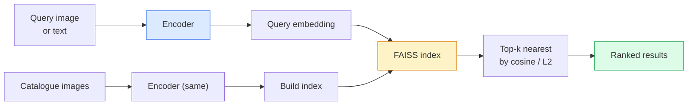

# Image Retrieval & Metric Learning

> Một hệ thống truy xuất xếp hạng ứng viên theo khoảng cách trong không gian embedding. Học metric là kỷ luật định hình không gian đó để các khoảng cách có ý nghĩa bạn muốn.

**Type:** Build
**Languages:** Python
**Prerequisites:** Phase 4 Lesson 14 (ViT), Phase 4 Lesson 18 (CLIP)
**Time:** ~45 minutes

## Learning Objectives

- Giải thích các mất mát học metric bộ ba, tương phản và dựa trên proxy, và chọn đúng loại cho một tập dữ liệu nhất định
- Triển khai chuẩn hóa L2 và độ tương đồng cosine đúng và kiểm tra khác biệt giữa truy xuất "cùng vật" và "cùng lớp"
- Xây chỉ mục FAISS, truy vấn bằng văn bản và hình ảnh, báo cáo recall@K cho tập truy vấn được giữ lại
- Sử dụng DINOv2, CLIP và SigLIP như các backbone embedding có sẵn và biết khi nào mỗi loại thắng

## The Problem

Truy xuất ở mọi nơi trong thị giác production: phát hiện trùng lặp, tìm kiếm ảnh ngược, tìm kiếm thị giác ("tìm sản phẩm tương tự"), tái nhận dạng khuôn mặt, tái nhận dạng người để giám sát, ghép cấp thực thể cho thương mại điện tử. Câu hỏi sản phẩm luôn giống nhau: "với hình ảnh truy vấn này, xếp hạng danh mục của tôi."

Hai quyết định thiết kế định hình toàn hệ thống. Embedding — mô hình nào tạo vector. Chỉ mục — cách tìm láng giềng gần nhất ở quy mô lớn. Cả hai đều phổ thông năm 2026 (DINOv2 cho embedding, FAISS cho chỉ mục), nâng tiêu chuẩn: phần khó là định nghĩa *điều gì được coi là tương tự* cho ứng dụng, rồi định hình không gian embedding để các khoảng cách khớp.

Việc định hình đó là học metric. Đó là một kỷ luật nhỏ nhưng có tác động lớn.

## The Concept

### Retrieval at a glance



### The four loss families

| Mất mát | Yêu cầu | Ưu điểm | Nhược điểm |
|------|----------|------|------|
| **Tương phản** | (neo, dương) + các mẫu âm | Đơn giản, hoạt động với mọi nhãn cặp | Hội tụ chậm nếu không có nhiều mẫu âm |
| **Bộ ba** | (neo, dương, âm) | Trực quan; kiểm soát biên trực tiếp | Khai thác bộ ba khó tốn kém |
| **NT-Xent / InfoNCE** | Các cặp + mẫu âm khai thác trong batch | Mở rộng tới batch lớn | Cần batch lớn hoặc hàng đợi momentum |
| **Dựa trên proxy (ProxyNCA)** | Chỉ nhãn lớp | Nhanh, ổn định, không khai thác | Có thể quá khớp các proxy trên tập dữ liệu nhỏ |

Với hầu hết trường hợp production, bắt đầu bằng backbone được tiền huấn luyện và chỉ thêm tinh chỉnh học metric nếu các embedding có sẵn hoạt động kém trên tập test.

### Triplet loss formally

```
L = max(0, ||f(a) - f(p)||^2 - ||f(a) - f(n)||^2 + margin)
```

Kéo neo `a` gần mẫu dương `p`, đẩy xa mẫu âm `n`, với một `margin` bảo đảm khoảng cách. Cấu trúc ba hình ảnh tổng quát hóa tới mọi thứ tự tương đồng.

Khai thác quan trọng: các bộ ba dễ (`n` đã xa `a`) đóng góp mất mát bằng không; chỉ các bộ ba khó dạy mạng. Khai thác bán khó (`n` xa hơn `p` nhưng trong biên) là công thức FaceNet năm 2016 và vẫn chiếm ưu thế.

### Cosine similarity vs L2

Hai metric, hai quy ước:

- **Cosine**: góc giữa các vector. Cần các embedding chuẩn hóa L2.
- **L2**: khoảng cách Euclid. Hoạt động trên các embedding thô hoặc chuẩn hóa, nhưng thường đi với chuẩn hóa L2 + L2 bình phương.

Với hầu hết mạng hiện đại hai metric tương đương: `||a - b||^2 = 2 - 2 cos(a, b)` khi `||a|| = ||b|| = 1`. Chọn quy ước khớp huấn luyện embedding; trộn chúng âm thầm thay đổi ý nghĩa "gần nhất".

### Recall@K

Thước đo truy xuất tiêu chuẩn:

```
recall@K = fraction of queries where at least one correct match is in the top K results
```

Báo cáo recall@1, @5, @10 cạnh nhau. Recall@10 trên 0.95 với recall@1 dưới 0.5 nghĩa là không gian embedding có cấu trúc đúng nhưng xếp hạng nhiễu — thử tinh chỉnh lâu hơn hoặc bước xếp hạng lại.

Với phát hiện trùng lặp, precision@K quan trọng hơn vì mọi dương tính giả là lỗi người dùng thấy được. Với tìm kiếm thị giác, recall@K là tín hiệu sản phẩm.

### FAISS in one paragraph

Facebook AI Similarity Search. Thư viện mặc nhiên cho tìm kiếm láng giềng gần nhất. Ba lựa chọn chỉ mục:

- `IndexFlatIP` / `IndexFlatL2` — vét cạn, chính xác, không huấn luyện. Dùng tới ~1M vector.
- `IndexIVFFlat` — phân hoạch thành K ô, chỉ tìm vài ô gần nhất. Xấp xỉ, nhanh, cần dữ liệu huấn luyện.
- `IndexHNSW` — dựa trên đồ thị, nhanh nhất cho nhiều truy vấn, kích thước chỉ mục lớn.

Với 100k vector có lẽ bạn muốn `IndexFlatIP` trên độ tương đồng cosine. Với 10M bạn muốn `IndexIVFFlat`. Với 100M+ kết hợp lượng tử hóa tích (`IndexIVFPQ`).

### Instance-level vs category-level retrieval

Hai bài toán rất khác nhau cùng tên:

- **Cấp loại** — "tìm mèo trong danh mục của tôi." Tương đồng có điều kiện lớp; các embedding CLIP / DINOv2 có sẵn hoạt động tốt.
- **Cấp thực thể** — "tìm *đúng sản phẩm này* trong danh mục của tôi." Cần phân biệt tinh giữa các đối tượng nhìn tương tự cùng lớp; embedding có sẵn hoạt động kém; tinh chỉnh bằng học metric quan trọng.

Luôn hỏi bạn đang giải bài toán nào trước khi chọn mô hình.

```figure
metric-embedding
```

## Build It

### Step 1: Triplet loss

```python
import torch
import torch.nn.functional as F

def triplet_loss(anchor, positive, negative, margin=0.2):
    d_ap = F.pairwise_distance(anchor, positive, p=2)
    d_an = F.pairwise_distance(anchor, negative, p=2)
    return F.relu(d_ap - d_an + margin).mean()
```

Một dòng. Hoạt động trên embedding chuẩn hóa L2 hoặc thô.

### Step 2: Semi-hard mining

Với một batch embedding và nhãn, tìm mẫu âm bán khó khó nhất cho mỗi neo.

```python
def semi_hard_negatives(emb, labels, margin=0.2):
    dist = torch.cdist(emb, emb)
    same_class = labels[:, None] == labels[None, :]
    diff_class = ~same_class
    N = emb.size(0)

    positives = dist.clone()
    positives[~same_class] = float("-inf")
    positives.fill_diagonal_(float("-inf"))
    pos_idx = positives.argmax(dim=1)

    semi_hard = dist.clone()
    semi_hard[same_class] = float("inf")
    d_ap = dist[torch.arange(N), pos_idx].unsqueeze(1)
    semi_hard[dist <= d_ap] = float("inf")
    neg_idx = semi_hard.argmin(dim=1)

    fallback_mask = semi_hard[torch.arange(N), neg_idx] == float("inf")
    if fallback_mask.any():
        hardest = dist.clone()
        hardest[same_class] = float("inf")
        neg_idx = torch.where(fallback_mask, hardest.argmin(dim=1), neg_idx)
    return pos_idx, neg_idx
```

Mỗi neo có mẫu dương khó nhất cùng lớp và mẫu âm bán khó xa hơn mẫu dương nhưng trong biên.

### Step 3: Recall@K

```python
def recall_at_k(query_emb, gallery_emb, query_labels, gallery_labels, k=1):
    sim = query_emb @ gallery_emb.T
    _, top_k = sim.topk(k, dim=-1)
    matches = (gallery_labels[top_k] == query_labels[:, None]).any(dim=-1)
    return matches.float().mean().item()
```

Top-k theo tích vô hướng trên embedding chuẩn hóa L2 bằng top-k theo cosine. Báo cáo tỷ lệ trung bình các truy vấn có ít nhất một láng giềng đúng.

### Step 4: Putting it together

```python
import torch
import torch.nn as nn
from torch.optim import Adam

class Encoder(nn.Module):
    def __init__(self, in_dim=128, emb_dim=64):
        super().__init__()
        self.net = nn.Sequential(
            nn.Linear(in_dim, 128), nn.ReLU(),
            nn.Linear(128, emb_dim),
        )

    def forward(self, x):
        return F.normalize(self.net(x), dim=-1)

torch.manual_seed(0)
num_classes = 6
protos = F.normalize(torch.randn(num_classes, 128), dim=-1)

def sample_batch(bs=32):
    labels = torch.randint(0, num_classes, (bs,))
    x = protos[labels] + 0.15 * torch.randn(bs, 128)
    return x, labels

enc = Encoder()
opt = Adam(enc.parameters(), lr=3e-3)

for step in range(200):
    x, y = sample_batch(32)
    emb = enc(x)
    pos_idx, neg_idx = semi_hard_negatives(emb, y)
    loss = triplet_loss(emb, emb[pos_idx], emb[neg_idx])
    opt.zero_grad(); loss.backward(); opt.step()
```

Sau vài trăm bước các cụm embedding tạo thành một cụm mỗi lớp.

## Use It

Các bộ công cụ production năm 2026:

- **DINOv2 + FAISS** — truy xuất thị giác đa dụng. Hoạt động sẵn có.
- **CLIP + FAISS** — khi truy vấn là văn bản.
- **DINOv2 được tinh chỉnh + FAISS** — truy xuất cấp thực thể, tái nhận dạng khuôn mặt, thời trang, thương mại điện tử.
- **Milvus / Weaviate / Qdrant** — các lớp bọc cơ sở dữ liệu vector được quản lý quanh FAISS hoặc HNSW.

Cho truy xuất thực thể SOTA, công thức là: backbone DINOv2, thêm đầu embedding, tinh chỉnh bằng mất mát bộ ba hoặc InfoNCE trên các cặp gán nhãn thực thể, lập chỉ mục trong FAISS.

## Ship It

Bài học này tạo ra:

- `outputs/prompt-retrieval-loss-picker.md` — một prompt chọn bộ ba / InfoNCE / ProxyNCA cho một bài toán truy xuất nhất định.
- `outputs/skill-recall-at-k-runner.md` — một skill viết bộ đánh giá gọn cho recall@K với các tập chia huấn luyện/validation/gallery và hợp đồng dữ liệu đúng.

## Exercises

1. **(Dễ)** Chạy ví dụ đồ chơi trên. Vẽ các embedding bằng PCA trước và sau huấn luyện để thấy sáu cụm hình thành.
2. **(Vừa)** Thêm bản triển khai mất mát ProxyNCA: một "proxy" được học mỗi lớp, cross-entropy tiêu chuẩn trên độ tương đồng cosine. So sánh tốc độ hội tụ với mất mát bộ ba trên dữ liệu đồ chơi.
3. **(Khó)** Lấy 1,000 hình ảnh validation ImageNet, embedding bằng DINOv2 qua HuggingFace, xây chỉ mục phẳng FAISS và báo cáo recall@{1, 5, 10} với cùng các hình ảnh làm truy vấn (nên là 1.0) và với tập chia được giữ lại có nhãn ImageNet làm sự thật nền.

## Key Terms

| Thuật ngữ | Cách mọi người nói | Ý nghĩa thực sự |
|------|----------------|----------------------|
| Metric learning (Học metric) | "Định hình không gian" | Huấn luyện encoder để khoảng cách trong không gian đầu ra phản ánh độ tương đồng đích |
| Triplet loss (Mất mát bộ ba) | "Kéo và đẩy" | L = max(0, d(a, p) - d(a, n) + margin); mất mát học metric chuẩn |
| Semi-hard mining (Khai thác bán khó) | "Các mẫu âm hữu ích" | Các mẫu âm xa neo hơn mẫu dương nhưng trong biên; nhiều thông tin nhất theo thực nghiệm |
| Proxy-based loss (Mất mát dựa trên proxy) | "Các nguyên mẫu lớp" | Một proxy được học mỗi lớp; cross-entropy trên tương đồng-với-proxy; không khai thác cặp |
| Recall@K | "Tỷ lệ trúng top-K" | Tỷ lệ truy vấn có ít nhất một kết quả đúng trong K kết quả đầu |
| Instance retrieval (Truy xuất thực thể) | "Tìm đúng thứ này" | Ghép tinh; các đặc trưng có sẵn thường hoạt động kém |
| FAISS | "Thư viện NN" | Thư viện láng giềng gần nhất của Facebook; hỗ trợ chỉ mục chính xác và xấp xỉ |
| HNSW | "Chỉ mục đồ thị" | Thế giới nhỏ điều hướng phân cấp; NN xấp xỉ nhanh với chi phí bộ nhớ phụ nhỏ |

## Further Reading

- [FaceNet: A Unified Embedding for Face Recognition (Schroff et al., 2015)](https://arxiv.org/abs/1503.03832) — bài báo mất mát bộ ba / khai thác bán khó
- [In Defense of the Triplet Loss for Person Re-Identification (Hermans et al., 2017)](https://arxiv.org/abs/1703.07737) — hướng dẫn thực tế về tinh chỉnh bộ ba
- [FAISS documentation](https://github.com/facebookresearch/faiss/wiki) — mọi chỉ mục, mọi đánh đổi
- [SMoT: Metric Learning Taxonomy (Kim et al., 2021)](https://arxiv.org/abs/2010.06927) — khảo sát các mất mát hiện đại và liên hệ của chúng
