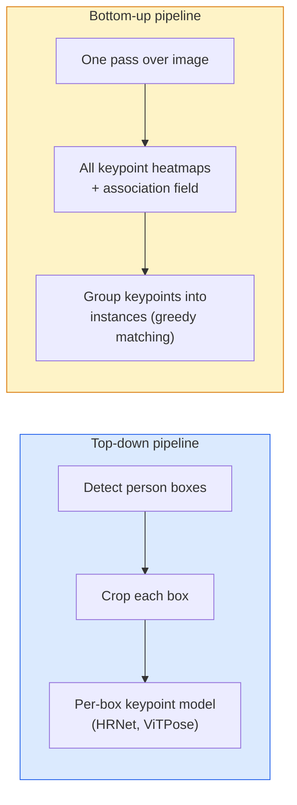

# Keypoint Detection & Pose Estimation

> Một tư thế là một tập điểm đặc trưng có thứ tự. Một bộ phát hiện điểm đặc trưng là một bộ hồi quy bản đồ nhiệt. Mọi thứ khác là công việc ghi sổ.

**Type:** Build
**Languages:** Python
**Prerequisites:** Phase 4 Lesson 06 (Detection), Phase 4 Lesson 07 (U-Net)
**Time:** ~45 minutes

## Learning Objectives

- Phân biệt ước lượng tư thế từ trên xuống và từ dưới lên, và nêu khi nào mỗi cách được dùng
- Hồi quy các bản đồ nhiệt cho K điểm đặc trưng với mục tiêu Gaussian mỗi điểm và trích xuất tọa độ điểm khi suy luận
- Giải thích Part Affinity Fields (PAF) và cách các pipeline từ dưới lên liên kết điểm đặc trưng thành thực thể
- Sử dụng MediaPipe Pose hoặc MMPose để ước lượng điểm đặc trưng production và hiểu định dạng đầu ra

## The Problem

Các tác vụ điểm đặc trưng ẩn dưới nhiều tên: tư thế người (17 khớp cơ thể), mốc khuôn mặt (68 hoặc 478 điểm), bàn tay (21 điểm), tư thế động vật, tư thế đối tượng robot, mốc giải phẫu y tế. Mọi tác vụ có cùng cấu trúc: phát hiện K điểm rời rạc trên một đối tượng và xuất tọa độ (x, y).

Ước lượng tư thế là nền tảng của ghi chuyển động, ứng dụng thể hình, phân tích thể thao, điều khiển cử chỉ, hoạt hình, thử đồ AR và nắm bắt robot. Trường hợp 2D đã trưởng thành; tư thế 3D (ước lượng vị trí khớp trong tọa độ thế giới từ một máy ảnh) là biên nghiên cứu hiện tại.

Câu hỏi kỹ thuật là quy mô. Tư thế một ảnh, một người là bài toán 20ms. Tư thế nhiều người trong đám đông ở 30 fps là bài toán khác với kiến trúc khác.

## The Concept

### Top-down vs bottom-up



- **Từ trên xuống** — phát hiện người trước, rồi chạy mô hình điểm đặc trưng từng người trên mỗi vùng cắt. Accuracy cao nhất; tăng tuyến tính với số người.
- **Từ dưới lên** — một lượt truyền xuôi dự đoán mọi điểm đặc trưng cộng trường liên kết; nhóm chúng. Thời gian hằng bất kể kích thước đám đông.

Từ trên xuống (HRNet, ViTPose) dẫn đầu accuracy; từ dưới lên (OpenPose, HigherHRNet) dẫn đầu thông lượng cho cảnh đông người.

### Heatmap regression

Thay vì hồi quy `(x, y)` trực tiếp, dự đoán một bản đồ nhiệt `H x W` mỗi điểm với đốm Gaussian đặt tâm tại vị trí thật.

```math
\text{target}[k, y, x] = \exp\left(-\frac{(x - \mathit{cx}_k)^2 + (y - \mathit{cy}_k)^2}{2 \sigma^2}\right)
```

Khi suy luận, argmax của mỗi bản đồ nhiệt là vị trí điểm đặc trưng dự đoán.

Tại sao bản đồ nhiệt hoạt động tốt hơn hồi quy trực tiếp: cấu trúc không gian mạng (bản đồ đặc trưng tích chập) tự nhiên khớp đầu ra không gian. Các mục tiêu Gaussian cũng chính quy hóa — sai số định vị nhỏ tạo mất mát nhỏ, không phải không.

### Sub-pixel localisation

Argmax cho các tọa độ nguyên. Để đạt độ chính xác dưới pixel, tinh chỉnh bằng cách khớp một parabol với argmax và các láng giềng của nó, hoặc dịch argmax về phía láng giềng cao hơn bằng `dx = 0.25 * (heatmap[y, x+1] - heatmap[y, x-1])` và tương tự cho `dy`, như mã thực hiện.

### Part Affinity Fields (PAFs)

Thủ thuật OpenPose cho liên kết từ dưới lên. Với mỗi cặp điểm được nối (ví dụ vai trái tới khuỷu trái), dự đoán một trường 2 kênh mã hóa vector đơn vị chỉ từ điểm này tới điểm kia. Để liên kết vai với khuỷu của nó, tích phân PAF dọc đường nối các cặp ứng viên; cặp có tích phân cao nhất được ghép.

```
For each connection (limb):
  PAF channels: 2 (unit vector x, y)
  Line integral: sum over sample points of (PAF . line_direction)
  Higher integral = stronger match
```

Thanh nhã và mở rộng tới kích thước đám đông tùy ý mà không cần vùng cắt từng người.

### COCO keypoints

Tập dữ liệu tư thế cơ thể tiêu chuẩn: 17 điểm mỗi người, PCK (Phần trăm Điểm đặc trưng Đúng) và OKS (Độ tương đồng Điểm đặc trưng Đối tượng) làm thước đo. OKS là tương đương IoU cho điểm đặc trưng và là thứ COCO mAP@OKS báo cáo.

### 2D vs 3D

- **Tư thế 2D** — tọa độ hình ảnh; đã giải ở chất lượng production (MediaPipe, HRNet, ViTPose).
- **Tư thế 3D** — tọa độ thế giới / máy ảnh; vẫn nghiên cứu tích cực. Các cách phổ biến:
  - Nâng dự đoán 2D lên 3D bằng một MLP nhỏ (VideoPose3D).
  - Hồi quy 3D trực tiếp từ hình ảnh (PyMAF, MHFormer).
  - Các thiết lập nhiều góc nhìn (CMU Panoptic) cho sự thật nền.

```figure
cv3-pose-heatmap
```

## Build It

### Step 1: Gaussian heatmap target

```python
import numpy as np
import torch

def gaussian_heatmap(size, cx, cy, sigma=2.0):
    yy, xx = np.meshgrid(np.arange(size), np.arange(size), indexing="ij")
    return np.exp(-((xx - cx) ** 2 + (yy - cy) ** 2) / (2 * sigma ** 2)).astype(np.float32)

hm = gaussian_heatmap(64, 32, 32, sigma=2.0)
print(f"peak: {hm.max():.3f} at ({hm.argmax() % 64}, {hm.argmax() // 64})")
```

Các bản đồ nhiệt từng điểm xếp dọc trục kênh cho tensor mục tiêu đầy đủ.

### Step 2: Tiny keypoint head

Một mô hình kiểu U-Net xuất K kênh bản đồ nhiệt.

```python
import torch.nn as nn
import torch.nn.functional as F

class TinyKeypointNet(nn.Module):
    def __init__(self, num_keypoints=4, base=16):
        super().__init__()
        self.down1 = nn.Sequential(nn.Conv2d(3, base, 3, 2, 1), nn.ReLU(inplace=True))
        self.down2 = nn.Sequential(nn.Conv2d(base, base * 2, 3, 2, 1), nn.ReLU(inplace=True))
        self.mid = nn.Sequential(nn.Conv2d(base * 2, base * 2, 3, 1, 1), nn.ReLU(inplace=True))
        self.up1 = nn.ConvTranspose2d(base * 2, base, 2, 2)
        self.up2 = nn.ConvTranspose2d(base, num_keypoints, 2, 2)

    def forward(self, x):
        h1 = self.down1(x)
        h2 = self.down2(h1)
        h3 = self.mid(h2)
        u1 = self.up1(h3)
        return self.up2(u1)
```

Đầu vào `(N, 3, H, W)`, đầu ra `(N, K, H, W)`. Mất mát là MSE từng pixel so với mục tiêu Gaussian.

### Step 3: Inference — extract keypoint coordinates

```python
def heatmap_to_coords(heatmaps):
    """
    heatmaps: (N, K, H, W)
    returns:  (N, K, 2) float coordinates in image pixels
    """
    N, K, H, W = heatmaps.shape
    hm = heatmaps.reshape(N, K, -1)
    idx = hm.argmax(dim=-1)
    ys = (idx // W).float()
    xs = (idx % W).float()
    return torch.stack([xs, ys], dim=-1)

coords = heatmap_to_coords(torch.randn(2, 4, 32, 32))
print(f"coords: {coords.shape}")  # (2, 4, 2)
```

Một dòng lúc suy luận. Để tinh chỉnh dưới pixel, nội suy quanh argmax.

### Step 4: Synthetic keypoint dataset

Đơn giản: vẽ bốn điểm trên nền trắng và học dự đoán chúng.

```python
def make_synthetic_sample(size=64):
    img = np.ones((3, size, size), dtype=np.float32)
    rng = np.random.default_rng()
    kps = rng.integers(8, size - 8, size=(4, 2))
    for cx, cy in kps:
        img[:, cy - 2:cy + 2, cx - 2:cx + 2] = 0.0
    hms = np.stack([gaussian_heatmap(size, cx, cy) for cx, cy in kps])
    return img, hms, kps
```

Đủ dễ để một mô hình rất nhỏ học trong một phút.

### Step 5: Training

```python
model = TinyKeypointNet(num_keypoints=4)
opt = torch.optim.Adam(model.parameters(), lr=3e-3)

for step in range(200):
    batch = [make_synthetic_sample() for _ in range(16)]
    imgs = torch.from_numpy(np.stack([b[0] for b in batch]))
    hms = torch.from_numpy(np.stack([b[1] for b in batch]))
    pred = model(imgs)
    # Upsample pred to full resolution
    pred = F.interpolate(pred, size=hms.shape[-2:], mode="bilinear", align_corners=False)
    loss = F.mse_loss(pred, hms)
    opt.zero_grad(); loss.backward(); opt.step()
```

## Use It

- **MediaPipe Pose** — bộ ước lượng tư thế production của Google; cung cấp runtime WebGL + di động với độ trễ dưới 10ms.
- **MMPose** (OpenMMLab) — cơ sở mã nghiên cứu toàn diện; mọi kiến trúc SOTA với trọng số được tiền huấn luyện.
- **YOLOv8-pose** — tư thế nhiều người thời gian thực nhanh nhất với một lượt truyền xuôi duy nhất.
- **transformers HumanDPT / PoseAnything** — các cách tiếp cận thị giác-ngôn ngữ mới hơn cho tư thế từ vựng mở (mọi đối tượng, mọi tập điểm).

## Ship It

Bài học này tạo ra:

- `outputs/prompt-pose-stack-picker.md` — một prompt chọn MediaPipe / YOLOv8-pose / HRNet / ViTPose với độ trễ, kích thước đám đông và nhu cầu 2D so với 3D cho trước.
- `outputs/skill-heatmap-to-coords.md` — một skill viết quy trình bản đồ nhiệt-sang-tọa độ dưới pixel dùng bởi mọi mô hình tư thế production.

## Exercises

1. **(Dễ)** Huấn luyện mô hình điểm nhỏ trên tập dữ liệu tổng hợp 4 điểm. Báo cáo sai số L2 trung bình giữa các điểm dự đoán và thật sau 200 bước.
2. **(Vừa)** Thêm tinh chỉnh dưới pixel: với vị trí argmax cho trước, khớp một parabol 1D dọc x và y từ các pixel lân cận. Báo cáo mức tăng accuracy so với argmax nguyên.
3. **(Khó)** Xây tập dữ liệu tổng hợp 2 người, mỗi ảnh có hai thực thể của mẫu 4 điểm. Huấn luyện pipeline từ dưới lên với các PAF dự đoán điểm nào thuộc thực thể nào, và đánh giá OKS.

## Key Terms

| Thuật ngữ | Cách mọi người nói | Ý nghĩa thực sự |
|------|----------------|----------------------|
| Keypoint (Điểm đặc trưng) | "Một mốc" | Một điểm có thứ tự cụ thể trên một đối tượng (khớp, góc, đặc trưng) |
| Pose (Tư thế) | "Bộ xương" | Một tập điểm đặc trưng có thứ tự thuộc một thực thể |
| Top-down (Từ trên xuống) | "Phát hiện rồi tư thế" | Pipeline hai giai đoạn: bộ phát hiện người + mô hình điểm từng vùng cắt; accuracy cao nhất |
| Bottom-up (Từ dưới lên) | "Tư thế trước, nhóm sau" | Dự đoán mọi điểm một lượt + nhóm; thời gian hằng theo kích thước đám đông |
| Heatmap (Bản đồ nhiệt) | "Mục tiêu Gaussian" | Tensor H x W mỗi điểm với đỉnh tại vị trí thật; mục tiêu hồi quy được ưu tiên |
| PAF | "Part Affinity Field" | Trường vector đơn vị 2 kênh mã hóa hướng chi; dùng nhóm điểm thành thực thể |
| OKS | "IoU điểm đặc trưng" | Object Keypoint Similarity; thước đo COCO cho tư thế |
| HRNet | "High-Resolution Net" | Kiến trúc điểm đặc trưng từ trên xuống chiếm ưu thế; giữ đặc trưng độ phân giải cao xuyên suốt |

## Further Reading

- [OpenPose (Cao et al., 2017)](https://arxiv.org/abs/1812.08008) — từ dưới lên với PAF; vẫn là trình bày tốt nhất về cách tiếp cận
- [HRNet (Sun et al., 2019)](https://arxiv.org/abs/1902.09212) — kiến trúc tham chiếu từ trên xuống
- [ViTPose (Xu et al., 2022)](https://arxiv.org/abs/2204.12484) — ViT thông thường làm backbone tư thế; SOTA hiện tại trên nhiều benchmark
- [MediaPipe Pose](https://developers.google.com/mediapipe/solutions/vision/pose_landmarker) — tư thế thời gian thực production; bộ công cụ triển khai nhanh nhất năm 2026
