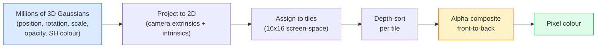

# 3D Gaussian Splatting from Scratch

> Một cảnh là một đám mây hàng triệu Gaussian 3D. Mỗi Gaussian có vị trí, hướng, tỷ lệ, độ đục và màu phụ thuộc hướng nhìn. Raster hóa chúng, lan truyền ngược qua raster hóa, xong.

**Type:** Build
**Languages:** Python
**Prerequisites:** Phase 4 Lesson 13 (3D Vision & NeRF), Phase 1 Lesson 12 (Tensor Operations), Phase 4 Lesson 10 (Diffusion basics optional)
**Time:** ~90 minutes

## Learning Objectives

- Giải thích tại sao 3D Gaussian Splatting thay NeRF làm mặc định production cho tái tạo 3D chân thực như ảnh năm 2026
- Nêu sáu tham số mỗi Gaussian (vị trí, quaternion xoay, tỷ lệ, độ đục, màu điều hòa cầu, đặc trưng tùy chọn) và số float mỗi tham số đóng góp
- Triển khai bộ raster hóa Gaussian splatting 2D từ đầu bằng tổng hợp `alpha`, rồi cho thấy trường hợp 3D chiếu về cùng vòng lặp
- Sử dụng `nerfstudio`, `gsplat` hoặc `SuperSplat` để tái tạo cảnh từ 20-50 ảnh và xuất sang phần mở rộng glTF `KHR_gaussian_splatting` hoặc schema `UsdVolParticleField3DGaussianSplat` của OpenUSD 26.03

## The Problem

Một NeRF lưu cảnh như các trọng số MLP. Mỗi pixel kết xuất là hàng trăm truy vấn MLP dọc một tia. Huấn luyện mất hàng giờ, kết xuất mất vài giây và các trọng số không thể chỉnh sửa — nếu muốn di chuyển một ghế trong cảnh, bạn phải huấn luyện lại.

3D Gaussian Splatting (Kerbl, Kopanas, Leimkühler, Drettakis, SIGGRAPH 2023) thay tất cả điều đó. Một cảnh là tập tường minh các Gaussian 3D. Kết xuất là raster hóa GPU ở 100+ fps. Huấn luyện mất vài phút. Chỉnh sửa trực tiếp: tịnh tiến một tập con Gaussian và bạn đã di chuyển ghế. Đến năm 2026 Khronos Group đã phê chuẩn phần mở rộng glTF cho Gaussian splat, OpenUSD 26.03 cung cấp schema Gaussian splat, Zillow và Apartments.com kết xuất bất động sản bằng chúng, và hầu hết bài báo nghiên cứu mới về tái tạo 3D là biến thể ý tưởng 3DGS cốt lõi.

Mô hình tư duy đơn giản, toán học có đủ nhiều thành phần chuyển động khiến hầu hết phần giới thiệu bắt đầu ở raster hóa và bỏ qua các phép chiếu và điều hòa cầu. Bài này xây toàn bộ — phiên bản 2D trước, rồi mở rộng 3D.

## The Concept

### What a Gaussian carries

Một Gaussian 3D là một đốm tham số trong không gian có các thuộc tính này:

```
position         mu         (3,)    centre in world coordinates
rotation         q          (4,)    unit quaternion encoding orientation
scale            s          (3,)    log-scales per axis (exponentiated at render time)
opacity          alpha      (1,)    post-sigmoid opacity [0, 1]
SH coefficients  c_lm       (3 * (L+1)^2,)   view-dependent colour
```

Xoay + tỷ lệ xây một hiệp phương sai 3x3: `Sigma = R S S^T R^T`. Đó là hình dạng Gaussian trong 3D. Điều hòa cầu cho phép màu thay đổi theo hướng nhìn — điểm sáng phản chiếu, ánh bóng nhẹ, phát sáng phụ thuộc góc nhìn — mà không lưu kết cấu từng góc nhìn. Với bậc SH 3 bạn có 16 hệ số mỗi kênh màu, 48 float mỗi Gaussian chỉ cho màu.

Một cảnh thường có 1-5 triệu Gaussian. Mỗi Gaussian lưu khoảng 60 float (3 + 4 + 3 + 1 + 48 + phụ). Đó là 240 MB cho cảnh năm triệu Gaussian — nhỏ hơn nhiều đám mây điểm tương đương với kết cấu từng điểm, và nhỏ hơn một bậc độ lớn so với trọng số MLP NeRF được kết xuất lại ở độ phân giải cao.

### Rasterisation, not ray marching



Năm bước, tất cả thân thiện GPU. Không truy vấn MLP mỗi pixel. Một RTX 3080 Ti duy nhất kết xuất 6 triệu splat ở 147 fps.

### The projection step

Gaussian 3D ở vị trí thế giới `mu` với hiệp phương sai 3D `Sigma` chiếu thành Gaussian 2D ở vị trí màn hình `mu'` với hiệp phương sai 2D `Sigma'`:

```
mu' = project(mu)
Sigma' = J W Sigma W^T J^T          (2 x 2)

W = viewing transform (rotation + translation of camera)
J = Jacobian of the perspective projection at mu'
```

Dấu phủ Gaussian 2D là một ellipse có các trục là vector riêng của `Sigma'`. Mọi pixel trong ellipse nhận đóng góp Gaussian, có trọng số `exp(-0.5 * (p - mu')^T Sigma'^-1 (p - mu'))`.

### The alpha-compositing rule

Với một pixel, các Gaussian phủ nó được sắp từ sau ra trước (hoặc tương đương từ trước ra sau với công thức đảo). Màu được tổng hợp bằng cùng phương trình như mọi bộ raster hóa bán trong suốt từ thập niên 1980:

```
C_pixel = sum_i alpha_i * T_i * c_i

T_i = prod_{j < i} (1 - alpha_j)       transmittance up to i
alpha_i = opacity_i * exp(-0.5 * d^T Sigma'^-1 d)   local contribution
c_i = eval_SH(SH_i, view_direction)    view-dependent colour
```

Đây là **cùng phương trình như kết xuất thể tích NeRF**, chỉ trên tập Gaussian thưa tường minh thay các mẫu dày đặc dọc tia. Sự đồng nhất đó là lý do chất lượng kết xuất khớp NeRF — cả hai tích phân cùng phương trình trường bức xạ.

### Why this is differentiable

Mọi bước — chiếu, gán ô, tổng hợp alpha, tính SH — khả vi theo các tham số Gaussian. Với hình ảnh sự thật nền, tính mất mát pixel kết xuất, lan truyền ngược qua bộ raster hóa, cập nhật mọi `(mu, q, s, alpha, c_lm)` bằng hạ gradient. Qua ~30,000 lần lặp các Gaussian tìm vị trí, tỷ lệ và màu đúng.

### Densification and pruning

Một tập Gaussian cố định không thể phủ một cảnh phức tạp. Huấn luyện gồm hai cơ chế thích nghi:

- **Nhân bản** một Gaussian tại vị trí hiện tại khi độ lớn gradient cao nhưng tỷ lệ nhỏ — tái tạo cần thêm chi tiết ở đây.
- **Tách** một Gaussian tỷ lệ lớn thành hai Gaussian nhỏ hơn khi gradient cao — một Gaussian lớn quá mượt để khớp vùng.
- **Cắt tỉa** các Gaussian có độ đục giảm dưới ngưỡng — chúng không đóng góp.

Làm dày chạy mỗi N lần lặp. Một cảnh thường tăng từ ~100k Gaussian ban đầu (khởi tạo từ các điểm SfM) tới 1-5M ở cuối huấn luyện.

### Spherical harmonics in one paragraph

Màu phụ thuộc hướng nhìn là hàm `c(direction)` trên mặt cầu đơn vị. Điều hòa cầu là cơ sở Fourier của mặt cầu. Cắt ở bậc `L` và bạn có `(L+1)^2` hàm cơ sở mỗi kênh. Tính màu cho góc nhìn mới là tích vô hướng giữa các hệ số SH được học và cơ sở tính tại hướng nhìn. Bậc 0 = một hệ số = màu hằng. Bậc 3 = 16 hệ số = đủ để nắm bắt đổ bóng Lambert, phản chiếu và phản xạ nhẹ. Các bài báo SD Gaussian Splatting mặc định dùng bậc 3.

### The 2026 production stack

```
1. Capture         smartphone / DJI drone / handheld scanner
2. SfM / MVS       COLMAP or GLOMAP derives camera poses + sparse points
3. Train 3DGS      nerfstudio / gsplat / inria official / PostShot (~10-30 min on RTX 4090)
4. Edit            SuperSplat / SplatForge (clean floaters, segment)
5. Export          .ply -> glTF KHR_gaussian_splatting or .usd (OpenUSD 26.03)
6. View            Cesium / Unreal / Babylon.js / Three.js / Vision Pro
```

### 4D and generative variants

- **4D Gaussian Splatting** — các Gaussian là hàm thời gian; dùng cho video thể tích (Superman 2026, "Helicopter" của A$AP Rocky).
- **Splat tạo sinh** — các mô hình văn bản-sang-splat (Marble của World Labs) ảo giác toàn bộ cảnh.
- **3D Gaussian Unscented Transform** — biến thể của NVIDIA NuRec cho mô phỏng lái xe tự hành.

```figure
cv3-gaussian-splat
```

## Build It

### Step 1: A 2D Gaussian

Trước tiên xây bộ raster hóa 2D. Trường hợp 3D rút về nó sau chiếu.

```python
import torch
import torch.nn as nn
import torch.nn.functional as F


def eval_2d_gaussian(means, covs, points):
    """
    means:  (G, 2)      centres
    covs:   (G, 2, 2)   covariance matrices
    points: (H, W, 2)   pixel coordinates
    returns: (G, H, W)  density at every pixel for every Gaussian
    """
    G = means.size(0)
    H, W, _ = points.shape
    flat = points.view(-1, 2)
    inv = torch.linalg.inv(covs)
    diff = flat[None, :, :] - means[:, None, :]
    d = torch.einsum("gpi,gij,gpj->gp", diff, inv, diff)
    density = torch.exp(-0.5 * d)
    return density.view(G, H, W)
```

`einsum` tính dạng toàn phương `diff^T Sigma^-1 diff` cho mọi cặp (Gaussian, pixel).

### Step 2: 2D splatting rasteriser

Tổng hợp alpha từ trước ra sau. Độ sâu trong 2D vô nghĩa, nên dùng số vô hướng được học mỗi Gaussian cho thứ tự.

```python
def rasterise_2d(means, covs, colours, opacities, depths, image_size):
    """
    means:     (G, 2)
    covs:      (G, 2, 2)
    colours:   (G, 3)
    opacities: (G,)     in [0, 1]
    depths:    (G,)     per-Gaussian scalar used for ordering
    image_size: (H, W)
    returns:   (H, W, 3) rendered image
    """
    H, W = image_size
    yy, xx = torch.meshgrid(
        torch.arange(H, dtype=torch.float32, device=means.device),
        torch.arange(W, dtype=torch.float32, device=means.device),
        indexing="ij",
    )
    points = torch.stack([xx, yy], dim=-1)

    densities = eval_2d_gaussian(means, covs, points)
    alphas = opacities[:, None, None] * densities
    alphas = alphas.clamp(0.0, 0.99)

    order = torch.argsort(depths)
    alphas = alphas[order]
    colours_sorted = colours[order]

    T = torch.ones(H, W, device=means.device)
    out = torch.zeros(H, W, 3, device=means.device)
    for i in range(means.size(0)):
        a = alphas[i]
        out += (T * a)[..., None] * colours_sorted[i][None, None, :]
        T = T * (1.0 - a)
    return out
```

Không nhanh — bản triển khai thật dùng các kernel CUDA dựa trên ô — nhưng toán học hoàn toàn đúng và khả vi đầy đủ.

### Step 3: A trainable 2D splat scene

```python
class Splats2D(nn.Module):
    def __init__(self, num_splats=128, image_size=64, seed=0):
        super().__init__()
        g = torch.Generator().manual_seed(seed)
        H, W = image_size, image_size
        self.means = nn.Parameter(torch.rand(num_splats, 2, generator=g) * torch.tensor([W, H]))
        self.log_scale = nn.Parameter(torch.ones(num_splats, 2) * math.log(2.0))
        self.rot = nn.Parameter(torch.zeros(num_splats))  # single angle in 2D
        self.colour_logits = nn.Parameter(torch.randn(num_splats, 3, generator=g) * 0.5)
        self.opacity_logit = nn.Parameter(torch.zeros(num_splats))
        self.depth = nn.Parameter(torch.rand(num_splats, generator=g))

    def covs(self):
        s = torch.exp(self.log_scale)
        c, si = torch.cos(self.rot), torch.sin(self.rot)
        R = torch.stack([
            torch.stack([c, -si], dim=-1),
            torch.stack([si, c], dim=-1),
        ], dim=-2)
        S = torch.diag_embed(s ** 2)
        return R @ S @ R.transpose(-1, -2)

    def forward(self, image_size):
        covs = self.covs()
        colours = torch.sigmoid(self.colour_logits)
        opacities = torch.sigmoid(self.opacity_logit)
        return rasterise_2d(self.means, covs, colours, opacities, self.depth, image_size)
```

`log_scale`, `opacity_logit` và `colour_logits` đều là các tham số không ràng buộc ánh xạ qua kích hoạt đúng khi kết xuất. Đây là mẫu tiêu chuẩn cho mọi bản triển khai 3DGS.

### Step 4: Fit 2D Gaussians to a target image

```python
import math
import numpy as np

def make_target(size=64):
    yy, xx = np.meshgrid(np.arange(size), np.arange(size), indexing="ij")
    img = np.zeros((size, size, 3), dtype=np.float32)
    # Red circle
    mask = (xx - 20) ** 2 + (yy - 20) ** 2 < 10 ** 2
    img[mask] = [1.0, 0.2, 0.2]
    # Blue square
    mask = (np.abs(xx - 45) < 8) & (np.abs(yy - 40) < 8)
    img[mask] = [0.2, 0.3, 1.0]
    return torch.from_numpy(img)


target = make_target(64)
model = Splats2D(num_splats=64, image_size=64)
opt = torch.optim.Adam(model.parameters(), lr=0.05)

for step in range(200):
    pred = model((64, 64))
    loss = F.mse_loss(pred, target)
    opt.zero_grad(); loss.backward(); opt.step()
    if step % 40 == 0:
        print(f"step {step:3d}  mse {loss.item():.4f}")
```

Qua 200 bước 64 Gaussian ổn định thành hai hình dạng. Đó là toàn bộ ý tưởng — hạ gradient trên các thành phần hình học tường minh.

### Step 5: From 2D to 3D

Mở rộng 3D giữ cùng vòng lặp. Các bổ sung:

1. Xoay từng Gaussian là quaternion thay vì góc đơn.
2. Hiệp phương sai là `R S S^T R^T` với `R` xây từ quaternion và `S = diag(exp(log_scale))`.
3. Phép chiếu `(mu, Sigma) -> (mu', Sigma')` dùng ngoại tại máy ảnh và Jacobian của phép chiếu phối cảnh tại `mu`.
4. Màu trở thành khai triển điều hòa cầu; tính tại hướng nhìn.
5. Sắp xếp độ sâu từ z thật trong không gian máy ảnh thay số vô hướng được học.

Mọi bản triển khai production (`gsplat`, `inria/gaussian-splatting`, `nerfstudio`) làm đúng điều này trên GPU bằng kernel CUDA dựa trên ô.

### Step 6: Spherical harmonics evaluation

Cơ sở SH tới bậc 3 có 16 số hạng mỗi kênh. Cách tính:

```python
def eval_sh_degree_3(sh_coeffs, dirs):
    """
    sh_coeffs: (..., 16, 3)   last dim is RGB channels
    dirs:      (..., 3)       unit vectors
    returns:   (..., 3)
    """
    C0 = 0.282094791773878
    C1 = 0.488602511902920
    C2 = [1.092548430592079, 1.092548430592079,
          0.315391565252520, 1.092548430592079,
          0.546274215296039]
    x, y, z = dirs[..., 0], dirs[..., 1], dirs[..., 2]
    x2, y2, z2 = x * x, y * y, z * z
    xy, yz, xz = x * y, y * z, x * z

    result = C0 * sh_coeffs[..., 0, :]
    result = result - C1 * y[..., None] * sh_coeffs[..., 1, :]
    result = result + C1 * z[..., None] * sh_coeffs[..., 2, :]
    result = result - C1 * x[..., None] * sh_coeffs[..., 3, :]

    result = result + C2[0] * xy[..., None] * sh_coeffs[..., 4, :]
    result = result + C2[1] * yz[..., None] * sh_coeffs[..., 5, :]
    result = result + C2[2] * (2.0 * z2 - x2 - y2)[..., None] * sh_coeffs[..., 6, :]
    result = result + C2[3] * xz[..., None] * sh_coeffs[..., 7, :]
    result = result + C2[4] * (x2 - y2)[..., None] * sh_coeffs[..., 8, :]

    # degree 3 terms omitted here for brevity; full 16-coefficient version in the code file
    return result
```

Các `sh_coeffs` được học lưu "màu ở mọi hướng" cho Gaussian đó. Khi kết xuất bạn tính theo hướng nhìn hiện tại và có vector RGB 3 phần tử.

## Use It

Cho công việc 3DGS thật, dùng `gsplat` (Meta) hoặc `nerfstudio`:

```bash
pip install nerfstudio gsplat
ns-download-data example
ns-train splatfacto --data path/to/data
```

`splatfacto` là bộ huấn luyện 3DGS của nerfstudio. Lần chạy mất 10-30 phút trên RTX 4090 cho cảnh điển hình.

Các lựa chọn xuất quan trọng năm 2026:

- `.ply` — đám mây Gaussian thô (di động, file lớn nhất).
- `.splat` — định dạng lượng tử hóa PlayCanvas / SuperSplat.
- glTF `KHR_gaussian_splatting` — tiêu chuẩn Khronos, di động giữa các trình xem (RC tháng 2 năm 2026).
- OpenUSD `UsdVolParticleField3DGaussianSplat` — gốc USD, cho pipeline NVIDIA Omniverse và Vision Pro.

Với cảnh 4D / động, `4DGS` và `Deformable-3DGS` mở rộng cùng bộ máy với các trung bình và độ đục biến thiên theo thời gian.

## Ship It

Bài học này tạo ra:

- `outputs/prompt-3dgs-capture-planner.md` — một prompt lập kế hoạch buổi thu nhận (số ảnh, đường máy ảnh, ánh sáng) cho loại cảnh nhất định.
- `outputs/skill-3dgs-export-router.md` — một skill chọn định dạng xuất đúng (`.ply` / `.splat` / glTF / USD) với trình xem hoặc engine phía sau cho trước.

## Exercises

1. **(Dễ)** Chạy bộ huấn luyện splat 2D trên trên hình ảnh tổng hợp khác. Thay đổi `num_splats` trong `[16, 64, 256]` và vẽ MSE theo bước cho mỗi cách. Xác định điểm lợi ích giảm dần.
2. **(Vừa)** Mở rộng bộ raster hóa 2D để hỗ trợ màu RGB từng Gaussian phụ thuộc một "góc nhìn" vô hướng qua điều hòa bậc 2. Huấn luyện trên cặp ảnh đích và xác minh mô hình tái tạo cả hai.
3. **(Khó)** Clone `nerfstudio` và huấn luyện `splatfacto` trên bộ thu nhận 20 ảnh của bất kỳ cảnh bạn có (bàn, cây, mặt, phòng). Xuất glTF `KHR_gaussian_splatting` và mở trong trình xem (Three.js `GaussianSplats3D`, SuperSplat, Babylon.js V9). Báo cáo thời gian huấn luyện, số Gaussian và fps kết xuất.

## Key Terms

| Thuật ngữ | Cách mọi người nói | Ý nghĩa thực sự |
|------|----------------|----------------------|
| 3DGS | "Các Gaussian splat" | Biểu diễn cảnh tường minh bằng hàng triệu Gaussian 3D với vị trí, xoay, tỷ lệ, độ đục, màu SH từng Gaussian |
| Covariance (Hiệp phương sai) | "Hình dạng Gaussian" | `Sigma = R S S^T R^T`; hướng và tỷ lệ dị hướng của một Gaussian |
| Alpha compositing (Tổng hợp alpha) | "Trộn từ sau ra trước" | Cùng phương trình kết xuất thể tích NeRF, giờ trên tập thưa tường minh |
| Densification (Làm dày) | "Nhân bản và tách" | Bổ sung thích nghi các Gaussian mới nơi tái tạo khớp thiếu |
| Pruning (Cắt tỉa) | "Xóa độ đục thấp" | Loại các Gaussian đã sụp về độ đục gần không trong huấn luyện |
| Spherical harmonics (Điều hòa cầu) | "Màu phụ thuộc góc nhìn" | Cơ sở Fourier trên mặt cầu; lưu màu như hàm hướng nhìn |
| Splatfacto | "3DGS của nerfstudio" | Đường dễ nhất tới huấn luyện 3DGS năm 2026 |
| `KHR_gaussian_splatting` | "Tiêu chuẩn glTF" | Phần mở rộng Khronos 2026 khiến 3DGS di động giữa các trình xem và engine |

## Further Reading

- [3D Gaussian Splatting for Real-Time Radiance Field Rendering (Kerbl et al., SIGGRAPH 2023)](https://repo-sam.inria.fr/fungraph/3d-gaussian-splatting/) — bài báo gốc
- [gsplat (Meta/nerfstudio)](https://github.com/nerfstudio-project/gsplat) — bộ raster hóa CUDA chất lượng production
- [nerfstudio Splatfacto](https://docs.nerf.studio/nerfology/methods/splat.html) — công thức huấn luyện tham chiếu
- [Khronos KHR_gaussian_splatting extension](https://github.com/KhronosGroup/glTF/blob/main/extensions/2.0/Khronos/KHR_gaussian_splatting/README.md) — định dạng di động năm 2026
- [OpenUSD 26.03 release notes](https://openusd.org/release/) — schema `UsdVolParticleField3DGaussianSplat`
- [THE FUTURE 3D State of Gaussian Splatting 2026](https://www.thefuture3d.com/blog-0/2026/4/4/state-of-gaussian-splatting-2026) — tổng quan ngành
