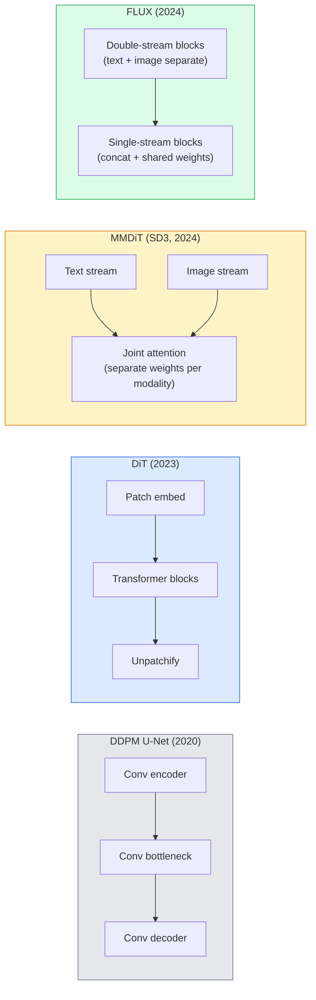

# Diffusion Transformers & Rectified Flow

> U-Net không phải bí mật của khuếch tán. Thay nó bằng một transformer, đổi lịch nhiễu thành một luồng đường thẳng, và đột nhiên bạn có SD3, FLUX và mọi mô hình văn bản-sang-ảnh năm 2026.

**Type:** Learn + Build
**Languages:** Python
**Prerequisites:** Phase 4 Lesson 10 (Diffusion DDPM), Phase 4 Lesson 14 (ViT), Phase 7 Lesson 02 (Self-Attention)
**Time:** ~75 minutes

## Learning Objectives

- Theo dõi sự phát triển từ DDPM U-Net (Bài 10) tới Diffusion Transformer (DiT), MMDiT (SD3) và DiT một+hai luồng (FLUX)
- Giải thích rectified flow: tại sao quỹ đạo đường thẳng giữa nhiễu và dữ liệu cho phép mô hình lấy mẫu trong 20 bước thay vì 1000
- Triển khai một khối DiT nhỏ và một vòng lặp huấn luyện rectified-flow, cả hai dưới 100 dòng
- Phân biệt các biến thể mô hình (SD3, FLUX.1-dev, FLUX.1-schnell, Z-Image, Qwen-Image) theo kiến trúc, số tham số và giấy phép

## The Problem

Bài 10 xây một DDPM với bộ khử nhiễu U-Net. Công thức đó thống trị 2020-2023: U-Net + lịch beta + mất mát dự đoán nhiễu. Nó tạo ra Stable Diffusion 1.5 và 2.1 và DALL-E 2.

Mọi mô hình văn bản-sang-ảnh tiên tiến nhất năm 2026 đều đã vượt qua nó. Stable Diffusion 3, FLUX, SD4, Z-Image, Qwen-Image, Hunyuan-Image — không mô hình nào dùng U-Net. Chúng sử dụng Diffusion Transformer (DiT). SD3 và FLUX cũng đổi lịch nhiễu DDPM thành rectified flow, làm thẳng đường từ nhiễu tới dữ liệu và cho phép suy luận 1-4 bước với các biến thể nhất quán hoặc chưng cất.

Sự chuyển dịch quan trọng vì đó là lý do sinh hình ảnh dựa trên khuếch tán trở nên có thể điều khiển, chính xác theo prompt (SD3/SD4 giải quyết kết xuất văn bản) và nhanh cho production. Hiểu DiT + rectified flow là hiểu bộ công cụ hình ảnh tạo sinh năm 2026.

## The Concept

### From U-Net to transformer



- **DiT** (Peebles & Xie, 2023) — thay U-Net bằng transformer giống ViT trên các patch tiềm ẩn. Điều kiện hóa qua layer norm thích nghi (AdaLN).
- **MMDiT** (SD3, Esser et al., 2024) — hai luồng có trọng số riêng cho token văn bản và hình ảnh dùng chung attention kết hợp.
- **FLUX** (Black Forest Labs, 2024) — N khối đầu hai luồng như SD3, các khối sau nối lại và dùng chung trọng số (một luồng) để hiệu quả ở độ sâu lớn hơn.
- **Z-Image** (2025) — một DiT một luồng hiệu quả ở 6B tham số thách thức "mở rộng bằng mọi giá".

### Rectified flow in one paragraph

DDPM định nghĩa quá trình xuôi như một SDE nhiễu nơi `x_t` ngày càng bị làm hỏng. Quá trình ngược được học là SDE thứ hai, giải bằng 1000 bước nhỏ.

Rectified flow định nghĩa một nội suy **đường thẳng** giữa dữ liệu sạch và nhiễu thuần:

```
x_t = (1 - t) * x_0 + t * epsilon,     t in [0, 1]
```

Huấn luyện một mạng dự đoán vận tốc `v_theta(x_t, t) = epsilon - x_0` — hướng xuôi dọc đường thẳng từ dữ liệu sạch tới nhiễu (`dx_t/dt`). Khi lấy mẫu, bạn tích phân vận tốc này ngược để bước từ nhiễu về dữ liệu. ODE kết quả gần đường thẳng hơn nhiều, nên cần ít bước tích phân hơn nhiều để lấy mẫu.

SD3 gọi đây là **Rectified Flow Matching**. FLUX, Z-Image và hầu hết mô hình năm 2026 dùng cùng mục tiêu. Suy luận điển hình: 20-30 bước Euler (tất định) so với 50+ bước DDIM ở chế độ DDPM cũ. Các biến thể chưng cất / turbo / schnell / LCM đưa xuống 1-4 bước.

### AdaLN conditioning

DiT điều kiện hóa theo bước thời gian và lớp/văn bản qua **layer norm thích nghi**: dự đoán `scale` và `shift` từ vector điều kiện rồi áp dụng sau LayerNorm. Gọn hơn nhiều điều biến kiểu FiLM trong U-Net và là mặc định trong mọi DiT hiện đại.

```
cond -> MLP -> (scale, shift, gate)
norm(x) * (1 + scale) + shift, then residual add * gate
```

### Text encoders in SD3 and FLUX

- **SD3** dùng ba encoder văn bản: hai mô hình CLIP + T5-XXL. Các embedding được nối và đưa vào luồng hình ảnh làm điều kiện văn bản.
- **FLUX** dùng một CLIP-L + T5-XXL.
- Các biến thể **Qwen-Image / Z-Image** dùng encoder văn bản nội bộ riêng căn chỉnh với LLM cơ sở của chúng.

Encoder văn bản là phần lớn lý do SD3/FLUX suy luận về prompt tốt hơn SD1.5 nhiều. Riêng T5-XXL là 4.7B tham số.

### Classifier-free guidance still holds

Rectified flow thay sampler, không phải điều kiện hóa. Classifier-free guidance (bỏ văn bản với xác suất 10% trong huấn luyện, trộn dự đoán có điều kiện và không điều kiện khi suy luận) hoạt động giống hệt với rectified flow. Hầu hết mô hình năm 2026 dùng thang hướng dẫn 3.5-5 — thấp hơn 7.5 của SD1.5 vì mô hình rectified-flow mặc định bám prompt sát hơn.

### Consistency, Turbo, Schnell, LCM

Bốn tên cho cùng ý tưởng: chưng cất mô hình chậm nhiều bước thành mô hình nhanh ít bước.

- **LCM (Latent Consistency Model)** — huấn luyện một học sinh dự đoán `x_0` cuối từ bất kỳ `x_t` trung gian nào trong một bước.
- **SDXL Turbo / FLUX schnell** — các mô hình 1-4 bước huấn luyện bằng chưng cất khuếch tán đối kháng.
- **SD Turbo** — các Consistency Model kiểu OpenAI được điều chỉnh cho khuếch tán tiềm ẩn.

Phục vụ production của mọi mô hình mới cung cấp cả checkpoint "chất lượng đầy đủ" và biến thể "turbo / schnell". Schnell ("nhanh" trong tiếng Đức, quy ước Black Forest Labs) chạy trong 1-4 bước và phù hợp các pipeline thời gian thực.

### Model landscape in 2026

| Mô hình | Kích thước | Kiến trúc | Giấy phép |
|-------|------|--------------|---------|
| Stable Diffusion 3 Medium | 2B | MMDiT | SAI Community |
| Stable Diffusion 3.5 Large | 8B | MMDiT | SAI Community |
| FLUX.1-dev | 12B | DiT Hai + Một Luồng | phi thương mại |
| FLUX.1-schnell | 12B | tương tự, được chưng cất | Apache 2.0 |
| FLUX.2 | — | FLUX.1 được cải tiến lặp | hỗn hợp |
| Z-Image | 6B | S3-DiT (Một Luồng Có thể Mở rộng) | cho phép rộng rãi |
| Qwen-Image | ~20B | DiT + tháp văn bản Qwen | Apache 2.0 |
| Hunyuan-Image-3.0 | ~80B | DiT | nghiên cứu |
| SD4 Turbo | 3B | DiT + chưng cất | SAI Commercial |

FLUX.1-schnell là mặc định nguồn mở năm 2026. Z-Image dẫn đầu hiệu quả. FLUX.2 và SD4 là các đỉnh chất lượng hiện tại.

### Why this phase shift matters

DDPM + U-Net đã hoạt động. DiT + rectified flow hoạt động **tốt hơn, nhanh hơn và mở rộng gọn hơn**. Chuyển đổi song song với chuyển đổi từ RNN sang transformer trong NLP: cả hai kiến trúc giải cùng bài toán, nhưng transformer mở rộng và giờ thống trị. Mọi bài báo năm 2026 về sinh hình ảnh, video hoặc 3D dùng bộ khử nhiễu dạng DiT và thường là mục tiêu rectified flow. DDPM U-Net giờ chủ yếu để giảng dạy (Bài 10).

```figure
cv3-rectified-flow
```

## Build It

### Step 1: A DiT block with AdaLN

```python
import torch
import torch.nn as nn


class AdaLNZero(nn.Module):
    """
    Adaptive LayerNorm with a gate. Predicts (scale, shift, gate) from the conditioning.
    Init such that the whole block starts as identity ("zero init").
    """

    def __init__(self, dim, cond_dim):
        super().__init__()
        self.norm = nn.LayerNorm(dim, elementwise_affine=False)
        self.mlp = nn.Linear(cond_dim, dim * 3)
        nn.init.zeros_(self.mlp.weight)
        nn.init.zeros_(self.mlp.bias)

    def forward(self, x, cond):
        scale, shift, gate = self.mlp(cond).chunk(3, dim=-1)
        h = self.norm(x) * (1 + scale.unsqueeze(1)) + shift.unsqueeze(1)
        return h, gate.unsqueeze(1)


class DiTBlock(nn.Module):
    def __init__(self, dim=192, heads=3, mlp_ratio=4, cond_dim=192):
        super().__init__()
        self.adaln1 = AdaLNZero(dim, cond_dim)
        self.attn = nn.MultiheadAttention(dim, heads, batch_first=True)
        self.adaln2 = AdaLNZero(dim, cond_dim)
        self.mlp = nn.Sequential(
            nn.Linear(dim, dim * mlp_ratio),
            nn.GELU(),
            nn.Linear(dim * mlp_ratio, dim),
        )

    def forward(self, x, cond):
        h, gate1 = self.adaln1(x, cond)
        a, _ = self.attn(h, h, h, need_weights=False)
        x = x + gate1 * a
        h, gate2 = self.adaln2(x, cond)
        x = x + gate2 * self.mlp(h)
        return x
```

`AdaLNZero` bắt đầu như ánh xạ đồng nhất vì các trọng số MLP của nó được khởi tạo bằng không. Huấn luyện dịch khối khỏi đồng nhất; điều này ổn định mạnh các mô hình khuếch tán transformer sâu.

### Step 2: A tiny DiT

```python
def timestep_embedding(t, dim):
    import math
    half = dim // 2
    freqs = torch.exp(-math.log(10000) * torch.arange(half, device=t.device) / half)
    args = t[:, None].float() * freqs[None]
    return torch.cat([args.sin(), args.cos()], dim=-1)


class TinyDiT(nn.Module):
    def __init__(self, image_size=16, patch_size=2, in_channels=3, dim=96, depth=4, heads=3):
        super().__init__()
        self.patch_size = patch_size
        self.num_patches = (image_size // patch_size) ** 2
        self.patch = nn.Conv2d(in_channels, dim, kernel_size=patch_size, stride=patch_size)
        self.pos = nn.Parameter(torch.zeros(1, self.num_patches, dim))
        self.time_mlp = nn.Sequential(
            nn.Linear(dim, dim * 2),
            nn.SiLU(),
            nn.Linear(dim * 2, dim),
        )
        self.blocks = nn.ModuleList([DiTBlock(dim, heads, cond_dim=dim) for _ in range(depth)])
        self.norm_out = nn.LayerNorm(dim, elementwise_affine=False)
        self.head = nn.Linear(dim, patch_size * patch_size * in_channels)

    def forward(self, x, t):
        n = x.size(0)
        x = self.patch(x)
        x = x.flatten(2).transpose(1, 2) + self.pos
        t_emb = self.time_mlp(timestep_embedding(t, self.pos.size(-1)))
        for blk in self.blocks:
            x = blk(x, t_emb)
        x = self.norm_out(x)
        x = self.head(x)
        return self._unpatchify(x, n)

    def _unpatchify(self, x, n):
        p = self.patch_size
        h = w = int(self.num_patches ** 0.5)
        x = x.view(n, h, w, p, p, -1).permute(0, 5, 1, 3, 2, 4).reshape(n, -1, h * p, w * p)
        return x
```

### Step 3: Rectified flow training

```python
import torch.nn.functional as F

def rectified_flow_train_step(model, x0, optimizer, device):
    model.train()
    x0 = x0.to(device)
    n = x0.size(0)
    t = torch.rand(n, device=device)
    epsilon = torch.randn_like(x0)
    x_t = (1 - t[:, None, None, None]) * x0 + t[:, None, None, None] * epsilon

    target_velocity = epsilon - x0
    pred_velocity = model(x_t, t)

    loss = F.mse_loss(pred_velocity, target_velocity)
    optimizer.zero_grad()
    loss.backward()
    optimizer.step()
    return loss.item()
```

So với mất mát dự đoán nhiễu DDPM (Bài 10): cùng cấu trúc, khác mục tiêu. Thay vì dự đoán nhiễu `epsilon`, chúng ta dự đoán **vận tốc** `epsilon - x_0`, chỉ từ dữ liệu tới nhiễu dọc nội suy đường thẳng.

### Step 4: Euler sampler

Rectified flow là một ODE. Phương pháp Euler đơn giản nhất và, với mô hình rectified-flow được huấn luyện tốt, gần chính xác như các bộ giải bậc cao ở 20+ bước.

```python
@torch.no_grad()
def rectified_flow_sample(model, shape, steps=20, device="cpu"):
    model.eval()
    x = torch.randn(shape, device=device)
    dt = 1.0 / steps
    t = torch.ones(shape[0], device=device)
    for _ in range(steps):
        v = model(x, t)
        x = x - dt * v
        t = t - dt
    return x
```

20 bước. Trên mô hình đã huấn luyện, cách này tạo mẫu tương đương DDPM 1000 bước.

### Step 5: End-to-end smoke test

```python
import numpy as np

def synthetic_blobs(num=200, size=16, seed=0):
    rng = np.random.default_rng(seed)
    out = np.zeros((num, 3, size, size), dtype=np.float32)
    yy, xx = np.meshgrid(np.arange(size), np.arange(size), indexing="ij")
    for i in range(num):
        cx, cy = rng.uniform(4, size - 4, size=2)
        r = rng.uniform(2, 4)
        mask = (xx - cx) ** 2 + (yy - cy) ** 2 < r ** 2
        colour = rng.uniform(-1, 1, size=3)
        for c in range(3):
            out[i, c][mask] = colour[c]
    return torch.from_numpy(out)
```

Huấn luyện một `TinyDiT` trên dữ liệu này bằng rectified flow. Sau 500 bước, đầu ra lấy mẫu nên trông như các đốm màu mờ.

## Use It

Cho sinh hình ảnh thật bằng FLUX / SD3 / Z-Image, `diffusers` cung cấp mọi loại với API thống nhất:

```python
from diffusers import FluxPipeline, StableDiffusion3Pipeline
import torch

pipe = FluxPipeline.from_pretrained(
    "black-forest-labs/FLUX.1-schnell",
    torch_dtype=torch.bfloat16,
).to("cuda")

out = pipe(
    prompt="a golden retriever surfing a tsunami, hyperrealistic, studio lighting",
    guidance_scale=0.0,           # schnell was trained without CFG
    num_inference_steps=4,
    max_sequence_length=256,
).images[0]
out.save("surf.png")
```

Ba dòng. `FLUX.1-schnell` trong bốn bước. Đổi id mô hình thành `black-forest-labs/FLUX.1-dev` để có chất lượng cao hơn ở 20-30 bước với CFG.

Với SD3:

```python
pipe = StableDiffusion3Pipeline.from_pretrained(
    "stabilityai/stable-diffusion-3.5-large",
    torch_dtype=torch.bfloat16,
).to("cuda")
out = pipe(prompt, guidance_scale=3.5, num_inference_steps=28).images[0]
```

## Ship It

Bài học này tạo ra:

- `outputs/prompt-dit-model-picker.md` — chọn giữa SD3, FLUX.1-dev, FLUX.1-schnell, Z-Image, SD4 Turbo với các ràng buộc chất lượng, độ trễ và giấy phép cho trước.
- `outputs/skill-rectified-flow-trainer.md` — viết vòng lặp huấn luyện đầy đủ cho rectified flow với DiT AdaLN và lấy mẫu Euler.

## Exercises

1. **(Dễ)** Huấn luyện TinyDiT trên trên tập dữ liệu đốm tổng hợp trong 500 bước. So sánh mẫu tạo bằng 10, 20 và 50 bước Euler.
2. **(Vừa)** Thêm điều kiện hóa văn bản bằng cách nối embedding lớp được học vào embedding thời gian (10 "lớp" đốm theo màu). Lấy mẫu với lớp 0, 5 và 9 và xác minh màu khớp.
3. **(Khó)** Tính khoảng cách Fréchet (đại diện FID) giữa các mẫu sinh từ phiên bản rectified-flow và DDPM của mạng cùng kích thước huấn luyện trên cùng dữ liệu trong cùng số bước. Báo cáo loại hội tụ nhanh hơn.

## Key Terms

| Thuật ngữ | Cách mọi người nói | Ý nghĩa thực sự |
|------|----------------|----------------------|
| DiT | "Transformer khuếch tán" | Transformer thay U-Net làm bộ khử nhiễu khuếch tán; hoạt động trên các biểu diễn tiềm ẩn chia patch |
| AdaLN | "Layer norm thích nghi" | Điều kiện hóa bước thời gian/văn bản qua scale, shift, gate được học áp dụng sau LayerNorm; tiêu chuẩn trong mọi DiT hiện đại |
| MMDiT | "DiT đa phương thức (SD3)" | Các luồng trọng số riêng cho token văn bản và hình ảnh dùng chung self-attention kết hợp |
| Single-stream / double-stream (Một luồng / hai luồng) | "Thủ thuật FLUX" | N khối đầu hai luồng (trọng số riêng mỗi phương thức), các khối sau một luồng (nối + dùng chung trọng số) để hiệu quả |
| Rectified flow | "Đường thẳng nhiễu-tới-dữ liệu" | Nội suy tuyến tính giữa dữ liệu và nhiễu; mạng dự đoán vận tốc; cần ít bước ODE hơn khi suy luận |
| Velocity target (Mục tiêu vận tốc) | "epsilon - x_0" | Mục tiêu hồi quy trong rectified flow; chỉ từ dữ liệu sạch tới nhiễu |
| CFG guidance | "classifier-free guidance" | Trộn các dự đoán có điều kiện và không điều kiện; vẫn dùng trong mô hình rectified-flow |
| Schnell / turbo / LCM | "Chưng cất 1-4 bước" | Các biến thể ít bước được chưng cất từ mô hình chất lượng đầy đủ; thời gian thực production |

## Further Reading

- [Scalable Diffusion Models with Transformers (Peebles & Xie, 2023)](https://arxiv.org/abs/2212.09748) — bài báo DiT
- [Scaling Rectified Flow Transformers (Esser et al., SD3 paper)](https://arxiv.org/abs/2403.03206) — MMDiT và rectified-flow ở quy mô lớn
- [FLUX.1 model card and technical report (Black Forest Labs)](https://huggingface.co/black-forest-labs/FLUX.1-dev) — chi tiết hai + một luồng
- [Z-Image: Efficient Image Generation Foundation Model (2025)](https://arxiv.org/html/2511.22699v1) — DiT một luồng ở 6B
- [Elucidating the Design Space of Diffusion (Karras et al., 2022)](https://arxiv.org/abs/2206.00364) — tài liệu tham khảo cho mọi đánh đổi thiết kế khuếch tán
- [Latent Consistency Models (Luo et al., 2023)](https://arxiv.org/abs/2310.04378) — cách LCM-LoRA cho suy luận 4 bước
