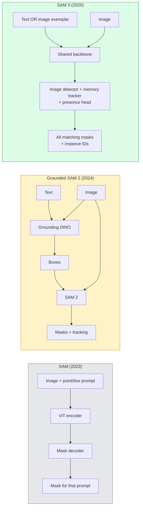

# SAM 3 & Open-Vocabulary Segmentation

> Đưa cho mô hình một prompt văn bản và một hình ảnh, nhận các mặt nạ cho mọi đối tượng khớp. SAM 3 khiến điều đó thành một lượt truyền xuôi.

**Type:** Use + Build
**Languages:** Python
**Prerequisites:** Phase 4 Lesson 07 (U-Net), Phase 4 Lesson 08 (Mask R-CNN), Phase 4 Lesson 18 (CLIP)
**Time:** ~60 minutes

## Learning Objectives

- Phân biệt SAM (chỉ prompt trực quan), Grounded SAM / SAM 2 (bộ phát hiện + SAM) và SAM 3 (prompt văn bản gốc qua Promptable Concept Segmentation)
- Giải thích kiến trúc SAM 3: backbone dùng chung + bộ phát hiện hình ảnh + bộ theo dõi video dựa trên bộ nhớ + đầu hiện diện + thiết kế bộ phát hiện-bộ theo dõi tách rời
- Sử dụng tích hợp SAM 3 của Hugging Face `transformers` cho phát hiện, phân đoạn và theo dõi video bằng prompt văn bản
- Chọn giữa SAM 3, Grounded SAM 2, YOLO-World và SAM-MI dựa trên độ trễ, độ phức tạp khái niệm và đích triển khai

## The Problem

SAM năm 2023 là mô hình chỉ prompt trực quan: bạn nhấp một điểm hoặc vẽ hộp và nó trả một mặt nạ. Với "cho tôi mọi quả cam trong ảnh này" bạn cần bộ phát hiện (Grounding DINO) tạo hộp, rồi SAM phân đoạn từng hộp. Grounded SAM biến điều này thành pipeline, nhưng là chuỗi hai mô hình đóng băng với tích lũy sai số không tránh khỏi.

SAM 3 (Meta, tháng 11 năm 2025, ICLR 2026) gộp chuỗi. Nó nhận cụm danh từ ngắn hoặc ảnh mẫu làm prompt và trả mọi mặt nạ khớp cùng ID thực thể trong một lượt truyền xuôi duy nhất. Đó là **Phân đoạn Khái niệm Có thể Đặt Prompt (PCS)**. Kết hợp bản cập nhật Object Multiplex tháng 3 năm 2026 (SAM 3.1), nó theo dõi hiệu quả nhiều thực thể cùng khái niệm qua video.

Bài này nói về sự chuyển dịch cấu trúc mà điều này thể hiện. Phân đoạn 2D, phát hiện và định vị văn bản-hình ảnh đã hợp nhất thành một mô hình. Câu hỏi production không còn là "tôi nối pipeline nào" mà là "mô hình có thể đặt prompt nào xử lý trường hợp của tôi đầu-cuối."

## The Concept

### The three generations



### Promptable Concept Segmentation

Một "prompt khái niệm" là cụm danh từ ngắn (`"yellow school bus"`, `"striped red umbrella"`, `"hand holding a mug"`) hoặc một ảnh mẫu. Mô hình trả các mặt nạ phân đoạn cho mọi thực thể trong hình ảnh khớp khái niệm, cộng một ID thực thể duy nhất mỗi kết quả.

Điều này khác SAM prompt trực quan cổ điển ở ba cách:

1. Không cần prompt từng thực thể — một prompt văn bản trả mọi kết quả khớp.
2. Từ vựng mở — khái niệm có thể là bất cứ thứ gì mô tả được bằng ngôn ngữ tự nhiên.
3. Trả nhiều thực thể cùng lúc thay vì một mặt nạ mỗi prompt.

### Key architectural pieces

- **Backbone dùng chung** — một ViT duy nhất xử lý hình ảnh. Cả đầu phát hiện và bộ theo dõi dựa trên bộ nhớ đều đọc từ đó.
- **Đầu hiện diện** — dự đoán liệu khái niệm có hiện diện trong hình ảnh hay không. Tách "cái này có ở đây không?" khỏi "nó ở đâu?". Giảm dương tính giả cho các khái niệm vắng mặt.
- **Bộ phát hiện-bộ theo dõi tách rời** — phát hiện cấp ảnh và theo dõi cấp video có các đầu riêng để không can thiệp nhau.
- **Ngân hàng bộ nhớ** — lưu các đặc trưng từng thực thể qua các khung hình để theo dõi video (cùng cơ chế SAM 2 dùng).

### Training at scale

SAM 3 được huấn luyện trên **4 triệu khái niệm duy nhất** tạo bởi một bộ máy dữ liệu chú thích và sửa lặp bằng AI + con người đánh giá. **Benchmark SA-CO** mới chứa 270K khái niệm duy nhất, lớn hơn các benchmark trước 50 lần. SAM 3 đạt 75-80% hiệu suất con người trên SA-CO và gấp đôi các hệ thống hiện có trên PCS hình ảnh + video.

### SAM 3.1 Object Multiplex

Cập nhật tháng 3 năm 2026: **Object Multiplex** giới thiệu cơ chế bộ nhớ dùng chung để cùng theo dõi nhiều thực thể cùng khái niệm một lúc. Trước đó, theo dõi N thực thể nghĩa là N ngân hàng bộ nhớ riêng. Multiplex gộp thành một bộ nhớ dùng chung với truy vấn từng thực thể. Kết quả: theo dõi nhiều đối tượng nhanh hơn đáng kể mà không hy sinh accuracy.

### Where Grounded SAM still matters in 2026

- Khi cần thay vào một bộ phát hiện từ vựng mở cụ thể (DINO-X, Florence-2).
- Khi giấy phép SAM 3 (cần xin quyền trên HF) là trở ngại.
- Khi cần kiểm soát ngưỡng bộ phát hiện nhiều hơn SAM 3 cho phép.
- Cho công việc nghiên cứu / loại bỏ thành phần bộ phát hiện.

Pipeline mô-đun vẫn có chỗ. Với hầu hết công việc production, SAM 3 là câu trả lời đơn giản hơn.

### YOLO-World vs SAM 3

- **YOLO-World** — chỉ bộ phát hiện từ vựng mở (không mặt nạ). Thời gian thực. Tốt nhất khi cần hộp ở fps cao.
- **SAM 3** — phân đoạn + theo dõi đầy đủ. Chậm hơn nhưng đầu ra phong phú hơn.

Phân chia production: YOLO-World cho pipeline chỉ phát hiện nhanh (điều hướng robot, bảng điều khiển nhanh), SAM 3 cho mọi thứ cần mặt nạ hoặc theo dõi.

### SAM-MI efficiency

SAM-MI (2025-2026) giải quyết nút thắt decoder SAM. Các ý tưởng chính:

- **Đặt prompt điểm thưa** — dùng vài điểm được chọn tốt thay prompt dày đặc; giảm 96% lời gọi decoder.
- **Tổng hợp mặt nạ nông** — gộp các dự đoán mặt nạ thô thành mặt nạ sắc hơn.
- **Đưa mặt nạ tách rời** — decoder nhận đặc trưng mặt nạ tính trước thay vì chạy lại.

Kết quả: tăng tốc ~1.6× so với Grounded-SAM trên benchmark từ vựng mở.

### Output format for the three models

Tất cả trả cùng cấu trúc tổng quát (hộp + nhãn + điểm + mặt nạ + ID), điều hữu ích — pipeline phía sau không phải rẽ nhánh theo mô hình đã chạy.

```figure
cv3-open-vocab
```

## Build It

### Step 1: Prompt construction

Xây hàm hỗ trợ biến câu người dùng thành danh sách prompt khái niệm SAM 3. Đây là ranh giới nơi "người dùng đã gõ gì" gặp "mô hình tiêu thụ gì".

```python
def split_concepts(sentence):
    """
    Heuristic splitter for multi-concept prompts.
    Returns list of short noun phrases.
    """
    for sep in [",", ";", "and", "or", "&"]:
        if sep in sentence:
            parts = [p.strip() for p in sentence.replace("and ", ",").split(",")]
            return [p for p in parts if p]
    return [sentence.strip()]

print(split_concepts("cats, dogs and balloons"))
```

SAM 3 nhận một khái niệm mỗi lượt truyền xuôi; với truy vấn nhiều khái niệm, lặp hoặc chia batch.

### Step 2: Post-processing helpers

Biến đầu ra thô SAM 3 thành danh sách phát hiện gọn khớp hợp đồng pipeline Giai đoạn 4 Bài 16.

```python
from dataclasses import dataclass
from typing import List

@dataclass
class ConceptDetection:
    concept: str
    instance_id: int
    box: tuple          # (x1, y1, x2, y2)
    score: float
    mask_rle: str       # run-length encoded


def rle_encode(binary_mask):
    flat = binary_mask.flatten().astype("uint8")
    runs = []
    prev, count = flat[0], 0
    for v in flat:
        if v == prev:
            count += 1
        else:
            runs.append((int(prev), count))
            prev, count = v, 1
    runs.append((int(prev), count))
    return ";".join(f"{v}x{c}" for v, c in runs)
```

RLE giữ nội dung phản hồi nhỏ ngay cả với nhiều mặt nạ độ phân giải cao. Cùng định dạng hoạt động với SAM 2, SAM 3, Grounded SAM 2.

### Step 3: A unified open-vocab segmentation interface

Bao bọc bất kỳ backend bạn có (SAM 3, Grounded SAM 2, YOLO-World + SAM 2) sau một phương thức. Mã phía sau không đổi khi backend thay đổi.

```python
from abc import ABC, abstractmethod
import numpy as np

class OpenVocabSeg(ABC):
    @abstractmethod
    def detect(self, image: np.ndarray, concept: str) -> List[ConceptDetection]:
        ...


class StubOpenVocabSeg(OpenVocabSeg):
    """
    Deterministic stub used for pipeline testing when real models are not loaded.
    """
    def detect(self, image, concept):
        h, w = image.shape[:2]
        return [
            ConceptDetection(
                concept=concept,
                instance_id=0,
                box=(w * 0.2, h * 0.3, w * 0.5, h * 0.8),
                score=0.89,
                mask_rle="0x100;1x50;0x200",
            ),
            ConceptDetection(
                concept=concept,
                instance_id=1,
                box=(w * 0.55, h * 0.25, w * 0.85, h * 0.75),
                score=0.74,
                mask_rle="0x80;1x40;0x220",
            ),
        ]
```

Lớp con `SAM3OpenVocabSeg` thật sẽ bao bọc `transformers.Sam3Model` và `Sam3Processor`.

### Step 4: Hugging Face SAM 3 usage (reference)

Với mô hình thật, tích hợp `transformers`:

```python
from transformers import Sam3Processor, Sam3Model
import torch

processor = Sam3Processor.from_pretrained("facebook/sam3")
model = Sam3Model.from_pretrained("facebook/sam3").eval()

inputs = processor(images=pil_image, return_tensors="pt")
inputs = processor.set_text_prompt(inputs, "yellow school bus")

with torch.no_grad():
    outputs = model(**inputs)

masks = processor.post_process_masks(
    outputs.masks, inputs.original_sizes, inputs.reshaped_input_sizes
)
boxes = outputs.boxes
scores = outputs.scores
```

Một prompt, mọi kết quả khớp trả về trong một lời gọi.

### Step 5: Measure what Grounded SAM 2 gave you for free

Một benchmark thành thật: điều gì xảy ra khi thay Grounded SAM 2 bằng SAM 3 trong pipeline thật?

- Độ trễ: SAM 3 tiết kiệm một lượt truyền xuôi (không bộ phát hiện riêng) nhưng bản thân mô hình nặng hơn; thường tổng thể trung tính hoặc tăng tốc nhẹ.
- Accuracy: SAM 3 tốt hơn đáng kể trên khái niệm hiếm hoặc tổ hợp ("ô đỏ có sọc"). Tương tự trên các khái niệm một từ phổ biến.
- Linh hoạt: Grounded SAM 2 cho phép đổi bộ phát hiện (DINO-X, Florence-2, Grounding DINO 1.5); SAM 3 nguyên khối.

Kết luận: SAM 3 là mặc định cho phân đoạn từ vựng mở năm 2026. Grounded SAM 2 vẫn đúng khi cần tính linh hoạt bộ phát hiện hoặc điều khoản giấy phép khác.

## Use It

Các mẫu triển khai production:

- **Chú thích thời gian thực** — SAM 3 + tính năng nhãn-là-prompt-văn-bản của CVAT. Người chú thích chọn tên nhãn; SAM 3 gán nhãn trước mọi thực thể khớp. Đánh giá và sửa.
- **Phân tích video** — SAM 3.1 Object Multiplex cho theo dõi nhiều đối tượng; đưa các khung hình vào bộ theo dõi dựa trên bộ nhớ.
- **Robot** — SAM 3 cho thao tác từ vựng mở ("nhấc cốc đỏ"); chạy như thành phần nguyên thủy lập kế hoạch.
- **Hình ảnh y tế** — SAM 3 tinh chỉnh trên khái niệm y tế; yêu cầu xin quyền truy cập trên HF.

Ultralytics bao bọc SAM 3 trong gói Python:

```python
from ultralytics import SAM

model = SAM("sam3.pt")
results = model(image_path, prompts="yellow school bus")
```

Cùng giao diện như YOLO và SAM 2.

## Ship It

Bài học này tạo ra:

- `outputs/prompt-open-vocab-stack-picker.md` — một prompt chọn SAM 3 / Grounded SAM 2 / YOLO-World / SAM-MI dựa trên độ trễ, độ phức tạp khái niệm và giấy phép.
- `outputs/skill-concept-prompt-designer.md` — một skill biến phát ngôn người dùng thành các prompt khái niệm SAM 3 đúng dạng (tách, khử mơ hồ, dự phòng).

## Exercises

1. **(Dễ)** Chạy SAM 3 trên 10 hình ảnh với prompt khái niệm bạn chọn. So sánh với SAM 2 + Grounding DINO 1.5 trên cùng ảnh. Báo cáo mỗi mô hình bỏ sót khái niệm nào.
2. **(Vừa)** Xây giao diện "nhấp-để-bao-gồm / nhấp-để-loại-trừ" trên SAM 3: prompt văn bản trả các thực thể ứng viên; các lần nhấp giữ của người dùng xác định thực thể nào tính là dương. Xuất tập khái niệm cuối thành JSON.
3. **(Khó)** Tinh chỉnh SAM 3 trên tập khái niệm tùy chỉnh (ví dụ 5 loại linh kiện điện tử) mỗi loại 20 ảnh gán nhãn. So sánh với SAM 3 zero-shot trên cùng tập test; đo cải thiện IoU mặt nạ.

## Key Terms

| Thuật ngữ | Cách mọi người nói | Ý nghĩa thực sự |
|------|----------------|----------------------|
| Open-vocabulary segmentation (Phân đoạn từ vựng mở) | "Phân đoạn bằng văn bản" | Tạo mặt nạ cho đối tượng được mô tả bằng ngôn ngữ tự nhiên, không phải tập nhãn cố định |
| PCS | "Promptable Concept Segmentation" | Tác vụ cốt lõi SAM 3 — với cụm danh từ hoặc ảnh mẫu, phân đoạn mọi thực thể khớp |
| Concept prompt (Prompt khái niệm) | "Đầu vào văn bản" | Cụm danh từ ngắn hoặc ảnh mẫu; không phải câu đầy đủ |
| Presence head (Đầu hiện diện) | "Nó có ở đây không?" | Module SAM 3 quyết định liệu khái niệm tồn tại trong hình ảnh trước định vị |
| SA-CO | "Benchmark SAM 3" | Benchmark phân đoạn từ vựng mở 270K khái niệm; lớn hơn benchmark từ vựng mở trước 50 lần |
| Object Multiplex | "Cập nhật SAM 3.1" | Theo dõi nhiều đối tượng bộ nhớ dùng chung; cùng theo dõi nhanh nhiều thực thể |
| Grounded SAM 2 | "Pipeline mô-đun" | Chuỗi bộ phát hiện + SAM 2; vẫn phù hợp khi đổi bộ phát hiện quan trọng |
| SAM-MI | "Biến thể SAM hiệu quả" | Đưa mặt nạ vào để tăng tốc 1.6 lần so với Grounded-SAM |

## Further Reading

- [SAM 3: Segment Anything with Concepts (arXiv 2511.16719)](https://arxiv.org/abs/2511.16719)
- [SAM 3.1 Object Multiplex (Meta AI, March 2026)](https://ai.meta.com/blog/segment-anything-model-3/)
- [SAM 3 model page on Hugging Face](https://huggingface.co/facebook/sam3)
- [Grounded SAM 2 tutorial (PyImageSearch)](https://pyimagesearch.com/2026/01/19/grounded-sam-2-from-open-set-detection-to-segmentation-and-tracking/)
- [Ultralytics SAM 3 docs](https://docs.ultralytics.com/models/sam-3/)
- [SAM3-I: Instruction-aware SAM (arXiv 2512.04585)](https://arxiv.org/abs/2512.04585)
