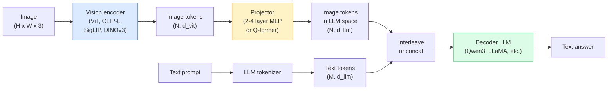

# Vision-Language Models — The ViT-MLP-LLM Pattern

> Một encoder thị giác chuyển hình ảnh thành token. Một bộ chiếu MLP ánh xạ các token vào không gian embedding LLM. Một mô hình ngôn ngữ làm phần còn lại. Mẫu đó — ViT-MLP-LLM — là mọi VLM production năm 2026.

**Type:** Learn + Use
**Languages:** Python
**Prerequisites:** Phase 4 Lesson 14 (ViT), Phase 4 Lesson 18 (CLIP), Phase 7 Lesson 02 (Self-Attention)
**Time:** ~75 minutes

## Learning Objectives

- Nêu kiến trúc ViT-MLP-LLM và giải thích đóng góp của mỗi thành phần trong ba thành phần
- So sánh Qwen3-VL, InternVL3.5, LLaVA-Next và GLM-4.6V về số tham số, độ dài ngữ cảnh và hiệu suất benchmark
- Giải thích DeepStack: tại sao đặc trưng ViT nhiều mức siết căn chỉnh thị giác-ngôn ngữ tốt hơn một đặc trưng lớp cuối
- Đo ảo giác VLM trong production bằng Cross-Modal Error Rate (CMER) và hành động theo tín hiệu

## The Problem

CLIP (Giai đoạn 4 Bài 18) cho bạn không gian embedding chung cho hình ảnh và văn bản, đủ cho phân loại zero-shot và truy xuất. Nó không thể trả lời "có bao nhiêu xe đỏ trong hình ảnh này?" vì CLIP không sinh văn bản — nó chỉ chấm các độ tương đồng.

Các Mô hình Thị giác-Ngôn ngữ (VLM) — Qwen3-VL, InternVL3.5, LLaVA-Next, GLM-4.6V — gắn một encoder hình ảnh họ CLIP vào một mô hình ngôn ngữ đầy đủ. Mô hình thấy hình ảnh cộng câu hỏi và sinh câu trả lời. Năm 2026 các VLM nguồn mở ngang hoặc vượt GPT-5 và Gemini-2.5-Pro trên các benchmark đa phương thức (MMMU, MMBench, DocVQA, ChartQA, MathVista, OSWorld).

Bộ ba thành phần (ViT, bộ chiếu, LLM) là tiêu chuẩn. Khác biệt giữa mô hình nằm ở ViT nào, bộ chiếu nào, LLM nào, dữ liệu huấn luyện và công thức căn chỉnh. Một khi hiểu mẫu, đổi bất kỳ thành phần nào là việc máy móc.

## The Concept

### The ViT-MLP-LLM architecture



1. **Encoder thị giác** — một ViT được tiền huấn luyện (CLIP-L/14, SigLIP, DINOv3 hoặc biến thể tinh chỉnh). Tạo các token patch.
2. **Bộ chiếu** — một module nhỏ (MLP 2-4 lớp hoặc Q-former) ánh xạ token thị giác vào số chiều embedding LLM. Đây là nơi phần lớn tinh chỉnh diễn ra.
3. **LLM** — một mô hình ngôn ngữ chỉ decoder (Qwen3, Llama, Mistral, GLM, InternLM). Đọc các token thị giác + văn bản theo chuỗi, sinh văn bản.

Cả ba phần về nguyên tắc có thể huấn luyện. Trong thực tế, encoder thị giác và LLM phần lớn đóng băng trong khi bộ chiếu huấn luyện — vài tỷ tham số tín hiệu với giá rẻ.

### DeepStack

Phép chiếu nguyên bản chỉ dùng lớp ViT cuối. DeepStack (Qwen3-VL) lấy các đặc trưng từ nhiều độ sâu ViT và xếp chúng. Các lớp sâu mang ngữ nghĩa cấp cao; các lớp nông mang thông tin không gian và kết cấu tinh. Đưa cả hai vào LLM khép khoảng cách giữa "hình ảnh chứa gì" (ngữ nghĩa) và "chính xác ở đâu" (định vị không gian).

### Three training stages

Các VLM hiện đại huấn luyện theo giai đoạn:

1. **Căn chỉnh** — đóng băng ViT và LLM. Chỉ huấn luyện bộ chiếu trên các cặp hình ảnh-chú thích. Dạy bộ chiếu ánh xạ không gian thị giác vào không gian ngôn ngữ.
2. **Tiền huấn luyện** — mở băng mọi thứ. Huấn luyện trên dữ liệu hình ảnh-văn bản đan xen quy mô lớn (500M+ cặp). Xây kiến thức thị giác của mô hình.
3. **Tinh chỉnh chỉ dẫn** — tinh chỉnh trên các bộ ba (hình ảnh, câu hỏi, câu trả lời) được tuyển chọn. Dạy hành vi hội thoại và định dạng tác vụ. Đây là thứ biến "LM nhận biết thị giác" thành trợ lý dùng được.

Hầu hết tinh chỉnh LoRA nhắm giai đoạn 3 với tập gán nhãn nhỏ.

### Model family comparison (early 2026)

| Mô hình | Tham số | Encoder thị giác | LLM | Ngữ cảnh | Điểm mạnh |
|-------|--------|----------------|-----|---------|-----------|
| Qwen3-VL-235B-A22B (MoE) | 235B (22B hoạt động) | ViT tùy chỉnh + DeepStack | Qwen3 | 256K | SOTA tổng quát, agent GUI |
| Qwen3-VL-30B-A3B (MoE) | 30B (3B hoạt động) | ViT tùy chỉnh + DeepStack | Qwen3 | 256K | Lựa chọn MoE nhỏ hơn |
| Qwen3-VL-8B (dày đặc) | 8B | ViT tùy chỉnh | Qwen3 | 128K | Mặc định dày đặc production |
| InternVL3.5-38B | 38B | InternViT-6B | Qwen3 + GPT-OSS | 128K | Mạnh trên MMBench / MMVet |
| InternVL3.5-241B-A28B | 241B (28B hoạt động) | InternViT-6B | Qwen3 | 128K | Cạnh tranh với GPT-4o |
| LLaVA-Next 72B | 72B | SigLIP | Llama-3 | 32K | Mở, dễ tinh chỉnh |
| GLM-4.6V | ~70B | tùy chỉnh | GLM | 64K | Nguồn mở, OCR mạnh |
| MiniCPM-V-2.6 | 8B | SigLIP | MiniCPM | 32K | Thân thiện biên |

### Visual agents

Qwen3-VL-235B đạt hiệu suất hàng đầu toàn cầu trên OSWorld — benchmark cho **agent thị giác** vận hành GUI (máy tính, di động, web). Mô hình thấy ảnh chụp màn hình, hiểu giao diện và xuất hành động (nhấp, gõ, cuộn). Kết hợp công cụ, nó khép vòng lặp các tác vụ máy tính phổ biến. Đây là thứ hầu hết bản minh họa "AI PC" năm 2026 chạy bên dưới.

### Agentic capabilities + RoPE variants

VLM cần biết một khung hình ở **khi nào** trong video. Qwen3-VL phát triển từ T-RoPE (embedding vị trí xoay thời gian) tới **căn chỉnh thời gian dựa trên văn bản** — các token văn bản dấu thời gian tường minh đan xen với khung hình video. Mô hình thấy "`<timestamp 00:32>` khung hình, prompt" và có thể suy luận các quan hệ thời gian.

### The alignment problem

12% cặp hình ảnh-văn bản trong tập thu thập chứa mô tả không hoàn toàn dựa trên hình ảnh. VLM huấn luyện trên đó âm thầm học ảo giác — bịa đối tượng, đọc sai số, tưởng tượng quan hệ. Trong production đây là kiểu thất bại chủ đạo.

Skywork.ai giới thiệu **Tỷ lệ Lỗi Liên Phương thức (CMER)** để theo dõi:

```
CMER = fraction of outputs where the text confidence is high but the image-text similarity (via a CLIP-family checker) is low
```

CMER cao nghĩa là mô hình tự tin nói điều không dựa trên hình ảnh. Giám sát CMER và coi nó như KPI production giảm tỷ lệ ảo giác ~35% trong triển khai của họ. Thủ thuật không phải "sửa mô hình" mà là "chuyển đầu ra CMER cao cho con người xem xét."

### Fine-tuning with LoRA / QLoRA

Tinh chỉnh đầy đủ VLM 70B ngoài tầm hầu hết nhóm. LoRA (hạng 16-64) trên attention + các lớp bộ chiếu, hoặc QLoRA với trọng số cơ sở 4 bit, vừa một A100 / H100. Chi phí: 5,000-50,000 ví dụ, $100-$5,000 tính toán, 2-10 giờ huấn luyện.

### Spatial reasoning is still weak

Các VLM hiện tại đạt 50-60% trên benchmark suy luận không gian (trên-dưới, trái-phải, đếm, khoảng cách). Nếu trường hợp của bạn phụ thuộc "đối tượng nào ở trên đối tượng nào", xác thực kỹ — hiệu suất VLM tổng quát dưới con người. Các lựa chọn tốt hơn VLM cho tác vụ không gian thuần: bộ ước lượng điểm / tư thế chuyên biệt, mô hình độ sâu hoặc mô hình phát hiện với hình học hộp được hậu xử lý.

```figure
v4-vlm-projector
```

## Build It

### Step 1: The projector

Phần bạn sẽ huấn luyện thường nhất. MLP 2-4 lớp với GELU.

```python
import torch
import torch.nn as nn


class Projector(nn.Module):
    def __init__(self, vit_dim=768, llm_dim=4096, hidden=4096):
        super().__init__()
        self.net = nn.Sequential(
            nn.Linear(vit_dim, hidden),
            nn.GELU(),
            nn.Linear(hidden, llm_dim),
        )

    def forward(self, x):
        return self.net(x)
```

Đầu vào là tensor token `(N_patches, d_vit)`. Đầu ra là `(N_patches, d_llm)`. LLM coi mọi hàng đầu ra như một token khác.

### Step 2: Assemble ViT-MLP-LLM end-to-end

Bộ khung lượt truyền xuôi cho VLM tối giản. Mã thật dùng `transformers`; đây là bố cục khái niệm.

```python
class MinimalVLM(nn.Module):
    def __init__(self, vit, projector, llm, image_token_id):
        super().__init__()
        self.vit = vit
        self.projector = projector
        self.llm = llm
        self.image_token_id = image_token_id  # placeholder token in text prompt

    def forward(self, image, input_ids, attention_mask):
        # 1. vision features
        vision_tokens = self.vit(image)                     # (B, N_patches, d_vit)
        vision_embeds = self.projector(vision_tokens)       # (B, N_patches, d_llm)

        # 2. text embeddings
        text_embeds = self.llm.get_input_embeddings()(input_ids)  # (B, M, d_llm)

        # 3. replace image placeholder tokens with vision embeds
        merged = self._merge(text_embeds, vision_embeds, input_ids)

        # 4. run LLM
        return self.llm(inputs_embeds=merged, attention_mask=attention_mask)

    def _merge(self, text_embeds, vision_embeds, input_ids):
        out = text_embeds.clone()
        expected = vision_embeds.size(1)
        for b in range(input_ids.size(0)):
            positions = (input_ids[b] == self.image_token_id).nonzero(as_tuple=True)[0]
            if len(positions) != expected:
                raise ValueError(
                    f"batch item {b} has {len(positions)} image tokens but vision_embeds has {expected} patches."
                    " Every sample in the batch must be pre-padded to the same number of image placeholder tokens.")
            out[b, positions] = vision_embeds[b]
        return out
```

Token giữ chỗ `<image>` trong văn bản được thay bằng các embedding hình ảnh thật — cùng mẫu LLaVA, Qwen-VL và InternVL dùng.

### Step 3: CMER computation

Một kiểm tra nhẹ lúc chạy.

```python
import torch.nn.functional as F


def cross_modal_error_rate(image_emb, text_emb, text_confidence, sim_threshold=0.25, conf_threshold=0.8):
    """
    image_emb, text_emb: embeddings of image and generated text (normalised internally)
    text_confidence:     mean per-token probability in [0, 1]
    Returns:             fraction of high-confidence outputs with low image-text alignment
    """
    image_emb = F.normalize(image_emb, dim=-1)
    text_emb = F.normalize(text_emb, dim=-1)
    sim = (image_emb * text_emb).sum(dim=-1)        # cosine similarity
    high_conf_low_sim = (text_confidence > conf_threshold) & (sim < sim_threshold)
    return high_conf_low_sim.float().mean().item()
```

Coi CMER như KPI production. Giám sát mỗi endpoint, mỗi loại prompt, mỗi khách hàng. CMER tăng cho thấy mô hình bắt đầu ảo giác trên phân phối đầu vào nào đó.

### Step 4: Toy VLM classifier (runnable)

Minh họa bộ chiếu huấn luyện được. "Đặc trưng ViT" giả đi vào; token kiểu LLM nhỏ dự đoán một lớp.

```python
class ToyVLM(nn.Module):
    def __init__(self, vit_dim=32, llm_dim=64, num_classes=5):
        super().__init__()
        self.projector = Projector(vit_dim, llm_dim, hidden=64)
        self.head = nn.Linear(llm_dim, num_classes)

    def forward(self, vision_tokens):
        projected = self.projector(vision_tokens)
        pooled = projected.mean(dim=1)
        return self.head(pooled)
```

Có thể khớp trên các cặp (đặc trưng, lớp) tổng hợp trong dưới 200 bước — đủ cho thấy mẫu bộ chiếu hoạt động.

## Use It

Ba cách các nhóm production dùng VLM năm 2026:

- **API được lưu trữ** — OpenAI Vision, Anthropic Claude Vision, Google Gemini Vision. Không hạ tầng, rủi ro nhà cung cấp.
- **Tự lưu trữ nguồn mở** — Qwen3-VL hoặc InternVL3.5 qua `transformers` và `vllm`. Toàn quyền kiểm soát, công sức ban đầu cao hơn.
- **Tinh chỉnh theo lĩnh vực** — tải Qwen2.5-VL-7B hoặc LLaVA-1.6-7B, LoRA trên 5k-50k ví dụ tùy chỉnh, phục vụ bằng `vllm` hoặc `TGI`.

```python
from transformers import AutoProcessor, AutoModelForVision2Seq
import torch
from PIL import Image

model_id = "Qwen/Qwen3-VL-8B-Instruct"
processor = AutoProcessor.from_pretrained(model_id)
model = AutoModelForVision2Seq.from_pretrained(model_id, torch_dtype=torch.bfloat16, device_map="auto")

messages = [{
    "role": "user",
    "content": [
        {"type": "image", "image": Image.open("plot.png")},
        {"type": "text", "text": "What does this chart show?"},
    ],
}]
inputs = processor.apply_chat_template(messages, add_generation_prompt=True, tokenize=True, return_dict=True, return_tensors="pt").to("cuda")
generated = model.generate(**inputs, max_new_tokens=256)
answer = processor.decode(generated[0][inputs["input_ids"].shape[1]:], skip_special_tokens=True)
```

`apply_chat_template` che giấu token hóa giữ chỗ `<image>`; mô hình xử lý việc gộp bên trong.

## Ship It

Bài học này tạo ra:

- `outputs/prompt-vlm-selector.md` — chọn Qwen3-VL / InternVL3.5 / LLaVA-Next / API với accuracy, độ trễ, độ dài ngữ cảnh và ngân sách cho trước.
- `outputs/skill-cmer-monitor.md` — xuất mã để trang bị endpoint VLM production với tỷ lệ lỗi liên phương thức, bảng điều khiển từng endpoint và ngưỡng cảnh báo.

## Exercises

1. **(Dễ)** Chạy ba prompt ("đây là gì?", "đếm các đối tượng", "mô tả cảnh") qua bất kỳ VLM mở nào trên năm ảnh. Chấm mỗi câu trả lời đúng / đúng một phần / ảo giác bằng tay. Tính tỷ lệ kiểu CMER bước đầu.
2. **(Vừa)** Tinh chỉnh Qwen2.5-VL-3B hoặc LLaVA-1.6-7B bằng LoRA (hạng 16) trên 500 ảnh lĩnh vực đích có chú thích. So sánh accuracy kiểu MMBench zero-shot với đã tinh chỉnh.
3. **(Khó)** Thay encoder hình ảnh VLM bằng DINOv3 thay SigLIP/CLIP mặc định. Chỉ huấn luyện lại bộ chiếu (LLM đóng băng + DINOv3 đóng băng). Đo liệu các tác vụ dự đoán dày đặc (đếm, suy luận không gian) cải thiện.

## Key Terms

| Thuật ngữ | Cách mọi người nói | Ý nghĩa thực sự |
|------|----------------|----------------------|
| ViT-MLP-LLM | "Mẫu VLM" | Encoder thị giác + bộ chiếu + mô hình ngôn ngữ; mọi VLM năm 2026 |
| Projector (Bộ chiếu) | "Cầu nối" | MLP 2-4 lớp (hoặc Q-former) ánh xạ token thị giác vào không gian embedding LLM |
| DeepStack | "Thủ thuật đặc trưng Qwen3-VL" | Các đặc trưng ViT nhiều mức xếp chồng thay vì chỉ lớp cuối |
| Image token (Token hình ảnh) | "Giữ chỗ <image>" | Token đặc biệt trong luồng văn bản được thay bằng các embedding thị giác đã chiếu |
| CMER | "KPI ảo giác" | Cross-Modal Error Rate; cao khi độ tin cậy văn bản cao nhưng tương đồng hình ảnh-văn bản thấp |
| Visual agent (Agent thị giác) | "VLM biết nhấp" | VLM vận hành GUI (OSWorld, di động, web) bằng lời gọi công cụ |
| Q-former | "Cầu nối số token cố định" | Bộ chiếu kiểu BLIP-2 tạo số token truy vấn thị giác cố định |
| Alignment / pre-training / instruction tuning (Căn chỉnh / tiền huấn luyện / tinh chỉnh chỉ dẫn) | "Ba giai đoạn" | Pipeline huấn luyện VLM tiêu chuẩn |

## Further Reading

- [Qwen3-VL Technical Report (arXiv 2511.21631)](https://arxiv.org/abs/2511.21631)
- [InternVL3.5 Advancing Open-Source Multimodal Models (arXiv 2508.18265)](https://arxiv.org/html/2508.18265v1)
- [LLaVA-Next series](https://llava-vl.github.io/blog/2024-05-10-llava-next-stronger-llms/)
- [BentoML: Best Open-Source VLMs 2026](https://www.bentoml.com/blog/multimodal-ai-a-guide-to-open-source-vision-language-models)
- [MMMU: Multi-discipline Multimodal Understanding benchmark](https://mmmu-benchmark.github.io/)
- [VLMs in manufacturing (Robotics Tomorrow, March 2026)](https://www.roboticstomorrow.com/story/2026/03/when-machines-learn-to-see-like-experts-the-rise-of-vision-language-models-in-manufacturing/26335/)
