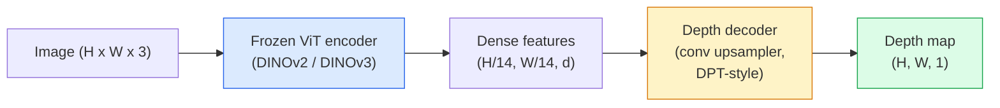

# Monocular Depth & Geometry Estimation

> Một bản đồ độ sâu là hình ảnh một kênh nơi mỗi pixel là khoảng cách từ máy ảnh. Dự đoán từ một khung RGB từng bất khả thi nếu không có stereo hoặc LiDAR. Năm 2026 một encoder ViT đóng băng cộng đầu nhẹ đạt trong phạm vi vài phần trăm sự thật nền.

**Type:** Build + Use
**Languages:** Python
**Prerequisites:** Phase 4 Lesson 14 (ViT), Phase 4 Lesson 17 (Self-Supervised Vision), Phase 4 Lesson 07 (U-Net)
**Time:** ~60 minutes

## Learning Objectives

- Phân biệt độ sâu tương đối và theo đơn vị đo và nêu mỗi mô hình production (MiDaS, Marigold, Depth Anything V3, ZoeDepth) giải loại nào
- Sử dụng Depth Anything V3 (backbone DINOv2) để dự đoán độ sâu cho các hình ảnh đơn tùy ý không cần hiệu chuẩn
- Giải thích tại sao độ sâu đơn mắt có thể hoạt động từ một hình ảnh (dấu hiệu phối cảnh, gradient kết cấu, tiên nghiệm được học) và không thể khôi phục gì (tỷ lệ tuyệt đối, hình học bị che khuất)
- Nâng các phát hiện 2D thành các điểm 3D bằng bản đồ độ sâu và nội tại máy ảnh lỗ kim

## The Problem

Độ sâu là trục còn thiếu trong thị giác máy tính 2D. Với RGB, bạn biết các vật xuất hiện ở đâu trong mặt phẳng hình ảnh; không biết chúng xa bao nhiêu. Các cảm biến độ sâu (bộ stereo, LiDAR, time-of-flight) giải trực tiếp nhưng đắt, mong manh và giới hạn tầm.

Ước lượng độ sâu đơn mắt — dự đoán độ sâu từ một khung RGB — từng tạo đầu ra mờ, không đáng tin. Đến năm 2026 các encoder lớn được tiền huấn luyện thay đổi điều đó: Depth Anything V3 dùng backbone DINOv2 đóng băng và tạo bản đồ độ sâu khái quát qua lĩnh vực trong nhà, ngoài trời, y tế và vệ tinh. Marigold đặt lại độ sâu thành bài toán khuếch tán có điều kiện. ZoeDepth hồi quy khoảng cách thật theo đơn vị đo.

Độ sâu cũng là cầu giữa phát hiện 2D và hiểu 3D: nhân các pixel của hộp phát hiện với độ sâu và bạn nâng đối tượng 2D thành đám mây điểm 3D. Đó là cốt lõi mọi hệ thống che khuất AR, mọi pipeline tránh chướng ngại và mọi robot "nhấc cốc".

## The Concept

### Relative vs metric depth

- **Độ sâu tương đối** — các giá trị `z` có thứ tự không có đơn vị thực. "Pixel A gần hơn pixel B, nhưng tỷ số khoảng cách không neo vào mét."
- **Độ sâu theo đơn vị đo** — khoảng cách tuyệt đối theo mét từ máy ảnh. Cần mô hình đã học quan hệ thống kê giữa các dấu hiệu hình ảnh và khoảng cách thật.

MiDaS và Depth Anything V3 tạo độ sâu tương đối. Marigold tạo độ sâu tương đối. ZoeDepth, UniDepth và Metric3D tạo độ sâu theo đơn vị đo. Các mô hình theo đơn vị đo nhạy với nội tại máy ảnh; mô hình tương đối thì không.

### The encoder-decoder pattern



Depth Anything V3 đóng băng encoder và chỉ huấn luyện decoder kiểu DPT. Encoder cung cấp đặc trưng phong phú; decoder nội suy chúng trở lại độ phân giải hình ảnh và hồi quy độ sâu.

### Why a single image produces depth at all

Một hình ảnh 2D chứa nhiều dấu hiệu đơn mắt tương quan với độ sâu:

- **Phối cảnh** — các đường song song trong 3D hội tụ trong 2D.
- **Gradient kết cấu** — các bề mặt xa có kết cấu nhỏ hơn, dày hơn.
- **Thứ tự che khuất** — các đối tượng gần che các đối tượng xa.
- **Tính hằng kích thước** — các đối tượng biết trước (xe, người) cho tỷ lệ gần đúng.
- **Phối cảnh khí quyển** — các đối tượng xa trông mờ sương và xanh hơn trong cảnh ngoài trời.

Một ViT huấn luyện trên hàng tỷ hình ảnh tiếp thu các dấu hiệu này. Với đủ dữ liệu và backbone mạnh, độ sâu đơn mắt đạt accuracy hợp lý mà không có giám sát 3D tường minh.

### What monocular depth cannot do

- **Tỷ lệ tuyệt đối theo đơn vị đo** không có nội tại hoặc đối tượng biết trước trong cảnh. Mạng có thể dự đoán "cốc xa gấp đôi thìa" mà không biết cốc cách 1 m hay 10 m.
- **Hình học bị che khuất** — mặt sau ghế không nhìn thấy và không thể suy ra đáng tin.
- **Các bề mặt thực sự không kết cấu / phản chiếu** — gương, kính, tường đồng nhất. Mạng báo độ sâu hợp lý nhưng sai.

### Depth Anything V3 in 2026

- DINOv2 ViT-L/14 nguyên bản làm encoder (đóng băng).
- Decoder DPT.
- Huấn luyện trên các cặp hình ảnh có tư thế từ nguồn đa dạng (không cần giám sát độ sâu tường minh ngoài tính nhất quán quang trắc).
- Dự đoán hình học nhất quán không gian từ **số đầu vào thị giác tùy ý, có hoặc không có tư thế máy ảnh đã biết**.
- SOTA trên độ sâu đơn mắt, hình học mọi góc nhìn, kết xuất thị giác, ước lượng tư thế máy ảnh.

Đây là mô hình thay trực tiếp để gọi khi cần độ sâu năm 2026.

### Marigold — diffusion for depth

Marigold (Ke et al., CVPR 2024) đặt lại ước lượng độ sâu thành khuếch tán ảnh-sang-ảnh có điều kiện. Điều kiện: RGB. Mục tiêu: bản đồ độ sâu. Dùng U-Net Stable Diffusion 2 được tiền huấn luyện làm backbone. Các bản đồ độ sâu đầu ra đặc biệt sắc ở biên đối tượng. Đánh đổi: suy luận chậm hơn mô hình truyền xuôi (10-50 bước khử nhiễu).

### Intrinsics and the pinhole camera

Để nâng pixel `(u, v)` có độ sâu `d` thành điểm 3D `(X, Y, Z)` trong tọa độ máy ảnh:

```math
\begin{aligned}
f_x, f_y, c_x, c_y &= \text{camera intrinsics} \\
X &= (u - c_x) \cdot d / f_x \\
Y &= (v - c_y) \cdot d / f_y \\
Z &= d
\end{aligned}
```

Các tham số nội tại đến từ metadata EXIF, một mẫu hiệu chuẩn hoặc một bộ ước lượng tham số nội tại đơn nhãn (Perspective Fields, UniDepth). Không có các tham số nội tại, bạn vẫn có thể kết xuất một đám mây điểm bằng cách giả định FOV 60-70° và một điểm chính tại tâm hình ảnh. Điều đó dùng được cho trực quan hóa, không phải cho đo lường.

### Evaluation

Hai thước đo tiêu chuẩn:

- **AbsRel** (sai số tương đối tuyệt đối): `mean(|d_pred - d_gt| / d_gt)`. Thấp hơn tốt hơn. 0.05-0.1 cho mô hình production.
- **delta < 1.25** (accuracy ngưỡng): tỷ lệ pixel có `max(d_pred/d_gt, d_gt/d_pred) < 1.25`. Cao hơn tốt hơn. 0.9+ cho SOTA.

Với độ sâu tương đối (Depth Anything V3, MiDaS), đánh giá dùng các phiên bản bất biến tỷ lệ-và-dịch chuyển của cả hai thước đo.

```figure
depth-sweep
```

## Build It

### Step 1: Depth metrics

```python
import torch

def abs_rel_error(pred, target, mask=None):
    if mask is not None:
        pred = pred[mask]
        target = target[mask]
    return (torch.abs(pred - target) / target.clamp(min=1e-6)).mean().item()


def delta_accuracy(pred, target, threshold=1.25, mask=None):
    if mask is not None:
        pred = pred[mask]
        target = target[mask]
    ratio = torch.maximum(pred / target.clamp(min=1e-6), target / pred.clamp(min=1e-6))
    return (ratio < threshold).float().mean().item()
```

Luôn che các pixel độ sâu không hợp lệ (không, NaN, bão hòa) trước đánh giá.

### Step 2: Scale-and-shift alignment

Với mô hình độ sâu tương đối, căn chỉnh dự đoán tới sự thật nền trước tính thước đo. Khớp bình phương tối thiểu `a * pred + b = target`:

```python
def align_scale_shift(pred, target, mask=None):
    if mask is not None:
        p = pred[mask]
        t = target[mask]
    else:
        p = pred.flatten()
        t = target.flatten()
    A = torch.stack([p, torch.ones_like(p)], dim=1)
    coeffs, *_ = torch.linalg.lstsq(A, t.unsqueeze(-1))
    a, b = coeffs[:2, 0]
    return a * pred + b
```

Chạy `align_scale_shift` trước `abs_rel_error` khi đánh giá MiDaS / Depth Anything.

### Step 3: Lift depth to a point cloud

```python
import numpy as np

def depth_to_point_cloud(depth, intrinsics):
    H, W = depth.shape
    fx, fy, cx, cy = intrinsics
    v, u = np.meshgrid(np.arange(H), np.arange(W), indexing="ij")
    z = depth
    x = (u - cx) * z / fx
    y = (v - cy) * z / fy
    return np.stack([x, y, z], axis=-1)


depth = np.random.uniform(0.5, 4.0, (240, 320))
intr = (320.0, 320.0, 160.0, 120.0)
pc = depth_to_point_cloud(depth, intr)
print(f"point cloud shape: {pc.shape}  (H, W, 3)")
```

Một hàm, mọi ứng dụng nâng lên 3D. Xuất đám mây điểm sang `.ply` và mở trong MeshLab hoặc CloudCompare.

### Step 4: Smoke test with a synthetic depth scene

```python
def synthetic_depth(size=96):
    yy, xx = np.meshgrid(np.arange(size), np.arange(size), indexing="ij")
    # Floor: linear gradient from near (top) to far (bottom)
    depth = 1.0 + (yy / size) * 4.0
    # Box in the middle: closer
    mask = (np.abs(xx - size / 2) < size / 6) & (np.abs(yy - size * 0.6) < size / 6)
    depth[mask] = 2.0
    return depth.astype(np.float32)


gt = torch.from_numpy(synthetic_depth(96))
pred = gt + 0.3 * torch.randn_like(gt)  # simulated prediction
aligned = align_scale_shift(pred, gt)
print(f"before align  absRel = {abs_rel_error(pred, gt):.3f}")
print(f"after align   absRel = {abs_rel_error(aligned, gt):.3f}")
```

### Step 5: Depth Anything V2 usage (reference)

```python
import numpy as np
from transformers import pipeline
from PIL import Image

pipe = pipeline(task="depth-estimation", model="depth-anything/Depth-Anything-V2-Large-hf")

image = Image.open("street.jpg").convert("RGB")
out = pipe(image)
depth_np = np.array(out["depth"])
```

Ba dòng. `out["depth"]` là thang xám PIL; chuyển sang numpy để tính toán. Depth Anything 3 (tháng 11 năm 2025) không tải qua pipeline này. Nó cung cấp gói `depth_anything_3` riêng: `DepthAnything3.from_pretrained("depth-anything/DA3MONO-LARGE")` tải mô hình đơn mắt tương đối, và `model.inference(images).depth` trả mảng độ sâu `[N, H, W]`.

## Use It

- **Depth Anything V3** (Meta AI / ByteDance, 2024-2026) — mặc định cho độ sâu tương đối. Mô hình backbone ViT-large nhanh nhất trong production.
- **Marigold** (ETH, 2024) — chất lượng trực quan cao nhất, suy luận chậm.
- **UniDepth** (ETH, 2024) — độ sâu theo đơn vị đo với ước lượng nội tại máy ảnh.
- **ZoeDepth** (Intel, 2023) — độ sâu theo đơn vị đo; cũ hơn, vẫn đáng tin.
- **MiDaS v3.1** — cũ nhưng ổn định; đường cơ sở tốt để so sánh.

Mẫu tích hợp điển hình:

1. Khung RGB đến.
2. Mô hình độ sâu tạo bản đồ độ sâu.
3. Bộ phát hiện tạo các hộp.
4. Nâng các trọng tâm hộp qua độ sâu lên 3D; gộp với đám mây điểm nếu có.
5. Phía sau: che khuất AR, lập kế hoạch đường đi, ước lượng kích thước đối tượng, thay stereo.

Cho thời gian thực, Depth Anything V2 Small (lượng tử hóa INT8) đạt ~30 fps trên GPU tiêu dùng ở 518x518.

## Ship It

Bài học này tạo ra:

- `outputs/prompt-depth-model-picker.md` — chọn giữa Depth Anything V3, Marigold, UniDepth, MiDaS với độ trễ, nhu cầu theo đơn vị đo-so-với-tương đối và loại cảnh cho trước.
- `outputs/skill-depth-to-pointcloud.md` — một skill xây đám mây điểm từ bản đồ độ sâu với xử lý nội tại đúng và xuất `.ply`.

## Exercises

1. **(Dễ)** Chạy Depth Anything V2 trên bất kỳ 10 ảnh bàn làm việc của bạn. Lưu độ sâu thành PNG thang xám và xem xét. Xác định một đối tượng có độ sâu dự đoán trông sai và giải thích tại sao các dấu hiệu đơn mắt thất bại.
2. **(Vừa)** Với RGB + độ sâu từ Depth Anything V2, nâng thành đám mây điểm và kết xuất bằng `open3d`. So sánh hai cảnh (trong nhà / ngoài trời) và ghi chú cảnh nào đáng tin hơn.
3. **(Khó)** Lấy năm cặp ảnh chỉ khác vị trí một đối tượng biết trước (ví dụ chai di chuyển gần hơn 30 cm). Dùng UniDepth dự đoán độ sâu theo đơn vị đo trên cả hai. Báo cáo chênh lệch khoảng cách dự đoán so với 30 cm thật.

## Key Terms

| Thuật ngữ | Cách mọi người nói | Ý nghĩa thực sự |
|------|----------------|----------------------|
| Monocular depth (Độ sâu đơn mắt) | "Độ sâu một hình ảnh" | Ước lượng độ sâu từ một khung RGB, không stereo hoặc LiDAR |
| Relative depth (Độ sâu tương đối) | "Độ sâu có thứ tự" | Các giá trị z có thứ tự không có đơn vị thực |
| Metric depth (Độ sâu theo đơn vị đo) | "Khoảng cách tuyệt đối" | Độ sâu theo mét; cần hiệu chuẩn hoặc mô hình được huấn luyện với giám sát theo đơn vị đo |
| AbsRel | "Sai số tương đối tuyệt đối" | Trung bình $\lvert d_{\text{pred}} - d_{\text{gt}} \rvert / d_{\text{gt}}$; thước đo độ sâu tiêu chuẩn |
| Delta accuracy (Accuracy delta) | "delta < 1.25" | Tỷ lệ pixel có dự đoán trong 25% sự thật nền |
| Pinhole camera (Máy ảnh lỗ kim) | "fx, fy, cx, cy" | Mô hình máy ảnh dùng để nâng (u, v, d) thành (X, Y, Z) |
| DPT | "Dense Prediction Transformer" | Decoder dựa trên tích chập dùng trên encoder ViT đóng băng cho độ sâu |
| DINOv2 backbone (Backbone DINOv2) | "Lý do nó hoạt động" | Các đặc trưng tự giám sát khái quát giữa lĩnh vực không cần nhãn độ sâu |

## Further Reading

- [Depth Anything V3 paper page](https://depth-anything.github.io/) — độ sâu đơn mắt SOTA với encoder DINOv2
- [Marigold (Ke et al., CVPR 2024)](https://marigoldmonodepth.github.io/) — ước lượng độ sâu dựa trên khuếch tán
- [UniDepth (Piccinelli et al., 2024)](https://arxiv.org/abs/2403.18913) — độ sâu theo đơn vị đo với nội tại
- [MiDaS v3.1 (Intel ISL)](https://github.com/isl-org/MiDaS) — đường cơ sở độ sâu tương đối chuẩn
- [DINOv3 blog post (Meta)](https://ai.meta.com/blog/dinov3-self-supervised-vision-model/) — họ encoder nâng accuracy độ sâu
