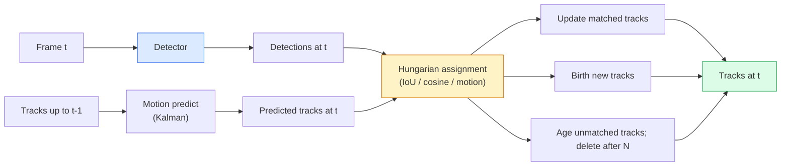

# Multi-Object Tracking & Video Memory

> Theo dõi là phát hiện cộng liên kết. Phát hiện mỗi khung hình. Ghép các phát hiện khung này với các quỹ đạo khung trước theo ID.

**Type:** Build
**Languages:** Python
**Prerequisites:** Phase 4 Lesson 06 (YOLO Detection), Phase 4 Lesson 08 (Mask R-CNN), Phase 4 Lesson 24 (SAM 3)
**Time:** ~60 minutes

## Learning Objectives

- Phân biệt theo dõi-bằng-phát hiện với theo dõi dựa trên truy vấn và nêu tên các họ thuật toán (SORT, DeepSORT, ByteTrack, BoT-SORT, bộ theo dõi bộ nhớ SAM 2, SAM 3.1 Object Multiplex)
- Triển khai IoU + phép gán Hungarian từ đầu cho theo dõi-bằng-phát hiện cổ điển
- Giải thích ngân hàng bộ nhớ SAM 2 và tại sao xử lý che khuất tốt hơn liên kết dựa trên IoU
- Đọc ba thước đo theo dõi (MOTA, IDF1, HOTA) và chọn loại quan trọng cho trường hợp sử dụng nhất định

## The Problem

Bộ phát hiện cho biết các đối tượng ở đâu trong một khung hình. Bộ theo dõi cho biết phát hiện nào trong khung `t` là cùng đối tượng với phát hiện trong khung `t-1`. Không có điều đó, bạn không thể đếm đối tượng vượt đường, theo bóng qua che khuất hoặc biết "xe #4 đã ở trong làn 8 giây."

Theo dõi thiết yếu cho mọi sản phẩm tiếp xúc video: phân tích thể thao, giám sát, lái xe tự hành, phân tích video y tế, giám sát động vật hoang dã, đếm nhãn chữ. Các khối cốt lõi dùng chung: bộ phát hiện từng khung, mô hình chuyển động (bộ lọc Kalman hoặc thứ phong phú hơn), bước liên kết (thuật toán Hungarian trên IoU / cosine / đặc trưng được học) và vòng đời quỹ đạo (sinh, cập nhật, chết).

Năm 2026 mang hai mẫu mới: **theo dõi dựa trên bộ nhớ SAM 2** (bộ nhớ đặc trưng thay liên kết mô hình chuyển động) và **SAM 3.1 Object Multiplex** (bộ nhớ dùng chung cho nhiều thực thể cùng khái niệm). Bài này đi qua bộ công cụ cổ điển trước, rồi cách dựa trên bộ nhớ.

## The Concept

### Tracking-by-detection



Mọi bộ theo dõi bạn gặp năm 2026 là biến thể vòng lặp này. Các khác biệt:

- **SORT** (2016): bộ lọc Kalman + Hungarian IoU. Đơn giản, nhanh, không mô hình diện mạo.
- **DeepSORT** (2017): SORT + một đặc trưng diện mạo dựa trên CNN mỗi quỹ đạo (embedding ReID). Xử lý giao cắt tốt hơn.
- **ByteTrack** (2021): liên kết các phát hiện tin cậy thấp như giai đoạn thứ hai; không cần đặc trưng diện mạo nhưng đạt hàng đầu trên MOT17.
- **BoT-SORT** (2022): Byte + bù chuyển động máy ảnh + ReID.
- **StrongSORT / OC-SORT** — các hậu duệ ByteTrack với chuyển động và diện mạo tốt hơn.

### Kalman filter in one paragraph

Bộ lọc Kalman duy trì trạng thái từng quỹ đạo `(x, y, w, h, dx, dy, dw, dh)` cùng hiệp phương sai. Mỗi khung, **dự đoán** trạng thái bằng mô hình vận tốc không đổi, rồi **cập nhật** bằng phát hiện được ghép. Cập nhật tin phát hiện hơn khi độ bất định dự đoán cao. Điều này cho quỹ đạo mượt và khả năng tiếp tục quỹ đạo qua che khuất ngắn (1-5 khung).

Mọi bộ theo dõi cổ điển dùng bộ lọc Kalman ở bước dự đoán chuyển động.

### The Hungarian algorithm

Với ma trận chi phí `M x N` (quỹ đạo x phát hiện), tìm phép gán một-một tối thiểu tổng chi phí. Chi phí thường `1 - IoU(track_bbox, detection_bbox)` hoặc âm độ tương đồng cosine của đặc trưng diện mạo. Thời gian chạy O((M+N)^3); với M, N tới ~1000, đủ nhanh trong Python qua `scipy.optimize.linear_sum_assignment`.

### ByteTrack's key idea

Các bộ theo dõi tiêu chuẩn bỏ phát hiện tin cậy thấp (< 0.5). ByteTrack giữ chúng như **ứng viên giai đoạn hai**: sau ghép quỹ đạo với phát hiện tin cậy cao, các quỹ đạo chưa ghép thử ghép phát hiện tin cậy thấp với ngưỡng IoU lỏng hơn một chút. Khôi phục che khuất ngắn, các lần đổi ID gần đám đông.

### SAM 2 memory-based tracking

SAM 2 xử lý video bằng cách giữ **ngân hàng bộ nhớ** các đặc trưng không-thời gian từng thực thể. Với một prompt (nhấp, hộp, văn bản) trên một khung, nó mã hóa thực thể vào bộ nhớ. Trên các khung sau, bộ nhớ được cross-attention với các đặc trưng khung mới, và decoder tạo mặt nạ cho cùng thực thể trong khung mới.

Không bộ lọc Kalman, không phép gán Hungarian. Liên kết ngầm trong phép toán attention bộ nhớ.

Ưu điểm:
- Vững trước che khuất lớn (bộ nhớ mang danh tính thực thể qua nhiều khung).
- Từ vựng mở khi kết hợp các prompt văn bản SAM 3.
- Hoạt động không cần mô hình chuyển động riêng.

Nhược điểm:
- Chậm hơn ByteTrack cho theo dõi nhiều đối tượng.
- Ngân hàng bộ nhớ tăng; giới hạn cửa sổ ngữ cảnh.

### SAM 3.1 Object Multiplex

Theo dõi SAM 2 / SAM 3 trước giữ ngân hàng bộ nhớ riêng mỗi thực thể. Với 50 đối tượng, 50 ngân hàng bộ nhớ. Object Multiplex (tháng 3 năm 2026) gộp thành một bộ nhớ dùng chung với **token truy vấn từng thực thể**. Chi phí tăng dưới tuyến tính theo số thực thể.

Multiplex là mặc định mới cho theo dõi đám đông năm 2026: đám đông hòa nhạc, nhân viên kho, giao lộ.

### Three metrics to know

- **MOTA (Multi-Object Tracking Accuracy)** — 1 - (FN + FP + các lần đổi ID) / GT. Có trọng số theo loại lỗi; một thước đo trộn các thất bại phát hiện và liên kết.
- **IDF1 (ID F1)** — trung bình điều hòa của precision và recall ID. Tập trung cụ thể vào mức độ mỗi quỹ đạo sự thật nền giữ ID theo thời gian. Tốt hơn MOTA cho tác vụ nhạy đổi ID.
- **HOTA (Higher Order Tracking Accuracy)** — phân tách thành accuracy phát hiện (DetA) và accuracy liên kết (AssA). Tiêu chuẩn cộng đồng từ 2020; toàn diện nhất.

Với giám sát (ai là ai): IDF1 là thứ báo cáo. Với phân tích thể thao (đếm đường chuyền): HOTA. Với so sánh học thuật tổng quát: HOTA.

```figure
cv3-track-assoc
```

## Build It

### Step 1: IoU-based cost matrix

```python
import numpy as np


def bbox_iou(a, b):
    """
    a, b: (N, 4) arrays of [x1, y1, x2, y2].
    Returns (N_a, N_b) IoU matrix.
    """
    ax1, ay1, ax2, ay2 = a[:, 0], a[:, 1], a[:, 2], a[:, 3]
    bx1, by1, bx2, by2 = b[:, 0], b[:, 1], b[:, 2], b[:, 3]
    inter_x1 = np.maximum(ax1[:, None], bx1[None, :])
    inter_y1 = np.maximum(ay1[:, None], by1[None, :])
    inter_x2 = np.minimum(ax2[:, None], bx2[None, :])
    inter_y2 = np.minimum(ay2[:, None], by2[None, :])
    inter = np.clip(inter_x2 - inter_x1, 0, None) * np.clip(inter_y2 - inter_y1, 0, None)
    area_a = (ax2 - ax1) * (ay2 - ay1)
    area_b = (bx2 - bx1) * (by2 - by1)
    union = area_a[:, None] + area_b[None, :] - inter
    return inter / np.clip(union, 1e-8, None)
```

### Step 2: Minimal SORT-style tracker

Kalman vận tốc không đổi cố định được bỏ để ngắn gọn — dùng liên kết IoU đơn giản ở đây; trong production dự đoán Kalman thiết yếu. Gói Python `sort` cung cấp phiên bản đầy đủ.

```python
from scipy.optimize import linear_sum_assignment


class Track:
    def __init__(self, tid, bbox, frame):
        self.id = tid
        self.bbox = bbox
        self.last_frame = frame
        self.hits = 1

    def update(self, bbox, frame):
        self.bbox = bbox
        self.last_frame = frame
        self.hits += 1


class SimpleTracker:
    def __init__(self, iou_threshold=0.3, max_age=5):
        self.tracks = []
        self.next_id = 1
        self.iou_threshold = iou_threshold
        self.max_age = max_age

    def step(self, detections, frame):
        if not self.tracks:
            for d in detections:
                self.tracks.append(Track(self.next_id, d, frame))
                self.next_id += 1
            return [(t.id, t.bbox) for t in self.tracks]

        track_boxes = np.array([t.bbox for t in self.tracks])
        det_boxes = np.array(detections) if len(detections) else np.empty((0, 4))

        iou = bbox_iou(track_boxes, det_boxes) if len(det_boxes) else np.zeros((len(track_boxes), 0))
        cost = 1 - iou
        cost[iou < self.iou_threshold] = 1e6

        matched_track = set()
        matched_det = set()
        if cost.size > 0:
            row, col = linear_sum_assignment(cost)
            for r, c in zip(row, col):
                if cost[r, c] < 1.0:
                    self.tracks[r].update(det_boxes[c], frame)
                    matched_track.add(r); matched_det.add(c)

        for i, d in enumerate(det_boxes):
            if i not in matched_det:
                self.tracks.append(Track(self.next_id, d, frame))
                self.next_id += 1

        self.tracks = [t for t in self.tracks if frame - t.last_frame <= self.max_age]
        return [(t.id, t.bbox) for t in self.tracks]
```

60 dòng. Nhận phát hiện từng khung, trả ID quỹ đạo từng khung. Các hệ thống thật thêm dự đoán Kalman, ghép lại giai đoạn hai ByteTrack và đặc trưng diện mạo.

### Step 3: Synthetic trajectory test

```python
def synthetic_frames(num_frames=20, num_objects=3, H=240, W=320, seed=0):
    rng = np.random.default_rng(seed)
    starts = rng.uniform(20, 200, size=(num_objects, 2))
    velocities = rng.uniform(-5, 5, size=(num_objects, 2))
    frames = []
    for f in range(num_frames):
        dets = []
        for i in range(num_objects):
            cx, cy = starts[i] + f * velocities[i]
            dets.append([cx - 10, cy - 10, cx + 10, cy + 10])
        frames.append(dets)
    return frames


tracker = SimpleTracker()
for f, dets in enumerate(synthetic_frames()):
    tracks = tracker.step(dets, f)
```

Ba đối tượng di chuyển thẳng nên giữ ID qua cả 20 khung.

### Step 4: ID-switch metric

```python
def count_id_switches(tracks_per_frame, gt_per_frame):
    """
    tracks_per_frame:  list of list of (track_id, bbox)
    gt_per_frame:      list of list of (gt_id, bbox)
    Returns number of ID switches.
    """
    prev_assignment = {}
    switches = 0
    for tracks, gts in zip(tracks_per_frame, gt_per_frame):
        if not tracks or not gts:
            continue
        t_boxes = np.array([b for _, b in tracks])
        g_boxes = np.array([b for _, b in gts])
        iou = bbox_iou(g_boxes, t_boxes)
        for g_idx, (gt_id, _) in enumerate(gts):
            j = iou[g_idx].argmax()
            if iou[g_idx, j] > 0.5:
                t_id = tracks[j][0]
                if gt_id in prev_assignment and prev_assignment[gt_id] != t_id:
                    switches += 1
                prev_assignment[gt_id] = t_id
    return switches
```

Đây là thước đo đơn giản gần IDF1: đếm số lần một đối tượng sự thật nền thay ID quỹ đạo dự đoán được gán. Công cụ MOTA / IDF1 / HOTA thật nằm trong `py-motmetrics` và `TrackEval`.

## Use It

Các bộ theo dõi production năm 2026:

- `ultralytics` — YOLOv8 + ByteTrack / BoT-SORT tích hợp. `results = model.track(source, tracker="bytetrack.yaml")`. Mặc định.
- `supervision` (Roboflow) — các lớp bọc ByteTrack cộng tiện ích chú thích.
- SAM 2 / SAM 3.1 — theo dõi dựa trên bộ nhớ qua `processor.track()`.
- Bộ công cụ tùy chỉnh: bộ phát hiện (YOLOv8 / RT-DETR) + `sort-tracker` / `OC-SORT` / `StrongSORT`.

Lựa chọn:

- Người đi bộ / xe / hộp ở 30+ fps: **ByteTrack với ultralytics**.
- Nhiều thực thể cùng lớp trong đám đông: **SAM 3.1 Object Multiplex**.
- Che khuất nặng với diện mạo nhận diện được: **DeepSORT / StrongSORT** (đặc trưng ReID).
- Thể thao / tương tác phức tạp: **BoT-SORT** hoặc bộ theo dõi được học (MOTRv3).

## Ship It

Bài học này tạo ra:

- `outputs/prompt-tracker-picker.md` — chọn SORT / ByteTrack / BoT-SORT / SAM 2 / SAM 3.1 với loại cảnh, mẫu che khuất và ngân sách độ trễ cho trước.
- `outputs/skill-mot-evaluator.md` — viết bộ đánh giá hoàn chỉnh cho MOTA / IDF1 / HOTA so với các quỹ đạo sự thật nền.

## Exercises

1. **(Dễ)** Chạy bộ theo dõi tổng hợp trên với 3, 10 và 30 đối tượng. Báo cáo số lần đổi ID mỗi trường hợp. Xác định nơi liên kết đơn giản chỉ IoU bắt đầu thất bại.
2. **(Vừa)** Thêm bước dự đoán Kalman vận tốc không đổi trước liên kết. Cho thấy che khuất ngắn (2-3 khung) không còn gây đổi ID.
3. **(Khó)** Tích hợp bộ theo dõi dựa trên bộ nhớ SAM 2 (qua `transformers`) như backend theo dõi thay thế. Chạy cả SimpleTracker và SAM 2 trên clip đám đông 30 giây và so sánh số lần đổi ID, gán nhãn tay ID sự thật nền cho 5 người nổi bật.

## Key Terms

| Thuật ngữ | Cách mọi người nói | Ý nghĩa thực sự |
|------|----------------|----------------------|
| Tracking-by-detection (Theo dõi bằng phát hiện) | "Phát hiện rồi liên kết" | Bộ phát hiện từng khung + phép gán Hungarian trên IoU / diện mạo |
| Kalman filter (Bộ lọc Kalman) | "Dự đoán chuyển động" | Động lực học tuyến tính + hiệp phương sai cho dự đoán quỹ đạo mượt và xử lý che khuất |
| Hungarian algorithm (Thuật toán Hungarian) | "Phép gán tối ưu" | Giải bài toán ghép hai phía chi phí tối thiểu; `scipy.optimize.linear_sum_assignment` |
| ByteTrack | "Lượt hai tin cậy thấp" | Ghép lại các quỹ đạo chưa ghép với phát hiện tin cậy thấp để khôi phục che khuất ngắn |
| DeepSORT | "SORT + diện mạo" | Thêm đặc trưng ReID để ghép giữa khung; tốt hơn để giữ ID |
| Memory bank (Ngân hàng bộ nhớ) | "Thủ thuật SAM 2" | Các đặc trưng không-thời gian từng thực thể lưu qua các khung; cross-attention thay liên kết tường minh |
| Object Multiplex | "Bộ nhớ dùng chung SAM 3.1" | Một bộ nhớ dùng chung với truy vấn từng thực thể để theo dõi nhanh nhiều đối tượng |
| HOTA | "Thước đo theo dõi hiện đại" | Phân tách thành accuracy phát hiện và liên kết; tiêu chuẩn cộng đồng |

## Further Reading

- [SORT (Bewley et al., 2016)](https://arxiv.org/abs/1602.00763) — bài báo theo dõi-bằng-phát hiện tối giản
- [DeepSORT (Wojke et al., 2017)](https://arxiv.org/abs/1703.07402) — thêm đặc trưng diện mạo
- [ByteTrack (Zhang et al., 2022)](https://arxiv.org/abs/2110.06864) — lượt hai tin cậy thấp
- [BoT-SORT (Aharon et al., 2022)](https://arxiv.org/abs/2206.14651) — bù chuyển động máy ảnh
- [HOTA (Luiten et al., 2020)](https://arxiv.org/abs/2009.07736) — thước đo theo dõi phân tách
- [SAM 2 video segmentation (Meta, 2024)](https://ai.meta.com/sam2/) — bộ theo dõi dựa trên bộ nhớ
- [SAM 3.1 Object Multiplex (Meta, March 2026)](https://ai.meta.com/blog/segment-anything-model-3/)
