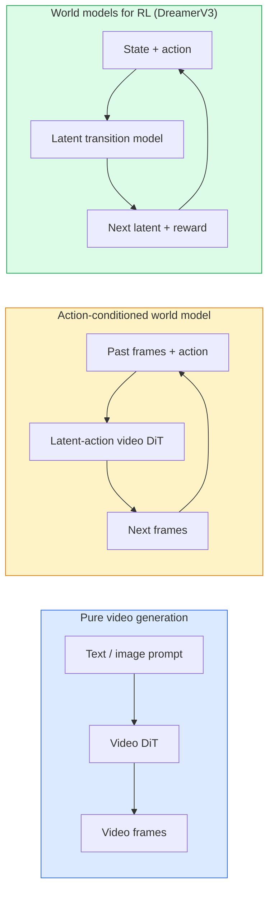

# World Models & Video Diffusion

> Một mô hình video dự đoán những giây tiếp theo của một cảnh là một bộ mô phỏng thế giới. Điều kiện hóa dự đoán đó theo các hành động và bạn có một game engine được học.

**Type:** Learn + Build
**Languages:** Python
**Prerequisites:** Phase 4 Lesson 10 (Diffusion), Phase 4 Lesson 12 (Video Understanding), Phase 4 Lesson 23 (DiT + Rectified Flow)
**Time:** ~75 minutes

## Learning Objectives

- Giải thích sự khác biệt giữa một mô hình sinh video thuần túy (Sora 2) và một world model được điều kiện hóa theo hành động (Genie 3, DreamerV3)
- Mô tả một video DiT: các patch không gian-thời gian, mã hóa vị trí 3D, attention kết hợp trên các token (T, H, W)
- Lần theo cách một world model kết nối vào robot học: VLM lập kế hoạch → mô hình video mô phỏng → động lực học nghịch đảo đưa ra các hành động
- Chọn giữa Sora 2, Genie 3, Runway GWM-1 Worlds, Wan-Video và HunyuanVideo cho một trường hợp sử dụng nhất định (video sáng tạo, mô phỏng tương tác, tổng hợp cho lái xe tự hành)

## The Problem

Sinh video và mô hình hóa thế giới hội tụ vào năm 2026. Một mô hình có thể sinh một phút video mạch lạc, theo một nghĩa nào đó, đã học được cách thế giới chuyển động: tính thường tồn của đối tượng, trọng lực, quan hệ nhân quả, phong cách. Nếu bạn điều kiện hóa dự đoán đó theo các hành động (đi sang trái, mở cửa), mô hình video trở thành một bộ mô phỏng có thể học có thể thay thế một game engine, một bộ mô phỏng lái xe hoặc một môi trường robot học.

Những gì được đặt cược là cụ thể. Genie 3 sinh các môi trường có thể chơi từ một hình ảnh duy nhất. Runway GWM-1 Worlds tổng hợp vô hạn cảnh có thể khám phá. Sora 2 tạo ra các video dài một phút với âm thanh được đồng bộ hóa và vật lý được mô hình hóa. NVIDIA Cosmos-Drive, Wayve Gaia-2 và Tesla DrivingWorld sinh video lái xe chân thực làm dữ liệu huấn luyện xe tự hành. Mô thức world model đang âm thầm tiếp quản sim-to-real cho robot học.

Bài học này là bài học về "bức tranh lớn" của Phase 4. Nó kết nối sinh ảnh, hiểu video và suy luận tác tử thành mẫu kiến trúc mà nghiên cứu chủ đạo đang hướng tới.

## The Concept

### Three families of world-modelling



- **Sora 2** là sinh video thuần túy được điều kiện hóa theo prompt. Không có giao diện hành động. Bạn không thể "điều khiển" nó giữa rollout.
- **Genie 3**, **GWM-1 Worlds**, **Mirage / Magica** là các world model được điều kiện hóa theo hành động. Suy ra các hành động tiềm ẩn từ video được quan sát, rồi điều kiện hóa các dự đoán khung hình tương lai theo các hành động. Có tính tương tác — bạn nhấn phím hoặc di chuyển camera và cảnh phản hồi.
- **DreamerV3** và họ world model RL kinh điển dự đoán trong một không gian tiềm ẩn với điều kiện hóa hành động tường minh, được huấn luyện dựa trên một tín hiệu phần thưởng. Ít trực quan hơn; hữu ích hơn cho RL hiệu quả về mẫu.

### Video DiT architecture

```
Video latent:          (C, T, H, W)
Patchify (spatial):    grid of P_h x P_w patches per frame
Patchify (temporal):   group P_t frames into a temporal patch
Resulting tokens:      (T / P_t) * (H / P_h) * (W / P_w) tokens
```

Mã hóa vị trí là 3D: một embedding xoay hoặc được học cho mỗi tọa độ (t, h, w). Attention có thể là:

- **Kết hợp đầy đủ** — tất cả token chú ý đến tất cả token. $O(N^2)$ với $N$ token. Quá tốn kém đối với video dài.
- **Phân chia** — luân phiên attention theo thời gian (cùng vị trí không gian, qua thời gian: `(H*W) * T^2`) và attention theo không gian (cùng bước thời gian, qua không gian: `T * (H*W)^2`). Được TimeSformer và phần lớn video DiT sử dụng.
- **Cửa sổ** — các cửa sổ cục bộ trong (t, h, w). Được Video Swin sử dụng.

Mọi mô hình video diffusion năm 2026 đều sử dụng một trong ba mẫu này cộng với điều kiện hóa AdaLN (Bài 23) và rectified flow.

### Conditioning on actions: latent action models

Genie học một **hành động tiềm ẩn** cho mỗi khung hình bằng cách dự đoán theo cách phân biệt hành động giữa một cặp khung hình liên tiếp. Sau đó, bộ giải mã của mô hình được điều kiện hóa theo hành động tiềm ẩn được suy ra — không theo các phím bàn phím tường minh. Khi suy luận, người dùng có thể chỉ định một hành động tiềm ẩn (hoặc lấy mẫu một hành động từ một phân phối tiên nghiệm mới) và mô hình sinh khung hình tiếp theo nhất quán với hành động đó.

Sora bỏ qua hoàn toàn giao diện hành động. Bộ giải mã của nó dự đoán các token không-thời gian tiếp theo từ các token không-thời gian trước đó. Prompt điều kiện hóa phần bắt đầu; không có gì điều khiển nó giữa quá trình sinh.

### Physical plausibility

Bản phát hành năm 2026 của Sora 2 quảng bá rõ ràng **tính hợp lý về vật lý**: trọng lượng, cân bằng, tính thường tồn của đối tượng, nguyên nhân và kết quả. Được nhóm đo bằng các điểm tính hợp lý do con người chấm; mô hình cải thiện rõ rệt đối với các vật bị thả rơi, các nhân vật va chạm và những thất bại có chủ ý (một cú nhảy hụt) so với Sora 1.

Tính hợp lý vẫn là dạng lỗi chủ đạo. Các video năm 2024-2025 về người ăn mì spaghetti hoặc uống từ ly cho thấy mô hình thiếu biểu diễn đối tượng bền vững. Các mô hình năm 2026 (Sora 2, Runway Gen-5, HunyuanVideo) giảm bớt nhưng không loại bỏ những lỗi này.

### Autonomous driving world models

Các world model lái xe sinh những cảnh đường phố chân thực được điều kiện hóa theo quỹ đạo, bounding box hoặc bản đồ dẫn đường. Cách sử dụng:

- **Cosmos-Drive-Dreams** (NVIDIA) — sinh nhiều phút video lái xe để huấn luyện RL.
- **Gaia-2** (Wayve) — tổng hợp cảnh được điều kiện hóa theo quỹ đạo để đánh giá chính sách.
- **DrivingWorld** (Tesla) — mô phỏng các điều kiện thời tiết, thời điểm trong ngày, giao thông đa dạng.
- **Vista** (ByteDance) — tổng hợp cảnh lái xe có tính phản ứng.

Chúng thay thế việc thu thập dữ liệu thực tế tốn kém cho các trường hợp góc — người đi bộ sang đường sai luật vào ban đêm, giao lộ đóng băng, các loại xe khác thường — mà nếu không sẽ đòi hỏi hàng triệu dặm lái xe.

### Robotics stack: VLM + video model + inverse dynamics

Vòng lặp robot học ba thành phần đang hình thành:

1. **VLM** phân tích mục tiêu ("nhấc chiếc cốc đỏ lên"), lập kế hoạch một chuỗi hành động cấp cao.
2. **Mô hình sinh video** mô phỏng việc thực hiện từng hành động sẽ trông như thế nào — dự đoán các quan sát trước N khung hình.
3. **Mô hình động lực học nghịch đảo** trích xuất các lệnh động cơ cụ thể sẽ tạo ra những quan sát đó.

Điều này thay thế việc định hình phần thưởng và RL cần nhiều mẫu. World model thực hiện việc tưởng tượng; động lực học nghịch đảo khép kín vòng lặp về chấp hành. Genie Envisioner là một cách hiện thực hóa; nhiều nhóm nghiên cứu đang hội tụ về cấu trúc này.

### Evaluation

- **Chất lượng hình ảnh** — FVD (Fréchet Video Distance), các nghiên cứu người dùng.
- **Mức độ phù hợp với prompt** — CLIPScore cho mỗi khung hình, đánh giá kiểu VQA.
- **Tính hợp lý về vật lý** — do con người chấm trên một bộ benchmark (benchmark nội bộ của Sora 2, VBench).
- **Khả năng điều khiển** (đối với các world model tương tác) — tính nhất quán hành động → quan sát; bạn có thể quay lại một trạng thái trước đó không?

### Model landscape in 2026

| Mô hình | Công dụng | Tham số | Đầu ra | Giấy phép |
|-------|-----|------------|--------|---------|
| Sora 2 | văn bản thành video, âm thanh | — | 1080p dài 1 phút + âm thanh | Chỉ API |
| Runway Gen-5 | văn bản/hình ảnh thành video | — | các đoạn phim 10s | API |
| Runway GWM-1 Worlds | thế giới tương tác | — | rollout 3D vô hạn | API |
| Genie 3 | thế giới tương tác từ hình ảnh | 11B+ | các khung hình có thể chơi | bản xem trước nghiên cứu |
| Wan-Video 2.1 | văn bản thành video mở | 14B | các đoạn phim chất lượng cao | phi thương mại |
| HunyuanVideo | văn bản thành video mở | 13B | các đoạn phim 10s | dễ dãi |
| Cosmos / Cosmos-Drive | mô phỏng lái xe tự hành | 7-14B | các cảnh lái xe | NVIDIA mở |
| Magica / Mirage 2 | game engine AI-native | — | các thế giới có thể chỉnh sửa | sản phẩm |

```figure
v4-world-rollout
```

## Build It

### Step 1: 3D patchify for video

```python
import torch
import torch.nn as nn


class VideoPatch3D(nn.Module):
    def __init__(self, in_channels=4, dim=64, patch_t=2, patch_h=2, patch_w=2):
        super().__init__()
        self.proj = nn.Conv3d(
            in_channels, dim,
            kernel_size=(patch_t, patch_h, patch_w),
            stride=(patch_t, patch_h, patch_w),
        )
        self.patch_t = patch_t
        self.patch_h = patch_h
        self.patch_w = patch_w

    def forward(self, x):
        # x: (N, C, T, H, W)
        x = self.proj(x)
        n, c, t, h, w = x.shape
        tokens = x.reshape(n, c, t * h * w).transpose(1, 2)
        return tokens, (t, h, w)
```

Một tích chập 3D với stride bằng kernel đóng vai trò bộ chia patch không gian-thời gian. Lưới token `(T, H, W) -> (T/2, H/2, W/2)`.

### Step 2: 3D rotary position encoding

Rotary Position Embeddings (RoPE) được áp dụng riêng dọc theo các trục `t`, `h`, `w`:

```python
def rope_3d(tokens, t_dim, h_dim, w_dim, grid):
    """
    tokens: (N, T*H*W, D)
    grid: (T, H, W) sizes
    t_dim + h_dim + w_dim == D
    """
    T, H, W = grid
    n, seq, d = tokens.shape
    if t_dim + h_dim + w_dim != d:
        raise ValueError(f"t_dim+h_dim+w_dim ({t_dim}+{h_dim}+{w_dim}) must equal D={d}")
    assert seq == T * H * W
    t_idx = torch.arange(T, device=tokens.device).repeat_interleave(H * W)
    h_idx = torch.arange(H, device=tokens.device).repeat_interleave(W).repeat(T)
    w_idx = torch.arange(W, device=tokens.device).repeat(T * H)
    # Simplified: just scale channels by frequencies. Real RoPE rotates pairs.
    freqs_t = torch.exp(-torch.log(torch.tensor(10000.0)) * torch.arange(t_dim // 2, device=tokens.device) / (t_dim // 2))
    freqs_h = torch.exp(-torch.log(torch.tensor(10000.0)) * torch.arange(h_dim // 2, device=tokens.device) / (h_dim // 2))
    freqs_w = torch.exp(-torch.log(torch.tensor(10000.0)) * torch.arange(w_dim // 2, device=tokens.device) / (w_dim // 2))
    emb_t = torch.cat([torch.sin(t_idx[:, None] * freqs_t), torch.cos(t_idx[:, None] * freqs_t)], dim=-1)
    emb_h = torch.cat([torch.sin(h_idx[:, None] * freqs_h), torch.cos(h_idx[:, None] * freqs_h)], dim=-1)
    emb_w = torch.cat([torch.sin(w_idx[:, None] * freqs_w), torch.cos(w_idx[:, None] * freqs_w)], dim=-1)
    return tokens + torch.cat([emb_t, emb_h, emb_w], dim=-1)
```

Dạng cộng được đơn giản hóa. RoPE thực tế xoay các kênh được ghép cặp ở các tần số; thông tin vị trí là như nhau.

### Step 3: Divided attention block

```python
class DividedAttentionBlock(nn.Module):
    def __init__(self, dim=64, heads=2):
        super().__init__()
        self.time_attn = nn.MultiheadAttention(dim, heads, batch_first=True)
        self.space_attn = nn.MultiheadAttention(dim, heads, batch_first=True)
        self.ln1 = nn.LayerNorm(dim)
        self.ln2 = nn.LayerNorm(dim)
        self.ln3 = nn.LayerNorm(dim)
        self.mlp = nn.Sequential(nn.Linear(dim, 4 * dim), nn.GELU(), nn.Linear(4 * dim, dim))

    def forward(self, x, grid):
        T, H, W = grid
        n, seq, d = x.shape
        # time attention: same (h, w), across t
        xt = x.view(n, T, H * W, d).permute(0, 2, 1, 3).reshape(n * H * W, T, d)
        a, _ = self.time_attn(self.ln1(xt), self.ln1(xt), self.ln1(xt), need_weights=False)
        xt = (xt + a).reshape(n, H * W, T, d).permute(0, 2, 1, 3).reshape(n, seq, d)
        # space attention: same t, across (h, w)
        xs = xt.view(n, T, H * W, d).reshape(n * T, H * W, d)
        a, _ = self.space_attn(self.ln2(xs), self.ln2(xs), self.ln2(xs), need_weights=False)
        xs = (xs + a).reshape(n, T, H * W, d).reshape(n, seq, d)
        xs = xs + self.mlp(self.ln3(xs))
        return xs
```

Attention theo thời gian chú ý trong mỗi vị trí không gian qua thời gian; attention theo không gian chú ý trong mỗi khung hình qua các vị trí. Hai phép toán $O(T^2 + (HW)^2)$ thay cho một phép toán $O((THW)^2)$. Đây là cốt lõi của TimeSformer và mọi video DiT hiện đại.

### Step 4: Compose a tiny video DiT

```python
class TinyVideoDiT(nn.Module):
    def __init__(self, in_channels=4, dim=64, depth=2, heads=2):
        super().__init__()
        self.patch = VideoPatch3D(in_channels=in_channels, dim=dim, patch_t=2, patch_h=2, patch_w=2)
        self.blocks = nn.ModuleList([DividedAttentionBlock(dim, heads) for _ in range(depth)])
        self.out = nn.Linear(dim, in_channels * 2 * 2 * 2)

    def forward(self, x):
        tokens, grid = self.patch(x)
        for blk in self.blocks:
            tokens = blk(tokens, grid)
        return self.out(tokens), grid
```

Không phải một bộ sinh video hoạt động được; một bản minh họa cấu trúc cho thấy mọi thành phần có hình dạng đúng.

### Step 5: Check shapes

```python
vid = torch.randn(1, 4, 8, 16, 16)  # (N, C, T, H, W)
model = TinyVideoDiT()
out, grid = model(vid)
print(f"input  {tuple(vid.shape)}")
print(f"tokens grid {grid}")
print(f"output {tuple(out.shape)}")
```

Dự kiến `grid = (4, 8, 8)` và `out = (1, 256, 32)` sau khi chia patch; sau đó head chiếu thành các patch không gian-thời gian cho mỗi token, sẵn sàng để được ghép patch trở lại thành video.

## Use It

Các cách truy cập cho môi trường production năm 2026:

- **Sora 2 API** (OpenAI) — văn bản thành video, âm thanh được đồng bộ hóa. Mức giá cao cấp.
- **Runway Gen-5 / GWM-1** (Runway) — hình ảnh thành video, các thế giới tương tác.
- **Wan-Video 2.1 / HunyuanVideo** — mã nguồn mở tự lưu trữ.
- **Cosmos / Cosmos-Drive** (NVIDIA) — trọng số mở cho mô phỏng lái xe.
- **Genie 3** — bản xem trước nghiên cứu, yêu cầu quyền truy cập.

Để xây dựng một bản minh họa world model tương tác: bắt đầu với Wan-Video vì chất lượng, bổ sung một adapter hành động tiềm ẩn để có tính tương tác. Đối với mô phỏng lái xe tự hành: Cosmos-Drive là tham chiếu mở năm 2026.

Đối với robot học, ngăn xếp trong thực tế:

1. Mục tiêu bằng ngôn ngữ -> VLM (Qwen3-VL) -> kế hoạch cấp cao.
2. Kế hoạch -> mô hình video hành động tiềm ẩn -> rollout được tưởng tượng.
3. Rollout -> mô hình động lực học nghịch đảo -> các hành động cấp thấp.
4. Các hành động được thực hiện -> quan sát được đưa trở lại bước 1.

## Ship It

Bài học này tạo ra:

- `outputs/prompt-video-model-picker.md` — chọn giữa Sora 2 / Runway / Wan / HunyuanVideo / Cosmos dựa trên tác vụ, giấy phép và độ trễ.
- `outputs/skill-physical-plausibility-checks.md` — một skill xác định các kiểm tra tự động (tính thường tồn của đối tượng, trọng lực, tính liên tục) để chạy trên mọi video được sinh trước khi phát hành.

## Exercises

1. **(Dễ)** Tính số lượng token cho một video 360p dài 5 giây với patch-t=2, patch-h=8, patch-w=8. Suy luận về bộ nhớ cho attention ở kích thước này.
2. **(Trung bình)** Thay khối attention phân chia ở trên bằng một khối attention kết hợp đầy đủ và đo hình dạng cùng số lượng tham số. Giải thích vì sao attention phân chia là cần thiết đối với các mô hình video thực tế.
3. **(Khó)** Xây dựng một mô hình video hành động tiềm ẩn tối thiểu: lấy một tập dữ liệu gồm các bộ ba (frame_t, action_t, frame_{t+1}) (bất kỳ trò chơi 2D đơn giản nào), huấn luyện một video DiT nhỏ được điều kiện hóa theo embedding hành động và cho thấy các hành động khác nhau tạo ra các khung hình tiếp theo khác nhau.

## Key Terms

| Thuật ngữ | Mọi người nói gì | Ý nghĩa thực sự |
|------|----------------|----------------------|
| World model (Mô hình thế giới) | "Bộ mô phỏng được học" | Một mô hình dự đoán các quan sát tương lai dựa trên trạng thái và hành động |
| Video DiT | "Transformer không-thời gian" | Diffusion transformer với chia patch 3D và attention phân chia |
| Latent action (Hành động tiềm ẩn) | "Điều khiển được suy ra" | Biến tiềm ẩn hành động rời rạc hoặc liên tục được suy ra từ các cặp khung hình; được dùng để điều kiện hóa việc sinh khung hình tiếp theo |
| Divided attention (Attention phân chia) | "Thời gian rồi không gian" | Hai phép toán attention cho mỗi khối — qua thời gian rồi qua không gian — để giữ $O(N^2)$ trong mức có thể quản lý |
| Object permanence (Tính thường tồn của đối tượng) | "Các vật vẫn tồn tại thực" | Thuộc tính của cảnh mà các mô hình video phải học; dạng lỗi kinh điển đối với thức ăn, đồ thủy tinh |
| FVD | "Fréchet Video Distance" | Tương đương của FID cho video; thước đo chất lượng hình ảnh chính |
| Inverse dynamics model (Mô hình động lực học nghịch đảo) | "Quan sát thành hành động" | Cho (trạng thái, trạng thái tiếp theo), xuất ra hành động kết nối chúng; khép kín vòng lặp robot học |
| Cosmos-Drive | "Mô phỏng lái xe NVIDIA" | World model lái xe tự hành có trọng số mở dành cho RL và đánh giá |

## Further Reading

- [Sora technical report (OpenAI)](https://openai.com/index/video-generation-models-as-world-simulators/)
- [Genie: Generative Interactive Environments (Bruce et al., 2024)](https://arxiv.org/abs/2402.15391) — các world model hành động tiềm ẩn
- [TimeSformer (Bertasius et al., 2021)](https://arxiv.org/abs/2102.05095) — attention phân chia cho video transformer
- [DreamerV3 (Hafner et al., 2023)](https://arxiv.org/abs/2301.04104) — các world model cho RL
- [Cosmos-Drive-Dreams (NVIDIA, 2025)](https://research.nvidia.com/labs/toronto-ai/cosmos-drive-dreams/) — world model lái xe
- [Top 10 Video Generation Models 2026 (DataCamp)](https://www.datacamp.com/blog/top-video-generation-models)
- [From Video Generation to World Model — survey repo](https://github.com/ziqihuangg/Awesome-From-Video-Generation-to-World-Model/)
