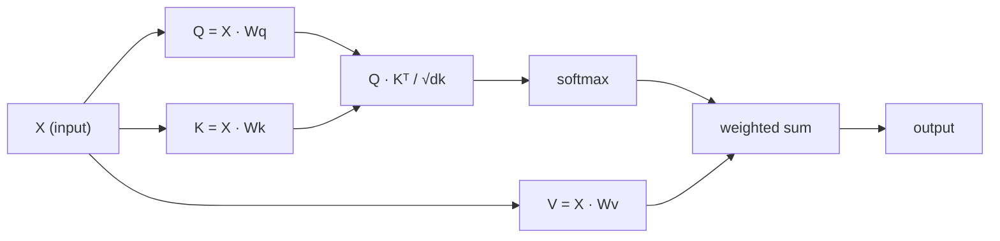

# Self-Attention from Scratch

> Attention là một bảng tra cứu nơi mọi từ hỏi "ai quan trọng với tôi?" - và học câu trả lời.

**Type:** Build
**Languages:** Python
**Prerequisites:** Phase 3 (Deep Learning Core), Phase 5 Lesson 10 (Sequence-to-Sequence)
**Time:** ~90 minutes

## Learning Objectives

- Triển khai scaled dot-product self-attention từ đầu chỉ bằng NumPy, bao gồm các phép chiếu query/key/value và tổng có trọng số softmax
- Xây dựng một tầng multi-head attention chia các head, tính attention song song và nối các kết quả
- Lần theo cách ma trận attention nắm bắt các quan hệ token và giải thích vì sao chia tỷ lệ bằng sqrt(d_k) ngăn bão hòa softmax
- Áp dụng masking nhân quả để chuyển attention hai chiều thành attention tự hồi quy (kiểu decoder)

## The Problem

RNN xử lý chuỗi từng token một. Khi bạn đến token 50, thông tin từ token 1 đã bị ép qua 50 bước nén. Các phụ thuộc xa bị nghiền vào một trạng thái ẩn kích thước cố định - một nút thắt mà không lượng cổng LSTM nào giải quyết hoàn toàn.

Bài báo attention Bahdanau năm 2014 cho thấy cách sửa: để decoder nhìn lại mọi vị trí encoder và quyết định những vị trí nào quan trọng cho bước hiện tại. Nhưng nó vẫn được gắn vào một RNN. Bài báo năm 2017 "Attention Is All You Need" hỏi một câu sắc hơn: nếu attention là cơ chế *duy nhất* thì sao? Không truy hồi. Không tích chập. Chỉ attention.

Self-attention cho phép mọi vị trí trong một chuỗi chú ý đến mọi vị trí khác trong một bước song song duy nhất. Đó là thứ khiến transformer nhanh, mở rộng được và thống trị.

## The Concept

### The Database Lookup Analogy

Nghĩ về attention như một tra cứu cơ sở dữ liệu mềm:

```
Traditional database:
  Query: "capital of France"  -->  exact match  -->  "Paris"

Attention:
  Query: "capital of France"  -->  similarity to ALL keys  -->  weighted blend of ALL values
```

Mỗi token sinh ba vector:
- **Query (Q)**: "Tôi đang tìm gì?"
- **Key (K)**: "Tôi chứa gì?"
- **Value (V)**: "Tôi cung cấp thông tin gì nếu được chọn?"

Tích vô hướng giữa một query và mọi key tạo các điểm attention. Điểm cao nghĩa là "key này khớp query của tôi." Các điểm đó gán trọng số cho các value. Đầu ra là một tổng có trọng số của các value.

### Q, K, V Computation

Mỗi embedding token được chiếu qua ba ma trận trọng số được học:

```
Input embeddings (sequence of n tokens, each d-dimensional):

  X = [x1, x2, x3, ..., xn]       shape: (n, d)

Three weight matrices:

  Wq  shape: (d, dk)
  Wk  shape: (d, dk)
  Wv  shape: (d, dv)

Projections:

  Q = X @ Wq    shape: (n, dk)      each token's query
  K = X @ Wk    shape: (n, dk)      each token's key
  V = X @ Wv    shape: (n, dv)      each token's value
```

Về trực quan, cho một token:

```
             Wq
  x_i ------[*]------> q_i    "What am I looking for?"
       |
       |     Wk
       +----[*]------> k_i    "What do I contain?"
       |
       |     Wv
       +----[*]------> v_i    "What do I offer?"
```

### The Attention Matrix

Một khi bạn có Q, K, V cho mọi token, các điểm attention tạo thành một ma trận:

```
Scores = Q @ K^T    shape: (n, n)

              k1    k2    k3    k4    k5
        +-----+-----+-----+-----+-----+
   q1   | 2.1 | 0.3 | 0.1 | 0.8 | 0.2 |   <- how much q1 attends to each key
        +-----+-----+-----+-----+-----+
   q2   | 0.4 | 1.9 | 0.7 | 0.1 | 0.3 |
        +-----+-----+-----+-----+-----+
   q3   | 0.2 | 0.6 | 2.3 | 0.5 | 0.1 |
        +-----+-----+-----+-----+-----+
   q4   | 0.9 | 0.1 | 0.4 | 1.7 | 0.6 |
        +-----+-----+-----+-----+-----+
   q5   | 0.1 | 0.3 | 0.2 | 0.5 | 2.0 |
        +-----+-----+-----+-----+-----+

Each row: one token's attention over the entire sequence
```

Quan sát từng query một quét các key: mỗi hàng chấm mọi token, softmax biến các điểm thành trọng số và vector ngữ cảnh là sự pha trộn có trọng số các value.

```figure
attention-matrix
```

### Why Scale?

Các tích vô hướng tăng theo số chiều dk. Nếu dk = 64, các tích vô hướng có thể nằm trong khoảng hàng chục, đẩy softmax vào các vùng mà gradient tiêu biến. Cách sửa: chia cho sqrt(dk).

```
Scaled scores = (Q @ K^T) / sqrt(dk)
```

Điều này giữ các giá trị trong một khoảng mà softmax tạo các gradient hữu ích.

### Softmax Turns Scores into Weights

Softmax chuyển các điểm thô thành một phân phối xác suất trên mỗi hàng:

```
Raw scores for q1:   [2.1, 0.3, 0.1, 0.8, 0.2]
                            |
                         softmax
                            |
Attention weights:   [0.52, 0.09, 0.07, 0.14, 0.08]   (sums to ~1.0)
```

Giờ mỗi token có một tập trọng số nói nên chú ý đến mỗi token khác bao nhiêu.

### Weighted Sum of Values

Đầu ra cuối cho mỗi token là một tổng có trọng số của mọi vector value:

```
output_i = sum( attention_weight[i][j] * v_j  for all j )

For token 1:
  output_1 = 0.52 * v1 + 0.09 * v2 + 0.07 * v3 + 0.14 * v4 + 0.08 * v5
```

### Full Pipeline



Công thức trong một dòng:

```
Attention(Q, K, V) = softmax( Q @ K^T / sqrt(dk) ) @ V
```

```figure
softmax-attention-scaling
```

## Build It

### Step 1: Softmax from scratch

Softmax chuyển các logits thô thành các xác suất. Trừ giá trị lớn nhất để ổn định số.

```python
import numpy as np

def softmax(x):
    shifted = x - np.max(x, axis=-1, keepdims=True)
    exp_x = np.exp(shifted)
    return exp_x / np.sum(exp_x, axis=-1, keepdims=True)

logits = np.array([2.0, 1.0, 0.1])
print(f"logits:  {logits}")
print(f"softmax: {softmax(logits)}")
print(f"sum:     {softmax(logits).sum():.4f}")
```

### Step 2: Scaled dot-product attention

Hàm cốt lõi. Nhận các ma trận Q, K, V và trả đầu ra attention cộng ma trận trọng số.

```python
def scaled_dot_product_attention(Q, K, V):
    dk = Q.shape[-1]
    scores = Q @ K.T / np.sqrt(dk)
    weights = softmax(scores)
    output = weights @ V
    return output, weights
```

### Step 3: Self-attention class with learned projections

Một mô-đun self-attention đầy đủ với các ma trận trọng số Wq, Wk, Wv được khởi tạo bằng co giãn kiểu Xavier.

```python
class SelfAttention:
    def __init__(self, d_model, dk, dv, seed=42):
        rng = np.random.default_rng(seed)
        scale = np.sqrt(2.0 / (d_model + dk))
        self.Wq = rng.normal(0, scale, (d_model, dk))
        self.Wk = rng.normal(0, scale, (d_model, dk))
        scale_v = np.sqrt(2.0 / (d_model + dv))
        self.Wv = rng.normal(0, scale_v, (d_model, dv))
        self.dk = dk

    def forward(self, X):
        Q = X @ self.Wq
        K = X @ self.Wk
        V = X @ self.Wv
        output, weights = scaled_dot_product_attention(Q, K, V)
        return output, weights
```

### Step 4: Run it on a sentence

Tạo các embedding giả cho một câu và quan sát các trọng số attention.

```python
sentence = ["The", "cat", "sat", "on", "the", "mat"]
n_tokens = len(sentence)
d_model = 8
dk = 4
dv = 4

rng = np.random.default_rng(42)
X = rng.normal(0, 1, (n_tokens, d_model))

attn = SelfAttention(d_model, dk, dv, seed=42)
output, weights = attn.forward(X)

print("Attention weights (each row: where that token looks):\n")
print(f"{'':>6}", end="")
for token in sentence:
    print(f"{token:>6}", end="")
print()

for i, token in enumerate(sentence):
    print(f"{token:>6}", end="")
    for j in range(n_tokens):
        w = weights[i][j]
        print(f"{w:6.3f}", end="")
    print()
```

### Step 5: Visualize attention with ASCII heatmap

Ánh xạ các trọng số attention sang các ký tự để có một hình trực quan nhanh.

```python
def ascii_heatmap(weights, tokens, chars=" ░▒▓█"):
    n = len(tokens)
    print(f"\n{'':>6}", end="")
    for t in tokens:
        print(f"{t:>6}", end="")
    print()

    for i in range(n):
        print(f"{tokens[i]:>6}", end="")
        for j in range(n):
            level = int(weights[i][j] * (len(chars) - 1) / weights.max())
            level = min(level, len(chars) - 1)
            print(f"{'  ' + chars[level] + '   '}", end="")
        print()

ascii_heatmap(weights, sentence)
```

## Use It

`nn.MultiheadAttention` của PyTorch làm chính xác điều chúng ta xây dựng, cộng chia multi-head và phép chiếu đầu ra:

```python
import torch
import torch.nn as nn

d_model = 8
n_heads = 2
seq_len = 6

mha = nn.MultiheadAttention(embed_dim=d_model, num_heads=n_heads, batch_first=True)

X_torch = torch.randn(1, seq_len, d_model)

output, attn_weights = mha(X_torch, X_torch, X_torch)

print(f"Input shape:            {X_torch.shape}")
print(f"Output shape:           {output.shape}")
print(f"Attention weight shape: {attn_weights.shape}")
print(f"\nAttn weights (averaged over heads):")
print(attn_weights[0].detach().numpy().round(3))
```

Khác biệt then chốt: multi-head attention chạy nhiều hàm attention song song, mỗi hàm có các phép chiếu Q, K, V riêng kích thước dk = d_model / n_heads, rồi nối các kết quả. Điều này cho mô hình chú ý đến các loại quan hệ khác nhau đồng thời.

## Ship It

Bài học này tạo ra:
- `outputs/prompt-attention-explainer.md` - một prompt giải thích attention qua phép tương tự tra cứu cơ sở dữ liệu

## Exercises

1. Sửa `scaled_dot_product_attention` để nhận một ma trận mặt nạ tùy chọn đặt các vị trí nhất định thành âm vô cực trước softmax (đây là cách masking nhân quả/decoder hoạt động)
2. Triển khai multi-head attention từ đầu: chia Q, K, V thành `n_heads` khối, chạy attention trên mỗi khối, nối lại và chiếu qua một ma trận trọng số cuối Wo
3. Lấy hai câu khác nhau cùng độ dài, đưa qua cùng một thể hiện SelfAttention và so sánh các mẫu attention của chúng. Điều gì thay đổi? Điều gì giữ nguyên?

## Key Terms

| Thuật ngữ | Mọi người nói gì | Ý nghĩa thực sự |
|------|----------------|----------------------|
| Query (Q) (Truy vấn) | "Vector câu hỏi" | Một phép chiếu được học của đầu vào biểu diễn token này đang tìm thông tin gì |
| Key (K) (Khóa) | "Vector nhãn" | Một phép chiếu được học biểu diễn token này chứa thông tin gì, được khớp với các query |
| Value (V) (Giá trị) | "Vector nội dung" | Một phép chiếu được học mang thông tin thực được tổng hợp dựa trên các điểm attention |
| Scaled dot-product attention | "Công thức attention" | softmax(QK^T / sqrt(dk)) @ V - chia tỷ lệ ngăn bão hòa softmax ở số chiều cao |
| Self-attention | "Token nhìn chính nó và các token khác" | Attention mà Q, K, V đều đến từ cùng một chuỗi, cho mọi vị trí chú ý đến mọi vị trí khác |
| Attention weights (Trọng số attention) | "Bao nhiêu tập trung" | Một phân phối xác suất trên các vị trí, được softmax trên các tích vô hướng đã chia tỷ lệ tạo ra |
| Multi-head attention | "Attention song song" | Chạy nhiều hàm attention với các phép chiếu khác nhau, rồi nối kết quả để có các biểu diễn phong phú hơn |

## Further Reading

- [Attention Is All You Need (Vaswani et al., 2017)](https://arxiv.org/abs/1706.03762) - bài báo transformer gốc
- [The Illustrated Transformer (Jay Alammar)](https://jalammar.github.io/illustrated-transformer/) - hướng dẫn trực quan tốt nhất về toàn bộ kiến trúc
- [The Annotated Transformer (Harvard NLP)](https://nlp.seas.harvard.edu/annotated-transformer/) - triển khai PyTorch từng dòng với các giải thích
