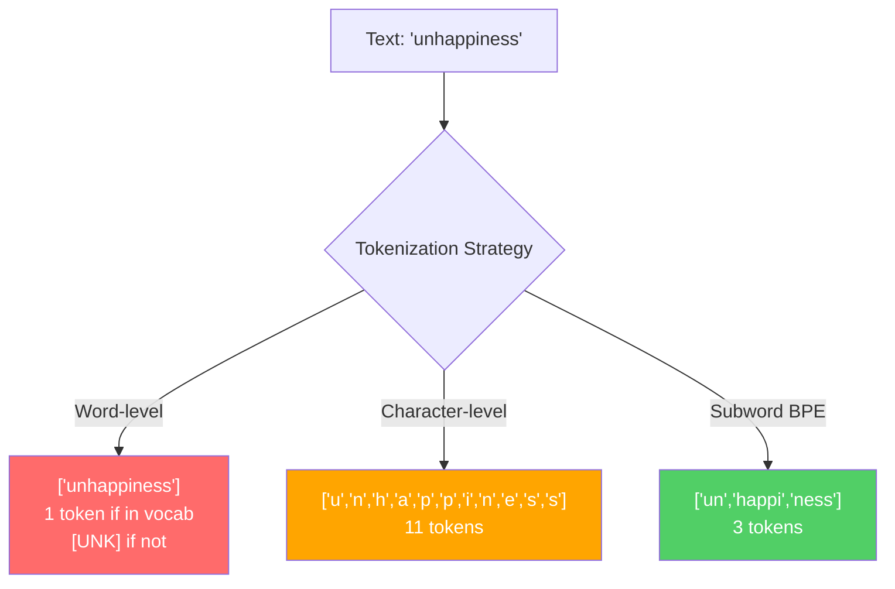
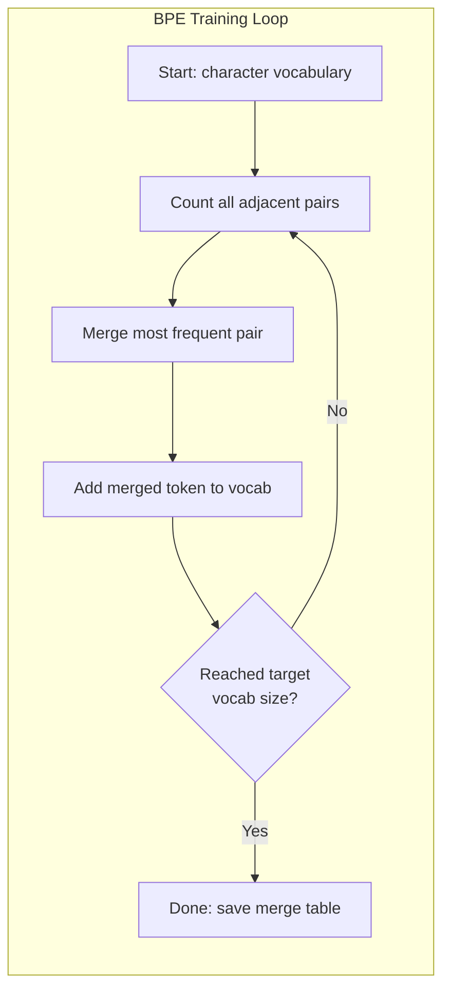
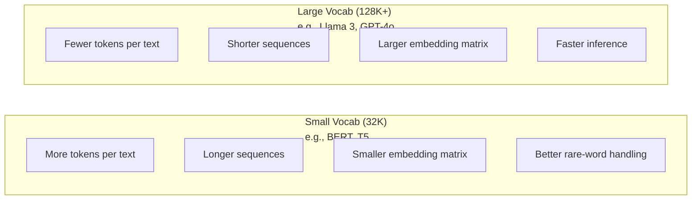

# Tokenizers: BPE, WordPiece, SentencePiece

> LLM của bạn không đọc tiếng Anh. Nó đọc các số nguyên. Tokenizer quyết định liệu các số nguyên đó mang ý nghĩa hay lãng phí nó.

**Type:** Build
**Languages:** Python
**Prerequisites:** Phase 05 (NLP Foundations)
**Time:** ~90 minutes

## Learning Objectives

- Triển khai các thuật toán token hóa BPE, WordPiece và Unigram từ đầu và so sánh các chiến lược gộp của chúng
- Giải thích kích thước từ vựng ảnh hưởng hiệu quả mô hình thế nào: quá nhỏ tạo chuỗi dài, quá lớn lãng phí tham số embedding
- Phân tích các lỗi giả token hóa xuyên ngôn ngữ và mã, xác định nơi các tokenizer cụ thể thất bại
- Dùng các thư viện tiktoken và sentencepiece để token hóa văn bản và kiểm tra các ID token thu được

## The Problem

LLM của bạn không đọc tiếng Anh. Nó không đọc bất kỳ ngôn ngữ nào. Nó đọc các con số.

Khoảng cách giữa "Hello, world!" và [15496, 11, 995, 0] là tokenizer. Mỗi từ, mỗi khoảng trắng, mỗi dấu câu phải được chuyển thành một số nguyên trước khi mô hình có thể xử lý nó. Sự chuyển đổi này không trung lập. Nó đưa các giả định vào mô hình mà sau này không thể hoàn tác.

Làm sai điều này và mô hình của bạn lãng phí năng lực mã hóa các từ phổ biến bằng nhiều token. "unfortunately" trở thành bốn token thay vì một. Cửa sổ ngữ cảnh 128K của bạn vừa co lại 75% với văn bản có nhiều từ đa âm tiết. Làm đúng và cùng cửa sổ ngữ cảnh chứa gấp đôi ý nghĩa. Khác biệt giữa "mô hình này xử lý mã tốt" và "mô hình này nghẹn với Python" thường quy về cách tokenizer được huấn luyện.

Mỗi lệnh gọi API bạn thực hiện đến GPT-4 hoặc Claude được tính giá theo token. Mỗi token mô hình của bạn sinh ra tốn tính toán. Càng ít token cần để biểu diễn một đầu ra, suy luận đầu cuối càng nhanh. Token hóa không phải tiền xử lý. Nó là kiến trúc.

## The Concept

### Three Approaches That Failed (and One That Won)

Có ba cách hiển nhiên để chuyển văn bản thành số. Hai trong số đó không hoạt động ở quy mô lớn.

**Token hóa cấp từ** tách theo khoảng trắng và dấu câu. "The cat sat" trở thành ["The", "cat", "sat"]. Đơn giản. Nhưng còn "tokenization"? Hoặc "GPT-4o"? Hoặc một từ ghép tiếng Đức như "Geschwindigkeitsbegrenzung"? Cấp từ đòi hỏi một từ vựng khổng lồ để bao phủ mọi từ trong mọi ngôn ngữ. Thiếu một từ và bạn nhận token `[UNK]` đáng sợ -- cách mô hình nói "Tôi không biết đây là gì." Riêng tiếng Anh đã có hơn một triệu dạng từ. Thêm mã, URL, ký pháp khoa học và 100 ngôn ngữ khác thì bạn cần một từ vựng vô hạn.

**Token hóa cấp ký tự** đi hướng ngược lại. "hello" trở thành ["h", "e", "l", "l", "o"]. Từ vựng rất nhỏ (vài trăm ký tự). Không bao giờ có token không biết. Nhưng các chuỗi trở nên cực dài. Một câu vốn là 10 token cấp từ trở thành 50 token cấp ký tự. Mô hình phải học rằng "t", "h", "e" cùng nhau nghĩa là "the" -- đốt năng lực attention cho điều mà con người học lúc ba tuổi.

**Token hóa từ con** tìm điểm cân bằng. Các từ phổ biến giữ nguyên: "the" là một token. Các từ hiếm phân rã thành các mảnh có nghĩa: "unhappiness" trở thành ["un", "happi", "ness"]. Từ vựng giữ ở mức quản lý được (30K đến 128K token). Chuỗi giữ ngắn. Token không biết về cơ bản biến mất vì bất kỳ từ nào cũng có thể được xây từ các mảnh từ con.

Mọi LLM hiện đại dùng token hóa từ con. GPT-2, GPT-4, BERT, Llama 3, Claude -- tất cả. Câu hỏi là thuật toán nào.



### BPE: Byte Pair Encoding

BPE là một thuật toán nén tham lam được dùng lại cho token hóa. Ý tưởng đủ đơn giản để vừa trên một thẻ ghi chú.

Bắt đầu với các ký tự riêng lẻ. Đếm mọi cặp liền kề trong corpus huấn luyện. Gộp cặp thường gặp nhất thành một token mới. Lặp lại cho đến khi đạt kích thước từ vựng mục tiêu.

```figure
tokenizer-bpe
```

Đây là BPE chạy trên một corpus nhỏ với các từ "lower", "lowest" và "newest":

```
Corpus (with word frequencies):
  "lower"  x5
  "lowest" x2
  "newest" x6

Step 0 -- Start with characters:
  l o w e r       (x5)
  l o w e s t     (x2)
  n e w e s t     (x6)

Step 1 -- Count adjacent pairs:
  (e,s): 8    (s,t): 8    (l,o): 7    (o,w): 7
  (w,e): 13   (e,r): 5    (n,e): 6    ...

Step 2 -- Merge most frequent pair (w,e) -> "we":
  l o we r        (x5)
  l o we s t      (x2)
  n e we s t      (x6)

Step 3 -- Recount and merge (e,s) -> "es":
  l o we r        (x5)
  l o we s t      (x2)    <- 'es' only forms from 'e'+'s', not 'we'+'s'
  n e we s t      (x6)    <- wait, the 'e' before 'we' and 's' after 'we'

Actually tracking this precisely:
  After "we" merge, remaining pairs:
  (l,o): 7   (o,we): 7   (we,r): 5   (we,s): 8
  (s,t): 8   (n,e): 6    (e,we): 6

Step 3 -- Merge (we,s) -> "wes" or (s,t) -> "st" (tied at 8, pick first):
  Merge (we,s) -> "wes":
  l o we r        (x5)
  l o wes t       (x2)
  n e wes t       (x6)

Step 4 -- Merge (wes,t) -> "west":
  l o we r        (x5)
  l o west        (x2)
  n e west        (x6)

...continue until target vocab size reached.
```

Bảng gộp là tokenizer. Để mã hóa văn bản mới, áp dụng các phép gộp theo thứ tự chúng được học. Corpus huấn luyện quyết định những phép gộp nào tồn tại, và lựa chọn đó định hình vĩnh viễn những gì mô hình thấy.



### Byte-Level BPE (GPT-2, GPT-3, GPT-4)

BPE tiêu chuẩn hoạt động trên các ký tự Unicode. BPE cấp byte hoạt động trên byte thô (0-255). Điều này cho bạn một từ vựng cơ sở chính xác 256, xử lý bất kỳ ngôn ngữ hoặc mã hóa nào, và không bao giờ tạo ra token không biết.

GPT-2 giới thiệu cách tiếp cận này. Từ vựng cơ sở bao phủ mọi byte có thể. Các phép gộp BPE xây trên đó. Thư viện tiktoken của OpenAI triển khai BPE cấp byte với các kích thước từ vựng này:

- GPT-2: 50,257 token
- GPT-3.5/GPT-4: ~100,256 token (mã hóa cl100k_base)
- GPT-4o: 200,019 token (mã hóa o200k_base)

### WordPiece (BERT)

WordPiece trông giống BPE nhưng chọn các phép gộp khác. Thay vì tần suất thô, nó tối đa hóa likelihood của dữ liệu huấn luyện:

```
BPE merge criterion:      count(A, B)
WordPiece merge criterion: count(AB) / (count(A) * count(B))
```

BPE hỏi: "Cặp nào xuất hiện thường xuyên nhất?" WordPiece hỏi: "Cặp nào xuất hiện cùng nhau thường xuyên hơn mức bạn kỳ vọng do ngẫu nhiên?" Khác biệt tinh tế này tạo ra các từ vựng khác nhau. WordPiece ưu tiên các phép gộp mà sự đồng xuất hiện gây bất ngờ, không chỉ thường xuyên.

WordPiece cũng dùng tiền tố "##" cho các từ con tiếp nối:

```
"unhappiness" -> ["un", "##happi", "##ness"]
"embedding"   -> ["em", "##bed", "##ding"]
```

Tiền tố "##" cho bạn biết mảnh này tiếp nối một token trước. BERT dùng WordPiece với một từ vựng 30,522 token. Mọi biến thể BERT -- DistilBERT, tokenizer của RoBERTa thực ra là BPE, nhưng bản thân BERT là WordPiece.

### SentencePiece (Llama, T5)

SentencePiece coi đầu vào là một luồng ký tự Unicode thô, gồm cả khoảng trắng. Không bước tiền token hóa. Không quy tắc riêng theo ngôn ngữ về ranh giới từ. Điều này làm nó thực sự độc lập ngôn ngữ -- nó hoạt động trên tiếng Trung, Nhật, Thái và các ngôn ngữ khác mà khoảng trắng không tách từ.

SentencePiece hỗ trợ hai thuật toán:
- **Chế độ BPE**: cùng logic gộp như BPE tiêu chuẩn, áp dụng cho các chuỗi ký tự thô
- **Chế độ Unigram**: bắt đầu với một từ vựng lớn và lặp việc loại bỏ các token ít ảnh hưởng nhất đến likelihood tổng thể. Ngược với BPE -- cắt tỉa thay vì gộp.

Llama 2 dùng SentencePiece BPE với một từ vựng 32,000 token. T5 dùng SentencePiece Unigram với 32,000 token. Lưu ý: Llama 3 chuyển sang một tokenizer BPE cấp byte dựa trên tiktoken với 128,256 token.

### Vocabulary Size Tradeoffs

Đây là một quyết định kỹ thuật thực với các hệ quả đo được.



Các con số cụ thể. Với một từ vựng 128K có embedding 4,096 chiều, riêng ma trận embedding là 128,000 x 4,096 = 524 triệu tham số. Với một từ vựng 32K, nó là 131 triệu tham số. Đó là một khác biệt 400M tham số chỉ từ lựa chọn tokenizer.

Nhưng các từ vựng lớn hơn nén văn bản mạnh hơn. Cùng đoạn tiếng Anh cần 100 token với một từ vựng 32K có thể cần 70 token với một từ vựng 128K. Điều đó nghĩa là ít lượt truyền xuôi hơn 30% khi sinh. Với một mô hình phục vụ hàng triệu yêu cầu, đó là giảm trực tiếp chi phí tính toán.

Xu hướng rõ ràng: kích thước từ vựng đang tăng. GPT-2 dùng 50,257. GPT-4 dùng ~100K. Llama 3 dùng 128K. GPT-4o dùng 200K.

| Mô hình | Kích thước từ vựng | Loại tokenizer | Số token trung bình mỗi từ tiếng Anh |
|-------|-----------|----------------|---------------------------|
| BERT | 30,522 | WordPiece | ~1.4 |
| GPT-2 | 50,257 | BPE cấp byte | ~1.3 |
| Llama 2 | 32,000 | SentencePiece BPE | ~1.4 |
| GPT-4 | ~100,256 | BPE cấp byte | ~1.2 |
| Llama 3 | 128,256 | BPE cấp byte (tiktoken) | ~1.1 |
| GPT-4o | 200,019 | BPE cấp byte | ~1.0 |

### The Multilingual Tax

Các tokenizer được huấn luyện chủ yếu trên tiếng Anh khắc nghiệt với các ngôn ngữ khác. Văn bản tiếng Hàn trong tokenizer GPT-2 trung bình 2-3 token mỗi từ. Tiếng Trung có thể tệ hơn. Điều này nghĩa là một người dùng tiếng Hàn thực tế có cửa sổ ngữ cảnh bằng nửa kích thước của người dùng tiếng Anh -- trả cùng giá cho mật độ thông tin ít hơn.

Đây là lý do Llama 3 tăng gấp bốn từ vựng từ 32K lên 128K. Nhiều token hơn dành cho các hệ chữ phi tiếng Anh nghĩa là nén công bằng hơn xuyên ngôn ngữ.

```figure
tokenizer-tradeoff
```

## Build It

### Step 1: Character-Level Tokenizer

Bắt đầu ở nền tảng. Một tokenizer cấp ký tự ánh xạ mỗi ký tự đến điểm mã Unicode của nó. Không cần huấn luyện. Không token không biết. Chỉ một ánh xạ trực tiếp.

```python
class CharTokenizer:
    def encode(self, text):
        return [ord(c) for c in text]

    def decode(self, tokens):
        return "".join(chr(t) for t in tokens)
```

"hello" trở thành [104, 101, 108, 108, 111]. Mỗi ký tự là token riêng. Đây là baseline mà chúng ta cải thiện.

### Step 2: BPE Tokenizer from Scratch

Triển khai thực. Chúng ta huấn luyện trên byte thô (như GPT-2), đếm cặp, gộp cặp thường gặp nhất và ghi lại mọi phép gộp theo thứ tự. Bảng gộp là tokenizer.

```python
from collections import Counter

class BPETokenizer:
    def __init__(self):
        self.merges = {}
        self.vocab = {}

    def _get_pairs(self, tokens):
        pairs = Counter()
        for i in range(len(tokens) - 1):
            pairs[(tokens[i], tokens[i + 1])] += 1
        return pairs

    def _merge_pair(self, tokens, pair, new_token):
        merged = []
        i = 0
        while i < len(tokens):
            if i < len(tokens) - 1 and tokens[i] == pair[0] and tokens[i + 1] == pair[1]:
                merged.append(new_token)
                i += 2
            else:
                merged.append(tokens[i])
                i += 1
        return merged

    def train(self, text, num_merges):
        tokens = list(text.encode("utf-8"))
        self.vocab = {i: bytes([i]) for i in range(256)}

        for i in range(num_merges):
            pairs = self._get_pairs(tokens)
            if not pairs:
                break
            best_pair = max(pairs, key=pairs.get)
            new_token = 256 + i
            tokens = self._merge_pair(tokens, best_pair, new_token)
            self.merges[best_pair] = new_token
            self.vocab[new_token] = self.vocab[best_pair[0]] + self.vocab[best_pair[1]]

        return self

    def encode(self, text):
        tokens = list(text.encode("utf-8"))
        for pair, new_token in self.merges.items():
            tokens = self._merge_pair(tokens, pair, new_token)
        return tokens

    def decode(self, tokens):
        byte_sequence = b"".join(self.vocab[t] for t in tokens)
        return byte_sequence.decode("utf-8", errors="replace")
```

Vòng lặp huấn luyện là cốt lõi của BPE: đếm cặp, gộp bên thắng, lặp lại. Mỗi phép gộp giảm tổng số token. Sau `num_merges` vòng, từ vựng tăng từ 256 (byte cơ sở) lên 256 + num_merges.

Mã hóa áp dụng các phép gộp theo đúng thứ tự chúng được học. Điều này quan trọng. Nếu phép gộp 1 tạo "th" và phép gộp 5 tạo "the", mã hóa phải áp dụng phép gộp 1 trước để "the" có thể hình thành từ "th" + "e" trong phép gộp 5.

Giải mã là phép ngược: tra mỗi ID token trong từ vựng, nối các byte, giải mã thành UTF-8.

### Step 3: Encode and Decode Roundtrip

```python
corpus = (
    "The cat sat on the mat. The cat ate the rat. "
    "The dog sat on the log. The dog ate the frog. "
    "Natural language processing is the study of how computers "
    "understand and generate human language. "
    "Tokenization is the first step in any NLP pipeline."
)

tokenizer = BPETokenizer()
tokenizer.train(corpus, num_merges=40)

test_sentences = [
    "The cat sat on the mat.",
    "Natural language processing",
    "tokenization pipeline",
    "unhappiness",
]

for sentence in test_sentences:
    encoded = tokenizer.encode(sentence)
    decoded = tokenizer.decode(encoded)
    raw_bytes = len(sentence.encode("utf-8"))
    ratio = len(encoded) / raw_bytes
    print(f"'{sentence}'")
    print(f"  Tokens: {len(encoded)} (from {raw_bytes} bytes) -- ratio: {ratio:.2f}")
    print(f"  Roundtrip: {'PASS' if decoded == sentence else 'FAIL'}")
```

Tỷ lệ nén cho bạn biết tokenizer hiệu quả đến đâu. Tỷ lệ 0.50 nghĩa là tokenizer nén văn bản xuống số token bằng một nửa số byte thô. Thấp hơn là tốt hơn. Trên corpus huấn luyện, tỷ lệ sẽ tốt. Trên văn bản ngoài phân phối như "unhappiness" (không xuất hiện trong corpus), tỷ lệ sẽ tệ hơn -- tokenizer quay về mã hóa cấp ký tự cho các mẫu chưa thấy.

### Step 4: Compare with tiktoken

```python
import tiktoken

enc = tiktoken.get_encoding("cl100k_base")

texts = [
    "The cat sat on the mat.",
    "unhappiness",
    "Hello, world!",
    "def fibonacci(n): return n if n < 2 else fibonacci(n-1) + fibonacci(n-2)",
    "Geschwindigkeitsbegrenzung",
]

for text in texts:
    our_tokens = tokenizer.encode(text)
    tiktoken_tokens = enc.encode(text)
    tiktoken_pieces = [enc.decode([t]) for t in tiktoken_tokens]
    print(f"'{text}'")
    print(f"  Our BPE:   {len(our_tokens)} tokens")
    print(f"  tiktoken:  {len(tiktoken_tokens)} tokens -> {tiktoken_pieces}")
```

tiktoken dùng chính thuật toán đó nhưng được huấn luyện trên hàng trăm gigabyte văn bản với 100,000 phép gộp. Thuật toán giống hệt. Khác biệt là dữ liệu huấn luyện và số phép gộp. Tokenizer của bạn được huấn luyện trên một đoạn văn với 40 phép gộp không thể cạnh tranh với 100K phép gộp của tiktoken trên một corpus khổng lồ. Nhưng cơ chế giống nhau.

### Step 5: Vocabulary Analysis

```python
def analyze_vocabulary(tokenizer, test_texts):
    total_tokens = 0
    total_chars = 0
    token_usage = Counter()

    for text in test_texts:
        encoded = tokenizer.encode(text)
        total_tokens += len(encoded)
        total_chars += len(text)
        for t in encoded:
            token_usage[t] += 1

    print(f"Vocabulary size: {len(tokenizer.vocab)}")
    print(f"Total tokens across all texts: {total_tokens}")
    print(f"Total characters: {total_chars}")
    print(f"Avg tokens per character: {total_tokens / total_chars:.2f}")

    print(f"\nMost used tokens:")
    for token_id, count in token_usage.most_common(10):
        token_bytes = tokenizer.vocab[token_id]
        display = token_bytes.decode("utf-8", errors="replace")
        print(f"  Token {token_id:4d}: '{display}' (used {count} times)")

    unused = [t for t in tokenizer.vocab if t not in token_usage]
    print(f"\nUnused tokens: {len(unused)} out of {len(tokenizer.vocab)}")
```

Điều này cho thấy phân phối Zipf trong từ vựng của bạn. Một vài token chi phối (khoảng trắng, "the", "e"). Hầu hết token hiếm khi được dùng. Các tokenizer production tối ưu cho phân phối này -- các mẫu phổ biến nhận ID token ngắn, các mẫu hiếm nhận biểu diễn dài hơn.

## Use It

BPE tự viết của bạn hoạt động. Giờ hãy xem các công cụ production trông như thế nào.

### tiktoken (OpenAI)

```python
import tiktoken

enc = tiktoken.get_encoding("cl100k_base")

text = "Tokenizers convert text to integers"
tokens = enc.encode(text)
print(f"Tokens: {tokens}")
print(f"Pieces: {[enc.decode([t]) for t in tokens]}")
print(f"Roundtrip: {enc.decode(tokens)}")
```

tiktoken được viết bằng Rust với binding Python. Nó mã hóa hàng triệu token mỗi giây. Cùng thuật toán BPE, triển khai cấp công nghiệp.

### Hugging Face tokenizers

```python
from tokenizers import Tokenizer
from tokenizers.models import BPE
from tokenizers.trainers import BpeTrainer
from tokenizers.pre_tokenizers import ByteLevel

tokenizer = Tokenizer(BPE())
tokenizer.pre_tokenizer = ByteLevel()

trainer = BpeTrainer(vocab_size=1000, special_tokens=["<pad>", "<eos>", "<unk>"])
tokenizer.train(["corpus.txt"], trainer)

output = tokenizer.encode("The cat sat on the mat.")
print(f"Tokens: {output.tokens}")
print(f"IDs: {output.ids}")
```

Thư viện tokenizers của Hugging Face cũng dùng Rust bên dưới. Nó huấn luyện BPE trên các corpus quy mô gigabyte trong vài giây. Đây là thứ bạn dùng khi huấn luyện mô hình riêng.

### Loading Llama's Tokenizer

```python
from transformers import AutoTokenizer

tokenizer = AutoTokenizer.from_pretrained("meta-llama/Llama-3.1-8B")

text = "Tokenizers are the unsung heroes of LLMs"
tokens = tokenizer.encode(text)
print(f"Token IDs: {tokens}")
print(f"Tokens: {tokenizer.convert_ids_to_tokens(tokens)}")
print(f"Vocab size: {tokenizer.vocab_size}")

multilingual = ["Hello world", "Hola mundo", "Bonjour le monde"]
for text in multilingual:
    ids = tokenizer.encode(text)
    print(f"'{text}' -> {len(ids)} tokens")
```

Từ vựng 128K của Llama 3 nén văn bản phi tiếng Anh tốt hơn đáng kể so với từ vựng 50K của GPT-2. Bạn có thể tự xác minh -- mã hóa cùng câu ở nhiều ngôn ngữ và đếm token.

## Ship It

Bài học này tạo ra `outputs/prompt-tokenizer-analyzer.md` -- một prompt tái sử dụng phân tích hiệu quả token hóa cho bất kỳ tổ hợp văn bản và mô hình nào. Đưa cho nó một mẫu văn bản và nó cho bạn biết tokenizer của mô hình nào xử lý tốt nhất.

## Exercises

1. Sửa tokenizer BPE để in từ vựng ở mỗi bước gộp. Quan sát cách "t" + "h" thành "th", rồi "th" + "e" thành "the". Theo dõi cách các từ tiếng Anh phổ biến được lắp từng mảnh.

2. Thêm các token đặc biệt (`<pad>`, `<eos>`, `<unk>`) vào tokenizer BPE. Gán chúng ID 0, 1, 2 và dịch tất cả token khác tương ứng. Triển khai một bước tiền token hóa tách theo khoảng trắng trước khi chạy BPE.

3. Triển khai tiêu chí gộp WordPiece (tỷ số likelihood thay vì tần suất). Huấn luyện cả BPE và WordPiece trên cùng corpus với cùng số phép gộp. So sánh các từ vựng thu được -- cái nào tạo ra từ con có ý nghĩa ngôn ngữ học hơn?

4. Xây dựng một benchmark hiệu quả tokenizer đa ngôn ngữ. Lấy 10 câu bằng tiếng Anh, Tây Ban Nha, Trung, Hàn và Ả Rập. Token hóa mỗi câu bằng tiktoken (cl100k_base) và đo số token trung bình mỗi ký tự. Định lượng "thuế đa ngôn ngữ" cho mỗi ngôn ngữ.

5. Huấn luyện tokenizer BPE trên một corpus lớn hơn (tải một bài Wikipedia). Điều chỉnh số phép gộp để đạt tỷ lệ nén trong 10% của tiktoken trên cùng văn bản đó. Điều này buộc bạn hiểu quan hệ giữa kích thước corpus, số phép gộp và chất lượng nén.

## Key Terms

| Thuật ngữ | Cách mọi người nói | Ý nghĩa thực sự |
|------|----------------|----------------------|
| Token | "Một từ" | Một đơn vị trong từ vựng của mô hình -- có thể là một ký tự, từ con, từ, hoặc khối nhiều từ |
| BPE | "Một thứ nén nào đó" | Mã hóa cặp byte -- lặp việc gộp cặp token liền kề thường gặp nhất cho đến khi đạt kích thước từ vựng mục tiêu |
| WordPiece | "Tokenizer của BERT" | Như BPE nhưng các phép gộp tối đa hóa tỷ số likelihood count(AB)/(count(A)*count(B)) thay vì tần suất thô |
| SentencePiece | "Một thư viện tokenizer" | Một tokenizer độc lập ngôn ngữ hoạt động trên Unicode thô không có tiền token hóa, hỗ trợ các thuật toán BPE và Unigram |
| Vocabulary size (Kích thước từ vựng) | "Nó biết bao nhiêu từ" | Tổng số token duy nhất: GPT-2 có 50,257, BERT có 30,522, Llama 3 có 128,256 |
| Fertility | "Không phải thuật ngữ tokenizer" | Số token trung bình mỗi từ -- đo hiệu quả tokenizer xuyên ngôn ngữ (1.0 là hoàn hảo, 3.0 nghĩa là mô hình làm việc nặng gấp ba) |
| Byte-level BPE (BPE cấp byte) | "Tokenizer của GPT" | BPE hoạt động trên byte thô (0-255) thay vì ký tự Unicode, bảo đảm không token không biết cho bất kỳ đầu vào nào |
| Merge table (Bảng gộp) | "File tokenizer" | Danh sách có thứ tự các phép gộp cặp được học trong huấn luyện -- đây CHÍNH LÀ tokenizer, và thứ tự quan trọng |
| Pre-tokenization (Tiền token hóa) | "Tách theo khoảng trắng" | Các quy tắc áp dụng trước token hóa từ con: tách khoảng trắng, tách chữ số, xử lý dấu câu |
| Compression ratio (Tỷ lệ nén) | "Tokenizer hiệu quả đến đâu" | Số token được tạo chia số byte đầu vào -- thấp hơn nghĩa là nén tốt hơn và suy luận nhanh hơn |

## Further Reading

- [Sennrich et al., 2016 -- "Neural Machine Translation of Rare Words with Subword Units"](https://arxiv.org/abs/1508.07909) -- bài báo giới thiệu BPE cho NLP, biến một thuật toán nén năm 1994 thành nền tảng của token hóa hiện đại
- [Kudo & Richardson, 2018 -- "SentencePiece: A simple and language independent subword tokenizer"](https://arxiv.org/abs/1808.06226) -- token hóa độc lập ngôn ngữ làm các mô hình đa ngôn ngữ trở nên thực tiễn
- [OpenAI tiktoken repository](https://github.com/openai/tiktoken) -- triển khai BPE production bằng Rust với binding Python, được GPT-3.5/4/4o dùng
- [Hugging Face Tokenizers documentation](https://huggingface.co/docs/tokenizers) -- huấn luyện tokenizer cấp production với hiệu năng Rust
