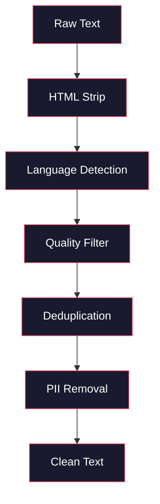
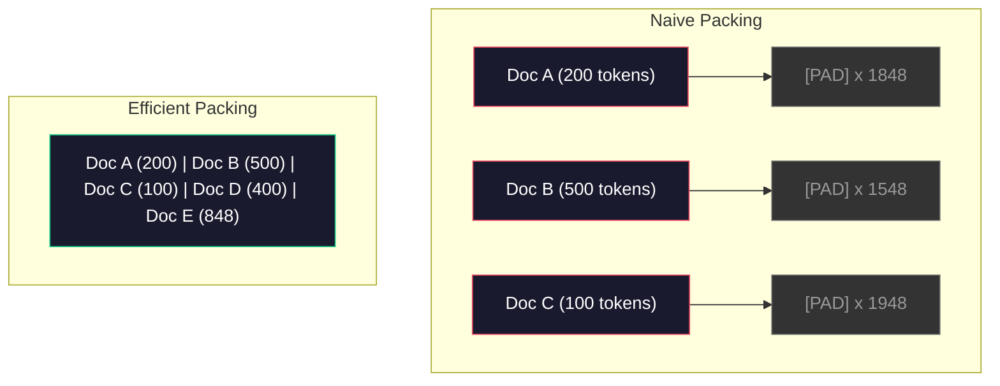

# Data Pipelines for Pre-Training

> Mô hình là một tấm gương. Nó phản chiếu bất cứ dữ liệu nào bạn đưa vào. Cho nó rác, nó phản chiếu rác với sự trôi chảy hoàn hảo.

**Type:** Build
**Languages:** Python
**Prerequisites:** Phase 10, Lessons 01-02 (Tokenizers, Building a Tokenizer)
**Time:** ~90 minutes

## Learning Objectives

- Xây dựng một pipeline dữ liệu streaming token hóa, chia khối, xáo trộn và gom batch hàng terabyte văn bản mà không tải toàn bộ vào bộ nhớ
- Triển khai các bộ lọc chất lượng dữ liệu (khử trùng lặp, phát hiện ngôn ngữ, lọc nội dung) được dùng trong các pipeline huấn luyện trước thực
- Tạo các chuỗi huấn luyện độ dài cố định với mặt nạ attention đúng và xử lý ranh giới tài liệu
- Profile thông lượng pipeline để bảo đảm dataloader theo kịp tốc độ huấn luyện GPU

## The Problem

Bạn có một tokenizer. Giờ bạn cần dữ liệu.

Không phải một tập dữ liệu. Không phải một file CSV. Hàng terabyte văn bản -- được làm sạch, khử trùng lặp, lọc chất lượng, token hóa thành các chuỗi độ dài cố định, và phục vụ trong các batch ngẫu nhiên hóa đủ nhanh để cụm 8 GPU của bạn không bao giờ đợi batch tiếp theo.

Hầu hết mọi người nghĩ huấn luyện một LLM là về kiến trúc mô hình. Không phải. Llama 3 dùng 15.6 nghìn tỷ token. GPT-3 dùng 300 tỷ. DeepSeek-V2 dùng 8.1 nghìn tỷ. Kiến trúc trên cả ba gần như giống nhau: các khối transformer xếp chồng với attention và các lớp feedforward. Khác biệt chất lượng đầu ra đến chủ yếu từ dữ liệu.

Bài báo Chinchilla từ DeepMind làm điều này chính xác. Với một ngân sách tính toán cho trước, có một tỷ lệ tối ưu giữa tham số mô hình và token huấn luyện. Chinchilla cho thấy hầu hết mô hình năm 2022 được huấn luyện thiếu trầm trọng -- chúng có quá nhiều tham số so với lượng dữ liệu chúng thấy. Một mô hình 70B tham số được huấn luyện trên 1.4 nghìn tỷ token (tối ưu Chinchilla) vượt một mô hình 280B được huấn luyện trên 300 tỷ token (Gopher).

Pipeline dữ liệu quyết định liệu mô hình của bạn học ngôn ngữ hay học nhiễu.

## The Concept

### Where the Data Comes From

Mọi mô hình ngôn ngữ lớn được huấn luyện trên một hỗn hợp nguồn. Thành phần chính xác là bí mật được giữ kín ở hầu hết phòng thí nghiệm, nhưng chúng ta biết đủ để hiểu các loại.

| Nguồn | Kích thước | Chất lượng | Được dùng bởi |
|--------|------|---------|---------|
| Common Crawl | ~250 TB thô | Thấp (cần lọc mạnh) | GPT-3, Llama, hầu hết mô hình mở |
| Wikipedia | ~20 GB | Cao | Mọi LLM lớn |
| Mã GitHub | ~1 TB+ | Trung bình (nhiều trùng lặp, mã chết) | StarCoder, CodeLlama, DeepSeek-Coder |
| Sách (BookCorpus, Pile) | ~100 GB | Cao | GPT-2, GPT-3, các mô hình đầu |
| Bài báo học thuật (arXiv, S2ORC) | ~100 GB | Cao cho STEM | Llama, Galactica |
| StackOverflow, Reddit | ~100 GB | Trung bình | Llama, Falcon |
| Web tuyển chọn (C4, RefinedWeb) | ~5 TB | Trung bình-Cao (đã lọc trước) | T5, Falcon |

Llama 3 công bố hỗn hợp dữ liệu: khoảng 50% dữ liệu web, 25% mã, 13% sách và bài báo học thuật, 8% dữ liệu toán, và 4% dữ liệu web đa ngôn ngữ. Tổng cộng là 15.6 nghìn tỷ token từ các nguồn vượt 5 TB văn bản thô.

Tỷ lệ quan trọng ngang tổng kích thước. Quá nhiều dữ liệu web và mô hình trở thành một con vẹt Reddit. Quá ít mã và nó không thể lập trình. Quá ít toán và nó thất bại ở suy luận. Làm đúng hỗn hợp này là một trong những phần khó nhất của huấn luyện một LLM, và không có công thức -- nó đòi hỏi thử nghiệm và đánh giá.

### Data Cleaning

Dữ liệu web thô rất bẩn. Một bản dump Common Crawl điển hình chứa:

- Thẻ HTML và JavaScript
- Header, footer, menu điều hướng mẫu
- Trang trùng lặp (chính xác và gần trùng lặp)
- Spam do máy sinh
- Thông tin nhận dạng cá nhân (PII)
- Văn bản chất lượng thấp (danh sách từ khóa, spam SEO)
- Nội dung phi văn bản được mã hóa thành văn bản

Làm sạch điều này không tùy chọn. Nó là khác biệt giữa một mô hình sinh các đoạn văn mạch lạc và một mô hình xuất thẻ HTML trộn với danh sách sản phẩm.



Mỗi bước loại bỏ một loại nhiễu:

**Loại HTML:** Loại bỏ mọi markup. Chỉ giữ nội dung văn bản hiển thị. Các thư viện như `trafilatura` hoặc `readability` trích xuất nội dung bài viết trong khi loại điều hướng, quảng cáo và nội dung mẫu.

**Phát hiện ngôn ngữ:** Dùng mô hình nhận dạng ngôn ngữ của fastText (lid.176.bin) để phân loại mỗi tài liệu. Lọc về các ngôn ngữ mục tiêu. Một tài liệu được phân loại tiếng Anh với độ tin cậy dưới 0.8 có lẽ không phải tiếng Anh sạch.

**Lọc chất lượng:** Đây là nơi mọi thứ trở nên thú vị. RefinedWeb (tập dữ liệu sau Falcon) dùng một bộ lọc dựa trên perplexity: huấn luyện một mô hình ngôn ngữ nhỏ trên Wikipedia, rồi chấm điểm mỗi tài liệu. Perplexity cao nghĩa là tài liệu không giống Wikipedia -- có thể là spam, danh sách từ khóa hoặc nội dung do máy sinh. Các tài liệu có perplexity trên một ngưỡng bị loại.

**Khử trùng lặp:** Bước làm sạch có tác động lớn nhất. Common Crawl chứa số lượng trang trùng lặp khổng lồ -- tuyên bố miễn trừ pháp lý, thông báo cookie, điều khoản dịch vụ. Huấn luyện trên bản trùng lặp lãng phí tính toán và có thể khiến mô hình ghi nhớ rồi nhắc lại nguyên văn những đoạn cụ thể.

**Loại PII:** Tên, địa chỉ email, số điện thoại, số an sinh xã hội. Phát hiện dựa trên regex cho PII có cấu trúc, mô hình NER cho tên trong ngữ cảnh.

### Deduplication with MinHash

Khử trùng lặp chính xác dễ: băm mỗi tài liệu, loại các bản trùng. Nhưng gần trùng lặp mới là vấn đề thực. Hai bản sao cùng bài báo tin tức với quảng cáo xung quanh hơi khác là gần trùng lặp. Nội dung giống hệt 95%, nhưng từng byte khác nhau.

MinHash + Locality-Sensitive Hashing (LSH) giải quyết điều này hiệu quả.


Ý tưởng:

1. **Shingling:** Chuyển mỗi tài liệu thành một tập n-gram (ví dụ 5-gram từ hoặc ký tự). "the quick brown fox" với shingle 3 từ thành {"the quick brown", "quick brown fox"}.

2. **MinHash:** Với tập shingle của mỗi tài liệu, tính k giá trị băm. Mỗi giá trị băm là băm tối thiểu trên tất cả shingle dưới một hàm băm khác. Điều này tạo một "chữ ký" kích thước cố định xấp xỉ độ tương đồng Jaccard giữa bất kỳ hai tài liệu nào.

3. **LSH:** Nhóm tài liệu vào các bucket dựa trên các dải của chữ ký MinHash. Các tài liệu cùng bucket là ứng viên gần trùng lặp. Điều này tránh so sánh mọi cặp -- bạn chỉ so sánh ứng viên.

4. **Xác minh:** Với mỗi cặp ứng viên, tính độ tương đồng Jaccard chính xác. Loại một bản sao nếu độ tương đồng vượt một ngưỡng (thường là 0.8).

Nhóm Llama báo cáo loại khoảng 38% dữ liệu web qua khử trùng lặp. Đó không phải một con số nhỏ. Hơn một phần ba Common Crawl là nội dung trùng hoặc gần trùng lặp.

### Sequence Packing

Mô hình kỳ vọng chuỗi đầu vào độ dài cố định. Tài liệu của bạn có độ dài biến đổi. Một số dài 50 token. Một số dài 50,000 token.

Cách đơn giản: đệm mỗi tài liệu đến độ dài chuỗi tối đa. Điều này lãng phí lượng tính toán khổng lồ trên các token đệm không đóng góp gì cho học.

Cách tốt hơn: đóng gói nhiều tài liệu vào một chuỗi, tách bằng các token kết thúc chuỗi. Một chuỗi 2048 token có thể chứa ba tài liệu ngắn được nối với các token [EOS] giữa chúng.



Mặt nạ attention phải được đặt đúng. Token từ Tài liệu A không nên chú ý đến token từ Tài liệu B trong cùng chuỗi đóng gói. Điều này đòi hỏi một mặt nạ attention đường chéo khối.

Tài liệu dài bị cắt ngắn hoặc chia thành các khối ở ranh giới chuỗi. Điểm chia quan trọng: chia giữa câu buộc mô hình thấy các ý nghĩ chưa hoàn chỉnh. Một số pipeline căn điểm chia theo ranh giới đoạn hoặc câu khi có thể.

### The Chinchilla Scaling Law

Với một ngân sách tính toán cố định $C$ (đo bằng FLOPs), kích thước mô hình tối ưu $N$ và kích thước tập dữ liệu $D$ tuân theo:

```math
\begin{aligned}
N_{\text{opt}} &\sim C^{0.5} \\
D_{\text{opt}} &\sim C^{0.5}
\end{aligned}
```

Trong thực tế, điều này nghĩa là bạn nên mở rộng kích thước mô hình và kích thước tập dữ liệu gần như ngang nhau. Một mô hình có nhiều tham số hơn 10x cần khoảng nhiều token huấn luyện hơn 10x để đạt cùng hàm mất mát.

| Mô hình | Tham số | Token huấn luyện | Tối ưu Chinchilla? |
|-------|-----------|----------------|-------------------|
| GPT-3 | 175B | 300B | Không (huấn luyện thiếu 3-4x) |
| Chinchilla | 70B | 1.4T | Có (theo thiết kế) |
| Llama 2 | 70B | 2T | Huấn luyện quá mức (có chủ ý) |
| Llama 3 | 70B | 15T | Huấn luyện quá mức nhiều |

Llama 3 cố ý vi phạm quy luật Chinchilla. Meta thấy rằng huấn luyện quá mức trên nhiều dữ liệu hơn -- vượt xa tỷ lệ tối ưu tính toán -- tạo các mô hình tốt hơn cho suy luận. Chi phí huấn luyện bổ sung được trả một lần, nhưng mô hình nhỏ hơn rẻ hơn để phục vụ mãi mãi. Điều này đôi khi được gọi là cách mở rộng "tối ưu suy luận", và đã trở thành tiêu chuẩn ngành từ năm 2024.

```figure
l5-data-pipeline
```

## Build It

### Step 1: Text Cleaning

Loại HTML, chuẩn hóa khoảng trắng, loại nội dung phi văn bản. Chúng ta sẽ dùng một văn bản thuộc phạm vi công cộng (Project Gutenberg) làm corpus nhỏ.

```python
import re

def clean_text(text):
    text = re.sub(r"<[^>]+>", "", text)
    text = re.sub(r"http\S+", "", text)
    text = re.sub(r"[^\x20-\x7E\n]", "", text)
    text = re.sub(r"\n{3,}", "\n\n", text)
    text = re.sub(r" {2,}", " ", text)
    return text.strip()

def quality_filter(text, min_words=50, max_ratio_caps=0.3, max_ratio_special=0.1):
    words = text.split()
    if len(words) < min_words:
        return False
    caps_ratio = sum(1 for w in words if w.isupper()) / len(words)
    if caps_ratio > max_ratio_caps:
        return False
    special_chars = sum(1 for c in text if not c.isalnum() and not c.isspace())
    if special_chars / max(len(text), 1) > max_ratio_special:
        return False
    return True
```

Bộ lọc chất lượng bắt spam SEO (VIẾT HOA TOÀN BỘ), nhiễu do máy sinh (tỷ lệ ký tự đặc biệt cao), và trang sơ khai (quá ngắn). Chỉ riêng ba kiểm tra này đã loại một lượng rác đáng ngạc nhiên khỏi dữ liệu thu thập web.

### Step 2: MinHash Deduplication

Triển khai MinHash từ đầu. Không cần thư viện ngoài -- chỉ `hashlib`.

```python
import hashlib
from collections import defaultdict

def get_shingles(text, k=5):
    words = text.lower().split()
    if len(words) < k:
        return set()
    return {" ".join(words[i:i+k]) for i in range(len(words) - k + 1)}

def minhash_signature(shingles, num_hashes=128):
    signature = []
    for i in range(num_hashes):
        min_hash = float("inf")
        for shingle in shingles:
            h = int(hashlib.sha256(f"{i}:{shingle}".encode()).hexdigest(), 16)
            min_hash = min(min_hash, h)
        signature.append(min_hash)
    return signature

def lsh_buckets(signature, bands=16):
    rows_per_band = len(signature) // bands
    buckets = []
    for b in range(bands):
        start = b * rows_per_band
        band_data = tuple(signature[start:start + rows_per_band])
        bucket_hash = hashlib.md5(str(band_data).encode()).hexdigest()
        buckets.append((b, bucket_hash))
    return buckets

def deduplicate(documents, threshold=0.8, num_hashes=128, bands=16):
    signatures = []
    shingle_sets = []
    for doc in documents:
        shingles = get_shingles(doc)
        shingle_sets.append(shingles)
        signatures.append(minhash_signature(shingles, num_hashes))

    bucket_map = defaultdict(list)
    for doc_idx, sig in enumerate(signatures):
        for band_id, bucket_hash in lsh_buckets(sig, bands):
            bucket_map[(band_id, bucket_hash)].append(doc_idx)

    duplicate_pairs = set()
    for bucket_docs in bucket_map.values():
        if len(bucket_docs) < 2:
            continue
        for i in range(len(bucket_docs)):
            for j in range(i + 1, len(bucket_docs)):
                duplicate_pairs.add((bucket_docs[i], bucket_docs[j]))

    removed = set()
    for i, j in duplicate_pairs:
        if i in removed or j in removed:
            continue
        s1, s2 = shingle_sets[i], shingle_sets[j]
        if not s1 or not s2:
            continue
        jaccard = len(s1 & s2) / len(s1 | s2)
        if jaccard >= threshold:
            removed.add(j)

    return [doc for idx, doc in enumerate(documents) if idx not in removed], len(removed)
```

Các tham số `num_hashes=128` và `bands=16` điều khiển đánh đổi precision-recall. Nhiều hàm băm hơn cho ước lượng độ tương đồng chính xác hơn. Nhiều dải hơn tăng recall (bắt nhiều bản trùng hơn) với cái giá nhiều dương tính giả hơn. Các giá trị này hoạt động tốt cho văn bản web điển hình.

### Step 3: Tokenize and Pack Sequences

Lấy văn bản sạch, đã khử trùng lặp, token hóa nó và đóng gói thành chuỗi độ dài cố định để huấn luyện.

```python
def tokenize_corpus(documents, tokenizer):
    all_tokens = []
    for doc in documents:
        tokens = tokenizer.encode(doc)
        all_tokens.extend(tokens)
        all_tokens.append(tokenizer.eos_id)
    return all_tokens

def pack_sequences(token_ids, seq_length, pad_id=0):
    sequences = []
    attention_masks = []
    for i in range(0, len(token_ids), seq_length):
        seq = token_ids[i:i + seq_length]
        mask = [1] * len(seq)
        if len(seq) < seq_length:
            pad_count = seq_length - len(seq)
            seq = seq + [pad_id] * pad_count
            mask = mask + [0] * pad_count
        sequences.append(seq)
        attention_masks.append(mask)
    return sequences, attention_masks
```

### Step 4: DataLoader for Training

Yield các batch ngẫu nhiên hóa của các chuỗi đóng gói. Đây là thứ vòng lặp huấn luyện tiêu thụ.

```python
import random

class PreTrainingDataLoader:
    def __init__(self, sequences, attention_masks, batch_size, shuffle=True):
        self.sequences = sequences
        self.attention_masks = attention_masks
        self.batch_size = batch_size
        self.shuffle = shuffle

    def __len__(self):
        return (len(self.sequences) + self.batch_size - 1) // self.batch_size

    def __iter__(self):
        indices = list(range(len(self.sequences)))
        if self.shuffle:
            random.shuffle(indices)
        for start in range(0, len(indices), self.batch_size):
            batch_idx = indices[start:start + self.batch_size]
            batch_seqs = [self.sequences[i] for i in batch_idx]
            batch_masks = [self.attention_masks[i] for i in batch_idx]
            yield batch_seqs, batch_masks
```

### Step 5: Dataset Statistics

Tính các con số quan trọng: tổng token, token duy nhất, tỷ lệ nén, phân phối độ dài tài liệu.

```python
from collections import Counter

def compute_statistics(documents, token_ids, sequences, tokenizer_vocab_size):
    total_chars = sum(len(d) for d in documents)
    total_tokens = len(token_ids)
    unique_tokens = len(set(token_ids))
    compression_ratio = total_chars / total_tokens

    doc_lengths = [len(d.split()) for d in documents]
    avg_doc_length = sum(doc_lengths) / max(len(doc_lengths), 1)
    max_doc_length = max(doc_lengths) if doc_lengths else 0
    min_doc_length = min(doc_lengths) if doc_lengths else 0

    token_counts = Counter(token_ids)
    top_tokens = token_counts.most_common(10)

    non_pad_tokens = sum(sum(1 for t in seq if t != 0) for seq in sequences)
    total_positions = sum(len(seq) for seq in sequences)
    utilization = non_pad_tokens / max(total_positions, 1)

    stats = {
        "total_documents": len(documents),
        "total_characters": total_chars,
        "total_tokens": total_tokens,
        "unique_tokens": unique_tokens,
        "vocab_utilization": unique_tokens / tokenizer_vocab_size,
        "compression_ratio": compression_ratio,
        "avg_doc_length_words": avg_doc_length,
        "max_doc_length_words": max_doc_length,
        "min_doc_length_words": min_doc_length,
        "num_sequences": len(sequences),
        "sequence_utilization": utilization,
        "top_10_tokens": top_tokens,
    }
    return stats
```

Tỷ lệ nén cho bạn biết tokenizer hiệu quả đến đâu trên corpus này. Văn bản tiếng Anh thường nén về khoảng 3-4 ký tự mỗi token. Nếu bạn thấy 1.5 ký tự mỗi token, tokenizer đang tách quá mạnh. Nếu thấy 8+, nó đã học các phép gộp rất riêng cho miền.

Mức sử dụng chuỗi cho biết bao nhiêu trong chuỗi đóng gói là dữ liệu thật so với đệm. Dưới 90% nghĩa là đóng gói kém hiệu quả -- bạn đang lãng phí tính toán cho token đệm.

## Use It

### Compare With HuggingFace Datasets

Tải cùng corpus qua thư viện datasets của HuggingFace và so sánh tốc độ pipeline.

```python
from datasets import load_dataset
from transformers import AutoTokenizer

ds = load_dataset("wikitext", "wikitext-2-raw-v1", split="train")
tokenizer = AutoTokenizer.from_pretrained("meta-llama/Meta-Llama-3-8B")

import time

start = time.time()
tokenized = ds.map(
    lambda x: tokenizer(x["text"], truncation=True, max_length=2048),
    batched=True,
    num_proc=4,
)
hf_time = time.time() - start
total_tokens = sum(len(t) for t in tokenized["input_ids"])
print(f"HuggingFace: {total_tokens:,} tokens in {hf_time:.2f}s ({total_tokens/hf_time:,.0f} tokens/sec)")
```

Pipeline HuggingFace dùng tokenizer Rust bên dưới và xử lý song song trên 4 lõi. Pipeline Python thuần của bạn sẽ chậm hơn 10-50x. Khoảng cách đó là lý do các nhóm production dùng tokenizer được biên dịch. Thuật toán giống nhau. Ngôn ngữ triển khai là khác biệt.

## Ship It

Bài học này tạo ra một prompt để xác thực và gỡ lỗi chất lượng dữ liệu trong các pipeline huấn luyện LLM. Xem `outputs/prompt-data-quality-checker.md`.

## Exercises

1. **Dễ:** Thêm phát hiện ngôn ngữ vào pipeline làm sạch bằng một heuristic đơn giản (phân tích tập ký tự). Lọc chỉ giữ tài liệu tiếng Anh và đo bao nhiêu tài liệu bị loại.
2. **Trung bình:** Triển khai khử trùng lặp chính xác bằng băm SHA-256 cùng khử gần trùng lặp MinHash. So sánh số bản trùng mỗi phương pháp bắt trên một corpus thu thập từ web.
3. **Khó:** Xây dựng một bộ lọc chất lượng dựa trên perplexity. Huấn luyện một mô hình ngôn ngữ bigram nhỏ trên văn bản Wikipedia, chấm điểm mỗi tài liệu theo perplexity và loại 20% cuối. So sánh chất lượng đầu ra mô hình khi huấn luyện trên dữ liệu có lọc so với không lọc.

## Key Terms

| Thuật ngữ | Cách mọi người nói | Ý nghĩa thực sự |
|------|----------------|----------------------|
| Common Crawl | "Internet" | Một tổ chức phi lợi nhuận thu thập web hàng tháng -- ~250TB thô, điểm khởi đầu cho hầu hết dữ liệu huấn luyện LLM |
| MinHash | "Một thủ thuật băm nào đó" | Một kỹ thuật ước lượng độ tương đồng Jaccard giữa các tập bằng chữ ký kích thước cố định -- cho phép phát hiện gần trùng lặp ở quy mô lớn |
| LSH | "Băm nhạy cục bộ" | Một phương pháp nhóm các mục tương đồng vào cùng bucket -- giảm so sánh theo cặp từ $O(n^2)$ xuống gần tuyến tính |
| Sequence packing (Đóng gói chuỗi) | "Nối tài liệu" | Ghép nhiều tài liệu vào các chuỗi độ dài cố định với mặt nạ attention đúng -- loại lãng phí đệm |
| Chinchilla scaling (Mở rộng Chinchilla) | "Huấn luyện trên nhiều dữ liệu hơn" | Với ngân sách tính toán cố định, hiệu năng tối ưu đòi hỏi mở rộng kích thước mô hình và token huấn luyện gần như ngang nhau |
| Fertility | "Token mỗi từ" | Số token trung bình mỗi từ -- 1.3 cho tiếng Anh trong GPT-4, cao hơn cho các hệ chữ phi Latin |
| Data mixing (Trộn dữ liệu) | "Chọn dữ liệu huấn luyện" | Tỷ lệ mã so với văn bản so với toán so với dữ liệu đa ngôn ngữ -- không có công thức, đòi hỏi thử nghiệm |
| Perplexity filter (Bộ lọc perplexity) | "Chấm điểm chất lượng" | Dùng một mô hình ngôn ngữ nhỏ để chấm điểm tài liệu -- perplexity cao nghĩa là văn bản không giống dữ liệu tham chiếu sạch |
| Deduplication (Khử trùng lặp) | "Loại bản sao" | Loại các tài liệu trùng và gần trùng lặp -- thường loại 30-40% dữ liệu web thô |
| Attention mask (Mặt nạ attention) | "Nhìn vào token nào" | Một mặt nạ nhị phân ngăn attention xuyên ranh giới tài liệu trong các chuỗi đóng gói |

## Further Reading

- [Hoffmann et al., 2022 -- Training Compute-Optimal Large Language Models (Chinchilla)](https://arxiv.org/abs/2203.15556) -- bài báo thay đổi cách chúng ta nghĩ về quy mô dữ liệu
- [Penedo et al., 2023 -- The RefinedWeb Dataset for Falcon LLM](https://arxiv.org/abs/2306.01116) -- cách lọc Common Crawl về chất lượng cao
- [Touvron et al., 2023 -- Llama 2: Open Foundation and Fine-Tuned Chat Models](https://arxiv.org/abs/2307.09288) -- chi tiết pipeline dữ liệu cho Llama 2
- [Lee et al., 2022 -- Deduplicating Training Data Makes Language Models Better](https://arxiv.org/abs/2107.06499) -- vì sao khử trùng lặp quan trọng hơn bạn nghĩ
- [Broder, 1997 -- On the Resemblance and Containment of Documents](https://ieeexplore.ieee.org/document/666900) -- bài báo MinHash gốc
- [Meta, 2024 -- Llama 3 Technical Report](https://arxiv.org/abs/2407.21783) -- 15.6T token, tỷ lệ trộn dữ liệu, pipeline lọc
