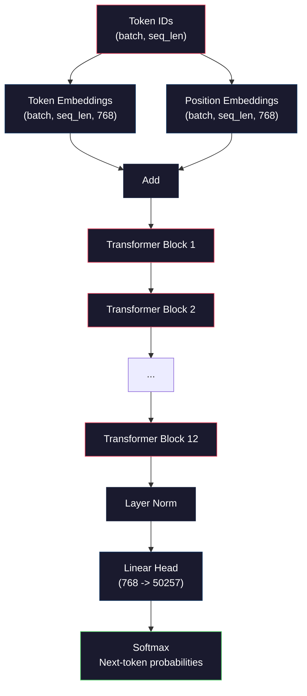
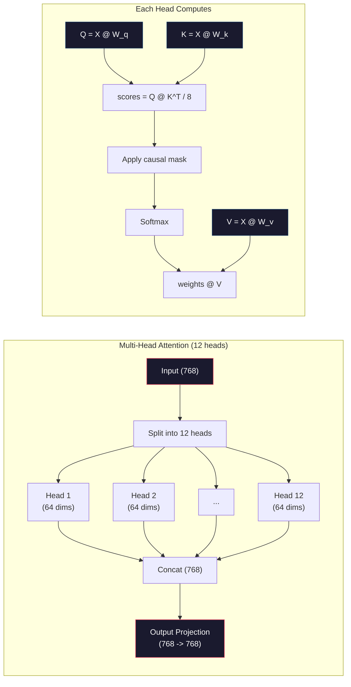
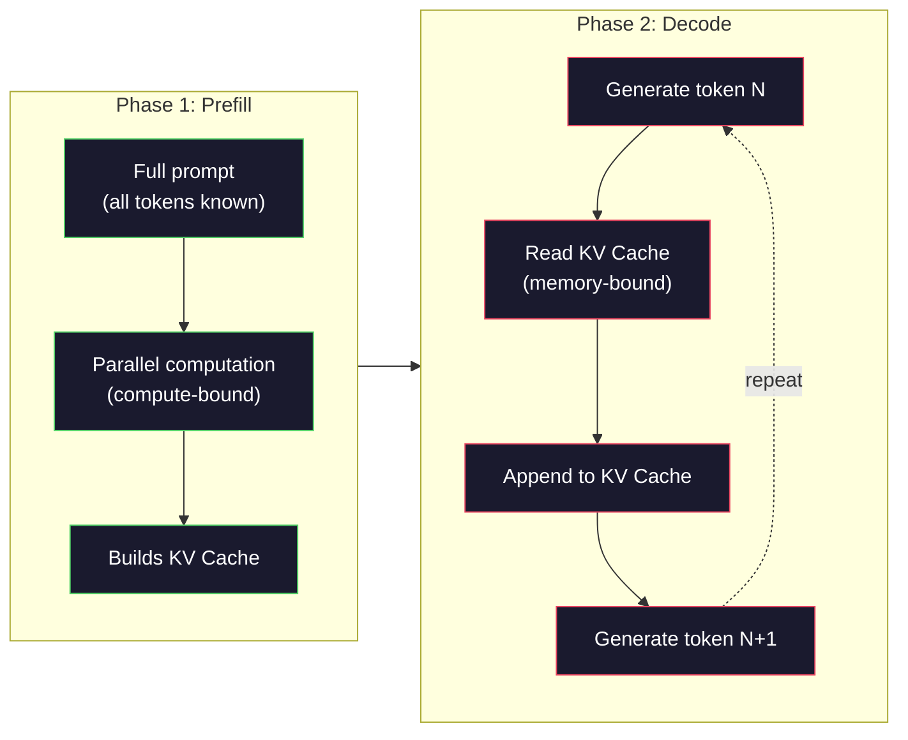

# Pre-Training a Mini GPT (124M Parameters)

> GPT-2 Small có 124 triệu tham số. Đó là 12 lớp transformer, 12 head attention và embedding 768 chiều. Bạn có thể huấn luyện nó từ đầu trên một GPU trong vài giờ. Hầu hết mọi người không bao giờ làm điều này. Họ dùng checkpoint được huấn luyện trước. Nhưng nếu không tự huấn luyện một mô hình, bạn không thực sự hiểu những gì xảy ra bên trong mô hình mà bạn đang xây sản phẩm trên đó.

**Type:** Build
**Languages:** Python (with numpy)
**Prerequisites:** Phase 10, Lessons 01-03 (Tokenizers, Building a Tokenizer, Data Pipelines)
**Time:** ~120 minutes

## Learning Objectives

- Triển khai toàn bộ kiến trúc GPT-2 (124M tham số) từ đầu: embedding token, embedding vị trí, khối transformer và head mô hình ngôn ngữ
- Huấn luyện một mô hình GPT trên một corpus văn bản bằng dự đoán token tiếp theo với hàm mất mát cross-entropy
- Triển khai sinh văn bản tự hồi quy với lấy mẫu temperature và lọc top-k/top-p
- Theo dõi các đường cong mất mát huấn luyện và xác thực rằng mô hình học các mẫu ngôn ngữ mạch lạc

## The Problem

Bạn biết transformer là gì. Bạn đã đọc các sơ đồ. Bạn có thể đọc thuộc "attention là tất cả những gì bạn cần" và vẽ các hộp ghi "Multi-Head Attention" trên bảng trắng.

Không điều nào trong đó nghĩa là bạn hiểu những gì xảy ra khi một mô hình sinh văn bản.

Có 124,438,272 tham số trong GPT-2 Small (với buộc trọng số). Mỗi tham số trong số đó được đặt bằng cách chạy một vòng lặp huấn luyện: truyền xuôi, tính mất mát, truyền ngược, cập nhật trọng số. Mười hai khối transformer. Mười hai head attention mỗi khối. Một không gian embedding 768 chiều. Một từ vựng 50,257 token. Mỗi khi mô hình sinh một token, cả 124 triệu tham số tham gia một chuỗi nhân ma trận duy nhất nhận một chuỗi ID token và tạo ra một phân phối xác suất trên token tiếp theo.

Nếu bạn chưa từng tự xây dựng điều này, bạn đang làm việc với một hộp đen. Bạn có thể dùng API. Bạn có thể tinh chỉnh. Nhưng khi có điều gì sai -- khi mô hình ảo giác, khi nó lặp lại chính nó, khi nó từ chối làm theo chỉ dẫn -- bạn không có mô hình tư duy cho *lý do*.

Bài học này xây GPT-2 Small từ đầu. Không trong PyTorch. Trong numpy. Mỗi phép nhân ma trận đều hiển thị. Mỗi gradient được mã của bạn tính. Bạn sẽ thấy chính xác cách 124 triệu con số phối hợp để dự đoán từ tiếp theo.

## The Concept

### The GPT Architecture

GPT là một mô hình ngôn ngữ tự hồi quy. "Tự hồi quy" nghĩa là nó sinh từng token một, mỗi token có điều kiện theo tất cả token trước. Kiến trúc là một chồng các khối decoder transformer.

Đây là toàn bộ đồ thị tính toán từ ID token đến xác suất token tiếp theo:

1. ID token đi vào. Hình dạng: (batch_size, seq_len).
2. Tra cứu embedding token. Mỗi ID ánh xạ sang một vector 768 chiều. Hình dạng: (batch_size, seq_len, 768).
3. Tra cứu embedding vị trí. Mỗi vị trí (0, 1, 2, ...) ánh xạ sang một vector 768 chiều. Cùng hình dạng.
4. Cộng embedding token + embedding vị trí.
5. Truyền qua 12 khối transformer.
6. Chuẩn hóa lớp cuối.
7. Chiếu tuyến tính sang kích thước từ vựng. Hình dạng: (batch_size, seq_len, vocab_size).
8. Softmax để nhận xác suất.

Đó là toàn bộ mô hình. Không tích chập. Không hồi tiếp. Chỉ embedding, attention, mạng feedforward và chuẩn hóa lớp xếp 12 lần.



### The Transformer Block

Mỗi khối trong 12 khối theo cùng mô thức. Kiến trúc pre-norm (GPT-2 dùng pre-norm, không phải post-norm như transformer gốc):

1. LayerNorm
2. Self-Attention đa head
3. Kết nối phần dư (cộng lại đầu vào)
4. LayerNorm
5. Mạng Feed-Forward (MLP)
6. Kết nối phần dư (cộng lại đầu vào)

Các kết nối phần dư cực kỳ quan trọng. Không có chúng, gradient triệt tiêu khi đến khối 1 trong lan truyền ngược. Có chúng, gradient có thể truyền trực tiếp từ hàm mất mát đến bất kỳ lớp nào qua đường "tắt". Đây là lý do bạn có thể xếp 12, 32, hoặc thậm chí 96 khối (GPT-4 được đồn dùng 120).

### Attention: The Core Mechanism

Self-attention cho phép mỗi token nhìn mọi token trước và quyết định chú ý đến mỗi token bao nhiêu. Đây là toán học.

Với mỗi vị trí token, tính ba vector từ đầu vào:
- **Query (Q)**: "Tôi đang tìm gì?"
- **Key (K)**: "Tôi chứa gì?"
- **Value (V)**: "Tôi mang thông tin gì?"

```
Q = input @ W_q    (768 -> 768)
K = input @ W_k    (768 -> 768)
V = input @ W_v    (768 -> 768)

attention_scores = Q @ K^T / sqrt(d_k)
attention_scores = mask(attention_scores)   # causal mask: -inf for future positions
attention_weights = softmax(attention_scores)
output = attention_weights @ V
```

Mặt nạ nhân quả là thứ khiến GPT tự hồi quy. Vị trí 5 có thể chú ý đến các vị trí 0-5 nhưng không phải 6, 7, 8, v.v. Điều này ngăn mô hình "gian lận" bằng cách nhìn các token tương lai trong huấn luyện.

**Attention đa head** chia không gian 768 chiều thành 12 head, mỗi head 64 chiều. Mỗi head học một mẫu attention khác. Một head có thể theo dõi quan hệ cú pháp (hòa hợp chủ ngữ-động từ). Một head khác có thể theo dõi tương đồng ngữ nghĩa (từ đồng nghĩa). Một head khác có thể theo dõi độ gần vị trí (từ gần nhau). Đầu ra từ cả 12 head được nối và chiếu trở lại 768 chiều.



Phép chia cho sqrt(d_k) -- sqrt(64) = 8 -- là co giãn. Không có nó, tích vô hướng tăng lớn với vector nhiều chiều, đẩy softmax vào các vùng mà gradient gần bằng không. Đây là một trong các nhận thức then chốt trong bài báo "Attention Is All You Need" gốc.

### KV Cache: Why Inference Is Fast

Trong huấn luyện, bạn xử lý toàn bộ chuỗi cùng lúc. Trong suy luận, bạn sinh từng token một. Không tối ưu, sinh token N đòi hỏi tính lại attention cho tất cả N-1 token trước. Đó là O(N^2) mỗi token được sinh, hay tổng O(N^3) cho một chuỗi độ dài N.

KV Cache giải quyết điều này. Sau khi tính K và V cho mỗi token, lưu chúng. Khi sinh token N+1, bạn chỉ cần tính Q cho token mới và tra K, V đã cache từ tất cả token trước. Điều này giảm chi phí mỗi token từ O(N) xuống O(1) cho tính toán K và V. Tính điểm attention vẫn là O(N) vì bạn chú ý đến mọi vị trí trước, nhưng tránh các phép nhân ma trận dư thừa trên đầu vào.

Với GPT-2 có 12 lớp và 12 head, KV cache lưu 2 (K + V) x 12 lớp x 12 head x 64 chiều = 18,432 giá trị mỗi token. Với một chuỗi 1024 token, đó là khoảng 75MB ở FP32. Với Llama 3 405B có 128 lớp, KV cache cho một chuỗi có thể vượt 10GB. Đây là lý do suy luận ngữ cảnh dài bị giới hạn bộ nhớ.

### Prefill vs Decode: Two Phases of Inference

Khi bạn gửi một prompt đến một LLM, suy luận diễn ra trong hai giai đoạn riêng biệt.

**Prefill** xử lý toàn bộ prompt song song. Mọi token đều đã biết, nên mô hình có thể tính attention cho mọi vị trí đồng thời. Giai đoạn này bị giới hạn tính toán -- GPU đang nhân ma trận ở toàn thông lượng. Với prompt 1000 token trên A100, prefill mất khoảng 20-50ms.

**Decode** sinh từng token một. Mỗi token mới phụ thuộc tất cả token trước. Giai đoạn này bị giới hạn bộ nhớ -- nút thắt là đọc trọng số mô hình và KV cache từ bộ nhớ GPU, không phải bản thân toán ma trận. Các lõi tính toán GPU phần lớn nhàn rỗi đợi đọc bộ nhớ. Với GPT-2, mỗi bước decode mất khoảng cùng thời gian bất kể các phép nhân ma trận cần bao nhiêu FLOPs, vì băng thông bộ nhớ là ràng buộc.

Phân biệt này quan trọng cho hệ thống production. Thông lượng prefill mở rộng theo tính toán GPU (nhiều FLOPS hơn = prefill nhanh hơn). Thông lượng decode mở rộng theo băng thông bộ nhớ (bộ nhớ nhanh hơn = decode nhanh hơn). Đó là lý do H100 của NVIDIA tập trung cải thiện băng thông bộ nhớ so với A100 -- nó trực tiếp tăng tốc sinh token.



### The Training Loop

Huấn luyện một LLM là dự đoán token tiếp theo. Với các token [0, 1, 2, ..., N-1], dự đoán các token [1, 2, 3, ..., N]. Hàm mất mát là cross-entropy giữa phân phối xác suất mô hình dự đoán và token tiếp theo thực tế.

Một bước huấn luyện:

1. **Truyền xuôi**: Chạy batch qua cả 12 khối. Nhận logits (điểm trước softmax) cho mỗi vị trí.
2. **Tính mất mát**: Cross-entropy giữa logits và token mục tiêu (đầu vào dịch một vị trí).
3. **Truyền ngược**: Tính gradient cho cả 124M tham số bằng lan truyền ngược.
4. **Bước optimizer**: Cập nhật trọng số. GPT-2 dùng Adam với khởi động tốc độ học và giảm cosine.

Lịch tốc độ học quan trọng hơn bạn có thể kỳ vọng. GPT-2 khởi động từ 0 đến tốc độ học đỉnh trong 2,000 bước đầu, rồi giảm theo một đường cong cosine. Bắt đầu với tốc độ học cao khiến mô hình phân kỳ. Giữ tốc độ cao không đổi gây dao động trong huấn luyện về sau. Mô thức khởi động-rồi-giảm được mọi LLM lớn dùng.

### GPT-2 Small: The Numbers

| Thành phần | Hình dạng | Tham số |
|-----------|-------|------------|
| Embedding token | (50257, 768) | 38,597,376 |
| Embedding vị trí | (1024, 768) | 786,432 |
| Attention mỗi khối (W_q, W_k, W_v, W_out) | 4 x (768, 768) | 2,359,296 |
| FFN mỗi khối (lên + xuống) | (768, 3072) + (3072, 768) | 4,718,592 |
| Các LayerNorm mỗi khối (2x) | 2 x 768 x 2 | 3,072 |
| LayerNorm cuối | 768 x 2 | 1,536 |
| **Tổng mỗi khối** | | **7,080,960** |
| **Tổng (12 khối)** | | **85,054,464 + 39,383,808 = 124,438,272** |

Phép chiếu đầu ra (head logits) chia sẻ trọng số với ma trận embedding token. Điều này gọi là buộc trọng số -- nó giảm số tham số 38M và cải thiện hiệu năng vì buộc mô hình dùng cùng không gian biểu diễn cho đầu vào và đầu ra.

## Build It

### Step 1: Embedding Layer

Embedding token ánh xạ mỗi token trong 50,257 token có thể sang một vector 768 chiều. Embedding vị trí thêm thông tin về nơi mỗi token nằm trong chuỗi. Hai thứ được cộng.

```python
import numpy as np

class Embedding:
    def __init__(self, vocab_size, embed_dim, max_seq_len):
        self.token_embed = np.random.randn(vocab_size, embed_dim) * 0.02
        self.pos_embed = np.random.randn(max_seq_len, embed_dim) * 0.02

    def forward(self, token_ids):
        seq_len = token_ids.shape[-1]
        tok_emb = self.token_embed[token_ids]
        pos_emb = self.pos_embed[:seq_len]
        return tok_emb + pos_emb
```

Độ lệch chuẩn 0.02 cho khởi tạo đến từ bài báo GPT-2. Quá lớn và các lượt truyền xuôi ban đầu tạo giá trị cực đoan làm mất ổn định huấn luyện. Quá nhỏ và các đầu ra ban đầu gần giống hệt cho mọi đầu vào, khiến tín hiệu gradient sớm vô dụng.

### Step 2: Self-Attention with Causal Mask

Attention một head trước. Mặt nạ nhân quả đặt các vị trí tương lai thành âm vô cùng trước softmax, bảo đảm mỗi vị trí chỉ có thể chú ý đến chính nó và các vị trí trước.

```python
def attention(Q, K, V, mask=None):
    d_k = Q.shape[-1]
    scores = Q @ K.transpose(0, -1, -2 if Q.ndim == 4 else 1) / np.sqrt(d_k)
    if mask is not None:
        scores = scores + mask
    weights = np.exp(scores - scores.max(axis=-1, keepdims=True))
    weights = weights / weights.sum(axis=-1, keepdims=True)
    return weights @ V
```

Triển khai softmax trừ giá trị lớn nhất trước khi lấy hàm mũ. Không có điều này, exp(large_number) tràn thành vô cùng. Đây là thủ thuật ổn định số không thay đổi đầu ra vì softmax(x - c) = softmax(x) với bất kỳ hằng số c nào.

### Step 3: Multi-Head Attention

Chia đầu vào 768 chiều thành 12 head, mỗi head 64 chiều. Mỗi head tính attention độc lập. Nối kết quả và chiếu trở lại 768 chiều.

```python
class MultiHeadAttention:
    def __init__(self, embed_dim, num_heads):
        self.num_heads = num_heads
        self.head_dim = embed_dim // num_heads
        self.W_q = np.random.randn(embed_dim, embed_dim) * 0.02
        self.W_k = np.random.randn(embed_dim, embed_dim) * 0.02
        self.W_v = np.random.randn(embed_dim, embed_dim) * 0.02
        self.W_out = np.random.randn(embed_dim, embed_dim) * 0.02

    def forward(self, x, mask=None):
        batch, seq_len, d = x.shape
        Q = (x @ self.W_q).reshape(batch, seq_len, self.num_heads, self.head_dim).transpose(0, 2, 1, 3)
        K = (x @ self.W_k).reshape(batch, seq_len, self.num_heads, self.head_dim).transpose(0, 2, 1, 3)
        V = (x @ self.W_v).reshape(batch, seq_len, self.num_heads, self.head_dim).transpose(0, 2, 1, 3)

        scores = Q @ K.transpose(0, 1, 3, 2) / np.sqrt(self.head_dim)
        if mask is not None:
            scores = scores + mask
        weights = np.exp(scores - scores.max(axis=-1, keepdims=True))
        weights = weights / weights.sum(axis=-1, keepdims=True)
        attn_out = weights @ V

        attn_out = attn_out.transpose(0, 2, 1, 3).reshape(batch, seq_len, d)
        return attn_out @ self.W_out
```

Điệu nhảy reshape-transpose-reshape là phần khó hiểu nhất của attention đa head. Đây là những gì xảy ra: tensor (batch, seq_len, 768) thành (batch, seq_len, 12, 64), rồi (batch, 12, seq_len, 64). Giờ mỗi head trong 12 head có ma trận (seq_len, 64) riêng để chạy attention. Sau attention, chúng ta đảo quá trình: (batch, 12, seq_len, 64) thành (batch, seq_len, 12, 64) thành (batch, seq_len, 768).

### Step 4: Transformer Block

Một khối transformer hoàn chỉnh: LayerNorm, attention đa head với phần dư, LayerNorm, feedforward với phần dư.

```python
class LayerNorm:
    def __init__(self, dim, eps=1e-5):
        self.gamma = np.ones(dim)
        self.beta = np.zeros(dim)
        self.eps = eps

    def forward(self, x):
        mean = x.mean(axis=-1, keepdims=True)
        var = x.var(axis=-1, keepdims=True)
        return self.gamma * (x - mean) / np.sqrt(var + self.eps) + self.beta


class FeedForward:
    def __init__(self, embed_dim, ff_dim):
        self.W1 = np.random.randn(embed_dim, ff_dim) * 0.02
        self.b1 = np.zeros(ff_dim)
        self.W2 = np.random.randn(ff_dim, embed_dim) * 0.02
        self.b2 = np.zeros(embed_dim)

    def forward(self, x):
        h = x @ self.W1 + self.b1
        h = np.maximum(0, h)  # GELU approximation: ReLU for simplicity
        return h @ self.W2 + self.b2


class TransformerBlock:
    def __init__(self, embed_dim, num_heads, ff_dim):
        self.ln1 = LayerNorm(embed_dim)
        self.attn = MultiHeadAttention(embed_dim, num_heads)
        self.ln2 = LayerNorm(embed_dim)
        self.ffn = FeedForward(embed_dim, ff_dim)

    def forward(self, x, mask=None):
        x = x + self.attn.forward(self.ln1.forward(x), mask)
        x = x + self.ffn.forward(self.ln2.forward(x))
        return x
```

Mạng feedforward mở rộng đầu vào 768 chiều lên 3,072 chiều (4x), áp dụng một phi tuyến, rồi chiếu trở lại 768. Mô thức mở rộng-co lại này cho mô hình một biểu diễn nội bộ "rộng hơn" để làm việc ở mỗi vị trí. GPT-2 dùng kích hoạt GELU, nhưng chúng ta dùng ReLU ở đây cho đơn giản -- khác biệt nhỏ đối với việc hiểu kiến trúc.

### Step 5: Full GPT Model

Xếp 12 khối transformer. Thêm lớp embedding phía trước và phép chiếu đầu ra phía sau.

```python
class MiniGPT:
    def __init__(self, vocab_size=50257, embed_dim=768, num_heads=12,
                 num_layers=12, max_seq_len=1024, ff_dim=3072):
        self.embedding = Embedding(vocab_size, embed_dim, max_seq_len)
        self.blocks = [
            TransformerBlock(embed_dim, num_heads, ff_dim)
            for _ in range(num_layers)
        ]
        self.ln_f = LayerNorm(embed_dim)
        self.vocab_size = vocab_size
        self.embed_dim = embed_dim

    def forward(self, token_ids):
        seq_len = token_ids.shape[-1]
        mask = np.triu(np.full((seq_len, seq_len), -1e9), k=1)

        x = self.embedding.forward(token_ids)
        for block in self.blocks:
            x = block.forward(x, mask)
        x = self.ln_f.forward(x)

        logits = x @ self.embedding.token_embed.T
        return logits

    def count_parameters(self):
        total = 0
        total += self.embedding.token_embed.size
        total += self.embedding.pos_embed.size
        for block in self.blocks:
            total += block.attn.W_q.size + block.attn.W_k.size
            total += block.attn.W_v.size + block.attn.W_out.size
            total += block.ffn.W1.size + block.ffn.b1.size
            total += block.ffn.W2.size + block.ffn.b2.size
            total += block.ln1.gamma.size + block.ln1.beta.size
            total += block.ln2.gamma.size + block.ln2.beta.size
        total += self.ln_f.gamma.size + self.ln_f.beta.size
        return total
```

Chú ý buộc trọng số: `logits = x @ self.embedding.token_embed.T`. Phép chiếu đầu ra tái sử dụng ma trận embedding token (chuyển vị). Đây không chỉ là thủ thuật tiết kiệm tham số. Nó nghĩa là mô hình dùng cùng không gian vector để hiểu token (embedding) và dự đoán chúng (đầu ra).

### Step 6: Training Loop

Với một lần huấn luyện thực trên 124M tham số, bạn sẽ cần GPU và PyTorch. Vòng lặp huấn luyện này minh họa cơ chế trên một mô hình nhỏ chạy bằng numpy thuần. Chúng ta dùng một mô hình nhỏ (4 lớp, 4 head, 128 chiều) để làm nó tính toán được.

```python
def cross_entropy_loss(logits, targets):
    batch, seq_len, vocab_size = logits.shape
    logits_flat = logits.reshape(-1, vocab_size)
    targets_flat = targets.reshape(-1)

    max_logits = logits_flat.max(axis=-1, keepdims=True)
    log_softmax = logits_flat - max_logits - np.log(
        np.exp(logits_flat - max_logits).sum(axis=-1, keepdims=True)
    )

    loss = -log_softmax[np.arange(len(targets_flat)), targets_flat].mean()
    return loss


def train_mini_gpt(text, vocab_size=256, embed_dim=128, num_heads=4,
                   num_layers=4, seq_len=64, num_steps=200, lr=3e-4):
    tokens = np.array(list(text.encode("utf-8")[:2048]))
    model = MiniGPT(
        vocab_size=vocab_size, embed_dim=embed_dim, num_heads=num_heads,
        num_layers=num_layers, max_seq_len=seq_len, ff_dim=embed_dim * 4
    )

    print(f"Model parameters: {model.count_parameters():,}")
    print(f"Training tokens: {len(tokens):,}")
    print(f"Config: {num_layers} layers, {num_heads} heads, {embed_dim} dims")
    print()

    for step in range(num_steps):
        start_idx = np.random.randint(0, max(1, len(tokens) - seq_len - 1))
        batch_tokens = tokens[start_idx:start_idx + seq_len + 1]

        input_ids = batch_tokens[:-1].reshape(1, -1)
        target_ids = batch_tokens[1:].reshape(1, -1)

        logits = model.forward(input_ids)
        loss = cross_entropy_loss(logits, target_ids)

        if step % 20 == 0:
            print(f"Step {step:4d} | Loss: {loss:.4f}")

    return model
```

Mất mát bắt đầu gần ln(vocab_size) -- với một từ vựng cấp byte 256 token, đó là ln(256) = 5.55. Một mô hình ngẫu nhiên gán xác suất bằng nhau cho mọi token. Khi huấn luyện tiến triển, mất mát giảm vì mô hình học dự đoán các mẫu phổ biến: "th" sau "t", khoảng trắng sau dấu chấm, v.v.

Trong production, bạn sẽ dùng optimizer Adam với tích lũy gradient, khởi động tốc độ học và cắt gradient. Vòng lặp truyền-xuôi-mất-mát-truyền-ngược-cập-nhật giống hệt. Optimizer tinh vi hơn.

### Step 7: Text Generation

Sinh dùng mô hình đã huấn luyện để dự đoán từng token một. Mỗi dự đoán được lấy mẫu từ phân phối đầu ra (hoặc chọn tham lam như argmax).

```python
def generate(model, prompt_tokens, max_new_tokens=100, temperature=0.8):
    tokens = list(prompt_tokens)
    seq_len = model.embedding.pos_embed.shape[0]

    for _ in range(max_new_tokens):
        context = np.array(tokens[-seq_len:]).reshape(1, -1)
        logits = model.forward(context)
        next_logits = logits[0, -1, :]

        next_logits = next_logits / temperature
        probs = np.exp(next_logits - next_logits.max())
        probs = probs / probs.sum()

        next_token = np.random.choice(len(probs), p=probs)
        tokens.append(next_token)

    return tokens
```

Temperature điều khiển độ ngẫu nhiên. Temperature 1.0 dùng phân phối thô. Temperature 0.5 làm nó sắc hơn (tất định hơn -- mô hình chọn các lựa chọn hàng đầu thường xuyên hơn). Temperature 1.5 làm phẳng nó (ngẫu nhiên hơn -- token xác suất thấp có cơ hội lớn hơn). Temperature 0.0 là giải mã tham lam (luôn chọn token xác suất cao nhất).

Cửa sổ `tokens[-seq_len:]` cần thiết vì mô hình có độ dài ngữ cảnh tối đa (1024 cho GPT-2). Khi vượt nó, bạn phải bỏ các token cũ nhất. Đây là "cửa sổ ngữ cảnh" mà mọi người nói đến.

```figure
sampling-decoder
```

## Use It

### Full Training and Generation Demo

```python
corpus = """The transformer architecture has revolutionized natural language processing.
Attention mechanisms allow the model to focus on relevant parts of the input.
Self-attention computes relationships between all pairs of positions in a sequence.
Multi-head attention splits the representation into multiple subspaces.
Each attention head can learn different types of relationships.
The feedforward network provides nonlinear transformations at each position.
Residual connections enable gradient flow through deep networks.
Layer normalization stabilizes training by normalizing activations.
Position embeddings give the model information about token ordering.
The causal mask ensures autoregressive generation during training.
Pre-training on large text corpora teaches the model general language understanding.
Fine-tuning adapts the pre-trained model to specific downstream tasks."""

model = train_mini_gpt(corpus, num_steps=200)

prompt = list("The transformer".encode("utf-8"))
output_tokens = generate(model, prompt, max_new_tokens=100, temperature=0.8)
generated_text = bytes(output_tokens).decode("utf-8", errors="replace")
print(f"\nGenerated: {generated_text}")
```

Trên một corpus nhỏ với một mô hình nhỏ, văn bản được sinh tốt nhất cũng chỉ phần nào mạch lạc. Nó sẽ học một số mẫu cấp byte từ văn bản huấn luyện nhưng không thể khái quát như GPT-2 với 40GB dữ liệu huấn luyện và kiến trúc đầy đủ 124M tham số. Điểm chính không phải chất lượng đầu ra. Điểm chính là bạn có thể truy từng bước: tra embedding, tính attention, biến đổi feedforward, chiếu logit, softmax và lấy mẫu. Mỗi phép toán đều hiển thị.

## Ship It

Bài học này tạo ra `outputs/prompt-gpt-architecture-analyzer.md` -- một prompt phân tích các lựa chọn kiến trúc trong bất kỳ mô hình kiểu GPT nào. Đưa cho nó một model card hoặc báo cáo kỹ thuật và nó phân tích phân bổ tham số, thiết kế attention và quyết định mở rộng quy mô.

## Exercises

1. Sửa mô hình dùng 24 lớp và 16 head thay vì 12/12. Đếm tham số. Tăng gấp đôi độ sâu so với tăng gấp đôi độ rộng (số chiều embedding) thế nào?

2. Triển khai hàm kích hoạt GELU (GELU(x) = x * 0.5 * (1 + erf(x / sqrt(2)))) và thay ReLU trong mạng feedforward. Chạy huấn luyện 500 bước với mỗi kích hoạt và so sánh mất mát cuối.

3. Thêm một KV cache vào hàm sinh. Lưu các tensor K và V cho mỗi lớp sau lượt truyền xuôi đầu, và tái sử dụng cho các token sau. Đo tăng tốc: sinh 200 token có và không có cache rồi so sánh thời gian thực.

4. Triển khai lấy mẫu top-k (chỉ xét k token xác suất cao nhất) và lấy mẫu top-p (lấy mẫu nucleus: xét tập token nhỏ nhất có xác suất tích lũy vượt p). So sánh chất lượng đầu ra ở temperature 0.8 với top-k=50 so với top-p=0.95.

5. Xây dựng một bộ vẽ đường cong mất mát huấn luyện. Huấn luyện mô hình 1000 bước và vẽ mất mát theo bước. Xác định ba giai đoạn: giảm nhanh ban đầu (học byte phổ biến), giai đoạn giữa chậm hơn (học mẫu byte), và chững lại (overfit trên corpus nhỏ). Hình dạng đường cong này giống nhau dù bạn huấn luyện một mô hình 128 chiều hay GPT-4.

## Key Terms

| Thuật ngữ | Cách mọi người nói | Ý nghĩa thực sự |
|------|----------------|----------------------|
| Autoregressive (Tự hồi quy) | "Nó sinh từng từ một" | Mỗi token đầu ra có điều kiện theo mọi token trước -- mô hình dự đoán P(token_n \| token_0, ..., token_{n-1}) |
| Causal mask (Mặt nạ nhân quả) | "Nó không thể thấy tương lai" | Một ma trận tam giác trên gồm các giá trị âm vô cùng ngăn attention đến vị trí tương lai trong huấn luyện |
| Multi-head attention (Attention đa head) | "Nhiều mẫu attention" | Chia Q, K, V thành các head song song (ví dụ 12 head mỗi head 64 chiều cho GPT-2) để mỗi head học các loại quan hệ khác nhau |
| KV Cache | "Cache để tăng tốc" | Lưu các tensor Key và Value đã tính từ token trước để tránh tính toán dư thừa khi sinh tự hồi quy |
| Prefill | "Xử lý prompt" | Giai đoạn suy luận đầu nơi mọi token prompt được xử lý song song -- bị giới hạn tính toán theo FLOPS GPU |
| Decode (Giải mã) | "Sinh token" | Giai đoạn suy luận thứ hai nơi token được sinh từng cái một -- bị giới hạn bộ nhớ theo băng thông GPU |
| Weight tying (Buộc trọng số) | "Chia sẻ embedding" | Dùng cùng ma trận cho embedding token đầu vào và head chiếu đầu ra -- tiết kiệm 38M tham số trong GPT-2 |
| Residual connection (Kết nối phần dư) | "Kết nối tắt" | Cộng đầu vào trực tiếp với đầu ra một lớp con (x + sublayer(x)) -- cho phép gradient truyền trong mạng sâu |
| Layer normalization (Chuẩn hóa lớp) | "Chuẩn hóa activation" | Chuẩn hóa trên chiều đặc trưng về trung bình 0 và phương sai 1, với các tham số scale và bias có thể học |
| Cross-entropy loss (Hàm mất mát cross-entropy) | "Dự đoán sai đến đâu" | -log(xác suất gán cho token tiếp theo đúng), lấy trung bình trên mọi vị trí -- mục tiêu huấn luyện LLM tiêu chuẩn |

## Further Reading

- [Radford et al., 2019 -- "Language Models are Unsupervised Multitask Learners" (GPT-2)](https://cdn.openai.com/better-language-models/language_models_are_unsupervised_multitask_learners.pdf) -- bài báo GPT-2 giới thiệu họ từ 124M đến 1.5B tham số
- [Vaswani et al., 2017 -- "Attention Is All You Need"](https://arxiv.org/abs/1706.03762) -- bài báo transformer gốc với attention tích vô hướng có co giãn và attention đa head
- [Llama 3 Technical Report](https://arxiv.org/abs/2407.21783) -- cách Meta mở rộng kiến trúc GPT lên 405B tham số với 16K GPU
- [Pope et al., 2022 -- "Efficiently Scaling Transformer Inference"](https://arxiv.org/abs/2211.05102) -- bài báo hình thức hóa prefill so với decode và phân tích KV cache
