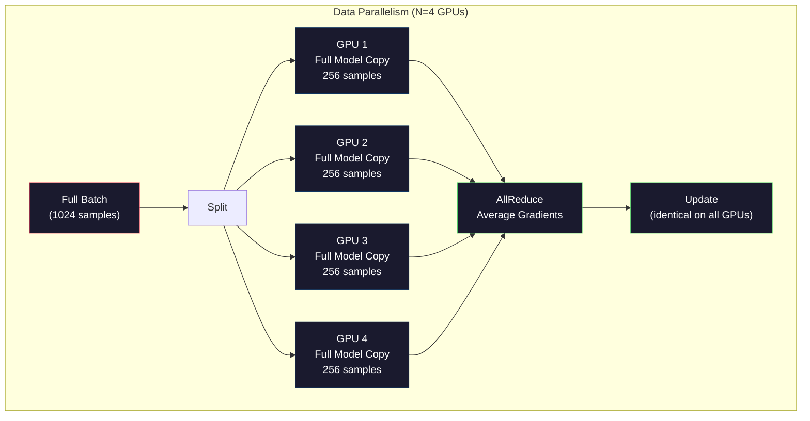
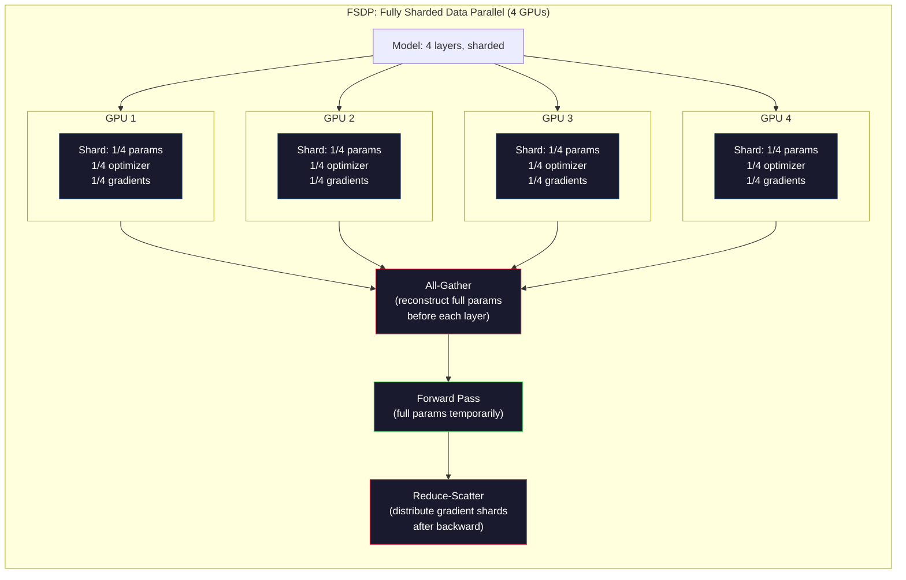
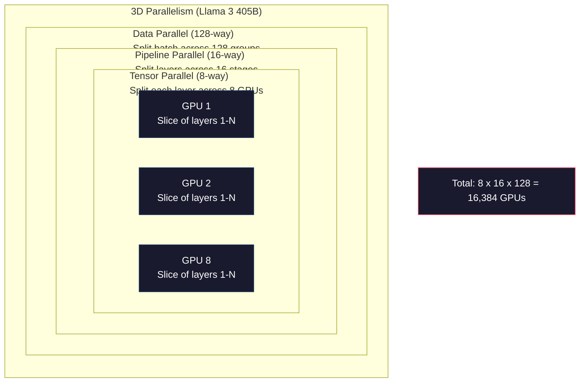

# Scaling: Distributed Training, FSDP, DeepSpeed

> Mô hình 124M của bạn huấn luyện trên một GPU. Giờ thử 7 tỷ tham số. Mô hình không vừa bộ nhớ. Dữ liệu mất nhiều tuần trên một máy. Huấn luyện phân tán không tùy chọn ở quy mô lớn. Nó là con đường duy nhất phía trước.

**Type:** Build
**Languages:** Python
**Prerequisites:** Phase 10, Lesson 04 (Pre-Training a Mini GPT)
**Time:** ~120 minutes

## Learning Objectives

- Giải thích ba loại song song hóa (dữ liệu, tensor, pipeline) và khi nào cần mỗi loại dựa trên kích thước mô hình và cụm
- Triển khai huấn luyện song song dữ liệu bằng PyTorch DDP với đồng bộ gradient xuyên nhiều GPU
- Tính ngân sách bộ nhớ cho một kích thước mô hình cho trước (trọng số + trạng thái optimizer + gradient + activation) để xác định phần cứng tối thiểu
- Cấu hình FSDP hoặc các giai đoạn DeepSpeed ZeRO để phân mảnh trạng thái mô hình trên GPU và chứa các mô hình vượt bộ nhớ một GPU

## The Problem

Một mô hình 7B tham số ở FP16 cần 14GB chỉ cho trọng số. Optimizer Adam lưu thêm hai bản sao của mỗi tham số (ước lượng moment bậc nhất và bậc hai). Đó là thêm 28GB. Gradient trong lan truyền ngược thêm 14GB nữa. Bạn đã ở 56GB trước khi lưu một activation nào.

Một NVIDIA A100 có 80GB bộ nhớ.

56GB trong 80GB đã tiêu thụ. Còn 24GB cho activation -- các giá trị trung gian tính trong truyền xuôi phải được giữ cho lan truyền ngược. Với một chuỗi 2048 token có mô hình 4096 chiều, activation một lớp dùng khoảng 64MB. Với 32 lớp, bạn cần 2GB mỗi mẫu. Kích thước batch 8 cần 16GB. Bạn có 24GB. Kích thước batch 12 bùng nổ.

Giờ thử 70B tham số. Riêng trọng số: 140GB ở FP16. Không vừa trên một GPU. Bạn cần ít nhất 2 A100 (2 x 80GB = 160GB) chỉ để giữ trọng số. Thêm trạng thái optimizer và gradient thì cần nhiều hơn xa: tối thiểu 3+ GPU, và thực tế 8-16 tùy chiến lược phân mảnh.

Llama 3 405B được huấn luyện trên 16,384 GPU NVIDIA H100. Lần huấn luyện tốn ước tính $100 triệu tính toán. DeepSeek V3 huấn luyện một mô hình tương đương với khoảng $5.6 triệu nhờ thông minh về kiến trúc (Mixture of Experts nghĩa là chỉ một phần tham số kích hoạt mỗi token) và hiệu quả huấn luyện.

Bài học này trình bày bốn chiến lược làm huấn luyện quy mô lớn khả thi: song song dữ liệu, song song tensor, song song pipeline và song song dữ liệu phân mảnh hoàn toàn. Bạn sẽ mô phỏng mỗi cách bằng Python thuần để hiểu cơ chế trước khi chạm vào một framework huấn luyện phân tán.

## The Concept

### Why Distribution is Required

Đây là toán bộ nhớ cho các mô hình thực. Mỗi con số được tính, không phải ước lượng.

| Mô hình | Tham số | Trọng số (FP16) | Trạng thái Adam | Gradient (FP16) | Tổng (không activation) |
|-------|--------|----------------|-------------|------------------|----------------------|
| GPT-2 Small | 124M | 248 MB | 992 MB | 248 MB | 1.5 GB |
| Llama 3 8B | 8B | 16 GB | 64 GB | 16 GB | 96 GB |
| Llama 3 70B | 70B | 140 GB | 560 GB | 140 GB | 840 GB |
| Llama 3 405B | 405B | 810 GB | 3,240 GB | 810 GB | 4,860 GB |

Cột "Trạng thái Adam" là sát thủ. Adam lưu một trung bình tích lũy (m) và một phương sai tích lũy (v) cho mỗi tham số, cả hai ở FP32. Với mô hình 70B, đó là 70B x 4 byte x 2 = 560GB. Riêng optimizer cần bảy A100.

Một H100 có 80GB. Llama 3 405B cần ít nhất 61 H100 để giữ trọng số, optimizer và gradient. Thêm activation và con số tăng nữa. Meta dùng 16,384 GPU không phải vì họ muốn -- vì họ phải làm thế.

### Data Parallelism

Chiến lược phân tán đơn giản nhất. Sao chép toàn bộ mô hình sang N GPU. Chia mỗi batch huấn luyện thành N phần bằng nhau. Mỗi GPU chạy truyền xuôi và truyền ngược trên mảnh dữ liệu của nó. Sau truyền ngược, lấy trung bình gradient trên mọi GPU. Mỗi GPU cập nhật bản sao trọng số bằng cùng gradient trung bình, giữ mọi bản sao đồng bộ.

**Điểm tốt:** Mở rộng thông lượng tuyến tính. N GPU xử lý gấp N dữ liệu mỗi bước. Giao tiếp giới hạn ở lấy trung bình gradient, chồng lấp với tính toán.

**Điểm xấu:** Mỗi GPU giữ một bản sao đầy đủ của mô hình, trạng thái optimizer và gradient. Với mô hình 70B, mỗi GPU cần 840GB. Song song dữ liệu không làm gì để giảm bộ nhớ mỗi GPU. Nó chỉ giảm thời gian huấn luyện.

**Toán học:** Kích thước batch hiệu dụng = per_gpu_batch_size x N. Với N=64 GPU có batch mỗi GPU 16, batch hiệu dụng là 1,024. Llama 3 dùng kích thước batch hiệu dụng 16 triệu token mỗi bước.



### Tensor Parallelism

Chia các lớp riêng lẻ trên GPU. Một phép nhân ma trận được chia cho các GPU, mỗi GPU tính một phần kết quả.

Xét một ma trận trọng số hình dạng (8192, 8192) trong một lớp feedforward. Với song song tensor 4 chiều, mỗi GPU giữ một mảnh (8192, 2048). Mỗi GPU nhân đầu vào với mảnh của nó, tạo một kết quả bộ phận. Các kết quả bộ phận được kết hợp (qua all-reduce hoặc all-gather) để tạo đầu ra đầy đủ.

**Điểm tốt:** Giảm bộ nhớ mỗi GPU cho trọng số mô hình. Một mô hình 70B chia trên 8 GPU nghĩa là mỗi GPU giữ lượng trọng số tương ứng ~8.75B tham số.

**Điểm xấu:** Đòi hỏi giao tiếp nhanh giữa GPU sau mỗi lớp. All-reduce sau mỗi phép nhân ma trận thêm độ trễ. Điều này hoạt động tốt với NVLink (900 GB/s giữa GPU cùng node) nhưng kém xuyên các node nối bằng InfiniBand (400 Gb/s, khoảng 50 GB/s). Song song tensor hầu như luôn giới hạn trong một node (8 GPU).

**Sử dụng thực:** Megatron-LM tiên phong song song tensor. Llama 3 405B dùng song song tensor 8 chiều trong mỗi node.

### Pipeline Parallelism

Chia mô hình theo lớp. GPU 1 chạy lớp 1-8. GPU 2 chạy lớp 9-16. GPU 3 chạy lớp 17-24. GPU 4 chạy lớp 25-32. Dữ liệu truyền qua pipeline: GPU 1 tính các lớp của nó và gửi activation đến GPU 2, GPU 2 tính các lớp của nó và gửi đến GPU 3, v.v.

**Điểm tốt:** Giao tiếp tối thiểu giữa GPU -- chỉ activation tại ranh giới lớp, nhỏ so với gradient hoặc trọng số. Hoạt động xuyên node vì yêu cầu băng thông thấp.

**Điểm xấu:** Bong bóng pipeline. Khi GPU 4 đang tính truyền xuôi trên micro-batch 1, GPU 1, 2 và 3 nhàn rỗi (chúng đã truyền xuôi phần mình). Trong truyền ngược, mô thức đảo lại. Với pipeline đơn giản, mức sử dụng GPU chỉ là 1/N cho N giai đoạn pipeline.

**GPipe và PipeDream** giải bài toán bong bóng bằng cách chia batch thành micro-batch. GPU 1 bắt đầu micro-batch 2 ngay khi xong truyền xuôi micro-batch 1. Điều này chồng lấp tính toán xuyên các giai đoạn pipeline. Với M micro-batch và N giai đoạn, tỷ lệ bong bóng giảm về (N-1)/M. Dùng M=16 micro-batch với N=4 giai đoạn và bong bóng là 3/16 = 18.75% thời gian nhàn rỗi.

### FSDP: Fully Sharded Data Parallel

FSDP kết hợp khả năng mở rộng của song song dữ liệu với hiệu quả bộ nhớ của phân mảnh. Thay vì mỗi GPU giữ một bản sao mô hình đầy đủ, mỗi GPU chỉ giữ 1/N tham số, gradient và trạng thái optimizer.

Trước truyền xuôi của một lớp, FSDP chạy một **all-gather** để thu thập tham số đầy đủ từ mọi GPU vào bộ nhớ mỗi GPU. Sau truyền xuôi, mỗi GPU loại các tham số không cục bộ. Trong truyền ngược, all-gather chạy lại để tái dựng tham số cho tính gradient. Sau truyền ngược, một **reduce-scatter** phân phối các mảnh gradient để mỗi GPU chỉ lưu 1/N gradient.

**Toán học cho một mô hình 70B trên 8 GPU:**

| Thành phần | Không FSDP | Có FSDP |
|-----------|-------------|-----------|
| Trọng số (FP16) | 140 GB mỗi GPU | 17.5 GB mỗi GPU |
| Trạng thái Adam (FP32) | 560 GB mỗi GPU | 70 GB mỗi GPU |
| Gradient (FP16) | 140 GB mỗi GPU | 17.5 GB mỗi GPU |
| **Tổng** | **840 GB mỗi GPU** | **105 GB mỗi GPU** |

Không FSDP, bạn không thể chứa một mô hình 70B trên một GPU 80GB. Với FSDP trên 8 GPU, mỗi GPU dùng 105GB -- khoan, vẫn không vừa. Bạn cần ít nhất 16 GPU để xuống dưới 80GB mỗi GPU, hoặc kết hợp FSDP với activation checkpointing (tính lại activation trong truyền ngược thay vì lưu chúng).

Chi phí giao tiếp cao hơn song song dữ liệu nguyên bản vì all-gather trước mỗi lớp. Nhưng tiết kiệm bộ nhớ làm các lần huấn luyện trước đó bất khả thi trở nên khả thi.



### DeepSpeed ZeRO

ZeRO (Zero Redundancy Optimizer) của DeepSpeed giống FSDP về khái niệm nhưng được Microsoft phát triển độc lập. Nó định nghĩa ba giai đoạn, mỗi giai đoạn phân mảnh mạnh hơn:

| Giai đoạn | Phân mảnh | Tiết kiệm bộ nhớ | Giao tiếp |
|-------|--------|---------------|---------------|
| ZeRO-1 | Chỉ trạng thái optimizer | Giảm ~4x | Giống song song dữ liệu |
| ZeRO-2 | + Gradient | Giảm ~8x | Nhiều hơn một chút |
| ZeRO-3 | + Tham số | Giảm ~Nx (N GPU) | All-gather mỗi lớp |

ZeRO-3 tương đương FSDP. Tên khác, cơ chế giống nhau. PyTorch thêm FSDP như một triển khai gốc sau khi DeepSpeed chứng minh khái niệm.

DeepSpeed cũng giới thiệu ZeRO-Offload (offload trạng thái optimizer sang RAM CPU, rẻ hơn và lớn hơn) và ZeRO-Infinity (offload sang SSD NVMe). Chúng đánh đổi tốc độ tính toán lấy dung lượng bộ nhớ -- các phép toán được offload chậm hơn nhưng giải phóng bộ nhớ GPU.

### Mixed Precision Training

Huấn luyện hiện đại dùng đồng thời nhiều định dạng dấu phẩy động:

- **Truyền xuôi**: FP16 hoặc BF16 (16-bit). Nửa bộ nhớ FP32. Phép nhân ma trận chạy nhanh gấp 2x trên tensor core.
- **Trọng số chính**: FP32 (32-bit). Được optimizer duy trì cho độ chính xác số trong cập nhật trọng số.
- **Co giãn mất mát**: Nhân mất mát với một hằng số lớn trước truyền ngược để ngăn gradient FP16 hụt xuống không. Chia cho cùng hằng số trước bước optimizer.

BF16 (Brain Float 16) có cùng phạm vi số mũ như FP32 (8 bit số mũ) nhưng độ chính xác giảm (7 bit phần định trị so với 23 của FP32). Nó hiếm khi cần co giãn mất mát vì có thể biểu diễn cùng phạm vi giá trị. FP16 có 5 bit số mũ và 10 bit phần định trị -- nó có thể biểu diễn giá trị chi tiết nhưng tràn/hụt ở độ lớn cực đoan.

TPU của Google dùng BF16 nguyên bản. A100 và H100 của NVIDIA hỗ trợ cả FP16 và BF16. Ngành phần lớn chuyển sang BF16 vì loại những đau đầu về co giãn mất mát.

**So sánh bộ nhớ cho một mô hình 7B:**

| Độ chính xác | Trọng số | Optimizer | Gradient | Tổng |
|-----------|---------|-----------|-----------|-------|
| FP32 khắp nơi | 28 GB | 56 GB | 28 GB | 112 GB |
| Hỗn hợp (BF16 + trọng số chính FP32) | 14 GB | 56 GB | 14 GB | 84 GB |

Độ chính xác hỗn hợp tiết kiệm 28GB trên mô hình này. Trạng thái optimizer vẫn ở FP32 bất kể thế nào -- đây là nơi hầu hết bộ nhớ đi vào.

### Megatron-LM and 3D Parallelism

Huấn luyện quy mô lớn thực kết hợp cả ba cách song song hóa:

- **Song song dữ liệu** xuyên các nhóm node (mở rộng kích thước batch)
- **Song song tensor** trong một node (chia lớp trên 8 GPU)
- **Song song pipeline** xuyên node (chia các nhóm lớp trên nhiều máy)

Llama 3 405B trên 16,384 H100:
- Song song tensor 8 chiều trong mỗi node (8 GPU mỗi node)
- Song song pipeline 16 chiều xuyên node (16 giai đoạn pipeline)
- Song song dữ liệu 128 chiều trên chiều còn lại (16,384 / 8 / 16 = 128)

Phân rã 3D này (8 x 16 x 128 = 16,384) là cách bạn mở rộng đến hàng nghìn GPU. Mỗi GPU thấy một mảnh dữ liệu khác (song song dữ liệu), giữ một lát của mỗi lớp (song song tensor), và tính một tập lớp khác (song song pipeline).

DeepSeek V3 đi theo cách khác. Kiến trúc Mixture of Experts của họ chỉ kích hoạt 37B trong 671B tham số mỗi token. Điều này nghĩa là mỗi GPU chỉ cần tính (và lưu activation cho) các tham số hoạt động. Họ huấn luyện trên 2,048 GPU H800 -- ít hơn 1/8 số GPU của Meta -- với $5.6M so với $100M ước tính của Meta.



```figure
paged-kv-cache
```

## Build It

### Step 1: Simulate Data Parallelism

Chia một batch trên các GPU mô phỏng. Mỗi GPU tính truyền xuôi trên mảnh của nó. Lấy trung bình các "gradient" (chúng ta mô phỏng chúng bằng giá trị mất mát).

```python
import numpy as np

def simulate_data_parallelism(data, num_gpus, model_fn):
    batch_size = len(data)
    shard_size = batch_size // num_gpus
    remainder = batch_size % num_gpus

    gpu_losses = []
    gpu_gradients = []

    offset = 0
    for gpu_id in range(num_gpus):
        extra = 1 if gpu_id < remainder else 0
        shard = data[offset:offset + shard_size + extra]
        offset += shard_size + extra

        loss, grad = model_fn(shard)
        gpu_losses.append(loss)
        gpu_gradients.append(grad)

    avg_loss = np.mean(gpu_losses)
    avg_gradient = np.mean(gpu_gradients, axis=0)

    return avg_loss, avg_gradient
```

Phép all-reduce (lấy trung bình gradient) là giao tiếp duy nhất trong song song dữ liệu. Trong thực tế, nó dùng thư viện NCCL trên GPU NVIDIA, triển khai ring all-reduce: mỗi GPU gửi 1/N gradient của nó cho hàng xóm, nhận 1/N từ hàng xóm kia, và sau N-1 bước mọi GPU có trung bình đầy đủ. Tổng lượng giao tiếp: 2 x gradient_size x (N-1)/N, tiến tới 2x kích thước gradient khi N lớn.

### Step 2: Simulate Tensor Parallelism

Chia một ma trận trọng số trên GPU. Mỗi GPU tính một phép nhân ma trận bộ phận. Kết hợp kết quả.

```python
def simulate_tensor_parallelism(input_data, weight_matrix, num_gpus):
    d_in, d_out = weight_matrix.shape
    assert d_out % num_gpus == 0, f"d_out {d_out} not divisible by num_gpus {num_gpus}"
    shard_size = d_out // num_gpus

    partial_results = []
    for gpu_id in range(num_gpus):
        start = gpu_id * shard_size
        end = start + shard_size
        weight_shard = weight_matrix[:, start:end]

        partial = input_data @ weight_shard
        partial_results.append(partial)

    full_output = np.concatenate(partial_results, axis=-1)

    direct_output = input_data @ weight_matrix
    error = np.abs(full_output - direct_output).max()

    return full_output, error
```

Sai số nên chính xác bằng không (hoặc epsilon máy). Song song tensor chính xác về toán học -- nó tạo cùng kết quả như tính toàn bộ phép nhân ma trận trên một GPU. Việc chia theo chiều đầu ra, nên mỗi GPU tạo một khối cột khác nhau, và nối tái dựng kết quả đầy đủ.

Với lớp tuyến tính song song cột (chia chiều đầu ra), bạn nối. Với song song hàng (chia chiều đầu vào), bạn cộng. Trong FFN transformer, lớp tuyến tính đầu (mở rộng) dùng song song cột và lớp tuyến tính thứ hai (co lại) dùng song song hàng. Điều này tránh all-reduce giữa hai lớp.

### Step 3: Simulate Pipeline Parallelism

Chia các lớp mô hình trên GPU ảo. Cho thấy bài toán bong bóng nơi giai đoạn sớm nhàn rỗi trong khi giai đoạn muộn tính toán.

```python
def simulate_pipeline_parallelism(num_layers, num_stages, num_microbatches):
    layers_per_stage = num_layers // num_stages

    timeline = {}
    clock = 0

    for mb in range(num_microbatches):
        for stage in range(num_stages):
            start_time = max(
                timeline.get((stage, mb - 1, "fwd"), (0, 0))[1] if mb > 0 else 0,
                timeline.get((stage - 1, mb, "fwd"), (0, 0))[1] if stage > 0 else 0,
            )
            end_time = start_time + layers_per_stage
            timeline[(stage, mb, "fwd")] = (start_time, end_time)

    last_fwd_end = max(v[1] for v in timeline.values())

    for mb in range(num_microbatches - 1, -1, -1):
        for stage in range(num_stages - 1, -1, -1):
            deps = [last_fwd_end]
            if mb < num_microbatches - 1 and (stage, mb + 1, "bwd") in timeline:
                deps.append(timeline[(stage, mb + 1, "bwd")][1])
            if stage < num_stages - 1 and (stage + 1, mb, "bwd") in timeline:
                deps.append(timeline[(stage + 1, mb, "bwd")][1])
            start_time = max(deps)
            end_time = start_time + layers_per_stage
            timeline[(stage, mb, "bwd")] = (start_time, end_time)

    total_time = max(v[1] for v in timeline.values())
    compute_time = num_microbatches * num_stages * layers_per_stage * 2
    bubble_fraction = 1.0 - compute_time / (total_time * num_stages)

    return timeline, total_time, bubble_fraction
```

Với 4 giai đoạn và 1 micro-batch, tỷ lệ bong bóng là 75% -- ba trong bốn GPU nhàn rỗi ở mọi thời điểm. Với 16 micro-batch, nó giảm xuống khoảng 19%. Cái giá loại bong bóng là bộ nhớ: bạn phải lưu activation cho mọi micro-batch đang xử lý đồng thời.

### Step 4: Memory Calculator

Tính yêu cầu bộ nhớ chính xác để huấn luyện bất kỳ kích thước mô hình nào.

```python
def memory_calculator(
    params_billions,
    precision_bytes=2,
    optimizer="adam",
    num_gpus=1,
    sharding="none",
    sequence_length=2048,
    batch_size_per_gpu=1,
    hidden_dim=None,
    num_layers=None,
):
    params = params_billions * 1e9

    weight_memory = params * precision_bytes

    if optimizer == "adam":
        optimizer_memory = params * 4 * 2
    elif optimizer == "sgd":
        optimizer_memory = params * 4
    else:
        optimizer_memory = 0

    gradient_memory = params * precision_bytes

    total_no_activation = weight_memory + optimizer_memory + gradient_memory

    if hidden_dim and num_layers:
        activation_per_layer = (
            sequence_length * batch_size_per_gpu * hidden_dim * precision_bytes * 4
        )
        activation_memory = activation_per_layer * num_layers
    else:
        activation_memory = params * precision_bytes * 0.5

    if sharding == "fsdp" or sharding == "zero3":
        weight_memory /= num_gpus
        optimizer_memory /= num_gpus
        gradient_memory /= num_gpus
    elif sharding == "zero2":
        optimizer_memory /= num_gpus
        gradient_memory /= num_gpus
    elif sharding == "zero1":
        optimizer_memory /= num_gpus

    per_gpu_total = weight_memory + optimizer_memory + gradient_memory + activation_memory

    return {
        "params_billions": params_billions,
        "weights_gb": weight_memory / 1e9,
        "optimizer_gb": optimizer_memory / 1e9,
        "gradients_gb": gradient_memory / 1e9,
        "activations_gb": activation_memory / 1e9,
        "per_gpu_total_gb": per_gpu_total / 1e9,
        "total_across_gpus_gb": per_gpu_total * num_gpus / 1e9,
        "fits_on_80gb": per_gpu_total / 1e9 <= 80,
        "num_gpus": num_gpus,
        "sharding": sharding,
    }
```

Bộ tính này trả lời câu hỏi mọi kỹ sư ML hỏi: "Tôi cần bao nhiêu GPU?" Đưa kích thước mô hình vào và xem nó có vừa không. Điều chỉnh chiến lược phân mảnh cho đến khi tổng mỗi GPU giảm dưới 80GB.

### Step 5: Mixed Precision Simulation

So sánh sử dụng bộ nhớ giữa huấn luyện FP32, FP16 và độ chính xác hỗn hợp.

```python
def mixed_precision_comparison(params_billions):
    params = params_billions * 1e9

    fp32_weights = params * 4
    fp32_optimizer = params * 4 * 2
    fp32_gradients = params * 4
    fp32_total = fp32_weights + fp32_optimizer + fp32_gradients

    fp16_weights = params * 2
    fp16_master = params * 4
    fp16_optimizer = params * 4 * 2
    fp16_gradients = params * 2
    fp16_total = fp16_weights + fp16_master + fp16_optimizer + fp16_gradients

    mixed_weights = params * 2
    mixed_optimizer = params * 4 * 2
    mixed_gradients = params * 2
    mixed_total = mixed_weights + mixed_optimizer + mixed_gradients

    return {
        "fp32_total_gb": fp32_total / 1e9,
        "fp16_with_master_gb": fp16_total / 1e9,
        "mixed_bf16_gb": mixed_total / 1e9,
        "savings_vs_fp32": 1 - mixed_total / fp32_total,
    }
```

Bất ngờ lớn nhất với hầu hết mọi người: độ chính xác hỗn hợp không giảm một nửa bộ nhớ. Các trạng thái optimizer (m và v của Adam) vẫn ở FP32 bất kể độ chính xác. Với mô hình 7B, huấn luyện FP32 dùng 112GB. Độ chính xác hỗn hợp dùng 84GB. Đó là giảm 25%, không phải 50%. Optimizer chi phối.

## Use It

### Run All Simulations

```python
def run_all_demos():
    print("=" * 70)
    print("DATA PARALLELISM SIMULATION")
    print("=" * 70)

    np.random.seed(42)
    data = np.random.randn(64, 32)
    weight = np.random.randn(32, 16)

    def model_fn(batch):
        output = batch @ weight
        loss = np.mean(output ** 2)
        grad = 2 * batch.T @ (batch @ weight) / len(batch)
        return loss, grad

    for n_gpus in [1, 2, 4, 8]:
        loss, grad = simulate_data_parallelism(data, n_gpus, model_fn)
        print(f"  {n_gpus} GPUs: loss={loss:.4f}, grad_norm={np.linalg.norm(grad):.4f}")

    print()
    print("=" * 70)
    print("TENSOR PARALLELISM SIMULATION")
    print("=" * 70)

    x = np.random.randn(4, 8192)
    W = np.random.randn(8192, 8192)

    for n_gpus in [1, 2, 4, 8]:
        output, error = simulate_tensor_parallelism(x, W, n_gpus)
        print(f"  {n_gpus} GPUs: output_shape={output.shape}, max_error={error:.2e}")

    print()
    print("=" * 70)
    print("PIPELINE PARALLELISM SIMULATION")
    print("=" * 70)

    for n_mb in [1, 4, 8, 16, 32]:
        _, total_t, bubble = simulate_pipeline_parallelism(32, 4, n_mb)
        print(f"  {n_mb:2d} micro-batches: total_time={total_t:4d}, bubble={bubble:.1%}")

    print()
    print("=" * 70)
    print("MEMORY CALCULATOR")
    print("=" * 70)

    configs = [
        (7, "none", 1),
        (7, "fsdp", 8),
        (70, "none", 1),
        (70, "fsdp", 8),
        (70, "fsdp", 16),
        (405, "fsdp", 64),
        (405, "fsdp", 128),
    ]

    print(f"  {'Model':>8} {'Sharding':>8} {'GPUs':>5} {'Per-GPU':>10} {'Fits 80GB':>10}")
    print("  " + "-" * 50)
    for params, shard, gpus in configs:
        result = memory_calculator(params, num_gpus=gpus, sharding=shard)
        fits = "Yes" if result["fits_on_80gb"] else "No"
        print(f"  {params:>6}B {shard:>8} {gpus:>5} {result['per_gpu_total_gb']:>8.1f}GB {fits:>10}")

    print()
    print("=" * 70)
    print("MIXED PRECISION COMPARISON")
    print("=" * 70)

    for params_b in [7, 13, 70, 405]:
        result = mixed_precision_comparison(params_b)
        print(f"  {params_b}B: FP32={result['fp32_total_gb']:.0f}GB, "
              f"Mixed BF16={result['mixed_bf16_gb']:.0f}GB, "
              f"Savings={result['savings_vs_fp32']:.0%}")
```

## Ship It

Bài học này tạo ra `outputs/prompt-distributed-training-planner.md` -- một prompt nhận kích thước mô hình và phần cứng sẵn có, rồi tạo một kế hoạch huấn luyện phân tán đầy đủ: chiến lược song song hóa, ngân sách bộ nhớ, chi phí giao tiếp và thông lượng kỳ vọng.

## Exercises

1. Sửa bộ tính bộ nhớ để bao gồm activation checkpointing. Với checkpointing, chỉ lưu activation ở mỗi lớp thứ K (thường K=1, nghĩa là tính lại tất cả). Cho thấy đánh đổi bộ nhớ-tính toán: checkpointing tiết kiệm bao nhiêu bộ nhớ, và làm chậm huấn luyện bao nhiêu (khoảng thêm 33% tính toán cho checkpointing đầy đủ)?

2. Mở rộng mô phỏng song song pipeline để triển khai lịch 1F1B (một truyền xuôi, một truyền ngược) được PipeDream dùng. So sánh tỷ lệ bong bóng với lịch đơn giản cho 4 giai đoạn và 8 micro-batch. Lịch 1F1B nên có bộ nhớ đỉnh nhỏ hơn vì bắt đầu truyền ngược sớm hơn.

3. Triển khai một bộ mô phỏng tích lũy gradient. Thay vì all-reduce sau mỗi micro-batch, tích lũy gradient cục bộ K bước, rồi all-reduce. Cho thấy cách này giảm giao tiếp K lần nhưng tạo gradient cuối giống hệt (và do đó huấn luyện giống hệt).

4. Xây dựng một bộ ước tính chi phí. Với kích thước mô hình, số token mục tiêu, loại GPU (A100 ở $2/giờ, H100 ở $3.50/giờ) và chiến lược song song hóa cho trước, ước lượng tổng chi phí huấn luyện bằng đô la. Xác thực với chi phí đã biết: Llama 3 405B được báo cáo tốn ~$100M, DeepSeek V3 tốn ~$5.6M.

5. Thêm ZeRO-Offload vào bộ tính bộ nhớ. Giả định RAM CPU là 512GB mỗi node và NVMe là 2TB. Cho thấy offload trạng thái optimizer sang CPU cho phép huấn luyện mô hình 70B trên 4 GPU thay vì 16, với cái giá bước optimizer chậm hơn 30-50%.

## Key Terms

| Thuật ngữ | Cách mọi người nói | Ý nghĩa thực sự |
|------|----------------|----------------------|
| Data parallelism (Song song dữ liệu) | "Sao chép mô hình sang mọi GPU" | Mỗi GPU xử lý một mảnh dữ liệu khác; gradient được lấy trung bình qua all-reduce sau mỗi bước |
| Tensor parallelism (Song song tensor) | "Chia một lớp trên GPU" | Phân hoạch ma trận trọng số để mỗi GPU tính một phần phép nhân ma trận; cần kết nối NVLink nhanh |
| Pipeline parallelism (Song song pipeline) | "Chia các lớp trên GPU" | Mỗi GPU chạy một nhóm lớp khác; dữ liệu truyền qua pipeline với micro-batch để giảm bong bóng |
| FSDP | "Phân mảnh mọi thứ" | Song song dữ liệu phân mảnh hoàn toàn -- mỗi GPU giữ 1/N trọng số, gradient và trạng thái optimizer; all-gather trước tính toán |
| ZeRO | "Phiên bản FSDP của DeepSpeed" | Zero Redundancy Optimizer với 3 giai đoạn: phân mảnh optimizer (Giai đoạn 1), + gradient (Giai đoạn 2), + tham số (Giai đoạn 3) |
| All-reduce | "Lấy trung bình xuyên GPU" | Phép toán tập thể mà mỗi GPU kết thúc với tổng (hoặc trung bình) đầu vào của mọi GPU -- thường triển khai bằng ring all-reduce |
| All-gather | "Thu thập từ mọi GPU" | Phép toán tập thể mà mỗi GPU kết thúc với phần nối dữ liệu của mọi GPU -- dùng trong FSDP để tái dựng tham số đầy đủ |
| Reduce-scatter | "Cộng và phân phối" | Phép toán tập thể rút gọn (cộng) dữ liệu và phân tán các khối khác nhau sang GPU khác nhau -- dùng trong FSDP để phân mảnh gradient |
| Mixed precision (Độ chính xác hỗn hợp) | "Huấn luyện ở nửa độ chính xác" | Dùng FP16/BF16 cho truyền xuôi/ngược và FP32 cho trạng thái optimizer -- tiết kiệm ~25% bộ nhớ, không phải 50%, vì optimizer chi phối |
| Pipeline bubble (Bong bóng pipeline) | "Thời gian nhàn rỗi trong pipeline" | Tỷ lệ thời gian GPU nhàn rỗi đợi dữ liệu từ giai đoạn trước -- giảm bằng cách dùng nhiều micro-batch hơn |

## Further Reading

- [Rajbhandari et al., 2020 -- "ZeRO: Memory Optimizations Toward Training Trillion Parameter Models"](https://arxiv.org/abs/1910.02054) -- bài báo DeepSpeed ZeRO định nghĩa ba giai đoạn phân mảnh
- [Shoeybi et al., 2020 -- "Megatron-LM: Training Multi-Billion Parameter Language Models Using Model Parallelism"](https://arxiv.org/abs/1909.08053) -- song song tensor cho transformer của NVIDIA
- [Narayanan et al., 2021 -- "Efficient Large-Scale Language Model Training on GPU Clusters Using Megatron-LM"](https://arxiv.org/abs/2104.04473) -- song song 3D kết hợp dữ liệu, tensor và pipeline
- [Zhao et al., 2023 -- "PyTorch FSDP: Experiences on Scaling Fully Sharded Data Parallel"](https://arxiv.org/abs/2304.11277) -- triển khai FSDP gốc của PyTorch
- [Llama 3 Technical Report](https://arxiv.org/abs/2407.21783) -- huấn luyện 16,384 GPU với chi tiết song song 3D
- [DeepSeek-V3 Technical Report](https://arxiv.org/abs/2412.19437) -- cách kiến trúc MoE giảm chi phí huấn luyện một bậc độ lớn
