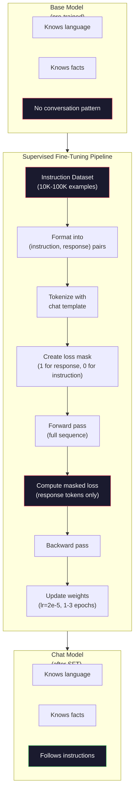

# Instruction Tuning (SFT)

> Một mô hình cơ sở dự đoán token tiếp theo. Chỉ vậy thôi. Nó không làm theo chỉ dẫn, trả lời câu hỏi hay từ chối yêu cầu có hại. SFT là cầu nối giữa bộ dự đoán token và trợ lý hữu ích. Mọi mô hình bạn từng nói chuyện -- Claude, GPT, Llama Chat -- đều trải qua bước này.

**Type:** Build
**Languages:** Python (with numpy)
**Prerequisites:** Phase 10, Lesson 04 (Pre-Training a Mini GPT)
**Time:** ~90 minutes

## Learning Objectives

- Triển khai tinh chỉnh có giám sát (SFT) chuyển một mô hình ngôn ngữ cơ sở thành trợ lý tuân theo chỉ dẫn
- Định dạng dữ liệu huấn luyện bằng chat template với vai trò hệ thống, người dùng và trợ lý, và che mất mát trên token không phải trợ lý
- Giải thích vì sao SFT cần thiết: mô hình cơ sở tiếp tục văn bản thay vì trả lời câu hỏi
- Đánh giá chất lượng SFT bằng so sánh phản hồi mô hình cơ sở với mô hình tinh chỉnh trên một tập chỉ dẫn giữ lại

## The Problem

Bạn đã huấn luyện một mô hình ở Bài 04. Nó có thể dự đoán token tiếp theo với một chuỗi cho trước. Đưa vào "Kiến trúc transformer" và nó có thể tiếp tục bằng "đã cách mạng hóa xử lý ngôn ngữ tự nhiên." Điều đó ấn tượng với một bộ dự đoán token tiếp theo.

Giờ thử điều này: đưa vào "Thủ đô nước Pháp là gì?" Một mô hình cơ sở không trả lời "Paris." Nó tiếp tục mẫu. Nó có thể tạo "Thủ đô nước Đức là gì? Thủ đô nước Tây Ban Nha là gì?" vì đã học từ các tài liệu chứa danh sách câu hỏi. Hoặc có thể tạo "là một câu hỏi nhiều người hỏi" vì đó là một phần tiếp nối token tiếp theo hợp lý. Mô hình không có khái niệm *trả lời*. Nó chỉ biết *tiếp tục*.

Đây là khoảng cách giữa GPT-3 (mô hình cơ sở, phát hành tháng 6 năm 2020) và ChatGPT (được tinh chỉnh chỉ dẫn, phát hành tháng 11 năm 2022). Cùng kiến trúc. Cùng huấn luyện trước. Khác biệt là 20,000 đến 100,000 cặp (chỉ dẫn, phản hồi) được xây dựng cẩn thận đã dạy mô hình theo mẫu hội thoại.

Stanford Alpaca chứng minh bạn không cần hàng triệu ví dụ. Tháng 3 năm 2023, họ tinh chỉnh Llama 7B trên chỉ 52,000 cặp chỉ dẫn-phản hồi do GPT-3.5 sinh. Tổng chi phí: $600. Kết quả là một chatbot có thể làm theo chỉ dẫn, trả lời câu hỏi và trò chuyện. Không tốt bằng ChatGPT, nhưng gần đến kinh ngạc với $600 và vài giờ huấn luyện.

Llama 2 Chat của Meta chỉ dùng ~27,000 ví dụ chất lượng cao cho giai đoạn SFT ban đầu. Nhận thức then chốt: chất lượng quan trọng hơn số lượng. 27,000 ví dụ do người chú giải lành nghề viết đánh bại 1 triệu ví dụ nhiều nhiễu thu thập từ internet.

## The Concept

### What SFT Actually Does

Tinh chỉnh có giám sát tiếp tục cùng vòng lặp huấn luyện từ huấn luyện trước -- truyền xuôi, tính mất mát, truyền ngược, cập nhật trọng số -- nhưng trên một loại dữ liệu khác. Thay vì văn bản thô, bạn huấn luyện trên hội thoại có cấu trúc:

```json
{
  "system": "You are a helpful assistant.",
  "user": "What is the capital of France?",
  "assistant": "The capital of France is Paris."
}
```

Mô hình đã biết Paris là thủ đô nước Pháp. Nó học điều này trong huấn luyện trước trên Wikipedia, giáo trình và trang web. SFT không dạy mô hình sự thật mới. Nó dạy mô hình một *hành vi* mới: khi thấy câu hỏi, tạo câu trả lời. Khi thấy chỉ dẫn, tạo phần hoàn thành. Khi thấy yêu cầu có hại, tạo lời từ chối.

Nghĩ theo cách này. Huấn luyện trước cho mô hình kiến thức. SFT cho mô hình cách cư xử.

### Data Formats

Ba định dạng chi phối ngành. Mỗi định dạng mã hóa cùng thông tin -- ai nói gì -- với các dấu phân cách khác nhau.

**Định dạng Alpaca** (Stanford, tháng 3 năm 2023):

```json
{
  "instruction": "Summarize the following article in 3 sentences.",
  "input": "The European Central Bank raised interest rates...",
  "output": "The ECB increased rates by 25 basis points..."
}
```

Đơn giản và dùng rộng rãi. Trường `input` tùy chọn -- nhiều chỉ dẫn không cần ngữ cảnh bổ sung. Stanford phát hành 52,000 ví dụ ở định dạng này, do GPT-3.5 sinh với $600. Điều này khởi đầu phong trào tinh chỉnh chỉ dẫn mã nguồn mở.

**Định dạng ShareGPT** (cộng đồng, 2023):

```json
{
  "conversations": [
    {"from": "system", "value": "You are a helpful assistant."},
    {"from": "human", "value": "What causes tides?"},
    {"from": "gpt", "value": "Tides are caused by the gravitational pull of the Moon..."},
    {"from": "human", "value": "How often do they occur?"},
    {"from": "gpt", "value": "Most coastal areas experience two high tides and two low tides per day..."}
  ]
}
```

Hỗ trợ hội thoại nhiều lượt. Trường "from" dùng "human" và "gpt" theo quy ước, bất kể mô hình thực tế. Vicuna được huấn luyện trên 70,000 hội thoại ShareGPT thu thập từ bản ghi ChatGPT do người dùng chia sẻ.

**Định dạng ChatML** (OpenAI, được nhiều mô hình mã nguồn mở dùng):

```
<|im_start|>system
You are a helpful assistant.<|im_end|>
<|im_start|>user
What is the capital of France?<|im_end|>
<|im_start|>assistant
The capital of France is Paris.<|im_end|>
```

Dùng token đặc biệt (`<|im_start|>`, `<|im_end|>`) để phân cách vai trò. Các token này được thêm vào từ vựng tokenizer trong tinh chỉnh. Qwen, Yi và nhiều mô hình khác dùng ChatML.

Cả ba định dạng làm cùng việc: chúng nói với mô hình "đây là chỉ dẫn, đây là phản hồi, hãy học mẫu này."

### Why It Works

Mô hình đã biết ngôn ngữ từ huấn luyện trước. Nó đã thấy hàng tỷ ví dụ câu hỏi theo sau bởi câu trả lời, chỉ dẫn theo sau bởi phần hoàn thành, và hội thoại giữa người với người. Các mẫu đã được mã hóa trong trọng số.

SFT tập trung năng lực tiềm ẩn này. Thay vì mô hình phải tìm từ ngữ cảnh liệu nên trả lời câu hỏi hay tiếp tục tài liệu, SFT huấn luyện tường minh trên mẫu hội thoại. Sau vài nghìn ví dụ, mô hình học: khi thấy dấu vai trò trợ lý, tạo một phản hồi hữu ích.

Đây là lý do 27,000 ví dụ là đủ. Bạn không dạy mô hình tiếng Anh. Bạn không dạy nó sự thật về thế giới. Bạn dạy nó một hành vi đơn giản: phản hồi chỉ dẫn. Kiến thức đã có sẵn.

### The Masked Loss

Đây là chi tiết kỹ thuật quan trọng nhất trong SFT, và hầu hết hướng dẫn bỏ qua.

Trong huấn luyện trước, bạn tính mất mát trên mọi token. Mô hình học dự đoán mỗi token tiếp theo trong chuỗi. Trong SFT, bạn chỉ tính mất mát trên token *phản hồi*. Token chỉ dẫn có đó để cung cấp ngữ cảnh, nhưng mô hình không bị phạt vì "dự đoán" sai chúng.

Vì sao? Vì bạn không muốn mô hình học *sinh* chỉ dẫn. Bạn muốn nó học *phản hồi* chỉ dẫn. Nếu tính mất mát trên token chỉ dẫn, bạn đang huấn luyện mô hình dự đoán "Thủ đô nước Pháp là gì?" như thể nó là bên đặt câu hỏi. Điều đó lãng phí tín hiệu gradient và có thể khiến mô hình nhầm vai trò.

Trong thực tế, bạn tạo một mặt nạ mất mát: 1 cho token phản hồi, 0 cho token chỉ dẫn. Nhân mất mát mỗi token với mặt nạ này trước khi lấy trung bình.

```
Tokens:    [SYS] You are helpful [USER] What is the capital? [ASST] Paris is the capital [EOS]
Loss mask:   0    0    0     0      0     0   0  0     0       1     1    1   1     1      1
```

Chỉ token sau `[ASST]` đóng góp vào mất mát. Mô hình thấy toàn bộ hội thoại trong truyền xuôi (nó cần chỉ dẫn để tạo phản hồi đúng) nhưng chỉ cập nhật trọng số dựa trên mức nó dự đoán phản hồi tốt đến đâu.

### Training Hyperparameters

SFT dùng siêu tham số rất khác huấn luyện trước. Bạn không huấn luyện từ đầu. Bạn điều chỉnh một mô hình đã hoạt động.

| Tham số | Huấn luyện trước (Llama 2 7B) | SFT (Llama 2 Chat) |
|-----------|---------------------------|---------------------|
| Tốc độ học | 3e-4 (đỉnh) | 2e-5 |
| Epoch | 1 (một lượt qua dữ liệu) | 2 |
| Kích thước batch | 4M token | 64 ví dụ |
| Bước khởi động | 2,000 | 0-100 |
| Suy giảm trọng số | 0.1 | 0.0-0.1 |
| Kích thước dữ liệu | 2T token | 27,000 ví dụ |

Tốc độ học thấp hơn 15x cho SFT. Điều này cực kỳ quan trọng. Tốc độ học cao trong tinh chỉnh phá hủy kiến thức đã huấn luyện trước. Mô hình "quên" những gì học được và overfit tập tinh chỉnh nhỏ. Đây là quên thảm khốc.

Hai epoch nghĩa là mô hình thấy mỗi ví dụ huấn luyện hai lần. Hơn 3 epoch trên một tập nhỏ dẫn đến ghi nhớ -- mô hình bắt đầu tái tạo nguyên văn ví dụ huấn luyện thay vì khái quát hóa.

### Catastrophic Forgetting

Tinh chỉnh có thể phá hủy năng lực tổng quát. Huấn luyện quá lâu trên dữ liệu tuân theo chỉ dẫn và mô hình mất khả năng viết mã, làm toán hoặc tạo văn bản sáng tạo. Nó trở nên rất tốt ở định dạng cụ thể của dữ liệu huấn luyện và tệ ở mọi thứ khác.

Ba cách giảm nhẹ:

1. **Tốc độ học thấp.** 1e-5 đến 5e-5. Cập nhật nhỏ hơn nghĩa là ít phá hủy đặc trưng đã huấn luyện trước hơn.

2. **Huấn luyện ngắn.** 1-3 epoch. Dừng trước khi mô hình overfit.

3. **Trộn dữ liệu huấn luyện trước.** Llama 2 Chat trộn một tỷ lệ nhỏ (2-5%) dữ liệu huấn luyện trước thô vào tập SFT. Điều này "nhắc" mô hình về năng lực tổng quát trong khi học hành vi tuân theo chỉ dẫn mới.

### Real Numbers

Tinh chỉnh mô hình 7B trên 10,000 cặp chỉ dẫn chất lượng cao mất khoảng 1 giờ trên một GPU NVIDIA A100 80GB. Đây là toán học:

- 10,000 ví dụ x trung bình 512 token = 5.12M token
- 2 epoch = tổng 10.24M token
- Thông lượng A100 cho tinh chỉnh mô hình 7B: ~3,000 token/giây
- 10.24M / 3,000 = ~3,400 giây = ~57 phút

Với mini GPT của chúng ta (4 lớp, 128 chiều), huấn luyện gần như tức thì. Điểm chính là hiểu cơ chế, không phải quy mô.



```figure
loss-masking
```

## Build It

### Step 1: Instruction Dataset

Tạo một tập chỉ dẫn tổng hợp. Trong production, các công ty như Scale AI và Anthropic thuê người chú giải để viết chúng. Chúng ta sẽ tạo bằng chương trình để minh họa định dạng.

```python
import numpy as np

INSTRUCTION_DATA = [
    {
        "instruction": "What is the capital of France?",
        "response": "The capital of France is Paris."
    },
    {
        "instruction": "Explain gravity in one sentence.",
        "response": "Gravity is the force that attracts objects with mass toward each other."
    },
    {
        "instruction": "Write a haiku about the ocean.",
        "response": "Waves crash on the shore, salt and foam beneath the sun, endless blue expanse."
    },
    {
        "instruction": "What is 15 multiplied by 7?",
        "response": "15 multiplied by 7 is 105."
    },
    {
        "instruction": "Name three programming languages.",
        "response": "Three programming languages are Python, Rust, and TypeScript."
    },
    {
        "instruction": "Summarize photosynthesis.",
        "response": "Photosynthesis converts sunlight, water, and carbon dioxide into glucose and oxygen."
    },
    {
        "instruction": "What year did World War II end?",
        "response": "World War II ended in 1945."
    },
    {
        "instruction": "Define machine learning.",
        "response": "Machine learning is a field where algorithms learn patterns from data to make predictions."
    },
]
```

Tám ví dụ rất nhỏ. Stanford Alpaca dùng 52,000. Nhưng cơ chế giống hệt dù bạn có 8 hay 52,000: token hóa, che, chỉ tính mất mát trên phản hồi.

### Step 2: Tokenize with Chat Template

Chuyển cặp chỉ dẫn-phản hồi thành chuỗi token với các dấu vai trò đặc biệt. Các dấu cho mô hình biết chỉ dẫn kết thúc ở đâu và phản hồi bắt đầu ở đâu.

```python
SPECIAL_TOKENS = {
    "INST_START": 253,
    "INST_END": 254,
    "RESP_START": 255,
}


def tokenize_instruction_pair(instruction, response, vocab_size=256):
    inst_tokens = list(instruction.encode("utf-8"))
    resp_tokens = list(response.encode("utf-8"))

    inst_tokens = [min(t, vocab_size - 4) for t in inst_tokens]
    resp_tokens = [min(t, vocab_size - 4) for t in resp_tokens]

    tokens = (
        [SPECIAL_TOKENS["INST_START"]]
        + inst_tokens
        + [SPECIAL_TOKENS["INST_END"]]
        + [SPECIAL_TOKENS["RESP_START"]]
        + resp_tokens
    )

    return tokens


def create_loss_mask(tokens):
    mask = np.zeros(len(tokens), dtype=np.float32)
    in_response = False

    for i, token in enumerate(tokens):
        if token == SPECIAL_TOKENS["RESP_START"]:
            in_response = True
            continue
        if in_response:
            mask[i] = 1.0

    return mask
```

Mặt nạ mất mát toàn số không cho token chỉ dẫn và toàn số một cho token phản hồi. Bản thân token `RESP_START` có mặt nạ 0 vì là dấu phân cách, không thuộc nội dung phản hồi.

### Step 3: Masked Cross-Entropy Loss

Cross-entropy tiêu chuẩn, nhưng nhân với mặt nạ mất mát. Chỉ token phản hồi đóng góp vào gradient.

```python
def masked_cross_entropy_loss(logits, targets, loss_mask):
    batch, seq_len, vocab_size = logits.shape
    logits_flat = logits.reshape(-1, vocab_size)
    targets_flat = targets.reshape(-1)
    mask_flat = loss_mask.reshape(-1)

    max_logits = logits_flat.max(axis=-1, keepdims=True)
    log_softmax = logits_flat - max_logits - np.log(
        np.exp(logits_flat - max_logits).sum(axis=-1, keepdims=True)
    )

    per_token_loss = -log_softmax[np.arange(len(targets_flat)), targets_flat]

    masked_loss = per_token_loss * mask_flat
    num_response_tokens = mask_flat.sum()
    if num_response_tokens == 0:
        return 0.0
    loss = masked_loss.sum() / num_response_tokens

    return loss
```

Mẫu số là `num_response_tokens`, không phải `seq_len`. Nếu chia cho tổng độ dài chuỗi, chỉ dẫn dài hơn làm loãng tín hiệu gradient. Chia cho số token phản hồi bảo đảm trọng số bằng nhau mỗi token phản hồi bất kể độ dài chỉ dẫn.

### Step 4: SFT Training Loop

Tái sử dụng MiniGPT từ Bài 04. Vòng lặp huấn luyện trông gần giống hệt huấn luyện trước, nhưng có định dạng chỉ dẫn và mất mát được che.

```python
import sys
import os
sys.path.insert(0, os.path.join(os.path.dirname(__file__), "..", "..", "04-pre-training-mini-gpt", "code"))
from main import MiniGPT, LayerNorm, FeedForward, MultiHeadAttention, TransformerBlock, Embedding


def sft_train(model, dataset, num_epochs=2, lr=2e-5, seq_len=64):
    formatted_data = []
    for example in dataset:
        tokens = tokenize_instruction_pair(example["instruction"], example["response"])
        mask = create_loss_mask(tokens)
        formatted_data.append((tokens, mask))

    print(f"SFT Training: {len(formatted_data)} examples, {num_epochs} epochs, lr={lr}")
    print(f"Total tokens: {sum(len(t) for t, _ in formatted_data):,}")
    print()

    losses = []

    for epoch in range(num_epochs):
        epoch_loss = 0.0
        num_batches = 0

        indices = np.random.permutation(len(formatted_data))

        for idx in indices:
            tokens, mask = formatted_data[idx]

            if len(tokens) < 3:
                continue
            if len(tokens) > seq_len:
                tokens = tokens[:seq_len]
                mask = mask[:seq_len]

            input_ids = np.array(tokens[:-1]).reshape(1, -1)
            target_ids = np.array(tokens[1:]).reshape(1, -1)
            loss_mask = np.array(mask[1:]).reshape(1, -1)

            logits = model.forward(input_ids)
            loss = masked_cross_entropy_loss(logits, target_ids, loss_mask)

            batch_size, s_len, v_size = logits.shape
            probs = np.exp(logits - logits.max(axis=-1, keepdims=True))
            probs = probs / probs.sum(axis=-1, keepdims=True)
            dlogits = probs.copy()
            dlogits[np.arange(batch_size)[:, None], np.arange(s_len), target_ids] -= 1.0

            mask_expanded = loss_mask[:, :, np.newaxis]
            num_resp = loss_mask.sum()
            if num_resp > 0:
                dlogits = dlogits * mask_expanded / num_resp

            for block in model.blocks:
                block.ffn.W1 -= lr * np.random.randn(*block.ffn.W1.shape) * 0.01
                block.ffn.W2 -= lr * np.random.randn(*block.ffn.W2.shape) * 0.01
                block.ffn.b1 -= lr * np.random.randn(*block.ffn.b1.shape) * 0.01
                block.ffn.b2 -= lr * np.random.randn(*block.ffn.b2.shape) * 0.01

            epoch_loss += loss
            num_batches += 1
            losses.append(loss)

        avg_loss = epoch_loss / max(num_batches, 1)
        print(f"Epoch {epoch + 1}/{num_epochs} | Avg Loss: {avg_loss:.4f}")

    return model, losses
```

Tốc độ học là 2e-5, khớp Llama 2 Chat. So với 3e-4 dùng trong huấn luyện trước -- nhỏ hơn 15x. Gradient được che: token chỉ dẫn tạo gradient bằng không. Chỉ token phản hồi đẩy trọng số.

### Step 5: Compare Base vs SFT Model

Toàn bộ điểm chính của SFT là thay đổi hành vi. Hãy đo bằng cách kiểm tra mô hình phản hồi đầu vào định dạng chỉ dẫn so với tiếp nối văn bản thô thế nào.

```python
def generate_response(model, prompt_tokens, max_new_tokens=50, temperature=0.8):
    tokens = list(prompt_tokens)
    seq_len = model.embedding.pos_embed.shape[0]

    for _ in range(max_new_tokens):
        context = np.array(tokens[-seq_len:]).reshape(1, -1)
        logits = model.forward(context)
        next_logits = logits[0, -1, :]

        next_logits = next_logits / max(temperature, 1e-8)
        probs = np.exp(next_logits - next_logits.max())
        probs = probs / probs.sum()
        probs = np.clip(probs, 1e-10, 1.0)
        probs = probs / probs.sum()

        next_token = np.random.choice(len(probs), p=probs)
        tokens.append(int(next_token))

    return tokens


def evaluate_instruction_following(model, instructions):
    print("Evaluating instruction following:")
    print("-" * 50)

    for instruction in instructions:
        tokens = (
            [SPECIAL_TOKENS["INST_START"]]
            + [min(t, 252) for t in list(instruction.encode("utf-8"))]
            + [SPECIAL_TOKENS["INST_END"]]
            + [SPECIAL_TOKENS["RESP_START"]]
        )

        output = generate_response(model, tokens, max_new_tokens=30, temperature=0.6)
        response_start = len(tokens)
        response_tokens = output[response_start:]
        response_bytes = bytes([t for t in response_tokens if t < 128])
        response_text = response_bytes.decode("utf-8", errors="replace")

        print(f"  Q: {instruction}")
        print(f"  A: {response_text[:80]}")
        print()
```

Trên mô hình nhỏ với 8 ví dụ, phản hồi sẽ không có nghĩa. Điều đó được kỳ vọng. Điều quan trọng là *cấu trúc*: mô hình học tạo đầu ra sau dấu phản hồi thay vì tiếp tục sinh thêm chỉ dẫn.

### Step 6: Measure Catastrophic Forgetting

So sánh khả năng dự đoán token tiếp theo trước và sau SFT. Nếu SFT làm hại năng lực tổng quát, mất mát trên văn bản thô sẽ tăng.

```python
def measure_forgetting(model, test_text, seq_len=64):
    tokens = np.array(list(test_text.encode("utf-8")[:512]))

    total_loss = 0.0
    num_windows = 0

    for start in range(0, len(tokens) - seq_len - 1, seq_len):
        input_ids = tokens[start:start + seq_len].reshape(1, -1)
        target_ids = tokens[start + 1:start + seq_len + 1].reshape(1, -1)

        logits = model.forward(input_ids)

        batch, s_len, vocab_size = logits.shape
        logits_flat = logits.reshape(-1, vocab_size)
        targets_flat = target_ids.reshape(-1)

        max_logits = logits_flat.max(axis=-1, keepdims=True)
        log_softmax = logits_flat - max_logits - np.log(
            np.exp(logits_flat - max_logits).sum(axis=-1, keepdims=True)
        )

        loss = -log_softmax[np.arange(len(targets_flat)), targets_flat].mean()
        total_loss += loss
        num_windows += 1

    return total_loss / max(num_windows, 1)
```

Trong tinh chỉnh thực, bạn sẽ theo dõi thước đo này suốt huấn luyện. Nếu mất mát văn bản thô tăng hơn 10-15%, SFT quá mạnh. Hạ tốc độ học hoặc giảm số epoch.

## Use It

### Full SFT Pipeline Demo

```python
if __name__ == "__main__":
    np.random.seed(42)

    test_text = """The transformer architecture processes sequences through self-attention.
Each layer applies multi-head attention followed by a feedforward network.
Residual connections and layer normalization stabilize deep networks.
The model learns to predict the next token given all previous tokens."""

    print("=" * 70)
    print("INSTRUCTION TUNING (SFT) DEMO")
    print("=" * 70)
    print()

    model = MiniGPT(
        vocab_size=256, embed_dim=128, num_heads=4,
        num_layers=4, max_seq_len=128, ff_dim=512
    )
    print(f"Model: {model.count_parameters():,} parameters")
    print(f"Config: 4 layers, 4 heads, 128 dims (mini GPT from Lesson 04)")
    print()

    print("PRE-SFT: Measuring base model loss on raw text")
    base_loss = measure_forgetting(model, test_text)
    print(f"  Base model loss: {base_loss:.4f}")
    print()

    print("=" * 70)
    print("SFT TRAINING")
    print("=" * 70)

    model, losses = sft_train(
        model, INSTRUCTION_DATA, num_epochs=3, lr=2e-5, seq_len=128
    )

    print()
    print("POST-SFT: Measuring fine-tuned model loss on raw text")
    sft_loss = measure_forgetting(model, test_text)
    print(f"  SFT model loss: {sft_loss:.4f}")
    print(f"  Change: {((sft_loss - base_loss) / base_loss * 100):+.1f}%")
    if abs(sft_loss - base_loss) / base_loss < 0.15:
        print("  Minimal forgetting (< 15% change)")
    else:
        print("  Significant forgetting detected")
    print()

    print("=" * 70)
    print("INSTRUCTION FOLLOWING EVALUATION")
    print("=" * 70)
    print()

    test_instructions = [
        "What is the capital of France?",
        "Name a programming language.",
        "Define gravity.",
    ]
    evaluate_instruction_following(model, test_instructions)

    print("=" * 70)
    print("DATA FORMAT EXAMPLES")
    print("=" * 70)
    print()

    for i, example in enumerate(INSTRUCTION_DATA[:3]):
        tokens = tokenize_instruction_pair(example["instruction"], example["response"])
        mask = create_loss_mask(tokens)
        resp_count = int(mask.sum())
        total_count = len(tokens)
        print(f"  Example {i + 1}: {total_count} tokens, {resp_count} response tokens ({resp_count/total_count:.0%} of sequence)")
        print(f"    Instruction: {example['instruction']}")
        print(f"    Response: {example['response']}")
        print()

    print("=" * 70)
    print("TRAINING LOSS CURVE")
    print("=" * 70)
    print()

    if losses:
        window = max(1, len(losses) // 5)
        for i in range(0, len(losses), window):
            chunk = losses[i:i + window]
            avg = sum(chunk) / len(chunk)
            print(f"  Steps {i:3d}-{i + len(chunk) - 1:3d}: avg loss = {avg:.4f}")
```

## Ship It

Bài học này tạo ra `outputs/prompt-sft-data-curator.md` -- một prompt giúp thiết kế và tuyển chọn tập chỉ dẫn cho SFT. Với một năng lực mục tiêu (sinh mã, toán, hội thoại), nó tạo kế hoạch thu thập dữ liệu với đặc tả định dạng, tiêu chí chất lượng và yêu cầu đa dạng.

## Exercises

1. Thêm hỗ trợ system prompt. Sửa `tokenize_instruction_pair` để nhận một tin nhắn hệ thống và thêm nó trước chỉ dẫn. Tạo 5 ví dụ với system prompt khác nhau ("Bạn là một nhà thơ", "Bạn là một gia sư toán") và xác minh mô hình thấy system prompt khác nhau trong huấn luyện.

2. Triển khai trộn dữ liệu. Tạo một hàm nhận tập SFT và corpus văn bản thô, rồi tạo batch huấn luyện mà 5% ví dụ là văn bản thô (không che) và 95% là cặp chỉ dẫn (được che). Chạy 3 epoch và so sánh thước đo quên với huấn luyện SFT thuần túy.

3. Xây một bộ chấm chất lượng dữ liệu. Với mỗi cặp chỉ dẫn-phản hồi, tính: (a) độ dài phản hồi bằng token, (b) tỷ lệ chỉ dẫn/phản hồi, (c) đa dạng từ vựng (token duy nhất / tổng token). Lọc ví dụ có độ dài phản hồi < 10 token hoặc đa dạng < 0.3. Cho thấy lọc ảnh hưởng mất mát cuối thế nào.

4. Triển khai huấn luyện hội thoại nhiều lượt. Mở rộng token hóa để xử lý hội thoại 3 lượt (người dùng-trợ lý-người dùng-trợ lý-người dùng-trợ lý). Mặt nạ mất mát nên bao phủ cả ba lượt trợ lý. Xác minh mặt nạ đúng bằng cách in căn chỉnh token-mặt nạ cho một ví dụ.

5. So sánh tốc độ học. Huấn luyện cùng mô hình ba lần với lr=1e-4, lr=2e-5 và lr=1e-6. Vẽ đường cong mất mát. Lần 1e-4 nên cho giảm nhanh ban đầu nhưng mất mát cuối cao hơn (overfit). Lần 1e-6 hầu như không đổi. Lần 2e-5 nên là điểm tốt nhất.

## Key Terms

| Thuật ngữ | Cách mọi người nói | Ý nghĩa thực sự |
|------|----------------|----------------------|
| SFT | "Tinh chỉnh trên hội thoại" | Tinh chỉnh có giám sát: tiếp tục huấn luyện trên cặp (chỉ dẫn, phản hồi) với mất mát chỉ tính trên token phản hồi |
| Instruction tuning (Tinh chỉnh chỉ dẫn) | "Dạy mô hình làm theo chỉ dẫn" | Huấn luyện trên cặp chỉ dẫn-phản hồi tường minh để mô hình cơ sở học mẫu hội thoại, không phải kiến thức mới |
| Loss masking (Che mất mát) | "Bỏ qua prompt" | Đặt mất mát bằng không cho token chỉ dẫn để gradient chỉ truyền từ dự đoán token phản hồi |
| ChatML | "Ngôn ngữ đánh dấu chat" | Một định dạng token dùng các dấu phân cách `<\|im_start\|>` và `<\|im_end\|>` để đánh dấu vai trò người nói trong dữ liệu hội thoại |
| Alpaca format (Định dạng Alpaca) | "Định dạng Stanford" | Một định dạng JSON có các trường instruction/input/output, dùng cho 52K ví dụ do GPT-3.5 sinh với chi phí $600 |
| Catastrophic forgetting (Quên thảm khốc) | "Mô hình trở nên ngốc hơn" | Tinh chỉnh phá hủy năng lực đã huấn luyện trước vì cập nhật gradient ghi đè kiến thức tổng quát bằng mẫu riêng tác vụ |
| Weight tying (Buộc trọng số) | "Embedding chung" | Dùng cùng ma trận cho embedding token đầu vào và head dự đoán đầu ra, tiết kiệm tham số và cải thiện tính mạch lạc |
| Chat template (Mẫu chat) | "Cách bạn định dạng prompt" | Chuỗi token cụ thể (dấu vai trò, dấu phân cách) cấu trúc hóa hội thoại cho mô hình |

## Further Reading

- [Ouyang et al., 2022 -- "Training language models to follow instructions with human feedback" (InstructGPT)](https://arxiv.org/abs/2203.02155) -- bài báo giới thiệu tinh chỉnh chỉ dẫn + RLHF tại OpenAI
- [Taori et al., 2023 -- "Stanford Alpaca: An Instruction-following LLaMA Model"](https://github.com/tatsu-lab/stanford_alpaca) -- 52K ví dụ chỉ dẫn với $600, chứng minh SFT hoạt động trên tập dữ liệu nhỏ
- [Touvron et al., 2023 -- "Llama 2: Open Foundation and Fine-Tuned Chat Models"](https://arxiv.org/abs/2307.09288) -- pipeline SFT + RLHF của Meta với 27K ví dụ chất lượng cao
- [Chiang et al., 2023 -- "Vicuna: An Open-Source Chatbot Impressing GPT-4"](https://lmsys.org/blog/2023-03-30-vicuna/) -- huấn luyện trên 70K hội thoại ShareGPT
- [Zhou et al., 2023 -- "LIMA: Less Is More for Alignment"](https://arxiv.org/abs/2305.11206) -- chứng minh 1,000 ví dụ tuyển chọn cẩn thận có thể ngang SFT trên tập lớn hơn nhiều
