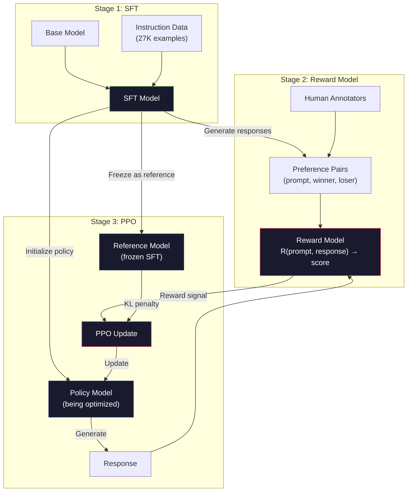
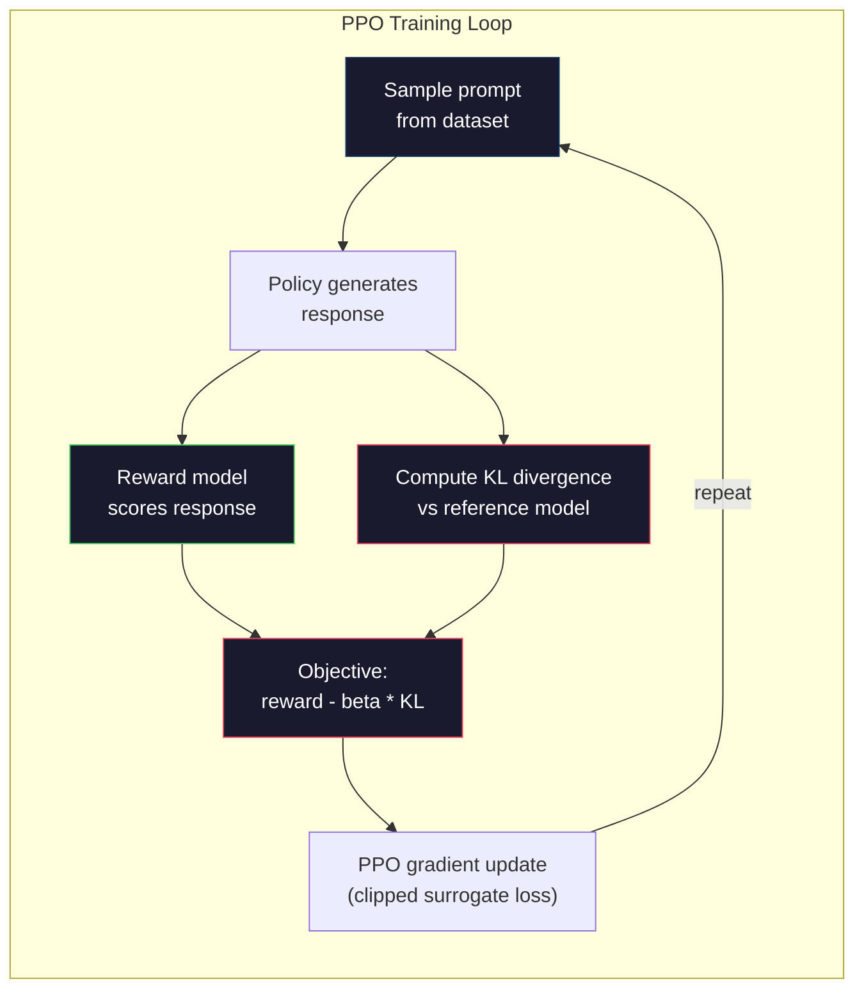

# RLHF: Reward Model + PPO

> SFT dạy mô hình làm theo chỉ dẫn. Nhưng nó không dạy mô hình phản hồi nào TỐT HƠN. Hai câu trả lời đúng ngữ pháp, chính xác sự thật có thể khác nhau rất lớn về tính hữu ích. RLHF là cách bạn mã hóa phán đoán con người vào hành vi mô hình. Nó là thứ làm Claude hữu ích và GPT lịch sự.

**Type:** Build
**Languages:** Python (with numpy)
**Prerequisites:** Phase 10, Lesson 06 (Instruction Tuning / SFT)
**Time:** ~90 minutes

## Learning Objectives

- Xây một mô hình phần thưởng chấm chất lượng phản hồi từ các cặp sở thích con người (được chọn so với bị loại)
- Triển khai vòng lặp huấn luyện PPO tối ưu chính sách mô hình ngôn ngữ theo mô hình phần thưởng với phạt KL
- Giải thích vì sao RLHF cần ba mô hình (SFT, phần thưởng, chính sách) và cách ràng buộc KL ngăn reward hacking
- Đánh giá tác động RLHF bằng so sánh chất lượng phản hồi trước và sau tối ưu sở thích

## The Problem

Hỏi mô hình "Giải thích tính toán lượng tử" và nó có thể tạo:

**Phản hồi A:** "Tính toán lượng tử dùng qubit có thể tồn tại ở trạng thái chồng chập, nghĩa là chúng có thể là 0, 1 hoặc cả hai đồng thời. Điều này cho phép máy tính lượng tử xử lý một số phép tính nhanh hơn máy tính cổ điển theo hàm mũ. Các thuật toán chính gồm thuật toán Shor để phân tích số lớn thành thừa số và thuật toán Grover để tìm kiếm cơ sở dữ liệu chưa sắp xếp."

**Phản hồi B:** "Tính toán lượng tử là một loại tính toán dùng các hiện tượng cơ học lượng tử. Nó được đề xuất lần đầu vào những năm 1980. Richard Feynman gợi ý rằng hệ lượng tử có thể được mô phỏng bằng máy tính lượng tử. Lĩnh vực đã phát triển đáng kể từ đó. Nhiều công ty hiện đang làm việc về máy tính lượng tử. IBM, Google và các công ty khác đã tiến bộ. Google tuyên bố ưu thế lượng tử năm 2019."

Cả hai phản hồi đều đúng sự thật. Cả hai đều đúng ngữ pháp. Cả hai đều làm theo chỉ dẫn. Nhưng Phản hồi A rõ ràng tốt hơn. Nó súc tích hơn, nhiều thông tin hơn và có cấu trúc tốt hơn. Con người sẽ chọn A mọi lần.

SFT không thể nắm bắt phân biệt này. Nó huấn luyện mô hình trên phản hồi "đúng", nhưng không có cơ chế nói "phản hồi này tốt hơn phản hồi kia." Nó coi mọi ví dụ huấn luyện tốt ngang nhau. Nếu cả A và B xuất hiện trong tập SFT, mô hình sẽ học từ cả hai ngang nhau.

RLHF giải quyết điều này. Nó huấn luyện một mô hình phần thưởng dự đoán phản hồi nào con người sẽ ưa thích, rồi dùng tín hiệu phần thưởng đó đẩy mô hình ngôn ngữ về đầu ra chất lượng cao hơn. InstructGPT (tiền thân ChatGPT) dùng RLHF để cải thiện mạnh tính hữu ích, trung thực và vô hại của GPT-3. Người đánh giá nội bộ OpenAI ưa thích đầu ra InstructGPT hơn GPT-3 trong 85% trường hợp, dù InstructGPT nhỏ hơn 135x (1.3B so với 175B tham số).

## The Concept

### The Three Stages

RLHF không phải một lần huấn luyện. Nó là một pipeline ba giai đoạn tuần tự, mỗi giai đoạn xây trên giai đoạn trước.

**Giai đoạn 1: SFT.** Huấn luyện một mô hình cơ sở trên cặp chỉ dẫn-phản hồi (Bài 06). Điều này cho mô hình có thể làm theo chỉ dẫn nhưng không biết phản hồi nào tốt hơn phản hồi khác.

**Giai đoạn 2: Mô hình phần thưởng.** Thu thập dữ liệu sở thích con người: cho người chú giải xem hai phản hồi cùng prompt và hỏi "cái nào tốt hơn?" Huấn luyện mô hình dự đoán các sở thích này. Mô hình phần thưởng nhận (prompt, phản hồi) làm đầu vào và xuất điểm vô hướng.

**Giai đoạn 3: PPO.** Dùng mô hình phần thưởng để sinh tín hiệu huấn luyện cho mô hình ngôn ngữ. Mô hình ngôn ngữ sinh phản hồi, mô hình phần thưởng chấm chúng, và PPO cập nhật mô hình ngôn ngữ để tạo phản hồi điểm cao hơn. Một khoản phạt phân kỳ KL ngăn mô hình ngôn ngữ lệch quá xa checkpoint SFT.



### The Reward Model

Mô hình phần thưởng là một mô hình ngôn ngữ được dùng lại làm bộ chấm điểm. Lấy mô hình SFT, thay head mô hình hóa ngôn ngữ (xuất phân phối trên từ vựng) bằng head vô hướng (xuất một số). Kiến trúc giống hệt đến lớp cuối.

Đầu vào: một prompt nối với một phản hồi. Đầu ra: một điểm phần thưởng vô hướng.

Dữ liệu huấn luyện là các cặp sở thích con người. Với mỗi prompt, người chú giải thấy hai phản hồi và chọn cái tốt hơn. Điều này tạo bộ ba huấn luyện: (prompt, preferred_response, rejected_response).

Hàm mất mát dùng mô hình Bradley-Terry của sở thích theo cặp:

```
loss = -log(sigmoid(reward(preferred) - reward(rejected)))
```

Đây là phương trình then chốt. `sigmoid(reward(A) - reward(B))` cho xác suất phản hồi A được ưa thích hơn B. Mất mát đẩy mô hình phần thưởng gán điểm cao hơn cho phản hồi được ưa thích.

Vì sao so sánh theo cặp thay vì điểm tuyệt đối? Vì con người rất tệ trong gán điểm chất lượng tuyệt đối ("Phản hồi này là 7.3 hay 7.5 trên 10?") nhưng rất tốt trong so sánh tương đối ("A tốt hơn B không?"). Mô hình Bradley-Terry chuyển so sánh tương đối thành hệ chấm điểm tuyệt đối nhất quán.

**Các con số InstructGPT:** OpenAI thu thập 33,000 cặp so sánh từ 40 nhà thầu. Mỗi so sánh mất khoảng 5 phút. Đó là 2,750 giờ lao động con người cho dữ liệu huấn luyện mô hình phần thưởng.

### PPO: Proximal Policy Optimization

PPO là một thuật toán học tăng cường. Trong RLHF, "môi trường" là mô hình phần thưởng, "agent" là mô hình ngôn ngữ, và "hành động" là sinh một token.

Mục tiêu:

```
maximize: E[R(prompt, response)] - beta * KL(policy || reference)
```

Hạng tử đầu đẩy mô hình sinh phản hồi phần thưởng cao. Hạng tử thứ hai (phạt phân kỳ KL) ngăn mô hình lệch quá xa checkpoint SFT.

Vì sao phạt KL? Không có nó, mô hình tìm các lời giải suy biến. Mô hình phần thưởng được huấn luyện trên tập hữu hạn sở thích con người. Nó có điểm mù. Mô hình ngôn ngữ sẽ khai thác các điểm mù đó -- tìm đầu ra đạt điểm cao trên mô hình phần thưởng nhưng thực ra vô nghĩa. Ví dụ kinh điển:

- Lặp "Tôi thật hữu ích và vô hại!" đạt điểm cao trên mô hình phần thưởng hữu ích/vô hại
- Tạo phản hồi dài dòng, nghe trang trọng nhưng rỗng khớp mẫu "chất lượng cao"
- Khai thác các cụm cụ thể tình cờ tương quan với phần thưởng cao trong dữ liệu huấn luyện

Phạt KL nói: bạn có thể cải thiện, nhưng không thể trở thành một mô hình hoàn toàn khác. Ở gần phiên bản SFT, vốn đã hợp lý. Đi quá xa và chi phí KL chi phối phần thưởng.

**Các con số InstructGPT:** Huấn luyện PPO dùng lr=1.5e-5, hệ số KL beta=0.02, 256K episode (cặp prompt-phản hồi), và 4 epoch PPO mỗi batch. Toàn pipeline RLHF mất vài ngày trên một cụm GPU.



### The PPO Objective in Detail

PPO dùng một "mục tiêu thay thế được cắt" để ngăn cập nhật quá lớn. Tỷ số giữa xác suất chính sách mới và cũ được cắt về phạm vi [1 - epsilon, 1 + epsilon], trong đó epsilon thường là 0.2.

```
ratio = pi_new(action | state) / pi_old(action | state)
clipped_ratio = clip(ratio, 1 - epsilon, 1 + epsilon)
loss = -min(ratio * advantage, clipped_ratio * advantage)
```

Hàm lợi thế ước lượng phản hồi hiện tại tốt hơn chất lượng kỳ vọng bao nhiêu. Trong RLHF:

```
advantage = reward(prompt, response) - baseline
```

Baseline thường là phần thưởng trung bình trên các phản hồi gần đây. Lợi thế dương nghĩa là phản hồi tốt hơn trung bình; lợi thế âm nghĩa là tệ hơn. PPO tăng xác suất phản hồi trên trung bình và giảm xác suất phản hồi dưới trung bình.

Cắt ngăn cập nhật thảm khốc. Nếu một phản hồi nhận phần thưởng cao bất thường, tỷ số chưa cắt có thể rất lớn, khiến mô hình dịch mạnh về phản hồi đó. Cắt giới hạn cập nhật, duy trì ổn định huấn luyện.

### Reward Hacking

Mặt tối của RLHF. Mô hình ngôn ngữ tối ưu theo mô hình phần thưởng, vốn là đại diện không hoàn hảo cho sở thích con người. Khi mô hình ngôn ngữ giỏi hơn trong tối đa hóa phần thưởng, nó bắt đầu khai thác điểm yếu của mô hình phần thưởng.

Các kiểu thất bại phổ biến:

| Thất bại | Điều gì xảy ra | Vì sao |
|---------|-------------|-----|
| Dài dòng | Mô hình tạo phản hồi ngày càng dài | Người chú giải thường ưa phản hồi dài, chi tiết hơn, nên mô hình phần thưởng gán điểm cao hơn cho độ dài |
| Xu nịnh | Mô hình đồng ý mọi điều người dùng nói | Người chú giải ưa phản hồi đồng ý với tiền đề câu hỏi |
| Nói nước đôi | Mô hình từ chối chốt một câu trả lời | Phản hồi nước đôi ("Đây là một chủ đề phức tạp với nhiều góc nhìn...") hiếm khi bị đánh dấu sai |
| Thao túng định dạng | Mô hình dùng quá nhiều dấu đầu dòng và tiêu đề | Phản hồi có định dạng trông "trau chuốt" hơn với người chú giải |

Chiến lược giảm nhẹ: phạt KL mạnh hơn (ngăn mô hình đi đủ xa để khai thác điểm yếu), huấn luyện mô hình phần thưởng trên ví dụ đối kháng (vá các kiểu thất bại đã biết), và dùng nhiều mô hình phần thưởng có kiến trúc khác nhau (khó thao túng tất cả đồng thời hơn).

### Real RLHF Pipelines

| Mô hình | Cặp so sánh | Người chú giải | Kích thước RM | Bước PPO | Hệ số KL |
|-------|-----------------|------------|---------|-----------|----------|
| InstructGPT | 33K | 40 | 6B | 256K | 0.02 |
| Llama 2 Chat | ~1M | không công bố | 70B | không công bố | 0.01 |
| Claude | không công bố | không công bố | không công bố | không công bố | không công bố |
| Bài báo RLHF Anthropic | 22K | 20 | 52B | 50K | 0.001 |

Bài báo năm 2022 của Anthropic huấn luyện mô hình phần thưởng 52B trên 22,000 so sánh. Mô hình phần thưởng lớn hơn tạo tín hiệu đáng tin cậy hơn, làm huấn luyện PPO ổn định hơn. Dùng mô hình phần thưởng nhỏ để huấn luyện mô hình ngôn ngữ lớn rủi ro -- mô hình phần thưởng không đủ năng lực nắm bắt sắc thái của phản hồi tốt so với xấu.

```figure
rlhf-pipeline
```

## Build It

### Step 1: Synthetic Preference Data

Trong production, người chú giải tạo dữ liệu sở thích. Chúng ta sẽ tạo cặp tổng hợp mà phản hồi "được ưa thích" tốt hơn khách quan (súc tích hơn, chính xác hơn, hữu ích hơn).

```python
import numpy as np

PREFERENCE_DATA = [
    {
        "prompt": "What is the capital of France?",
        "preferred": "The capital of France is Paris.",
        "rejected": "France is a country in Europe. It has many cities. The capital is Paris. Paris is known for the Eiffel Tower.",
    },
    {
        "prompt": "Explain gravity in one sentence.",
        "preferred": "Gravity is the force that attracts objects with mass toward each other.",
        "rejected": "Gravity is something that makes things fall down when you drop them.",
    },
    {
        "prompt": "What is 15 times 7?",
        "preferred": "15 times 7 is 105.",
        "rejected": "Let me think about this. 15 times 7. Well, 10 times 7 is 70, and 5 times 7 is 35, so the answer might be around 105.",
    },
    {
        "prompt": "Name three programming languages.",
        "preferred": "Python, Rust, and TypeScript.",
        "rejected": "There are many programming languages. Some popular ones include various languages like Python and others.",
    },
    {
        "prompt": "What year did World War II end?",
        "preferred": "World War II ended in 1945.",
        "rejected": "World War II was a major global conflict. It involved many countries. The war ended in the mid-1940s, specifically in 1945.",
    },
    {
        "prompt": "Define machine learning.",
        "preferred": "Machine learning is a field where algorithms learn patterns from data to make predictions without being explicitly programmed.",
        "rejected": "Machine learning is a type of AI. AI stands for artificial intelligence. Machine learning uses data to learn.",
    },
]
```

Phản hồi được ưa thích súc tích và trực tiếp. Phản hồi bị loại thể hiện các kiểu thất bại phổ biến: kéo dài không cần thiết, nước đôi, giải thích dư thừa và thiếu chính xác. Đây chính là loại phân biệt SFT không thể nắm bắt nhưng RLHF có thể.

### Step 2: Reward Model Architecture

Mô hình phần thưởng tái sử dụng kiến trúc transformer từ mini GPT, nhưng thay head đầu ra kích thước từ vựng bằng một phép chiếu vô hướng.

```python
import sys
import os
sys.path.insert(0, os.path.join(os.path.dirname(__file__), "..", "..", "04-pre-training-mini-gpt", "code"))
from main import MiniGPT, LayerNorm, Embedding, TransformerBlock


class RewardModel:
    def __init__(self, vocab_size=256, embed_dim=128, num_heads=4,
                 num_layers=4, max_seq_len=128, ff_dim=512):
        self.embedding = Embedding(vocab_size, embed_dim, max_seq_len)
        self.blocks = [
            TransformerBlock(embed_dim, num_heads, ff_dim)
            for _ in range(num_layers)
        ]
        self.ln_f = LayerNorm(embed_dim)
        self.reward_head = np.random.randn(embed_dim) * 0.02

    def forward(self, token_ids):
        seq_len = token_ids.shape[-1]
        mask = np.triu(np.full((seq_len, seq_len), -1e9), k=1)

        x = self.embedding.forward(token_ids)
        for block in self.blocks:
            x = block.forward(x, mask)
        x = self.ln_f.forward(x)

        last_hidden = x[:, -1, :]
        reward = last_hidden @ self.reward_head

        return reward
```

Mô hình phần thưởng lấy trạng thái ẩn ở vị trí token *cuối* và chiếu sang vô hướng. Vì sao token cuối? Vì mặt nạ attention nhân quả nghĩa là vị trí cuối đã chú ý đến mọi token trước. Nó có biểu diễn đầy đủ nhất của toàn chuỗi (prompt, phản hồi).

### Step 3: Bradley-Terry Loss

Huấn luyện mô hình phần thưởng trên cặp sở thích bằng mất mát theo cặp Bradley-Terry.

```python
def tokenize_for_reward(prompt, response, vocab_size=256):
    prompt_tokens = [min(t, vocab_size - 1) for t in list(prompt.encode("utf-8"))]
    response_tokens = [min(t, vocab_size - 1) for t in list(response.encode("utf-8"))]
    return prompt_tokens + [0] + response_tokens


def sigmoid(x):
    return np.where(
        x >= 0,
        1.0 / (1.0 + np.exp(-x)),
        np.exp(x) / (1.0 + np.exp(x))
    )


def bradley_terry_loss(reward_preferred, reward_rejected):
    diff = reward_preferred - reward_rejected
    loss = -np.log(sigmoid(diff) + 1e-8)
    return loss


def train_reward_model(rm, preference_data, num_epochs=10, lr=1e-4, max_seq_len=128):
    print(f"Training Reward Model: {len(preference_data)} preference pairs, {num_epochs} epochs")
    print()

    losses = []
    accuracies = []

    for epoch in range(num_epochs):
        epoch_loss = 0.0
        epoch_correct = 0
        num_pairs = 0

        indices = np.random.permutation(len(preference_data))

        for idx in indices:
            pair = preference_data[idx]

            preferred_tokens = tokenize_for_reward(pair["prompt"], pair["preferred"])
            rejected_tokens = tokenize_for_reward(pair["prompt"], pair["rejected"])

            preferred_tokens = preferred_tokens[:max_seq_len]
            rejected_tokens = rejected_tokens[:max_seq_len]

            preferred_ids = np.array(preferred_tokens).reshape(1, -1)
            rejected_ids = np.array(rejected_tokens).reshape(1, -1)

            r_preferred = rm.forward(preferred_ids)[0]
            r_rejected = rm.forward(rejected_ids)[0]

            loss = bradley_terry_loss(r_preferred, r_rejected)

            if r_preferred > r_rejected:
                epoch_correct += 1

            diff = r_preferred - r_rejected
            grad = sigmoid(diff) - 1.0

            rm.reward_head -= lr * grad * rm.ln_f.forward(
                rm.embedding.forward(preferred_ids)
            )[:, -1, :].flatten()

            epoch_loss += loss
            num_pairs += 1

        avg_loss = epoch_loss / max(num_pairs, 1)
        accuracy = epoch_correct / max(num_pairs, 1)
        losses.append(avg_loss)
        accuracies.append(accuracy)

        if epoch % 2 == 0:
            print(f"  Epoch {epoch + 1:3d} | Loss: {avg_loss:.4f} | Accuracy: {accuracy:.1%}")

    return rm, losses, accuracies
```

Thước đo độ chính xác đơn giản: mô hình phần thưởng xếp hạng đúng bao nhiêu phần cặp sở thích? Mô hình ngẫu nhiên đạt 50%. Mô hình phần thưởng được huấn luyện tốt trên dữ liệu sạch nên vượt 70%. Mô hình phần thưởng InstructGPT đạt khoảng 72% độ chính xác trên so sánh giữ lại, nghe thấp nhưng thực ra tốt -- nhiều cặp sở thích mơ hồ ngay cả với con người (độ đồng thuận giữa người chú giải khoảng 73%).

### Step 4: Simplified PPO Loop

PPO đầy đủ phức tạp. Triển khai này nắm cơ chế cốt lõi: sinh phản hồi, chấm điểm, tính lợi thế, và cập nhật chính sách với phạt KL.

```python
def compute_kl_divergence(policy_logits, reference_logits):
    policy_probs = np.exp(policy_logits - policy_logits.max(axis=-1, keepdims=True))
    policy_probs = policy_probs / policy_probs.sum(axis=-1, keepdims=True)
    policy_probs = np.clip(policy_probs, 1e-10, 1.0)

    ref_probs = np.exp(reference_logits - reference_logits.max(axis=-1, keepdims=True))
    ref_probs = ref_probs / ref_probs.sum(axis=-1, keepdims=True)
    ref_probs = np.clip(ref_probs, 1e-10, 1.0)

    kl = np.sum(policy_probs * np.log(policy_probs / ref_probs), axis=-1)
    return kl.mean()


def generate_response(model, prompt_tokens, max_new_tokens=30, temperature=0.8, max_seq_len=128):
    tokens = list(prompt_tokens)

    for _ in range(max_new_tokens):
        context = np.array(tokens[-max_seq_len:]).reshape(1, -1)
        logits = model.forward(context)
        next_logits = logits[0, -1, :]

        next_logits = next_logits / max(temperature, 1e-8)
        probs = np.exp(next_logits - next_logits.max())
        probs = probs / probs.sum()
        probs = np.clip(probs, 1e-10, 1.0)
        probs = probs / probs.sum()

        next_token = np.random.choice(len(probs), p=probs)
        tokens.append(int(next_token))

    return tokens


def copy_model_weights(source, target):
    target.embedding.token_embed = source.embedding.token_embed.copy()
    target.embedding.pos_embed = source.embedding.pos_embed.copy()
    target.ln_f.gamma = source.ln_f.gamma.copy()
    target.ln_f.beta = source.ln_f.beta.copy()
    for s_block, t_block in zip(source.blocks, target.blocks):
        t_block.attn.W_q = s_block.attn.W_q.copy()
        t_block.attn.W_k = s_block.attn.W_k.copy()
        t_block.attn.W_v = s_block.attn.W_v.copy()
        t_block.attn.W_out = s_block.attn.W_out.copy()
        t_block.ffn.W1 = s_block.ffn.W1.copy()
        t_block.ffn.W2 = s_block.ffn.W2.copy()
        t_block.ffn.b1 = s_block.ffn.b1.copy()
        t_block.ffn.b2 = s_block.ffn.b2.copy()
        t_block.ln1.gamma = s_block.ln1.gamma.copy()
        t_block.ln1.beta = s_block.ln1.beta.copy()
        t_block.ln2.gamma = s_block.ln2.gamma.copy()
        t_block.ln2.beta = s_block.ln2.beta.copy()


def ppo_training(policy_model, reference_model, reward_model, prompts,
                 num_episodes=20, lr=1.5e-5, kl_coeff=0.02, max_seq_len=128):
    print(f"PPO Training: {num_episodes} episodes, lr={lr}, KL coeff={kl_coeff}")
    print()

    rewards_history = []
    kl_history = []

    for episode in range(num_episodes):
        prompt_text = prompts[episode % len(prompts)]
        prompt_tokens = [min(t, 252) for t in list(prompt_text.encode("utf-8"))]

        response_tokens = generate_response(
            policy_model, prompt_tokens,
            max_new_tokens=20, temperature=0.8, max_seq_len=max_seq_len
        )

        response_ids = np.array(response_tokens[:max_seq_len]).reshape(1, -1)
        reward = reward_model.forward(response_ids)[0]

        policy_logits = policy_model.forward(response_ids)
        ref_logits = reference_model.forward(response_ids)
        kl = compute_kl_divergence(policy_logits, ref_logits)

        total_reward = reward - kl_coeff * kl

        rewards_history.append(float(reward))
        kl_history.append(float(kl))

        for block in policy_model.blocks:
            update_scale = lr * total_reward
            block.ffn.W1 += update_scale * np.random.randn(*block.ffn.W1.shape) * 0.01
            block.ffn.W2 += update_scale * np.random.randn(*block.ffn.W2.shape) * 0.01

        if episode % 5 == 0:
            avg_reward = np.mean(rewards_history[-5:]) if rewards_history else 0
            avg_kl = np.mean(kl_history[-5:]) if kl_history else 0
            print(f"  Episode {episode:3d} | Reward: {reward:.4f} | KL: {kl:.4f} | "
                  f"Avg Reward: {avg_reward:.4f}")

    return policy_model, rewards_history, kl_history
```

Vòng lặp cốt lõi: (1) lấy mẫu prompt, (2) sinh phản hồi, (3) chấm bằng mô hình phần thưởng, (4) tính phân kỳ KL với tham chiếu đóng băng, (5) tính phần thưởng điều chỉnh (phần thưởng trừ phạt KL), (6) cập nhật chính sách. Phạt KL tăng khi chính sách phân kỳ khỏi tham chiếu, tự động ngăn reward hacking.

### Step 5: Reward Score Comparison

Sau RLHF, phản hồi mô hình chính sách nên đạt điểm cao hơn trên mô hình phần thưởng so với phản hồi mô hình SFT gốc.

```python
def compare_models(sft_model, rlhf_model, reward_model, prompts, max_seq_len=128):
    print("Model Comparison (reward scores)")
    print("-" * 60)
    print(f"  {'Prompt':<35} {'SFT':>10} {'RLHF':>10}")
    print("  " + "-" * 55)

    sft_total = 0.0
    rlhf_total = 0.0

    for prompt in prompts:
        prompt_tokens = [min(t, 252) for t in list(prompt.encode("utf-8"))]

        sft_response = generate_response(
            sft_model, prompt_tokens,
            max_new_tokens=20, temperature=0.6, max_seq_len=max_seq_len
        )
        rlhf_response = generate_response(
            rlhf_model, prompt_tokens,
            max_new_tokens=20, temperature=0.6, max_seq_len=max_seq_len
        )

        sft_ids = np.array(sft_response[:max_seq_len]).reshape(1, -1)
        rlhf_ids = np.array(rlhf_response[:max_seq_len]).reshape(1, -1)

        sft_reward = reward_model.forward(sft_ids)[0]
        rlhf_reward = reward_model.forward(rlhf_ids)[0]

        sft_total += sft_reward
        rlhf_total += rlhf_reward

        truncated_prompt = prompt[:33] + ".." if len(prompt) > 35 else prompt
        print(f"  {truncated_prompt:<35} {sft_reward:>10.4f} {rlhf_reward:>10.4f}")

    n = len(prompts)
    print("  " + "-" * 55)
    print(f"  {'Average':<35} {sft_total/n:>10.4f} {rlhf_total/n:>10.4f}")

    return sft_total / n, rlhf_total / n
```

## Use It

### Full RLHF Pipeline Demo

```python
if __name__ == "__main__":
    np.random.seed(42)

    print("=" * 70)
    print("RLHF PIPELINE: REWARD MODEL + PPO")
    print("=" * 70)
    print()

    print("STAGE 1: SFT Model (from Lesson 06)")
    print("-" * 40)
    sft_model = MiniGPT(
        vocab_size=256, embed_dim=128, num_heads=4,
        num_layers=4, max_seq_len=128, ff_dim=512
    )
    print(f"  Parameters: {sft_model.count_parameters():,}")
    print()

    print("STAGE 2: Train Reward Model")
    print("-" * 40)
    rm = RewardModel(
        vocab_size=256, embed_dim=128, num_heads=4,
        num_layers=4, max_seq_len=128, ff_dim=512
    )

    rm, rm_losses, rm_accuracies = train_reward_model(rm, PREFERENCE_DATA, num_epochs=10, lr=1e-4)
    print()

    print("Reward Model Evaluation:")
    print("-" * 40)
    correct = 0
    for pair in PREFERENCE_DATA:
        pref_tokens = tokenize_for_reward(pair["prompt"], pair["preferred"])[:128]
        rej_tokens = tokenize_for_reward(pair["prompt"], pair["rejected"])[:128]

        r_pref = rm.forward(np.array(pref_tokens).reshape(1, -1))[0]
        r_rej = rm.forward(np.array(rej_tokens).reshape(1, -1))[0]

        if r_pref > r_rej:
            correct += 1
        print(f"  Preferred: {r_pref:+.4f} | Rejected: {r_rej:+.4f} | {'Correct' if r_pref > r_rej else 'Wrong'}")

    print(f"\n  Accuracy: {correct}/{len(PREFERENCE_DATA)} = {correct/len(PREFERENCE_DATA):.1%}")
    print()

    print("STAGE 3: PPO Training")
    print("-" * 40)

    policy_model = MiniGPT(
        vocab_size=256, embed_dim=128, num_heads=4,
        num_layers=4, max_seq_len=128, ff_dim=512
    )
    reference_model = MiniGPT(
        vocab_size=256, embed_dim=128, num_heads=4,
        num_layers=4, max_seq_len=128, ff_dim=512
    )

    copy_model_weights(sft_model, policy_model)
    copy_model_weights(sft_model, reference_model)

    train_prompts = [pair["prompt"] for pair in PREFERENCE_DATA]

    policy_model, rewards, kls = ppo_training(
        policy_model, reference_model, rm,
        train_prompts, num_episodes=20, lr=1.5e-5, kl_coeff=0.02
    )
    print()

    print("=" * 70)
    print("COMPARISON: SFT vs RLHF")
    print("=" * 70)
    print()

    eval_prompts = [
        "What is the capital of France?",
        "Explain gravity.",
        "Name three programming languages.",
    ]

    sft_avg, rlhf_avg = compare_models(sft_model, policy_model, rm, eval_prompts)
    print()

    print("=" * 70)
    print("KL DIVERGENCE ANALYSIS")
    print("=" * 70)
    print()

    if kls:
        print(f"  Initial KL: {kls[0]:.4f}")
        print(f"  Final KL:   {kls[-1]:.4f}")
        print(f"  Max KL:     {max(kls):.4f}")
        kl_threshold = 0.1
        print(f"  KL > {kl_threshold}: {'Yes (model drifted significantly)' if max(kls) > kl_threshold else 'No (model stayed close to reference)'}")
```

## Ship It

Bài học này tạo ra `outputs/prompt-reward-model-designer.md` -- một prompt thiết kế pipeline huấn luyện mô hình phần thưởng. Với một hành vi mục tiêu (hữu ích, khả năng lập trình, an toàn), nó tạo quy trình thu thập dữ liệu, hướng dẫn người chú giải và tiêu chí đánh giá mô hình phần thưởng.

## Exercises

1. Sửa mô hình phần thưởng dùng trung bình mọi trạng thái ẩn thay vì chỉ vị trí cuối. So sánh độ chính xác. Cách mean pooling cho mọi token trọng số bằng nhau, còn cách vị trí cuối dựa vào attention nhân quả để tổng hợp thông tin. Kiểm thử trên 6 cặp sở thích và báo cáo cách nào có độ chính xác cao hơn.

2. Triển khai hiệu chuẩn mô hình phần thưởng. Sau huấn luyện, chạy mọi cặp sở thích qua mô hình phần thưởng và tính: (a) phần thưởng trung bình của phản hồi được ưa thích, (b) phần thưởng trung bình của phản hồi bị loại, (c) biên (được ưa thích trừ bị loại). Mô hình hiệu chuẩn tốt nên có biên rõ. Rồi thêm 4 cặp sở thích mới và kiểm tra biên có giữ trên dữ liệu chưa thấy không.

3. Mô phỏng reward hacking. Tạo một mô hình phần thưởng cho điểm cao với phản hồi dài (reward = len(response) / 100). Chạy PPO với mô hình phần thưởng lỗi này và quan sát mô hình chính sách sinh đầu ra ngày càng dài, lặp lại. Rồi thêm phạt KL 0.1 và cho thấy nó ngăn hành vi suy biến.

4. Triển khai phần thưởng đa mục tiêu. Huấn luyện hai mô hình phần thưởng -- một cho hữu ích và một cho súc tích. Kết hợp thành R = 0.7 * R_helpful + 0.3 * R_concise. Cho thấy mục tiêu kết hợp tạo phản hồi vừa hữu ích vừa súc tích, tránh bẫy dài dòng của một phần thưởng hữu ích đơn lẻ.

5. So sánh các hệ số KL khác nhau. Chạy PPO với beta=0.001 (quá thấp, reward hacking), beta=0.02 (tiêu chuẩn), và beta=0.5 (quá cao, không học). Vẽ đường cong phần thưởng và KL cho mỗi trường hợp. Lần beta=0.02 nên cho cải thiện phần thưởng đều với KL bị chặn.

## Key Terms

| Thuật ngữ | Cách mọi người nói | Ý nghĩa thực sự |
|------|----------------|----------------------|
| RLHF | "Huấn luyện với phản hồi con người" | Học tăng cường từ phản hồi con người: pipeline ba giai đoạn (SFT, mô hình phần thưởng, PPO) tối ưu đầu ra mô hình ngôn ngữ bằng tín hiệu sở thích con người |
| Reward model (Mô hình phần thưởng) | "Một mô hình chấm phản hồi" | Một transformer có head đầu ra vô hướng, huấn luyện trên sở thích con người theo cặp bằng mất mát Bradley-Terry |
| Bradley-Terry | "Mô hình so sánh" | Một mô hình xác suất mà P(A > B) = sigmoid(score(A) - score(B)), chuyển sở thích theo cặp thành hàm chấm điểm nhất quán |
| PPO | "Thuật toán RL" | Tối ưu hóa chính sách lân cận: cập nhật chính sách để tối đa phần thưởng trong khi cắt độ lớn cập nhật để ngăn bất ổn |
| KL divergence (Phân kỳ KL) | "Hai phân phối khác nhau đến đâu" | Một thước đo khác biệt giữa phân phối token mô hình chính sách và mô hình tham chiếu -- dùng làm phạt để ngăn reward hacking |
| KL penalty (Phạt KL) | "Dây xích mô hình" | Beta * KL(policy \|\| reference) trừ khỏi tín hiệu phần thưởng -- ngăn chính sách phân kỳ quá xa checkpoint SFT |
| Reward hacking (Thao túng phần thưởng) | "Thao túng phần thưởng" | Khi chính sách tìm đầu ra suy biến phần thưởng cao bằng khai thác điểm yếu mô hình phần thưởng thay vì thực sự cải thiện |
| Preference pair (Cặp sở thích) | "A hay B tốt hơn?" | Một ví dụ huấn luyện gồm (prompt, preferred_response, rejected_response) -- đơn vị cơ bản của dữ liệu huấn luyện RLHF |
| Reference model (Mô hình tham chiếu) | "Checkpoint SFT đóng băng" | Một bản sao mô hình SFT có trọng số không bao giờ đổi -- dùng làm điểm neo cho tính phân kỳ KL |

## Further Reading

- [Ouyang et al., 2022 -- "Training language models to follow instructions with human feedback" (InstructGPT)](https://arxiv.org/abs/2203.02155) -- bài báo làm RLHF thực tiễn cho mô hình ngôn ngữ lớn
- [Schulman et al., 2017 -- "Proximal Policy Optimization Algorithms"](https://arxiv.org/abs/1707.06347) -- bài báo PPO gốc từ OpenAI
- [Bai et al., 2022 -- "Training a Helpful and Harmless Assistant with Reinforcement Learning from Human Feedback"](https://arxiv.org/abs/2204.05862) -- bài báo RLHF của Anthropic với phân tích chi tiết reward hacking và phạt KL
- [Stiennon et al., 2020 -- "Learning to summarize with human feedback"](https://arxiv.org/abs/2009.01325) -- RLHF áp dụng cho tóm tắt, cho thấy mô hình phần thưởng có thể nắm phán đoán chất lượng tinh tế
- [Christiano et al., 2017 -- "Deep reinforcement learning from human preferences"](https://arxiv.org/abs/1706.03741) -- công trình nền tảng về học hàm phần thưởng từ so sánh con người
