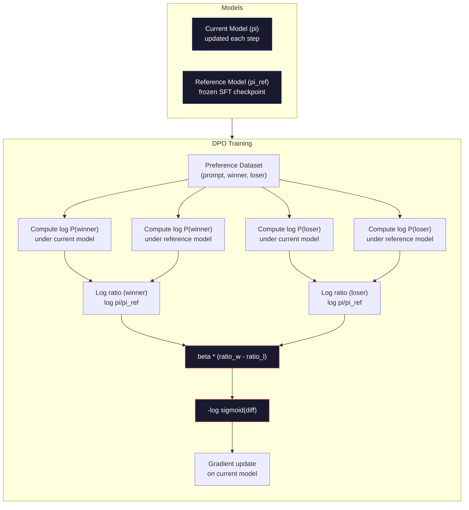

# DPO: Direct Preference Optimization

> RLHF hoạt động. Nó cũng đòi hỏi huấn luyện ba mô hình (SFT, mô hình phần thưởng, chính sách), quản lý bất ổn PPO và điều chỉnh phạt KL. DPO hỏi: nếu bạn có thể bỏ qua tất cả thì sao? DPO trực tiếp tối ưu mô hình ngôn ngữ trên cặp sở thích. Không mô hình phần thưởng. Không PPO. Một vòng lặp huấn luyện. Cùng kết quả.

**Type:** Build
**Languages:** Python (with numpy)
**Prerequisites:** Phase 10, Lesson 07 (RLHF)
**Time:** ~90 minutes

## Learning Objectives

- Triển khai huấn luyện DPO trực tiếp tối ưu mô hình ngôn ngữ trên cặp sở thích mà không có mô hình phần thưởng riêng
- Suy ra hàm mất mát DPO và giải thích cách nó biểu diễn ngầm mô hình phần thưởng qua log xác suất của chính sách
- So sánh DPO với RLHF về ổn định huấn luyện, chi phí tính toán và số mô hình cần
- Điều chỉnh tham số beta để kiểm soát mức chính sách được huấn luyện phân kỳ khỏi mô hình tham chiếu

## The Problem

Bạn đã xây một pipeline RLHF ở Bài 07. Ba giai đoạn. Ba mô hình. Mô hình SFT, mô hình phần thưởng và mô hình chính sách được tối ưu bằng PPO. Riêng mô hình phần thưởng cần hàng nghìn cặp sở thích con người và vòng lặp huấn luyện riêng. PPO cần điều chỉnh cẩn thận hệ số KL, tốc độ học, tỷ số cắt và số epoch.

Trong thực tế, huấn luyện PPO nổi tiếng bất ổn. Thay đổi siêu tham số nhỏ khiến huấn luyện phân kỳ. Mô hình phần thưởng là đại diện không hoàn hảo cho sở thích con người, và chính sách tìm cách khai thác điểm yếu của nó. Phạt KL giúp nhưng cần điều chỉnh riêng -- quá thấp thì reward hacking, quá cao thì mô hình hầu như không học.

Sự phức tạp này là lý do hầu hết mô hình mã nguồn mở chật vật với RLHF nhiều năm sau khi InstructGPT công bố. Pipeline ba giai đoạn mong manh. Mỗi giai đoạn có kiểu thất bại riêng, và sai số tích lũy.

Tháng 5 năm 2023, Rafael Rafailov, Archit Sharma và đồng nghiệp tại Stanford công bố "Direct Preference Optimization: Your Language Model is Secretly a Reward Model." Nhận thức then chốt: bạn không cần mô hình phần thưởng riêng. Hàm phần thưởng tối ưu được xác định về toán học bởi xác suất token của chính mô hình ngôn ngữ. Bạn có thể bỏ hoàn toàn mô hình phần thưởng và trực tiếp tối ưu mô hình ngôn ngữ trên cặp sở thích.

DPO rút RLHF về một bước học có giám sát duy nhất. Một mô hình. Một hàm mất mát. Một vòng lặp huấn luyện. Không học tăng cường. Zephyr-7B, một trong các mô hình đầu dùng DPO ở quy mô lớn, ngang hoặc vượt các mô hình huấn luyện bằng RLHF đầy đủ trên nhiều benchmark. Meta dùng DPO như một phần pipeline căn chỉnh Llama 3. Anthropic đã dẫn các phương pháp kiểu DPO trong nghiên cứu căn chỉnh.

## The Concept

### The Key Insight

RLHF tối ưu mục tiêu này:

```
maximize: E[R(x, y)] - beta * KL(pi || pi_ref)
```

trong đó R là mô hình phần thưởng, pi là chính sách, pi_ref là mô hình tham chiếu và beta là hệ số KL.

Bài báo DPO cho thấy mục tiêu này có một lời giải tối ưu dạng đóng. Với bất kỳ hàm phần thưởng R nào, chính sách tối ưu là:

```
pi*(y | x) = pi_ref(y | x) * exp(R(x, y) / beta) / Z(x)
```

trong đó Z(x) là hằng số chuẩn hóa. Sắp xếp lại:

```
R(x, y) = beta * log(pi*(y | x) / pi_ref(y | x)) + beta * log Z(x)
```

Đây là đột phá. Phần thưởng được biểu diễn hoàn toàn theo xác suất của mô hình chính sách và xác suất mô hình tham chiếu. Bạn không cần huấn luyện mô hình phần thưởng riêng. Phần thưởng là *ngầm* trong tỷ số xác suất.

Thay điều này vào mô hình sở thích Bradley-Terry:

```
P(y_w > y_l | x) = sigmoid(R(x, y_w) - R(x, y_l))
                  = sigmoid(beta * (log pi(y_w|x)/pi_ref(y_w|x) - log pi(y_l|x)/pi_ref(y_l|x)))
```

Các hạng tử Z(x) triệt tiêu vì cả hai phản hồi có điều kiện theo cùng prompt x. Phần còn lại chỉ là hàm của log xác suất mô hình chính sách và log xác suất mô hình tham chiếu trên phản hồi được ưa thích và bị loại.

### The DPO Loss

```
L_DPO = -log(sigmoid(beta * (log pi(y_w|x)/pi_ref(y_w|x) - log pi(y_l|x)/pi_ref(y_l|x))))
```

Hãy phân tích từng phần:

- **y_w** = phản hồi được ưa thích (thắng)
- **y_l** = phản hồi bị loại (thua)
- **x** = prompt
- **pi** = mô hình hiện tại (đang huấn luyện)
- **pi_ref** = mô hình tham chiếu (checkpoint SFT đóng băng)
- **beta** = tham số temperature kiểm soát lệch khỏi tham chiếu (thường 0.1 đến 0.5)

Tỷ số `log pi(y|x) / pi_ref(y|x)` là tỷ số log xác suất. Khi tỷ số dương, mô hình hiện tại gán xác suất cao hơn cho phản hồi y so với tham chiếu. Khi âm, mô hình hiện tại gán xác suất thấp hơn.

Mất mát DPO đẩy mô hình tăng tỷ số log xác suất cho phản hồi được ưa thích và giảm cho phản hồi bị loại. Tham số beta kiểm soát mức mô hình có thể lệch khỏi tham chiếu -- beta nhỏ nghĩa là cho phép lệch lớn, beta lớn giữ mô hình gần tham chiếu.



### Why DPO is Simpler

| Khía cạnh | RLHF (PPO) | DPO |
|--------|-----------|-----|
| Mô hình cần huấn luyện | 3 (SFT + phần thưởng + chính sách) | 1 (chỉ chính sách) |
| Vòng lặp huấn luyện | 3 (SFT, huấn luyện RM, PPO) | 2 (SFT, DPO) |
| Siêu tham số | lr, hệ số KL, tỷ số cắt, lr RM, epoch x3 | lr, beta, epoch |
| Mô hình phần thưởng | Cần (huấn luyện riêng) | Ngầm trong xác suất mô hình |
| Thuật toán RL | PPO (phức tạp, bất ổn) | Học có giám sát (ổn định) |
| Bộ nhớ GPU | 3-4 mô hình trong bộ nhớ khi PPO | 2 mô hình (hiện tại + tham chiếu) |
| Ổn định huấn luyện | Nhạy với siêu tham số | Vững, giống SFT |

DPO cần hai mô hình trong bộ nhớ khi huấn luyện -- mô hình hiện tại và tham chiếu đóng băng. RLHF cần ba hoặc bốn: chính sách, tham chiếu, mô hình phần thưởng và tùy chọn baseline hàm giá trị. Với mô hình 70B, mỗi bản sao chiếm 140GB ở FP16. Tiết kiệm bộ nhớ từ loại mô hình phần thưởng rất đáng kể.

### When DPO Beats RLHF

**Tập dữ liệu nhỏ.** Với 5,000-20,000 cặp sở thích, DPO thường ngang hoặc vượt RLHF. Mô hình phần thưởng trong RLHF cần đủ dữ liệu để khái quát -- với dữ liệu hạn chế, nó overfit và tạo tín hiệu phần thưởng không đáng tin. DPO tránh vấn đề này bằng cách hoàn toàn không cần mô hình phần thưởng.

**Tính toán hạn chế.** DPO cần khoảng một phần ba tính toán RLHF đầy đủ (một vòng lặp huấn luyện thay vì ba). Với các nhóm không có cụm GPU lớn, đây là lựa chọn thực tiễn.

**Lặp nhanh.** Muốn thử 10 tập sở thích khác nhau để xem cái nào tạo mô hình tốt nhất? DPO cho bạn chạy mỗi thử nghiệm trong vài giờ. RLHF cần huấn luyện lại mô hình phần thưởng cho mỗi tập dữ liệu.

### When RLHF Beats DPO

**Huấn luyện quy mô lớn.** Ở quy mô GPT-4 hoặc Claude, mô hình phần thưởng riêng của RLHF có thể nắm tín hiệu sở thích tinh tế hơn. Mô hình phần thưởng đóng vai hàm mất mát được học thích nghi với tiêu chí chất lượng phức tạp.

**Tín hiệu phần thưởng phức tạp.** Khi "tốt hơn" gồm nhiều chiều (hữu ích, vô hại, trung thực), mô hình phần thưởng có thể học đánh đổi đa mục tiêu này. DPO coi mỗi cặp sở thích là tín hiệu nhị phân -- một tốt hơn, một tệ hơn -- mà không mô hình hóa vì sao.

**Căn chỉnh lặp.** Pipeline RLHF có thể sinh phản hồi mới bằng chính sách hiện tại, để con người đánh giá, và huấn luyện lại mô hình phần thưởng trong vòng lặp trực tuyến. DPO làm việc trên tập cặp sở thích cố định. Constitutional AI (cách của Anthropic) dùng rộng rãi tính chất lặp này của RLHF.

### Beyond DPO: KTO, ORPO, SimPO

DPO truyền cảm hứng cho một họ phương pháp căn chỉnh đơn giản hóa.

**KTO (Tối ưu hóa Kahneman-Tversky, 2024):** Bạn thậm chí không cần cặp. KTO làm việc với phản hồi không ghép cặp -- chỉ gán nhãn mỗi phản hồi "tốt" hoặc "xấu" mà không so với phương án khác. Điều này đơn giản hóa mạnh thu thập dữ liệu. Thay vì cho người chú giải hai phản hồi và hỏi "cái nào tốt hơn?", bạn cho một phản hồi và hỏi "cái này tốt không?" Hàm mất mát áp dụng ác cảm mất mát từ lý thuyết triển vọng: phản hồi xấu bị phạt nhiều hơn mức phản hồi tốt được thưởng.

**ORPO (Tối ưu hóa sở thích tỷ số odds, 2024):** Kết hợp SFT và căn chỉnh trong một bước huấn luyện. Thay vì làm SFT rồi DPO, ORPO sửa mất mát SFT để gồm tín hiệu sở thích. Mất mát có hai hạng tử: mất mát dự đoán token tiếp theo tiêu chuẩn trên phản hồi được ưa thích, cộng hạng tử tỷ số odds tăng khoảng cách giữa xác suất phản hồi được ưa thích và bị loại. Một vòng lặp huấn luyện thay vì hai.

**SimPO (Tối ưu hóa sở thích đơn giản, 2024):** Loại hoàn toàn mô hình tham chiếu. Thay vì tính tỷ số log xác suất với tham chiếu đóng băng, SimPO dùng log xác suất trung bình của phản hồi (chuẩn hóa theo độ dài) làm phần thưởng ngầm. Điều này tiết kiệm bộ nhớ (không cần mô hình tham chiếu) và đơn giản hóa huấn luyện. Chuẩn hóa độ dài ngăn mô hình ưu ái phản hồi ngắn hơn.

| Phương pháp | Năm | Mô hình trong bộ nhớ | Cần cặp? | Cần tham chiếu? | Vòng lặp huấn luyện |
|--------|------|-----------------|-------------|-----------------|----------------|
| RLHF | 2022 | 3-4 | Có (cho RM) | Có | 3 |
| DPO | 2023 | 2 | Có | Có | 2 |
| KTO | 2024 | 2 | Không (không ghép cặp) | Có | 2 |
| ORPO | 2024 | 1 | Có | Không | 1 |
| SimPO | 2024 | 1 | Có | Không | 1 |

Xu hướng rõ ràng: mỗi phương pháp loại thêm một phần phức tạp. RLHF cần mô hình phần thưởng và PPO. DPO loại cả hai. KTO loại dữ liệu ghép cặp. ORPO loại giai đoạn SFT riêng. SimPO loại mô hình tham chiếu. Thuế căn chỉnh -- chi phí tính toán và phức tạp để đi từ mô hình cơ sở đến mô hình căn chỉnh -- tiếp tục giảm.

### Real DPO Deployments

**Zephyr-7B (HuggingFace, tháng 10 năm 2023):** Cơ sở Mistral 7B, SFT trên UltraChat (200K ví dụ), rồi DPO trên UltraFeedback (60K cặp sở thích). Đạt 6.47 trên MT-Bench -- mô hình 7B cao nhất lúc đó. Để so sánh, Llama 2 Chat 70B đạt 6.86, nghĩa là Zephyr ở trong khoảng 6% so với mô hình lớn gấp 10x chỉ bằng căn chỉnh DPO.

**Llama 3 (Meta, tháng 4 năm 2024):** Dùng DPO sau các giai đoạn RLHF ban đầu. Sự kết hợp gợi ý DPO và RLHF có thể bổ trợ -- RLHF cho căn chỉnh rộng, DPO cho tinh chỉnh có mục tiêu.

**Neural Magic / nm-chat (2024):** Áp dụng DPO cho nhiều mô hình mã nguồn mở, luôn cho cải thiện 5-15% trên benchmark căn chỉnh so với baseline chỉ SFT.

```figure
dpo-loss
```

## Build It

### Step 1: Preference Dataset

Cùng định dạng RLHF -- bộ ba (prompt, preferred, rejected). DPO tiêu thụ dữ liệu trực tiếp mà không có mô hình phần thưởng trung gian.

```python
import numpy as np
import sys
import os
sys.path.insert(0, os.path.join(os.path.dirname(__file__), "..", "..", "04-pre-training-mini-gpt", "code"))
from main import MiniGPT, LayerNorm, Embedding, TransformerBlock

PREFERENCE_DATA = [
    {
        "prompt": "What is the capital of France?",
        "preferred": "The capital of France is Paris.",
        "rejected": "France is a country in Europe. It has many cities. The capital is Paris. Paris is known for the Eiffel Tower.",
    },
    {
        "prompt": "Explain gravity in one sentence.",
        "preferred": "Gravity is the force that attracts objects with mass toward each other.",
        "rejected": "Gravity is something that makes things fall down when you drop them.",
    },
    {
        "prompt": "What is 15 times 7?",
        "preferred": "15 times 7 is 105.",
        "rejected": "Let me think about this. 15 times 7. Well, 10 times 7 is 70, and 5 times 7 is 35, so the answer might be around 105.",
    },
    {
        "prompt": "Name three programming languages.",
        "preferred": "Python, Rust, and TypeScript.",
        "rejected": "There are many programming languages. Some popular ones include various languages like Python and others.",
    },
    {
        "prompt": "What year did World War II end?",
        "preferred": "World War II ended in 1945.",
        "rejected": "World War II was a major global conflict. It involved many countries. The war ended in the mid-1940s, specifically in 1945.",
    },
    {
        "prompt": "Define machine learning.",
        "preferred": "Machine learning is a field where algorithms learn patterns from data to make predictions without being explicitly programmed.",
        "rejected": "Machine learning is a type of AI. AI stands for artificial intelligence. Machine learning uses data to learn.",
    },
]
```

### Step 2: Sequence Log-Probability

Mất mát DPO cần tính tổng log xác suất của phản hồi với prompt cho trước. Điều này nghĩa là chạy mô hình trên toàn chuỗi (prompt + phản hồi) và cộng log xác suất mỗi token phản hồi.

```python
def tokenize_sequence(text, vocab_size=256):
    return [min(t, vocab_size - 1) for t in list(text.encode("utf-8"))]


def compute_sequence_log_prob(model, prompt_tokens, response_tokens, max_seq_len=128):
    full_sequence = prompt_tokens + response_tokens
    if len(full_sequence) > max_seq_len:
        full_sequence = full_sequence[:max_seq_len]

    if len(full_sequence) < 2:
        return 0.0

    input_ids = np.array(full_sequence[:-1]).reshape(1, -1)
    target_ids = np.array(full_sequence[1:])

    logits = model.forward(input_ids)
    logits = logits[0]

    max_logits = logits.max(axis=-1, keepdims=True)
    log_probs = logits - max_logits - np.log(
        np.exp(logits - max_logits).sum(axis=-1, keepdims=True)
    )

    prompt_len = len(prompt_tokens)
    response_start = max(0, prompt_len - 1)
    response_end = len(target_ids)

    if response_start >= response_end:
        return 0.0

    response_log_probs = log_probs[response_start:response_end, :]
    response_targets = target_ids[response_start:response_end]

    total_log_prob = 0.0
    for i, target in enumerate(response_targets):
        total_log_prob += response_log_probs[i, target]

    return total_log_prob
```

Hàm này là cỗ máy làm việc của DPO. Với mỗi cặp sở thích, nó chạy bốn lần: mô hình trên phản hồi được ưa thích, mô hình trên phản hồi bị loại, tham chiếu trên phản hồi được ưa thích, tham chiếu trên phản hồi bị loại. Đó là 4 lượt truyền xuôi mỗi ví dụ huấn luyện so với sinh + chấm phần thưởng + ước lượng giá trị + cập nhật PPO của RLHF. Đơn giản hơn, nhanh hơn, ổn định hơn.

### Step 3: The DPO Loss

Cốt lõi bài báo trong mã. Một hàm. Một mất mát. Không mô hình phần thưởng.

```python
def sigmoid(x):
    return np.where(
        x >= 0,
        1.0 / (1.0 + np.exp(-x)),
        np.exp(x) / (1.0 + np.exp(x))
    )


def dpo_loss(policy_logprob_preferred, policy_logprob_rejected,
             ref_logprob_preferred, ref_logprob_rejected, beta=0.1):
    preferred_ratio = policy_logprob_preferred - ref_logprob_preferred
    rejected_ratio = policy_logprob_rejected - ref_logprob_rejected

    logit = beta * (preferred_ratio - rejected_ratio)

    loss = -np.log(sigmoid(logit) + 1e-8)

    preferred_reward = beta * preferred_ratio
    rejected_reward = beta * rejected_ratio

    return loss, {
        "preferred_ratio": float(preferred_ratio),
        "rejected_ratio": float(rejected_ratio),
        "logit": float(logit),
        "implicit_preferred_reward": float(preferred_reward),
        "implicit_rejected_reward": float(rejected_reward),
        "reward_margin": float(preferred_reward - rejected_reward),
    }
```

`preferred_ratio` và `rejected_ratio` là các tỷ số log xác suất từ suy dẫn DPO. Khi mô hình hiện tại gán xác suất cao hơn cho phản hồi được ưa thích (so với tham chiếu) và thấp hơn cho phản hồi bị loại, logit dương và mất mát thấp. Tín hiệu huấn luyện đẩy mô hình chính xác theo hướng này.

`implicit_preferred_reward` và `implicit_rejected_reward` là các phần thưởng mà mất mát DPO gán ngầm. Bạn có thể trích chúng để xác minh huấn luyện đang hoạt động -- biên giữa phần thưởng được ưa thích và bị loại nên tăng qua huấn luyện.

### Step 4: DPO Training Loop

Một vòng lặp huấn luyện có giám sát tiêu chuẩn. Không PPO. Không mô hình phần thưởng. Chỉ truyền xuôi và cập nhật gradient.

```python
def copy_model_weights(source, target):
    target.embedding.token_embed = source.embedding.token_embed.copy()
    target.embedding.pos_embed = source.embedding.pos_embed.copy()
    target.ln_f.gamma = source.ln_f.gamma.copy()
    target.ln_f.beta = source.ln_f.beta.copy()
    for s_block, t_block in zip(source.blocks, target.blocks):
        t_block.attn.W_q = s_block.attn.W_q.copy()
        t_block.attn.W_k = s_block.attn.W_k.copy()
        t_block.attn.W_v = s_block.attn.W_v.copy()
        t_block.attn.W_out = s_block.attn.W_out.copy()
        t_block.ffn.W1 = s_block.ffn.W1.copy()
        t_block.ffn.W2 = s_block.ffn.W2.copy()
        t_block.ffn.b1 = s_block.ffn.b1.copy()
        t_block.ffn.b2 = s_block.ffn.b2.copy()
        t_block.ln1.gamma = s_block.ln1.gamma.copy()
        t_block.ln1.beta = s_block.ln1.beta.copy()
        t_block.ln2.gamma = s_block.ln2.gamma.copy()
        t_block.ln2.beta = s_block.ln2.beta.copy()


def dpo_train(policy_model, reference_model, preference_data,
              num_epochs=5, lr=5e-6, beta=0.1, max_seq_len=128):
    print(f"DPO Training: {len(preference_data)} pairs, {num_epochs} epochs, "
          f"lr={lr}, beta={beta}")
    print()

    losses = []
    margins = []

    for epoch in range(num_epochs):
        epoch_loss = 0.0
        epoch_margin = 0.0
        num_examples = 0

        indices = np.random.permutation(len(preference_data))

        for idx in indices:
            pair = preference_data[idx]

            prompt_tokens = tokenize_sequence(pair["prompt"])
            preferred_tokens = tokenize_sequence(pair["preferred"])
            rejected_tokens = tokenize_sequence(pair["rejected"])

            pi_logprob_w = compute_sequence_log_prob(
                policy_model, prompt_tokens, preferred_tokens, max_seq_len
            )
            pi_logprob_l = compute_sequence_log_prob(
                policy_model, prompt_tokens, rejected_tokens, max_seq_len
            )
            ref_logprob_w = compute_sequence_log_prob(
                reference_model, prompt_tokens, preferred_tokens, max_seq_len
            )
            ref_logprob_l = compute_sequence_log_prob(
                reference_model, prompt_tokens, rejected_tokens, max_seq_len
            )

            loss, metrics = dpo_loss(
                pi_logprob_w, pi_logprob_l,
                ref_logprob_w, ref_logprob_l, beta
            )

            update_direction = 1.0 if metrics["logit"] < 0 else -0.1
            for block in policy_model.blocks:
                block.ffn.W1 += lr * update_direction * np.random.randn(*block.ffn.W1.shape) * 0.01
                block.ffn.W2 += lr * update_direction * np.random.randn(*block.ffn.W2.shape) * 0.01

            epoch_loss += loss
            epoch_margin += metrics["reward_margin"]
            num_examples += 1
            losses.append(float(loss))
            margins.append(metrics["reward_margin"])

        avg_loss = epoch_loss / max(num_examples, 1)
        avg_margin = epoch_margin / max(num_examples, 1)

        print(f"  Epoch {epoch + 1}/{num_epochs} | Loss: {avg_loss:.4f} | "
              f"Avg Margin: {avg_margin:.4f}")

    return policy_model, losses, margins
```

Vòng lặp huấn luyện đơn giản một cách dễ chịu so với RLHF. Với mỗi cặp sở thích: tính bốn log xác suất (hai mô hình, hai phản hồi), đưa vào mất mát DPO, tính gradient, cập nhật chính sách. Không bước sinh. Không suy luận mô hình phần thưởng. Không ước lượng lợi thế. Không cắt.

### Step 5: Compare DPO vs RLHF

Đo biên phần thưởng ngầm và dịch chuyển log xác suất để so DPO với mô hình RLHF từ Bài 07.

```python
def evaluate_preference_accuracy(model, reference_model, preference_data, beta=0.1, max_seq_len=128):
    correct = 0
    total = 0

    for pair in preference_data:
        prompt_tokens = tokenize_sequence(pair["prompt"])
        preferred_tokens = tokenize_sequence(pair["preferred"])
        rejected_tokens = tokenize_sequence(pair["rejected"])

        pi_w = compute_sequence_log_prob(model, prompt_tokens, preferred_tokens, max_seq_len)
        pi_l = compute_sequence_log_prob(model, prompt_tokens, rejected_tokens, max_seq_len)
        ref_w = compute_sequence_log_prob(reference_model, prompt_tokens, preferred_tokens, max_seq_len)
        ref_l = compute_sequence_log_prob(reference_model, prompt_tokens, rejected_tokens, max_seq_len)

        preferred_reward = beta * (pi_w - ref_w)
        rejected_reward = beta * (pi_l - ref_l)

        if preferred_reward > rejected_reward:
            correct += 1
        total += 1

    return correct / max(total, 1)


def analyze_implicit_rewards(model, reference_model, preference_data, beta=0.1, max_seq_len=128):
    print("Implicit Reward Analysis:")
    print("-" * 65)
    print(f"  {'Prompt':<30} {'Pref Reward':>12} {'Rej Reward':>12} {'Margin':>10}")
    print("  " + "-" * 60)

    for pair in preference_data:
        prompt_tokens = tokenize_sequence(pair["prompt"])
        preferred_tokens = tokenize_sequence(pair["preferred"])
        rejected_tokens = tokenize_sequence(pair["rejected"])

        pi_w = compute_sequence_log_prob(model, prompt_tokens, preferred_tokens, max_seq_len)
        pi_l = compute_sequence_log_prob(model, prompt_tokens, rejected_tokens, max_seq_len)
        ref_w = compute_sequence_log_prob(reference_model, prompt_tokens, preferred_tokens, max_seq_len)
        ref_l = compute_sequence_log_prob(reference_model, prompt_tokens, rejected_tokens, max_seq_len)

        pref_reward = beta * (pi_w - ref_w)
        rej_reward = beta * (pi_l - ref_l)
        margin = pref_reward - rej_reward

        truncated = pair["prompt"][:28] + ".." if len(pair["prompt"]) > 30 else pair["prompt"]
        print(f"  {truncated:<30} {pref_reward:>12.4f} {rej_reward:>12.4f} {margin:>10.4f}")

    print()
```

### Step 6: Beta Sensitivity Analysis

Tham số beta là tương đương của hệ số KL trong RLHF đối với DPO. Nó kiểm soát mức mô hình có thể lệch khỏi tham chiếu. Thử nghiệm này cho thấy tác động.

```python
def beta_sensitivity_analysis(sft_model, preference_data, betas, max_seq_len=128):
    print("Beta Sensitivity Analysis")
    print("-" * 60)
    print(f"  {'Beta':>8} {'Final Loss':>12} {'Final Margin':>14} {'Accuracy':>10}")
    print("  " + "-" * 55)

    results = []

    for beta in betas:
        policy = MiniGPT(
            vocab_size=256, embed_dim=128, num_heads=4,
            num_layers=4, max_seq_len=max_seq_len, ff_dim=512
        )
        reference = MiniGPT(
            vocab_size=256, embed_dim=128, num_heads=4,
            num_layers=4, max_seq_len=max_seq_len, ff_dim=512
        )
        copy_model_weights(sft_model, policy)
        copy_model_weights(sft_model, reference)

        policy, losses, margins_list = dpo_train(
            policy, reference, preference_data,
            num_epochs=3, lr=5e-6, beta=beta, max_seq_len=max_seq_len
        )

        accuracy = evaluate_preference_accuracy(
            policy, reference, preference_data, beta, max_seq_len
        )

        final_loss = losses[-1] if losses else 0
        final_margin = margins_list[-1] if margins_list else 0

        print(f"  {beta:>8.3f} {final_loss:>12.4f} {final_margin:>14.4f} {accuracy:>10.1%}")
        results.append({
            "beta": beta,
            "final_loss": final_loss,
            "final_margin": final_margin,
            "accuracy": accuracy,
        })

        print()

    return results
```

Beta nhỏ (0.01) cho mô hình lệch tự do khỏi tham chiếu -- học nhanh nhưng có rủi ro lời giải suy biến. Beta lớn (1.0) giữ mô hình gần tham chiếu -- ổn định nhưng học chậm. Điểm tốt nhất cho hầu hết ứng dụng là 0.1 đến 0.3.

## Use It

### Full DPO Pipeline Demo

```python
if __name__ == "__main__":
    np.random.seed(42)

    print("=" * 70)
    print("DPO: DIRECT PREFERENCE OPTIMIZATION")
    print("=" * 70)
    print()

    print("STEP 1: Initialize SFT Model (from Lesson 06)")
    print("-" * 50)
    sft_model = MiniGPT(
        vocab_size=256, embed_dim=128, num_heads=4,
        num_layers=4, max_seq_len=128, ff_dim=512
    )
    print(f"  Parameters: {sft_model.count_parameters():,}")
    print()

    print("STEP 2: DPO Training")
    print("-" * 50)

    policy_model = MiniGPT(
        vocab_size=256, embed_dim=128, num_heads=4,
        num_layers=4, max_seq_len=128, ff_dim=512
    )
    reference_model = MiniGPT(
        vocab_size=256, embed_dim=128, num_heads=4,
        num_layers=4, max_seq_len=128, ff_dim=512
    )
    copy_model_weights(sft_model, policy_model)
    copy_model_weights(sft_model, reference_model)

    policy_model, losses, margins = dpo_train(
        policy_model, reference_model, PREFERENCE_DATA,
        num_epochs=5, lr=5e-6, beta=0.1
    )
    print()

    print("=" * 70)
    print("STEP 3: Evaluate")
    print("=" * 70)
    print()

    pre_accuracy = evaluate_preference_accuracy(
        sft_model, reference_model, PREFERENCE_DATA, beta=0.1
    )
    post_accuracy = evaluate_preference_accuracy(
        policy_model, reference_model, PREFERENCE_DATA, beta=0.1
    )

    print(f"  Preference accuracy (pre-DPO):  {pre_accuracy:.1%}")
    print(f"  Preference accuracy (post-DPO): {post_accuracy:.1%}")
    print()

    analyze_implicit_rewards(policy_model, reference_model, PREFERENCE_DATA, beta=0.1)

    print("=" * 70)
    print("STEP 4: Training Dynamics")
    print("=" * 70)
    print()

    if losses:
        print("  Loss curve:")
        window = max(1, len(losses) // 5)
        for i in range(0, len(losses), window):
            chunk = losses[i:i + window]
            avg = sum(chunk) / len(chunk)
            print(f"    Steps {i:3d}-{i + len(chunk) - 1:3d}: loss = {avg:.4f}")
        print()

    if margins:
        print("  Reward margin curve:")
        window = max(1, len(margins) // 5)
        for i in range(0, len(margins), window):
            chunk = margins[i:i + window]
            avg = sum(chunk) / len(chunk)
            print(f"    Steps {i:3d}-{i + len(chunk) - 1:3d}: margin = {avg:.4f}")
        print()

    print("=" * 70)
    print("STEP 5: Beta Sensitivity")
    print("=" * 70)
    print()

    beta_results = beta_sensitivity_analysis(
        sft_model, PREFERENCE_DATA, betas=[0.01, 0.1, 0.3, 1.0]
    )

    print("=" * 70)
    print("DPO vs RLHF COMPARISON")
    print("=" * 70)
    print()
    print("  DPO advantages:")
    print("    - 1 training loop (vs 3 for RLHF)")
    print("    - 2 models in memory (vs 3-4 for RLHF)")
    print("    - Supervised learning (vs RL, more stable)")
    print("    - No reward model to train or maintain")
    print()
    print("  RLHF advantages:")
    print("    - Separate reward model captures complex preferences")
    print("    - Online learning: generate, rate, retrain")
    print("    - Better for multi-objective alignment")
    print("    - Proven at largest scales (GPT-4, Claude)")
    print()
    print("  Practical guidance:")
    print("    - Start with DPO. It's simpler and often sufficient.")
    print("    - Switch to RLHF if DPO plateaus on your eval metrics.")
    print("    - Many production systems use both: RLHF first, DPO to refine.")
```

## Ship It

Bài học này tạo ra `outputs/prompt-alignment-method-selector.md` -- một prompt giúp chọn phương pháp căn chỉnh đúng (SFT, RLHF, DPO, KTO, ORPO, SimPO) cho trường hợp sử dụng. Với dữ liệu sẵn có, ngân sách tính toán và mục tiêu căn chỉnh, nó đề xuất phương pháp và kế hoạch huấn luyện.

## Exercises

1. Triển khai KTO (Tối ưu hóa Kahneman-Tversky). KTO không cần cặp -- chỉ gán nhãn mỗi phản hồi "tốt" hoặc "xấu." Mất mát cho phản hồi tốt là `-log(sigmoid(beta * log_ratio))` và cho phản hồi xấu là `-log(1 - sigmoid(beta * log_ratio))` với hệ số ác cảm mất mát (thường 1.5x) trên mất mát phản hồi xấu. Huấn luyện trên cùng dữ liệu (coi được ưa thích là "tốt" và bị loại là "xấu" độc lập) rồi so độ chính xác với DPO.

2. Triển khai DPO chuẩn hóa độ dài. Thay vì log xác suất thô, chia cho số token phản hồi: `normalized_logprob = total_logprob / num_tokens`. Điều này ngăn mô hình ưu ái phản hồi ngắn hơn (có tổng log xác suất cao hơn). So sánh biên phần thưởng ngầm có và không chuẩn hóa.

3. Xây một mất mát kết hợp kiểu ORPO. Thêm mất mát dự đoán token tiếp theo tiêu chuẩn trên phản hồi được ưa thích vào mất mát DPO: `L = L_sft(preferred) + alpha * L_dpo`. Thử alpha 0.1, 0.5 và 1.0. Mất mát kết hợp nên tạo mô hình vừa làm theo chỉ dẫn (từ hạng tử SFT) vừa ưa phản hồi tốt hơn (từ hạng tử DPO), loại nhu cầu giai đoạn SFT riêng.

4. Triển khai DPO lặp. Chạy DPO 3 epoch, rồi sinh phản hồi mới từ mô hình đã huấn luyện, ghép với phản hồi được ưa thích gốc thành cặp sở thích mới, và chạy DPO lại. Hai vòng của quá trình "tự chơi" này. So độ chính xác sở thích sau vòng 1 và vòng 2 để xem tinh chỉnh lặp có giúp không.

5. So sánh DPO với các mô hình tham chiếu khác nhau. Thay vì dùng checkpoint SFT làm tham chiếu, thử: (a) mô hình cơ sở (trước SFT), (b) checkpoint từ epoch 1 của DPO, (c) trung bình trượt hàm mũ của mô hình chính sách. Báo cáo tham chiếu nào cho độ chính xác sở thích cao nhất và đường cong huấn luyện ổn định nhất.

## Key Terms

| Thuật ngữ | Cách mọi người nói | Ý nghĩa thực sự |
|------|----------------|----------------------|
| DPO | "RLHF không RL" | Tối ưu hóa sở thích trực tiếp: thuật toán học có giám sát tối ưu mô hình ngôn ngữ trực tiếp trên cặp sở thích, bỏ qua mô hình phần thưởng và PPO |
| Implicit reward (Phần thưởng ngầm) | "Phần thưởng trong mô hình" | Hàm phần thưởng được xác định bởi tỷ số log xác suất giữa mô hình chính sách và tham chiếu -- không cần mô hình phần thưởng riêng |
| Beta (DPO) | "Temperature" | Kiểm soát mức chính sách có thể lệch khỏi mô hình tham chiếu -- beta nhỏ cho lệch lớn, beta lớn giữ mô hình gần |
| Log-probability ratio (Tỷ số log xác suất) | "Mô hình thay đổi bao nhiêu" | log pi(y\|x) - log pi_ref(y\|x) -- dương nghĩa là mô hình hiện tại gán xác suất cao hơn tham chiếu |
| Reference model (Mô hình tham chiếu) | "Checkpoint đóng băng" | Bản sao mô hình SFT có trọng số không bao giờ đổi -- làm điểm neo để tính tỷ số xác suất |
| KTO | "DPO không cặp" | Tối ưu hóa Kahneman-Tversky: làm việc với nhãn "tốt" hoặc "xấu" không ghép cặp thay vì đòi cặp sở thích |
| ORPO | "Căn chỉnh một bước" | Tối ưu hóa sở thích tỷ số odds: kết hợp SFT và căn chỉnh thành một vòng lặp huấn luyện bằng thêm hạng tử sở thích vào mất mát SFT |
| SimPO | "Không cần tham chiếu" | Tối ưu hóa sở thích đơn giản: loại mô hình tham chiếu bằng dùng log xác suất trung bình chuẩn hóa độ dài làm phần thưởng ngầm |
| Alignment tax (Thuế căn chỉnh) | "Chi phí làm mô hình an toàn" | Tính toán, dữ liệu và phức tạp bổ sung cần để đi từ mô hình cơ sở đến mô hình căn chỉnh -- DPO giảm đáng kể |

## Further Reading

- [Rafailov et al., 2023 -- "Direct Preference Optimization: Your Language Model is Secretly a Reward Model"](https://arxiv.org/abs/2305.18290) -- bài báo DPO đơn giản hóa căn chỉnh từ RLHF sang học có giám sát
- [Tunstall et al., 2023 -- "Zephyr: Direct Distillation of LM Alignment"](https://arxiv.org/abs/2310.16944) -- Zephyr-7B, cho thấy DPO trên UltraFeedback ngang RLHF trên benchmark
- [Ethayarajh et al., 2024 -- "KTO: Model Alignment as Prospect Theoretic Optimization"](https://arxiv.org/abs/2402.01306) -- loại nhu cầu sở thích ghép cặp
- [Hong et al., 2024 -- "ORPO: Monolithic Preference Optimization without Reference Model"](https://arxiv.org/abs/2403.07691) -- kết hợp SFT và căn chỉnh trong một bước
- [Meng et al., 2024 -- "SimPO: Simple Preference Optimization with a Reference-Free Reward"](https://arxiv.org/abs/2405.14734) -- loại hoàn toàn mô hình tham chiếu
- [Llama 3 Technical Report](https://arxiv.org/abs/2407.21783) -- pipeline căn chỉnh Meta kết hợp RLHF và DPO
