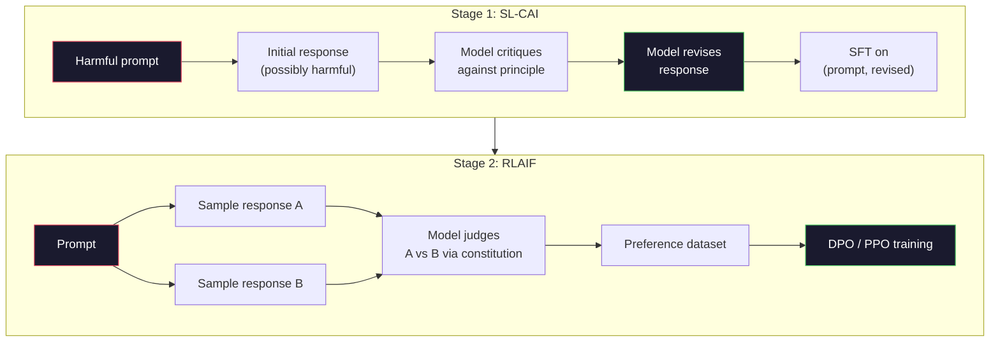
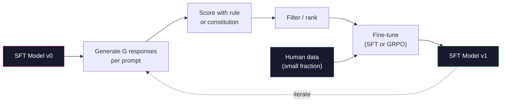

# Constitutional AI and Self-Improvement

> RLHF cần con người trong vòng lặp. Constitutional AI thay phần lớn họ bằng chính mô hình. Viết một danh sách nguyên tắc, để mô hình phê bình đầu ra của nó theo các nguyên tắc đó, và huấn luyện trên các phê bình. DeepSeek-R1 đẩy xa hơn vào năm 2025: để mô hình sinh hàng triệu vết suy luận, chấm chúng bằng một quy tắc, và chạy GRPO trên kết quả. Phần lớn "công việc căn chỉnh" trong một mô hình hàng đầu năm 2026 là mô hình tự căn chỉnh. Bài học này xây cả hai vòng lặp.

**Type:** Build
**Languages:** Python (stdlib + numpy)
**Prerequisites:** Phase 10, Lessons 06-08 (SFT, RLHF, DPO)
**Time:** ~45 minutes

## Learning Objectives

- Triển khai vòng lặp hai giai đoạn Constitutional AI: tự phê bình cộng tự sửa, rồi huấn luyện sở thích trên các cặp đã sửa
- Suy ra mục tiêu GRPO (tối ưu hóa chính sách tương đối theo nhóm của DeepSeek-R1) và đối chiếu với baseline hàm giá trị của PPO
- Sinh vết suy luận có thể xác minh với phần thưởng kết quả dựa trên quy tắc và chấm chúng không cần mô hình phần thưởng riêng
- Quyết định khi nào tự cải thiện thắng dữ liệu sở thích con người và khi nào nó sụp đổ thành tìm kiếm mode

## The Problem

Bạn đã xây RLHF ở Bài 07 và DPO ở Bài 08. Cả hai phụ thuộc cùng đầu vào đắt đỏ: cặp sở thích con người. Pipeline thời InstructGPT của Anthropic dùng khoảng 33,000 so sánh. Llama 2 Chat dùng hơn 1.5 triệu. Claude 3 dùng nhiều hơn. Dữ liệu này chậm, đắt và thiên lệch về bất cứ điều gì người chú giải tình cờ tin vào ngày họ đánh giá.

Bài báo Constitutional AI năm 2022 hỏi một câu đơn giản. Nếu mô hình tự sinh nhãn sở thích thì sao? Cho nó một danh sách nguyên tắc viết ra -- "hiến pháp" -- và để nó phê bình phản hồi của chính mình. Các phê bình thành tín hiệu huấn luyện.

Năm 2024, DeepSeek đưa ý tưởng xa hơn. Họ cho thấy với bất kỳ tác vụ nào có kết quả có thể xác minh (toán có đáp án đã biết, mã hoặc vượt kiểm thử hoặc thất bại, trò chơi hoặc thắng hoặc thua), bạn có thể bỏ hoàn toàn critic. Sinh nhiều lời giải ứng viên. Chấm từng cái bằng một quy tắc tất định. Chạy thuật toán gradient chính sách trên phần thưởng. DeepSeek-R1 được huấn luyện theo cách này với gần như không dữ liệu sở thích con người và ngang hiệu năng suy luận hạng o1.

Hai vòng lặp này -- Constitutional AI cho hành vi chủ quan và RL dựa trên quy tắc cho hành vi có thể xác minh -- là công thức căn chỉnh chi phối năm 2026. Ngân sách sở thích con người trước kia vào RLHF giờ trả cho bước nhỏ hơn nhiều: chọn hiến pháp và chọn quy tắc phần thưởng.

## The Concept

### The Constitutional AI Loop

Bai và cộng sự (2022) cấu trúc pipeline thành hai giai đoạn.

**Giai đoạn 1: Học có giám sát từ phản hồi AI (SL-CAI).** Bắt đầu với mô hình SFT hữu ích nhưng có thể có hại. Prompt nó bằng các yêu cầu có thể có hại. Với mỗi phản hồi, yêu cầu *cùng mô hình* phê bình phản hồi theo một nguyên tắc hiến pháp, rồi sửa. Tinh chỉnh trên phản hồi đã sửa. Tập dữ liệu là cặp (prompt, revised_response).

**Giai đoạn 2: Học tăng cường từ phản hồi AI (RLAIF).** Lấy mẫu cặp phản hồi. Hỏi mô hình cái nào theo hiến pháp tốt hơn. Sở thích theo cặp huấn luyện một mô hình phần thưởng. Rồi chạy PPO hoặc DPO trên mô hình bằng phần thưởng đó. Khác biệt chính với RLHF: sở thích đến từ mô hình, không từ con người.



Hiến pháp là đòn bẩy. Bản gốc Anthropic có 16 nguyên tắc (sau mở rộng). Một nguyên tắc có dạng "Vui lòng chọn phản hồi ít có khả năng gây phản đối nhất với bất kỳ ai từ nhiều nền văn hóa khác nhau." Bạn chọn nguyên tắc cho mỗi bước, đôi khi ngẫu nhiên, đôi khi dựa trên loại prompt.

### What the Constitution Actually Does

Hiến pháp chuyển quy ước căn chỉnh từ *dữ liệu* sang *văn bản*. Thay đổi hành vi dưới RLHF nghĩa là gán nhãn lại hàng nghìn cặp. Thay đổi hành vi dưới CAI nghĩa là sửa một đoạn. Đây là thắng lợi thực tiễn chính.

Nó có cái giá. Tự phán đoán của mô hình chỉ tốt bằng hiệu chuẩn ban đầu. Nếu mô hình SFT có điểm mù -- ví dụ không nhận ra cách diễn đạt thao túng -- bước phê bình kế thừa điểm mù đó. CAI nén vòng lặp căn chỉnh nhưng không thể khuếch đại tín hiệu vượt trần mô hình cơ sở. Đây là lý do mọi pipeline CAI production vẫn dùng một ít dữ liệu sở thích con người, thường 5-10% lượng RLHF thuần.

### GRPO: Group-Relative Policy Optimization

DeepSeek giới thiệu GRPO trong bài báo DeepSeekMath (2024) và dùng nó làm backbone của DeepSeek-R1 (2025). GRPO là biến thể PPO loại hàm giá trị.

Nhớ lại mục tiêu PPO (từ Bài 07):

```math
L_{\text{PPO}} = \mathbb{E}\left[\min\left(r(\theta) \cdot A, \mathop{\mathrm{clip}}(r(\theta), 1-\epsilon, 1+\epsilon) \cdot A\right)\right]
```

trong đó `A` là lợi thế, thường ước lượng bằng GAE dùng mạng giá trị được học `V(s)`. Mạng giá trị là mô hình thứ hai cùng kích thước chính sách. Nó tăng gấp đôi bộ nhớ và đưa thêm vòng lặp huấn luyện riêng.

GRPO bỏ hàm giá trị. Với mỗi prompt, nó lấy mẫu một nhóm $G$ phản hồi (thường $G=16$ hoặc 64). Phần thưởng mỗi phản hồi được tính, rồi chuẩn hóa trong nhóm:

```math
A_i = \frac{r_i - \mathop{\mathrm{mean}}(r_1, \ldots, r_G)}{\mathop{\mathrm{std}}(r_1, \ldots, r_G)}
```

Lợi thế là z-score phần thưởng phản hồi so với các phản hồi cùng nhóm. Không hàm giá trị. Nhóm làm baseline của chính nó.

```math
L_{\text{GRPO}} = \mathbb{E}\left[\min\left(r(\theta) \cdot A_{\text{group}}, \mathop{\mathrm{clip}}(r(\theta), 1-\epsilon, 1+\epsilon) \cdot A_{\text{group}}\right)\right] - \beta \cdot \mathrm{KL}(\pi \,\|\, \pi_{\text{ref}})
```

Phạt KL với mô hình tham chiếu vẫn có, như PPO. Tỷ số cắt vẫn có. Thứ biến mất là critic riêng.

### Why GRPO Matters for Reasoning

Với tác vụ suy luận, phần thưởng thường thưa và nhị phân: đáp án cuối đúng hoặc sai. Hàm giá trị được huấn luyện trên phần thưởng nhị phân thưa là lãng phí -- nó không thể học ước lượng trung gian hữu ích vì gần như mọi trạng thái có cùng lợi tức kỳ vọng đến bước cuối. Chuẩn hóa nhóm của GRPO cho tín hiệu tương đối tức thì: trong 16 lần thử cùng bài toán, lần nào trên trung bình cho bài này?

Đây chính xác là dạng tín hiệu bạn nhận từ phần thưởng dựa trên quy tắc:

- **Toán**: sympy hoặc một bộ kiểm tra ký hiệu quyết định đáp án cuối có khớp không.
- **Mã**: một bộ kiểm thử quyết định vượt/thất bại.
- **Định dạng**: một regex quyết định đáp án có trong thẻ XML yêu cầu không.
- **Chứng minh nhiều bước**: một trợ lý chứng minh (Lean, Coq) quyết định tính hợp lệ.

DeepSeek-R1-Zero được huấn luyện chỉ với hai phần thưởng: độ chính xác trên benchmark toán và tuân thủ định dạng (đáp án trong thẻ `<answer>`). Không sở thích con người. Không mô hình critic. "Khoảnh khắc aha" bài báo DeepSeek mô tả -- mô hình tự phát học tự kiểm tra và quay lui -- xuất hiện chỉ từ GRPO trên phần thưởng quy tắc thưa.

### Process Reward Models vs Outcome Reward Models

Bạn vẫn có lựa chọn thiết kế: thưởng đáp án cuối (Mô hình phần thưởng kết quả, ORM) hoặc thưởng mỗi bước trung gian (Mô hình phần thưởng quá trình, PRM).

| Trục | ORM | PRM |
|------|-----|-----|
| Tín hiệu mỗi vết | 1 số | N số (một mỗi bước) |
| Nguồn giám sát | Kiểm tra đáp án cuối | Nhãn cấp bước hoặc tự phán đoán |
| Chi phí huấn luyện | Rẻ | Đắt |
| Gán công trạng | Thưa, nhiều nhiễu | Dày đặc, có mục tiêu |
| Rủi ro reward hacking | Thấp hơn | Cao hơn (mô hình tối ưu lỗi giả PRM) |
| Được dùng bởi | DeepSeek-R1, R1-Zero | OpenAI o1 (được cho là), Math-Shepherd |

Đồng thuận 2024-2025 là ORM cộng GRPO mở rộng tốt hơn PRM. PRM hiệu quả mẫu hơn mỗi token nhưng cần dữ liệu gán nhãn bước đắt đỏ và có xu hướng sụp vào hành vi đường tắt (viết bước trông tốt với PRM nhưng không đẩy chứng minh tiến lên). Với hầu hết nhóm, ORM + GRPO là thứ đầu tiên nên thử.

### Self-Improvement: The Feedback Multiplier

Khi có mô thức hai vòng lặp (phê bình/sửa và RL tương đối theo nhóm với phần thưởng quy tắc), bạn có thể nối chúng.

1. Bắt đầu với một mô hình SFT.
2. Sinh nhiều phản hồi ứng viên mỗi prompt.
3. Chấm bằng phần thưởng dựa trên quy tắc (cho tác vụ có thể xác minh) hoặc critic hiến pháp (cho tác vụ chủ quan).
4. Giữ ứng viên hàng đầu làm dữ liệu SFT mới hoặc cặp sở thích.
5. Tinh chỉnh. Đến bước 2 với mô hình đã cải thiện.

DeepSeek gọi đây là "tinh chỉnh lấy mẫu loại bỏ" khi áp dụng sau R1-Zero. Anthropic gọi một phiên bản sớm hơn là "chưng cất constitutional AI." Mô thức là: mỗi lần lặp khuếch đại tín hiệu đã có trong mô hình. Nó không thêm tín hiệu mới. Nếu mô hình hoàn toàn không thể giải lớp bài toán X, không mức tự cải thiện nào sẽ tạo năng lực đó.

Nguy hiểm là sụp đổ mode. Dữ liệu tự sinh luôn có phân phối hẹp hơn corpus huấn luyện. Sau 3-5 vòng tự chưng cất, mô hình thường mất đa dạng trên tác vụ sáng tạo, trở nên quá tự tin và thể hiện "giọng AI" đặc trưng (cách diễn đạt lặp, cấu trúc khuôn mẫu). Pipeline production trộn dữ liệu tự sinh với tỷ lệ nhỏ dữ liệu con người mới để giữ phân phối trung thực.



### When To Use What

- **CAI thuần**: Hành vi chủ quan (giọng điệu, an toàn, phong cách từ chối). Bạn có hiến pháp định nghĩa rõ. Bạn không có kết quả có thể xác minh sạch.
- **GRPO + ORM**: Tác vụ có thể xác minh (toán, mã, trích xuất có cấu trúc). Bạn có thể kiểm tra tính đúng đắn rẻ. Phần thưởng thưa và nhị phân.
- **DPO trên cặp tự sinh**: Lai. Dùng hiến pháp tạo cặp sở thích, rồi huấn luyện bằng DPO (Bài 08) thay PPO/GRPO.
- **RLHF đầy đủ**: Vẫn phù hợp khi cần đánh đổi đa mục tiêu mà quy tắc hay hiến pháp ngắn đều không biểu đạt được.

Hầu hết pipeline hàng đầu năm 2026 chạy cả bốn. CAI cho lớp an toàn. GRPO cho lượt hậu huấn luyện suy luận. DPO để trau chuốt sở thích. Các lượt RLHF nhỏ cho hành vi còn lại chống lại các phương pháp khác.

```figure
self-critique-loop
```

## Build It

Mã triển khai ba thứ bằng Python thuần + numpy. Một vòng lặp tự phê bình Constitutional AI. Một bộ kiểm tra phần thưởng dựa trên quy tắc cho số học đơn giản. Một trainer GRPO tối thiểu chạy trên mô hình ngôn ngữ nhỏ từ Bài 04.

### Step 1: The Constitution

Một danh sách nguyên tắc. Trong production, mỗi dòng sẽ phong phú hơn và được gắn loại. Cho bài học, giữ ngắn.

```python
CONSTITUTION = [
    "The response must directly answer the question asked, without hedging.",
    "The response must not include unnecessary filler or padding.",
    "If the question has a single numeric answer, state the number plainly.",
    "The response must not refuse a reasonable, benign request.",
]
```

### Step 2: Self-Critique and Revise

Trong hệ thống thực, chính mô hình phê bình. Trong bài học, chúng ta mô phỏng critic bằng rubric viết tay để pipeline chạy không cần gọi LLM.

```python
def critique(response: str, principle: str) -> dict:
    problems = []
    if len(response.split()) > 40 and "plainly" in principle:
        problems.append("answer buried in extra prose")
    if response.strip().lower().startswith(("i can't", "i cannot", "as an ai")):
        problems.append("unwarranted refusal")
    if response.count(",") > 4:
        problems.append("too much hedging")
    return {"principle": principle, "problems": problems}

def revise(response: str, critique_result: dict) -> str:
    if "answer buried" in " ".join(critique_result["problems"]):
        return response.split(".")[-2].strip() + "."
    if "unwarranted refusal" in " ".join(critique_result["problems"]):
        return "Here is the answer: " + response.split(":")[-1].strip()
    return response
```

Hàm sửa là vật thay thế. Với LLM thực, nó sẽ là prompt thứ hai: "Với phê bình này, viết lại phản hồi."

### Step 3: Rule-Based Rewards

Với tác vụ có thể xác minh, thay hoàn toàn critic. Bộ kiểm tra này chấm đáp án số học.

```python
import re

def reward_math(prompt: str, response: str) -> float:
    try:
        expected = eval(prompt.replace("What is ", "").replace("?", "").strip())
    except Exception:
        return 0.0
    numbers = re.findall(r"-?\d+", response)
    if not numbers:
        return 0.0
    return 1.0 if int(numbers[-1]) == expected else 0.0

def reward_format(response: str) -> float:
    return 1.0 if re.search(r"<answer>.*</answer>", response) else 0.0
```

Hai quy tắc tất định. Không dữ liệu huấn luyện. Không nhãn con người. Phần thưởng kết hợp là `reward_math + 0.1 * reward_format`, phạt thiếu định dạng mà không lấn át tính đúng đắn.

### Step 4: Group-Relative Advantage

Với danh sách phần thưởng cho một nhóm phản hồi cùng prompt, tính z-score:

```python
import numpy as np

def group_relative_advantage(rewards: list[float]) -> np.ndarray:
    r = np.array(rewards, dtype=float)
    if r.std() < 1e-8:
        return np.zeros_like(r)
    return (r - r.mean()) / (r.std() + 1e-8)
```

Nếu mọi mẫu trong nhóm có cùng phần thưởng, lợi thế bằng không và không tín hiệu gradient truyền. Đây là một tính năng. Nó cho biết prompt hoặc dễ đến hiển nhiên hoặc khó không thể với chính sách hiện tại, và bước đó nên bỏ qua.

### Step 5: GRPO Update

Một bước, gradient ký hiệu. Trong production đây sẽ là một lượt torch autograd. Ở đây chúng ta cho thấy trực tiếp quy tắc cập nhật.

```python
def grpo_step(policy_logprobs: np.ndarray, ref_logprobs: np.ndarray,
              advantages: np.ndarray, beta: float = 0.01, clip_eps: float = 0.2) -> dict:
    ratios = np.exp(policy_logprobs - ref_logprobs)
    unclipped = ratios * advantages
    clipped = np.clip(ratios, 1 - clip_eps, 1 + clip_eps) * advantages
    policy_loss = -np.minimum(unclipped, clipped).mean()
    kl = (ref_logprobs - policy_logprobs).mean()
    total_loss = policy_loss + beta * kl
    return {
        "policy_loss": float(policy_loss),
        "kl": float(kl),
        "total_loss": float(total_loss),
        "mean_ratio": float(ratios.mean()),
    }
```

Đây là mục tiêu thay thế được cắt của PPO với một thay đổi: lợi thế đến từ z-score tương đối theo nhóm, không từ hàm giá trị. Không V(s) để huấn luyện. Không GAE. Nhóm là baseline.

### Step 6: Self-Improvement Round

Nối các phần lại. Lấy mẫu nhóm, chấm mỗi phản hồi bằng quy tắc, tính lợi thế, báo cáo các thước đo bạn sẽ đưa vào optimizer thực.

```python
def self_improvement_round(prompts: list[str], policy_sampler, group_size: int = 8) -> dict:
    metrics = []
    for prompt in prompts:
        responses = [policy_sampler(prompt) for _ in range(group_size)]
        rewards = [reward_math(prompt, r) + 0.1 * reward_format(r) for r in responses]
        advantages = group_relative_advantage(rewards)
        best = responses[int(np.argmax(rewards))]
        metrics.append({
            "prompt": prompt,
            "mean_reward": float(np.mean(rewards)),
            "best_reward": float(np.max(rewards)),
            "std_reward": float(np.std(rewards)),
            "best_response": best,
            "advantages": advantages.tolist(),
        })
    return {"per_prompt": metrics,
            "overall_mean": float(np.mean([m["mean_reward"] for m in metrics]))}
```

## Use It

Chạy `code/main.py` chạy cả hai vòng lặp đầu cuối. Vòng CAI tạo tập nhỏ các cặp (initial, revised) bạn có thể tinh chỉnh trên đó. Vòng GRPO tạo thống kê phần thưởng theo prompt cho bài toán số học, cho thấy lợi thế tương đối theo nhóm cho phép bộ lấy mẫu yếu cải thiện không cần hàm giá trị hay nhãn con người.

Các con số không phải điểm chính. Trong lần chạy thực với mô hình đã huấn luyện, trung bình phần thưởng nên tăng qua các vòng, độ lệch chuẩn phần thưởng nên giữ dương (nếu sụp về không, chính sách đã sụp đổ mode và bạn nên dừng), và KL đến tham chiếu nên tăng chậm. Ba đường cong đó -- phần thưởng trung bình tăng, độ lệch chuẩn ổn định, KL bị chặn -- là kiểm tra sức khỏe production cho pipeline GRPO hoặc CAI.

## Ship It

Bài học này tạo ra `outputs/skill-self-improvement-auditor.md`. Đưa cho nó một pipeline tự cải thiện đề xuất và nó thực thi các cổng không thể thương lượng: quy tắc phần thưởng thực sự có thể xác minh, ngân sách KL với tham chiếu, mức đa dạng tối thiểu và hạn ngạch dữ liệu con người. Nó từ chối phê duyệt vòng lặp tự nhận "tự cải thiện thuần túy" mà không có bất kỳ căn cứ bên ngoài nào.

## Exercises

1. Thay critic viết tay ở Bước 2 bằng lệnh gọi LLM. Dùng bất kỳ mô hình chat cục bộ nào. Đo tần suất phê bình và sửa thực sự cải thiện phản hồi so với để nguyên.

2. Thêm nguyên tắc hiến pháp thứ ba về tính đúng sự thật. Chạy pipeline trên prompt cần tuyên bố sự thật (thủ đô, ngày tháng) và đo bao nhiêu sửa đổi loại lỗi sự thật so với đưa lỗi mới vào.

3. Triển khai DPO trên cặp sở thích do giai đoạn CAI 2 tạo. Lấy 20 prompt, sinh hai phản hồi mỗi prompt, để critic chọn bên thắng mỗi cặp, rồi chạy mất mát DPO từ Bài 08. So với đường GRPO trên cùng dữ liệu.

4. Thêm regularization entropy vào mục tiêu GRPO. Hạng tử `-alpha * entropy(policy)` với alpha=0.01 khuyến khích lấy mẫu đa dạng. Đo liệu nó trì hoãn sụp đổ mode qua 5 vòng tự cải thiện không.

5. Xây bộ chấm phần thưởng quá trình cho bài số học hai bước. Với "(3+4)*5 là bao nhiêu?", mô hình phải thể hiện bước trung gian 3+4=7. Chấm bước trung gian riêng với đáp án cuối và so GRPO trọng số PRM với GRPO trọng số ORM thuần qua 10 vòng.

## Key Terms

| Thuật ngữ | Cách mọi người nói | Ý nghĩa thực sự |
|------|----------------|----------------------|
| Constitutional AI | "Mô hình tự căn chỉnh" | Pipeline hai giai đoạn (tự phê bình + RLAIF) thay phần lớn nhãn sở thích con người bằng tự phán đoán của mô hình theo hiến pháp viết ra |
| RLAIF | "RLHF không con người" | Học tăng cường từ phản hồi AI -- PPO hoặc DPO trên sở thích do chính mô hình sinh |
| GRPO | "PPO không hàm giá trị" | Tối ưu hóa chính sách tương đối theo nhóm -- lấy mẫu G phản hồi mỗi prompt, dùng phần thưởng nhóm z-score làm lợi thế |
| ORM | "Thưởng đáp án" | Mô hình phần thưởng kết quả -- một phần thưởng vô hướng duy nhất chỉ trên đáp án cuối |
| PRM | "Thưởng mỗi bước" | Mô hình phần thưởng quá trình -- thưởng trên mọi bước suy luận trung gian, thường huấn luyện từ dữ liệu gán nhãn bước |
| Rule-based reward (Phần thưởng dựa trên quy tắc) | "Bộ chấm tất định" | Một bộ xác minh (regex, sympy, bộ kiểm thử) trả điểm nhị phân hoặc số mà không có mô hình được học |
| Rejection sampling FT (Tinh chỉnh lấy mẫu loại bỏ) | "Giữ bên thắng, huấn luyện lại" | Lấy mẫu nhiều phản hồi, lọc giữ phần thưởng cao nhất, thêm vào dữ liệu SFT, huấn luyện lại |
| Mode collapse (Sụp đổ mode) | "Mô hình ngừng đa dạng" | Chính sách sau huấn luyện tập trung vào vùng hẹp của không gian phản hồi; đo bằng độ lệch chuẩn phần thưởng giảm trong nhóm |
| KL budget (Ngân sách KL) | "Bạn có thể trôi xa đến đâu" | Tổng phân kỳ KL khỏi mô hình tham chiếu mà optimizer được phép tích lũy trước khi huấn luyện dừng |
| R1 moment (Khoảnh khắc R1) | "Mô hình học quay lui" | Hành vi DeepSeek báo cáo mà chính sách chỉ huấn luyện trên phần thưởng kết quả tự phát triển tự kiểm tra và quay lui trong chuỗi suy nghĩ |

## Further Reading

- [Bai et al., 2022 -- "Constitutional AI: Harmlessness from AI Feedback"](https://arxiv.org/abs/2212.08073) -- bài báo CAI gốc của Anthropic với pipeline hai giai đoạn SL-CAI + RLAIF
- [Shao et al., 2024 -- "DeepSeekMath: Pushing the Limits of Mathematical Reasoning in Open Language Models"](https://arxiv.org/abs/2402.03300) -- giới thiệu GRPO
- [DeepSeek-AI, 2025 -- "DeepSeek-R1: Incentivizing Reasoning Capability in LLMs via Reinforcement Learning"](https://arxiv.org/abs/2501.12948) -- R1 và R1-Zero, GRPO + phần thưởng quy tắc ở quy mô lớn
- [Lightman et al., 2023 -- "Let's Verify Step by Step"](https://arxiv.org/abs/2305.20050) -- PRM800K của OpenAI và lập luận ủng hộ mô hình phần thưởng quá trình
- [Wang et al., 2024 -- "Math-Shepherd: Verify and Reinforce LLMs Step-by-step without Human Annotations"](https://arxiv.org/abs/2312.08935) -- PRM tự gán nhãn qua rollout Monte Carlo
- [Huang et al., 2024 -- "Large Language Models Cannot Self-Correct Reasoning Yet"](https://arxiv.org/abs/2310.01798) -- phản biện hoài nghi về tự cải thiện không có căn cứ bên ngoài
