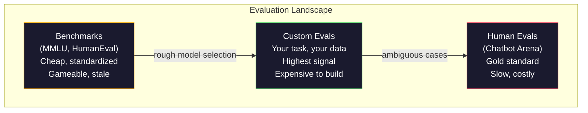
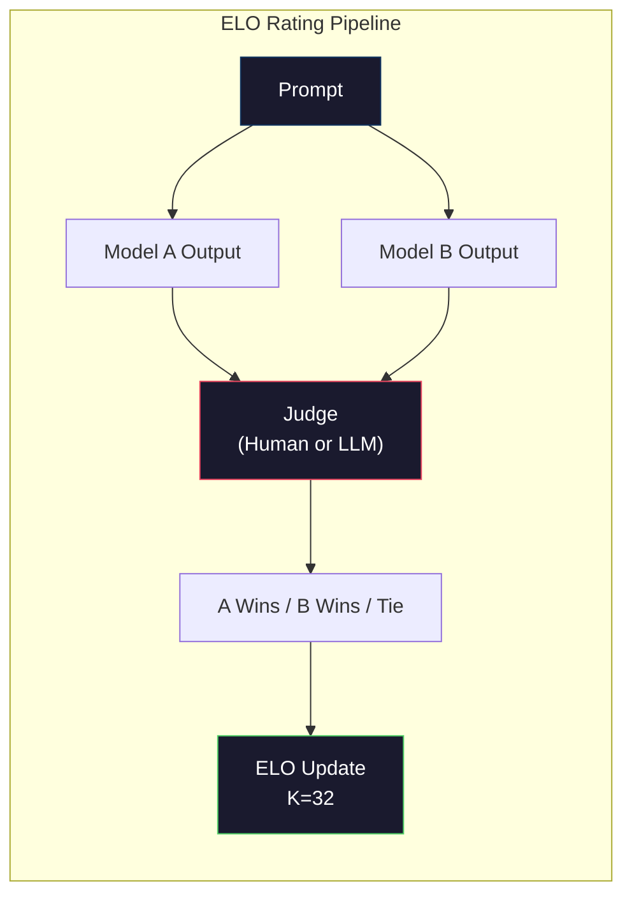

# Evaluation: Benchmarks, Evals, LM Harness

> Định luật Goodhart: khi một thước đo thành mục tiêu, nó ngừng là thước đo tốt. Mọi phòng thí nghiệm hàng đầu thao túng benchmark. Điểm MMLU tăng trong khi mô hình vẫn không thể đếm đáng tin cậy số chữ R trong "strawberry." Đánh giá duy nhất quan trọng là đánh giá CỦA BẠN -- trên tác vụ CỦA BẠN, với dữ liệu CỦA BẠN.

**Type:** Build
**Languages:** Python
**Prerequisites:** Phase 10, Lessons 01-05 (LLMs from Scratch)
**Time:** ~90 minutes

## Learning Objectives

- Xây một bộ khung đánh giá tùy chỉnh chạy benchmark trắc nghiệm và mở với mô hình ngôn ngữ
- Giải thích vì sao benchmark tiêu chuẩn (MMLU, HumanEval) bão hòa và không phân biệt được mô hình hàng đầu
- Triển khai đánh giá riêng tác vụ với thước đo đúng: khớp chính xác, F1, BLEU và chấm LLM-as-judge
- Thiết kế một bộ đánh giá tùy chỉnh nhắm trường hợp sử dụng cụ thể thay vì chỉ dựa bảng xếp hạng công khai

## The Problem

MMLU được công bố năm 2020 với 15,908 câu hỏi trên 57 môn. Trong ba năm, mô hình hàng đầu làm nó bão hòa. GPT-4 đạt 86.4%. Claude 3 Opus đạt 86.8%. Llama 3 405B đạt 88.6%. Bảng xếp hạng nén vào phạm vi 3 điểm mà khác biệt là nhiễu thống kê, không phải khoảng cách năng lực thực.

Trong khi đó, chính các mô hình ấy thất bại ở tác vụ một đứa trẻ 10 tuổi xử lý không cần nghĩ. Claude 3.5 Sonnet, đạt 88.7% MMLU, ban đầu không thể đếm chữ trong "strawberry" -- tác vụ không cần kiến thức thế giới và không suy luận, chỉ lặp cấp ký tự. HumanEval kiểm thử sinh mã với 164 bài. Mô hình đạt 90%+ trên đó trong khi vẫn tạo mã sập ở trường hợp biên mà lập trình viên mới nào cũng bắt được.

Khoảng cách giữa hiệu năng benchmark và độ tin cậy thực tế là vấn đề trung tâm của đánh giá LLM. Benchmark cho biết mô hình làm trên benchmark thế nào. Chúng gần như không cho biết mô hình sẽ làm trên tác vụ cụ thể, dữ liệu cụ thể, dưới kiểu thất bại cụ thể của bạn thế nào. Nếu xây bot hỗ trợ khách hàng, MMLU không liên quan. Nếu xây trợ lý mã, HumanEval chỉ bao phủ sinh cấp hàm -- nó không nói gì về gỡ lỗi, tái cấu trúc hay giải thích mã xuyên file.

Bạn cần đánh giá tùy chỉnh. Không phải vì benchmark vô dụng -- chúng hữu ích cho chọn mô hình sơ bộ -- mà vì đánh giá cuối phải khớp chính xác điều kiện triển khai.

## The Concept

### The Eval Landscape

Có ba loại đánh giá, mỗi loại có chi phí và chất lượng tín hiệu khác nhau.

**Benchmark** là bộ kiểm thử chuẩn hóa. MMLU, HumanEval, SWE-bench, MATH, ARC, HellaSwag. Bạn chạy mô hình với benchmark và nhận điểm. Ưu điểm: mọi người dùng cùng bài kiểm thử nên so được mô hình. Nhược điểm: mô hình và dữ liệu huấn luyện ngày càng làm nhiễm các benchmark này. Phòng thí nghiệm huấn luyện trên dữ liệu có câu hỏi benchmark. Điểm tăng. Năng lực có thể không.

**Đánh giá tùy chỉnh** là bộ kiểm thử bạn xây cho trường hợp sử dụng cụ thể. Bạn định nghĩa đầu vào, đầu ra kỳ vọng và hàm chấm điểm. Bộ tóm tắt tài liệu pháp lý được đánh giá trên tài liệu pháp lý. Bộ sinh SQL được đánh giá trên schema cơ sở dữ liệu của bạn. Chúng tốn kém để tạo nhưng là đánh giá duy nhất dự đoán hiệu năng production.

**Đánh giá con người** dùng người chú giải được trả tiền để phán xét đầu ra mô hình theo tiêu chí như hữu ích, đúng đắn, trôi chảy và an toàn. Tiêu chuẩn vàng cho tác vụ mở nơi chấm tự động thất bại. Chatbot Arena đã thu hơn 2 triệu phiếu sở thích con người trên 100+ mô hình. Nhược điểm: chi phí ($0.10-$2.00 mỗi phán xét) và tốc độ (giờ đến ngày).



### Why Benchmarks Break

Ba cơ chế khiến điểm benchmark ngừng phản ánh năng lực thực.

**Nhiễm dữ liệu.** Corpus huấn luyện thu thập internet. Câu hỏi benchmark nằm trên internet. Mô hình thấy đáp án khi huấn luyện. Đây không phải gian lận theo nghĩa truyền thống -- phòng thí nghiệm không cố ý đưa dữ liệu benchmark vào. Nhưng thu thập quy mô web khiến loại trừ gần như bất khả thi.

**Dạy để thi.** Phòng thí nghiệm tối ưu hỗn hợp huấn luyện cho hiệu năng benchmark. Nếu 5% hỗn hợp huấn luyện là trắc nghiệm kiểu MMLU, mô hình học định dạng và phân phối đáp án. MMLU là trắc nghiệm 4 lựa chọn. Mô hình học phân phối đáp án gần đều trên A/B/C/D, điều giúp ngay cả khi mô hình không biết đáp án.

**Bão hòa.** Khi mọi mô hình hàng đầu đạt 85-90% trên benchmark, benchmark ngừng phân biệt. 10-15% câu còn lại có thể mơ hồ, gán nhãn sai hoặc cần kiến thức miền ít biết. Cải thiện từ 87% lên 89% MMLU có thể nghĩa là mô hình ghi nhớ thêm hai câu ít biết, không phải thông minh hơn.

### Perplexity: A Quick Health Check

Perplexity đo mức mô hình ngạc nhiên trước chuỗi token. Hình thức, nó là hàm mũ của log-likelihood âm trung bình:

```math
\text{PPL} = \exp\left(-\frac{1}{N} \sum_i \log P(\text{token}_i \mid \text{context})\right)
```

Perplexity 10 nghĩa là mô hình trung bình bất định như chọn đều giữa 10 phương án ở mỗi vị trí token. Thấp hơn tốt hơn. GPT-2 có perplexity ~30 trên WikiText-103. GPT-3 có ~20. Llama 3 8B có ~7.

Perplexity hữu ích để so mô hình trên cùng tập kiểm thử, nhưng có điểm mù. Mô hình có thể có perplexity thấp nhờ giỏi dự đoán mẫu phổ biến trong khi tệ ở mẫu hiếm nhưng quan trọng. Nó cũng không nói gì về tuân theo chỉ dẫn, suy luận hay chính xác sự thật. Dùng như kiểm tra hợp lý, không phải phán quyết cuối.

### LLM-as-Judge

Dùng mô hình mạnh đánh giá đầu ra mô hình yếu hơn. Ý tưởng đơn giản: yêu cầu GPT-4o hoặc Claude Sonnet đánh giá phản hồi theo thang 1-5 về đúng đắn, hữu ích và an toàn. Chi phí khoảng $0.01 mỗi phán xét với GPT-4o-mini và tương quan tốt đáng ngạc nhiên với phán xét con người -- khoảng 80% đồng thuận trên hầu hết tác vụ.

Prompt chấm điểm quan trọng hơn mô hình. Prompt mơ hồ ("Đánh giá phản hồi này") tạo điểm nhiều nhiễu. Prompt có cấu trúc với rubric ("Chấm 5 nếu đáp án đúng sự thật và dẫn nguồn, 4 nếu đúng nhưng không nguồn, 3 nếu đúng một phần...") tạo điểm nhất quán, tái lập được.

Kiểu thất bại: mô hình giám khảo có thiên lệch vị trí (ưa phản hồi đầu trong so cặp), thiên lệch dài dòng (ưa phản hồi dài hơn), và tự ưu ái (GPT-4 chấm đầu ra GPT-4 cao hơn đầu ra Claude tương đương). Giảm nhẹ: ngẫu nhiên hóa thứ tự, chuẩn hóa độ dài, dùng giám khảo khác mô hình được đánh giá.

### ELO Ratings from Pairwise Comparisons

Cách của Chatbot Arena. Cho xem hai phản hồi cùng prompt từ các mô hình khác. Con người (hoặc giám khảo LLM) chọn cái tốt hơn. Từ hàng nghìn so sánh này, tính xếp hạng ELO cho mỗi mô hình -- cùng hệ thống dùng trong cờ vua.

Ưu điểm ELO: xếp hạng tương đối đáng tin hơn chấm điểm tuyệt đối, xử lý hòa tốt, và hội tụ với ít so sánh hơn chấm mỗi đầu ra độc lập. Tính đến đầu năm 2026, xếp hạng Chatbot Arena cho thấy GPT-4o, Claude 3.5 Sonnet và Gemini 1.5 Pro trong 20 điểm ELO của nhau ở đầu.



### Eval Frameworks

**lm-evaluation-harness** (EleutherAI): framework đánh giá mã nguồn mở tiêu chuẩn. Hỗ trợ 200+ benchmark. Chạy bất kỳ mô hình Hugging Face nào với MMLU, HellaSwag, ARC, v.v. bằng một lệnh. Được Open LLM Leaderboard dùng.

**RAGAS**: framework đánh giá riêng pipeline RAG. Đo tính trung thành (đáp án có khớp ngữ cảnh truy xuất không?), liên quan (ngữ cảnh truy xuất có liên quan câu hỏi không?), và tính đúng đắn đáp án.

**promptfoo**: đánh giá theo cấu hình cho kỹ thuật prompt. Định nghĩa ca kiểm thử trong YAML, chạy với nhiều mô hình, nhận báo cáo đạt/không đạt. Hữu ích cho kiểm thử hồi quy prompt -- bảo đảm thay đổi prompt không phá ca kiểm thử hiện có.

### Building Custom Evals

Đánh giá duy nhất quan trọng cho production. Quy trình:

1. **Định nghĩa tác vụ.** Mô hình chính xác nên làm gì? Hãy chính xác. "Trả lời câu hỏi" quá mơ hồ. "Với một email khiếu nại khách hàng, trích tên sản phẩm, loại vấn đề và cảm xúc" là tác vụ bạn có thể đánh giá.

2. **Tạo ca kiểm thử.** Tối thiểu 50 cho đánh giá nguyên mẫu, 200+ cho production. Mỗi ca là một cặp (input, expected_output). Bao gồm trường hợp biên: đầu vào rỗng, đối kháng, mơ hồ, ngôn ngữ khác.

3. **Định nghĩa chấm điểm.** Khớp chính xác cho đầu ra có cấu trúc. BLEU/ROUGE cho tương đồng văn bản. LLM-as-judge cho chất lượng mở. F1 cho tác vụ trích xuất. Kết hợp nhiều thước đo có trọng số.

4. **Tự động hóa.** Mỗi đánh giá chạy bằng một lệnh. Không bước thủ công. Lưu kết quả ở định dạng cho phép so sánh theo thời gian.

5. **Theo dõi theo thời gian.** Điểm đánh giá vô nghĩa khi đứng riêng. Bạn cần đường xu hướng. Điểm có cải thiện sau thay đổi prompt cuối không? Có giảm sau đổi mô hình không? Quản lý phiên bản đánh giá cùng prompt.

| Loại đánh giá | Chi phí mỗi phán xét | Đồng thuận với con người | Tốt nhất cho |
|-----------|------------------|----------------------|----------|
| Khớp chính xác | ~$0 | 100% (khi áp dụng được) | Đầu ra có cấu trúc, phân loại |
| BLEU/ROUGE | ~$0 | ~60% | Dịch, tóm tắt |
| LLM-as-judge | ~$0.01 | ~80% | Sinh mở |
| Đánh giá con người | $0.10-$2.00 | N/A (là ground truth) | Tác vụ mơ hồ, rủi ro cao |

```figure
perplexity-loss
```

## Build It

### Step 1: A Minimal Eval Framework

Định nghĩa các trừu tượng cốt lõi. Một ca đánh giá có đầu vào, đầu ra kỳ vọng và dict metadata tùy chọn. Bộ chấm nhận dự đoán và tham chiếu, trả điểm từ 0 đến 1.

```python
import json
from collections import Counter

class EvalCase:
    def __init__(self, input_text, expected, metadata=None):
        self.input_text = input_text
        self.expected = expected
        self.metadata = metadata or {}

class EvalSuite:
    def __init__(self, name, cases, scorers):
        self.name = name
        self.cases = cases
        self.scorers = scorers

    def run(self, model_fn):
        results = []
        for case in self.cases:
            prediction = model_fn(case.input_text)
            scores = {}
            for scorer_name, scorer_fn in self.scorers.items():
                scores[scorer_name] = scorer_fn(prediction, case.expected)
            results.append({
                "input": case.input_text,
                "expected": case.expected,
                "prediction": prediction,
                "scores": scores,
            })
        return results
```

### Step 2: Scoring Functions

Xây khớp chính xác, token F1 và một bộ chấm LLM-as-judge mô phỏng.

```python
def exact_match(prediction, expected):
    return 1.0 if prediction.strip().lower() == expected.strip().lower() else 0.0

def token_f1(prediction, expected):
    pred_tokens = set(prediction.lower().split())
    exp_tokens = set(expected.lower().split())
    if not pred_tokens or not exp_tokens:
        return 0.0
    common = pred_tokens & exp_tokens
    precision = len(common) / len(pred_tokens)
    recall = len(common) / len(exp_tokens)
    if precision + recall == 0:
        return 0.0
    return 2 * (precision * recall) / (precision + recall)

def llm_judge_simulated(prediction, expected):
    pred_words = set(prediction.lower().split())
    exp_words = set(expected.lower().split())
    if not exp_words:
        return 0.0
    overlap = len(pred_words & exp_words) / len(exp_words)
    length_penalty = min(1.0, len(prediction) / max(len(expected), 1))
    return round(overlap * 0.7 + length_penalty * 0.3, 3)
```

### Step 3: ELO Rating System

Triển khai so sánh theo cặp với cập nhật ELO. Đây chính xác là hệ thống Chatbot Arena dùng để xếp hạng mô hình.

```python
class ELOTracker:
    def __init__(self, k=32, initial_rating=1500):
        self.ratings = {}
        self.k = k
        self.initial_rating = initial_rating
        self.history = []

    def _ensure_player(self, name):
        if name not in self.ratings:
            self.ratings[name] = self.initial_rating

    def expected_score(self, rating_a, rating_b):
        return 1 / (1 + 10 ** ((rating_b - rating_a) / 400))

    def record_match(self, player_a, player_b, outcome):
        self._ensure_player(player_a)
        self._ensure_player(player_b)

        ea = self.expected_score(self.ratings[player_a], self.ratings[player_b])
        eb = 1 - ea

        if outcome == "a":
            sa, sb = 1.0, 0.0
        elif outcome == "b":
            sa, sb = 0.0, 1.0
        else:
            sa, sb = 0.5, 0.5

        self.ratings[player_a] += self.k * (sa - ea)
        self.ratings[player_b] += self.k * (sb - eb)

        self.history.append({
            "a": player_a, "b": player_b,
            "outcome": outcome,
            "rating_a": round(self.ratings[player_a], 1),
            "rating_b": round(self.ratings[player_b], 1),
        })

    def leaderboard(self):
        return sorted(self.ratings.items(), key=lambda x: -x[1])
```

### Step 4: Perplexity Calculation

Tính perplexity bằng xác suất token. Trong thực tế bạn lấy chúng từ logits mô hình. Ở đây chúng ta mô phỏng bằng một phân phối xác suất.

```python
import numpy as np

def perplexity(log_probs):
    if not log_probs:
        return float("inf")
    avg_neg_log_prob = -np.mean(log_probs)
    return float(np.exp(avg_neg_log_prob))

def token_log_probs_simulated(text, model_quality=0.8):
    np.random.seed(hash(text) % 2**31)
    tokens = text.split()
    log_probs = []
    for i, token in enumerate(tokens):
        base_prob = model_quality
        if len(token) > 8:
            base_prob *= 0.6
        if i == 0:
            base_prob *= 0.7
        prob = np.clip(base_prob + np.random.normal(0, 0.1), 0.01, 0.99)
        log_probs.append(float(np.log(prob)))
    return log_probs
```

### Step 5: Aggregate Results

Tính thống kê tóm tắt trên một lần đánh giá: trung bình, trung vị, tỷ lệ đạt ở một ngưỡng và phân tích theo từng thước đo.

```python
def summarize_results(results, threshold=0.8):
    all_scores = {}
    for r in results:
        for metric, score in r["scores"].items():
            all_scores.setdefault(metric, []).append(score)

    summary = {}
    for metric, scores in all_scores.items():
        arr = np.array(scores)
        summary[metric] = {
            "mean": round(float(np.mean(arr)), 3),
            "median": round(float(np.median(arr)), 3),
            "std": round(float(np.std(arr)), 3),
            "min": round(float(np.min(arr)), 3),
            "max": round(float(np.max(arr)), 3),
            "pass_rate": round(float(np.mean(arr >= threshold)), 3),
            "n": len(scores),
        }
    return summary

def print_summary(summary, suite_name="Eval"):
    print(f"\n{'=' * 60}")
    print(f"  {suite_name} Summary")
    print(f"{'=' * 60}")
    for metric, stats in summary.items():
        print(f"\n  {metric}:")
        print(f"    Mean:      {stats['mean']:.3f}")
        print(f"    Median:    {stats['median']:.3f}")
        print(f"    Std:       {stats['std']:.3f}")
        print(f"    Range:     [{stats['min']:.3f}, {stats['max']:.3f}]")
        print(f"    Pass rate: {stats['pass_rate']:.1%} (threshold >= 0.8)")
        print(f"    N:         {stats['n']}")
```

### Step 6: Run the Full Pipeline

Nối mọi thứ lại. Định nghĩa tác vụ, tạo ca kiểm thử, mô phỏng hai mô hình, chạy đánh giá, tính ELO từ so cặp và in bảng xếp hạng.

```python
def demo_model_good(prompt):
    responses = {
        "What is the capital of France?": "Paris",
        "What is 2 + 2?": "4",
        "Who wrote Hamlet?": "William Shakespeare",
        "What language is PyTorch written in?": "Python and C++",
        "What is the boiling point of water?": "100 degrees Celsius",
    }
    return responses.get(prompt, "I don't know")

def demo_model_bad(prompt):
    responses = {
        "What is the capital of France?": "Paris is the capital city of France",
        "What is 2 + 2?": "The answer is four",
        "Who wrote Hamlet?": "Shakespeare",
        "What language is PyTorch written in?": "Python",
        "What is the boiling point of water?": "212 Fahrenheit",
    }
    return responses.get(prompt, "Unknown")

cases = [
    EvalCase("What is the capital of France?", "Paris"),
    EvalCase("What is 2 + 2?", "4"),
    EvalCase("Who wrote Hamlet?", "William Shakespeare"),
    EvalCase("What language is PyTorch written in?", "Python and C++"),
    EvalCase("What is the boiling point of water?", "100 degrees Celsius"),
]

suite = EvalSuite(
    name="General Knowledge",
    cases=cases,
    scorers={
        "exact_match": exact_match,
        "token_f1": token_f1,
        "llm_judge": llm_judge_simulated,
    },
)

results_good = suite.run(demo_model_good)
results_bad = suite.run(demo_model_bad)

print_summary(summarize_results(results_good), "Model A (concise)")
print_summary(summarize_results(results_bad), "Model B (verbose)")
```

Mô hình "tốt" cho đáp án chính xác. Mô hình "xấu" cho diễn đạt lại dài dòng. Khớp chính xác phạt mô hình dài dòng nặng. Token F1 và LLM-as-judge dễ tính hơn. Điều này minh họa vì sao chọn thước đo quan trọng: cùng mô hình trông tuyệt vời hoặc tệ tùy cách chấm.

### Step 7: ELO Tournament

Chạy so sánh theo cặp giữa mô hình qua nhiều vòng.

```python
elo = ELOTracker(k=32)

for case in cases:
    pred_a = demo_model_good(case.input_text)
    pred_b = demo_model_bad(case.input_text)

    score_a = token_f1(pred_a, case.expected)
    score_b = token_f1(pred_b, case.expected)

    if score_a > score_b:
        outcome = "a"
    elif score_b > score_a:
        outcome = "b"
    else:
        outcome = "tie"

    elo.record_match("model_a_concise", "model_b_verbose", outcome)

print("\nELO Leaderboard:")
for name, rating in elo.leaderboard():
    print(f"  {name}: {rating:.0f}")
```

### Step 8: Perplexity Comparison

So perplexity giữa các "mô hình" có mức chất lượng khác nhau.

```python
test_text = "The quick brown fox jumps over the lazy dog in the garden"

for quality, label in [(0.9, "Strong model"), (0.7, "Medium model"), (0.4, "Weak model")]:
    log_probs = token_log_probs_simulated(test_text, model_quality=quality)
    ppl = perplexity(log_probs)
    print(f"  {label} (quality={quality}): perplexity = {ppl:.2f}")
```

## Use It

### lm-evaluation-harness (EleutherAI)

Công cụ tiêu chuẩn để chạy benchmark trên bất kỳ mô hình nào.

```python
# pip install lm-eval
# Command line:
# lm_eval --model hf --model_args pretrained=meta-llama/Llama-3.1-8B --tasks mmlu --batch_size 8

# Python API:
# import lm_eval
# results = lm_eval.simple_evaluate(
#     model="hf",
#     model_args="pretrained=meta-llama/Llama-3.1-8B",
#     tasks=["mmlu", "hellaswag", "arc_easy"],
#     batch_size=8,
# )
# print(results["results"])
```

### promptfoo

Đánh giá theo cấu hình cho kỹ thuật prompt. Định nghĩa kiểm thử trong YAML và chạy với nhiều nhà cung cấp.

```yaml
# promptfoo.yaml
providers:
  - openai:gpt-4o-mini
  - anthropic:claude-3-haiku

prompts:
  - "Answer in one word: {{question}}"

tests:
  - vars:
      question: "What is the capital of France?"
    assert:
      - type: contains
        value: "Paris"
  - vars:
      question: "What is 2 + 2?"
    assert:
      - type: equals
        value: "4"
```

### RAGAS for RAG evaluation

```python
# pip install ragas
# from ragas import evaluate
# from ragas.metrics import faithfulness, answer_relevancy, context_precision
#
# result = evaluate(
#     dataset,
#     metrics=[faithfulness, answer_relevancy, context_precision],
# )
# print(result)
```

RAGAS đo những gì đánh giá chung bỏ sót: liệu đáp án mô hình có căn cứ trong ngữ cảnh truy xuất, không chỉ liệu đáp án "đúng" một cách trừu tượng.

## Ship It

Bài học này tạo ra `outputs/prompt-eval-designer.md` -- một prompt tái sử dụng thiết kế bộ đánh giá tùy chỉnh cho bất kỳ tác vụ nào. Cho mô tả tác vụ và nó sinh ca kiểm thử, hàm chấm điểm và đề xuất ngưỡng đạt/không đạt.

Nó cũng tạo ra `outputs/skill-llm-evaluation.md` -- khung quyết định chọn chiến lược đánh giá đúng dựa trên loại tác vụ, ngân sách và yêu cầu độ trễ.

## Exercises

1. Thêm bộ chấm "nhất quán" chạy cùng đầu vào qua mô hình 5 lần và đo tần suất đầu ra khớp. Đáp án không nhất quán trên đầu vào tất định bộc lộ prompt mong manh hoặc temperature cao.

2. Mở rộng bộ theo dõi ELO hỗ trợ nhiều hàm giám khảo (khớp chính xác, F1, LLM-as-judge) và đặt trọng số. So cách bảng xếp hạng đổi khi đặt trọng số cao cho khớp chính xác so với F1.

3. Xây bộ đánh giá cho tác vụ cụ thể: phân loại email vào 5 loại. Tạo 100 ca với ví dụ đa dạng gồm trường hợp biên (email có thể thuộc nhiều loại, email rỗng, email ngôn ngữ khác). Đo cách các "mô hình" khác (dựa quy tắc, khớp từ khóa, LLM mô phỏng) hoạt động.

4. Triển khai phát hiện nhiễm: với tập câu hỏi đánh giá và corpus huấn luyện, kiểm tra bao nhiêu phần trăm câu hỏi đánh giá (hoặc diễn đạt lại gần) xuất hiện trong dữ liệu huấn luyện. Đây là cách nhà nghiên cứu kiểm tra tính hợp lệ benchmark.

5. Xây công cụ "diff mô hình". Với kết quả đánh giá từ hai phiên bản mô hình, làm nổi bật ca cụ thể nào cải thiện, giảm và giữ nguyên. Đây là tương đương của diff mã cho đánh giá -- thiết yếu để hiểu thay đổi giúp hay hại.

## Key Terms

| Thuật ngữ | Cách mọi người nói | Ý nghĩa thực sự |
|------|----------------|----------------------|
| MMLU | "Benchmark" | Hiểu ngôn ngữ đa tác vụ quy mô lớn -- 15,908 câu trắc nghiệm trên 57 môn, bão hòa trên 88% vào năm 2025 |
| HumanEval | "Đánh giá mã" | 164 bài hoàn thành hàm Python từ OpenAI, chỉ kiểm thử sinh hàm riêng lẻ |
| SWE-bench | "Đánh giá lập trình thực" | 2,294 issue GitHub từ 12 repo Python, đo sửa lỗi đầu cuối gồm sinh kiểm thử |
| Perplexity | "Mô hình bối rối đến đâu" | $\exp(-\mathop{\mathrm{avg}}(\log P(\text{token}_i \text{ given context})))$ -- thấp hơn nghĩa là mô hình gán xác suất cao hơn cho token thực tế |
| ELO rating (Xếp hạng ELO) | "Xếp hạng cờ vua cho mô hình" | Xếp hạng kỹ năng tương đối tính từ hồ sơ thắng/thua theo cặp, được Chatbot Arena dùng xếp 100+ mô hình |
| LLM-as-judge | "Dùng AI chấm AI" | Mô hình mạnh chấm đầu ra mô hình yếu theo rubric, ~80% đồng thuận giám khảo con người ở ~$0.01/phán xét |
| Data contamination (Nhiễm dữ liệu) | "Mô hình đã thấy bài kiểm thử" | Dữ liệu huấn luyện chứa câu hỏi benchmark, làm tăng điểm mà không cải thiện năng lực thực |
| Eval suite (Bộ đánh giá) | "Một đống kiểm thử" | Tập bộ ba (input, expected_output, scorer) được quản lý phiên bản đo một năng lực cụ thể |
| Pass rate (Tỷ lệ đạt) | "Nó làm đúng bao nhiêu phần trăm" | Tỷ lệ ca đánh giá đạt trên ngưỡng -- dễ hành động hơn điểm trung bình vì đo độ tin cậy |
| Chatbot Arena | "Website xếp hạng mô hình" | Nền tảng LMSYS với 2M+ phiếu sở thích con người, tạo bảng xếp hạng LLM đáng tin nhất qua xếp hạng ELO |

## Further Reading

- [Hendrycks et al., 2021 -- "Measuring Massive Multitask Language Understanding"](https://arxiv.org/abs/2009.03300) -- bài báo MMLU, vẫn là benchmark LLM được dẫn nhiều nhất dù bão hòa
- [Chen et al., 2021 -- "Evaluating Large Language Models Trained on Code"](https://arxiv.org/abs/2107.03374) -- bài báo HumanEval từ OpenAI, thiết lập phương pháp đánh giá sinh mã
- [Zheng et al., 2023 -- "Judging LLM-as-a-Judge"](https://arxiv.org/abs/2306.05685) -- phân tích có hệ thống dùng LLM đánh giá LLM, gồm phát hiện thiên lệch vị trí và dài dòng
- [Arena (formerly LMSYS Chatbot Arena)](https://arena.ai/leaderboard) -- nền tảng so sánh mô hình cộng đồng với 2M+ phiếu, xếp hạng LLM thực tế đáng tin nhất
