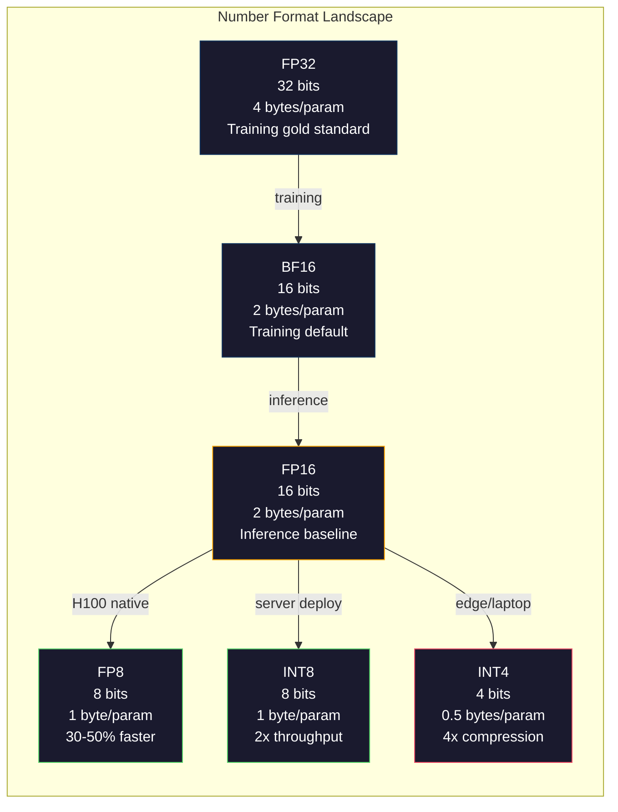
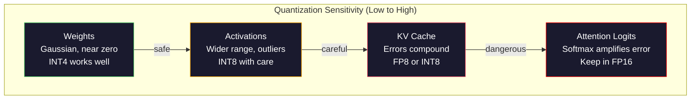
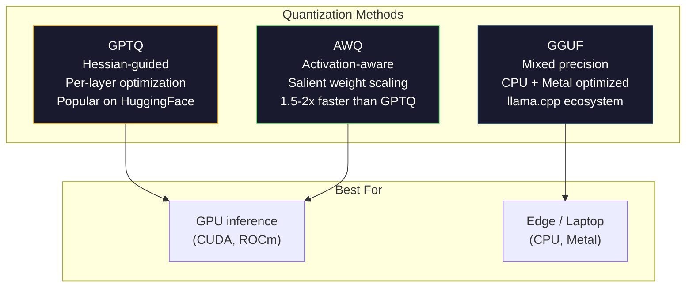

# Quantization: Making Models Fit

> Mô hình 70B ở FP16 cần 140GB. Hai A100 chỉ cho trọng số. Lượng tử hóa xuống FP8: một GPU 80GB. INT4: một MacBook.

**Type:** Build
**Languages:** Python (with numpy)
**Prerequisites:** Phase 10, Lessons 01-10 (LLMs from Scratch)
**Time:** ~120 minutes

## Learning Objectives

- Triển khai lượng tử hóa đối xứng và bất đối xứng từ FP16 sang INT8 và INT4, gồm co giãn theo tensor và theo kênh
- Tính tiết kiệm bộ nhớ từ lượng tử hóa và xác định độ chính xác nào vừa VRAM của GPU cho trước
- Giải thích khác biệt giữa lượng tử hóa sau huấn luyện (PTQ) và huấn luyện nhận biết lượng tử hóa (QAT)
- Áp dụng GPTQ hoặc AWQ để lượng tử hóa mô hình thực và đo đánh đổi độ chính xác-bộ nhớ trên benchmark

## The Problem

Llama 3 70B có 70 tỷ tham số. Mỗi tham số là số dấu phẩy động 16-bit. Đó là 140 tỷ byte. 140GB. Một A100 có 80GB VRAM. Bạn còn không thể tải trọng số, chứ chưa nói chạy suy luận, trên một GPU. Bạn cần hai A100 ở $2/giờ mỗi cái chỉ để phục vụ một mô hình.

Nhưng 16 bit mỗi tham số lãng phí. Hầu hết trọng số trong mạng nơ-ron tập trung gần không. Toàn dải động FP16 (từ 0.000000059 đến 65,504) gần như hoàn toàn không dùng. Nếu đo phân phối trọng số thực tế trong Llama 3 70B, 95% nằm giữa -0.1 và +0.1. Bạn đang đốt 16 bit để biểu diễn giá trị có thể vừa trong 4.

Lượng tử hóa thay số độ chính xác cao bằng số thấp hơn. FP16 sang FP8 giảm nửa bộ nhớ. FP16 sang INT4 giảm còn một phần tư. Mô hình 140GB đó thành 35GB. Nó vừa trên một GPU phổ thông. Đẩy xuống lượng tử hóa 2-bit (mạnh, mất mát, nhưng dùng được cho vài tác vụ) và cùng mô hình chạy trên laptop 16GB.

Cái giá là độ chính xác. Mỗi bit bạn bỏ phá hủy thông tin. Câu hỏi là mất bao nhiêu độ chính xác và ở đâu. Mô hình INT4 lượng tử hóa tốt giữ 95-99% chất lượng gốc trên hầu hết benchmark. Lượng tử hóa INT4 đơn giản có thể phá hủy mô hình hoàn toàn. Khác biệt là kỹ thuật.

Các bản lượng tử hóa cộng đồng Llama 3 xuống INT4 bằng GPTQ cho thấy mất khoảng 1-2 điểm perplexity trên WikiText. Mistral phát hành checkpoint FP8 của Mixtral 8x22B không có mất mát chất lượng đo được trên MMLU. Định dạng GGUF hỗ trợ llama.cpp, chạy mô hình 70B trên MacBook chip dòng M. Lượng tử hóa không phải mẹo vá. Nó là đường triển khai tiêu chuẩn cho mọi mô hình lớn hơn 7B.

## The Concept

### Number Formats: What Each Bit Does

Mỗi số dấu phẩy động có ba phần: dấu, số mũ và phần định trị (cũng gọi là significand). Dấu là một bit. Số mũ quyết định phạm vi (số có thể lớn hoặc nhỏ đến đâu). Phần định trị quyết định độ chính xác (bạn có bao nhiêu chữ số thập phân).

```
FP32:  [1 sign] [8 exponent] [23 mantissa]  = 32 bits
FP16:  [1 sign] [5 exponent] [10 mantissa]  = 16 bits
BF16:  [1 sign] [8 exponent] [7  mantissa]  = 16 bits
FP8:   [1 sign] [4 exponent] [3  mantissa]  = 8  bits (E4M3)
FP8:   [1 sign] [5 exponent] [2  mantissa]  = 8  bits (E5M2)
INT8:  [1 sign] [7 value]                   = 8  bits (uniform steps)
INT4:  [1 sign] [3 value]                   = 4  bits (16 levels total)
```

**FP32** là độ chính xác đầy đủ. 23 bit phần định trị cho khoảng 7 chữ số thập phân chính xác. Phạm vi: khoảng 1.2 x 10^-38 đến 3.4 x 10^38. Huấn luyện từng chỉ diễn ra ở FP32. Nó vẫn dùng cho tích lũy (tổng tích lũy trong nhân ma trận).

**FP16** giảm nửa số bit. 10 bit phần định trị cho khoảng 3.3 chữ số thập phân. Số mũ co về 5 bit, giảm mạnh phạm vi (giá trị tối đa ~65,504). Điều này ổn cho trọng số (tập trung gần không) nhưng nguy hiểm cho activation và gradient có thể tăng vọt khi huấn luyện. Huấn luyện FP16 cần co giãn mất mát để ngăn hụt số.

**BF16** (Brain Float 16) giữ số mũ 8-bit từ FP32 nhưng co phần định trị về 7 bit. Cùng phạm vi FP32, ít chính xác hơn FP16. Google thiết kế riêng cho học sâu. Trực giác: phạm vi quan trọng hơn độ chính xác với mạng nơ-ron. Gradient 10^-20 hụt về không ở FP16 sống sót ở BF16. Trọng số 0.07342 làm tròn thành 0.0734 ở BF16 đủ gần. Mọi lần huấn luyện hiện đại dùng BF16 hoặc hỗn hợp BF16/FP32.

**FP8** có hai dạng. E4M3 (4 số mũ, 3 phần định trị) dùng cho trọng số và activation khi suy luận. E5M2 (5 số mũ, 2 phần định trị) dùng cho gradient khi huấn luyện nơi phạm vi quan trọng hơn độ chính xác. Suy luận FP8 trên GPU H100 đạt tăng tốc 30-50% so với FP16 với mất mát chất lượng không đáng kể.

**INT8** là định dạng số nguyên. Không số mũ, không phần định trị. Chỉ 256 giá trị cách đều từ -128 đến 127. Bạn cần hệ số tỷ lệ để ánh xạ trọng số dấu phẩy động vào phạm vi này. Ưu điểm: số học số nguyên nhanh và hiệu quả điện hơn dấu phẩy động. Nhân ma trận INT8 trên A100 chạy ở 624 TOPS so với 312 TFLOPS cho FP16.

**INT4** đẩy xa hơn. Chỉ 16 giá trị có thể. Hệ số tỷ lệ làm phần việc nặng. Chất lượng phụ thuộc hoàn toàn cách chọn hệ số và lượng tử hóa trọng số nào. Các phương pháp INT4 tiên tiến nhất (GPTQ, AWQ) giữ 95%+ chất lượng mô hình gốc.



### How Quantization Works

Phép toán cốt lõi đơn giản. Lấy tensor giá trị dấu phẩy động, tìm hệ số tỷ lệ, nhân, làm tròn đến số nguyên gần nhất, và lưu số nguyên cộng hệ số tỷ lệ.

**Lượng tử hóa:**
```
scale = max(abs(tensor)) / max_int_value
quantized = round(tensor / scale)
```

**Giải lượng tử hóa:**
```
reconstructed = quantized * scale
```

Với INT8 có phạm vi đối xứng (-127 đến 127):
```
scale = max(abs(tensor)) / 127
quantized = clamp(round(tensor / scale), -128, 127)
```

Sai số là sai số làm tròn. Mỗi giá trị có thể lệch tối đa `scale / 2`. Tổng sai số trên một lớp phụ thuộc có bao nhiêu trọng số và mô hình nhạy thế nào với nhiễu loạn trong các trọng số đó.

**Lượng tử hóa theo tensor so với theo kênh.** Theo tensor dùng một hệ số tỷ lệ cho toàn ma trận trọng số. Đơn giản nhưng mất mát: nếu một cột có giá trị lớn và cột khác nhỏ, giá trị nhỏ mất phần lớn độ chính xác. Theo kênh dùng một hệ số tỷ lệ mỗi kênh đầu ra (mỗi hàng hoặc cột ma trận trọng số). Chi phí thêm (lưu N hệ số thay vì 1) nhưng chất lượng tốt hơn nhiều. Mọi phương pháp lượng tử hóa production dùng theo kênh hoặc độ hạt mịn hơn.

**Lượng tử hóa bất đối xứng** thêm độ lệch điểm không: `quantized = round(tensor / scale) + zero_point`. Điều này xử lý phân phối không tập trung ở không. Activation ReLU, ví dụ, luôn không âm. Lượng tử hóa đối xứng lãng phí nửa phạm vi số nguyên cho giá trị âm không bao giờ xuất hiện. Lượng tử hóa bất đối xứng ánh xạ phạm vi thực [min, max] sang toàn phạm vi số nguyên.

### Sensitivity Hierarchy

Không phải mọi thứ trong mô hình chịu lượng tử hóa như nhau. Có một thứ bậc rõ ràng.

**Trọng số (vững nhất).** Trọng số mô hình thay đổi chậm khi huấn luyện và theo phân phối gần Gaussian tập trung gần không. Chúng lượng tử hóa tốt. Trọng số INT8 với hệ số theo kênh tạo kết quả gần không mất mát. INT4 cần phương pháp tinh vi hơn nhưng hoạt động.

**Activation (nhạy vừa phải).** Activation là giá trị trung gian truyền qua mạng khi suy luận. Chúng có dải động rộng hơn trọng số và chứa ngoại lệ. Một head attention có thể tạo giá trị activation lớn hơn trung bình 100x. Ngoại lệ này cực quan trọng cho chất lượng mô hình. Lượng tử hóa đơn giản phá thông tin. Giải pháp: giữ kênh ngoại lệ ở độ chính xác cao hơn (LLM.int8()), dùng hệ số activation theo token hoặc theo kênh.

**KV cache (nhạy cao).** Cache key-value lưu trạng thái attention cho mọi token trước. Ở ngữ cảnh dài, KV cache chi phối bộ nhớ. Với mô hình 70B ở ngữ cảnh 32K, riêng KV cache là 40GB ở FP16. Lượng tử hóa KV cache xuống FP8 hoặc INT8 tiết kiệm bộ nhớ lớn nhưng mọi sai số tích lũy qua tất cả tính attention tương lai. Tác động chất lượng tăng theo độ dài chuỗi.

**Logit attention (nhạy nhất).** Softmax trong attention rất nhạy với thay đổi nhỏ ở đầu vào. Sai số lượng tử hóa 0.01 trong logit trước softmax có thể dịch phân phối attention đáng kể. Hầu hết cách lượng tử hóa giữ tính attention ở độ chính xác cao hơn (FP16 hoặc BF16) ngay cả khi mọi thứ khác đã lượng tử hóa.



### PTQ vs QAT

**Lượng tử hóa sau huấn luyện (PTQ)** lượng tử hóa mô hình đã huấn luyện. Không huấn luyện lại. Bạn lấy trọng số FP16, tính hệ số tỷ lệ, làm tròn và triển khai. Nhanh (phút đến giờ) và rẻ. Hoạt động tốt cho INT8 và FP8. Với INT4, PTQ đơn giản thường thất bại nặng vì sai số làm tròn tích lũy. Phương pháp PTQ nâng cao (GPTQ, AWQ) dùng dữ liệu hiệu chuẩn để giảm sai số lượng tử hóa.

**Huấn luyện nhận biết lượng tử hóa (QAT)** chèn phép lượng tử hóa giả vào truyền xuôi khi huấn luyện. Mô hình học đặt trọng số nơi sai số làm tròn nhỏ. Gradient truyền qua lượng tử hóa giả bằng bộ ước lượng truyền thẳng (STE): giả vờ phép làm tròn có gradient 1. QAT tạo mô hình INT4 và INT2 tốt hơn PTQ nhưng cần cả lần huấn luyện. Google dùng QAT để phục vụ Gemini hiệu quả. Meta dùng QAT cho một số đích triển khai Llama.

| Khía cạnh | PTQ | QAT |
|--------|-----|-----|
| Chi phí | Phút đến giờ | Toàn lần huấn luyện |
| Chất lượng ở INT8 | Xuất sắc (mất < 0.1%) | Xuất sắc |
| Chất lượng ở INT4 | Tốt với GPTQ/AWQ (mất 1-3%) | Tốt hơn (mất < 1%) |
| Chất lượng ở INT2 | Kém | Dùng được cho vài tác vụ |
| Dữ liệu hiệu chuẩn | 128-1024 ví dụ | Toàn tập dữ liệu huấn luyện |
| Khi nào dùng | Triển khai, lặp | Chất lượng tối đa ở độ rộng bit thấp |

### GPTQ, AWQ, GGUF

**GPTQ (GPT Quantization)** là phương pháp PTQ một lần. Nó lượng tử hóa từng lớp trọng số, dùng tập hiệu chuẩn nhỏ (thường 128 ví dụ) để đo Hessian (thông tin bậc hai về mức đầu ra nhạy với mỗi trọng số). Trọng số Hessian cho là quan trọng được lượng tử hóa cẩn thận hơn. GPTQ là phương pháp đầu làm lượng tử hóa INT4 thực tiễn cho LLM. TheBloke trên Hugging Face phổ biến GPTQ bằng phát hành bản lượng tử hóa hàng trăm mô hình.

**AWQ (Lượng tử hóa trọng số nhận biết activation)** quan sát rằng tỷ lệ nhỏ trọng số (khoảng 1%) quan trọng không tương xứng vì chúng nhân với giá trị activation lớn. AWQ xác định các trọng số nổi bật này bằng dữ liệu hiệu chuẩn và tăng tỷ lệ chúng trước lượng tử hóa (rồi giảm tỷ lệ activation tương ứng). Điều này giữ trọng số quan trọng trong phạm vi mà lượng tử hóa INT4 chính xác. AWQ thường ngang hoặc hơn nhẹ chất lượng GPTQ trong khi áp dụng nhanh hơn 1.5-2x.

**GGUF (GPT-Generated Unified Format)** là định dạng file được llama.cpp và hệ sinh thái dùng. Nó hỗ trợ lượng tử hóa hỗn hợp: các lớp khác có độ rộng bit khác nhau. Lớp đầu và cuối (embedding và head đầu ra) thường giữ độ chính xác cao hơn. Lớp giữa nhận INT4 hoặc INT3. File GGUF tự chứa: trọng số, tokenizer, metadata trong một file. Định dạng thiết kế cho suy luận CPU và Apple Silicon, nơi tải cả mô hình vào bộ nhớ và chạy nhân ma trận trên CPU hoặc GPU Metal là đường chuẩn. Q4_K_M là biến thể lượng tử hóa GGUF phổ biến nhất, cân bằng chất lượng và kích thước.



### Quality Measurement

Làm sao biết mô hình lượng tử hóa vẫn tốt?

**Perplexity.** Thước đo phổ biến nhất. Thấp hơn tốt hơn. Tính perplexity trên tập giữ lại (WikiText-2 là tiêu chuẩn) cho cả mô hình gốc và lượng tử hóa. Độ chênh cho biết lượng tử hóa phá bao nhiêu thông tin. Quy tắc kinh nghiệm: chênh < 0.5 xuất sắc, 0.5-1.0 tốt, 1.0-2.0 chấp nhận cho hầu hết tác vụ, > 2.0 nghĩa là có gì sai.

**Benchmark riêng tác vụ.** Chạy mô hình lượng tử hóa trên MMLU, HumanEval, GSM8K hoặc bộ đánh giá tùy chỉnh. So với gốc. Lượng tử hóa ảnh hưởng năng lực khác nhau không đều. Tác vụ toán và mã nhạy với mất độ chính xác hơn kiến thức tổng quát.

**So đầu ra.** Sinh phản hồi từ cả hai mô hình trên cùng prompt và so sánh. LLM-as-judge (Bài 10) hoạt động tốt ở đây. Tính tỷ lệ thắng: bao nhiêu phần prompt mô hình lượng tử hóa ngang hoặc vượt gốc?

**Độ trễ và thông lượng.** Lượng tử hóa tồn tại để làm mô hình nhanh và rẻ hơn. Đo token mỗi giây, thời gian đến token đầu và sử dụng bộ nhớ. Mô hình lượng tử hóa chậm hơn gốc còn tệ hơn vô dụng.

| Mô hình | Định dạng | Kích thước | Perplexity (WikiText-2) | MMLU | Token/giây (A100) |
|-------|--------|------|------------------------|------|-------------------|
| Llama 3 70B | FP16 | 140GB | 3.12 | 79.5% | 38 |
| Llama 3 70B | FP8 | 70GB | 3.14 | 79.3% | 55 |
| Llama 3 70B | GPTQ INT4 | 35GB | 4.32 | 77.8% | 72 |
| Llama 3 70B | AWQ INT4 | 35GB | 4.18 | 78.1% | 75 |
| Llama 3 70B | GGUF Q4_K_M | 40GB | 4.25 | 77.9% | 28 (CPU) |

Mô thức: FP8 gần như miễn phí. INT4 tốn 1-2 điểm MMLU nhưng tăng gấp đôi thông lượng và giảm bộ nhớ còn một phần tư. Đánh đổi đáng giá cho gần mọi triển khai.

### Real Numbers

FP16 sang FP8 trên H100: tăng tốc suy luận 30-50%, mất chất lượng < 0.1%. Đây là lượng tử hóa hiển nhiên nên làm. Mọi triển khai H100 nên dùng.

FP16 sang INT8 (LLM.int8()): giảm bộ nhớ 2x, mất chất lượng < 0.5%. Cách độ chính xác hỗn hợp giữ đặc trưng ngoại lệ ở FP16 trong khi lượng tử hóa mọi thứ khác sang INT8.

FP16 sang INT4 (GPTQ/AWQ): giảm bộ nhớ 4x, mất chất lượng 1-3% tùy mô hình và phương pháp. Cho phép mô hình 70B trên một GPU 48GB.

FP16 sang INT4 (GGUF Q4_K_M): giảm bộ nhớ 3.5x, mất chất lượng 1-2%. Tối ưu cho suy luận CPU. Mô hình 70B ở Q4_K_M khoảng 40GB và chạy 10-15 token/giây trên M3 Max có 64GB.

FP16 sang INT2: giảm bộ nhớ 8x, mất chất lượng 5-15%. Chỉ khả thi cho tác vụ hẹp cụ thể nơi chịu được suy giảm. Biên nghiên cứu, chưa sẵn sàng production cho sử dụng chung.

```figure
quantization
```

## Build It

### Step 1: Number Format Representations

Xây biểu diễn cấp bit của mỗi định dạng để thấy chính xác dấu, số mũ và phần định trị làm gì.

```python
import numpy as np


def float_to_fp32_bits(value):
    bits = np.float32(value).view(np.uint32)
    sign = (bits >> 31) & 1
    exponent = (bits >> 23) & 0xFF
    mantissa = bits & 0x7FFFFF
    return {"sign": int(sign), "exponent": int(exponent), "mantissa": int(mantissa),
            "exponent_bits": format(int(exponent), '08b'),
            "mantissa_bits": format(int(mantissa), '023b'),
            "value": float(value),
            "actual_exponent": int(exponent) - 127}


def float_to_fp16_bits(value):
    fp16 = np.float16(value)
    bits = fp16.view(np.uint16)
    sign = (bits >> 15) & 1
    exponent = (bits >> 10) & 0x1F
    mantissa = bits & 0x3FF
    return {"sign": int(sign), "exponent": int(exponent), "mantissa": int(mantissa),
            "exponent_bits": format(int(exponent), '05b'),
            "mantissa_bits": format(int(mantissa), '010b'),
            "value": float(fp16),
            "actual_exponent": int(exponent) - 15}


def float_to_bf16_bits(value):
    fp32_bits = np.float32(value).view(np.uint32)
    bf16_bits = (fp32_bits >> 16).astype(np.uint16)
    sign = (bf16_bits >> 15) & 1
    exponent = (bf16_bits >> 7) & 0xFF
    mantissa = bf16_bits & 0x7F
    reconstructed = np.uint32(bf16_bits.astype(np.uint32) << 16).view(np.float32)
    return {"sign": int(sign), "exponent": int(exponent), "mantissa": int(mantissa),
            "exponent_bits": format(int(exponent), '08b'),
            "mantissa_bits": format(int(mantissa), '07b'),
            "value": float(reconstructed),
            "actual_exponent": int(exponent) - 127}


def simulate_fp8_e4m3(value):
    sign = 1 if value < 0 else 0
    abs_val = abs(value)
    max_val = 448.0
    abs_val = min(abs_val, max_val)
    if abs_val == 0:
        return {"sign": sign, "exponent": 0, "mantissa": 0, "value": 0.0,
                "exponent_bits": "0000", "mantissa_bits": "000"}
    exp = int(np.floor(np.log2(abs_val)))
    exp = max(-6, min(8, exp))
    mantissa_val = abs_val / (2.0 ** exp) - 1.0
    mantissa_quant = round(mantissa_val * 8) / 8
    mantissa_quant = max(0, min(0.875, mantissa_quant))
    reconstructed = (1.0 + mantissa_quant) * (2.0 ** exp)
    if sign:
        reconstructed = -reconstructed
    mantissa_int = int(round(mantissa_quant * 8))
    return {"sign": sign, "exponent": exp + 7, "mantissa": mantissa_int,
            "exponent_bits": format(exp + 7, '04b'),
            "mantissa_bits": format(mantissa_int, '03b'),
            "value": float(reconstructed),
            "actual_exponent": exp}


def display_format_comparison(value):
    fp32 = float_to_fp32_bits(value)
    fp16 = float_to_fp16_bits(value)
    bf16 = float_to_bf16_bits(value)
    fp8 = simulate_fp8_e4m3(value)

    print(f"\n  Value: {value}")
    print(f"  {'Format':<8} {'Stored Value':>14} {'Error':>12} {'Sign':>5} {'Exp Bits':>10} {'Man Bits':>25}")
    print(f"  {'-'*76}")
    print(f"  {'FP32':<8} {fp32['value']:>14.6f} {abs(fp32['value'] - value):>12.8f} {fp32['sign']:>5} {fp32['exponent_bits']:>10} {fp32['mantissa_bits']:>25}")
    print(f"  {'FP16':<8} {fp16['value']:>14.6f} {abs(fp16['value'] - value):>12.8f} {fp16['sign']:>5} {fp16['exponent_bits']:>10} {fp16['mantissa_bits']:>25}")
    print(f"  {'BF16':<8} {bf16['value']:>14.6f} {abs(bf16['value'] - value):>12.8f} {bf16['sign']:>5} {bf16['exponent_bits']:>10} {bf16['mantissa_bits']:>25}")
    print(f"  {'FP8e4m3':<8} {fp8['value']:>14.6f} {abs(fp8['value'] - value):>12.8f} {fp8['sign']:>5} {fp8['exponent_bits']:>10} {fp8['mantissa_bits']:>25}")
```

### Step 2: Symmetric Quantization (Per-Tensor and Per-Channel)

Các phép lượng tử hóa nền tảng. Theo tensor dùng một hệ số cho toàn ma trận. Theo kênh dùng một hệ số mỗi hàng hoặc cột.

```python
def quantize_symmetric(tensor, num_bits=8):
    qmin = -(2 ** (num_bits - 1))
    qmax = 2 ** (num_bits - 1) - 1
    abs_max = np.max(np.abs(tensor))
    if abs_max == 0:
        return np.zeros_like(tensor, dtype=np.int32), 1.0
    scale = abs_max / qmax
    quantized = np.clip(np.round(tensor / scale), qmin, qmax).astype(np.int32)
    return quantized, float(scale)


def dequantize_symmetric(quantized, scale):
    return quantized.astype(np.float64) * scale


def quantize_per_channel(tensor, num_bits=8, axis=0):
    qmin = -(2 ** (num_bits - 1))
    qmax = 2 ** (num_bits - 1) - 1

    if axis == 0:
        abs_max = np.max(np.abs(tensor), axis=1, keepdims=True)
    else:
        abs_max = np.max(np.abs(tensor), axis=0, keepdims=True)

    abs_max = np.where(abs_max == 0, 1.0, abs_max)
    scales = abs_max / qmax
    quantized = np.clip(np.round(tensor / scales), qmin, qmax).astype(np.int32)
    return quantized, scales.squeeze()


def dequantize_per_channel(quantized, scales, axis=0):
    if axis == 0:
        return quantized.astype(np.float64) * scales.reshape(-1, 1)
    else:
        return quantized.astype(np.float64) * scales.reshape(1, -1)


def quantize_asymmetric(tensor, num_bits=8):
    qmin = 0
    qmax = 2 ** num_bits - 1
    t_min = np.min(tensor)
    t_max = np.max(tensor)
    if t_max == t_min:
        return np.zeros_like(tensor, dtype=np.int32), 1.0, 0
    scale = (t_max - t_min) / (qmax - qmin)
    zero_point = int(np.round(qmin - t_min / scale))
    zero_point = max(qmin, min(qmax, zero_point))
    quantized = np.clip(np.round(tensor / scale + zero_point), qmin, qmax).astype(np.int32)
    return quantized, float(scale), int(zero_point)


def dequantize_asymmetric(quantized, scale, zero_point):
    return (quantized.astype(np.float64) - zero_point) * scale
```

### Step 3: Quality Measurement

Đo lượng thông tin lượng tử hóa phá hủy. Sai số bình phương trung bình, tỷ lệ tín hiệu trên nhiễu và độ tương đồng cosine giữa tensor gốc và tái dựng.

```python
def quantization_error(original, reconstructed):
    diff = original - reconstructed
    mse = float(np.mean(diff ** 2))
    rmse = float(np.sqrt(mse))
    max_error = float(np.max(np.abs(diff)))
    signal_power = float(np.mean(original ** 2))
    snr_db = 10 * np.log10(signal_power / max(mse, 1e-20))

    orig_flat = original.flatten()
    recon_flat = reconstructed.flatten()
    norm_orig = np.linalg.norm(orig_flat)
    norm_recon = np.linalg.norm(recon_flat)
    if norm_orig == 0 or norm_recon == 0:
        cosine_sim = 0.0
    else:
        cosine_sim = float(np.dot(orig_flat, recon_flat) / (norm_orig * norm_recon))

    return {"mse": mse, "rmse": rmse, "max_error": max_error,
            "snr_db": float(snr_db), "cosine_similarity": cosine_sim}


def compare_quantization_methods(tensor, num_bits=8):
    q_pt, s_pt = quantize_symmetric(tensor, num_bits)
    recon_pt = dequantize_symmetric(q_pt, s_pt)
    err_pt = quantization_error(tensor, recon_pt)

    q_pc, s_pc = quantize_per_channel(tensor, num_bits, axis=0)
    recon_pc = dequantize_per_channel(q_pc, s_pc, axis=0)
    err_pc = quantization_error(tensor, recon_pc)

    q_asym, s_asym, zp = quantize_asymmetric(tensor, num_bits)
    recon_asym = dequantize_asymmetric(q_asym, s_asym, zp)
    err_asym = quantization_error(tensor, recon_asym)

    print(f"\n  Quantization Comparison ({num_bits}-bit, tensor shape {tensor.shape}):")
    print(f"  {'Method':<20} {'MSE':>12} {'SNR (dB)':>10} {'Cosine Sim':>12} {'Max Error':>12}")
    print(f"  {'-'*68}")
    print(f"  {'Per-tensor sym':<20} {err_pt['mse']:>12.8f} {err_pt['snr_db']:>10.2f} {err_pt['cosine_similarity']:>12.8f} {err_pt['max_error']:>12.8f}")
    print(f"  {'Per-channel sym':<20} {err_pc['mse']:>12.8f} {err_pc['snr_db']:>10.2f} {err_pc['cosine_similarity']:>12.8f} {err_pc['max_error']:>12.8f}")
    print(f"  {'Asymmetric':<20} {err_asym['mse']:>12.8f} {err_asym['snr_db']:>10.2f} {err_asym['cosine_similarity']:>12.8f} {err_asym['max_error']:>12.8f}")

    return {"per_tensor": err_pt, "per_channel": err_pc, "asymmetric": err_asym}
```

### Step 4: Bit-Width Sweep

Lượng tử hóa cùng tensor ở các độ rộng bit khác nhau (2, 3, 4, 8, 16) và đo chất lượng mỗi mức. Điều này cho thấy chính xác vách chất lượng ở đâu.

```python
def bit_width_sweep(tensor):
    print(f"\n  Bit-Width Sweep (tensor shape {tensor.shape}):")
    print(f"  {'Bits':>6} {'Levels':>8} {'MSE':>14} {'SNR (dB)':>10} {'Cosine Sim':>12} {'Compression':>12}")
    print(f"  {'-'*64}")

    results = []
    for bits in [2, 3, 4, 8, 16]:
        q, s = quantize_per_channel(tensor, bits, axis=0)
        recon = dequantize_per_channel(q, s, axis=0)
        err = quantization_error(tensor, recon)
        levels = 2 ** bits
        compression = 32.0 / bits

        print(f"  {bits:>6} {levels:>8} {err['mse']:>14.8f} {err['snr_db']:>10.2f} {err['cosine_similarity']:>12.8f} {compression:>11.1f}x")
        results.append({"bits": bits, "levels": levels, "error": err, "compression": compression})

    return results
```

### Step 5: Sensitivity Experiment

Mô phỏng lượng tử hóa các phần khác nhau của transformer và đo thành phần nào nhạy nhất. Điều này minh họa thứ bậc độ nhạy: trọng số < activation < KV cache < attention.

```python
def simulate_transformer_layer(input_data, weights, kv_scale=1.0):
    hidden = input_data @ weights["qkv"]
    seq_len = hidden.shape[1]
    d_model = weights["qkv"].shape[1] // 3
    q, k, v = hidden[:, :, :d_model], hidden[:, :, d_model:2*d_model], hidden[:, :, 2*d_model:]

    attn_scores = (q @ k.transpose(0, 2, 1)) / np.sqrt(d_model) * kv_scale
    attn_max = np.max(attn_scores, axis=-1, keepdims=True)
    attn_exp = np.exp(attn_scores - attn_max)
    attn_weights = attn_exp / np.sum(attn_exp, axis=-1, keepdims=True)

    attn_output = attn_weights @ v
    output = attn_output @ weights["out"]
    return output, {"q": q, "k": k, "v": v, "attn_scores": attn_scores,
                    "attn_weights": attn_weights, "attn_output": attn_output}


def sensitivity_experiment(batch_size=2, seq_len=16, d_model=64, num_bits=8):
    np.random.seed(42)
    input_data = np.random.randn(batch_size, seq_len, d_model) * 0.1

    weights = {
        "qkv": np.random.randn(d_model, 3 * d_model) * (2.0 / d_model) ** 0.5,
        "out": np.random.randn(d_model, d_model) * (2.0 / d_model) ** 0.5,
    }

    baseline_output, baseline_internals = simulate_transformer_layer(input_data, weights)

    experiments = {}

    q_qkv, s_qkv = quantize_per_channel(weights["qkv"], num_bits, axis=0)
    q_out, s_out = quantize_per_channel(weights["out"], num_bits, axis=0)
    quantized_weights = {
        "qkv": dequantize_per_channel(q_qkv, s_qkv, axis=0),
        "out": dequantize_per_channel(q_out, s_out, axis=0),
    }
    weight_quant_output, _ = simulate_transformer_layer(input_data, quantized_weights)
    experiments["Weights only"] = quantization_error(baseline_output, weight_quant_output)

    _, fresh_internals = simulate_transformer_layer(input_data, weights)
    q_act, s_act = quantize_per_channel(
        fresh_internals["attn_output"].reshape(-1, d_model), num_bits, axis=0
    )
    quant_attn_out = dequantize_per_channel(q_act, s_act, axis=0).reshape(batch_size, seq_len, d_model)
    act_quant_output = quant_attn_out @ weights["out"]
    experiments["Activations only"] = quantization_error(baseline_output, act_quant_output)

    q_k, s_k = quantize_per_channel(fresh_internals["k"].reshape(-1, d_model), num_bits, axis=0)
    q_v, s_v = quantize_per_channel(fresh_internals["v"].reshape(-1, d_model), num_bits, axis=0)
    quant_k = dequantize_per_channel(q_k, s_k, axis=0).reshape(batch_size, seq_len, d_model)
    quant_v = dequantize_per_channel(q_v, s_v, axis=0).reshape(batch_size, seq_len, d_model)
    attn_scores_kv = (fresh_internals["q"] @ quant_k.transpose(0, 2, 1)) / np.sqrt(d_model)
    attn_max_kv = np.max(attn_scores_kv, axis=-1, keepdims=True)
    attn_exp_kv = np.exp(attn_scores_kv - attn_max_kv)
    attn_weights_kv = attn_exp_kv / np.sum(attn_exp_kv, axis=-1, keepdims=True)
    kv_quant_output = (attn_weights_kv @ quant_v) @ weights["out"]
    experiments["KV cache only"] = quantization_error(baseline_output, kv_quant_output)

    noise_scale = np.std(fresh_internals["attn_scores"]) * 0.05
    noisy_scores = fresh_internals["attn_scores"] + np.random.randn(*fresh_internals["attn_scores"].shape) * noise_scale
    noisy_max = np.max(noisy_scores, axis=-1, keepdims=True)
    noisy_exp = np.exp(noisy_scores - noisy_max)
    noisy_weights = noisy_exp / np.sum(noisy_exp, axis=-1, keepdims=True)
    attn_quant_output = (noisy_weights @ fresh_internals["v"]) @ weights["out"]
    experiments["Attention logits (5% noise)"] = quantization_error(baseline_output, attn_quant_output)

    print(f"\n  Sensitivity Experiment ({num_bits}-bit quantization):")
    print(f"  {'Component':<30} {'MSE':>14} {'SNR (dB)':>10} {'Cosine Sim':>12}")
    print(f"  {'-'*68}")
    for name, err in sorted(experiments.items(), key=lambda x: x[1]["mse"]):
        print(f"  {name:<30} {err['mse']:>14.8f} {err['snr_db']:>10.2f} {err['cosine_similarity']:>12.8f}")

    return experiments
```

### Step 6: Simulated GPTQ

GPTQ lượng tử hóa từng cột, dùng Hessian quyết định cách phân phối sai số làm tròn. Đây là phiên bản đơn giản hóa nắm ý cốt lõi: dùng dữ liệu hiệu chuẩn đo tầm quan trọng trọng số, rồi lượng tử hóa trọng số ít quan trọng mạnh hơn.

```python
def simulated_gptq(weight_matrix, calibration_inputs, num_bits=4):
    n_in, n_out = weight_matrix.shape
    qmin = -(2 ** (num_bits - 1))
    qmax = 2 ** (num_bits - 1) - 1

    H = np.zeros((n_in, n_in))
    for x in calibration_inputs:
        x = x.reshape(-1, 1) if x.ndim == 1 else x
        for row in range(x.shape[0]):
            xi = x[row].reshape(-1, 1)
            H += xi @ xi.T
    H /= len(calibration_inputs)
    H += np.eye(n_in) * 1e-4

    weight_importance = np.diag(H)

    quantized = np.zeros_like(weight_matrix, dtype=np.int32)
    scales = np.zeros(n_out)
    errors = np.zeros(n_out)

    W = weight_matrix.copy()

    for col in range(n_out):
        w_col = W[:, col]
        abs_max = np.max(np.abs(w_col))
        if abs_max == 0:
            scales[col] = 1.0
            continue
        scale = abs_max / qmax
        scales[col] = scale

        q_col = np.clip(np.round(w_col / scale), qmin, qmax).astype(np.int32)
        quantized[:, col] = q_col

        quant_error = w_col - q_col * scale
        errors[col] = np.sqrt(np.mean(quant_error ** 2))

        if col < n_out - 1:
            importance_weights = weight_importance / (np.max(weight_importance) + 1e-10)
            for next_col in range(col + 1, min(col + 4, n_out)):
                compensation = quant_error * importance_weights * 0.1
                W[:, next_col] += compensation

    return quantized, scales, {"column_errors": errors,
                               "mean_error": float(np.mean(errors)),
                               "max_error": float(np.max(errors))}


def dequantize_gptq(quantized, scales):
    result = np.zeros_like(quantized, dtype=np.float64)
    for col in range(quantized.shape[1]):
        result[:, col] = quantized[:, col] * scales[col]
    return result
```

### Step 7: AWQ Simulation

AWQ xác định trọng số nổi bật (những trọng số nhân với activation lớn) và bảo vệ chúng bằng co giãn trước lượng tử hóa.

```python
def simulated_awq(weight_matrix, calibration_inputs, num_bits=4, salient_fraction=0.01):
    n_in, n_out = weight_matrix.shape
    qmin = -(2 ** (num_bits - 1))
    qmax = 2 ** (num_bits - 1) - 1

    activation_magnitudes = np.zeros(n_in)
    for x in calibration_inputs:
        if x.ndim == 1:
            activation_magnitudes += np.abs(x)
        else:
            activation_magnitudes += np.mean(np.abs(x), axis=0)
    activation_magnitudes /= len(calibration_inputs)

    n_salient = max(1, int(n_in * salient_fraction))
    salient_indices = np.argsort(activation_magnitudes)[-n_salient:]

    scale_factors = np.ones(n_in)
    for idx in salient_indices:
        col_max = np.max(np.abs(weight_matrix[idx, :]))
        if col_max > 0:
            scale_factors[idx] = min(4.0, 1.0 / (col_max + 1e-8) * np.mean(np.abs(weight_matrix)))

    scaled_weights = weight_matrix * scale_factors.reshape(-1, 1)

    quantized, scales = quantize_per_channel(scaled_weights, num_bits, axis=0)
    dequantized = dequantize_per_channel(quantized, scales, axis=0)

    result = dequantized / scale_factors.reshape(-1, 1)

    err = quantization_error(weight_matrix, result)

    return result, {"salient_indices": salient_indices,
                    "scale_factors": scale_factors[salient_indices],
                    "error": err,
                    "n_salient": n_salient}
```

### Step 8: Full Pipeline

Nối mọi thứ lại. So lượng tử hóa đơn giản, theo kênh, GPTQ và AWQ trên cùng ma trận trọng số.

```python
def full_quantization_comparison(d_in=256, d_out=512, num_bits=4, n_calibration=32):
    np.random.seed(42)

    weight = np.random.randn(d_in, d_out) * 0.02
    outlier_rows = np.random.choice(d_in, size=5, replace=False)
    weight[outlier_rows] *= 10

    calibration = [np.random.randn(8, d_in) * 0.1 for _ in range(n_calibration)]

    q_naive, s_naive = quantize_symmetric(weight, num_bits)
    recon_naive = dequantize_symmetric(q_naive, s_naive)
    err_naive = quantization_error(weight, recon_naive)

    q_pc, s_pc = quantize_per_channel(weight, num_bits, axis=0)
    recon_pc = dequantize_per_channel(q_pc, s_pc, axis=0)
    err_pc = quantization_error(weight, recon_pc)

    q_gptq, s_gptq, gptq_info = simulated_gptq(weight, calibration, num_bits)
    recon_gptq = dequantize_gptq(q_gptq, s_gptq)
    err_gptq = quantization_error(weight, recon_gptq)

    recon_awq, awq_info = simulated_awq(weight, calibration, num_bits)
    err_awq = awq_info["error"]

    print(f"\n  Full Quantization Comparison ({num_bits}-bit, {d_in}x{d_out} matrix)")
    print(f"  Matrix has {len(outlier_rows)} outlier rows (10x scale)")
    print()
    print(f"  {'Method':<20} {'MSE':>14} {'SNR (dB)':>10} {'Cosine Sim':>12}")
    print(f"  {'-'*58}")
    print(f"  {'Naive per-tensor':<20} {err_naive['mse']:>14.8f} {err_naive['snr_db']:>10.2f} {err_naive['cosine_similarity']:>12.8f}")
    print(f"  {'Per-channel':<20} {err_pc['mse']:>14.8f} {err_pc['snr_db']:>10.2f} {err_pc['cosine_similarity']:>12.8f}")
    print(f"  {'Simulated GPTQ':<20} {err_gptq['mse']:>14.8f} {err_gptq['snr_db']:>10.2f} {err_gptq['cosine_similarity']:>12.8f}")
    print(f"  {'Simulated AWQ':<20} {err_awq['mse']:>14.8f} {err_awq['snr_db']:>10.2f} {err_awq['cosine_similarity']:>12.8f}")

    test_input = np.random.randn(4, d_in) * 0.1
    baseline = test_input @ weight
    output_naive = test_input @ recon_naive
    output_pc = test_input @ recon_pc
    output_gptq = test_input @ recon_gptq
    output_awq = test_input @ recon_awq

    print(f"\n  End-to-End Output Error (matmul with test input):")
    print(f"  {'Method':<20} {'Output MSE':>14} {'Output Cosine':>14}")
    print(f"  {'-'*50}")
    for name, output in [("Naive", output_naive), ("Per-channel", output_pc),
                          ("GPTQ", output_gptq), ("AWQ", output_awq)]:
        out_err = quantization_error(baseline, output)
        print(f"  {name:<20} {out_err['mse']:>14.8f} {out_err['cosine_similarity']:>14.8f}")

    return {"naive": err_naive, "per_channel": err_pc, "gptq": err_gptq, "awq": err_awq}


def memory_calculator(num_params_billions, bits_per_param):
    bytes_per_param = bits_per_param / 8
    total_bytes = num_params_billions * 1e9 * bytes_per_param
    total_gb = total_bytes / (1024 ** 3)
    return total_gb


def print_memory_table():
    print("\n  Memory Requirements by Model and Precision:")
    print(f"  {'Model':<15} {'FP32':>8} {'FP16':>8} {'FP8':>8} {'INT8':>8} {'INT4':>8} {'INT2':>8}")
    print(f"  {'-'*64}")
    for name, params in [("7B", 7), ("13B", 13), ("34B", 34), ("70B", 70), ("405B", 405)]:
        fp32 = memory_calculator(params, 32)
        fp16 = memory_calculator(params, 16)
        fp8 = memory_calculator(params, 8)
        int8 = memory_calculator(params, 8)
        int4 = memory_calculator(params, 4)
        int2 = memory_calculator(params, 2)
        print(f"  {name:<15} {fp32:>7.1f}G {fp16:>7.1f}G {fp8:>7.1f}G {int8:>7.1f}G {int4:>7.1f}G {int2:>7.1f}G")


if __name__ == "__main__":
    np.random.seed(42)

    print("=" * 70)
    print("QUANTIZATION: MAKING MODELS FIT")
    print("=" * 70)

    print("\nSTEP 1: Number Format Comparison")
    print("-" * 50)
    for val in [0.1, 3.14159, -0.00073, 42.5, 0.0000012]:
        display_format_comparison(val)

    print("\n\nSTEP 2: Memory Requirements")
    print("-" * 50)
    print_memory_table()

    print("\n\nSTEP 3: Quantization Methods Comparison")
    print("-" * 50)
    weight_matrix = np.random.randn(128, 256) * 0.02
    weight_matrix[0] *= 15
    weight_matrix[42] *= 8
    compare_quantization_methods(weight_matrix, num_bits=8)
    compare_quantization_methods(weight_matrix, num_bits=4)

    print("\n\nSTEP 4: Bit-Width Sweep")
    print("-" * 50)
    sweep_tensor = np.random.randn(64, 128) * 0.05
    bit_width_sweep(sweep_tensor)

    print("\n\nSTEP 5: Sensitivity Experiment")
    print("-" * 50)
    print("\n  INT8:")
    sensitivity_experiment(num_bits=8)
    print("\n  INT4:")
    sensitivity_experiment(num_bits=4)

    print("\n\nSTEP 6: GPTQ vs AWQ vs Naive (INT4)")
    print("-" * 50)
    full_quantization_comparison(d_in=256, d_out=512, num_bits=4)

    print("\n\nSTEP 7: Distribution Analysis")
    print("-" * 50)
    np.random.seed(0)
    simulated_weights = np.random.randn(1000) * 0.02
    abs_vals = np.abs(simulated_weights)
    pct_in_range = np.mean(abs_vals < 0.1) * 100
    print(f"\n  Simulated weight distribution (1000 params, std=0.02):")
    print(f"  Weights in [-0.1, 0.1]: {pct_in_range:.1f}%")
    print(f"  Weights in [-0.05, 0.05]: {np.mean(abs_vals < 0.05) * 100:.1f}%")
    print(f"  Weights in [-0.01, 0.01]: {np.mean(abs_vals < 0.01) * 100:.1f}%")
    print(f"  Max absolute value: {np.max(abs_vals):.6f}")
    print(f"  Mean absolute value: {np.mean(abs_vals):.6f}")

    histogram = np.histogram(simulated_weights, bins=20)
    print(f"\n  Weight histogram:")
    max_count = max(histogram[0])
    for i in range(len(histogram[0])):
        bar_len = int(histogram[0][i] / max_count * 40)
        lo = histogram[1][i]
        hi = histogram[1][i + 1]
        print(f"  [{lo:>7.4f}, {hi:>7.4f}] {'#' * bar_len} ({histogram[0][i]})")

    print("\n\n" + "=" * 70)
    print("DONE")
    print("=" * 70)
```

## Use It

### Quantizing with GPTQModel

```python
# pip install gptqmodel
# from gptqmodel import GPTQConfig, GPTQModel
#
# model_id = "meta-llama/Llama-3.1-8B"
# quant_config = GPTQConfig(bits=4, group_size=128)
#
# model = GPTQModel.load(model_id, quant_config)
# model.quantize(calibration_texts[:128], batch_size=1)
# model.save("llama-8b-gptq-int4")
```

### Quantizing to AWQ with LLM Compressor

```python
# pip install llmcompressor
# from transformers import AutoModelForCausalLM, AutoTokenizer
# from llmcompressor import oneshot
# from llmcompressor.modifiers.quantization import QuantizationModifier
# from llmcompressor.modifiers.transform.awq import AWQModifier
#
# model_id = "meta-llama/Llama-3.1-8B"
# model = AutoModelForCausalLM.from_pretrained(model_id)
# tokenizer = AutoTokenizer.from_pretrained(model_id)
#
# recipe = [
#     AWQModifier(duo_scaling="both"),
#     QuantizationModifier(ignore=["lm_head"], scheme="W4A16_ASYM", targets=["Linear"]),
# ]
# oneshot(
#     model=model,
#     dataset="perfectblend",
#     splits="train[:512]",
#     recipe=recipe,
#     max_seq_length=512,
#     num_calibration_samples=256,
# )
# model.save_pretrained("llama-8b-awq-int4", save_compressed=True)
# tokenizer.save_pretrained("llama-8b-awq-int4")
```

AutoGPTQ và AutoAWQ, công cụ gốc cho hai phương pháp này, đã được lưu trữ. GPTQModel và LLM Compressor là các công cụ kế nhiệm được duy trì.

### Converting to GGUF

```bash
# git clone https://github.com/ggml-org/llama.cpp
# cmake -S llama.cpp -B llama.cpp/build && cmake --build llama.cpp/build --config Release
# pip install -r llama.cpp/requirements.txt
# hf download meta-llama/Llama-3.1-8B --local-dir Llama-3.1-8B
# python llama.cpp/convert_hf_to_gguf.py Llama-3.1-8B --outtype f16 --outfile llama-8b-f16.gguf
# llama.cpp/build/bin/llama-quantize llama-8b-f16.gguf llama-8b-q4km.gguf Q4_K_M
# llama.cpp/build/bin/llama-server -m llama-8b-q4km.gguf -c 4096 -ngl 99
```

Bộ chuyển đổi không có đầu ra K-quant (`--outtype` nhận `f32`, `f16`, `bf16`, `q8_0`, `tq1_0`, `tq2_0` hoặc `auto`), nên `llama-quantize` tạo file Q4_K_M.

### Serving quantized models

```python
# pip install vllm
# vllm serve llama-8b-awq-int4 --max-model-len 8192
```

vLLM hỗ trợ nguyên bản mô hình AWQ và GPTQ và đọc phương pháp lượng tử hóa từ cấu hình checkpoint, nên không cần cờ `--quantization`. Nó xử lý giải lượng tử hóa trong nhân ma trận và dùng paged attention cho KV cache. Với FP8 trên H100, thêm `--quantization fp8_per_tensor` để lượng tử hóa trọng số checkpoint 16-bit lúc tải.

## Ship It

Bài học này tạo ra `outputs/skill-quantization.md`, khung quyết định chọn chiến lược lượng tử hóa đúng. Với kích thước mô hình, phần cứng mục tiêu và yêu cầu chất lượng, nó cho biết nên dùng định dạng, phương pháp và bước xác thực nào. Nó gồm tính ngân sách bộ nhớ, đề xuất độ chính xác từng thành phần và công thức triển khai cho vLLM, llama.cpp và TensorRT-LLM.

## Exercises

1. Triển khai lượng tử hóa nhóm. Thay vì một hệ số mỗi kênh, dùng một hệ số mỗi nhóm 128 trọng số trong kênh. Đây là điều GPTQ và AWQ thực sự dùng. So kích thước nhóm 32, 64, 128 và 256 trên cùng ma trận trọng số. Nhóm nhỏ hơn cho chất lượng tốt hơn nhưng thêm lưu trữ hệ số tỷ lệ.

2. Xây bộ lượng tử hóa độ chính xác hỗn hợp. Lượng tử hóa lớp đầu và cuối của mạng nhiều lớp ở INT8, lớp giữa ở INT4. So chất lượng đầu ra đầu cuối với INT4 đồng nhất và INT8 đồng nhất. Đo tiết kiệm bộ nhớ so với toàn INT8.

3. Triển khai bộ ước lượng truyền thẳng (STE) cho huấn luyện nhận biết lượng tử hóa. Chèn phép lượng tử hóa/giải lượng tử hóa giả vào truyền xuôi của mạng hai lớp đơn giản huấn luyện trên tác vụ hồi quy. So mất mát cuối giữa mô hình huấn luyện thường (rồi PTQ sang INT4) với mô hình huấn luyện QAT từ đầu.

4. Xây bộ lượng tử hóa nhận biết ngoại lệ lấy cảm hứng LLM.int8(). Phát hiện kênh có độ lớn activation vượt 6x trung bình. Giữ kênh đó ở FP16 và lượng tử hóa mọi thứ khác sang INT8. Đo chất lượng đầu cuối trên lớp transformer từ Bước 5 với ngưỡng ngoại lệ thay đổi (3x, 6x, 10x).

5. Triển khai bảng theo dõi chất lượng lượng tử hóa. Với một ma trận trọng số, tính và hiển thị: histogram phân phối trọng số, phân phối sai số lượng tử hóa, hệ số tỷ lệ theo kênh, các kênh lượng tử hóa tệ nhất (sai số tái dựng cao nhất), và tương đồng cosine giữa đầu ra gốc và lượng tử hóa trên 100 đầu vào ngẫu nhiên. Xác định kênh nào nên giữ độ chính xác cao hơn.

## Key Terms

| Thuật ngữ | Cách mọi người nói | Ý nghĩa thực sự |
|------|----------------|----------------------|
| FP16 | "Nửa độ chính xác" | Float 16-bit với 5 bit số mũ và 10 bit phần định trị, giá trị tối đa 65,504, định dạng suy luận tiêu chuẩn |
| BF16 | "Brain float" | Float 16-bit với 8 bit số mũ (cùng phạm vi FP32) và 7 bit phần định trị, Google thiết kế cho huấn luyện |
| FP8 | "Float tám bit" | Hai biến thể: E4M3 (suy luận, chính xác hơn) và E5M2 (huấn luyện, phạm vi rộng hơn), nguyên bản trên H100 |
| INT8 | "Số nguyên tám bit" | 256 giá trị cách đều từ -128 đến 127, cần hệ số tỷ lệ để ánh xạ từ float |
| INT4 | "Số nguyên bốn bit" | Tổng 16 mức, cần phương pháp tinh vi (GPTQ, AWQ) để duy trì chất lượng |
| Per-channel quantization (Lượng tử hóa theo kênh) | "Một hệ số mỗi hàng" | Dùng hệ số tỷ lệ riêng cho mỗi kênh đầu ra thay vì một cho toàn tensor, giảm mạnh sai số |
| GPTQ | "Phương pháp Hessian" | Lượng tử hóa sau huấn luyện dùng thông tin bậc hai để giảm sai số đầu ra, từng lớp một |
| AWQ | "Nhận biết activation" | Co giãn trọng số nổi bật (nhân với activation lớn) trước lượng tử hóa để bảo vệ chúng |
| GGUF | "Định dạng llama.cpp" | File mô hình tự chứa với các lớp độ chính xác hỗn hợp, tối ưu cho suy luận CPU và Apple Silicon |
| PTQ | "Lượng tử hóa sau huấn luyện" | Chuyển trọng số mô hình đã huấn luyện sang độ chính xác thấp hơn không huấn luyện lại, nhanh nhưng hạn chế ở nén cực đoan |
| QAT | "Lượng tử hóa khi huấn luyện" | Chèn lượng tử hóa giả vào truyền xuôi để mô hình học chịu làm tròn, tốt hơn ở INT4/INT2 |
| Calibration data (Dữ liệu hiệu chuẩn) | "128 ví dụ" | Tập nhỏ chạy qua mô hình để tính thống kê activation cho đặt hệ số tỷ lệ |
| Scale factor (Hệ số tỷ lệ) | "Hệ số nhân" | Chuyển giữa phạm vi dấu phẩy động và số nguyên: `float_val = int_val * scale` |
| Perplexity delta (Độ chênh perplexity) | "Tệ hơn bao nhiêu" | Khác biệt perplexity giữa mô hình gốc và lượng tử hóa, < 0.5 xuất sắc, > 2.0 có vấn đề |

## Further Reading

- [Frantar et al., 2022 -- "GPTQ: Accurate Post-Training Quantization for Generative Pre-trained Transformers"](https://arxiv.org/abs/2210.17323) -- bài báo làm lượng tử hóa INT4 thực tiễn cho LLM bằng làm tròn trọng số theo Hessian
- [Lin et al., 2023 -- "AWQ: Activation-aware Weight Quantization for LLM Compression and Acceleration"](https://arxiv.org/abs/2306.00978) -- bảo vệ trọng số nổi bật bằng co giãn trước lượng tử hóa, ngang hoặc vượt GPTQ
- [Dettmers et al., 2022 -- "LLM.int8(): 8-bit Matrix Multiplication for Transformers at Scale"](https://arxiv.org/abs/2208.07339) -- INT8 độ chính xác hỗn hợp giữ đặc trưng ngoại lệ ở FP16, cho phép suy luận INT8 không mất chất lượng
- [Xiao et al., 2023 -- "SmoothQuant: Accurate and Efficient Post-Training Quantization for Large Language Models"](https://arxiv.org/abs/2211.10438) -- chuyển khó khăn lượng tử hóa từ activation sang trọng số cho triển khai W8A8
- [Micikevicius et al., 2022 -- "FP8 Formats for Deep Learning"](https://arxiv.org/abs/2209.05433) -- bài báo NVIDIA/ARM/Intel định nghĩa E4M3 và E5M2 hiện nguyên bản trên H100
