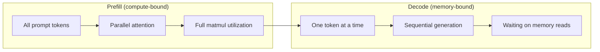
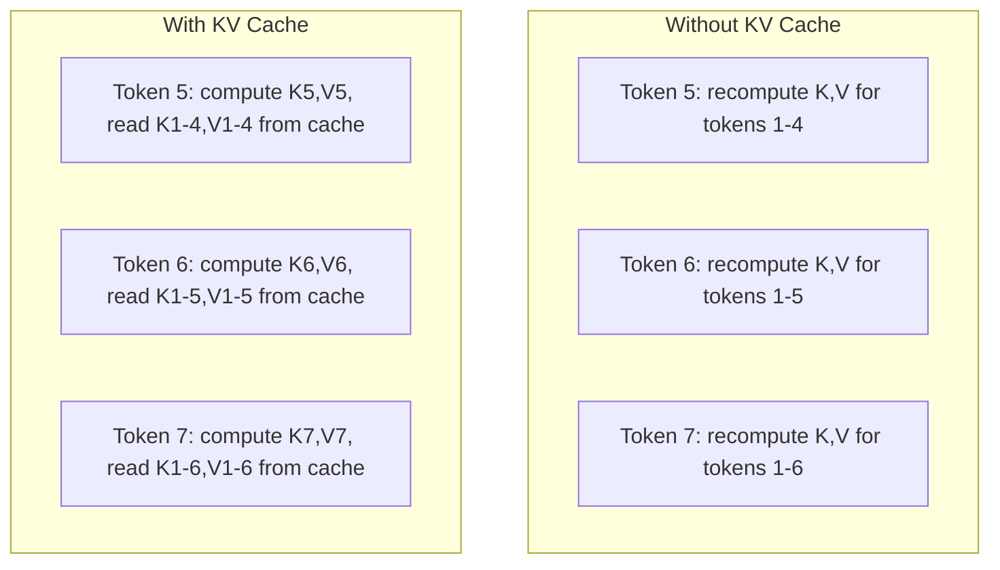
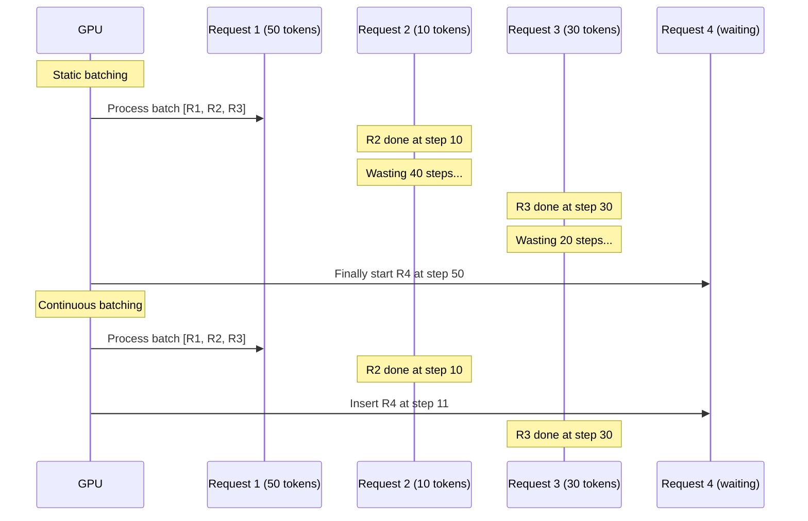
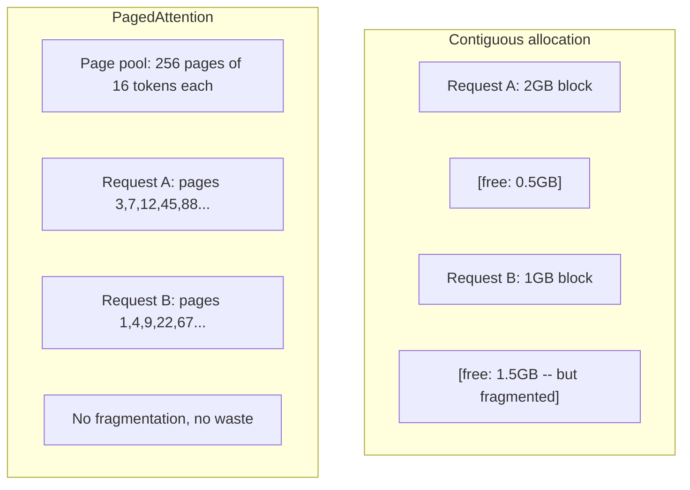
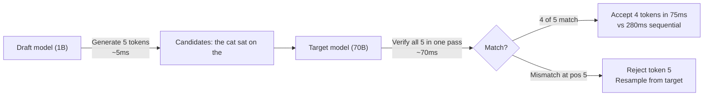

# Inference Optimization

> Hai giai đoạn định nghĩa suy luận LLM. Prefill xử lý prompt song song -- bị giới hạn tính toán. Decode sinh từng token một -- bị giới hạn bộ nhớ. Mọi tối ưu nhắm một hoặc cả hai.

**Type:** Build
**Languages:** Python
**Prerequisites:** Phase 10, Lessons 01-08 (Transformer architecture, attention)
**Time:** ~120 minutes

## Learning Objectives

- Triển khai KV-cache để loại tính toán dư thừa khi sinh token tự hồi quy
- Giải thích các giai đoạn prefill và decode của suy luận LLM và vì sao mỗi giai đoạn có nút thắt khác (giới hạn tính toán so với bộ nhớ)
- Triển khai khái niệm continuous batching và PagedAttention để tối đa mức sử dụng GPU dưới yêu cầu đồng thời
- So sánh kỹ thuật tối ưu suy luận (KV-cache, speculative decoding, flash attention) và đánh đổi thông lượng/độ trễ

## The Problem

Bạn triển khai Llama 3 70B trên GPU 4xA100. Một người dùng nhận ~50 token mỗi giây. Cảm thấy nhanh. Rồi 100 người dùng đồng thời truy cập endpoint. Thông lượng giảm còn 3 token/giây/người. Hóa đơn GPU $25,000/tháng đang phục vụ phản hồi chậm hơn con người gõ.

Bản thân mô hình không đổi giữa 1 và 100 người dùng. Cùng trọng số, kiến trúc, toán học. Thứ thay đổi là cách lập lịch công việc. Suy luận đơn giản lãng phí 90%+ tính toán GPU sẵn có. Người dùng đợi token 47 giữ cả một chỗ batch trong khi bus bộ nhớ GPU nhàn rỗi giữa các phép nhân ma trận. Trong khi đó, prompt 2,000 token của người dùng mới có thể lấp thời gian chết bằng tính toán hữu ích.

Đây không phải bài toán mở rộng quy mô. Nó là bài toán lập lịch. Các kỹ thuật trong bài này -- KV caching, continuous batching, PagedAttention, speculative decoding, prefix caching -- là thứ phân biệt hóa đơn suy luận $25k/tháng với $5k/tháng phục vụ cùng lưu lượng.

vLLM phục vụ Llama 3 70B trên 4xA100-80GB đạt ~50 token/giây/người ở mức đồng thời thấp, và duy trì 15-25 TPS/người ở 100 yêu cầu đồng thời qua continuous batching và PagedAttention. Không có tối ưu này, cùng phần cứng phục vụ 5 TPS/người ở mức đồng thời đó. Cùng GPU, mô hình, thông lượng 4x.

## The Concept

### Prefill vs Decode

Mỗi yêu cầu suy luận LLM có hai giai đoạn riêng.

**Prefill** xử lý toàn bộ prompt đầu vào. Mọi token đã biết, nên attention có thể tính song song trên toàn chuỗi. Đây là phép nhân ma trận lớn -- lõi GPU luôn bận. Nút thắt là tính toán: phần cứng cung cấp bao nhiêu FLOPS mỗi giây. A100 làm 312 TFLOPS (BF16). Prefill cho prompt 4,096 token trên mô hình 70B mất ~400ms trên một A100.

**Decode** sinh từng token đầu ra. Mỗi token mới chú ý mọi token trước, nhưng chỉ một token được tạo mỗi lượt truyền xuôi. Ma trận trọng số cùng kích thước như khi prefill, nhưng bạn nhân với một vector thay vì ma trận. Lõi GPU xong trong micro giây, rồi đợi batch trọng số tiếp đến từ bộ nhớ. Nút thắt là băng thông bộ nhớ: có thể stream trọng số mô hình từ HBM đến đơn vị tính nhanh đến đâu. A100 có băng thông 2 TB/s. Mô hình 70B ở FP16 là 140 GB. Đọc toàn mô hình một lần mất 70ms -- đó là mức sàn cho một bước decode.



**Tỷ lệ ops:byte** (cũng gọi cường độ số học) nắm đánh đổi này. Nó đo bao nhiêu phép toán bạn thực hiện mỗi byte tải từ bộ nhớ.

```
ops:byte ratio = FLOPs per token / bytes read from memory
```

Khi prefill với batch 4,096 token, bạn thực hiện ~4,096 phép nhân-tích lũy mỗi trọng số được tải. Tỷ lệ cao -- bị giới hạn tính toán. Khi decode với batch 1, bạn thực hiện ~1 phép toán mỗi trọng số được tải. Tỷ lệ thấp -- bị giới hạn bộ nhớ.

Nhận thức nền tảng: *decode bị giới hạn bộ nhớ vì bạn đọc toàn mô hình để tạo một token*. Mọi tối ưu dưới đây hoặc giảm thứ bạn đọc, tăng batch token xử lý mỗi lần đọc, hoặc tránh đọc hoàn toàn.

### KV Cache

Trong attention, query mỗi token chú ý vector key và value của mọi token trước. Không cache, sinh token N cần tính lại phép chiếu key và value cho cả N-1 token trước. Token 1 được chiếu khi sinh token 2, rồi lại cho token 3, rồi token 4. Đến token 1,000, bạn đã chiếu token 1 tổng cộng 999 lần.

KV cache lưu các phép chiếu key và value từ mọi token trước. Khi sinh token N, bạn chỉ tính key và value cho token N, rồi nối với K/V đã cache từ token 1 đến N-1.



**Công thức bộ nhớ cho KV cache:**

```
KV cache size = 2 * num_layers * num_kv_heads * head_dim * seq_len * bytes_per_param
```

Với Llama 3 70B (80 lớp, 8 head KV với GQA, head_dim=128, BF16):

```
per token: 2 * 80 * 8 * 128 * 2 bytes = 327,680 bytes = 320 KB
at 4,096 tokens: 320 KB * 4,096 = 1.28 GB
at 128K tokens: 320 KB * 131,072 = 40 GB
```

Một hội thoại ngữ cảnh 128K cho Llama 3 70B tiêu thụ 40 GB KV cache -- nửa bộ nhớ A100. Với 100 người dùng đồng thời ở 4K token mỗi người, riêng KV cache cần 128 GB. Đây là lý do quản lý KV cache là thách thức trung tâm của tối ưu suy luận.

### Continuous Batching

Gom batch tĩnh đợi batch N yêu cầu đến, xử lý cùng nhau, rồi đợi *tất cả* xong trước khi nhận yêu cầu mới. Nếu một yêu cầu cần 500 token và một yêu cầu cần 10, yêu cầu ngắn nằm nhàn rỗi 490 bước decode sau khi xong.

Continuous batching (cũng gọi gom batch cấp lần lặp) chèn yêu cầu mới vào batch ngay khi bất kỳ yêu cầu nào xong. Batch được đánh giá lại mỗi bước decode. Yêu cầu xong sau 10 token lập tức được thay bằng yêu cầu đang đợi.



Cải thiện thông lượng phụ thuộc mức biến thiên độ dài đầu ra. Với độ dài đồng nhất, continuous batching ngang gom batch tĩnh. Với độ dài biến đổi (trường hợp phổ biến), continuous batching có thể cho thông lượng cao hơn 2-5x vì chỗ GPU không bao giờ trống.

### PagedAttention

KV cache cho mỗi yêu cầu là khối bộ nhớ liên tục. Khi yêu cầu đến và đi, bộ nhớ phân mảnh -- hệt phân mảnh RAM trong hệ điều hành. Yêu cầu 4K token cần 1.28 GB liên tục. Dù tổng có 2 GB trống, có thể không có 1.28 GB *liên tục*. Bạn hoặc lãng phí bộ nhớ hoặc từ chối yêu cầu.

PagedAttention (từ vLLM) áp dụng bộ nhớ ảo kiểu hệ điều hành cho KV cache. Thay vì cấp một khối liên tục mỗi yêu cầu, nó cấp các "trang" kích thước cố định (thường 16 token mỗi trang). Trang có thể ở bất kỳ đâu trong bộ nhớ GPU vật lý. Bảng trang ánh xạ vị trí chuỗi logic mỗi yêu cầu sang vị trí trang vật lý.



PagedAttention cũng cho phép **copy-on-write** cho tiền tố chung. Nếu 50 yêu cầu chung system prompt, các trang KV cache cho prompt đó được lưu một lần và được cả 50 yêu cầu tham chiếu. Chỉ khi yêu cầu phân nhánh (tin nhắn người dùng khác) nó mới có trang riêng. Điều này giảm mạnh bộ nhớ cho ứng dụng có system prompt chung.

vLLM báo cáo lãng phí bộ nhớ gần không (~4% so với ~60-80% trong cấp phát đơn giản) qua PagedAttention.

### Speculative Decoding

Decode chậm vì tuần tự -- bạn sinh token, đưa trở lại, sinh token kế. Nhưng nếu có thể đoán rẻ 5 token tiếp theo, rồi xác minh tất cả cùng lúc?

Speculative decoding dùng **mô hình nháp** nhỏ, nhanh để sinh K token ứng viên. **Mô hình đích** lớn sau đó xử lý cả K ứng viên trong một lượt truyền xuôi (trông như prefill -- song song, giới hạn tính toán, hiệu quả). Nếu mô hình đích đồng ý dự đoán nháp, bạn nhận cả K token trong thời gian một lượt truyền xuôi đích. Nếu bất đồng ở vị trí j, bạn nhận token 1 đến j-1 và bỏ phần còn lại.



Tăng tốc phụ thuộc **tỷ lệ chấp nhận** -- tần suất dự đoán nháp khớp đích. Với Llama 3 8B làm nháp cho Llama 3 70B, tỷ lệ 70-85% điển hình trên ngôn ngữ tự nhiên. Điều này chuyển thành tăng tốc decode 2-3x.

Ba cách speculative decoding:

| Phương pháp | Nguồn nháp | Tỷ lệ chấp nhận | Chi phí thêm |
|--------|-------------|-----------------|----------|
| Nháp-đích (Leviathan và cộng sự) | Mô hình nhỏ riêng | 70-85% | Bộ nhớ mô hình nháp |
| EAGLE (Li và cộng sự) | Head nhẹ trên đích | 75-90% | ~1% tham số thêm |
| Tra cứu N-gram | Bảng n-gram token | 40-60% | Không đáng kể |

**EAGLE** huấn luyện một head tự hồi quy nhỏ trên trạng thái ẩn mô hình đích. Nó dự đoán embedding token tiếp theo bằng đặc trưng lớp áp chót của đích. Vì hoạt động trên biểu diễn của chính đích (không phải mô hình riêng), nó đạt tỷ lệ chấp nhận cao hơn với bộ nhớ thêm tối thiểu. EAGLE-2 thêm cây nháp động điều chỉnh số ứng viên dựa ngữ cảnh.

**Speculative decoding N-gram** duy trì bảng phần tiếp nối n-gram từ ngữ cảnh hiện tại hoặc corpus dựng trước. Nếu nháp khớp thứ đã xuất hiện trong cùng hội thoại (mẫu lặp, mã, đầu ra có cấu trúc), nó hoạt động không tốn mạng nơ-ron. Tỷ lệ chấp nhận trung bình thấp hơn nhưng chi phí mỗi lần suy đoán về cơ bản miễn phí.

Speculative decoding *chính xác về toán học* -- phân phối đầu ra giống hệt phân phối mô hình đích. Nó không phải xấp xỉ. Bước xác minh bảo đảm mỗi token được nhận có chính xác xác suất mô hình đích sẽ gán.

### Prefix Caching

Nhiều yêu cầu chung tiền tố. System prompt chatbot. Khối ngữ cảnh RAG. Tập ví dụ few-shot. Không prefix caching, mỗi yêu cầu tính lại KV cache cho các token chung từ đầu.

Prefix caching lưu KV cache cho tiền tố phổ biến và tái sử dụng xuyên yêu cầu. Khi yêu cầu mới đến với tiền tố đã biết, hệ thống sao chép (hoặc tham chiếu) các mục KV đã cache và chỉ tính KV cho hậu tố riêng.

Với system prompt 2,000 token chung mọi yêu cầu, prefix caching loại ~400ms prefill mỗi yêu cầu. Ở 100 yêu cầu/giây, tiết kiệm 40 giây tính toán GPU mỗi giây -- hơn lượng công việc của một GPU.

RadixAttention của SGLang triển khai prefix caching bằng cây radix (trie) lập chỉ mục tiền tố theo nội dung token. Yêu cầu khớp tiền tố đã lưu có KV cache miễn phí. Cây cho phép khớp tiền tố một phần -- nếu chung 1,500 trong 2,000 token tiền tố với mục đã cache, bạn dùng lại 1,500 và chỉ tính lại 500.

### Inference Engines

Ba engine chi phối phục vụ LLM production:

| Engine | Đổi mới chính | Tốt nhất cho |
|--------|---------------|----------|
| vLLM | PagedAttention, continuous batching | Phục vụ tổng quát, tương thích cao nhất |
| SGLang | RadixAttention (prefix caching), sinh có cấu trúc | Chatbot nhiều lượt, giải mã có ràng buộc |
| TensorRT-LLM | Hợp nhất kernel NVIDIA, lượng tử hóa FP8 | Thông lượng một GPU tối đa trên phần cứng NVIDIA |

**vLLM** là điểm khởi đầu mặc định. Nó hỗ trợ phạm vi mô hình rộng nhất, chạy trên GPU bất kỳ nhà cung cấp nào (NVIDIA, AMD, Intel), và đạt thông lượng mạnh qua PagedAttention + continuous batching. API tương thích OpenAI nghĩa là có thể thay trực tiếp bất kỳ lệnh gọi API OpenAI nào.

**SGLang** xây trên cùng nền tảng vLLM nhưng thêm RadixAttention cho prefix caching và ngôn ngữ riêng miền cho chương trình LLM có cấu trúc. Nếu khối lượng công việc gồm hội thoại nhiều lượt, dùng công cụ hoặc giải mã có ràng buộc (đầu ra JSON, sinh theo regex), SGLang thường vượt vLLM 2-5x nhờ tái sử dụng tiền tố.

**TensorRT-LLM** biên dịch mô hình thành kernel GPU NVIDIA tối ưu. Nó hợp nhất phép toán (attention + tuyến tính + activation trong một kernel), dùng FP8 trên H100 và tích hợp NVIDIA Triton Inference Server cho triển khai production. Nó đạt thông lượng một GPU cao nhất trên phần cứng NVIDIA nhưng cần thiết lập nhiều hơn và chỉ hoạt động trên GPU NVIDIA.

Các con số thực tế cho Llama 3 70B (4xA100-80GB, BF16):

| Thước đo | vLLM | SGLang | TensorRT-LLM |
|--------|------|--------|---------------|
| Thông lượng (1 người dùng) | ~50 TPS | ~55 TPS | ~65 TPS |
| Thông lượng (100 người dùng) | tổng ~2,500 TPS | tổng ~3,200 TPS | tổng ~3,000 TPS |
| Thời gian đến token đầu | ~400ms | ~300ms (trúng tiền tố) | ~350ms |
| Ngữ cảnh tối đa | 128K | 128K | 128K |

### The Ops:Byte Framework

Bạn không thể tối ưu thứ không đo. Tỷ lệ ops:byte cho biết bị giới hạn tính toán hay bộ nhớ, quyết định tối ưu nào quan trọng.

```
Compute roof: peak FLOPS of the GPU
Memory roof:  peak bandwidth * ops:byte ratio
```

Khi ops:byte thấp (decode, batch nhỏ), bạn chạm trần băng thông bộ nhớ. Thêm tính toán (xung cao, nhiều lõi) không giúp. Bạn cần giảm đọc bộ nhớ (lượng tử hóa, nén KV cache) hoặc tăng batch để phân bổ lần đọc trên nhiều công việc hữu ích hơn.

Khi ops:byte cao (prefill, batch lớn), bạn chạm trần tính toán. Tối ưu băng thông bộ nhớ không giúp. Bạn cần GPU nhanh hơn, hợp nhất kernel hoặc độ chính xác giảm để lấy thêm FLOPS.

| Kịch bản | ops:byte | Giới hạn | Tối ưu bằng |
|----------|----------|-------|---------------|
| Prefill, batch=1 | ~4,096 | Tính toán | Hợp nhất kernel, FP8 |
| Decode, batch=1 | ~1 | Bộ nhớ | Lượng tử hóa, nén KV |
| Decode, batch=32 | ~32 | Bộ nhớ | Batch lớn hơn, continuous batching |
| Decode, batch=256 | ~256 | Đang chuyển tiếp | Cả hai quan trọng |
| Decode, batch=1024 | ~1,024 | Tính toán | Hợp nhất kernel, song song tensor |

Điểm giao trên A100 khoảng ops:byte = 156 (312 TFLOPS / 2 TB/s). Dưới 156, bị giới hạn bộ nhớ. Trên 156, bị giới hạn tính toán. Continuous batching đẩy decode về điểm giao bằng đóng gói nhiều token hơn mỗi lần lặp.

```figure
context-window-slide
```

## Build It

### Step 1: KV Cache from Scratch

Chúng ta xây KV cache đa head lưu các phép chiếu key và value theo lớp, theo head, và minh họa mô thức tăng bộ nhớ.

```python
import numpy as np

class KVCache:
    def __init__(self, num_layers, num_heads, head_dim, max_seq_len, dtype=np.float16):
        self.num_layers = num_layers
        self.num_heads = num_heads
        self.head_dim = head_dim
        self.max_seq_len = max_seq_len
        self.dtype = dtype

        self.k_cache = np.zeros(
            (num_layers, num_heads, max_seq_len, head_dim), dtype=dtype
        )
        self.v_cache = np.zeros(
            (num_layers, num_heads, max_seq_len, head_dim), dtype=dtype
        )
        self.seq_len = 0

    def update(self, layer_idx, new_keys, new_values):
        num_new = new_keys.shape[1]
        end = self.seq_len + num_new
        self.k_cache[layer_idx, :, self.seq_len:end, :] = new_keys
        self.v_cache[layer_idx, :, self.seq_len:end, :] = new_values
        return (
            self.k_cache[layer_idx, :, :end, :],
            self.v_cache[layer_idx, :, :end, :]
        )

    def advance(self, num_tokens):
        self.seq_len += num_tokens

    def memory_bytes(self):
        return self.k_cache.nbytes + self.v_cache.nbytes

    def used_bytes(self):
        per_token = 2 * self.num_layers * self.num_heads * self.head_dim * np.dtype(self.dtype).itemsize
        return per_token * self.seq_len
```

### Step 2: Attention with KV Cache

Attention đa head đơn giản hóa dùng KV cache cho bước decode.

```python
def scaled_dot_product_attention(query, keys, values):
    head_dim = query.shape[-1]
    scores = np.matmul(query, keys.transpose(0, 1, 3, 2)) / np.sqrt(head_dim)
    seq_len_q = scores.shape[-2]
    seq_len_k = scores.shape[-1]
    if seq_len_q > 1:
        mask = np.triu(np.ones((seq_len_q, seq_len_k), dtype=np.float32), k=seq_len_k - seq_len_q + 1)
        scores = scores + mask * (-1e9)
    max_scores = np.max(scores, axis=-1, keepdims=True)
    exp_scores = np.exp(scores - max_scores)
    attn_weights = exp_scores / np.sum(exp_scores, axis=-1, keepdims=True)
    return np.matmul(attn_weights, values)


class MultiHeadAttention:
    def __init__(self, d_model, num_heads):
        self.num_heads = num_heads
        self.head_dim = d_model // num_heads
        scale = np.sqrt(2.0 / d_model)
        self.W_q = np.random.randn(d_model, d_model).astype(np.float32) * scale
        self.W_k = np.random.randn(d_model, d_model).astype(np.float32) * scale
        self.W_v = np.random.randn(d_model, d_model).astype(np.float32) * scale
        self.W_o = np.random.randn(d_model, d_model).astype(np.float32) * scale

    def forward(self, x, kv_cache=None, layer_idx=0):
        batch, seq_len, d_model = x.shape
        Q = np.matmul(x, self.W_q).reshape(batch, seq_len, self.num_heads, self.head_dim).transpose(0, 2, 1, 3)
        K = np.matmul(x, self.W_k).reshape(batch, seq_len, self.num_heads, self.head_dim).transpose(0, 2, 1, 3)
        V = np.matmul(x, self.W_v).reshape(batch, seq_len, self.num_heads, self.head_dim).transpose(0, 2, 1, 3)

        if kv_cache is not None:
            K_full, V_full = kv_cache.update(layer_idx, K[0], V[0])
            K = K_full[np.newaxis, :, :, :]
            V = V_full[np.newaxis, :, :, :]
            if seq_len == 1:
                kv_cache.advance(1)

        attn_out = scaled_dot_product_attention(Q, K, V)
        attn_out = attn_out.transpose(0, 2, 1, 3).reshape(batch, -1, d_model)
        return np.matmul(attn_out, self.W_o)
```

### Step 3: Continuous Batching Simulator

Điều này mô phỏng khác biệt lập lịch giữa gom batch tĩnh và liên tục.

```python
import heapq

class Request:
    def __init__(self, request_id, prompt_tokens, output_tokens, arrival_step):
        self.request_id = request_id
        self.prompt_tokens = prompt_tokens
        self.output_tokens = output_tokens
        self.arrival_step = arrival_step
        self.tokens_generated = 0
        self.start_step = None
        self.end_step = None

    def is_done(self):
        return self.tokens_generated >= self.output_tokens


def simulate_static_batching(requests, batch_size):
    step = 0
    completed = []
    queue = list(requests)
    queue.sort(key=lambda r: r.arrival_step)

    while queue:
        batch = []
        while queue and len(batch) < batch_size:
            r = queue.pop(0)
            r.start_step = max(step, r.arrival_step)
            batch.append(r)

        if batch:
            step = max(step, max(r.start_step for r in batch))
            max_output = max(r.output_tokens for r in batch)
            for r in batch:
                r.tokens_generated = r.output_tokens
                r.end_step = step + max_output
            step += max_output
            completed.extend(batch)

    return completed


def simulate_continuous_batching(requests, batch_size):
    step = 0
    completed = []
    queue = sorted(requests, key=lambda r: r.arrival_step)
    queue_idx = 0
    active = []
    waiting = []

    while queue_idx < len(queue) or active or waiting:
        while queue_idx < len(queue) and queue[queue_idx].arrival_step <= step:
            waiting.append(queue[queue_idx])
            queue_idx += 1

        while waiting and len(active) < batch_size:
            r = waiting.pop(0)
            r.start_step = step
            active.append(r)

        if not active:
            if waiting:
                step += 1
                continue
            elif queue_idx < len(queue):
                step = queue[queue_idx].arrival_step
                continue
            else:
                break

        for r in active:
            r.tokens_generated += 1

        done = [r for r in active if r.is_done()]
        for r in done:
            r.end_step = step + 1
            completed.append(r)
        active = [r for r in active if not r.is_done()]

        step += 1

    return completed


def batching_stats(completed):
    latencies = [r.end_step - r.arrival_step for r in completed]
    total_time = max(r.end_step for r in completed) - min(r.arrival_step for r in completed)
    total_tokens = sum(r.output_tokens for r in completed)
    return {
        "avg_latency": np.mean(latencies),
        "p50_latency": np.median(latencies),
        "p99_latency": np.percentile(latencies, 99),
        "total_time": total_time,
        "throughput": total_tokens / total_time if total_time > 0 else 0,
    }
```

### Step 4: Prefix Cache

Cache tiền tố dựa trên trie lưu mục KV cho tiền tố chung.

```python
class TrieNode:
    def __init__(self):
        self.children = {}
        self.kv_data = None
        self.hit_count = 0


class PrefixCache:
    def __init__(self, max_entries=1000):
        self.root = TrieNode()
        self.max_entries = max_entries
        self.total_entries = 0
        self.hits = 0
        self.misses = 0

    def _walk(self, token_ids):
        node = self.root
        depth = 0
        for tid in token_ids:
            if tid not in node.children:
                break
            node = node.children[tid]
            depth += 1
        return node, depth

    def lookup(self, token_ids):
        node, depth = self._walk(token_ids)
        if depth > 0:
            self.hits += 1
            current = self.root
            for tid in token_ids[:depth]:
                current = current.children[tid]
                current.hit_count += 1
            kv_entries = []
            current = self.root
            for tid in token_ids[:depth]:
                current = current.children[tid]
                if current.kv_data is not None:
                    kv_entries.append(current.kv_data)
            return depth, kv_entries
        self.misses += 1
        return 0, []

    def insert(self, token_ids, kv_per_token):
        node = self.root
        for i, tid in enumerate(token_ids):
            if tid not in node.children:
                if self.total_entries >= self.max_entries:
                    return i
                node.children[tid] = TrieNode()
                self.total_entries += 1
            node = node.children[tid]
            if i < len(kv_per_token):
                node.kv_data = kv_per_token[i]
        return len(token_ids)

    def hit_rate(self):
        total = self.hits + self.misses
        return self.hits / total if total > 0 else 0.0
```

### Step 5: Speculative Decoding Simulator

Chúng ta mô phỏng speculative decoding nháp-đích với tỷ lệ chấp nhận cấu hình được.

```python
class DraftModel:
    def __init__(self, vocab_size, acceptance_rate=0.8):
        self.vocab_size = vocab_size
        self.acceptance_rate = acceptance_rate

    def generate(self, context, num_tokens):
        tokens = np.random.randint(0, self.vocab_size, size=num_tokens)
        return tokens

    def get_probs(self, context, token):
        probs = np.random.dirichlet(np.ones(self.vocab_size))
        return probs


class TargetModel:
    def __init__(self, vocab_size):
        self.vocab_size = vocab_size

    def get_probs(self, context, tokens=None):
        if tokens is not None:
            return [np.random.dirichlet(np.ones(self.vocab_size)) for _ in tokens]
        return np.random.dirichlet(np.ones(self.vocab_size))


def speculative_decode(draft_model, target_model, context, num_speculative=5,
                       draft_cost=1.0, target_cost=10.0, verify_cost=12.0):
    total_tokens = 0
    total_cost = 0.0
    accepted_counts = []
    context = list(context)

    max_tokens = 100

    while total_tokens < max_tokens:
        draft_tokens = draft_model.generate(context, num_speculative)
        total_cost += draft_cost * num_speculative

        target_probs = target_model.get_probs(context, draft_tokens)
        total_cost += verify_cost

        accepted = 0
        for i, token in enumerate(draft_tokens):
            draft_p = draft_model.get_probs(context + list(draft_tokens[:i]), token)
            target_p = target_probs[i]

            r = np.random.random()
            acceptance_prob = min(1.0, target_p[token] / (draft_p[token] + 1e-10))

            if r < draft_model.acceptance_rate:
                accepted += 1
                context.append(token)
                total_tokens += 1
            else:
                new_token = np.random.choice(draft_model.vocab_size, p=target_p)
                context.append(new_token)
                total_tokens += 1
                break

        accepted_counts.append(accepted)

        if accepted == num_speculative:
            bonus_probs = target_model.get_probs(context)
            bonus_token = np.random.choice(draft_model.vocab_size, p=bonus_probs)
            context.append(bonus_token)
            total_tokens += 1

    sequential_cost = total_tokens * target_cost
    return {
        "total_tokens": total_tokens,
        "speculative_cost": total_cost,
        "sequential_cost": sequential_cost,
        "speedup": sequential_cost / total_cost if total_cost > 0 else 1.0,
        "avg_accepted": np.mean(accepted_counts),
        "acceptance_rate": np.mean(accepted_counts) / num_speculative,
    }


def compare_speculation_strategies(vocab_size=1000, num_trials=20):
    results = {}

    for name, acceptance_rate, spec_tokens in [
        ("Draft-target (8B->70B)", 0.78, 5),
        ("EAGLE", 0.85, 6),
        ("N-gram", 0.50, 4),
        ("No speculation", 0.0, 0),
    ]:
        if spec_tokens == 0:
            results[name] = {
                "speedup": 1.0,
                "acceptance_rate": 0.0,
                "avg_accepted": 0.0,
            }
            continue

        trial_results = []
        for _ in range(num_trials):
            draft = DraftModel(vocab_size, acceptance_rate=acceptance_rate)
            target = TargetModel(vocab_size)
            context = list(np.random.randint(0, vocab_size, size=10))
            result = speculative_decode(draft, target, context, num_speculative=spec_tokens)
            trial_results.append(result)

        results[name] = {
            "speedup": np.mean([r["speedup"] for r in trial_results]),
            "acceptance_rate": np.mean([r["acceptance_rate"] for r in trial_results]),
            "avg_accepted": np.mean([r["avg_accepted"] for r in trial_results]),
        }

    return results
```

### Step 6: KV Cache Memory Profiler

Tính yêu cầu bộ nhớ KV cache cho cấu hình mô hình thực.

```python
MODEL_CONFIGS = {
    "Llama-3-8B": {
        "num_layers": 32, "num_kv_heads": 8, "head_dim": 128,
        "model_params_b": 8, "gqa": True,
    },
    "Llama-3-70B": {
        "num_layers": 80, "num_kv_heads": 8, "head_dim": 128,
        "model_params_b": 70, "gqa": True,
    },
    "Llama-3-405B": {
        "num_layers": 126, "num_kv_heads": 8, "head_dim": 128,
        "model_params_b": 405, "gqa": True,
    },
    "Mistral-7B": {
        "num_layers": 32, "num_kv_heads": 8, "head_dim": 128,
        "model_params_b": 7, "gqa": True,
    },
    "GPT-4-est": {
        "num_layers": 120, "num_kv_heads": 96, "head_dim": 128,
        "model_params_b": 1800, "gqa": False,
    },
}


def kv_cache_memory(config, seq_len, dtype_bytes=2):
    per_token = 2 * config["num_layers"] * config["num_kv_heads"] * config["head_dim"] * dtype_bytes
    total = per_token * seq_len
    return {
        "per_token_bytes": per_token,
        "per_token_kb": per_token / 1024,
        "total_bytes": total,
        "total_mb": total / (1024 ** 2),
        "total_gb": total / (1024 ** 3),
    }


def memory_budget(config, gpu_memory_gb, model_dtype_bytes=2, kv_dtype_bytes=2):
    model_memory_gb = config["model_params_b"] * 1e9 * model_dtype_bytes / (1024 ** 3)
    overhead_gb = gpu_memory_gb * 0.1
    available_for_kv = gpu_memory_gb - model_memory_gb - overhead_gb

    if available_for_kv <= 0:
        return {"error": "Model does not fit in GPU memory", "model_memory_gb": model_memory_gb}

    per_token = 2 * config["num_layers"] * config["num_kv_heads"] * config["head_dim"] * kv_dtype_bytes
    max_tokens = int(available_for_kv * (1024 ** 3) / per_token)

    return {
        "gpu_memory_gb": gpu_memory_gb,
        "model_memory_gb": round(model_memory_gb, 1),
        "overhead_gb": round(overhead_gb, 1),
        "available_for_kv_gb": round(available_for_kv, 1),
        "max_total_tokens": max_tokens,
        "max_users_at_2k": max_tokens // 2048,
        "max_users_at_4k": max_tokens // 4096,
        "max_users_at_32k": max_tokens // 32768,
    }
```

## Use It

Với vLLM:

```python
from vllm import LLM, SamplingParams

llm = LLM(
    model="meta-llama/Meta-Llama-3-70B-Instruct",
    tensor_parallel_size=4,
    enable_prefix_caching=True,
    max_model_len=8192,
    gpu_memory_utilization=0.9,
)

params = SamplingParams(temperature=0.7, max_tokens=256)
outputs = llm.generate(["Explain inference optimization in one paragraph."], params)
```

Với SGLang cho prefix caching + đầu ra có cấu trúc:

```python
import sglang as sgl

@sgl.function
def classify(s, text):
    s += sgl.system("You are a classifier. Output JSON only.")
    s += sgl.user(f"Classify this text: {text}")
    s += sgl.assistant(sgl.gen("result", regex=r'\{"label": "(positive|negative|neutral)"\}'))

runtime = sgl.Runtime(model_path="meta-llama/Meta-Llama-3-70B-Instruct", tp_size=4)
sgl.set_default_backend(runtime)

results = classify.run_batch([
    {"text": "This product is amazing!"},
    {"text": "Terrible experience."},
    {"text": "It was okay I guess."},
])
```

Với TensorRT-LLM:

```python
import tensorrt_llm
from tensorrt_llm.runtime import ModelRunner

runner = ModelRunner.from_dir("./llama-70b-trt-engine/", rank=0)

outputs = runner.generate(
    batch_input_ids=[tokenizer.encode("Explain KV caching.")],
    max_new_tokens=256,
    temperature=0.7,
)
```

## Ship It

Bài học này tạo ra:
- `outputs/skill-inference-optimization.md` -- một skill chẩn đoán và tối ưu phục vụ suy luận LLM

## Exercises

1. Sửa bộ profile KV cache để so lượng tử hóa KV cache FP16 với FP8 với INT4. Với Llama 3 70B ở ngữ cảnh 4K, tính người dùng đồng thời tối đa cho mỗi cách trên 4xA100-80GB. Lượng tử hóa KV sang INT4 nên tăng sức chứa người dùng khoảng 4x.

2. Mở rộng bộ mô phỏng continuous batching để theo dõi mức sử dụng GPU (tỷ lệ chỗ batch được lấp mỗi bước). Vẽ mức sử dụng theo thời gian cho gom batch tĩnh và liên tục với 50 yêu cầu có độ dài đầu ra theo phân phối Pareto (shape=1.5, scale=20). Continuous batching nên duy trì >80% sử dụng.

3. Triển khai phiên bản grouped-query attention (GQA) của KV cache mà `num_kv_heads < num_query_heads`. Llama 3 70B dùng 64 head query nhưng chỉ 8 head KV. Tính tiết kiệm bộ nhớ so với attention đa head đầy đủ (giảm kích thước KV cache 8x).

4. Xây cache tiền tố dùng loại bỏ LRU. Đặt max_entries bằng 500 và sinh 1,000 yêu cầu mà 60% chung một trong 5 tiền tố phổ biến. Đo tỷ lệ trúng và so với cache không giới hạn. Với loại bỏ tốt, tỷ lệ trúng nên giữ trên 55%.

5. Mở rộng bộ mô phỏng speculative decoding để triển khai suy đoán theo cây (kiểu EAGLE-2). Thay vì một chuỗi K token nháp, sinh cây ứng viên (ví dụ 2 nhánh mỗi mức trong 3 mức = 8 lá ứng viên). So tổng token được nhận mỗi vòng xác minh với suy đoán tuyến tính.

## Key Terms

| Thuật ngữ | Cách mọi người nói | Ý nghĩa thực sự |
|------|----------------|----------------------|
| Prefill | "Xử lý prompt" | Tính attention trên mọi token đầu vào song song -- giới hạn tính toán vì phép nhân ma trận đầy đủ giữ lõi GPU bận |
| Decode (Giải mã) | "Sinh token" | Tạo một token mỗi lượt truyền xuôi, đọc toàn trọng số mỗi lần -- giới hạn bộ nhớ vì tính toán xong trước khi trọng số tiếp đến |
| KV cache | "Cache trạng thái attention" | Lưu phép chiếu key và value mọi token trước để không tính lại mỗi bước decode -- đổi bộ nhớ lấy tính toán |
| Continuous batching (Gom batch liên tục) | "Gom batch động" | Chèn yêu cầu mới vào batch đang chạy ngay khi bất kỳ yêu cầu nào xong, đánh giá mỗi lần lặp decode thay vì đợi cả batch |
| PagedAttention | "Bộ nhớ ảo cho KV cache" | Cấp KV cache theo trang cố định thay khối liên tục, loại phân mảnh và cho copy-on-write với tiền tố chung |
| Speculative decoding (Giải mã suy đoán) | "Nháp và xác minh" | Dùng mô hình nháp nhanh đề xuất nhiều token, rồi xác minh tất cả trong một lượt truyền xuôi đích -- chính xác toán học, tăng tốc 2-3x |
| EAGLE | "Giải mã tự suy đoán" | Biến thể speculative decoding huấn luyện head nhẹ trên trạng thái ẩn của đích, đạt tỷ lệ chấp nhận cao hơn mô hình nháp riêng |
| Prefix caching (Cache tiền tố) | "Dùng lại KV system prompt" | Lưu mục KV cache đã tính cho tiền tố phổ biến (system prompt, ví dụ few-shot) và dùng lại xuyên yêu cầu để bỏ prefill dư |
| Ops:byte ratio (Tỷ lệ ops:byte) | "Cường độ số học" | Tỷ lệ phép toán tính toán trên byte bộ nhớ được đọc -- quyết định công việc giới hạn tính toán (cao) hay bộ nhớ (thấp) |
| Time to first token (Thời gian đến token đầu) | "TTFT" | Độ trễ từ nhận yêu cầu đến tạo token đầu ra đầu tiên -- bị thời gian prefill chi phối với prompt dài |

## Further Reading

- Kwon et al., "Efficient Memory Management for Large Language Model Serving with PagedAttention" (2023) -- bài báo vLLM giới thiệu quản lý KV cache phân trang, nay là tiêu chuẩn ngành phục vụ suy luận
- Leviathan et al., "Fast Inference from Transformers via Speculative Decoding" (2023) -- bài báo nền tảng chứng minh suy đoán nháp-xác minh tạo đúng phân phối đích trong khi tăng tốc 2-3x
- Li et al., "EAGLE: Speculative Sampling Requires Rethinking Feature Uncertainty" (2024) -- đạt tỷ lệ chấp nhận cao hơn bằng huấn luyện head trên đặc trưng của chính đích thay vì mô hình nháp riêng
- Zheng et al., "SGLang: Efficient Execution of Structured Language Model Programs" (2024) -- giới thiệu RadixAttention cho prefix caching và mô hình lập trình cho chương trình LLM nhiều lệnh gọi
- Williams et al., "Roofline: An Insightful Visual Performance Model for Multicore Architectures" (2009) -- bài báo roofline gốc hình thức hóa khung ops:byte để suy luận về nút thắt tính toán so với bộ nhớ
