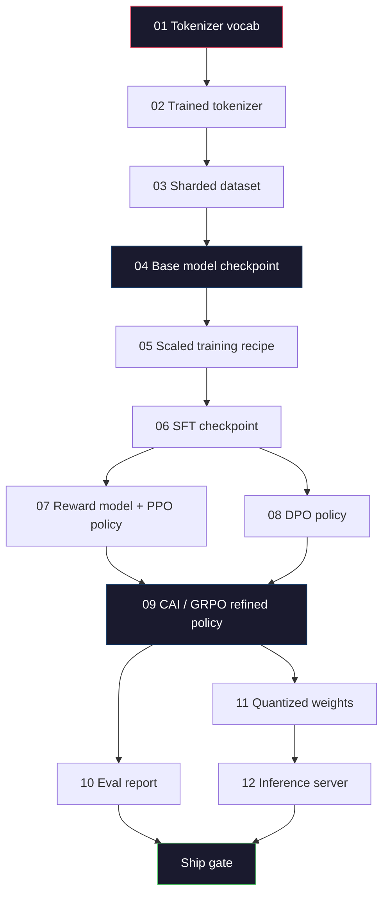
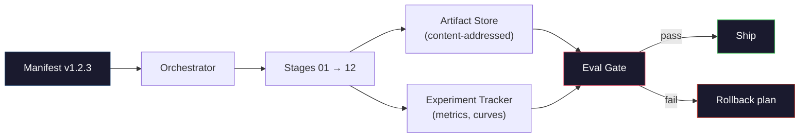

# Building a Complete LLM Pipeline

> Mọi thứ từ Bài 01 đến 12 là một giai đoạn của một pipeline. Bài này là khung biến các giai đoạn đó thành một lần chạy đầu cuối: token hóa, huấn luyện trước, mở rộng, SFT, căn chỉnh, đánh giá, lượng tử hóa, phục vụ. Bạn sẽ không huấn luyện mô hình 70B trên laptop. Bạn sẽ tạo lớp điều phối, manifest, cổng đánh giá và kế hoạch hoàn tác mà một nhóm hàng đầu năm 2026 dùng để quyết định thứ được phát hành. Đây là bài tổng kết.

**Type:** Build
**Languages:** Python (stdlib)
**Prerequisites:** All Phase 10 lessons 01-12
**Time:** ~120 minutes

## Learning Objectives

- Kết hợp mười hai bài học trước (hai bài tokenizer, dữ liệu, tiền huấn luyện, mở rộng quy mô, SFT, RLHF, DPO, CAI, đánh giá, lượng tử hóa, suy luận) thành một đặc tả pipeline có thể tái lập duy nhất
- Định nghĩa quy ước artifact giữa các giai đoạn: mỗi giai đoạn tiêu thụ gì, tạo gì và giai đoạn sau xác minh đầu vào thế nào
- Xây bộ điều phối theo dõi thử nghiệm, băm artifact và đặt cổng quyết định phát hành theo ngưỡng đánh giá
- Thiết kế kế hoạch hoàn tác: artifact nào rẻ để chạy lại, cái nào đắt, và checkpoint hỏng tốn gì

## The Problem

Mỗi bài trước đều hoạt động. Tokenizer đã huấn luyện. GPT nhỏ đã huấn luyện trước. Tập SFT đã lắp. Mô hình phần thưởng đã huấn luyện. DPO đã chạy. Đánh giá đã đo. Trọng số lượng tử hóa đã xuất. Máy chủ suy luận đã khởi chạy. Mỗi thứ là một notebook. Mỗi thứ có quy ước, đường dẫn đầu ra và seed riêng.

Một lần huấn luyện hàng đầu không phải notebook. Llama 3 405B mất 30 triệu giờ H100 trong khoảng 54 ngày. DeepSeek-V3 dùng khoảng 2.8 triệu giờ H800. Trong thời gian đó, một checkpoint hỏng, một lần nhiễm dữ liệu, một hồi quy đánh giá có thể tốn một tuần thời gian thực và một tháng ngân sách GPU của nhóm. Cách nhóm sống sót là giữ pipeline ngăn nắp: mỗi giai đoạn có đầu vào tất định, đầu ra tất định, manifest, hash và cổng.

Đây là bài tổng kết. Bạn sẽ không chạy pipeline đầu cuối trên laptop. Bạn sẽ viết bộ điều phối phối hợp các giai đoạn, manifest mô tả lần chạy, bộ xác minh đặt cổng phát hành, và kế hoạch chạy lại cho phép bên thứ ba chạy lại công việc từ một file. Mã nhỏ; kỷ luật lớn.

Mô thức mở rộng từ 100M đến 1T tham số không đổi. Cùng bốn thành phần -- manifest, bộ điều phối, cổng đánh giá, kho artifact -- chạy Llama 3 và cả GPT sở thích của bạn. Khác biệt là độ lớn các con số trong cấu hình mỗi giai đoạn, không phải hình dạng pipeline.

## The Concept

### The Twelve Stages

Mọi bài Giai đoạn 10 là một giai đoạn. Đây là toàn đồ thị phụ thuộc.



Giai đoạn 07 và 08 có thể chạy song song. Mọi thứ khác là phụ thuộc cứng. Thay đổi giai đoạn 02 (tokenizer) làm mất hiệu lực mọi artifact phía sau. Thay đổi giai đoạn 10 (đánh giá) chỉ làm mất hiệu lực quyết định phát hành.

### The Manifest

Manifest là một file mô tả lần chạy đủ đầy để chạy lại. Không thứ gì pipeline tạo nên phụ thuộc trạng thái không có trong manifest. Các trường nhàm chán và bắt buộc.

```
pipeline_version: 1.2.3
seed: 42
git_commit: a1b2c3d4
stages:
  01_tokenizer:
    recipe: bpe_32k
    input_hash: sha256:...
    output_hash: sha256:...
    wall_clock_sec: 3600
    cost_usd: 12
```

Hash đầu ra của giai đoạn N là hash đầu vào của giai đoạn N+1. Bất kỳ sai lệch nào cũng khiến pipeline dừng. Đây là cách bạn phát hiện hỏng dữ liệu sớm. Đây cũng là cách một đồng đội ở châu lục khác xác minh rằng việc chạy lại một giai đoạn tất định của họ tạo ra cùng sản phẩm như của bạn.

Trong thực tế nhóm dùng schema YAML nhỏ cộng bộ kiểm tra manifest so khác biệt với lần thành công trước. Mọi thay đổi ngoài trường kỳ vọng (chi phí, thời gian thực) là dấu hiệu cảnh báo.

### Artifact Typing

Đầu ra mỗi giai đoạn là artifact có kiểu. Không phải khối thư mục, không phải pickle, mà là kiểu có tên với schema đã biết.

| Giai đoạn | Loại artifact | Trường chính |
|-------|--------------|-----------|
| 01-02 | Tokenizer | vocab.json, merges.txt, config.json, hash |
| 03 | Tập dữ liệu | shards[], số hàng, số token, thống kê khử trùng lặp |
| 04-05 | Checkpoint | weights.safetensors, config.json, trạng thái optimizer, số bước |
| 06 | Mô hình SFT | checkpoint + công thức SFT + hỗn hợp dữ liệu |
| 07 | Mô hình phần thưởng | checkpoint RM + hash dữ liệu sở thích |
| 08-09 | Chính sách | checkpoint + hash tham chiếu + beta + ngân sách KL đã dùng |
| 10 | Báo cáo đánh giá | điểm benchmark + diff hồi quy + hash dữ liệu đánh giá |
| 11 | Mô hình lượng tử hóa | trọng số lượng tử hóa + dữ liệu hiệu chuẩn + độ chênh chính xác so với FP16 |
| 12 | Đặc tả máy chủ | endpoint + hash mô hình + cấu hình + hook khả năng quan sát |

Định kiểu ngăn kiểu thất bại phổ biến nhất: dùng đầu ra giai đoạn 08 làm đầu vào giai đoạn 06, phát hành mô hình huấn luyện DPO qua đường SFT. Artifact và chữ ký giai đoạn có kiểu biến lỗi này thành lỗi lúc biên dịch, không phải lỗi ngày thứ năm.

### The Eval Gate

Phát hành không phải "huấn luyện xong." Phát hành là "huấn luyện xong và cổng đánh giá đạt." Cổng được định nghĩa trước khi bắt đầu.

```
gates:
  mmlu:      >= baseline + 0.5   # no regression
  humaneval: >= baseline + 1.0
  truthfulqa: >= baseline         # no drop
  safety_refusal_rate: <= 0.05
  kl_from_reference: <= 25.0
  cost_total_usd: <= 50000
```

Mỗi cổng là ngưỡng số. Không cổng "trông tốt". Không phê duyệt chủ quan. Nếu mọi cổng đạt, artifact được đánh dấu có thể phát hành. Nếu bất kỳ cổng nào không đạt, lần chạy bị giữ chờ ghi đè rõ ràng bởi người rà soát có tên, bản thân việc này được ghi vào manifest.

Hai cổng bắt hầu hết thảm họa. Cổng *hồi quy* (mô hình mới ít nhất phải tốt bằng mô hình trước trên benchmark cốt lõi) bắt lỗi huấn luyện. Cổng *ngân sách KL* (chính sách căn chỉnh không được trôi quá X khỏi tham chiếu) bắt căn chỉnh quá tay. Mọi pipeline production có cả hai.

### The Orchestrator

Một đoạn mã nhỏ đọc manifest, phân công giai đoạn, theo dõi artifact và dừng khi vi phạm bất kỳ quy ước nào. Đây không phải Airflow. Không phải Kubeflow. Để giữ pipeline ngăn nắp, bạn muốn thứ nhàm chán do mình viết.

Công việc bộ điều phối hẹp:

1. Giải quyết DAG từ manifest.
2. Với mỗi giai đoạn, kiểm tra đầu ra kỳ vọng đã tồn tại ở hash đúng chưa (bỏ qua nếu có).
3. Chạy giai đoạn, thu stdout/stderr, đo thời gian thực và chi phí.
4. Xác minh hash đầu ra với hash đầu vào kỳ vọng của giai đoạn phía sau.
5. Khi thất bại, ghi manifest một phần với đúng giai đoạn lỗi và thoát khác không.

Đó là 200 dòng Python. Nó sẽ giống file `code/main.py` trong bài này. Bên dưới, pipeline thực dùng `torchrun` hoặc `ray` để thực thi từng giai đoạn trên cụm, nhưng bản thân bộ điều phối chạy trên một máy.

### Experiment Tracking and Artifact Storage

Hai hệ thống ngoài neo pipeline.

**Bộ theo dõi thử nghiệm (wandb, neptune, mlflow).** Ghi đường cong mất mát, thước đo đánh giá, đo từ xa hệ thống mỗi giai đoạn. Bộ theo dõi là nơi bạn đến khi cần so lần A với B sau ba tuần. Nhóm gần như luôn dùng bộ theo dõi được lưu trữ cho việc này -- tự viết mất thời gian nên dành cho huấn luyện.

**Kho artifact (S3, R2, GCS).** Kho đối tượng bất biến cho checkpoint, tập dữ liệu, tokenizer, báo cáo đánh giá. Artifact được định địa chỉ bằng hash, không tên file. Tên như `latest.pt` là cái bẫy tự hại; `ckpt-7b-step-20000-sha256:abc123.safetensors` là quy ước.

Bộ điều phối ghi vào cả hai. Bộ theo dõi cho con người xem biểu đồ. Kho artifact cho giai đoạn sau tra đầu vào.

### Costing

Lần chạy hàng đầu gắn một con số đô la. Kỷ luật ngân sách diễn ra ở hai nơi.

**Ước tính trước chạy.** Từ manifest, tính FLOPs kỳ vọng (cho huấn luyện trước: 6 x params x tokens), giờ GPU kỳ vọng (FLOPs / thông lượng đỉnh / mức sử dụng), và chi phí đô la theo giá thuê hiện tại. Nếu ước tính vượt cổng ngân sách, pipeline từ chối bắt đầu.

**Theo dõi trong chạy.** Thời gian thực và chi phí từng giai đoạn được ghi vào manifest. Sau mỗi giai đoạn, kiểm tra ngân sách còn lại. Nếu giai đoạn vượt dự trù, cổng giai đoạn sau được đánh giá với ngân sách còn lại mới. Bạn không chờ nhà đầu tư mạo hiểm gọi mới biết hết tiền.

Chi phí Llama 3 được báo cáo là $61M. DeepSeek-V3 báo cáo $5.6M cho lần huấn luyện trước chính. Tỷ lệ phần lớn do hiệu quả phần cứng cộng mixture-of-experts -- nhưng chi phí cụ thể thấy được vì cả hai nhóm theo dõi từng giai đoạn, không từng lần chạy.

### Reproducibility vs Determinism

Hai thứ này không giống nhau. *Tái lập được* nghĩa là cùng manifest cộng cùng mã cộng cùng hạ tầng tạo checkpoint có thước đo phía sau tương đương. *Tất định* nghĩa là đầu ra giống hệt từng bit.

Huấn luyện LLM hiện đại có thể tái lập nhưng không tất định. Thứ tự phép reduce của huấn luyện phân tán, tính không tất định của kernel GPU (cuBLAS, flash-attn) và làm tròn độ chính xác hỗn hợp kết hợp để tạo ra các số thực khác nhau ở mức 1e-5 giữa các lần chạy. Điều này ổn đối với các chỉ số cuối, vốn không thay đổi. Nó là tai hại nếu bạn đang cố gỡ lỗi bằng các diff ở cấp bit. Cách khắc phục là ghi log hash đầu vào, hash đầu ra và các chỉ số chính của mọi giai đoạn. Trong một lần chạy lại, các hash chỉ khớp đối với các giai đoạn tất định, như xử lý dữ liệu và tách token. Một giai đoạn huấn luyện ghi các trọng số mới, vì vậy hash đầu ra của nó thay đổi. Đối với những giai đoạn đó, lần chạy được "tái lập" khi các chỉ số chính khớp, dù các trọng số không giống hệt ở cấp bit.



### Rollback Plan

Trước khi bắt đầu, viết ra điều xảy ra khi mỗi giai đoạn thất bại. Ba loại.

- **Rẻ để chạy lại** (giờ): tokenizer, đánh giá, lượng tử hóa, máy chủ suy luận. Cứ chạy lại.
- **Trung bình** (ngày): SFT, DPO, CAI. Giữ mô hình cơ sở; chỉ chạy lại giai đoạn căn chỉnh.
- **Đắt** (tuần và hàng triệu đô la): huấn luyện trước. Kế hoạch hoàn tác ở đây không phải "chạy lại." Là "dùng checkpoint tốt cuối và chạy lại giai đoạn phía sau rẻ hơn với dữ liệu sửa đổi."

Vì phụ thuộc giai đoạn có kiểu và hash, bộ điều phối tự tính tập hoàn tác: làm mất hiệu lực giai đoạn lỗi cộng mọi hậu duệ. Lỗi ở giai đoạn 06 (SFT) làm mất hiệu lực 06, 07, 08, 09, 10, 11, 12. Lỗi ở giai đoạn 11 (lượng tử hóa) chỉ làm mất hiệu lực 11 và 12. Nêu trước điều này tránh ứng biến khi nhóm kiệt sức lúc 4 giờ sáng.

### Production Recipes Observed in 2026

Hầu hết nhóm hàng đầu hội tụ về cùng bộ khung.

- Tokenizer: BPE 128k với dự phòng byte. Huấn luyện trên lát đa ngôn ngữ nhỏ, cân bằng.
- Huấn luyện trước: 10-20T token, phần lớn web cộng mã cộng tổng hợp. Optimizer Muon hoặc AdamW. FSDP2 hoặc DeepSpeed ZeRO-3. Gradient checkpointing. Trọng số BF16, trọng số chính FP32.
- SFT: 500k-2M cặp chỉ dẫn, trộn con người và tổng hợp, khử trùng lặp nghiêm ngặt với tập đánh giá.
- Căn chỉnh: DPO hoặc CAI + GRPO. RLHF chỉ ở nơi tín hiệu sở thích quá đa chiều cho DPO.
- Đánh giá: MMLU-Pro, MATH, HumanEval+, GPQA, SWE-Bench Verified, LiveBench, cộng tập giữ lại riêng công chúng không bao giờ thấy.
- Lượng tử hóa: GPTQ hoặc AWQ 4-bit để phục vụ, 8-bit cho đánh giá an toàn nơi độ chênh chính xác quan trọng.
- Phục vụ: vLLM, TensorRT-LLM hoặc nội bộ. Continuous batching. Speculative decoding. Loại bỏ KV cache.

Các con số đổi mỗi sáu tháng. Bộ khung không đổi.

```figure
beam-search
```

## Build It

Mã bài học là bộ điều phối và bộ kiểm tra manifest, không phải mười hai script huấn luyện. Mỗi giai đoạn được mô phỏng bằng placeholder tạo artifact đầu ra có hình dạng và hash đúng. Chạy bộ điều phối đầu cuối chứng minh kết nối pipeline hoạt động trước khi đốt tiền GPU cho giai đoạn thực.

Xem `code/main.py` cho triển khai đầy đủ. Các phần chính:

- Dataclass `Manifest`: phiên bản pipeline, seed, git commit, giai đoạn, cổng.
- Dataclass `Stage`: tên, kiểu, đầu vào (hash), đầu ra (hash), thời gian thực, chi phí.
- `Orchestrator.run()`: giải DAG, phân công giai đoạn, xác minh hash, cập nhật manifest.
- `EvalGate.check()`: đọc ngưỡng, so báo cáo đánh giá mới nhất, trả đạt/không đạt.
- `ArtifactStore` (stub trong bộ nhớ): put/get theo hash, mô phỏng S3.
- `CostTracker`: theo giai đoạn và tích lũy, dừng khi vượt trần.

Pipeline trong `main.py` chạy mười hai giai đoạn placeholder, tạo manifest và thử cổng đánh giá không đạt để cho thấy lần chạy bị giữ trông thế nào. Đổi mỗi placeholder thành script huấn luyện thực từ bài tương ứng và bạn có bộ khung pipeline hàng đầu thực dùng.

## Use It

Quy trình chuẩn có ba lệnh.

```
python code/main.py plan    # validate manifest, compute cost estimate, print DAG
python code/main.py run     # execute stages, writing to manifest.out.yaml
python code/main.py gate    # read manifest.out.yaml, apply eval gates, ship-or-hold
```

Luôn chạy `plan` trước. Hầu hết lỗi pipeline lộ lúc lập kế hoạch -- thiếu ngưỡng cổng, hash cũ, vượt ngân sách. Chạy `plan` miễn phí. Chạy `run` đắt. Tiết kiệm tiền bằng bắt lỗi ở phía rẻ.

Đầu ra `gate` hoặc `SHIP` hoặc `HOLD: <reason>`. Lần bị giữ không phải thất bại; là điểm quyết định. Người rà soát có tên hoặc ghi đè (và ghi lại ghi đè), hoặc phê duyệt hoàn tác.

## Ship It

Bài học này tạo ra `outputs/skill-llm-pipeline-reviewer.md`. Đưa manifest pipeline đề xuất và nó kiểm tra mọi quy ước: định kiểu giai đoạn, chuỗi hash, cổng, kế hoạch hoàn tác, ước tính chi phí. Nó từ chối phê duyệt manifest thiếu cổng đánh giá, ngân sách KL không bị chặn, hoặc lần chạy trộn dữ liệu đánh giá và huấn luyện.

## Exercises

1. Mở rộng bộ điều phối hỗ trợ thực thi song song giai đoạn 07 và 08. Dùng mô-đun stdlib `concurrent.futures`. Xác nhận manifest cuối ghi đầu ra cả hai và hash đầu vào giai đoạn 09 là kết hợp tất định của cả hai.

2. Thêm cổng "kiểm tra nhiễm". Với hash tập đánh giá và mảnh tập huấn luyện, tính chồng lấp (khớp chuỗi chính xác hoặc 13-gram). Cổng không đạt nếu chồng lấp vượt 0.1%. Đưa tập huấn luyện nhiễm và xác nhận cổng giữ lần chạy.

3. Triển khai bộ ước tính chi phí từ nguyên lý đầu tiên. Với giai đoạn 04 (huấn luyện trước), ước tính FLOPs là 6 x params x tokens, giả định MFU 40% (mức sử dụng FLOPs mô hình) trên H100 ở 989 TFLOPs BF16, giá $2.50/giờ GPU. Báo ước tính cho mô hình 7B huấn luyện trên 2T token. So với con số Llama 2 công bố.

4. Xây hoàn tác một phần. Mô phỏng lỗi ở giai đoạn 09 (CAI), rồi chạy lại 09 đến 12 trong khi giữ 01-08 đã cache. Bộ điều phối nên phát hiện artifact cache bằng hash và bỏ qua. Đo thời gian thực tiết kiệm so với chạy lại đầy đủ.

5. Thêm khả năng quan sát. Phát span OpenTelemetry cho mỗi giai đoạn, với thuộc tính tham số, token đã thấy, mất mát và chi phí. Đưa span đến collector cục bộ. Điểm chính không phải bảng theo dõi; mà là sức khỏe mỗi giai đoạn truy được từ một trace ID.

## Key Terms

| Thuật ngữ | Cách mọi người nói | Ý nghĩa thực sự |
|------|----------------|----------------------|
| Manifest | "File công thức" | YAML hoặc JSON mô tả phiên bản pipeline, seed, cấu hình từng giai đoạn và ngưỡng cổng — đủ để chạy lại |
| Content-addressed (Định địa chỉ theo nội dung) | "Bằng hash không bằng tên" | Artifact lưu theo SHA-256 nội dung, nên không thể nhầm phiên bản A với B |
| Eval gate (Cổng đánh giá) | "Tiêu chí phát hành" | Ngưỡng số trên thước đo benchmark và điểm an toàn phải đạt trước khi artifact được đánh dấu có thể phát hành |
| KL budget (Ngân sách KL) | "Căn chỉnh đã trôi xa bao nhiêu" | Trần $\mathrm{KL}(\text{policy} \Vert \text{reference})$ tích lũy xuyên các giai đoạn căn chỉnh, thực thi như cổng |
| MFU | "Bạn đã dùng bao nhiêu GPU" | Mức sử dụng FLOPs mô hình — FLOPs đạt được chia đỉnh lý thuyết. 40% điển hình ở quy mô 70B, 55% ở 7B |
| Rollback plan (Kế hoạch hoàn tác) | "Làm gì khi nó hỏng" | Tập hành động viết trước theo giai đoạn khi lỗi: chạy lại, quay về, huấn luyện lại với đầu vào sửa đổi |
| Orchestrator (Bộ điều phối) | "Nhạc trưởng" | Tiến trình đọc manifest, phân công giai đoạn, xác minh hash, dừng khi vi phạm bất kỳ quy ước nào |
| Artifact store (Kho artifact) | "S3 có phiên bản cho trọng số" | Kho đối tượng bất biến định địa chỉ theo nội dung — nguồn sự thật duy nhất cho checkpoint, tập dữ liệu, báo cáo đánh giá |
| Reproducible (Tái lập được) | "Cùng thước đo khi chạy lại" | Trọng số khác cấp bit nhưng thước đo phía sau tương đương — mục tiêu thực tế cho huấn luyện LLM phân tán |
| Cost gate (Cổng chi phí) | "Bạn không thể vượt X" | Ước tính trước chạy cộng theo dõi trong chạy — pipeline từ chối bắt đầu nếu ước tính vượt ngân sách |

## Further Reading

- [Dubey et al., 2024 -- "The Llama 3 Herd of Models"](https://arxiv.org/abs/2407.21783) -- mô tả công khai chi tiết nhất về pipeline hàng đầu gồm dữ liệu, huấn luyện, căn chỉnh, đánh giá
- [DeepSeek-AI, 2024 -- "DeepSeek-V3 Technical Report"](https://arxiv.org/abs/2412.19437) -- pipeline ưu tiên hiệu quả với khoảng 1/10 chi phí huấn luyện hạng Llama 3
- [Kaplan et al., 2020 -- "Scaling Laws for Neural Language Models"](https://arxiv.org/abs/2001.08361) -- quan hệ mở rộng tính toán-dữ liệu-tham số gốc
- [Hoffmann et al., 2022 -- "Training Compute-Optimal Large Language Models (Chinchilla)"](https://arxiv.org/abs/2203.15556) -- hiệu chỉnh Kaplan đã hiệu chuẩn lại ngân sách dữ liệu hiện đại
- [PyTorch FSDP2 documentation](https://pytorch.org/docs/stable/fsdp.html) -- thành phần huấn luyện phân tán thay FSDP1 trong PyTorch 2.4+
- [Weights & Biases LLM Reports](https://wandb.ai/site/solutions/llms/) -- manifest thực và đầu ra bộ theo dõi thử nghiệm cho lần chạy LLM mã nguồn mở, hữu ích làm mẫu có thể đạo văn
