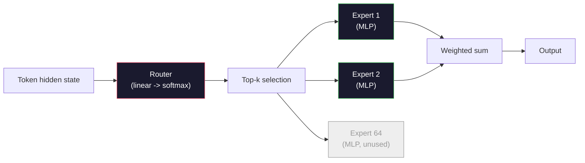

# Open Models: Architecture Walkthroughs

> Bạn đã xây GPT-2 Small từ đầu ở Bài 04. Mô hình mở hàng đầu năm 2026 cùng họ với năm hoặc sáu thay đổi cụ thể. RMSNorm thay LayerNorm. SwiGLU thay GELU. RoPE thay vị trí được học. GQA hoặc MLA thay MHA đầy đủ. Mixture-of-Experts ở quy mô lớn. Toán bạn đã biết bao phủ 95% chúng. Bài này đọc Llama 3, DeepSeek-V3, Mixtral, Qwen và Gemma cạnh nhau và chỉ rõ dòng chính xác nơi mỗi kiến trúc khác đi.

**Type:** Learn
**Languages:** Python (stdlib)
**Prerequisites:** Phase 10, Lessons 04, 05, 12 (Pre-training, Scaling, Inference)
**Time:** ~45 minutes

## Learning Objectives

- Đọc config.json của Llama 3, Mistral, Mixtral, Gemma 2, Qwen 2.5 và DeepSeek-V3 và giải thích mỗi trường
- Nêu thay đổi kiến trúc cụ thể mỗi mô hình làm so với GPT-2 Small và biện minh từ nguyên lý đầu tiên
- Tính số tham số, kích thước KV cache và bộ nhớ activation cho bất kỳ mô hình mở nào chỉ từ cấu hình
- Chọn mô hình mở đúng cho đích triển khai với ràng buộc độ trễ, bộ nhớ và năng lực

## The Problem

Ở Bài 04 bạn viết 350 dòng numpy và có mô hình dạng GPT-2. Llama 3 405B có báo cáo kỹ thuật 200 trang. Bản năng cho rằng đây là hai con thú khác. Không phải. 200 trang mô tả cùng đối tượng với năm hoặc sáu sửa đổi có động cơ tốt, cộng một nghìn chi tiết triển khai mở rộng. Bộ khung -- embedding, khối transformer, attention, MLP, norm, head -- không đổi.

Bài này là một bản diff. Với mỗi họ mô hình mở lớn, chúng ta liệt kê chính xác thứ đổi từ GPT-2, vì sao và tốn gì. Khi xong bạn có thể đọc model card mới và dịch trong đầu về baseline GPT-2.

Lợi ích thực tiễn là khi Meta phát hành Llama 5 hoặc DeepSeek phát hành V4, bạn không cần mô hình tư duy mới. Bạn nhìn cấu hình, thấy nút quen thuộc nào đổi và biết hàm ý phía sau. Kiến trúc năm 2026 là hộp công cụ hữu hạn. Mỗi mô hình mới chọn tập con khác.

## The Concept

### The Invariant Core

Mọi mô hình mở tự hồi quy chung:

- Ma trận embedding token (vocab_size x hidden_dim).
- Chồng N khối decoder: norm, self-attention, phần dư, norm, MLP, phần dư.
- Norm cuối và head tuyến tính chiếu sang vocab_size (thường buộc trọng số với embedding).
- Mặt nạ nhân quả, mất mát cross-entropy token tiếp theo.

Đó là cấu trúc. Phần còn lại là các nút điều chỉnh.

### The Six Knobs That Actually Move

Trên mọi mô hình mở hàng đầu 2024-2026, cùng sáu lựa chọn thiết kế được chọn lặp đi lặp lại:

1. **Chuẩn hóa.** LayerNorm -> RMSNorm.
2. **Mã hóa vị trí.** Tuyệt đối được học -> RoPE (cộng biến thể: YaRN, NTK).
3. **Kích hoạt.** GELU -> SwiGLU (hoặc GeGLU).
4. **Chia sẻ head attention.** MHA -> GQA -> MQA -> MLA.
5. **MLP dense so với thưa.** Dense -> Mixture-of-Experts.
6. **Vị trí pre-norm.** Pre-norm ở lại. Post-norm đã biến mất.

Mọi thứ khác (lịch tốc độ học, hỗn hợp dữ liệu, kích thước batch, ngữ cảnh) nằm trong cấu hình huấn luyện, không kiến trúc. Sáu nút.

### Knob 1: RMSNorm

LayerNorm trừ trung bình, chia độ lệch chuẩn, co giãn và dịch chuyển. RMSNorm chỉ giữ co giãn:

```
RMSNorm(x) = x / sqrt(mean(x^2) + eps) * gamma
```

Không trừ trung bình. Không bias. Ít hơn một phép nhân ma trận mỗi token. Zhang và Sennrich (2019) lập luận nó ngang LayerNorm trên dịch máy trong khi nhanh hơn 10%. Mọi mô hình mở hiện đại chạy nó.

Chi phí: không. Lợi ích: thắng nhỏ về thông lượng, mã đơn giản hơn.

### Knob 2: RoPE

Embedding vị trí được học là bảng tra 1024 chỗ ở GPT-2. Ngữ cảnh 1025 vượt cuối bảng. Mô hình không thể ngoại suy vượt độ dài huấn luyện.

Rotary Position Embedding (RoPE, Su và cộng sự 2021) đưa vị trí vào bằng quay từng vector Q và K theo cặp trước tích vô hướng attention. Góc quay là hàm tất định của vị trí, nên không có gì được học và không có gì cạn. Với thủ thuật co giãn (nội suy nhận biết NTK, YaRN), mô hình huấn luyện trên ngữ cảnh 8k có thể kéo đến 128k khi suy luận với mất chính xác vừa phải.

```
q_rotated = rotate(q, angle(pos))
k_rotated = rotate(k, angle(pos))
score = q_rotated . k_rotated
```

Mọi Llama, Mistral, Qwen, DeepSeek và Gemma dùng RoPE. Gemma 2 dùng lai (RoPE ở hầu hết lớp, attention cửa sổ trượt cục bộ ở lớp khác).

### Knob 3: SwiGLU

MLP GPT-2 là `x -> gelu(xW1 + b1) -> (...)W2 + b2`. SwiGLU (Shazeer 2020) thay kích hoạt bằng tích có cổng:

```
SwiGLU(x) = (xW1) * sigmoid(xW1) * xV
```

Hai phép chiếu song song thay vì một, được đặt cổng bằng kích hoạt Swish. Mạnh hơn thực nghiệm về perplexity mỗi tham số. Llama 2 áp dụng, mọi người theo. Kích thước ẩn MLP thường đặt để tổng tham số khớp MLP dense gốc: nếu GPT-2 dùng `ff_dim = 4 * hidden`, SwiGLU dùng `ff_dim = (2/3) * 4 * hidden = 8/3 * hidden`.

### Knob 4: Attention Head Sharing

GPT-2 dùng **Multi-Head Attention (MHA)**: mỗi head có phép chiếu Q, K, V riêng.

**Multi-Query Attention (MQA, Shazeer 2019)** chia sẻ một K và một V trên mọi head. Giảm KV cache num_heads lần, tức giảm 12x đến 32x trên mô hình điển hình. Độ chính xác giảm nhẹ trên benchmark khó.

**Grouped-Query Attention (GQA, Ainslie và cộng sự 2023)** là điểm giữa: G nhóm head Q chia sẻ một K và một V. Llama 3 8B dùng GQA với 32 head Q và 8 head KV (G=8), nên KV cache co 4x so với MHA đầy đủ.

**Multi-Head Latent Attention (MLA, DeepSeek 2024)** nén K và V thành latent hạng thấp chung, chiếu chúng lên lại theo head. Giảm thêm KV cache trong khi giữ sức biểu đạt từng head. DeepSeek-V2 và V3 dựa vào điều này cho hiệu năng ngữ cảnh dài.

| Cách | Head KV | KV Cache | Độ chính xác |
|--------|----------|----------|----------|
| MHA    | num_heads | đầy đủ | tốt nhất |
| GQA    | num_groups (G < num_heads) | giảm num_heads / G lần | gần MHA |
| MQA    | 1 | giảm num_heads lần | giảm nhẹ |
| MLA    | latent, giải nén theo head | nhỏ hơn MQA | gần MHA |

Với mô hình trên ~13B tham số, GQA hoặc MLA thực tế bắt buộc. MHA đầy đủ ở quy mô lớn là thảm họa KV cache.

### Knob 5: Mixture of Experts

MLP dense kích hoạt mọi tham số cho mỗi token. MLP MoE có K expert mỗi khối và router chọn expert top-k mỗi token (thường top-2). Chỉ trọng số các expert đó thấy truyền xuôi cho token ấy.

```
router_logits = xW_r
indices, weights = top_k(router_logits, k=2)
output = sum_i weights[i] * expert[indices[i]](x)
```

Sức hấp dẫn: bạn có thể có 64 expert kích thước 7B mỗi cái (nên tổng tham số rất lớn) trong khi chỉ chạy 2 mỗi token (nên tính toán mỗi token ngang mô hình dense 7B). Mixtral 8x7B có 47B tổng tham số nhưng chỉ kích hoạt 13B mỗi token. DeepSeek-V3 có 671B tổng tham số nhưng chỉ kích hoạt 37B mỗi token.



Ưu: cùng tính toán, nhiều tham số, năng lực tốt hơn. Nhược: bộ nhớ expert vẫn phải ở đâu đó (nên phục vụ cần nhiều VRAM hơn dense tương đương), cân bằng tải router khó, và tinh chỉnh router khi căn chỉnh là lĩnh vực nghiên cứu riêng.

### Knob 6: Pre-norm stays

Transformer gốc áp dụng chuẩn hóa lớp sau mỗi lớp con. Mọi mô hình mở từ GPT-2 đặt nó *trước* mỗi lớp con. Pre-norm rõ ràng dễ huấn luyện hơn ở độ sâu lớn. Không có gì tranh luận.

### Model-by-Model Diff

Đây là bảng làm mọi thứ cụ thể.

| Mô hình | Năm | Tổng tham số | Tham số hoạt động | Norm | Kích hoạt | Vị trí | Attention | MoE | Ngữ cảnh |
|-------|------|-------------|---------------|------|-----------|----------|-----------|-----|---------|
| GPT-2 Small | 2019 | 124M | 124M | LayerNorm | GELU | Được học | MHA (12 head) | không | 1k |
| Llama 3 8B | 2024 | 8B | 8B | RMSNorm | SwiGLU | RoPE | GQA (32/8) | không | 128k |
| Llama 3 70B | 2024 | 70B | 70B | RMSNorm | SwiGLU | RoPE | GQA (64/8) | không | 128k |
| Llama 3 405B | 2024 | 405B | 405B | RMSNorm | SwiGLU | RoPE | GQA (128/16) | không | 128k |
| Mistral 7B | 2023 | 7.2B | 7.2B | RMSNorm | SwiGLU | RoPE | GQA | không | 32k |
| Mixtral 8x7B | 2023 | 47B | 13B | RMSNorm | SwiGLU | RoPE | GQA | có (8 expert, top-2) | 32k |
| Gemma 2 9B | 2024 | 9B | 9B | RMSNorm (trước+sau) | GeGLU | RoPE + trượt | GQA | không | 8k |
| Qwen 2.5 72B | 2024 | 72B | 72B | RMSNorm | SwiGLU | RoPE (YaRN) | GQA (64/8) | không | 128k |
| DeepSeek V2 236B | 2024 | 236B | 21B | RMSNorm | SwiGLU | RoPE | MLA | có (160 expert, top-6) | 128k |
| DeepSeek V3 | 2024 | 671B | 37B | RMSNorm | SwiGLU | RoPE | MLA | có (256 expert, top-8) | 128k |

Nhìn các cột. RMSNorm phổ quát. SwiGLU hoặc họ hàng GeGLU phổ quát. RoPE phổ quát. GQA phổ quát trên 7B trừ khi thay bằng MLA. MoE là khác biệt ở đầu cao.

### Reading a config.json

Cấu hình Llama 3 8B:

```
{
  "hidden_size": 4096,
  "intermediate_size": 14336,
  "num_hidden_layers": 32,
  "num_attention_heads": 32,
  "num_key_value_heads": 8,
  "max_position_embeddings": 131072,
  "rope_theta": 500000.0,
  "rms_norm_eps": 1e-5,
  "vocab_size": 128256
}
```

Mỗi trường tương ứng thứ bạn đã triển khai.

- `hidden_size`: số chiều embedding.
- `intermediate_size`: kích thước ẩn MLP (3.5x hidden -- toán SwiGLU).
- `num_hidden_layers`: độ sâu chồng.
- `num_attention_heads`: head Q.
- `num_key_value_heads`: head KV (GQA).
- `max_position_embeddings`: độ dài ngữ cảnh huấn luyện.
- `rope_theta`: tần số cơ sở RoPE. Meta co giãn từ mặc định 10k lên 500k để ngoại suy ngữ cảnh dài.
- `rms_norm_eps`: ổn định số.
- `vocab_size`: token.

Chỉ từ chúng bạn tính tổng tham số, KV cache và bộ nhớ activation đỉnh. Xem `code/main.py` cho công thức chính xác.

### Activation memory budget

Activation chi phối bộ nhớ huấn luyện trên vài tỷ tham số. Quy tắc kinh nghiệm cho huấn luyện trước (có gradient checkpointing):

```
activation_mem ~ batch_size * seq_len * hidden_size * num_layers * bytes_per_element
```

Với Llama 3 8B ở batch 1, chuỗi 8192, BF16, 32 lớp, hidden 4096: khoảng 8 GB chỉ cho activation có checkpointing, 40 GB không có. Đây là lý do flash-attention và ring-attention quan trọng -- chúng viết lại tính attention để activation vừa.

### KV Cache budget

Cho suy luận ở ngữ cảnh tối đa:

```
kv_cache = 2 * num_layers * num_kv_heads * head_dim * max_seq_len * bytes_per_element
```

Llama 3 8B ở ngữ cảnh 128k, BF16, head_dim = hidden / num_heads = 128:
`2 * 32 * 8 * 128 * 131072 * 2 = 17.2 GB` mỗi chuỗi.

Trọng số 8B là 16 GB ở BF16. KV cache cho một chuỗi 128k lớn hơn trọng số. Đây là áp lực bộ nhớ thúc đẩy nghiên cứu GQA, MLA và lượng tử hóa KV cache.

### When Each Model Wins

- **Một GPU 80GB, không MoE**: Llama 3 8B, Mistral 7B, Gemma 2 9B. Dễ phục vụ, công cụ rộng.
- **Một node (8x80GB), năng lực lớn**: Llama 3 70B, Qwen 2.5 72B. Năng lực dense mở cao nhất.
- **Năng lực mở lớn nhất, chấp nhận phức tạp MoE**: DeepSeek V3, Mixtral 8x22B. Năng lực tốt nhất mỗi FLOP hoạt động.
- **Nhu cầu ngữ cảnh dài**: Llama 3 (128k với co giãn RoPE), DeepSeek (lợi thế MLA).
- **Phục vụ độ trễ thấp**: Gemma 2 9B (cửa sổ trượt giảm tính toán ngữ cảnh dài).

```figure
rmsnorm-vs-layernorm
```

## Build It

Mã bài học là bộ tính. Với bất kỳ config.json, nó in tham số theo thành phần, KV cache ở ngữ cảnh tối đa, tỷ lệ MLP SwiGLU và kết luận ngắn về kiến trúc (dense / GQA / MLA / MoE).

```python
config = {
    "hidden_size": 4096, "intermediate_size": 14336,
    "num_hidden_layers": 32, "num_attention_heads": 32,
    "num_key_value_heads": 8, "vocab_size": 128256,
    "max_position_embeddings": 131072,
}
```

Script duyệt kiến trúc từng trường, tính tham số cho embedding, attention (có giảm GQA), MLP (có mở rộng SwiGLU), layernorm và head. Rồi tính KV cache ở độ dài ngữ cảnh đã nêu và in tóm tắt.

Xem `code/main.py` cho triển khai.

## Use It

Chạy bộ tính trên cấu hình Llama 3 8B, Mistral 7B, Mixtral 8x7B và DeepSeek V3 kèm trong script. So phân tích tham số. Chú ý mô hình MoE có tổng tham số lớn vượt trội dense nhưng tham số hoạt động thường nhỏ hơn. Chú ý KV cache DeepSeek V3 nhỏ hơn Llama 3 405B dù có nhiều tổng tham số hơn -- đó là MLA hoạt động.

Rồi đưa cấu hình bất kỳ mô hình cục bộ nào vào, đọc tóm tắt và quyết định có vừa GPU không.

## Ship It

Bài này tạo ra `outputs/skill-open-model-picker.md`. Với đích triển khai (loại GPU, VRAM, ngữ cảnh, ngân sách độ trễ) và đặc điểm tác vụ (chat, mã, suy luận, ngữ cảnh dài), nó đề xuất mô hình mở, cách lượng tử hóa từ Bài 11 và bộ suy luận từ Bài 12, với lý giải tường minh về sáu nút kiến trúc.

## Exercises

1. Đọc cấu hình Qwen 2.5 72B từ HuggingFace. Tính tổng tham số từ đầu. So giá trị HF báo và xác định nguồn độ chênh (làm tròn số chiều head, hệ số chia sẻ KV, v.v.).

2. DeepSeek V3 dùng 256 expert với định tuyến top-8. Tính tỷ lệ expert kích hoạt trên tổng expert và so với top-2 trong 8 của Mixtral 8x7B. Chuyển từ thưa (25%) sang thưa dày hơn (3%) hàm ý gì về năng lực mỗi FLOP?

3. Tính KV cache cho Llama 3 405B ở ngữ cảnh 128k trong FP8 và BF16. Ở FP8 nó bằng nửa con số BF16. Bao nhiêu chuỗi song song có thể phục vụ trên một node 8xH100 (80GB mỗi cái = tổng 640GB, trừ bộ nhớ trọng số)?

4. Gemma 2 xen kẽ lớp attention đầy đủ và cửa sổ trượt. Viết toán cho KV cache khi nửa lớp dùng cửa sổ trượt 4096 token thay ngữ cảnh đầy đủ. Tiết kiệm bao nhiêu bộ nhớ ở tổng ngữ cảnh 8k?

5. Tìm mô hình mở hàng đầu gần đây phát hành sau khi bài này viết. Xác định nó chọn nút nào trong sáu nút và có thêm nút thứ bảy không. Giáo trình sẽ có vẻ lỗi thời ngay khi kiến trúc mới ra -- mục tiêu là cập nhật bảng mà không xây lại mô hình tư duy.

## Key Terms

| Thuật ngữ | Cách mọi người nói | Ý nghĩa thực sự |
|------|----------------|----------------------|
| RMSNorm | "LayerNorm không trung bình" | Chỉ chuẩn hóa bằng căn trung bình bình phương, với hệ số được học — rẻ hơn và tương đương LayerNorm |
| RoPE | "Vị trí xoay" | Quay từng vector Q và K theo cặp 2D bằng góc phụ thuộc vị trí — ngoại suy vượt độ dài huấn luyện với thủ thuật co giãn |
| SwiGLU | "Kích hoạt MLP mới" | Đơn vị tuyến tính có cổng với Swish: `(xW1) * sigmoid(xW1) * xV` — tiêu chuẩn trong mọi mô hình mở 2024+ |
| GQA | "Attention điểm giữa" | Grouped-Query Attention: G nhóm head Q chung một head K và V — co KV cache mà không mất chính xác như MQA |
| MLA | "Attention DeepSeek" | Multi-Head Latent Attention: nén K/V thành latent hạng thấp chung, giải nén theo head — KV cache nhỏ nhất cho mô hình lớn |
| MoE | "Expert thưa" | Mixture of Experts: N MLP mỗi khối, router chọn top-k mỗi token — tổng tham số khổng lồ, tham số hoạt động nhỏ |
| Top-k routing (Định tuyến top-k) | "Chọn k expert mỗi token" | Router tính điểm mỗi expert và kích hoạt k cao nhất — k thường từ 2 (Mixtral) đến 8 (DeepSeek) |
| YaRN | "Kéo RoPE" | Lại một mở rộng RoPE nữa — nội suy góc xoay để kéo ngữ cảnh từ 8k đến 128k+ khi suy luận |
| Sliding-window attention (Attention cửa sổ trượt) | "Đừng chú ý mọi thứ" | Mỗi token chỉ chú ý W token cuối — giới hạn chi phí attention ở O(W) mỗi token, dùng trong Gemma 2 và Mistral đời đầu |
| Active params (Tham số hoạt động) | "Thứ chạy mỗi token" | Với MoE, số tham số thấy truyền xuôi mỗi token (nhỏ hơn nhiều tổng tham số) — chi phối FLOPs mỗi token |

## Further Reading

- [Dubey et al., 2024 -- "The Llama 3 Herd of Models"](https://arxiv.org/abs/2407.21783) -- tham chiếu kiến trúc và huấn luyện cho họ Llama 3 dense
- [DeepSeek-AI, 2024 -- "DeepSeek-V3 Technical Report"](https://arxiv.org/abs/2412.19437) -- MLA cộng cân bằng tải không mất mát phụ cộng MoE 671B
- [Jiang et al., 2024 -- "Mixtral of Experts"](https://arxiv.org/abs/2401.04088) -- bài báo mô hình mở MoE chuẩn
- [Su et al., 2021 -- "RoFormer: Enhanced Transformer with Rotary Position Embedding"](https://arxiv.org/abs/2104.09864) -- bài báo RoPE
- [Shazeer, 2020 -- "GLU Variants Improve Transformer"](https://arxiv.org/abs/2002.05202) -- SwiGLU, GeGLU và các họ hàng
- [Ainslie et al., 2023 -- "GQA: Training Generalized Multi-Query Transformer Models"](https://arxiv.org/abs/2305.13245) -- bài báo GQA
- [Gemma 2 Team, 2024 -- "Gemma 2: Improving Open Language Models at a Practical Size"](https://arxiv.org/abs/2408.00118) -- attention lai đầy đủ+trượt, norm trước+sau
- [Qwen Team, 2024 -- "Qwen 2.5 Technical Report"](https://arxiv.org/abs/2412.15115) -- mở rộng ngữ cảnh YaRN và công thức huấn luyện ngữ cảnh dài
