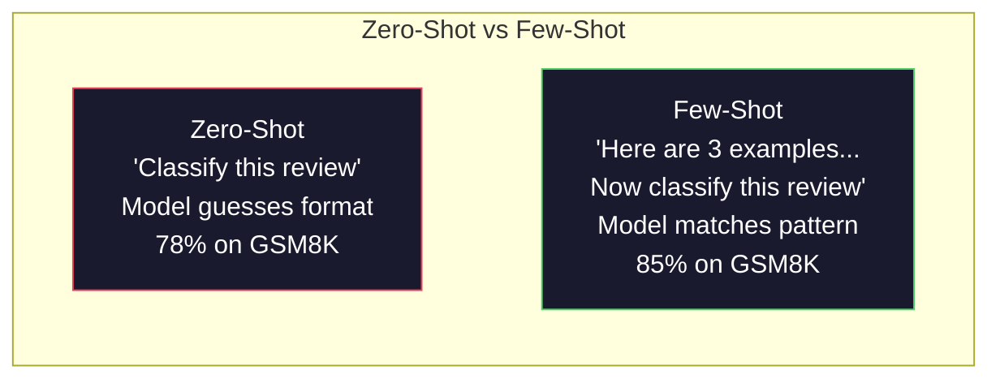
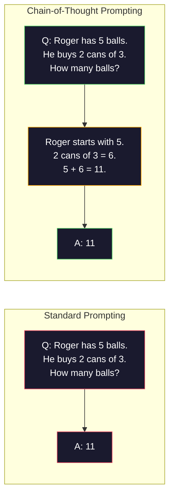
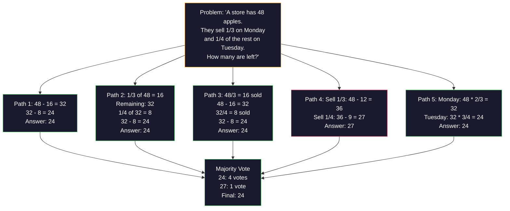
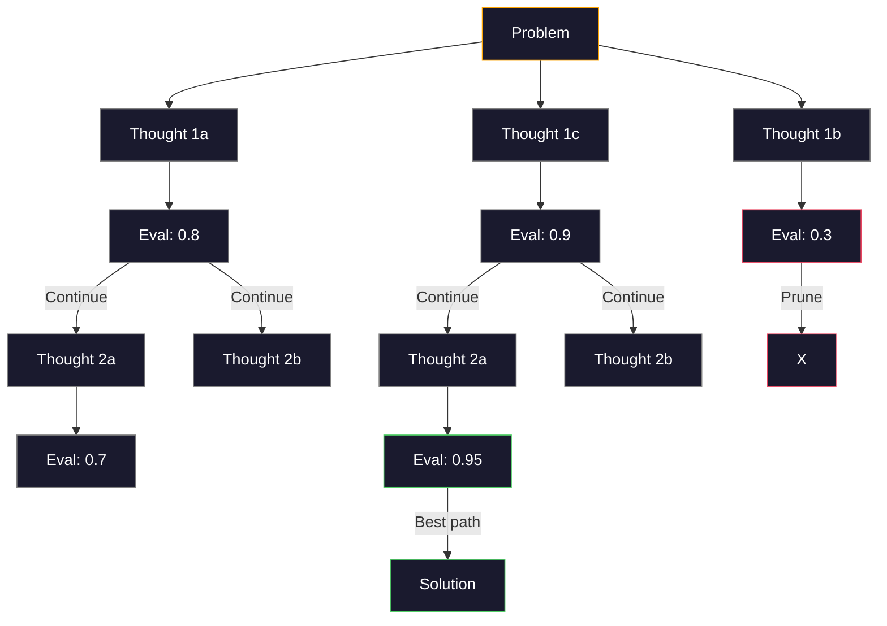

# Few-Shot, Chain-of-Thought, Tree-of-Thought

> Bảo mô hình làm gì là prompting. Chỉ cho nó cách suy nghĩ là kỹ thuật. Khoảng cách giữa độ chính xác 78% và 91% trên cùng mô hình, cùng tác vụ, cùng dữ liệu không phải là một mô hình tốt hơn. Nó là một chiến lược suy luận tốt hơn.

**Type:** Build
**Languages:** Python
**Prerequisites:** Lesson 11.01 (Prompt Engineering)
**Time:** ~45 minutes

## Learning Objectives

- Triển khai few-shot prompting bằng cách chọn và định dạng các ví dụ minh họa tối đa hóa độ chính xác tác vụ
- Áp dụng suy luận chain-of-thought (CoT) để cải thiện độ chính xác trên các bài toán nhiều bước như bài toán có lời văn
- Xây dựng một prompt tree-of-thought khám phá nhiều đường suy luận và chọn đường tốt nhất
- Đo sự cải thiện độ chính xác của zero-shot so với few-shot so với CoT trên một benchmark tiêu chuẩn

## The Problem

Bạn xây dựng một ứng dụng gia sư toán. Prompt của bạn nói: "Giải bài toán có lời văn này." GPT-5 làm đúng 94% số lần trên GSM8K, benchmark toán tiểu học tiêu chuẩn. Bạn nghĩ mình đã đạt đỉnh. Bạn chưa — chain-of-thought vẫn thêm 3-4 điểm.

Thêm năm từ -- "Hãy suy nghĩ từng bước" -- và độ chính xác nhảy lên 91%. Thêm vài ví dụ có lời giải và nó đạt 95%. Cùng mô hình. Cùng temperature. Cùng chi phí API. Khác biệt duy nhất là bạn đưa cho mô hình giấy nháp.

Đây không phải một mẹo. Đó là cách suy luận hoạt động. Con người không giải các bài toán nhiều bước trong một bước nhảy tư duy. Transformer cũng không. Khi bạn buộc mô hình sinh các token trung gian, những token đó trở thành một phần ngữ cảnh cho token tiếp theo. Mỗi bước suy luận cung cấp cho bước tiếp theo. Mô hình thực sự tính toán để đi đến câu trả lời.

Nhưng "suy nghĩ từng bước" là khởi đầu, không phải kết thúc. Điều gì xảy ra nếu bạn lấy mẫu năm đường suy luận và bỏ phiếu đa số? Nếu bạn để mô hình khám phá một cây khả năng, đánh giá và cắt tỉa các nhánh? Nếu bạn xen kẽ suy luận với sử dụng công cụ? Đây không phải giả thuyết. Chúng là những kỹ thuật đã được công bố với các cải thiện đo được, và bạn sẽ xây dựng tất cả trong bài học này.

## The Concept

### Zero-Shot vs Few-Shot: When Examples Beat Instructions

Zero-shot prompting đưa cho mô hình một tác vụ và không có gì khác. Few-shot prompting đưa cho nó ví dụ trước.

Wei và cộng sự (2022) đo điều này trên 8 benchmark. Với các tác vụ đơn giản như phân loại cảm xúc, zero-shot và few-shot có hiệu năng trong khoảng 2% của nhau. Với các tác vụ phức tạp như số học nhiều bước và suy luận ký hiệu, few-shot cải thiện độ chính xác 10-25%.

Trực giác: ví dụ là chỉ dẫn được nén. Thay vì mô tả định dạng đầu ra, bạn cho thấy nó. Thay vì giải thích quá trình suy luận, bạn minh họa nó. Mô hình khớp mẫu trên các ví dụ đáng tin cậy hơn việc diễn giải chỉ dẫn trừu tượng.



**Khi few-shot thắng:** tác vụ nhạy định dạng, phân loại, trích xuất có cấu trúc, thuật ngữ chuyên biệt miền, bất kỳ tác vụ nào mà mô hình cần khớp một mẫu cụ thể.

**Khi zero-shot thắng:** câu hỏi sự kiện đơn giản, tác vụ sáng tạo mà ví dụ ràng buộc sự sáng tạo, tác vụ mà tìm ví dụ tốt khó hơn viết chỉ dẫn tốt.

### Example Selection: Similar Beats Random

Không phải mọi ví dụ đều ngang nhau. Chọn ví dụ tương tự đầu vào đích vượt trội hơn lựa chọn ngẫu nhiên 5-15% trên các tác vụ phân loại (Liu và cộng sự, 2022). Ba nguyên tắc:

1. **Tương đồng ngữ nghĩa**: chọn các ví dụ gần đầu vào nhất trong không gian embedding
2. **Đa dạng nhãn**: bao quát mọi loại đầu ra trong các ví dụ của bạn
3. **Khớp độ khó**: khớp mức độ phức tạp của bài toán đích

Số ví dụ tối ưu cho hầu hết tác vụ là 3-5. Dưới 3, mô hình không có đủ tín hiệu để rút ra mẫu. Trên 5, bạn gặp lợi ích giảm dần và lãng phí token cửa sổ ngữ cảnh. Với phân loại có nhiều nhãn, dùng một ví dụ mỗi nhãn.

### Chain-of-Thought: Giving Models Scratch Paper

Chain-of-Thought (CoT) prompting được Wei và cộng sự (2022) tại Google Brain giới thiệu. Ý tưởng đơn giản: thay vì chỉ yêu cầu mô hình đưa câu trả lời, yêu cầu nó trình bày các bước suy luận trước.



Tại sao điều này hoạt động về mặt cơ chế? Mỗi token transformer sinh trở thành ngữ cảnh cho token tiếp theo. Không có CoT, mô hình phải nén mọi suy luận vào trạng thái ẩn của một forward pass duy nhất. Với CoT, mô hình đưa các tính toán trung gian ra ngoài dưới dạng token. Mỗi token suy luận mở rộng độ sâu tính toán hiệu dụng.

**Các benchmark GSM8K (toán tiểu học, 8.5K bài toán):**

| Mô hình | Zero-Shot | Zero-Shot CoT | Few-Shot CoT |
|-------|-----------|---------------|--------------|
| GPT-4o | 78% | 91% | 95% |
| GPT-5 | 94% | 97% | 98% |
| o4-mini (suy luận) | 97% | — | — |
| Claude Opus 4.7 | 93% | 97% | 98% |
| Gemini 3 Pro | 92% | 96% | 98% |
| Llama 4 70B | 80% | 89% | 94% |
| DeepSeek-V3.1 | 89% | 94% | 96% |

**Lưu ý về các mô hình suy luận.** Các mô hình như dòng o của OpenAI (o3, o4-mini) và DeepSeek-R1 chạy chain-of-thought bên trong trước khi đưa ra câu trả lời. Thêm "Hãy suy nghĩ từng bước" vào mô hình suy luận là dư thừa và đôi khi phản tác dụng — chúng đã làm điều đó.

Hai kiểu CoT:

**Zero-shot CoT**: thêm "Hãy suy nghĩ từng bước" vào cuối prompt. Không cần ví dụ. Kojima và cộng sự (2022) cho thấy một câu này cải thiện độ chính xác trên các tác vụ số học, lẽ thường và suy luận ký hiệu.

**Few-shot CoT**: cung cấp các ví dụ có các bước suy luận. Hiệu quả hơn zero-shot CoT vì mô hình thấy chính xác định dạng suy luận mà bạn kỳ vọng.

**Khi CoT gây hại**: nhớ lại sự kiện đơn giản ("Thủ đô nước Pháp là gì?"), phân loại một bước, tác vụ mà tốc độ quan trọng hơn độ chính xác. CoT thêm 50-200 token chi phí suy luận mỗi truy vấn. Với tác vụ thông lượng cao, độ phức tạp thấp, đó là chi phí lãng phí.

### Self-Consistency: Sample Many, Vote Once

Wang và cộng sự (2023) giới thiệu self-consistency. Nhận thức: một đường CoT duy nhất có thể chứa lỗi suy luận. Nhưng nếu bạn lấy mẫu N đường suy luận độc lập (dùng temperature > 0) và bỏ phiếu đa số cho câu trả lời cuối, các lỗi triệt tiêu nhau.



Self-consistency cải thiện độ chính xác GSM8K từ 56.5% (CoT đơn) lên 74.4% với N=40 trên các thí nghiệm PaLM 540B ban đầu. Trên GPT-5, cải thiện nhỏ (97% lên 98%) vì độ chính xác cơ sở đã bão hòa. Kỹ thuật này nổi trội nhất trên các mô hình có độ chính xác CoT cơ sở 60-85% -- điểm tối ưu mà lỗi một đường thường xuyên nhưng không có tính hệ thống. Với các mô hình suy luận (dòng o, R1), self-consistency được bao hàm bởi lấy mẫu nội bộ tích hợp sẵn.

Sự đánh đổi: N mẫu nghĩa là Nx chi phí API và độ trễ. Trong thực tế, N=5 nắm được phần lớn lợi ích. N=3 là tối thiểu cho một cuộc bỏ phiếu có ý nghĩa. N > 10 có lợi ích giảm dần với hầu hết tác vụ.

### Tree-of-Thought: Branching Exploration

Yao và cộng sự (2023) giới thiệu Tree-of-Thought (ToT). Trong khi CoT đi theo một đường suy luận tuyến tính, ToT khám phá nhiều nhánh và đánh giá những nhánh hứa hẹn nhất trước khi tiếp tục.



ToT có ba thành phần:

1. **Sinh suy nghĩ**: tạo nhiều bước tiếp theo ứng viên
2. **Đánh giá trạng thái**: chấm điểm từng ứng viên (có thể dùng chính LLM làm bộ đánh giá)
3. **Thuật toán tìm kiếm**: BFS hoặc DFS qua cây, cắt tỉa các nhánh điểm thấp

Trên tác vụ Game of 24 (kết hợp 4 số bằng số học để tạo 24), GPT-4 với prompting tiêu chuẩn giải 7.3% bài toán. Với CoT, 4.0% (CoT thực sự gây hại ở đây vì không gian tìm kiếm rộng). Với ToT, 74%.

ToT tốn kém. Mỗi node trong cây cần một lệnh gọi LLM. Một cây với hệ số phân nhánh 3 và độ sâu 3 cần tối đa 39 lệnh gọi LLM. Chỉ dùng cho các bài toán mà không gian tìm kiếm lớn nhưng có thể đánh giá -- lập kế hoạch, giải đố, giải quyết vấn đề sáng tạo có ràng buộc.

### ReAct: Thinking + Doing

Yao và cộng sự (2022) kết hợp các vết suy luận với hành động. Mô hình luân phiên giữa suy nghĩ (sinh suy luận) và hành động (gọi công cụ, tìm kiếm, tính toán).

```mermaid
graph LR
    Q["Question:\nWhat is the\npopulation of the\ncountry where\nthe Eiffel Tower\nis located?"]
    T1["Thought: I need to\nfind which country\nhas the Eiffel Tower"]
    A1["Action: search\n'Eiffel Tower location'"]
    O1["Observation:\nParis, France"]
    T2["Thought: Now I need\nFrance's population"]
    A2["Action: search\n'France population 2024'"]
    O2["Observation:\n68.4 million"]
    T3["Thought: I have\nthe answer"]
    F["Answer:\n68.4 million"]

    Q --> T1 --> A1 --> O1 --> T2 --> A2 --> O2 --> T3 --> F

    style Q fill:#1a1a2e,stroke:#ffa500,color:#fff
    style T1 fill:#1a1a2e,stroke:#51cf66,color:#fff
    style A1 fill:#1a1a2e,stroke:#e94560,color:#fff
    style O1 fill:#1a1a2e,stroke:#808080,color:#fff
    style T2 fill:#1a1a2e,stroke:#51cf66,color:#fff
    style A2 fill:#1a1a2e,stroke:#e94560,color:#fff
    style O2 fill:#1a1a2e,stroke:#808080,color:#fff
    style T3 fill:#1a1a2e,stroke:#51cf66,color:#fff
    style F fill:#1a1a2e,stroke:#51cf66,color:#fff
```



ReAct vượt trội hơn CoT thuần trên các tác vụ đòi hỏi nhiều kiến thức vì nó có thể đặt suy luận trên dữ liệu thực. Trên HotpotQA (trả lời câu hỏi nhiều bước nối), ReAct với GPT-4 đạt 35.1% khớp chính xác so với 29.4% cho riêng CoT. Sức mạnh thực sự là các lỗi suy luận được sửa bằng quan sát -- mô hình có thể cập nhật kế hoạch giữa lúc thực thi.

ReAct là nền tảng của các tác tử AI hiện đại. Mọi framework tác tử (LangChain, CrewAI, AutoGen) triển khai một biến thể nào đó của vòng lặp Suy nghĩ-Hành động-Quan sát. Bạn sẽ xây dựng các tác tử đầy đủ trong Giai đoạn 14. Bài học này trình bày mẫu prompting.

### Structured Prompting: XML Tags, Delimiters, Headers

Khi prompt trở nên phức tạp, cấu trúc ngăn mô hình nhầm lẫn các phần. Ba cách tiếp cận:

**Thẻ XML** (hoạt động tốt nhất với Claude, vững chắc ở mọi nơi):
```
<context>
You are reviewing a pull request.
The codebase uses TypeScript and React.
</context>

<task>
Review the following diff for bugs, security issues, and style violations.
</task>

<diff>
{diff_content}
</diff>

<output_format>
List each issue with: file, line, severity (critical/warning/info), description.
</output_format>
```

**Tiêu đề Markdown** (phổ quát):
```
## Role
Senior security engineer at a fintech company.

## Task
Analyze this API endpoint for vulnerabilities.

## Input
{api_code}

## Rules
- Focus on OWASP Top 10
- Rate each finding: critical, high, medium, low
- Include remediation steps
```

**Dấu phân cách** (tối thiểu nhưng hiệu quả):
```
---INPUT---
{user_text}
---END INPUT---

---INSTRUCTIONS---
Summarize the above in 3 bullet points.
---END INSTRUCTIONS---
```

### Prompt Chaining: Sequential Decomposition

Một số tác vụ quá phức tạp cho một prompt duy nhất. Prompt chaining chia chúng thành các bước, trong đó đầu ra của một prompt trở thành đầu vào của prompt tiếp theo.


Nối chuỗi vượt trội hơn một prompt duy nhất vì ba lý do:

1. **Mỗi bước đơn giản hơn**: mô hình xử lý một tác vụ tập trung thay vì xoay xở mọi thứ
2. **Đầu ra trung gian có thể kiểm tra**: bạn có thể xác thực và sửa giữa các bước
3. **Các bước khác nhau có thể dùng mô hình khác nhau**: dùng mô hình rẻ cho trích xuất, mô hình đắt cho suy luận

### Performance Comparison

| Kỹ thuật | Tốt nhất cho | Độ chính xác GSM8K (GPT-5) | Lệnh gọi API | Token bổ sung | Độ phức tạp |
|-----------|----------|------------------------|-----------|----------------|------------|
| Zero-Shot | Tác vụ đơn giản | 94% | 1 | Không | Tầm thường |
| Few-Shot | Khớp định dạng | 96% | 1 | 200-500 token | Thấp |
| Zero-Shot CoT | Tăng suy luận nhanh | 97% | 1 | 50-200 token | Tầm thường |
| Few-Shot CoT | Độ chính xác tối đa một lệnh gọi | 98% | 1 | 300-600 token | Thấp |
| Self-Consistency (N=5) | Suy luận hệ trọng | 98.5% | 5 | Chi phí token 5x | Trung bình |
| Mô hình suy luận (o4-mini) | Thay thế CoT trực tiếp | 97% | 1 | ẩn (2-10x nội bộ) | Tầm thường |
| Tree-of-Thought | Bài toán tìm kiếm/lập kế hoạch | N/A (74% trên Game of 24) | 10-40+ | Chi phí token 10-40x | Cao |
| ReAct | Suy luận dựa trên kiến thức | N/A (35.1% trên HotpotQA) | 3-10+ | Thay đổi | Cao |
| Nối chuỗi prompt | Tác vụ nhiều bước phức tạp | 96% (pipeline) | 2-5 | Chi phí token 2-5x | Trung bình |

Kỹ thuật phù hợp phụ thuộc ba yếu tố: yêu cầu độ chính xác, ngân sách độ trễ và khả năng chịu chi phí. Với hầu hết hệ thống sản xuất, few-shot CoT với dự phòng self-consistency 3 mẫu bao quát 90% trường hợp sử dụng.

```figure
few-shot-curve
```

## Build It

Chúng ta sẽ xây dựng một bộ giải bài toán kết hợp few-shot prompting, suy luận chain-of-thought và bỏ phiếu self-consistency vào một pipeline duy nhất. Sau đó chúng ta sẽ thêm tree-of-thought cho các bài toán khó.

Triển khai đầy đủ nằm trong `code/advanced_prompting.py`. Đây là các thành phần chính.

### Step 1: Few-Shot Example Store

Thành phần đầu tiên quản lý các ví dụ few-shot và chọn những ví dụ liên quan nhất cho một bài toán cho trước.

```python
GSM8K_EXAMPLES = [
    {
        "question": "Janet's ducks lay 16 eggs per day. She eats three for breakfast every morning and bakes muffins for her friends every day with four. She sells every egg at the farmers' market for $2. How much does she make every day at the farmers' market?",
        "reasoning": "Janet's ducks lay 16 eggs per day. She eats 3 and bakes 4, using 3 + 4 = 7 eggs. So she has 16 - 7 = 9 eggs left. She sells each for $2, so she makes 9 * 2 = $18 per day.",
        "answer": "18"
    },
    ...
]
```

Mỗi ví dụ có ba phần: câu hỏi, chuỗi suy luận và câu trả lời cuối. Chuỗi suy luận là thứ biến một ví dụ few-shot thông thường thành một ví dụ few-shot CoT.

### Step 2: Chain-of-Thought Prompt Builder

Bộ xây dựng prompt lắp ráp một thông điệp hệ thống, các ví dụ few-shot với chuỗi suy luận và câu hỏi đích thành một prompt duy nhất.

```python
def build_cot_prompt(question, examples, num_examples=3):
    system = (
        "You are a math problem solver. "
        "For each problem, show your step-by-step reasoning, "
        "then give the final numerical answer on the last line "
        "in the format: 'The answer is [number]'."
    )

    example_text = ""
    for ex in examples[:num_examples]:
        example_text += f"Q: {ex['question']}\n"
        example_text += f"A: {ex['reasoning']} The answer is {ex['answer']}.\n\n"

    user = f"{example_text}Q: {question}\nA:"
    return system, user
```

Ràng buộc định dạng ("Câu trả lời là [số]") rất quan trọng. Không có nó, self-consistency không thể trích xuất và so sánh câu trả lời giữa các mẫu.

### Step 3: Self-Consistency Voting

Lấy mẫu N đường suy luận và chọn câu trả lời đa số.

```python
def self_consistency_solve(question, examples, client, model, n_samples=5):
    system, user = build_cot_prompt(question, examples)

    answers = []
    reasonings = []
    for _ in range(n_samples):
        response = client.chat.completions.create(
            model=model,
            messages=[
                {"role": "system", "content": system},
                {"role": "user", "content": user}
            ],
            temperature=0.7
        )
        text = response.choices[0].message.content
        reasonings.append(text)
        answer = extract_answer(text)
        if answer is not None:
            answers.append(answer)

    vote_counts = Counter(answers)
    best_answer = vote_counts.most_common(1)[0][0] if vote_counts else None
    confidence = vote_counts[best_answer] / len(answers) if best_answer else 0

    return best_answer, confidence, reasonings, vote_counts
```

Temperature 0.7 quan trọng. Ở temperature 0.0, cả N mẫu sẽ giống hệt nhau, làm mất mục đích. Bạn cần đủ ngẫu nhiên cho các đường suy luận đa dạng nhưng không nhiều đến mức mô hình tạo ra văn bản vô nghĩa.

### Step 4: Tree-of-Thought Solver

Với các bài toán mà suy luận tuyến tính thất bại, ToT khám phá nhiều cách tiếp cận và đánh giá hướng nào hứa hẹn nhất.

```python
def tree_of_thought_solve(question, client, model, breadth=3, depth=3):
    thoughts = generate_initial_thoughts(question, client, model, breadth)
    scored = [(t, evaluate_thought(t, question, client, model)) for t in thoughts]
    scored.sort(key=lambda x: x[1], reverse=True)

    for current_depth in range(1, depth):
        next_thoughts = []
        for thought, score in scored[:2]:
            extensions = extend_thought(thought, question, client, model, breadth)
            for ext in extensions:
                ext_score = evaluate_thought(ext, question, client, model)
                next_thoughts.append((ext, ext_score))
        scored = sorted(next_thoughts, key=lambda x: x[1], reverse=True)

    best_thought = scored[0][0] if scored else ""
    return extract_answer(best_thought), best_thought
```

Bản thân bộ đánh giá là một lệnh gọi LLM. Bạn hỏi mô hình: "Trên thang 0.0 đến 1.0, đường suy luận này hứa hẹn đến mức nào để giải bài toán?" Đây là nhận thức then chốt của ToT -- mô hình đánh giá các lời giải một phần của chính nó.

### Step 5: Full Pipeline

Pipeline kết hợp mọi kỹ thuật với một chiến lược tăng cấp.

```python
def solve_with_escalation(question, examples, client, model):
    single_answer, _ = few_shot_cot_solve(question, examples, client, model)

    sc_answer, confidence, _, _ = self_consistency_solve(
        question, examples, client, model, n_samples=5
    )

    if confidence >= 0.8 and single_answer == sc_answer:
        return sc_answer, "self_consistency", confidence

    tot_answer, _ = tree_of_thought_solve(question, client, model)
    return tot_answer, "tree_of_thought", None
```

Logic tăng cấp: thử cách rẻ (CoT đơn) trước. Một đường tất định duy nhất không cho tỷ lệ phiếu, nên kiểm tra chất lượng của nó là sự đồng thuận: câu trả lời temperature-0 phải khớp câu trả lời đa số từ các đường được lấy mẫu. Nếu không, hoặc nếu độ tin cậy self-consistency dưới 0.8 (ít hơn 4 trong 5 mẫu đồng ý), tăng cấp lên ToT. Điều này cân bằng chi phí và độ chính xác -- hầu hết bài toán được giải rẻ, bài toán khó nhận thêm tính toán.

## Use It

### Template-Driven Few-Shot Prompts

LangChain cung cấp hỗ trợ tích hợp cho khuôn mẫu prompt và phân tích cú pháp đầu ra giúp đơn giản hóa các mẫu few-shot và CoT:

```python
from langchain_core.prompts import FewShotPromptTemplate, PromptTemplate
from langchain_openai import ChatOpenAI

example_prompt = PromptTemplate(
    input_variables=["question", "reasoning", "answer"],
    template="Q: {question}\nA: {reasoning} The answer is {answer}."
)

few_shot_prompt = FewShotPromptTemplate(
    examples=examples,
    example_prompt=example_prompt,
    suffix="Q: {input}\nA: Let's think step by step.",
    input_variables=["input"]
)

llm = ChatOpenAI(model="gpt-4o", temperature=0.7)
chain = few_shot_prompt | llm
result = chain.invoke({"input": "If a train travels 120 km in 2 hours..."})
```

LangChain cũng có các lớp `ExampleSelector` để lựa chọn theo tương đồng ngữ nghĩa:

```python
from langchain_core.example_selectors import SemanticSimilarityExampleSelector
from langchain_openai import OpenAIEmbeddings

selector = SemanticSimilarityExampleSelector.from_examples(
    examples,
    OpenAIEmbeddings(),
    k=3
)
```

### Compiled Prompts

DSPy xem các chiến lược prompting là các mô-đun có thể tối ưu. Thay vì tự tạo prompt CoT, bạn định nghĩa một chữ ký và để DSPy tối ưu prompt:

```python
import dspy

dspy.configure(lm=dspy.LM("openai/gpt-4o", temperature=0.7))

class MathSolver(dspy.Module):
    def __init__(self):
        self.solve = dspy.ChainOfThought("question -> answer")

    def forward(self, question):
        return self.solve(question=question)

solver = MathSolver()
result = solver(question="Janet's ducks lay 16 eggs per day...")
```

`ChainOfThought` của DSPy tự động thêm các vết suy luận. `dspy.majority` triển khai self-consistency:

```python
result = dspy.majority(
    [solver(question=q) for _ in range(5)],
    field="answer"
)
```

### Comparison: From-Scratch vs Frameworks

| Tính năng | Từ đầu (bài học này) | LangChain | DSPy |
|---------|--------------------------|-----------|------|
| Kiểm soát định dạng prompt | Toàn bộ | Dựa trên khuôn mẫu | Tự động |
| Self-consistency | Bỏ phiếu thủ công | Thủ công | Tích hợp (`dspy.majority`) |
| Lựa chọn ví dụ | Logic tùy chỉnh | `ExampleSelector` | `dspy.BootstrapFewShot` |
| Tree-of-Thought | Tìm kiếm cây tùy chỉnh | Các chuỗi cộng đồng | Không tích hợp |
| Tối ưu prompt | Lặp thủ công | Thủ công | Biên dịch tự động |
| Tốt nhất cho | Học tập, pipeline tùy chỉnh | Quy trình tiêu chuẩn | Nghiên cứu, tối ưu |

## Ship It

Bài học này tạo ra hai sản phẩm.

**1. Prompt chuỗi suy luận** (`outputs/prompt-reasoning-chain.md`): một khuôn mẫu prompt sẵn sàng cho sản xuất cho few-shot CoT với self-consistency. Thêm các ví dụ và miền bài toán của bạn.

**2. Skill lựa chọn mẫu CoT** (`outputs/skill-cot-patterns.md`): một khung quyết định để chọn kỹ thuật suy luận phù hợp dựa trên loại tác vụ, yêu cầu độ chính xác và ràng buộc chi phí.

## Exercises

1. **Đo khoảng cách**: Lấy 10 bài toán GSM8K. Giải mỗi bài bằng zero-shot, few-shot, zero-shot CoT và few-shot CoT. Ghi độ chính xác cho mỗi loại. Kỹ thuật nào mang lại mức tăng lớn nhất trên mô hình của bạn?

2. **Thí nghiệm lựa chọn ví dụ**: Với cùng 10 bài toán, so sánh lựa chọn ví dụ ngẫu nhiên với các ví dụ tương tự được chọn bằng tay. Đo chênh lệch độ chính xác. Ở điểm nào chất lượng ví dụ quan trọng hơn số lượng ví dụ?

3. **Đường cong chi phí self-consistency**: Chạy self-consistency với N=1, 3, 5, 7, 10 trên 20 bài toán GSM8K. Vẽ độ chính xác theo chi phí (tổng token). Điểm gối đường cong cho mô hình của bạn ở đâu?

4. **Xây dựng vòng lặp ReAct**: Mở rộng pipeline bằng một công cụ máy tính. Khi mô hình sinh biểu thức toán, thực thi nó bằng `eval()` của Python (trong sandbox) và đưa kết quả trở lại. Đo xem suy luận dựa trên công cụ có vượt trội hơn CoT thuần không.

5. **ToT cho tác vụ sáng tạo**: Điều chỉnh bộ giải Tree-of-Thought cho một tác vụ viết sáng tạo: "Viết một câu chuyện 6 từ vừa hài hước vừa buồn." Dùng LLM làm bộ đánh giá. Khám phá phân nhánh có tạo đầu ra sáng tạo tốt hơn sinh một lần không?

## Key Terms

| Thuật ngữ | Mọi người nói gì | Ý nghĩa thực sự |
|------|----------------|----------------------|
| Few-shot prompting (Prompting ít ví dụ) | "Đưa cho nó vài ví dụ" | Bao gồm các minh họa đầu vào-đầu ra trong prompt để neo định dạng đầu ra và hành vi của mô hình |
| Chain-of-Thought (Chuỗi suy nghĩ) | "Khiến nó suy nghĩ từng bước" | Gợi ra các token suy luận trung gian mở rộng tính toán hiệu dụng của mô hình trước khi tạo câu trả lời cuối |
| Self-Consistency (Tự nhất quán) | "Chạy nó nhiều lần" | Lấy mẫu N đường suy luận đa dạng ở temperature > 0 và chọn câu trả lời cuối phổ biến nhất bằng bỏ phiếu đa số |
| Tree-of-Thought (Cây suy nghĩ) | "Để nó khám phá các lựa chọn" | Tìm kiếm có cấu trúc trên các nhánh suy luận trong đó mỗi lời giải một phần được đánh giá và chỉ các đường hứa hẹn được mở rộng |
| ReAct | "Suy nghĩ + sử dụng công cụ" | Xen kẽ các vết suy luận với hành động bên ngoài (tìm kiếm, tính toán, lệnh gọi API) trong vòng lặp Suy nghĩ-Hành động-Quan sát |
| Prompt chaining (Nối chuỗi prompt) | "Chia nó thành các bước" | Phân rã một tác vụ phức tạp thành các prompt tuần tự trong đó mỗi đầu ra cung cấp đầu vào tiếp theo |
| Zero-shot CoT (CoT không ví dụ) | "Chỉ thêm 'suy nghĩ từng bước'" | Thêm một cụm từ kích hoạt suy luận vào cuối prompt mà không có ví dụ, dựa vào năng lực suy luận tiềm ẩn của mô hình |

## Further Reading

- [Chain-of-Thought Prompting Elicits Reasoning in Large Language Models](https://arxiv.org/abs/2201.11903) -- Wei và cộng sự 2022. Bài báo CoT gốc từ Google Brain. Đọc các mục 2-3 để xem kết quả cốt lõi.
- [Self-Consistency Improves Chain of Thought Reasoning in Language Models](https://arxiv.org/abs/2203.11171) -- Wang và cộng sự 2023. Bài báo self-consistency. Bảng 1 có mọi con số bạn cần.
- [Tree of Thoughts: Deliberate Problem Solving with Large Language Models](https://arxiv.org/abs/2305.10601) -- Yao và cộng sự 2023. Bài báo ToT. Kết quả Game of 24 ở mục 4 là điểm nổi bật.
- [ReAct: Synergizing Reasoning and Acting in Language Models](https://arxiv.org/abs/2210.03629) -- Yao và cộng sự 2022. Nền tảng của các tác tử AI hiện đại. Mục 3 giải thích vòng lặp Suy nghĩ-Hành động-Quan sát.
- [Large Language Models are Zero-Shot Reasoners](https://arxiv.org/abs/2205.11916) -- Kojima và cộng sự 2022. Bài báo "Hãy suy nghĩ từng bước". Hiệu quả đáng ngạc nhiên so với sự đơn giản của nó.
- [DSPy: Compiling Declarative Language Model Calls into Self-Improving Pipelines](https://arxiv.org/abs/2310.03714) -- Khattab và cộng sự 2023. Xem prompting là một bài toán biên dịch. Đọc nếu bạn muốn vượt ra ngoài prompt engineering thủ công.
- [OpenAI — Reasoning models guide](https://platform.openai.com/docs/guides/reasoning) -- hướng dẫn nhà cung cấp về khi nào chain-of-thought trở thành chế độ "suy luận" nội bộ tính giá theo token thay vì một thủ thuật ở cấp prompt.
- [Lightman et al., "Let's Verify Step by Step" (2023)](https://arxiv.org/abs/2305.20050) -- các mô hình phần thưởng quá trình (PRM) chấm từng bước của một chuỗi; tín hiệu giám sát suy luận kế tiếp phần thưởng chỉ dựa trên kết quả.
- [Snell et al., "Scaling LLM Test-Time Compute Optimally" (2024)](https://arxiv.org/abs/2408.03314) -- nghiên cứu có hệ thống về độ dài CoT, lấy mẫu self-consistency và MCTS; nơi "suy nghĩ từng bước" đi tới khi độ chính xác quan trọng hơn độ trễ.
